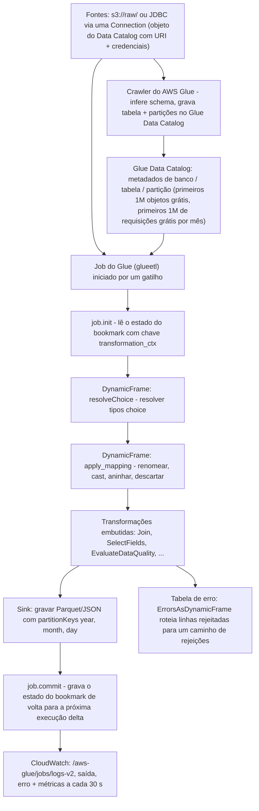
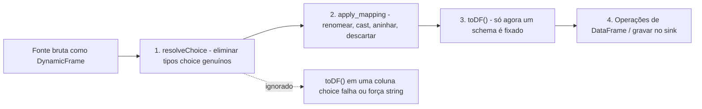
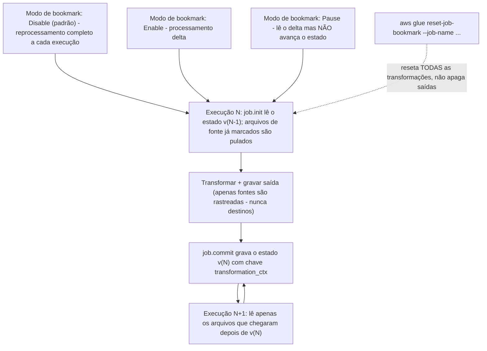
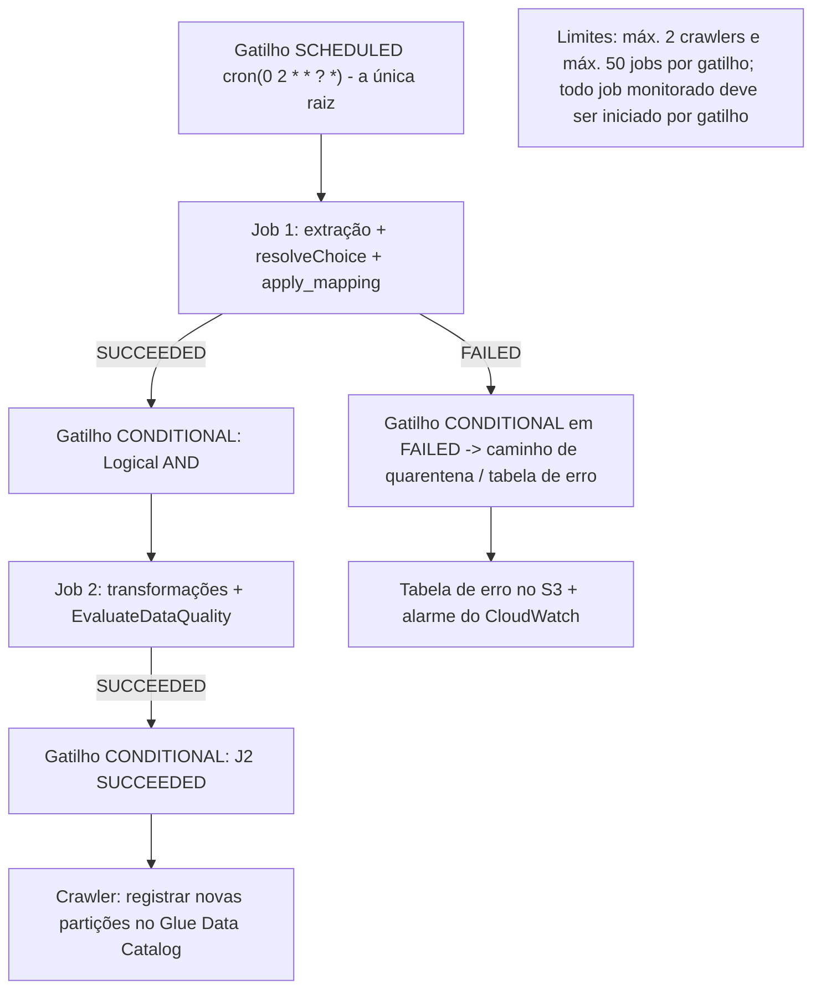
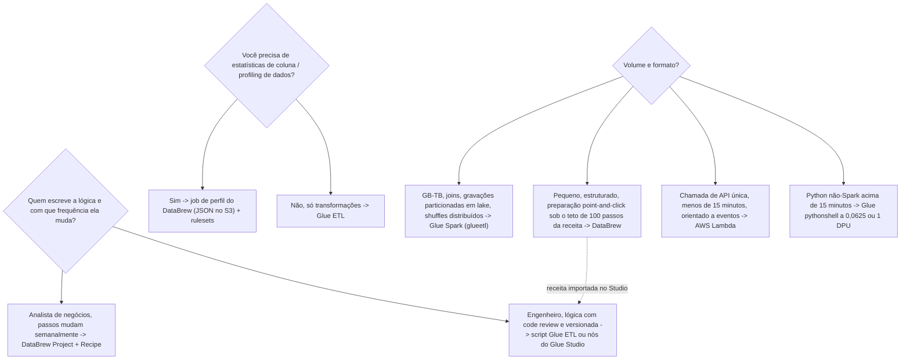

# Transformação Serverless com AWS Glue e DataBrew

Transformação é onde o julgamento de um engenheiro de dados se torna visível. Ingestão pode ser comprada como um tubo gerenciado; armazenamento pode ser alugado pelo gigabyte. Mas decidir **qual motor** roda o job, **quanta capacidade** ele ocupa enquanto roda, **quais registros** são processados na segunda execução e **para onde vão as linhas rejeitadas**; isso é trabalho de design, e é exatamente o que o Domínio 1 do DEA-C01 (Ingestão e Transformação de Dados, **34%** do exame; pesos pelo guia de exame DEA-C01, acesso em outubro de 2026) examina por meio das declarações de tarefa *"preparando dados para transformação (AWS Glue DataBrew)"*, *"usando recursos do AWS Glue para processar dados"* e *"usando Lambda para automatizar o processamento de dados"*.

```text
====================================================================
 A SUPERFÍCIE DE DECISÃO DA TRANSFORMAÇÃO (DEA-C01 DOMÍNIO 1)
====================================================================
  Motor ............... AWS Glue Spark (ETL serverless)
                        AWS Glue Python shell (processo único)
                        AWS Glue streaming (Spark Structured Streaming)
                        AWS Glue Ray (workers Z.2X)
                        AWS Glue DataBrew (receitas sem código + profiling)
                        AWS Lambda (micro-transformações de menos de 15 min)
  Representação ........ DynamicFrame (autodescritivo, tipos choice)
                        vs DataFrame (schema deve ser resolvido)
  Incrementalidade ..... job bookmarks (lote) / checkpoints + watermarks
                        (streaming)
  Orquestração ......... gatilhos: agendado | condicional | sob demanda
                        | evento (EventBridge)
  Capacidade ........... tipos de worker G./R./Z. + NumberOfWorkers,
                        cobrados em DPU-horas (1 DPU = 4 vCPU + 16 GB)
  Design de falha ....... tabelas de erro, Spigot, EvaluateDataQuality,
                        novas tentativas, timeouts, job run insights
====================================================================
```

Nesta lição você vai:

- modelar o **job serverless do Glue**: tipos de jobs, anatomia, integração com o Data Catalog, estados de execução e timeouts;
- separar **DynamicFrame** de **DataFrame** e conduzir `resolveChoice` → `apply_mapping` → `toDF()` na ordem certa;
- operar **job bookmarks**: Enable / Disable / Pause, `job.init` e `job.commit`, `transformation_ctx` como chave de estado, e as cinco maneiras de quebrá-los;
- ligar **gatilhos** em topologias serial, condicional e agendada, e conhecer os dois limites duros de gatilho;
- dimensionar **workers e DPU-horas** na lista de preços de outubro de 2026, incluindo a armadilha de memória G vs R e o mínimo de 10 minutos do crawler;
- criar com **ETL visual do Glue Studio**: nós, notebooks, a sessão de pré-visualização de dados e os limites de importação do nó Recipe;
- escolher o **DataBrew** corretamente: seus seis objetos centrais, o teto de 100 passos da receita, receita vs jobs de perfil, e sua medição sem DPU;
- projetar **tratamento de erros**: `ErrorsAsDynamicFrame`, `Spigot`, `EvaluateDataQuality`, novas tentativas, padrões de timeout e onde vivem as tabelas de erro;
- ajustar **desempenho**: gravações particionadas, job run insights, agrupamento de arquivos de entrada, aritmética de arquivos pequenos e auto scaling do Glue;
- estudar **quatro estudos de caso de clientes da AWS** (BMW Group, PayU, Integral Ad Science e Nasdaq) e uma **caixa de atualizações de outubro de 2026 com fonte**;
- praticar com **14 questões no estilo de exame** mais quatro verificações interativas.

---

## 1. Fundamentos do Glue ETL: um motor Spark serverless com um catálogo anexado

### 1.1 O que "serverless" significa aqui

O AWS Glue é um serviço de ETL **serverless**: você define um job, a AWS provisiona e desmonta o ambiente de execução Spark (ou shell), e você **paga apenas enquanto o job roda**, cobrado por segundo (jobs e sessões interativas são cobrados em incrementos de 1 segundo, arredondados para cima, com **mínimo de 1 minuto** para jobs Spark: preços do AWS Glue, acesso em outubro de 2026). Não há cluster para manter quente, AMI para atualizar nem nó para aposentar. O Data Catalog que os crawlers preenchem é a cola entre armazenamento e computação: **os schemas vivem no catálogo, os dados vivem no S3 (ou fontes JDBC), e os jobs leem os dois**.

### 1.2 Tipos de jobs e linguagens

| Tipo de job | `JobCommand.Name` | Runtime | Cobrado como | Encaixe no exame |
|---|---|---|---|---|
| Spark ETL | `glueetl` | PySpark / Scala no Spark | DPU-hora (mín. 1 min) | Transformações em massa de GB: TB, joins, gravações particionadas em lake |
| Spark streaming | `gluestreaming` | Spark Structured Streaming | DPU-hora (**2 DPU** padrão) | Micro-batch contínuo de fontes Kinesis/Kafka |
| Python shell | `pythonshell` | Python 3.9 em processo único (Glue 3.0+) | DPU-hora a **0,0625 ou 1 DPU** | Trabalho não-Spark > 15 minutos: pulls de API, movimentação de arquivos, SQL leve |
| Ray | `ray` (worker `Z.2X`) | Ray sobre Python | **M-DPU-hora** | Cargas de trabalho Python paralelas (por exemplo, estilo Pandas) |

Rotas de autoria: **scripts PySpark/Scala**, **Python (shell ou Ray)**, **autoria visual no Glue Studio** e **notebooks interativos** (Pandas no Spark, SQL no Spark). Um **job** do Glue é montado a partir de: o comando, tipo e contagem de workers, uma **role de IAM**, **connections** opcionais, uma **security configuration** opcional, **gatilhos**, um **timeout**, **novas tentativas**, argumentos padrão e `MaxConcurrentRuns`.

> [!NOTE]
> `MaxConcurrentRuns` tem padrão **1**, e a API de jobs da AWS afirma explicitamente: *"O padrão é 1. Um erro é retornado quando este limite é atingido."* Esse padrão também é sua primeira linha de defesa para os **job bookmarks**, que não são seguros para concorrência (Seção 3).

### 1.3 Estados de execução, timeouts e histórico

| Item | Valor (API do AWS Glue, acesso em outubro de 2026) |
|---|---|
| Estados de execução | `STARTING` `RUNNING` `STOPPING` `STOPPED` `SUCCEEDED` `FAILED` `TIMEOUT` `ERROR` `WAITING` `EXPIRED` |
| `WAITING` | a execução está **na fila**: capacidade ou posição de gatilho, não uma falha |
| Padrão de timeout | **2.880 minutos** no Glue 4.0 e anteriores · **480 minutos** no Glue 5.0 e posteriores |
| Teto de timeout | deve ser **menor que 7 dias (10.080 minutos)** |
| Novas tentativas | `MaxRetries`; `NotifyDelayAfter` levanta um alerta quando uma execução é atrasada |
| Histórico de execuções | retido por **90 dias** |

### 1.4 Anatomia do job e integração com o Data Catalog



Duas propriedades desse diagrama são examináveis:

1. **O catálogo é metadado, não armazenamento.** Os crawlers são cobrados separadamente dos jobs (Seção 5), e um job pode rodar com ou sem um crawler na mesma cadeia de gatilhos.
2. **O estado do bookmark vive fora do script.** `job.init` o lê, `job.commit` o grava, e nenhuma das duas chamadas é opcional se você habilitou os bookmarks (Seção 3).

- **📚 Você sabia?** O Glue registra cada execução com seu estado e mantém o histórico de **90 dias**, e `WAITING` simplesmente significa *na fila*. Combinado com `MaxConcurrentRuns` no padrão **1**, uma execução que parece "presa" em `WAITING` está te contando sobre capacidade ou posição de gatilho: não sobre seu código (API de job-runs do AWS Glue, acesso em outubro de 2026).

---

## 2. DynamicFrame versus DataFrame: o conceito do Glue mais testado

### 2.1 As duas representações

| Propriedade | **DataFrame** (Spark) | **DynamicFrame** (Glue) |
|---|---|---|
| Requisito de schema | O schema **deve ser resolvido** antes da maioria das operações | *"Cada registro é autodescritivo, então nenhum schema é necessário inicialmente"* (guia do desenvolvedor do AWS Glue, acesso em outubro de 2026) |
| Valores ambíguos | Alarga para o tipo mais geral (geralmente `string`) ou falha | Carrega um **tipo `choice` genuíno**, por exemplo `choice<long,string>`, quando as linhas discordam |
| Erros em nível de linha | Falha ou converte silenciosamente | Preservados como **linhas de erro** (`ErrorsAsDynamicFrame`) |
| API de transformação | Métodos do DataFrame | Transformações do Glue: `resolveChoice`, `apply_mapping`, `Relationalize`, `Join`, `Spigot`, `EvaluateDataQuality`, … |
| Conversão |: | `toDF()` apenas **depois** que os choices forem resolvidos |

### 2.2 Por que tipos choice aparecem: a armadilha da amostragem do crawler

A própria amostra da AWS (dados de provedores do Medicaid) é a ilustração canônica: um crawler que inspecionou apenas um **prefixo de 2 MB** inferiu a coluna provider-id como `long`. Um DataFrame construído sobre todo o conjunto de dados encontrou valores que a amostra nunca viu e forçou tudo para `string`. Um DynamicFrame reportou corretamente **`choice<long,string>`**: as linhas genuinamente discordavam. O bug está na **amostra de inferência de schema**, não nos dados, e a correção pertence ao script.

### 2.3 `resolveChoice`: resolver a ambiguidade

`resolveChoice(specs=…, choice=…, database=…, table_name=…)` oferece quatro ações para uma coluna `choice` (referência da API da AWS, acesso em outubro de 2026):

| Ação | O que faz | Efeito colateral que você deve prever |
|---|---|---|
| `cast:TYPE` | Converte cada valor para `TYPE` | Valores que não convertem viram **`null`** |
| `project:TYPE` | Mantém **apenas** os valores já do tipo `TYPE` | Os valores do outro tipo são **descartados** |
| `make_cols` | Uma coluna por tipo: `col_long`, `col_string` | O schema alarga para colunas irmãs |
| `make_struct` | Aninha ambos em um struct | O código a jusante deve ler campos do struct |
| `MATCH_CATALOG` (via `database` + `table_name`) | Alinha ao tipo declarado no catálogo | Exige uma tabela no catálogo |

```text
choice<long,string>  --cast:long-->     long        (não conversível -> null)
                  --project:long-->   long        (strings descartadas)
                  --make_cols-->      provider_id_long + provider_id_string
                  --make_struct-->    {c_long, c_string}
```

### 2.4 `apply_mapping`: renomear, cast, aninhar, descartar

`apply_mapping(mappings, case_sensitive=False, …)` recebe uma lista de **quadruplas**:

```text
(coluna_origem, tipo_origem, coluna_destino, tipo_destino)
("provider id", "string",      "provider.id", "string")   # destino pontilhado aninha
("zip",         "string",      "zip",         "bigint")   # cast no lugar
("legacy_col",  "string",      "",            "")         # destino vazio -> descarta
```

Regras que custam pontos no exame: use crase num nome de **origem** que contenha um ponto literal; um **destino** pontilhado cria um campo aninhado (`provider.id`); e `case_sensitive` tem padrão **`False`**.

### 2.5 A ordem não é negociável



> [!IMPORTANT]
> ⚠️ **`resolveChoice` antes de `apply_mapping` antes de `toDF()`.** `apply_mapping` assume um tipo por coluna já resolvido; converter para DataFrame com um `choice` não resolvido força a coluna para um tipo geral (geralmente `string`) e derrota silenciosamente o cast que você faria. A ordem é a diferença entre uma chave `bigint` limpa e uma tabela de strings preenchidas.

### 2.6 Exemplo resolvido E1: IDs de provedor ambíguos

```text
Entrada: 160.000 linhas, coluna "provider id"
         crawler (amostra de 2 MB) diz long | 2 linhas dizem string | DynamicFrame diz choice<long,string>

Passo 1  resolveChoice([('provider id', 'cast:long')])
         -> coluna é long; os 2 valores não conversíveis viram null
Passo 2  apply_mapping([('provider id','long','provider.id','long'),
                        ('name','string','name','string'),
                        ('legacy_flag','string','','')])     # aninhar + descartar
Passo 3  toDF()  -> schema agora fixado e tipado
Passo 4  sink.write(frame, format='parquet',
                    partitionKeys=['year','month','day'])

Leitura: cast é com perdas (nulls), project é destrutivo (descarta valores das linhas),
make_cols é aditivo, make_struct é reestruturante.
```

### 2.7 Transformações embutidas de DynamicFrame que valem ser nomeadas

`Relationalize` · `UnnestFrame` · `Map` · `FlatMap` · `Join` · `Spigot` · `ErrorsAsDynamicFrame` · `EvaluateDataQuality` · `FlagDuplicatesInColumn` · `SelectFields` · `DropFields` · `FillMissingValues` · `mergeDynamicFrame` · `FindMatches` (referência de transformações PySpark do AWS, acesso em outubro de 2026). O exame testa **reconhecimento**: qual transformação *roteia rejeições*, qual *amostra* a saída, qual *testa regras*.

```dragdrop
{
  "question": "Ordene o pipeline de DynamicFrame do Glue como a AWS o documenta:",
  "items": [
    "Ler a fonte como DynamicFrame: registros são autodescritivos, nenhum schema necessário",
    "resolveChoice: resolver tipos choice com cast, project, make_cols ou make_struct",
    "apply_mapping: renomear, cast, aninhar (destinos pontilhados) e descartar via quadruplas",
    "toDF() - converter só agora que cada coluna tem um tipo",
    "Gravar o sink, por exemplo Parquet com partitionKeys year, month, day"
  ],
  "correctOrder": [
    "Ler a fonte como DynamicFrame: registros são autodescritivos, nenhum schema necessário",
    "resolveChoice: resolver tipos choice com cast, project, make_cols ou make_struct",
    "apply_mapping: renomear, cast, aninhar (destinos pontilhados) e descartar via quadruplas",
    "toDF() - converter só agora que cada coluna tem um tipo",
    "Gravar o sink, por exemplo Parquet com partitionKeys year, month, day"
  ],
  "explanation": "DynamicFrame primeiro (registros autodescritivos mais tipos choice genuínos), depois resolveChoice para eliminar a ambiguidade, depois apply_mapping para renomear/cast/aninhar/descartar, depois toDF() quando existir um único tipo por coluna, e só então a gravação. Inverter os dois primeiros passos faz o apply_mapping aplicar cast contra um tipo ainda ambíguo; converter para DataFrame cedo força a coluna choice para um tipo geral como string e derruba todo o propósito."
}
```

---

## 3. Job bookmarks: processamento incremental em lote sem duplicatas

### 3.1 Os três modos

| Modo | Comportamento | Padrão? |
|---|---|---|
| **Enable** | Atualiza o estado do bookmark **a cada execução** e processa apenas o delta desde o último commit | Não |
| **Disable** | Processa **todo o conjunto de dados** a cada execução | **Sim** |
| **Pause** | Processa incrementalmente, mas **não** atualiza o estado | Não |

### 3.2 Como o estado é mantido

O estado do bookmark é armazenado pelo serviço do Glue como mais ou menos `{job_name, run_id, run_number, attempt_number, states: {transformation_ctx: state}}`, com chave de **nome do job mais versão**. Seu script participa com exatamente duas chamadas: **`job.init`** lê o estado no início, **`job.commit`** o grava no fim. O guia do desenvolvedor da AWS é direto: *"Bookmarks não funcionam sem chamá-los."*

E a regra-chave, literalmente da página de bookmarks da AWS:

> "O `transformation_ctx` serve como chave para buscar o estado do bookmark de uma fonte específica no seu script. Para que o bookmark funcione corretamente, você deve sempre manter a fonte e o `transformation_ctx` associado consistentes."



### 3.3 Exemplo resolvido E2: a aritmética do delta

```text
Conjunto de dados: s3://raw/orders/ com 1.000 arquivos na primeira habilitação.

Execução 1 (bookmarks acabaram de ser habilitados): 320 arquivos novos -> processados 320, estado -> 320
Execução 2:                                       410 arquivos novos -> processados 410, estado -> 730
Execução 3:                                       270 arquivos novos -> processados 270, estado -> 1.000

Arquivos processados em três execuções: 320 + 410 + 270 = 1.000
Total ingênuo de reprocessamento:        1.000 x 3       = 3.000
Sem continuidade de estado, o número errado tentador é 320+410+270 contados
contra um estado resetado, ou 2.680 se a execução 1 fosse anterior à habilitação.

Lição: bookmarks deduplicam a SAÍDA em relação às FONTES rastreadas - o
estado é a única coisa que lembra o que "já processado" significa.
```

### 3.4 Quando os bookmarks quebram (a lista favorita de falhas do exame)

| Falha | O que realmente acontece |
|---|---|
| Você muda um **caminho** de fonte mas mantém o mesmo `transformation_ctx` | O estado deixa de corresponder à realidade → **arquivos pulados ou faltando** |
| Duas execuções rodam **concorrentemente** | Commits disputam; o estado fica confiável → mantenha `MaxConcurrentRuns = 1` |
| Você espera um **rewind** | Não existe. Reset existe; rewind não |
| `reset-job-bookmark` | Reseta **todas** as transformações do job de uma vez e **não apaga as saídas** que você já gravou |
| Você assume que **destinos** são rastreados | Apenas **arquivos de fonte** são rastreados, nunca destinos |
| Você apaga o job do Glue | Seu **bookmark é apagado junto** |
| Fonte JDBC sem chave de bookmark | Você precisa **escolher as colunas-chave do bookmark** você mesmo |
| Job de streaming | Bookmarks são o mecanismo errado: streaming usa **`checkpointLocation` + watermarks** |

- **📚 Você sabia?** A própria redação da AWS para a garantia é que os bookmarks *"evitam processamento duplicado e dados duplicados"*: a frase "exactly-once" é uma sigla que o mundo do exame usa, mas o modelo honesto é **processamento at-least-once com saídas deduplicadas**, porque apenas fontes são rastreadas e uma execução com falha entre `job.init` e `job.commit` deixa o estado intocado. Nunca reivindique uma garantia do lado do destino que você não consiga apontar na estrutura de estado (guia do desenvolvedor do AWS Glue, acesso em outubro de 2026).

```fillblank
{
  "question": "Complete as afirmações sobre job bookmarks com o próprio vocabulário do guia do desenvolvedor da AWS:",
  "template": "O estado do bookmark tem como chave {{1}} mais uma versão, e a chave por fonte dentro do estado é o {{2}} da fonte. O script deve chamar {{3}} no início e {{4}} na conclusão: a AWS afirma que bookmarks não funcionam sem chamá-los. Os três modos são {{5}} (padrão, conjunto de dados inteiro), Enable (delta, estado atualizado) e Pause (delta, estado não atualizado), e o estado é resetado com o comando da CLI {{6}}.",
  "answers": {
    "1": "job_name",
    "2": "transformation_ctx",
    "3": "job.init",
    "4": "job.commit",
    "5": "Disable",
    "6": "reset-job-bookmark"
  },
  "distractors": ["run_id", "source path", "job.commit first", "job.start", "Enable", "Pause", "delete-job-bookmark", "reset-bookmark-state"],
  "explanation": "O estado vive sob job_name + version; dentro dele, transformation_ctx é a chave que a AWS manda você manter consistente com a fonte. job.init lê, job.commit grava. Disable é o modo PADRÃO, então um job que 'continua reprocessando tudo' geralmente tem bookmarks desligados, não quebrados. aws glue reset-job-bookmark --job-name ... reseta toda transformação do job e não limpa saída alguma."
}
```

---

## 4. Gatilhos: topologias serial, condicional e agendada

### 4.1 Os quatro tipos de gatilho

| `Type` da API | Nome no console | Dispara quando |
|---|---|---|
| `SCHEDULED` | **Scheduled** | Uma expressão **cron** expira |
| `CONDITIONAL` | **Conditional** | Uma lista de predicados de jobs/crawlers monitorados atinge os status requeridos, unidos por `Logical` **AND** / **OR** |
| `ON_DEMAND` | **On-demand** | Você o ativa (API/console/CLI) |
| `EVENT` | (nível de API) | Um evento do **EventBridge**, com `EventBatchingCondition {BatchSize, BatchWindow}` |

### 4.2 As regras que fazem gatilhos condicionais funcionarem

1. Os jobs monitorados devem **terem sido iniciados por um gatilho**. Um job que você começou à mão e que depois terminou com sucesso **não disparará** um gatilho condicional.
2. A cadeia deve descer de um gatilho raiz **único, agendado ou sob demanda**.
3. Limites: **no máximo 2 crawlers por gatilho**; **no máximo 50 jobs por gatilho** (cotas do AWS Glue, acesso em outubro de 2026).



**Serial vs paralelo em uma linha cada:** serial = `J3` dispara quando `J1` **AND** `J2` ambos `SUCCEEDED`; fan-out = `J4` dispara quando `J1` **OR** `J2` `FAILED`. Essa é toda a gramática de gatilho condicional: mais a regra do gatilho raiz, onde vivem a maioria dos erros dos candidatos.

---

## 5. Tipos de worker e dimensionamento de DPU: de onde vem a conta

### 5.1 A unidade

**1 DPU = 4 vCPU e 16 GB de memória**, e a AWS afirma que *"uma única DPU também é chamada de worker."* Jobs no Glue 2.0 e posteriores são dimensionados com **`WorkerType` + `NumberOfWorkers`**: nunca com `MaxCapacity` (esse campo legado pertence ao Glue 1.0 e anteriores; definir ambos é erro). Padrões: jobs Spark **10 DPU**, streaming **2 DPU**, ambos com **mínimo de 2 DPU**.

### 5.2 Catálogo de workers (em outubro de 2026)

| Worker | DPU por worker | vCPU | Memória | Disco (livre) | Restrição |
|---|---|---|---|---|---|
| **G.1X** | 1 | 4 | 16 GB | 94 GB (44 GB livres) | Todo Spark; **padrão para Glue ≥2.0** |
| **G.2X** | 2 | 8 | 32 GB | 138 GB (78 GB livres) | Recomendado para **transformações de ML** |
| **G.4X** | 4 | 16 | 64 GB | 256 GB (230 GB livres) | **Glue ≥3.0** (Regiões limitadas) |
| **G.8X** | 8 | 32 | 128 GB | 512 GB (485 GB livres) | **Glue ≥3.0** (Regiões limitadas) |
| **G.12X** | 12 | 48 | 192 GB | 768 GB (741 GB livres) | **Glue ≥4.0** |
| **G.16X** | 16 | 64 | 256 GB | 1024 GB (996 GB livres) | **Glue ≥4.0** |
| **G.025X** | 0,25 | 2 | 4 GB | 84 GB (34 GB livres) | **Apenas streaming**, ≥3.0 |
| **R.1X / R.2X / R.4X / R.8X** | 1 / 2 / 4 / 8 **M-DPU** | 4 / 8 / 16 / 32 | **32 / 64 / 128 / 256 GB** | igual aos pares G | **Otimizado para memória** (≥4.0) |
| **Z.2X** | 2 M-DPU | 8 | 64 GB | 128 GB (~120 GB livres) | **Apenas Ray**, até 8 workers Ray |

**M-DPU** significa *"dobrar a alocação de memória para um determinado tamanho em comparação com DPUs padrão."*

> [!IMPORTANT]
> ⚠️ **A família G não compra memória por CPU.** Todo worker G mantém a razão **4 vCPU: 16 GB**; apenas a família **R.** dobra essa razão (**4 vCPU: 32 GB**). Mover de G.1X para G.4X, portanto, **não** conserta uma falha por falta de memória: apenas dá a mesma razão quatro vezes mais rápido e quatro vezes mais largo. OOM → **R.**; shuffle/desbalanceamento → mais workers; trabalho single-thread genuinamente lento → worker maior.

### 5.3 A tabela de preços de outubro de 2026

Linha de base **us-east-1 (N. Virginia)**; todo número **em outubro de 2026** (taxas do Glue 6.0 anunciadas em 2026-08-21):

| Medidor | Glue ≤5.1 | Glue ≥6.0 | Mínimo de cobrança |
|---|---|---|---|
| Job Spark / Spark Streaming | **$0,44 / DPU-hora** | **$0,308 / DPU-hora** | 1 segundo, arredondado para cima; mínimo de **1 minuto** |
| Flex execution (G.1X/G.2X, ≥3.0) | **$0,29 / DPU-hora** | ver página de preços ao vivo | 1 minuto; atraso/interrupção de início possível |
| Workers otimizados para memória **R** (≥4.0) | **$0,52 / DPU-hora** | ver página de preços ao vivo | 1 minuto |
| Sessão interativa / notebook do Studio | **$0,44 / DPU-hora** | **$0,308 / DPU-hora** | 1 minuto; **5 DPU** padrão, mínimo de **2 DPU** |
| Python shell (0,0625 ou 1 DPU) | **$0,44 / DPU-hora** |: | 1 minuto |
| Ray | **$0,44 / M-DPU-hora** |: | 1 minuto |
| **Crawler do Data Catalog** | **$0,44 / DPU-hora** |: | **mínimo de 10 minutos por execução** |
| Data Quality avaliado em um job de ETL | **$0,44 / DPU-hora** | **$0,308 / DPU-hora** | 1 minuto |
| Job de receita/perfil do **DataBrew** | **$0,48 / node-hora** |: | por nó |
| Sessão interativa do **DataBrew** | **$1,00 / bloco de 30 minutos** |: | contado a partir da primeira interação |

Os quatro medidores baseados em DPU dessa tabela como um gráfico interativo (mesmas unidades, então são legitimamente comparáveis, o medidor de node-hora do DataBrew é deliberadamente **não plotado**, porque é uma unidade diferente):

```plot
{
  "type": "bar",
  "title": "USD por DPU-hora (us-east-1, em outubro de 2026)",
  "data": [
    {"meter": "Glue <=5.1 standard", "usd": 0.44},
    {"meter": "Glue >=6.0 standard", "usd": 0.308},
    {"meter": "Flex (G.1X/G.2X, <=5.1)", "usd": 0.29},
    {"meter": "R memory-optimized (<=5.1)", "usd": 0.52}
  ],
  "xKey": "meter",
  "yKey": "usd",
  "xLabel": "Medidor",
  "yLabel": "USD por DPU-hora"
}
```

Lendo o gráfico: custo total = DPU × horas × altura da barra. A barra do 6.0 é ~30% menor que a do 5.1 (o corte de preço de 2026-08-21), o Flex compra ~34% de desconto em troca de um possível início atrasado ou interrupção, e a barra do R é o prêmio por memória dobrada por DPU.

### 5.4 Exemplo resolvido E3: a própria aritmética de DPU-hora da AWS

```text
Job: 6 DPU (por exemplo 6 x G.1X) rodando 15 minutos no Glue <= 5.1
Custo = 6 DPU x 0,25 h x $0,44 / DPU-h = $0,66 por execução      (em outubro de 2026)

Mesmo job no Glue 6.0:
Custo = 6 x 0,25 x $0,308               = $0,462 por execução
Economia por execução                    = $0,66 - $0,462 = $0,198  (~30%)
30 execuções por mês                     = 30 x $0,198    = $5,94 por mês

Fonte: exemplo resolvido da página de preços do AWS Glue ("6 DPU * 0.25 hour * $0.44,
or $0.66"), em outubro de 2026; taxa do 6.0 do anúncio de 2026-08-21.
```

### 5.5 Exemplo resolvido E4: Flex versus padrão

```text
Job: 6 DPU x 1/3 hora (em outubro de 2026)
Padrão: 6 x 0,3333 x $0,44 = $0,88
Flex:   6 x 0,3333 x $0,29 = $0,58      (o próprio exemplo resolvido da AWS)

O Flex compra ~34% de desconto aceitando um possível início atrasado e interrupção.
Nunca use Flex para trabalho com SLA; ele existe para jobs interrompíveis e tolerantes a falhas.
```

### 5.6 Exemplo resolvido E5: a escolha do worker não muda nada no preço

```text
Capacidade alvo: 16 DPU  (em outubro de 2026, $0,44/DPU-h no Glue <= 5.1)

16 x G.1X  = 16 workers x 1 DPU = 16 DPU -> 16 x $0,44 = $7,04 / hora
 8 x G.2X  =  8 x 2             = 16 DPU -> 16 x $0,44 = $7,04 / hora
 4 x G.4X  =  4 x 4             = 16 DPU -> 16 x $0,44 = $7,04 / hora
 2 x G.8X  =  2 x 8             = 16 DPU -> 16 x $0,44 = $7,04 / hora

Custo idêntico, formatos diferentes: 16 executores no G.1X vs 2 no G.8X,
16 GB vs 128 GB por worker. Escolha por paralelismo e memória por executor,
nunca por preço - a DPU é a unidade medida.
```

### 5.7 Exemplo resolvido E6, o mínimo de 10 minutos do crawler

```text
Crawler roda de hora em hora, 2 DPU, o trabalho real leva 3 minutos (em outubro de 2026).

Cobrado por execução: 2 DPU x (10/60) h x $0,44 = $0,147     <- mínimo de 10 min
Execuções em um mês de 30 dias: 24 x 30 = 720
Mensal: 720 x $0,147 = $105,60
Com duração real de 3 minutos: 720 x (2 x 0,05 x $0,44) = $31,68
Prêmio oculto do mínimo: $105,60 - $31,68 = $73,92 / mês

Movimento no exame: rastrear por evento (gatilho condicional depois do SUCCEEDED
do job) em vez de de hora em hora, ou agrupar a descoberta de partições,
antes de otimizar DPU.
```

### 5.8 Auto scaling e o `MaxCapacity` legado

Para Glue **3.0 e posteriores**, o auto scaling é habilitado com `--enable-auto-scaling=true` nas famílias de worker **G.1X…G.16X** e **R.1X…R.8X** (`G.025X` para streaming); o worker **Standard** não o suporta. Com auto scaling ligado, `NumberOfWorkers` é tratado como o **máximo**, e jobs em lote no Glue 4.0+ podem ser revisados com a métrica do CloudWatch **`DPUSeconds`**. Os preços do Data Catalog acrescentam seu próprio medidor: **os primeiros 1.000.000 de objetos e 1.000.000 de requisições são grátis por mês**, depois **$1,00 por 100.000 objetos** além do nível gratuito e **$1,00 por milhão de requisições** além dele (em outubro de 2026).

- **📚 Você sabia?** Um **job** do DataBrew não é precificado em DPU-horas de modo algum: é **$0,48 por node-hora** com **padrão de 5 nós**, e uma sessão interativa do DataBrew é **$1,00 por bloco de 30 minutos**: três interações separadas dentro de 75 minutos são cobradas como **três blocos = $3,00** (preços do AWS Glue/DataBrew, em outubro de 2026). Misturar os dois medidores é uma armadilha clássica de estimativa de custo.

---

## 6. Glue Studio: ETL visual sobre o mesmo motor

### 6.1 O que a camada visual realmente é

O Glue Studio permite **criar, executar e monitorar** jobs do Glue no motor Spark serverless *"sem precisar aprender Spark ou escrever código."* Cada **nó** no canvas é uma ação, uma origem, uma transformação ou um destino, e o Studio **gera um script PySpark** a partir do schema de origem mais a localização e o schema de destino. O script é real e editável no modo desenvolvedor; o grafo visual e o código são duas vistas do mesmo job.

| Modo de autoria | O que você obtém |
|---|---|
| **ETL visual** | Canvas de nós de origem/transformação/destino; script gerado |
| **Notebook interativo** | Células **Pandas** sobre Spark ou **SQL** contra uma sessão interativa |
| **Editor de script** | PySpark/Scala escrito à mão |

### 6.2 Sessões, pré-visualizações e monitoramento

- **Sessão de pré-visualização de dados**: **2 DPUs por até 30 minutos**, **parada automática**, cobrada na taxa padrão de DPU (em outubro de 2026).
- **Monitoramento**: a página de Jobs e detalhes da execução, mais o **painel de monitoramento de execuções de jobs** com blocos para taxa de sucesso e uso estimado de DPU, links para o CloudWatch, o Spark History Server e os job run insights.
- **Logs**: `/aws-glue/jobs/logs-v2` (logging contínuo), `/aws-glue/jobs/output`, `/aws-glue/jobs/error`; as métricas do CloudWatch chegam **a cada 30 segundos** como deltas.

### 6.3 O nó Data Preparation Recipe: DataBrew dentro do Studio

Você pode autuar um passo de receita embutido no Studio ou **importar uma receita publicada do DataBrew** em um **nó Data Preparation Recipe**, sujeito a limites rígidos (docs do AWS Glue Studio, acesso em outubro de 2026):

| Regra | Valor |
|---|---|
| Versão mínima do Glue | **4.0** (versão do Python definida automaticamente) |
| **Não importável** | `GROUP_BY`, `PIVOT`, `UNPIVOT`, `TRANSPOSE`: use nós dedicados do Studio |
| Não suportado se a receita contiver | `UNION` ou `JOIN`: use os nós Join/Union do Studio |
| Requisito de Região | apenas Regiões comerciais do DataBrew |

Essa ponte é a razão de DataBrew e Glue Studio estarem no exame **juntos**: uma receita autuada por um analista vira um passo governado dentro de um job agendado de um engenheiro, que então ganha bookmarks, novas tentativas e auto scaling que nunca teve como um job autônomo do DataBrew.

---

## 7. AWS Glue DataBrew: preparação e profiling sem código

### 7.1 Seis objetos centrais, e o nome que não existe

O AWS Prescriptive Guidance lista exatamente **seis** conceitos centrais (acesso em outubro de 2026):

| Objeto | Papel |
|---|---|
| **Project** | O espaço de trabalho onde um dataset e uma receita se encontram |
| **Dataset** | Uma referência **somente leitura** a uma origem (S3, tabelas do catálogo do Glue, …) |
| **Recipe** | Uma lista **ordenada** de passos de transformação com expressões de condição opcionais |
| **Job** | Um **job de receita** (aplicar uma versão de receita) ou um **job de perfil** (calcular estatísticas) |
| **Data lineage** | Registro do que a receita fez com os dados |
| **Data profile** | A saída estatística de um job de perfil (JSON no S3) |

> [!WARNING]
> ⚠️ **Não existe objeto do DataBrew chamado "data flow".** Os seis objetos acima são o vocabulário completo; um "flow" é linguagem solta para um grafo visual do **Glue Studio** ou para a própria receita. Uma opção de exame pedindo para você "criar um data flow do DataBrew" está testando se você conhece os nomes reais dos objetos.

### 7.2 Receitas: limitadas, versionadas, point-and-click

- Uma receita é uma lista ordenada de objetos `RecipeAction` (`Action.Operation` + `Parameters` + `ConditionExpressions` opcionais).
- **Máximo de 100 transformações por receita**; **máximo de 100 versões publicadas por receita** (cotas da AWS, acesso em outubro de 2026).
- Escala da biblioteca: **mais de 250 transformações point-and-click** (página do produto) / **mais de 200 ações de receita** (guia do desenvolvedor).
- Operações relevantes para o exame: `SPLIT`, `GROUP_BY`, `REPLACE_TEXT`, `REMOVE_VALUES`, `CHANGE_DATA_TYPE`, `PIVOT`, `UNPIVOT`, `TRANSPOSE`, `NEST`, `UNNEST` e *Remover duplicatas*.

### 7.3 Jobs, agendamentos e rulesets de qualidade de dados

| Controle | Valor (em outubro de 2026) |
|---|---|
| Saída do job de receita | Amazon S3 · Glue Data Catalog · Amazon Redshift |
| Saída do job de perfil | Avaliação estatística como **JSON no S3** |
| Sintaxe de agendamento | **Cron de seis campos**; dia-do-mês e dia-da-semana são mutuamente exclusivos (`?`) |
| Intervalo mínimo de agendamento | **Expressões cron mais rápidas que 5 minutos não são suportadas** |
| Rulesets | **100 regras por ruleset**, **10 rulesets por dataset**, **100 rulesets por conta** |
| Cotas de conta | 10 jobs simultâneos · **300 nós por conta** · 100 jobs · 100 datasets · 100 projetos · 10 projetos abertos · 500 receitas · 10 agendamentos |

### 7.4 Exemplo resolvido E7: precificando um pipeline do DataBrew

```text
Job de receita: 5 nós (o padrão), roda 10 minutos   (em outubro de 2026)
Custo = 5 nós x (10/60) h x $0,48 / node-hora = $0,40 por execução

Dia interativo do analista: 3 sessões dentro de 75 minutos
Custo = 3 x $1,00 / bloco de 30 min = $3,00

Job de receita agendado de hora em hora por um mês (pior caso, 720 execuções):
720 x $0,40 = $288,00  vs o mesmo job como Glue ETL apenas se um job Spark
for genuinamente necessário - os medidores NÃO são intercambiáveis.
```

### 7.5 Quando escolher DataBrew, quando escolher Glue



| Dimensão | **DataBrew** | **Glue ETL (Spark)** |
|---|---|---|
| Código | **Nenhum**: point-and-click | PySpark/Scala (ou gerado pelo Studio) |
| Melhor para | Preparação, limpeza, profiling, autosserviço do analista | Transformações em massa, joins, processamento distribuído |
| Medidor | **$0,48 / node-hora** + **$1,00 / sessão de 30 min** | **DPU-hora** |
| Bookmarks / novas tentativas / auto scaling | Somente depois que uma receita é **importada no Glue Studio** | Nativo |
| Teto rígido | **100** transformações por receita | Tamanho do script, não passos |
| Qualidade de dados | Rulesets em datasets, rodando dentro de jobs | Nó/transformação `EvaluateDataQuality` |

- **📚 Você sabia?** A AWS afirma que o DataBrew pode reduzir o tempo de preparação de dados em **até 80%** em comparação com trabalho de preparação sob medida (página do produto AWS Glue DataBrew, acesso em outubro de 2026): uma afirmação voltada ao cliente, não uma garantia, e o fato examinável é o *mecanismo* (project → dataset → recipe → job de receita/perfil), não a porcentagem.

```matching
{
  "question": "Associe cada objeto do AWS Glue DataBrew ao que ele realmente é:",
  "pairs": [
    {"left": "Project", "right": "O espaço de trabalho onde um dataset e uma receita são reunidos para preparação interativa"},
    {"left": "Dataset", "right": "Uma referência somente leitura a uma origem como um prefixo do S3 ou uma tabela do catálogo do Glue"},
    {"left": "Recipe", "right": "Uma lista ordenada de transformações com expressões de condição opcionais, limitada a 100 passos"},
    {"left": "Recipe job", "right": "Aplica uma versão publicada de receita e grava resultados no S3, Glue Data Catalog ou Redshift"},
    {"left": "Profile job", "right": "Calcula estatísticas de coluna e grava um data profile como JSON no S3"},
    {"left": "Data lineage", "right": "O histórico registrado do que os passos de preparação fizeram com os dados"}
  ],
  "explanation": "Esses seis objetos são o vocabulário central completo da AWS para o DataBrew: não existe objeto 'data flow', e é por isso que essa redação aparece apenas como distrator. Note também que o DataBrew não tem medidor de DPU: jobs cobram $0,48 por node-hora com padrão de 5 nós, sessões cobram $1,00 por bloco de 30 minutos, uma receita tem teto de 100 transformações e 100 versões publicadas, e agendamentos cron não podem rodar mais rápido que a cada 5 minutos (tudo em outubro de 2026)."
}
```

---

## 8. Tratamento de erros: linhas rejeitadas, novas tentativas e para onde vão as falhas

### 8.1 Os três padrões dentro do script

| Padrão | Mecanismo | Use quando |
|---|---|---|
| **Tabela de erro** | `ErrorsAsDynamicFrame` (ou `errorsFromDF`) roteia registros rejeitados para um **DynamicFrame separado** em vez de falhar a execução | Violações de schema devem ser *capturadas*, não fatais |
| **Spigot** | Desvia uma **amostra** de registros para um caminho de rejeições | Você quer um canário, não toda rejeição |
| **EvaluateDataQuality** | Avaliação de regras (Studio: nó "Data quality rules") que pode **falhar ou desviar** na violação | As regras são declarativas e auditáveis |

O frame rejeitado é então gravado em seu próprio prefixo: essa é a **tabela de erro** que o exame quer dizer: linhas ruins caem em `s3://…/errors/`, linhas boas caem no sink particionado, e um gatilho condicional a jusante ou uma consulta do analista pode ler cada uma independentemente.

> [!WARNING]
> ⚠️ **Não existe recurso do Glue chamado "ErrorCDC."** Uma busca no guia do desenvolvedor do Glue, referência da API e notas de versão (verificado em outubro de 2026) não retorna nada sob esse nome. Os mecanismos reais são `ErrorsAsDynamicFrame`, `errorsFromDF`, `Spigot` e `EvaluateDataQuality`: se uma opção usa um nome que você nunca viu na documentação, trate-a como distrator e escolha o mecanismo documentado.

### 8.2 Novas tentativas, timeouts e estados de execução

```text
Escada de falha de job (API de job-runs do AWS Glue):
  falha transitória -> MaxRetries (configurado no job) -> nova tentativa
  fila longa        -> estado WAITING (na fila, não falhou)
  NotifyDelayAfter  -> alerta levantado enquanto a execução é atrasada
  acima do limite   -> estado TIMEOUT   (padrão 480 min no Glue >= 5.0,
                                         padrão 2.880 min no Glue <= 4.0,
                                         teto rígido < 10.080 min = 7 dias)
  erro não tratado  -> estado FAILED ou ERROR; histórico retido por 90 dias
```

### 8.3 Exemplo resolvido E8: a armadilha do padrão de timeout

```text
Um pipeline foi projetado em 2024 no Glue 4.0, onde um Timeout em branco
tem padrão de 2.880 minutos (48 horas). A equipe atualiza para Glue 5.1/6.0
e deixa o Timeout em branco -> o padrão agora é 480 minutos (8 horas).

Tempo de execução do job: 60 horas = 3.600 minutos
Resultado: estado TIMEOUT aos 480 minutos, muito antes da conclusão.

Correção: defina um timeout explícito (sempre < 10.080 minutos) e trate o
padrão como dependente da versão, não como uma constante. (Padrões em outubro de 2026.)
```

### 8.4 Security configuration: quatro planos, uma regra de precedência

Uma **security configuration** é um conjunto nomeado que pode ser anexado a um **job, crawler ou development endpoint**, cobrindo quatro planos: **dados no S3** (SSE-S3 ou SSE-KMS), **CloudWatch Logs** (SSE-KMS), **job bookmarks** (**CSE-KMS**: lado do cliente) e **ativos de qualidade de dados**. Três regras que valem decorar:

1. *"Atualmente, uma security configuration sobrepõe qualquer configuração de criptografia do lado do servidor (SSE-S3) passada como parâmetro de um job de ETL."*
2. Apenas chaves KMS **simétricas** são suportadas, e security configurations **não são suportadas para jobs Ray**.
3. A role do job precisa de permissões de KMS mais `logs:AssociateKmsKey`. A criptografia do **catálogo** é uma configuração separada, **em nível de conta** (`CatalogEncryptionMode`: `DISABLED`, `SSE-KMS`, `SSE-KMS-WITH-SERVICE-ROLE`).

---

## 9. Desempenho: insights, partições e o imposto dos arquivos pequenos

### 9.1 Job run insights, o caminho mais rápido até a causa raiz

Disponível no Glue **2.0 e posteriores**, opt-in pela caixa de seleção do Studio **"Generate job insights"** ou `--enable-job-insights=true`. Quando habilitado, uma execução com falha reporta (docs do AWS Glue, acesso em outubro de 2026):

- a **linha do script que falhou**,
- a **última ação do Spark**,
- o **fluxo de exceções** em ordem cronológica, e
- uma **causa raiz com uma ação recomendada**.

Compare isso com a falha seca `An error occurred while calling o111.collectToPython`: um é um diagnóstico, o outro é um sintoma. Os insights caem no mesmo grupo de logs `/aws-glue/jobs/logs-v2` que você já envia ao CloudWatch.

### 9.2 Gravações particionadas e pushdown

Grave as chaves de partição com o sink (`partitionKeys = ["year","month","day"]`) para que os leitores a jusante toquem apenas nas partições que uma consulta nomeia. O particionamento é uma **decisão de tempo de gravação** que você não consegue retrofitar de barato em um prefixo plano, é por isso que o sink pertence à conversa de design, não ao sprint de limpeza. Saídas conscientes de partições também são o que torna os crawlers baratos de rodar: o crawler registra **partições**, e uma tabela particionada é o que permite a um motor pular arquivos que ele jamais lerá.

### 9.3 Exemplo resolvido E9: aritmética de arquivos pequenos

```text
Ingestão: 1 TB por ano de eventos brutos, particionado ano/mês/dia,
          128 arquivos de saída por partição (em outubro de 2026 - contagens de
          arquivo são aritmética estrutural, não um limite da AWS).

Partições por ano        = 365
Arquivos de saída por ano = 365 x 128 = 46.720 arquivos
Tamanho médio de arquivo  = 1 TB / 46.720 ~= 21 MB (antes da compressão)

Cada um desses arquivos é um objeto, uma entrada de listagem, uma entrada de
tarefa e uma linha de metadado. Remédios no lado do Glue:
  - groupFiles / groupPartition: o agrupamento automático entra além de ~50.000
    arquivos de entrada para que uma tarefa leia UM GRUPO de arquivos;
  - coalesce(n) / repartition(n) para ajustar a contagem de arquivos de SAÍDA;
  - sem agrupamento, o driver pode ficar sem memória só com metadados de arquivo
    (orientação de agrupamento de entrada e escalonamento do Spark do AWS Glue).
```

### 9.4 O que verificar antes de comprar mais DPU

```text
1. Desbalanceamento - uma chave quente; mais workers não ajudam, use sal ou pré-agregue
2. Muitas tarefas  - arquivos pequenos; agrupe entradas, una saídas (coalesce) primeiro
3. Worker errado   - OOM no G.*? mude para R.* (4 vCPU : 32 GB), não suba a escada G
4. Auto scaling    - Glue >= 3.0, --enable-auto-scaling=true, NumberOfWorkers = max
5. Versão          - Glue 5.1 vs 6.0 muda o preço por DPU em ~30% (em outubro de 2026)
6. Medidor         - isto é sequer um job de DPU? pythonshell de 0,0625 DPU ou Lambda podem servir
```

---

## 10. Connections, criptografia e a escada de versões

### 10.1 Connections são objetos do catálogo, não configurações de job

> "Uma conexão do AWS Glue é um **objeto do Data Catalog** que armazena credenciais de login, strings de URI, informações de virtual private cloud (VPC)…"

Connections são, portanto, **reutilizáveis** entre crawlers, jobs e development endpoints. Os tipos incluem `JDBC`, `NETWORK`, `MARKETPLACE`, `CUSTOM`, `KAFKA`, `MONGODB`, `SFTP` (a AWS observa que SFTP atualmente **não é suportado**) e as famílias SaaS/banco de dados (`MYSQL`, `ORACLE`, `POSTGRESQL`, `SQLSERVER`, `SYNAPSE`, `TERADATA`, `OPENSEARCH`, `SALESFORCE`, …). Para JDBC você fornece `HOST`/`PORT`/`JDBC_ENGINE` ou uma `JDBC_CONNECTION_URL` completa, mais `USERNAME`/`PASSWORD` **ou** `SECRET_ID`, com alternadores de SSL. Dentro de uma VPC, o Glue cria uma **ENI**; os security groups precisam de uma **regra de entrada auto-referenciada para todas as portas TCP**, e a saída exige um NAT gateway ou endpoints VPC. Limites: **1.000 connections por conta**, e `ConnectionsList` por job também tem teto de **1.000**.

### 10.2 A escada de versões (em outubro de 2026)

| Versão do Glue | Spark | Python | Status |
|---|---|---|---|
| **6.0** | 4.1.1 | 3.13 | GA **2026-08-21**, **−30% de preços**, Iceberg v3, Java 17 / Scala 2.13.17 |
| **5.1** | 3.5.6 | 3.11 | **Padrão quando `GlueVersion` é omitido** (desde 2025-11-26) |
| **5.0** | 3.5.4 | 3.11 | Suportado; padrão de timeout já **480 min** |
| **4.0** | 3.3.0 | 3.10 | Suportado; padrão de timeout **2.880 min** |
| **3.0** | 3.1.1 | 3.7 | Suportado; **transformações de ML indisponíveis** |
| **2.0 / 1.0 / 0.9** | 2.4.3 | 3.7 / 2.7-3.6 | **Fim de vida 2026-04-01** |

Deltas de migração do Glue 6.0 que quebram scripts antigos: padrão de `spark.sql.legacy.timeParserPolicy` alterado; o **modo ANSI** pode falhar em casts implícitos string→numérico; **`--additional-python-modules` está obsoleto** em favor de `--python-virtual-env`; **EMRFS foi removido** (S3A é o único sistema de arquivos do S3); e o **AWS SDK for Java v1 foi removido** (apenas SDK v2, o boto3 não é afetado).

### 10.3 Escolhendo o motor em uma tabela

| Dimensão | AWS Lambda | Glue Spark | Glue Python shell |
|---|---|---|---|
| Runtime máximo | **15 minutos** (duro) | padrão 480 min (≥5.0) / 2.880 min (≤4.0), sempre < 7 dias | mesmas regras de timeout do Glue |
| Paralelismo | uma invocação ≈ um worker | Spark distribuído com shuffles | processo único |
| Superfície de gatilho | 220+ eventos de serviço, SQS/Kinesis/DynamoDB, API Gateway | gatilhos do Glue, EventBridge, Step Functions | igual ao Glue |
| Medidor de custo | GB-segundo + requisições | **DPU-hora** (granularidade de 1 segundo, mínimo de 1 minuto) | DPU-hora (0,0625 ou 1 DPU) |
| Encaixe | micro-transformações de eventos < 15 min | massa de GB: TB, joins, gravações particionadas em lake | Python não-Spark > 15 minutos |

### 10.4 Exemplo resolvido E10: "a opção correta mais barata"

```text
Requisito: toda noite às 03:00, rodar um job de cópia de arquivos de ~90 segundos,
payload pequeno, sem Spark, sem shuffle, SLA folgado.

A) Job etl do Glue, mínimo de 2 DPU, cobrança de 1 minuto
   -> família de motor correta, mas você paga 2 DPU pela execução inteira
      (admitidamente curta): 2 x (1/60) x $0,44 = $0,0147/execução de piso,
      mais o gatilho e a sobrecarga do script. (em outubro de 2026)
B) Glue pythonshell a 0,0625 DPU
   -> 0,0625 x (1/60) x $0,44 = $0,00046/execução - nativo do Glue, sem Spark.
C) AWS Lambda
   -> medição em GB-segundo, sem piso de DPU, o teto de 15 minutos é irrelevante.

Leitura: "precisa rodar no Glue" -> pythonshell. "Correta mais barata" -> Lambda.
"Precisa de shuffles distribuídos" -> nenhum dos dois; use glueetl.
```

---

### Atualizações de 2026 (em outubro de 2026)

> [!NOTE]
> **O que mudou neste tópico entre 2025 e outubro de 2026**: cada linha é verificada contra uma fonte primária da AWS e é examinável porque o exame testa o comportamento atual:
> - **O Glue 6.0 foi GA em 2026-08-21** com *"preços 30% menores que versões anteriores do AWS Glue"* e suporte completo a Apache Iceberg v3 (Spark **4.1.1**, Python **3.13**, Scala **2.13.17**, Java 17; Iceberg 1.11.0, Hudi 1.1.1, Delta 4.2.0): AWS What's New, 2026-08-21; notas de versão do Glue, acesso em outubro de 2026.
> - **Glue 5.1 é o padrão** quando `GlueVersion` é omitido (anunciado em 2025-11-26 / blog 2025-12-09), e **0.9/1.0/2.0 chegaram ao fim de vida em 2026-04-01**; novos jobs de Python Shell 3.6 não podiam mais ser criados depois de **2026-03-31**: política de suporte de versões do Glue, acesso em outubro de 2026.
> - **6.0 quebra código antigo**: EMRFS removido (apenas S3A), AWS SDK for Java v1 removido, binário do Scala 2.12 → 2.13, `--additional-python-modules` obsoleto para `--python-virtual-env`, e o modo ANSI pode falhar em casts implícitos string→numérico: migrando para o Glue 6.0, acesso em outubro de 2026.
> - **Guia de exame v1.1 (2025-12-12)** consolidou conhecimentos/habilidades em uma única lista e acrescentou **8 novas habilidades, nenhuma removida**, incluindo *1.2.10 Integrar Grandes Modelos de Linguagem (LLM) para processamento de dados* e *2.1.7 Gerenciar formatos de tabela abertos (por exemplo Apache Iceberg)*; a lista de serviços no escopo moveu-se em **+6 / −3** (Aurora, Amazon Q, Bedrock, Kendra, Data Exchange, S3 Tables adicionados; Cloud9, CodeCommit, AWS SCT removidos), página de revisões do DEA-C01, 2025-12-12; páginas no escopo/fora do escopo, acesso em outubro de 2026.
> - **Aviso de fato obsoleto**: uma especificação de pipeline de 2024 dizendo `GlueVersion=4.0`, destino "kinesis-firehose" e "12 meses de Free Tier" está errada nos três pontos hoje, o padrão é 5.1, o nome no console é **Amazon Data Firehose** (renomeado em 2024-02-09, APIs inalteradas, e o guia do DEA ainda imprime "Amazon Kinesis Data Firehose"), e contas criadas depois de **2025-07-15** recebem um **Free Plan de 6 meses com até $200 em créditos**, página do AWS Free Tier, acesso em outubro de 2026.
> - **O Glue agora é uma perna de um triângulo de formatos de tabela abertos**: o Glue 6.0 grava **Apache Iceberg v3** (VARIANT + shredding, vetores de exclusão, linhagem de linha), enquanto o **Redshift ganhou gravações em Iceberg** (GA 2025-11-17, tabelas registradas no **Glue Data Catalog**), **JIT ANALYZE** (2025-11-18), **UPDATE/DELETE/MERGE** em Iceberg incluindo S3 Tables (2026-04-23) e **views materializadas do Iceberg** (2026-10-05), uma tabela Iceberg autuada pelo Glue agora pode ser modificada in place pelo Redshift, consultada pelo Athena e compartilhada pelo Lake Formation, AWS What's New, 2025-11-17 / 2026-04-23 / 2026-10-05; anúncio do Glue 6.0, 2026-08-21.
> - **Nem todo caminho de streaming precisa mais de um job do Glue**: o Kinesis Data Streams agora pode entregar direto para **tabelas Iceberg no Amazon S3 Tables** (2026-08-28, formato de origem convertido para Parquet automaticamente, compactação inline, "sem ETL") ou para **buckets S3 de propósito geral** (2026-08-29), ambos disponíveis apenas nos modos de capacidade sob demanda e precificados por GB entregue, AWS What's New, 2026-08-28 e 2026-08-29. Leia isso como uma *opção de custo* a avaliar, não como "o Glue está obsoleto": gravações em lake agendadas, dirigidas por bookmarks e verificadas por qualidade continuam sendo o padrão do Glue que este exame testa.

- **📚 Você sabia?** As próprias remoções do guia de exame são tão examináveis quanto suas adições: **AWS SCT, Cloud9 e CodeCommit** saíram da lista no escopo no v1.1, é por isso que "use Schema Conversion Tool" agora é um distrator onde "use Glue ou ferramenta nativa" é a resposta, e a chegada de **S3 Tables** ao escopo é a razão de o Glue gravar **Iceberg** (incluindo recursos do Iceberg v3 no 6.0) ser jogo limpo (página de serviços no escopo do DEA-C01, acesso em outubro de 2026).
- **📚 Você sabia?** A confusão de renomeação corre nos dois sentidos neste tópico: a lista no escopo do DEA ainda imprime **"Amazon Kinesis Data Firehose"** enquanto o produto é **Amazon Data Firehose** desde 2024-02-09, *"nenhuma outra alteração, incluindo endpoints de serviço, APIs, AWS Command Line Interface (AWS CLI), políticas de acesso do AWS Identity and Access Management (IAM) e métricas do Amazon CloudWatch"* (AWS What's New, 2024-02-09). As ações de IAM continuam `firehose:*`, então **qualquer nome é válido no exame**, nunca "conserte" uma opção que usa o mais antigo (página de história do AWS Firehose, acesso em outubro de 2026).

---

## Casos Reais

A AWS publica como essas abstrações parecem em produção. Todo número abaixo é **afirmação do cliente ou da AWS, não auditada**, com a fonte nomeada para que você possa verificar, o ponto examinável é o **padrão**, não o marketing.

### Caso A, BMW Group: um lake on-premises vira um lake de nuvem governado (Glue como camada de schema)

| Elemento | Detalhe |
|---|---|
| Cliente | **BMW Group**, fabricante automotivo |
| Desafio | Um data lake on-premises **construído em 2015** não conseguia servir múltiplos locatários |
| Serviços | Produtores: **Amazon Data Firehose + AWS Lambda + AWS Glue + Amazon EMR**; consumidores: **Amazon Athena, SageMaker AI, Amazon EMR**; armazenamento no **Amazon S3**, schemas no **AWS Glue Data Catalog** |
| Resultados | **10 TB/dia de 1,2 milhão de veículos**; um Cloud Data Hub servindo **mais de 500 usuários**; telemetria compartilhada de forma anonimizada |
| Domínio do exame | **Domínio 1** (transformação e processamento dirigido por catálogo) com ganchos do Domínio 4 (atribuição de custo multi-tenant) |
| Fonte | `aws.amazon.com/solutions/case-studies/bmw-group-case-study` (acesso em outubro de 2026) |

O padrão examinável é a **separação que a AWS ensina**: os dados aterram no S3, **os schemas vivem no Glue Data Catalog**, a transformação roda no Glue/EMR, e o consumo (Athena, SageMaker) lê o mesmo catálogo. Produtores e consumidores são contas diferentes com privilégios diferentes: é por isso que o contrato é o catálogo, não o bucket.

### Caso B, PayU: Glue ETL para um warehouse compartilhado (transformação alimentando consolidação)

| Elemento | Detalhe |
|---|---|
| Cliente | **PayU**, empresa de fintech/pagamentos |
| Desafio | Dados em silos em **~40 bancos de dados de produção**; consultas levando 10 to 15 minutos; frescor apenas uma vez por dia |
| Serviços | **AWS Glue ETL → Amazon S3 → Amazon Redshift**, mais **Redshift Data Sharing** entre 5 clusters (2 de ETL + 3 de consumo) |
| Resultados | Consultas **10 to 15 min → menos de 1 min**; frescor **1x/dia → menos de 30 minutos** (ML streaming abaixo de 5 s); **$20.000/mês** economizados; **~200 TB escaneados por dia**; volume de consultas **150.000 → 35.000 por mês (−77%)** |
| Domínio do exame | **Domínio 1** (recursos do Glue para processar dados) alimentando Domínio 3/4 (custo e desempenho) |
| Fonte | `aws.amazon.com/solutions/case-studies/payu-redshift-case-study` (acesso em outubro de 2026) |

> "Em 1 mês, reduzimos as consultas em 77 por cento, o que teria sido um exercício de 6 meses no ambiente anterior.": PayU, estudo de caso da AWS (acesso em outubro de 2026)

Leia a PayU como duas alavancas separadas: a mudança de **plataforma** (Glue → S3 → Redshift com data sharing) é uma mudança de arquitetura que vale **$20.000/mês** (afirmação do cliente), enquanto a racionalização da **demanda** é uma redução de **77%** nas consultas. Respostas que colapsam ambos em "a AWS economizou 77% de custo" estão lendo o número errado.

### Caso C, Integral Ad Science: o catálogo como plano de autorização (Glue Data Catalog + Lake Formation)

| Elemento | Detalhe |
|---|---|
| Cliente | **Integral Ad Science (IAS)**, ad-tech |
| Desafio | Um data lake de autosserviço abrangendo **contas de produtor e consumidor** sob GDPR/CCPA, com acesso concedido por **classificação de dados e papel do trabalho** em vez de políticas por bucket escritas à mão |
| Serviços | Concessões do **AWS Lake Formation** e **controle de acesso baseado em tags (LF-TBAC)**, **AWS Glue Data Catalog**, Amazon Athena, Amazon EMR, federação Okta; S3 acessível apenas por meio de uma **role de acesso a dados do Lake Formation** |
| Resultados | **Centenas de regras de permissão reduzidas a exatamente duas**; controle em **nível de coluna**; tags em nível de banco **herdadas** por tabelas e colunas; workgroups do Athena por unidade de negócio servem como **tags de cobrança + limites de consulta** |
| Domínio do exame | **Domínio 1** (processamento dirigido por catálogo) com **Domínio 4** (acesso governado e de autosserviço) |
| Fonte | `aws.amazon.com/blogs/big-data/integral-ad-science-secures-self-service-data-lake-using-aws-lake-formation` (2021-09-23, acesso em outubro de 2026) |

> "Com os controles de acesso baseados em tags do Lake Formation, a IAS reduziu centenas de regras de permissão a precisamente duas regras.": AWS Big Data Blog (acesso em outubro de 2026)

Leia a IAS como o mesmo catálogo que esta lição descreve (§1.4) usando um segundo chapéu: o **Glue Data Catalog guarda o schema**, e o Lake Formation decide **quem pode ler qual tabela, coluna ou linha** daquele schema. É por isso que "é só adicionar uma política de bucket do S3" é o instinto errado numa resposta de exame sobre um lake governado e multi-conta, e por que tags, não princípios, são o mecanismo de escala.

### Caso D, Nasdaq: uma carga em lote de bolsa desacoplada da consulta (S3 como zona de aterrissagem)

| Elemento | Detalhe |
|---|---|
| Cliente | **Nasdaq**, bolsa de valores |
| Desafio | Uma carga noturna de ordens, cotações e negócios que precisa terminar **antes da abertura do mercado**, ainda rodando em um warehouse on-premises legado depois da migração para a AWS em 2014 |
| Serviços | **Data lake no Amazon S3** (caminho de escrita) + **Amazon Redshift** com **Redshift Spectrum** (caminho de leitura) = um **lake house**, mais S3 Glacier e S3 Object Lock para arquivo e retenção |
| Resultados | **70 bilhões de registros/dia** processados (pico de **113 bilhões**, fev. 2020), a partir de **30 bilhões**; **90% da carga concluída 5 horas mais cedo**; **consultas 32% mais rápidas**; um lake de **15 TB** consultado no lugar |
| Domínio do exame | **Domínio 1** (cadência de carga e transformação em lote) com **Domínio 2** (armazenamento e computação desacoplados) |
| Fonte | `aws.amazon.com/solutions/case-studies/nasdaq-case-study` (acesso em outubro de 2026) |

> "Conseguimos suportar facilmente o salto de 30 bilhões de registros para 70 bilhões de registros por dia por causa da flexibilidade e escalabilidade do Amazon S3 e do Amazon Redshift.": Robert Hunt, VP de Software Engineering, Nasdaq (estudo de caso da AWS, acesso em outubro de 2026)

O padrão examinável é a **contenção removida**: a carga grava no S3 enquanto a consulta lê Redshift/Spectrum sobre o mesmo armazenamento, de modo que o prazo noturno deixa de ser uma discussão de capacidade compartilhada. É o mesmo instinto arquitetônico do caminho Glue → S3 → Redshift da PayU, **aterrar uma vez no lake, transformar com Glue, deixar cada consumidor ler barato**, e a razão de saída particionada e catalogada (§9.2) importar mais que throughput bruto.

| Caso | Padrão Glue/DataBrew que demonstra | Domínio |
|---|---|---|
| BMW Group | Catálogo como contrato de schema entre contas de produtor e consumidor | D1 Transformação |
| PayU | Glue ETL como caminho de carga para um warehouse consolidado e compartilhado | D1 → D3/D4 |
| Integral Ad Science | Metadados do Glue Data Catalog governados por controle de acesso baseado em tags do Lake Formation | D1 → D4 |
| Nasdaq | Zona de aterrissagem desacoplada no S3 alimentando transformação e consulta noturnas em lote | D1 → D2 |

- **📚 Você sabia?** Nenhum dos dois estudos de caso menciona uma ferramenta sem código como caminho de carga: ambos colocaram o **Glue** no pipeline e mantiveram humanos fora do loop para o trabalho agendado. Essa é a forma da resposta do exame também: **DataBrew para preparação e profiling, Glue para a execução agendada, governada e incremental** (estudos de caso da AWS, acesso em outubro de 2026).
- **📚 Você sabia?** As próprias palavras da Nasdaq descrevem um prazo de *carga*, não de consulta: **90% da carga diária terminou 5 horas mais cedo** depois de migrar para S3 + Redshift, e o lake de **15 TB** é consultado onde está em vez de copiado: com o **S3 Object Lock** segurando o lado da retenção da história de conformidade da bolsa (estudo de caso da AWS Nasdaq, acesso em outubro de 2026). Os números são publicados pela AWS/cliente e específicos do workload da Nasdaq; não os generalize em uma afirmação universal de "32% mais rápido".

---

## Perguntas de Prática (Practice Questions)

```question
{
  "id": "dea-03-q1",
  "type": "multiple-choice",
  "question": "Um DynamicFrame do Glue reporta uma coluna como choice<long,string> porque o crawler amostrou apenas um prefixo de 2 MB, enquanto arquivos posteriores contêm valores de string. Qual ação de resolveChoice mantém apenas os valores do tipo long e descarta os de string?",
  "options": [
    "cast:long",
    "project:long",
    "make_cols",
    "make_struct"
  ],
  "correct": 1,
  "explanation": "project:TYPE mantém apenas valores que já são desse tipo e descarta os demais. cast:long converte tudo e transforma valores não convertíveis em null (com perda, mas inclusivo), make_cols cria colunas irmãs como col_long e col_string (aditivo), e make_struct aninha ambas em um struct (reestruturação). A armadilha é escolher cast quando o requisito diz descartar."
}
```

```question
{
  "id": "dea-03-q2",
  "type": "multiple-choice",
  "question": "Um job de streaming do Glue lendo do Kinesis precisa evitar o reprocessamento de registros após uma reinicialização. Qual mecanismo está correto?",
  "options": [
    "Habilitar job bookmarks no job de streaming para que transformation_ctx rastreie os shards processados",
    "Definir checkpointLocation para a consulta de Structured Streaming e confiar nos watermarks para dados atrasados",
    "Chamar aws glue reset-job-bookmark no início de cada micro-batch",
    "Definir MaxConcurrentRuns com valor maior que 1 para que as execuções se sobreponham e nenhum dado seja perdido"
  ],
  "correct": 1,
  "explanation": "Bookmarks são o mecanismo incremental de lote, indexados por job_name + transformation_ctx, cobrindo JDBC, Relationalize e algumas fontes S3. Streaming usa checkpointLocation mais watermarks. Redefinir descartaria o estado, e aumentar MaxConcurrentRuns piora as commits concorrentes: bookmarks não são seguros para concorrência."
}
```

```question
{
  "id": "dea-03-q3",
  "type": "multiple-choice",
  "question": "O Job 1 foi iniciado manualmente pelo console, terminou com SUCCEEDED, mas o gatilho condicional que deveria iniciar o Job 2 nunca disparou. Por quê?",
  "options": [
    "Gatilhos condicionais só suportam no máximo um job monitorado por gatilho",
    "Os jobs monitorados precisam ter sido iniciados por um gatilho, e a cadeia precisa descer de um único gatilho raiz agendado ou sob demanda",
    "Gatilhos condicionais só podem referenciar crawlers, não jobs, então o Job 1 precisa ser convertido em um crawler",
    "Gatilhos condicionais disparam apenas em eventos ON_DEMAND, então um cron precisa ser adicionado ao Job 1"
  ],
  "correct": 1,
  "explanation": "A AWS documenta as duas regras: os jobs monitorados precisam ter sido iniciados por um gatilho, e a cadeia precisa pendurar de um único raiz agendado ou sob demanda. A conclusão de um job iniciado à mão é invisível ao motor de gatilhos. Os limites que existem são 2 crawlers e 50 jobs por gatilho: nenhum dos dois explica essa falha."
}
```

```question
{
  "id": "dea-03-q4",
  "type": "multiple-choice",
  "question": "Um crawler do Data Catalog roda de hora em hora, usa 2 DPU e conclui o trabalho real em 3 minutos. A $0,44 por DPU-hora com mínimo de 10 minutos por execução (em outubro de 2026), quanto custa em um mês de 30 dias?",
  "options": [
    "Cerca de $31,68, porque a cobrança é por segundo e o que conta é a duração de 3 minutos",
    "Cerca de $105,60, porque cada execução cobra o mínimo de 10 minutos (2 x 10/60 x $0,44 x 720)",
    "Cerca de $1,06, porque crawlers são cobrados por requisição de catálogo e não por DPU-hora",
    "Cerca de $316,80, porque o crawler cobra 10 DPU por padrão, como um job Spark"
  ],
  "correct": 1,
  "explanation": "2 DPU x (10/60) h x $0,44 = $0,147 por execução; 720 execuções em um mês de 30 dias x $0,147 = $105,60 (em outubro de 2026). Na duração real de 3 minutos seriam $31,68, então o mínimo custa $73,92/mês a mais: é por isso que crawling dirigido por evento vence um agendamento ingênuo de hora em hora."
}
```

```question
{
  "id": "dea-03-q5",
  "type": "multiple-choice",
  "question": "Uma analista projeta uma receita do DataBrew com 140 transformações. O que acontece?",
  "options": [
    "A receita é aceita, mas cobrada em uma taxa de node-hora maior depois de 100 passos",
    "A receita é rejeitada: uma única receita do DataBrew suporta no máximo 100 transformações",
    "A receita é dividida automaticamente em duas receitas que rodam sequencialmente",
    "A receita é aceita, mas apenas as primeiras 100 versões publicadas podem ser armazenadas"
  ],
  "correct": 1,
  "explanation": "O teto é de 100 transformações por receita (guia do desenvolvedor do AWS DataBrew, acesso em outubro de 2026). 100 é também o máximo de VERSÕES PUBLICADAS por receita: uma cota diferente que a opção confunde. Não há divisão automática nem faixa de preço por passo: jobs cobram $0,48 por node-hora independentemente do número de passos (em outubro de 2026)."
}
```

```question
{
  "id": "dea-03-q6",
  "type": "multiple-choice",
  "question": "Um job do Glue em workers G.2X falha repetidamente com erros de falta de memória durante um join amplo. Dimensionar DPU não é o problema: a equipe precisa permanecer em 16 DPU. Qual é a mudança correta?",
  "options": [
    "Migrar de 8 x G.2X para 4 x G.4X, porque workers G maiores dobram a memória por CPU",
    "Migrar de 8 x G.2X para 8 x R.1X equivalentes dentro do mesmo orçamento de DPU, porque apenas a família R dobra a memória por DPU",
    "Habilitar Flex execution, que aloca automaticamente capacidade otimizada para memória",
    "Aumentar MaxCapacity para 100 para que o Spark faça menos spill"
  ],
  "correct": 1,
  "explanation": "Todo worker G mantém a razão 4 vCPU: 16 GB, então subir na escada G não muda a memória por CPU: apenas a família R (otimizada para memória) a dobra para 4 vCPU: 32 GB por M-DPU. Flex é um modo de precificação, não uma classe de capacidade, e MaxCapacity é o campo legado do Glue 1.0 que não pode ser combinado com WorkerType e NumberOfWorkers."
}
```

```question
{
  "id": "dea-03-q7",
  "type": "multiple-choice",
  "question": "Um job noturno copia um arquivo pequeno em cerca de 90 segundos, roda com SLA folgado, não precisa de shuffle nem de Spark. Qual opção é a mais apropriada em custo?",
  "options": [
    "AWS Lambda: dirigido por eventos, medido em GB-segundo, e o limite duro de 15 minutos é irrelevante aqui",
    "Um job etl do Glue nos 10 DPU padrão, porque o Glue é sempre a opção mais barata",
    "Um job etl do Glue com mínimo de 2 DPU, porque o Glue só cobra por cargas Spark",
    "Um cluster EMR aquecido durante a noite para que a cópia nunca espere por provisionamento"
  ],
  "correct": 0,
  "explanation": "Micro-transformações dirigidas por eventos, abaixo de 15 minutos e não distribuídas, são o encaixe do Lambda. Um job Spark do Glue carrega mínimo de 2 DPU e piso de cobrança de 1 minuto; o pythonshell do Glue a 0,0625 DPU seria o segundo lugar apenas se o requisito dissesse 'precisa rodar no Glue'. Um cluster EMR aquecido é o oposto da economia serverless para um job de 90 segundos."
}
```

```question
{
  "id": "dea-03-q8",
  "type": "multiple-choice",
  "question": "Um job é criado sem especificar GlueVersion e com Timeout em branco. Em outubro de 2026, qual declaração está correta?",
  "options": [
    "Ele roda no Glue 5.1 por padrão e seu timeout tem padrão de 480 minutos",
    "Ele roda no Glue 6.0 por padrão e seu timeout tem padrão de 2.880 minutos",
    "Ele roda no Glue 4.0 por padrão e seu timeout tem padrão de 480 minutos",
    "Ele roda no Glue 5.1 por padrão e nenhum timeout é aplicado até que um seja definido explicitamente"
  ],
  "correct": 0,
  "explanation": "O Glue 5.1 é o padrão quando GlueVersion é omitido desde 2025-11-26, e o padrão de timeout depende da versão: 480 minutos no Glue 5.0 e posterior, 2.880 minutos no 4.0 e anterior, com teto rígido inferior a 10.080 minutos (7 dias). Omitir GlueVersion não seleciona o lançamento mais recente (6.0), e um timeout em branco nunca é ilimitado."
}
```

```question
{
  "id": "dea-03-q9",
  "type": "multiple-choice",
  "question": "Em um job do Glue ETL com script, qual é a ordem correta de operações quando a fonte contém um tipo choice genuíno e você precisa de colunas renomeadas, convertidas e aninhadas antes de gravar?",
  "options": [
    "apply_mapping, depois resolveChoice, depois toDF(), depois write",
    "toDF(), depois apply_mapping, depois resolveChoice, depois write",
    "resolveChoice, depois apply_mapping, depois toDF(), depois write",
    "toDF(), depois resolveChoice, depois apply_mapping, depois write"
  ],
  "correct": 2,
  "explanation": "O fluxo documentado pela AWS é resolveChoice (resolver a ambiguidade) -> apply_mapping (renomear/aninhar/converter/descartar via quatro-tuplas) -> toDF() (o schema agora está fixo) -> write. Converter para DataFrame primeiro força a coluna choice a um tipo geral, geralmente string, o que silenciosamente derrota a conversão pretendida."
}
```

```question
{
  "id": "dea-03-q10",
  "type": "multiple-choice",
  "question": "Uma analista de negócios quer explorar, limpar e perfilar um novo dataset no S3 com passos point-and-click e estatísticas de coluna, e depois agendar a saída preparada para uma tabela do catálogo do Glue. Qual é a combinação de melhor encaixe?",
  "options": [
    "Um projeto do DataBrew com uma receita, um job de receita para a saída e um job de perfil para as estatísticas; importar a receita no Glue Studio se bookmarks ou novas tentativas forem necessários",
    "Um job etl do Glue com PySpark escrito à mão mais um crawler, porque o Glue é sempre mais barato que o DataBrew",
    "Um data flow do DataBrew conectado a um nó de receita do Glue Studio, usando o data flow como objeto de agendamento",
    "Um job pythonshell do Glue a 0,0625 DPU com a analista editando o Python diretamente"
  ],
  "correct": 0,
  "explanation": "Os seis objetos do DataBrew são project, dataset, recipe, job (de receita ou de perfil), data lineage e data profile: não existe objeto 'data flow'. Jobs de receita gravam no S3, Glue Data Catalog ou Redshift; jobs de perfil emitem estatísticas em JSON. Para execução agendada, incremental e com novas tentativas, importe a receita em um nó Data Preparation Recipe do Glue Studio (Glue 4.0+)."
}
```

```question
{
  "id": "dea-03-q11",
  "type": "multiple-choice",
  "question": "Um job Spark do Glue 6.0 roda 6 DPU por 15 minutos. A $0,308 por DPU-hora (us-east-1, em outubro de 2026), qual é o custo por execução e como ele se compara ao mesmo job no Glue 5.1 a $0,44?",
  "options": [
    "$0,462 por execução: cerca de $0,198 (30%) mais barato que os $0,66 no Glue 5.1",
    "$0,66 por execução: o Glue 6.0 mantém a taxa de $0,44 e só adiciona recursos",
    "$0,44 por execução: o preço do 6.0 é por job, não por DPU-hora",
    "$1,848 por execução: o 6.0 cobra quatro vCPU e 16 GB separadamente"
  ],
  "correct": 0,
  "explanation": "6 DPU x 0,25 h x $0,308 = $0,462; no Glue 5.1 a mesma execução é 6 x 0,25 x $0,44 = $0,66 (o próprio exemplo resolvido da AWS). A diferença é $0,198 por execução, cerca de 30%, correspondente à redução de preço anunciada quando o Glue 6.0 alcançou disponibilidade geral em 2026-08-21 (em outubro de 2026). O corte de 30% vale apenas para jobs do 6.0: o 5.1 continua sendo o padrão quando GlueVersion é omitido."
}
```

```question
{
  "id": "dea-03-q12",
  "type": "multiple-choice",
  "question": "Qual declaração sobre o estado dos job bookmarks está correta?",
  "options": [
    "O estado do bookmark é armazenado dentro dos arquivos de saída, então apagar o prefixo do S3 reinicia o processamento incremental",
    "O estado do bookmark é indexado por job_name mais uma versão, e cada fonte é indexada por seu transformation_ctx: que deve permanecer consistente com a fonte; reset-job-bookmark redefini todas as transformações e apaga as saídas já gravadas",
    "Bookmarks rastreiam fontes e destinos, então uma gravação falhada é revertida automaticamente na próxima execução",
    "Bookmarks são por arquivo e sobrevivem à exclusão do job, então recriar um job com o mesmo script retoma exatamente onde parou"
  ],
  "correct": 1,
  "explanation": "O estado vive no serviço do Glue como job_name + metadados de execução + um mapa de estados indexado por transformation_ctx; a AWS manda manter fonte e transformation_ctx consistentes, porque mudar um caminho sem mudar o índice faz arquivos serem pulados ou perdidos. Apenas arquivos de FONTE são rastreados (nunca destinos), o reset redefini TODAS as transformações e não limpa saídas, e excluir o job exclui seu bookmark: execuções concorrentes também quebram as commits, então mantenha MaxConcurrentRuns em 1."
}
```

```question
{
  "id": "dea-03-q13",
  "type": "multiple-choice",
  "question": "Um job do Glue ETL fixado em GlueVersion=6.0 falha na inicialização com NoClassDefFoundError para com.amazonaws.services.s3.AmazonS3Client, e o log também reporta que fs.s3.consistent.* não é uma configuração de sistema de arquivos reconhecida. Qual é a remediação correta?",
  "options": [
    "Migrar o código para o AWS SDK for Java v2 (2.44.6 ou posterior) e substituir os caminhos EMRFS por S3A, excluindo as configurações fs.s3.consistent.* - tanto EMRFS quanto o SDK for Java v1 foram removidos no Glue 6.0",
    "Rebaixar a versão binária de Scala do job para 2.12 e reabilitar o EMRFS atrás de uma flag de compatibilidade, porque o Glue 6.0 mantém sistemas de arquivos legados disponíveis sob demanda",
    "Reintroduzir os jars removidos via --additional-python-modules, que é a forma suportada de restaurar EMRFS e SDK v1 no Glue 6.0",
    "Definir MaxCapacity ao lado de WorkerType para que o Glue provisione um runtime compatível com o Glue 4.0 ao lado do ambiente 6.0"
  ],
  "correct": 0,
  "explanation": "O Glue 6.0 (GA 2026-08-21) removeu o EMRFS - S3A é agora o único sistema de arquivos do S3, então as chaves fs.s3.consistent.* estão obsoletas: e removeu o AWS SDK for Java v1, deixando apenas o SDK v2 (2.44.6+); o boto3 não é afetado. A compatibilidade binária de Scala migrou de 2.12 -> 2.13, então rebaixar para 2.12 também não é a correção. --additional-python-modules é ele mesmo descontinuado em favor de --python-virtual-env e não pode restaurar uma classe removida, e MaxCapacity é o campo legado do Glue 1.0 que nunca deve ser combinado com WorkerType e NumberOfWorkers. A alternativa aceita na vida real é fixar GlueVersion em 5.1 (o padrão para novos jobs) até que o código seja migrado (migrando para o Glue 6.0, acesso em outubro de 2026)."
}
```

```question
{
  "id": "dea-03-q14",
  "type": "multiple-choice",
  "question": "Um data lake abrange contas de produtor e consumidor e o acesso precisa ser concedido por classificação de dados e papel no trabalho. Um estudo de caso publicado pela AWS reduziu centenas de regras de permissão por principal para exatamente dois. Qual padrão ele usou?",
  "options": [
    "Controle de acesso baseado em tags do Lake Formation sobre tabelas registradas no Glue Data Catalog, com o S3 alcançado apenas por meio de uma role de acesso a dados do Lake Formation",
    "Uma política de bucket do S3 por classificação de dados mais uma política IAM inline para cada analista em cada conta consumidora",
    "Uma security configuration do Glue com CSE-KMS aplicada a job bookmarks de cada crawler e job na conta produtora",
    "Pontuações de sensibilidade do Amazon Macie usadas como chaves de condição IAM nas roles da conta consumidora"
  ],
  "correct": 0,
  "explanation": "A Integral Ad Science usou o AWS Lake Formation com controle de acesso baseado em tags (LF-TBAC) em um lake apoiado pelo Glue Data Catalog: tags em nível de banco são herdadas por tabelas e colunas, então um punhado de concessões de tag substitui centenas de regras por principal: a AWS relata exatamente duas regras no final. O Okta federou as identidades e os workgroups do Athena por unidade de negócio forneceram tags de cobrança mais limites de consulta. Políticas de bucket são o problema de escala sendo resolvido, não a solução; uma security configuration do Glue cobre apenas os planos de criptografia (dados S3, logs do CloudWatch, bookmarks, ativos de qualidade de dados); e o Macie descobre dados sensíveis no S3: ele não concede permissões (AWS Big Data Blog, 2021-09-23, acesso em outubro de 2026)."
}
```

> [!WARNING]
> ⚠️ **Armadilhas de dia de prova nesta lição:**
> - **DynamicFrame primeiro**: `resolveChoice` → `apply_mapping` → `toDF()`; uma coluna choice convertida cedo vira `string` silenciosamente.
> - **`cast` vs `project`**: cast converte valores não convertíveis em `null`; project **descarta** os valores do outro tipo.
> - **Bookmarks são lote**: streaming precisa de `checkpointLocation` + watermarks; não há rebobinamento de bookmark, e o reset toca **todas** as transformações sem limpar **nenhuma** saída.
> - **`transformation_ctx` é a chave de estado**: mude o caminho da fonte sem mudá-lo e arquivos se perdem; bookmarks não são seguros para concorrência (`MaxConcurrentRuns` padrão **1**).
> - **Gatilhos condicionais precisam de uma cadeia iniciada por gatilho a partir de um único raiz agendado/sob demanda**: um job iniciado manualmente nunca dispara um; **máx. 2 crawlers / 50 jobs** por gatilho.
> - **Workers G mantêm 4 vCPU: 16 GB**: apenas **R.** dobra a memória por DPU; G.4X não conserta um OOM.
> - **`MaxCapacity` é legado**: Glue ≥2.0 usa `WorkerType` + `NumberOfWorkers`, nunca ambos.
> - **Crawlers cobram mínimo de 10 minutos**; o DataBrew **não** cobra DPU-horas (**$0,48/node-hour**, **$1,00/sessão de 30 min**), e sua receita tem teto de **100 passos**, agendamentos de intervalos de **5 minutos**.
> - **Padrões de timeout dependem da versão**: 2.880 min (≤4.0) vs **480 min (≥5.0)**, sempre < 10.080 min.
> - **DataBrew tem seis objetos e nenhum "data flow"**; o Glue não tem "ErrorCDC": os nomes documentados são `ErrorsAsDynamicFrame`, `Spigot` e `EvaluateDataQuality`.
> - **Security configuration sobrepõe** criptografia passada como parâmetro de job; bookmarks usam **CSE-KMS**, S3/CloudWatch usam **SSE-KMS**, e jobs Ray **não têm** security configuration.
> - **O corte de 30% do Glue 6.0 vale só no 6.0**; 5.1 é o padrão, e crawlers/Python shell/Ray não mostram taxa separada do 6.0.
> - **No Glue 6.0, EMRFS e AWS SDK for Java v1 foram embora**: qualquer configuração `fs.s3.consistent.*` ou import `com.amazonaws.*` está desatualizada (apenas S3A + SDK v2, boto3 não afetado), e o binário de Scala é **2.13**, não 2.12.
> - **Lakes governados autorizam pelo Lake Formation, não por políticas de bucket**, o padrão IAS publicado pela AWS cortou **centenas de regras de permissão para exatamente dois** com **controle de acesso baseado em tags** no Glue Data Catalog.

> **Veredito Comparativo: como este tópico aparece no dia de prova**
> - **Contra outra nuvem:** este exame testa **apenas serviços AWS**: nada em DEA-C01 pede para comparar o Glue com Spark hospedado de concorrente. Responda com um serviço AWS ou um comportamento documentado pela AWS (DPU, cotas, regras de gatilho); uma opção que pivô para um benchmark de terceiro não verificado está fora do escopo por construção.
> - **Contra autogerenciado / on-premises (seu próprio EMR ou Hadoop):** o Glue remove provisionamento de cluster, patch e capacidade ociosa, você paga **por segundo enquanto o job roda** ($0,44/DPU-h ≤5.1, $0,308/DPU-h no 6.0, em outubro de 2026) com mínimo de 1 minuto. O contracaso que o exame respeita: EMR autogerenciado continua defensível quando você precisa de controle fino do cluster ou de um runtime que o Glue não oferece, a resposta deve caber no **requisito enunciado**, não num slogan.
> - **Contra outro serviço AWS:** **Lambda** vence para micro-transformações de eventos abaixo de 15 minutos (medição em GB-segundo, sem piso de DPU); **Glue pythonshell** para Python de processo único acima de 15 minutos a 0,0625 DPU; **Glue Spark** para joins distribuídos de GB: TB e gravações particionadas em lake; **DataBrew** para preparação, limpeza e profiling sem código; **Amazon EMR** quando você precisa de controle total de cluster Spark/Hive/Presto. Respostas erradas quase sempre dimensionam o motor por *hábito* em vez de por volume, latência e quem escreve a lógica.
> - **Contra um processo manual e humano:** o DataBrew existe porque a preparação é frequentemente trabalho de analista, mas execuções de produção agendadas, incrementais e governadas pertencem ao Glue com bookmarks, gatilhos, tabelas de erro e job insights. Escolha a opção com **menor esforço manual não gerenciado**: CSVs editados à mão e scripts ad hoc são distratores, não pontos bônus.

> [!SUCCESS]
> **Pontos Principais (Key Takeaways):**
> 1. O Glue é **serverless** e cobrado **por segundo enquanto roda** (incrementos de 1 segundo, **mínimo de 1 minuto** para jobs Spark); um job é comando + tipo/quantidade de worker + role IAM + connections + security configuration + gatilhos + timeout + novas tentativas + `MaxConcurrentRuns` (padrão **1**), e o histórico de execuções dura **90 dias**.
> 2. Os tipos de job são **`glueetl`** (Spark), **`gluestreaming`**, **`pythonshell`** (0,0625 ou 1 DPU) e **Ray `Z.2X`**; a autoria acontece via PySpark/Scala, Python, **Glue Studio** ou notebooks (Pandas, SQL).
> 3. Registros de **DynamicFrame** são autodescritivos e podem carregar um tipo **`choice`** real; **DataFrame** exige um schema resolvido. A ordem é **`resolveChoice` → `apply_mapping` → `toDF()` → write**, com `cast` (→ null), `project` (→ descartar), `make_cols`, `make_struct` e `MATCH_CATALOG` como as quatro ações de resolução.
> 4. **Job bookmarks** = **Enable / Disable (padrão) / Pause**; o estado é indexado por `job_name` + versão com **`transformation_ctx`** como chave por fonte; **`job.init` lê, `job.commit` grava**; apenas **fontes** são rastreadas, **sem rebobinamento**, o reset limpa **todas** as transformações e **nenhuma** saída, e streaming usa **`checkpointLocation` + watermarks** no lugar.
> 5. **Gatilhos**: `SCHEDULED` (cron), `CONDITIONAL` (predicado AND/OR sobre jobs e crawlers monitorados), `ON_DEMAND`, `EVENT` (EventBridge); cadeias condicionais precisam ser **iniciadas por gatilho a partir de um único raiz**, com **máx. 2 crawlers / 50 jobs** por gatilho.
> 6. **1 DPU = 4 vCPU + 16 GB**; Spark padrão **10 DPU**, streaming **2 DPU**, mínimo **2 DPU**; **workers G mantêm a razão 4:16** enquanto **workers R dobram a memória** (4 vCPU : 32 GB); G.4X/G.8X exigem ≥3.0, G.12X/G.16X ≥4.0, G.025X apenas streaming, Z.2X apenas Ray.
> 7. **Preços (us-east-1, em outubro de 2026):** Spark **$0,44/DPU-h** (≤5.1) vs **$0,308/DPU-h** (6.0) · Flex **$0,29** · workers R **$0,52** · crawler **$0,44 com mínimo de 10 minutos** · jobs do DataBrew **$0,48/node-hour** (padrão de 5 nós) e sessões **$1,00/30 min** · Data Catalog grátis até **1M de objetos e 1M de requisições/mês**.
> 8. **Aritmética resolvida para decorar:** 6 DPU × 15 min = **$0,66** (≤5.1) / **$0,462** (6.0) · Flex 6 DPU × 1/3 h = **$0,58** vs **$0,88** · 16 DPU como 16×G.1X ou 2×G.8X = **$7,04/h nos dois casos** · crawler de 2 DPU de hora em hora = **$105,60/mês** no mínimo de 10 minutos vs **$31,68** na duração real · DataBrew 5 nós × 10 min = **$0,40**.
> 9. **Glue Studio** gera PySpark real a partir de um grafo de nós; o **nó Data Preparation Recipe** importa receitas do DataBrew no **Glue ≥4.0**, mas **não** `GROUP_BY`/`PIVOT`/`UNPIVOT`/`TRANSPOSE`, e rejeita receitas com `UNION`/`JOIN`; sessões de pré-visualização são **2 DPU / 30 minutos, com parada automática**.
> 10. **Os seis objetos do DataBrew** são project, dataset, recipe, job (de receita ou de perfil), data lineage e data profile: **nenhum "data flow"**; receitas têm teto de **100 passos / 100 versões publicadas**, agendamentos não podem ser mais rápidos que **5 minutos**, e as cotas de conta incluem **300 nós** e **10 jobs simultâneos**.
> 11. **Design de falha:** roteie rejeições com **`ErrorsAsDynamicFrame`/`errorsFromDF`**, amoestre com **`Spigot`**, imponha regras com **`EvaluateDataQuality`**, configure **`MaxRetries`/`NotifyDelayAfter`**, defina um **timeout** explícito (padrões 2.880 vs 480 minutos por versão, teto <10.080) e ligue os **job run insights** (`--enable-job-insights=true`) para a linha falhada, a última ação do Spark e a causa raiz.
> 12. **Desempenho** vem de gravações particionadas com `partitionKeys`, **agrupamento de entrada além de ~50.000 arquivos**, `coalesce`/`repartition` para contagens de saída, **auto scaling** (`--enable-auto-scaling=true`, `NumberOfWorkers` = máximo, Glue ≥3.0) e escolher o medidor certo: mais o **estado de 2026**: Glue 6.0 GA **2026-08-21 a −30%**, **5.1 como padrão**, **0.9/1.0/2.0 com fim de vida em 2026-04-01**, e guia de exame **v1.1 (2025-12-12)** com +8 habilidades e escopo **+6/−3**.
