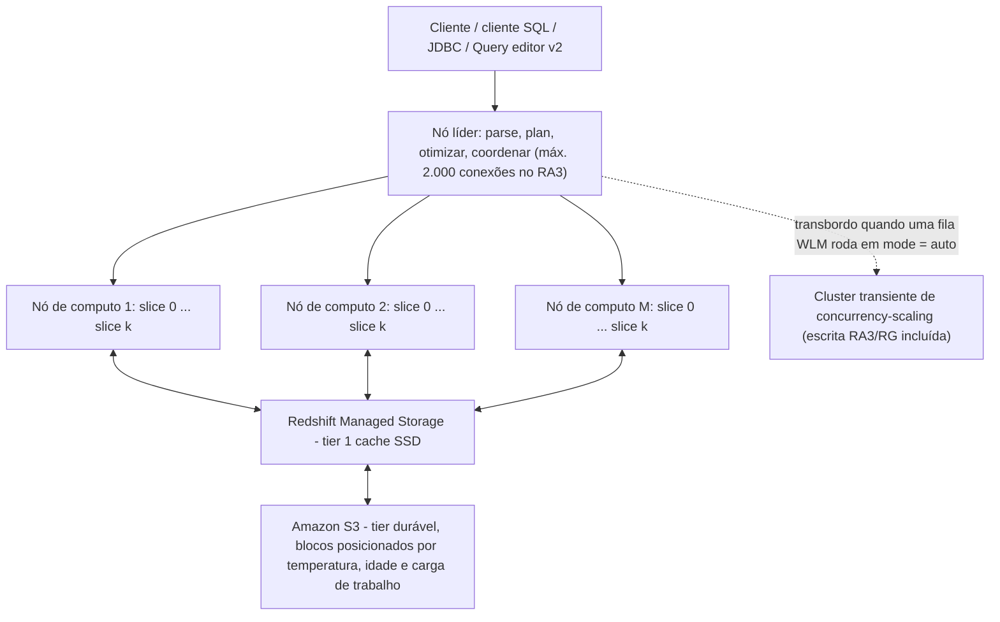
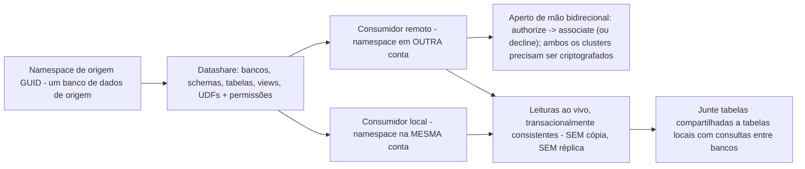
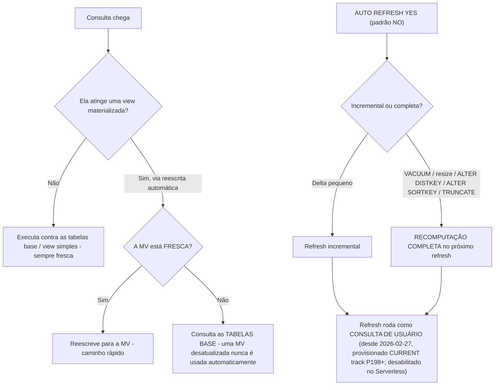
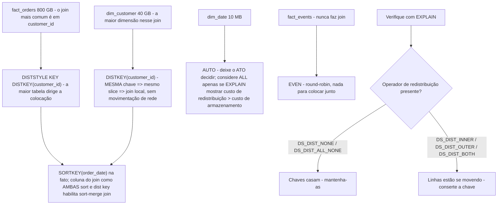
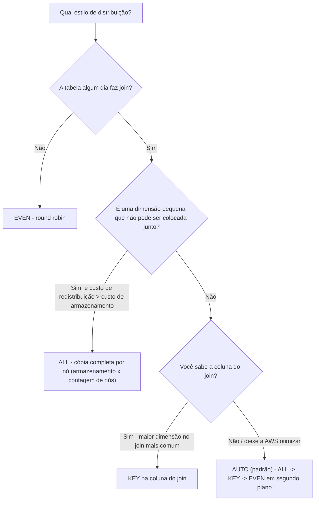
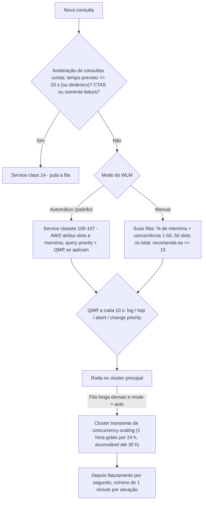
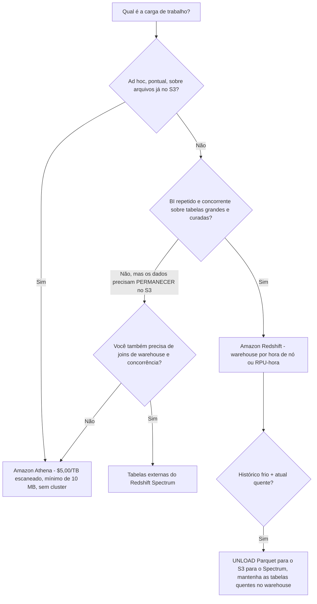

# Amazon Redshift: SQL de Data Warehouse e Transformação de Dados

A Lição 3 terminou com dados aterrando no S3. Esta lição é o que acontece depois. O Amazon Redshift é o serviço que o guia de exame DEA-C01 nomeia em **todos os domínios**: como fonte de leitura (habilidades 1.1.1, 1.1.2), como motor de transformação (1.2.5), como "consultas SQL para transformar dados … por exemplo, procedimentos armazenados do Amazon Redshift" (1.4), como método de migração/acesso remoto por meio de **consultas federadas, views materializadas e Spectrum** (2.1.5), como assunto de **operações de carga e descarga** (2.3.1), como alvo de design de schema (2.4.1), e como superfície de permissões e compartilhamento de dados (4.2.3, 4.2.4, 4.5.1). É por isso que uma lição só precisa cobrir arquitetura, SQL, design físico e custo juntos: neste exame eles nunca são perguntados isoladamente.

```text
====================================================================
 A SUPERFÍCIE DE DECISÃO DO REDSHIFT (DEA-C01, os quatro domínios)
====================================================================
  Computo ........ cluster RA3 provisionado (a partir de $0,543/hora)
                   Redshift Serverless (a partir de $1,50/hora, medido em RPU)
  Armazenamento .. Redshift Managed Storage: cache SSD + S3,
                   $0,024/GB-mês - cobrado INDEPENDENTEMENTE do computo
  Alcançar dados .. Spectrum (tabelas externas, $5,00/TB escaneado)
                   consultas entre bancos (um cluster, sem cópia)
                   data sharing (ao vivo, sem cópia, entre contas)
                   consultas federadas (somente leitura, RDS/Aurora)
  Carga / descarga .. COPY (+ MANIFEST, IAM_ROLE, compressão)
                   UNLOAD (CSV/JSON/Parquet, PARTITION BY)
                   MERGE (+ REMOVE DUPLICATES)
  SQL no warehouse .. procedimentos armazenados (PL/pgSQL), views
                   materializadas, views simples, views de vinculação tardia
  Design físico .. DISTSTYLE AUTO|EVEN|KEY|ALL
                   SORTKEY AUTO|COMPOUND|INTERLEAVED
  Autonomia ...... VACUUM delete/sort automático, ANALYZE automático, ATO
  Concorrência ... WLM automático ou manual + SQA + concurrency scaling
  Não é isto ..... SQL ad hoc pontual sobre S3 bruto = Amazon Athena
====================================================================
```

Nesta lição você vai:

- ler a **arquitetura RA3**: nó líder, slices, e como o Redshift Managed Storage cobra separadamente do computo;
- dimensionar e raciocinar sobre **Redshift Serverless**: RPUs, capacidade base, o teto de 10×, workgroup versus namespace;
- precificar o **Spectrum** por bytes escaneados e explicar por que formato colunar, compressão e poda de partições são controles de custo, não apenas de velocidade;
- separar **consultas entre bancos** (dentro de um único cluster) de **data sharing** (entre clusters e contas) e de **consultas federadas** (somente leitura para RDS/Aurora);
- dominar **COPY versus UNLOAD versus MERGE**: manifests, roles IAM, `COMPUPDATE`, `PARALLEL OFF` e as restrições exatas do MERGE;
- escrever **procedimentos armazenados PL/pgSQL** no escopo declarado pelo exame, incluindo o que um procedimento *não* pode conter;
- escolher entre uma **view simples** e uma **view materializada**, e saber o que a mudança de auto-refresh de **27 de fevereiro de 2026** fez;
- escolher **estilos de distribuição** e **sort keys** com exemplos trabalhados de join, redistribuição e skew que você calcula à mão;
- aplicar **VACUUM, ANALYZE e WLM automáticos** (auto, manual e aceleração de consultas curtas) com os próprios limites da AWS;
- decidir **Redshift ou Athena** a partir de uma matriz de decisão em vez de hábito;
- estudar **quatro estudos de caso de clientes da AWS** (GE Aerospace, PayU, Nasdaq e Amazon Customer Service) e uma **caixa de atualização de outubro de 2026 com fontes**;
- praticar com **14 perguntas no estilo do exame** mais quatro verificações interativas.

---

## 1. Arquitetura RA3 e Redshift Managed Storage

### 1.1 O nó líder, nós de computo e slices

A página de arquitetura da AWS diz isso diretamente: *"Um nó de computo é particionado em slices… O nó líder gerencia a distribuição de dados para os slices e distribui a carga de trabalho de consultas ou outras operações de banco de dados para os slices."* O **nó líder** faz parse, planeja, otimiza e coordena; ele não armazena dados de tabela. Os **nós de computo** fazem o trabalho, cada um particionado em **slices** que rodam em paralelo. Os clientes conectam ao nó líder, é por isso que clusters RA3 limitam conexões de cliente a **2.000** (limites do AWS Redshift, acesso em outubro de 2026).



```dragdrop
{
  "question": "Ordene a vida de uma consulta do Redshift, do pedido do cliente até as linhas retornadas:",
  "items": [
    "O cliente envia SQL ao endpoint de conexão do nó líder (RA3 permite até 2.000 conexões)",
    "O nó líder faz parse, planeja e otimiza o statement",
    "O nó líder distribui o trabalho para os slices nos nós de computo",
    "Os slices executam em paraleho, lendo blocos frios do Amazon S3 pelo cache SSD do Redshift Managed Storage",
    "O nó líder coleta os resultados dos slices e retorna a resposta ao cliente"
  ],
  "correctOrder": [
    "O cliente envia SQL ao endpoint de conexão do nó líder (RA3 permite até 2.000 conexões)",
    "O nó líder faz parse, planeja e otimiza o statement",
    "O nó líder distribui o trabalho para os slices nos nós de computo",
    "Os slices executam em paraleho, lendo blocos frios do Amazon S3 pelo cache SSD do Redshift Managed Storage",
    "O nó líder coleta os resultados dos slices e retorna a resposta ao cliente"
  ],
  "explanation": "A AWS documenta essa divisão assim: o nó líder 'gerencia a distribuição de dados para os slices e distribui a carga de trabalho de consultas ou outras operações de banco de dados para os slices', enquanto os dados de tabela vivem nos nós de computo: e no RA3 a cópia durável vive no S3 atrás do cache SSD do Managed Storage, então um slice pode buscar um bloco frio em vez de falhar. Tudo sobre planejamento e coordenação acontece no nó líder; tudo sobre dados acontece nos slices."
}
```

### 1.2 Formatos de nó RA3 e o que um slice significa para o seu SQL

| Tamanho RA3 | vCPU | Memória | Slices |
|---|---|---|---|
| `ra3.large` | 2 | 16 GiB | **2** |
| `ra3.xlplus` | 4 | 32 GiB | **2** |
| `ra3.4xlarge` | 12 | 96 GiB | **4** |
| `ra3.16xlarge` | 48 | 384 GiB | **16** |

A contagem de slices importa para duas regras examináveis: **o COPY quer uma contagem de arquivos que é múltiplo da contagem de slices**, e **uma tabela tem exatamente uma chave de distribuição**, então a colocação é avaliada por slice, não por nó (detalhes na Seção 10).

### 1.3 Redshift Managed Storage: a conta se divide em duas

No RA3, o disco local é um **cache SSD de tier 1**; a cópia durável vive no **Amazon S3**, com blocos posicionados por **temperatura, idade e carga de trabalho**. A consequência para o exame é aritmética, não marca: **computo e armazenamento são medidos independentemente**: você pode adicionar ou remover nós sem recomprar armazenamento, e o armazenamento continua acumulando quer o cluster esteja ocupado ou não.

**Exemplo resolvido E1: armazenamento gerenciado na tabela de preços de outubro de 2026**

| Entrada | Valor |
|---|---|
| Taxa do Managed Storage | **$0,024 por GB-mês** (preços do AWS Redshift, em outubro de 2026) |
| Tamanho do warehouse | **40 TB** = $40 \times 1{,}024 = 40{,}960$ GB |
| Custo mensal de armazenamento | $40{,}960 \times 0,024 = $ \mathbf{983.04}$ **/ mês** |

Esses $983.04 são cobrados **por cima** das horas de nó, e não desaparecem quando você pausa o computo. Respostas que citam um preço único de warehouse "por TB" misturado estão erradas em mecânica e em faturamento.

- **📚 Você sabia?** **A descontinuação do DC2 foi anunciada em abril de 2025**, empurrando clientes para **RA3 ou Serverless**: é por isso que a melhor prática documentada da AWS para novas cargas é **RA3/RG**, e por que "é só adicionar mais um nó DC2" é um distrator (AWS Big Data Blog, abordagem de migração do DC2, 2026-03-11). RA3 *não* é "armazenamento apenas local": separar computo de armazenamento é o propósito inteiro da geração.

### 1.4 Concurrency scaling: capacidade de surto com um orçamento de horas gratuitas

Quando uma fila WLM roda com **mode = auto**, consultas em transbordo são roteadas para **clusters transientes** em vez de enfileirar. Elegibilidade: clusters EC2-VPC de **dc2/rg/ra3** criados com **32 nós de computo ou menos**; tabelas com **sort keys interleave** e alvos `DISTSTYLE ALL` são excluídos da escala de **escrita**, e a escala de escrita em si existe apenas no **RA3/RG**. `max_concurrency_scaling_clusters` tem padrão **1** dentro de uma cota de **10**.

**Exemplo resolvido E2: a própria conta de surto da AWS (em outubro de 2026)**

```text
Cluster: 10 x rg.4xlarge em US-West-1            $33.66 / hora
Taxa transiente:  33.66 / 3600                    $0,00935 / segundo
Crédito grátis:   1 hora por 24 h por cluster ativo,
                  acumulável até 30 horas
Surto usado:      2 clusters x 300 segundos além do crédito
                  0,00935 x 300 x 2               = $5,61
Total da hora:    $33.66 + $5,61                  = $39,27
```

Drill que vale decorar: **uma hora creditada espalhada por 4 clusters transientes simultâneos compra apenas $60 \div 4 = 15$ minutos** de surto grátis cada: créditos são consumidos em tempo real, não divididos como horas inteiras.

---

## 2. Redshift Serverless

### 2.1 A capacidade é medida em RPUs

A capacidade do Serverless é expressa em **RPU-horas**, e a AWS define **1 RPU = 16 GB de memória**. Não há cluster para dimensionar; em vez disso você define uma **capacidade base** e um **alvo de preço-desempenho** (padrão **Balanced**, um modo de escala dirigido por IA), e o Redshift dimensiona o computo para a carga.

| Parâmetro do Serverless | Valor (docs da AWS, acesso em outubro de 2026) |
|---|---|
| Unidade | **1 RPU = 16 GB de memória** |
| Capacidade base | padrão **128**; configurável **4 to 512** em passos de **8**; até **1024** em Regiões suportadas |
| Teto de escala | **até 10× a capacidade base** |
| MaxRPU (teto rígido por workgroup) | valor máximo **5.632** |
| Faturamento | por segundo, **mínimo de 60 segundos** |
| Incluído na RPU-hora | **Spectrum** e **concurrency scaling** |
| Preço de entrada | **a partir de $1,50/hora** (em outubro de 2026) |

**Exemplo resolvido E3, o que a "capacidade base" compra**

```text
Capacidade base          128 RPU  x 16 GB  =  2.048 GB de memória
Teto de escala   10 x 128           = 1.280 RPU x 16 GB = 20.480 GB
Teto de workgroup MaxRPU            = 5.632 RPU (a parada rígida)
```

A própria orientação de dimensionamento da AWS (re:Post, 2026-06-11): **4 RPU para menos de 32 TB**; **8/16/24 RPU para menos de 128 TB**; **32 RPU ou mais acima de 128 TB**. E como o faturamento é por segundo com **mínimo de 60 segundos**, uma consulta de dois segundos ainda custa um minuto inteiro de RPU: serverless não significa *grátis quando ocioso*, significa *sem ociosidade alguma* entre consultas.

### 2.2 Workgroup é computo; namespace é identidade

| Objeto | O que possui | Frase de exame |
|---|---|---|
| **Workgroup** | Fronteira de computo: configurações de capacidade, VPC, alvo de preço-desempenho | "Qual configuração de *capacidade* eu mudo?" → workgroup |
| **Namespace** | Identidade de banco de dados: schemas, usuários, chaves de criptografia; identificado por um **GUID** | "Quais *objetos de banco de dados* são compartilhados?" → namespace |

Essa distinção volta na Seção 5: um **datashare é vinculado a um banco de dados de origem dentro de um namespace**, e o comando do consumidor cita esse **GUID**.

---

## 3. Amazon Redshift Spectrum

### 3.1 Tabelas externas: consulte o S3 sem carregá-lo

O Spectrum permite que um cluster do Redshift crie **tabelas externas** sobre dados que permanecem no **Amazon S3**, com metadados registrados no **AWS Glue Data Catalog**, e ele é cobrado por **bytes escaneados**: não por linhas retornadas, não por bytes armazenados.

| Fato do Spectrum | Valor (preços da AWS, em outubro de 2026) |
|---|---|
| Taxa (us-east-1) | **$5,00 por TB escaneado**, arredondado para MB, **mínimo de 10 MB por consulta** |
| Gratuitos | statements **DDL** e consultas **falhadas** |
| Ainda cobrados | consultas **canceladas**, pelos bytes já lidos |
| No Serverless | **Sem cobrança separada do Spectrum**: incluída na RPU-hora |
| Em instâncias RG | **Não é necessário**: RG inclui um motor de consulta de data lake embutido |

### 3.2 Exemplo resolvido E4: três maneiras de tornar uma consulta do Spectrum mais barata

Uma tabela de **100 colunas**; a consulta lê **uma** coluna:

| Layout dos mesmos dados | Bytes escaneados | Custo do Spectrum |
|---|---|---|
| Texto sem compressão | 4 TB | $4 \times 5.00 = \mathbf{\$20.00}$ |
| GZIP 4:1 | 1 TB | $1 \times 5.00 = \mathbf{\$5.00}$ |
| GZIP + Parquet, uma coluna lida | 0,25 TB | $0.25 \times 5.00 = \mathbf{\$0.05}$ |

Três alavancas, três mecanismos diferentes: **compressão** encolhe cada byte, **formato colunar** permite ao motor pular colunas de que não precisa, e **poda de partições** pula arquivos inteiros. Uma quarta alavanca é higiene de arquivos: a AWS recomenda arquivos externos de **64 MB ou maiores**, e definir `TABLE PROPERTIES (numRows = …)` porque **o Redshift nunca executa ANALYZE em tabelas externas** e caso contrário assume que a tabela externa é a maior tabela do join.

> [!IMPORTANT]
> **O Spectrum cobra o que você escaneia, não o que você retorna.** `SELECT *` sobre CSV largo e sem compressão paga por cada coluna de cada linha lida. O preço do Athena na Seção 12 é o mesmo **$5,00/TB escaneado** com **mínimo de 10 MB**: os dois serviços medem de forma idêntica, e é exatamente por isso que a *escolha* entre eles é arquitetural, não financeira (em outubro de 2026).

---

## 4. Consultas entre bancos

Um único cluster do Redshift pode hospedar vários bancos de dados. Consultas entre bancos deixam você ler e escrever entre eles usando o nome de três partes `database.schema.object` (ou um alias de schema externo): **sem cópias de dados**, contra um **snapshot transacionalmente consistente**. Elas são suportadas em **RG, RA3 e Serverless**.

```sql
-- Connected to database "analytics"; two other databases, zero copies
SELECT s.order_id,
       e.event_ts
FROM   analytics.sales          s
JOIN   staging.raw_events     e USING (order_id)
WHERE  s.order_date >= '2026-10-01'
AND    e.source = 'mobile-app';

-- Same cluster, one database away: three-part name is database.schema.table
SELECT count(*) FROM otherdb.reporting.weekly_rollup;
```

| Suportado | Não suportado (limites do exame) |
|---|---|
| Leitura/escrita entre bancos em **um único cluster** | Tabelas de privilégios em **nível de coluna** de outro banco de dados |
| Views sobre outros bancos: **apenas views de vinculação tardia e views materializadas** | Views regulares sobre objetos de outro banco de dados |
| Schemas externos como atalho | Escritas no schema externo de um banco ao qual você não está conectado |
| RG, RA3, Serverless | **Sort keys interleave** no objeto remoto |
|: | Referências de três partes a `information_schema` / `pg_catalog` |

- **📚 Você sabia?** Os dois recursos mais confundidos neste exame diferem por **uma palavra e uma fronteira**: **cross-database** fica *dentro de um único cluster*, enquanto **data sharing** cruza *clusters, contas e Regiões*. Nenhum dos dois copia dados, mas só o data sharing precisa de um GUID `NAMESPACE '<guid>'`, de um aperto de mão explícito de authorize/associate e de **dois clusters criptografados**.

---

## 5. Data sharing

Um **datashare** é um pacote de **objetos + permissões + consumidores**, vinculado a **um banco de dados de origem**. O consumidor cria um banco de dados *a partir* dele:

```sql
-- Consumer side: local (same account) or remote (other account)
CREATE DATABASE consumer_sales
FROM DATASHARE orders_share
OF NAMESPACE '1a2b3c4d-5e6f-7a8b-9c0d-1e2f3a4b5c6d';
```



| Regra | Detalhe (docs de data sharing da AWS, acesso em outubro de 2026) |
|---|---|
| Consistência | **Ao vivo e transacionalmente consistente**: sem cópia, sem atraso de refresh |
| Escritas | **Somente leitura por padrão**; escritas exigem concessões explícitas (`WITH PERMISSIONS` dá concessões por objeto, caso contrário `USAGE` implica todos os objetos) |
| Encadeamento | **Não permitido**: um datashare não pode ser repassado a partir do consumidor |
| Views | Apenas **views de vinculação tardia e views materializadas** sobre objetos compartilhados |
| Joins com dados locais | Use **consultas entre bancos** (Seção 4) |
| O que pode ser compartilhado | Bancos, schemas, tabelas, views, UDFs |

Duas coisas estão deliberadamente ausentes dessa tabela: a AWS **não** documenta um preço para data sharing, e **não** documenta disponibilidade por Região para ele, então nem "é grátis" nem "custa X" pertence a uma resposta de exame (veja a Seção 17 do digest: não verificado).

---

## 6. COPY, UNLOAD e MERGE: os três verbos do caminho de carga

### 6.1 COPY: a resposta padrão para volume

Regra prática da AWS: *carregue linhas em massa com `COPY`; use inserts SQL apenas para mudanças pequenas, e se você precisar inserir em SQL, use um **insert de múltiplas linhas** sempre que possível, porque "a compressão de dados é ineficiente quando você adiciona dados apenas uma linha ou algumas linhas por vez."*

**Exemplo resolvido E5: COPY com um manifest e uma role IAM (o rascunho para decorar)**

```sql
COPY public.order_items
FROM 's3://acme-orders-prod/2026/10/orders.manifest'
IAM_ROLE 'arn:aws:iam::123456789012:role/RedshiftCopyRole'
MANIFEST
FORMAT AS CSV
GZIP
COMPUPDATE ON
MAXERROR 100
TRUNCATECOLUMNS;
```

O manifest apontado é **um único arquivo JSON**, não um prefixo:

```json
{"entries":[
  {"url":"s3://acme-orders-prod/2026/10/part-0001.gz","mandatory":true},
  {"url":"s3://acme-orders-prod/2026/10/part-0002.gz","mandatory":false}
]}
```

| Regra do COPY | Valor / comportamento |
|---|---|
| Autorização | **`IAM_ROLE 'arn:…'`** ou **`IAM_ROLE 'default'`** (role pré-vinculada ao cluster); access keys são **desencorajadas** e **mutuamente exclusivas** com `IAM_ROLE` |
| Manifest | Opcional `{"entries":[{url, mandatory}]}`; você precisa acrescentar a palavra-chave **`MANIFEST`**: omita-a e o COPY interpreta seu JSON como dados e falha |
| Entrada de manifest duplicada | O arquivo **é carregado duas vezes** |
| Dimensionamento de arquivo | Contagem = **múltiplo da contagem de slices**, cada arquivo **1 MB: 1 GB comprimido** |
| Padrão de `COMPUPDATE` | Amostra **apenas quando a tabela de destino está vazia e nenhuma codificação está declarada** |
| `COMPUPDATE ON / PRESET / OFF` | amostra e talvez substitui / atribui por tipo sem amostragem / nunca |
| `COMPROWS` | **100.000 linhas por slice** amostradas por padrão (mínimo 1.000) |

> [!WARNING]
> **`COMPUPDATE` silenciosamente não faz nada em uma tabela já populada.** Reexecutar `COPY` em uma tabela que já tem linhas **não** recalcula as codificações sob o padrão. Se o exame disser "recalcular a compressão em uma tabela existente", a resposta é um `COMPUPDATE ON`/`PRESET` explícito: ou, melhor, deixar a **otimização automática de tabela** cuidar disso (Seção 11).

### 6.2 UNLOAD: exportação, com controle de formato e forma de arquivo

```sql
UNLOAD ('SELECT order_id, amount, updated_at
         FROM sales_fact
         WHERE order_date >= ''2026-10-01''
         ORDER BY order_date')
TO 's3://acme-curated/sales_fact/'
IAM_ROLE 'default'
FORMAT AS PARQUET
PARTITION BY (order_date)
PARALLEL OFF
ALLOWOVERWRITE;
```

| Cláusula do UNLOAD | Por que é examinável |
|---|---|
| `FORMAT CSV \| JSON \| PARQUET` | Unload em Parquet é **até 2× mais rápido** e usa **até 6× menos armazenamento** que texto (AWS) |
| `PARTITION BY` | Grava partições no estilo Hive para que Athena/Spectrum possam podar |
| `PARALLEL ON` (padrão) | Um ou mais arquivos **por slice** |
| `PARALLEL OFF` | **Preserva o `ORDER BY`**, o único modo que faz isso |
| `MAXFILESIZE` | Teto de **6,2 GB** (intervalo 5 MB: 6,2 GB) |
| `MANIFEST [VERBOSE]` | Emite um manifest para que um posterior `COPY … MANIFEST` possa fazê-lo ida e volta exatamente |
| `ALLOWOVERWRITE`, `ENCRYPTED` | Reexecuções idempotentes; criptografia lado servidor na gravação |

### 6.3 MERGE, o upsert idempotente

```sql
MERGE INTO sales_fact t
USING sales_staging s
   ON t.order_id = s.order_id
WHEN MATCHED THEN
     UPDATE SET amount = s.amount, updated_at = s.updated_at
WHEN NOT MATCHED THEN
     INSERT (order_id, amount, updated_at)
     VALUES (s.order_id, s.amount, s.updated_at);
```

| Restrição do MERGE (referência `MERGE` da AWS) | Consequência |
|---|---|
| O destino não pode ser uma tabela de sistema, de catálogo ou **externa** | Você não pode fazer MERGE direto em uma tabela do Spectrum |
| **Fonte ≠ destino**, e sem cláusula `WITH` | Estagie primeiro, depois faça o merge |
| Uma linha de destino não pode corresponder a **múltiplas** linhas de origem | Deduplique a tabela de staging, ou use `MERGE … WHEN MATCHED THEN REMOVE DUPLICATES` para dedupe puro em schemas idênticos |
| Privilégios necessários | `SELECT` nos dois lados mais `INSERT`/`UPDATE`/`DELETE` no destino |
| Alternativa manual | `UPDATE`/`DELETE`/`INSERT` em staging devem rodar em **uma única transação** |

```fillblank
{
  "question": "Complete os statements de carga, descarga e upsert com as palavras-chave corretas do Redshift:",
  "template": "Uma carga diária de 500 milhões de linhas no S3 é carregada com {{1}}, cuja lista de arquivos JSON exige a palavra-chave {{2}} e é mutuamente exclusiva com access keys quando a cláusula {{3}} é usada. Exportar um conjunto de resultados ordenado para um único arquivo exige {{4}} OFF, e o statement de upsert idempotente é {{5}}.",
  "answers": {
    "1": "COPY",
    "2": "MANIFEST",
    "3": "IAM_ROLE",
    "4": "PARALLEL",
    "5": "MERGE"
  },
  "distractors": ["INSERT", "UNLOAD", "LOAD", "FORMAT", "SPLIT", "PARTITION BY", "UPSERT", "REPLACE", "MERGE INTO DEDUP"],
  "explanation": "COPY cuida da carga em massa; MANIFEST diz ao COPY que o caminho é uma lista de arquivos JSON e não dados (omitir a palavra-chave faz o COPY interpretar o JSON como linhas); IAM_ROLE é a autorização preferida documentada e não pode ser combinada com access keys; PARALLEL OFF é o único modo do UNLOAD que preserva ORDER BY; MERGE é o upsert nativo. INSERT é o verbo errado em 500 milhões de linhas: a AWS diz explicitamente para usar inserts de múltiplas linhas apenas quando o COPY não é uma opção."
}
```

**Exemplo resolvido E6: a aritmética de copy versus insert**

```text
Tabela: 8 slices, alvo de 500.000.000 de linhas a partir do S3
COPY:   contagem de arquivos = 8 x k   (k arquivos por slice), 1 MB-1 GB cada
        -> um statement, paralelo entre slices, ANALYZE automático em um
           alvo vazio, compressão derivada pelo COMPUPDATE
INSERT: 1 linha por statement = 500.000.000 de statements
        -> a compressão não pode ser derivada incrementalmente, e a AWS diz
           que a compressão é "ineficiente quando você adiciona dados apenas
           uma linha ou algumas linhas por vez"
```

---

## 7. Procedimentos armazenados (PL/pgSQL), o escopo do exame

```sql
CREATE OR REPLACE PROCEDURE stg.load_orders()
LANGUAGE plpgsql AS $$
DECLARE
  v_rows bigint;
BEGIN
  COPY stg.orders_raw FROM 's3://acme-orders-prod/today/'
       IAM_ROLE 'default' GZIP;
  SELECT count(*) INTO v_rows FROM stg.orders_raw;
  IF v_rows = 0 THEN
    RAISE INFO 'no rows today - skipping';
  ELSE
    TRUNCATE stg.orders_clean;
    INSERT INTO stg.orders_clean
      SELECT * FROM stg.orders_raw WHERE valid;
    CALL stg.merge_orders();   -- nested CALL, max 16 levels
  END IF;
END $$;

CALL stg.load_orders();
```

| Fato sobre o procedimento | Detalhe (docs de procedimentos armazenados da AWS) |
|---|---|
| Invocação | `CALL name(...)`; criado com `CREATE [OR REPLACE] PROCEDURE … LANGUAGE plpgsql` |
| Versus uma UDF | Um procedimento **pode conter DDL e DML** (`COPY`, `UNLOAD`, `INSERT`, `CREATE TABLE`) e **não precisa retornar valor** |
| `DECLARE / BEGIN / END` | **Agrupamento, não transação**: um bloco `BEGIN…END` não abre uma transação |
| Transação padrão | Uma **transação implícita por `CALL`**; `COMMIT`/`ROLLBACK`/`TRUNCATE` são legais apenas **fora** de um bloco de transação do chamador |
| `NONATOMIC` | Auto-commit por statement; um loop de cursor então precisa de um `START TRANSACTION` explícito antes |
| Recursos do corpo | `IF/ELSIF/ELSE`, loops, `EXIT`, `EXECUTE` (SQL dinâmico), `RAISE`, cursores `refcursor` |
| Limites | **16** níveis aninhados de `CALL`; **um** cursor aberto por sessão; **sem subtransações** |
| Proibido dentro | `PREPARE`, `CREATE/DROP DATABASE`, `CREATE EXTERNAL TABLE`, **`VACUUM`**, `SET LOCAL`, `ALTER TABLE APPEND` |

A moldura do exame é **lógica condicional de pipeline**: ramificar por contagem de linhas, `TRUNCATE` + `INSERT…SELECT`, e então deixar **Step Functions ou EventBridge** invocarem o conjunto inteiro por meio da **Redshift Data API**. "Executar `VACUUM` dentro do procedimento" nunca é a resposta: a manutenção é orquestrada *por fora*, na Seção 11.

- **📚 Você sabia?** O `BEGIN/END` de um procedimento e o `BEGIN` de uma transação são bichos diferentes com a mesma palavra-chave. É por isso que a documentação avisa que blocos de agrupamento **não são transações**: um statement falhado dentro de um `CALL` desfaz a transação implícita inteira, não apenas o bloco, a menos que o procedimento tenha sido declarado `NONATOMIC`.

---

## 8. Views materializadas versus views

| | **View** | **View materializada** |
|---|---|---|
| O que é armazenado | **Apenas o SQL** | **Os resultados da consulta** |
| Frescor | Sempre atual: nada para dar refresh | **Desatualizada até receber refresh** |
| Velocidade de leitura | Reexecuta a consulta | Lê linhas pré-computadas |
| Custo | Sem armazenamento, sem job de refresh | Armazenamento mais computo de refresh |
| Frase de exame | "Precisa sempre refletir a última mudança da tabela base" | "Agregação repetida e custosa sobre uma base estável" |

### 8.1 Mecânica do refresh

O refresh é manual (`REFRESH MATERIALIZED VIEW`) ou automático (`AUTO REFRESH YES`, **o padrão é `NO`**), e o Redshift escolhe entre recomputação **incremental** ou **completa**. Uma **recomputação completa é forçada** após um `VACUUM` manual, um resize clássico, `ALTER DISTKEY`, `ALTER SORTKEY` ou um `TRUNCATE`.



### 8.2 Reescrita automática e AutoMV

A reescrita automática de consulta usa **apenas** views materializadas frescas, e apenas para `SELECT`s elegíveis: **sem subqueries, joins externos, operações de conjunto, `DISTINCT`/janela/`HAVING`, agregações além de `SUM`/`COUNT`/`MIN`/`MAX`/`AVG`, e sem tabelas externas ou compartilhadas**. A chave de desligamento da sessão é `SET mv_enable_aqmv_for_session = FALSE`. O **AutoMV** cria views materializadas a partir de padrões observados da carga de trabalho (elas aparecem como `%_auto_mv_%` dentro do `EXPLAIN`) sob os mesmos limites de elegibilidade.

```sql
CREATE MATERIALIZED VIEW mv_sales_by_region
AUTO REFRESH YES
AS
SELECT region_id, date_trunc('month', order_date) AS m, sum(amount) AS total
FROM   sales_fact
GROUP  BY 1, 2;

REFRESH MATERIALIZED VIEW mv_sales_by_region;
```

> [!WARNING]
> **O refresh não é grátis, e ficou mais ruidoso em 2026.** *"A partir de 27 de fevereiro de 2026, consultas de Auto REFRESH de views materializadas do Amazon Redshift são executadas como consultas de usuários em vez de processos autonômicos em segundo plano"* (clusters provisionados no trilho CURRENT, P198+; **desabilitado no Serverless**). Um refresh portanto disputa slots de WLM em prioridade de usuário: que é exatamente a interação que as Seções 8 e 11 desta lição testam juntas.

---

## 9. Consultas federadas e a superfície de consulta ao redor delas

**Consultas federadas** deixam o nó líder do Redshift puxar dados de uma fonte relacional sem movê-los antes:

| Fato | Valor (docs de consultas federadas da AWS) |
|---|---|
| Fontes | **Amazon RDS / Amazon Aurora PostgreSQL ≥ 9.6** e **MySQL ≥ 5.6** |
| Portas | **5432** (PostgreSQL), **3306** (MySQL) |
| Direção | **Somente leitura** |
| Credenciais | Segredo do **AWS Secrets Manager** mais uma **role IAM** |
| Concurrency scaling | **Não disponível** para consultas federadas |
| Uso no exame | Habilidade **2.1.5**: "implementar métodos de migração de dados ou acesso remoto (por exemplo, consultas federadas do Amazon Redshift, views materializadas, Spectrum)" |

Os quatro recursos de "alcançar para fora" agora se alinham como uma família, e o exame testa as diferenças:

| Recurso | Copia dados? | Direção | Fronteira |
|---|---|---|---|
| **Consultas entre bancos** | Não | Leitura/escrita | Um cluster, vários bancos de dados |
| **Data sharing** | Não | Leitura (escrita com concessões explícitas) | Clusters, contas, Regiões |
| **Spectrum** | Não | Leitura | Redshift → S3 via Glue Data Catalog |
| **Consultas federadas** | Não | **Somente leitura** | Redshift → RDS / Aurora PostgreSQL ou MySQL |

Ao redor disso, o **Query editor v2** é a superfície do analista: abas e notebooks concorrentes, variáveis de sessão, tabelas temporárias, placeholders `${param}`, histórico das últimas **1.000** consultas e consultas agendadas dirigidas por **EventBridge + Redshift Data API**.

---

## 10. Estilos de distribuição e sort keys: onde o custo do join é decidido

### 10.1 Estilos de distribuição

`DISTSTYLE` aceita **AUTO | EVEN | KEY | ALL**, com **AUTO como padrão**. O AUTO começa tabelas pequenas como **ALL**, move-as para **KEY**, e pode se estabelecer em **EVEN**, ajustando em segundo plano, e a **otimização automática de tabela** continua fazendo esses ajustes a menos que você fixe um estilo explícito.

| Style | O que faz | Custo / armadilha |
|---|---|---|
| **KEY** | Coloca linhas juntas pelo valor de **uma** coluna de distribuição: no máximo **uma** distkey por tabela | A coluna do join precisa casar, ou as linhas ainda redistribuem |
| **EVEN** | Round-robin entre os slices | Sem colocação; ok para tabelas que nunca fazem join |
| **ALL** | Uma cópia completa da tabela em **todos** os nós | Armazenamento **× contagem de nós**; cargas mais lentas; **excluído das escritas de concurrency scaling** |
| **AUTO** (padrão) | Migração em segundo plano ALL → KEY → talvez EVEN | Chaves explícitas tiram a tabela da automática |

A orientação da AWS para esquema estrela: a chave de distribuição deve ser **a maior dimensão no join mais comum**; use **ALL** para dimensões que não podem ser colocadas juntas e cujo custo de redistribuição excede o custo de armazenamento; **AUTO** para todo o resto. E a própria frase da AWS sobre por que KEY funciona: *"Se você distribuir um par de tabelas pelas chaves de join, o nó líder coloca as linhas juntas nos slices de acordo com os valores das colunas de join."*

### 10.2 Sort keys

| Tipo de sort key | Teto | Observações |
|---|---|---|
| **COMPOUND** | **400** colunas | Intervalos de prefixo da coluna líder; a escolha clássica |
| **INTERLEAVED** | **8** colunas | Peso igual entre colunas; **custo maior de carga e VACUUM**, precisa de `REINDEX` (`interleaved_skew > 1.4`), **bloqueia concurrency scaling**, não suportado em consultas entre bancos |
| **AUTO** (padrão) |: | Deixa a **otimização automática de tabela** escolher e revisar a sort key |

Coloque a coluna do join como **sort key e chave de distribuição ao mesmo tempo** e o Redshift pode escolher um **sort-merge join** em vez de um hash join: sem construção de hash, sem spill, sem movimentação de rede.

**Exemplo resolvido E7: escolher o estilo de distribuição para um esquema estrela**

```text
fact_orders   800 GB   joins dim_customer on customer_id em 90% das consultas
dim_customer   40 GB   a maior dimensão nesse join
dim_date       10 MB   também faz join, mas é minúscula
fact_events    -       denormalizada, nunca faz join
```





**Exemplo resolvido E8: lendo o plano, com os próprios números da AWS**

```sql
-- Skew and sort triage before you change anything
SELECT "table", diststyle, skew_rows, unsorted, stats_off, vacuum_sort_benefit
FROM   svv_table_info
ORDER  BY skew_rows DESC NULLS LAST;
```

```text
skew_rows        >= 4.00  -> mude o DIST STYLE
unsorted         >  20 %  -> considere VACUUM, mas leia vacuum_sort_benefit
                               primeiro (86% unsorted ainda pode ser 5% melhorável)
stats_off        high     -> ANALYZE ... PREDICATE COLUMNS
interleaved_skew >  1.4   -> VACUUM REINDEX (lento, apenas interleaved)

Tags de operador do EXPLAIN:
  DS_DIST_NONE / DS_DIST_ALL_NONE   bom - sem movimentação
  DS_BCAST_INNER                    ok apenas quando o lado interno é pequeno
  DS_DIST_INNER / DS_DIST_OUTER     custoso - um lado está sendo movido
  DS_DIST_ALL_INNER                 serializa em um único slice
  DS_DIST_BOTH                      pior caso
  Nested Loop                       geralmente um predicado de join FALTANDO
  Hash Join                         pode spillar para disco
  Merge Join                        mais rápido - ambos os lados dist + sorted nas chaves
```

A AWS publicou o efeito de mover dimensões para `DISTSTYLE ALL` em um plano real: o custo do join caiu de **3.272.334.142,59 para 14.142,59** (Amazon Redshift Prescriptive Guidance, acesso em outubro de 2026). A lição não é "sempre use ALL": é que **o plano, não a regra prática, é o árbitro**.

```matching
{
  "question": "Associe cada situação de design físico do Redshift à escolha correta:",
  "pairs": [
    {"left": "Fato de 800 GB com join a uma dimensão de 40 GB em 90% das consultas", "right": "DISTSTYLE KEY na coluna do join: coloque os dois lados juntos para o join ficar local"},
    {"left": "Uma tabela fato larga que só é agregada, nunca faz join", "right": "DISTSTYLE EVEN: round-robin, não há nada para colocar junto"},
    {"left": "Uma dimensão minúscula que não pode compartilhar a chave de distribuição da fato", "right": "DISTSTYLE ALL: cópia completa por nó, cuidado com armazenamento x contagem de nós"},
    {"left": "Três predicados de igualdade diferentes consultados com frequência igual", "right": "DISTSTYLE AUTO / SORTKEY AUTO: deixe a otimização automática de tabela revisar"},
    {"left": "Uma tabela escaneada por intervalos de data da coluna líder", "right": "Sort key COMPOUND: até 400 colunas, intervalos de prefixo, barato de manter"},
    {"left": "Uma tabela consultada por qualquer uma de 4 to 8 colunas independentes", "right": "Sort key INTERLEAVED: máx. 8 colunas, mas VACUUM mais pesado e sem escritas de concurrency scaling"}
  ],
  "explanation": "A regra do esquema estrela é: chave de distribuição = a maior dimensão no join mais comum; ALL apenas quando redistribuir custa mais que o armazenamento replicado; EVEN quando não há join. Em sort keys, COMPOUND é a escolha de 400 colunas amigável ao padrão, enquanto INTERLEAVED tem teto de 8 colunas, exige VACUUM REINDEX quando interleaved_skew ultrapassa 1.4, bloqueia concurrency scaling e não é suportado em consultas entre bancos."
}
```

---

## 11. Manutenção automática e gerenciamento de carga de trabalho

### 11.1 VACUUM, ANALYZE e as autonomias que os substituíram

As **autonomias** do Redshift são quatro comportamentos em segundo plano: **vacuum delete automático**, **vacuum sort automático**, **analyze automático** e **otimização automática de tabela** (mais views materializadas automatizadas). Elas rodam em janelas de baixa carga e pausam sob alta carga ou locks exclusivos de DDL: é por isso que "por que meu VACUUM não rodou?" é uma pergunta de agendamento, não de permissão.

| Controle | Padrão / limite (docs da AWS, acesso em outubro de 2026) |
|---|---|
| Analyze automático | **Ligado por padrão**; pula tabelas com estatísticas atuais; `analyze_threshold_percent` = **10** |
| Gatilhos de auto-analyze | `COPY` para um alvo **vazio**; `CREATE TABLE AS` |
| VACUUM delete/sort automático | Ligado, em segundo plano, pausado por carga ou locks |
| `VACUUM` manual (padrão `FULL`) | **Pula a ordenação abaixo de 95% unsorted**: não ensine "VACUUM depois de cada carga" |
| `VACUUM REINDEX` | Apenas interleaved; muito mais lento |
| Monitorar | `unsorted` e `vacuum_sort_benefit` em `SVV_TABLE_INFO` |
| ATO | Aplica sort/dist keys em tabelas `AUTO` em poucas horas de consultas suficientes; audite `SVV_ALTER_TABLE_RECOMMENDATIONS` |

### 11.2 Gerenciamento de carga de trabalho: três mecanismos, não um

A configuração do WLM vive no **parameter group** (`wlm_json_configuration`), e a regra rígida da AWS é: **nunca misture filas automáticas e manuais em um único parameter group**.

| Mecanismo | O que controla | Números-chave |
|---|---|---|
| **WLM automático** (padrão, recomendado) | O Redshift atribui **concorrência e memória** sozinho | Até **8 filas** (service classes **100 to 107**); acrescenta **query priority** e Query Monitoring Rules |
| **WLM manual** | Você define **% de memória** e **concorrência** estáticos por fila e roteia por grupo de usuário | Concorrência **1 to 50** por fila, **50 slots no total**, a AWS recomenda **≤ 15** |
| **Aceleração de consultas curtas (SQA)** | Um modelo ML prevê o tempo de execução; consultas curtas **pulam a fila** | Dinâmico (0) ou **1 to 20 segundos**; **ligado por padrão**; service class **14**; apenas **CTAS e consultas somente leitura** são elegíveis |
| **Query priority** | Importância relativa de uma consulta dentro do WLM **automático** | `priority` existe **apenas** no auto WLM |
| **Concurrency scaling** | Transbordo para clusters transientes | Por fila com **mode = auto**; **1 hora grátis por 24 h** |

Estado padrão de um cluster novo: **1 fila com 5 consultas concorrentes**. `max_execution_time` está **descontinuado**, o equivalente moderno é um QMR sobre `query_execution_time`, avaliado a cada **10 segundos**, com severidades `log` < `hop` < `abort` < `change priority` (nota: `abort` nunca para `COPY`, `ALTER`, `ANALYZE` ou `VACUUM`, e `change priority` existe só no auto WLM).



- **📚 Você sabia?** SQA e WLM automático são frequentemente confundidos e são **mecanismos diferentes**: o SQA (class **14**) prevê o *tempo de execução* para dar um curto-circuito na fila, enquanto o WLM automático (classes **100 to 107**) decide *slots e memória*. Ambos podem estar ligados ao mesmo tempo, e nenhum dos dois é concurrency scaling, que adiciona **clusters** inteiros. Três camadas, três nomes, uma mesma raiz.

---

## 12. Redshift ou Athena? A matriz de decisão

A própria moldura da AWS: o Amazon Athena é para *"consultas SQL ad hoc interativas sobre dados no Amazon S3, sem … infraestrutura ou clusters"*, enquanto o Redshift é *"otimizado … em consultas complexas que unem grandes números de tabelas de banco de dados muito grandes"*. A regra didática que segue é curta: **Athena = SQL ad hoc sobre arquivos no S3; Redshift = BI sobre um warehouse curado.**

| Sinal na pergunta | Resposta do exame | Base |
|---|---|---|
| Joins complexos entre muitas tabelas grandes e curadas; painéis de BI; relatórios concorrentes repetidos | **Redshift** | Otimizado para warehouse em joins grandes |
| SQL pontual e infrequente sobre arquivos já no S3; não quer infraestrutura | **Athena** | Sem cluster, sem nós |
| "Pague apenas ao consultar" | **Athena**: $5,00/TB escaneado | O Redshift cobra horas de nó ou RPU-horas quer alguém consulte ou não |
| Manter dados no S3 mas ainda precisar de joins de warehouse e concorrência | **Redshift Spectrum** tabelas externas | Mesmo cluster, sem carga |
| Bruto barato em longo prazo mais uma camada curada rápida | **Ambos**: `UNLOAD` Parquet para o S3, Spectrum para o frio, warehouse para o quente | Padrão lake house |
| Log/evento, semiestruturado, exploração schema-on-read | **Athena** | Encaixe schema-on-read |



> [!IMPORTANT]
> **Não invente um ponto de cruzamento.** Muitos artigos de terceiros afirmam que "o Redshift fica mais barato que o Athena acima de X TB por mês": **a AWS não publica nenhum número assim**, então nenhuma resposta de exame deve conter um (não verificado, veja a seção G do digest). O que a AWS *publica* é a forma de medição: **por escaneamento** para o Athena versus **horas de nó / RPU-horas sempre ligadas** para o Redshift, mais os **$5,00/TB escaneado** do Spectrum para dados no S3 consultados a partir do Redshift (em outubro de 2026).

- **📚 Você sabia?** A metade do Athena dessa matriz também mudou: os **resultados de consulta gerenciados** (2025-06-03) são gerenciados pelo serviço, criptografados e **não custam nada a mais**, então não é mais necessária uma pasta de resultados no S3, e as **Capacity Reservations** agora começam em **4 DPU por 1 minuto** em vez de 24 DPU por 60 minutos (2026-02-11). Tanto "o Athena precisa de uma pasta de resultados no S3" quanto "as reservas do Athena começam em 24 DPU" são fatos desatualizados que ainda aparecem em material vivo de terceiros (AWS What's New, 2025-06-03 / 2026-02-11).

### Atualizações de 2026 (em outubro de 2026)

> [!NOTE]
> **O que mudou no Redshift entre 2025 e outubro de 2026**: cada linha verificada contra uma fonte primária da AWS, e cada uma examinável porque o exame testa comportamento atual:
> - **O Redshift agora pode gravar em Iceberg, não apenas ler**: criação de tabela/`INSERT` foi GA em **2025-11-17** (apenas append, sobre o **Glue Data Catalog**), **JIT ANALYZE** veio em **2025-11-18**, **`UPDATE`/`DELETE`/`MERGE` em tabelas Iceberg (incluindo Amazon S3 Tables) chegaram em 2026-04-23**, e **views materializadas de Iceberg** em **2026-10-05**: AWS What's New, 2025-11-17 / 2025-11-18 / 2026-04-23 / 2026-10-05.
> - **Permissões de DML do Iceberg foram apertadas (Patch 202)**: `INSERT` exige `INSERT`; `DELETE` exige `DELETE`; `UPDATE`/`MERGE` exigem **`INSERT` + `DELETE`**; e **todo DML do Iceberg também exige `ALTER`**: uma concessão apenas de `INSERT` não basta mais (página de mudanças de comportamento do Redshift, acesso em outubro de 2026).
> - **UDs Python escalares acabaram**: nenhuma nova depois de **2025-10-30**, sem suporte depois de **2026-06-30**: não projete nova lógica de pipeline sobre elas (banner da documentação do Redshift, acesso em outubro de 2026).
> - **O Serverless agora tem um caminho de compromisso**: **reservas de 1 ano com 20%/24%** e **de 3 anos com até 45%** (2026-02-23), mais **reservas de 3 anos de upgrade tudo adiantado com até 50%** (2026-07-24), contra um preço de entrada de **a partir de $1,50/hora** e um mínimo de **4 RPU**: AWS What's New, 2026-02-23 e 2026-07-24; preços do Redshift, em outubro de 2026.
> - **O auto refresh de views materializadas mudou em 2026-02-27**: consultas de auto-refresh agora rodam **como consultas de usuários** em vez de processos autonômicos em segundo plano em clusters provisionados do trilho CURRENT (P198+), e permanecem **desabilitadas no Serverless**: documentação do Redshift, acesso em outubro de 2026.
> - **Duas mudanças de comportamento datadas ainda estão caindo**: faturamento aprimorado para **Serverless e snapshots gerenciados pelo Redshift a partir de 2026-06-08**, e uma **mudança de versão mínima de TLS em 2026-10-31**: página de mudanças de comportamento do Redshift, acesso em outubro de 2026. Perguntas de handshake de certificado e custo de snapshot agora têm datas anexadas.
> - **A tabela Iceberg compartilhada ganhou um terceiro escritor**: o **Amazon S3 Tables acrescentou o tipo Variant para Iceberg v3** (2026-07-28), e desde **2026-04-23** o `UPDATE`/`DELETE`/`MERGE` do Redshift roda sobre **S3 Tables** também, então uma única tabela pode ser gravada pelo Glue, atualizada pelo Redshift e lida pelo Athena sem cópia, AWS What's New, 2026-07-28 e 2026-04-23.
> - **O formato Iceberg v3 agora é mainstream na stack de lake da AWS**: **AWS Glue 6.0** (2026-08-21) traz **suporte completo ao Apache Iceberg v3**, VARIANT + shredding, deletion vectors e row lineage, com **redução de preço de 30%**, então perguntas de "formato de tabela aberto" podem assumir recursos do v3 (AWS What's New e AWS Big Data Blog, 2026-08-21).
> - **Contexto do guia de exame**: o **guia v1.1 do DEA-C01 (2025-12-12)** acrescentou a habilidade **2.1.7 "Gerenciar formatos de tabela abertos (por exemplo Apache Iceberg)"** sem remoções, e é por isso que Redshift sobre Iceberg está francamente no escopo: página de revisões do DEA-C01, 2025-12-12.

- **📚 Você sabia?** Duas armadilhas de "fato desatualizado" ficam no mesmo tópico: um post da APN de 2020 amplamente citado afirma que o Redshift *"na verdade não suporta views materializadas"* (falso desde 2021), e qualquer opção afirmando que o Redshift só pode *ler* Iceberg está errada desde **2025-11-17**. Neste exame, um post antigo da AWS não é fonte: a página de documentação atual é.

---

## Casos Reais

A AWS publica como essas abstrações parecem em produção. Todo número abaixo é **afirmação do cliente ou da AWS, não auditada**, com a fonte nomeada para que você possa verificar, o ponto examinável é o **padrão**, não o marketing.

### Caso A, GE Aerospace: um data store operacional legado, reescrito no Redshift

| Elemento | Detalhe |
|---|---|
| Cliente | **GE Aerospace**, operações aeroespaciais e de cadeia de suprimentos |
| Desafio | Um grande **operational data store (ODS)** com restrições de conformidade e desempenho, mais **150+ relatórios** (alguns com **mais de 10.000 linhas de código**) |
| Serviços | **Amazon Redshift**, com suporte da AWS Solutions Architecture e da equipe de engenharia do Redshift |
| Resultados | **~70% de melhoria no desempenho de consultas**; estimativa de **mais de $500.000 por ano**; prova de conceito em nov: dez 2022, depois uma **migração de 9 meses de janeiro a setembro de 2023**; relatórios que rodavam **90 minutos agora rodam em 7 minutos** |
| Domínio do exame | **Domínio 2** (design de armazenamento e carga/descarga) com ganchos do **Domínio 3** (desempenho, custo) |
| Fonte | `aws.amazon.com/solutions/case-studies/ge-aerospace-case-study` (acesso em outubro de 2026) |

> "Víamos consultas que levavam uma hora e meia rodando em 7 minutos usando o Amazon Redshift.": Bejoy John, Senior Director of Data Analytics, GE Aerospace (estudo de caso da AWS, acesso em outubro de 2026)

O padrão examinável: isto **não** foi lift-and-shift. Foi um programa de **nove meses** com um PoC formal, e a vitória veio de refazer o design físico de um warehouse: que é exatamente as Seções 10 e 11 desta lição (distribuição, sort keys, manutenção, WLM), não de adicionar nós.

### Caso B, PayU: consolidação mais data sharing entre cinco clusters

| Elemento | Detalhe |
|---|---|
| Cliente | **PayU**, empresa de fintech/pagamentos |
| Desafio | Dados em silos em **~40 bancos de dados de produção**; consultas levando **10 to 15 minutos**; frescor de dados apenas **uma vez por dia** |
| Serviços | **AWS Glue ETL → Amazon S3 → Amazon Redshift**, mais **Redshift Data Sharing entre 5 clusters** (2 de ETL + 3 de consumo) |
| Resultados | Consultas **10 to 15 min → menos de 1 min**; frescor **1x/dia → menos de 30 minutos** (streaming de ML abaixo de 5 s); **$20.000/mês** economizados; **~200 TB escaneados por dia**; volume de consultas **150.000 → 35.000 por mês (−77%)** |
| Domínio do exame | **Domínio 1** (transformação alimentando a carga) mais a habilidade 4.5.1 do **Domínio 4** (permissões para data sharing) |
| Fonte | `aws.amazon.com/solutions/case-studies/payu-redshift-case-study` (acesso em outubro de 2026) |

> "Em 1 mês, reduzimos as consultas em 77 por cento, o que teria sido um exercício de 6 meses no ambiente anterior.": PayU, estudo de caso da AWS (acesso em outubro de 2026)

Leia a PayU como **duas alavancas independentes**: a arquitetura (Glue → S3 → Redshift, depois **data sharing** para que cinco clusters leiam uma fonte sem cópia) e a racionalização da demanda (**−77%** de consultas). Respostas que colapsam ambos em "a AWS cortou custos em 77%" leem o número errado; os $20.000/mês é a afirmação de economia, os 77% são a *contagem* de consultas.

### Caso C, Nasdaq: um lake house com Redshift no caminho de leitura

| Elemento | Detalhe |
|---|---|
| Cliente | **Nasdaq**, bolsa de valores |
| Desafio | Um lote noturno de ordens, cotações e negócios que precisa ser consultável **antes da abertura do mercado**, depois de uma mudança em 2014 de um warehouse legado on-premises |
| Serviços | **Data lake no Amazon S3 + Amazon Redshift + Redshift Spectrum**, mais arquivo **Amazon S3 Glacier** e **S3 Object Lock** |
| Resultados | O salto de **30 bilhões para 70 bilhões de registros por dia** (pico de **113 bilhões**, fevereiro de 2020); **90% da carga disponível 5 horas mais cedo**; **consultas 32% mais rápidas**; um lake de **15 TB** consultado **no lugar** |
| Domínio do exame | **Domínio 2** (design de armazenamento e carga/descarga) com ganchos do caminho de carga do **Domínio 1** e retenção/Object Lock do **Domínio 4** |
| Fonte | `aws.amazon.com/solutions/case-studies/nasdaq-case-study` (acesso em outubro de 2026) |

> "Conseguimos suportar facilmente o salto de 30 bilhões de registros para 70 bilhões de registros por dia por causa da flexibilidade e escalabilidade do Amazon S3 e do Amazon Redshift.": Robert Hunt, VP de Software Engineering, Nasdaq (estudo de caso da AWS, acesso em outubro de 2026)

O padrão examinável é a **separação do caminho de escrita e do caminho de leitura**: mensagens da bolsa aterraram primeiro no S3, o Redshift carrega e consulta a partir de lá, e o Spectrum consulta o lake de 15 TB **sem movê-lo**, o armazenamento absorve o volume enquanto o computo permanece dimensionado para as consultas. Isso é a Seção 3 e a Seção 5 desta lição materializadas, e é por isso que "carregar tudo no warehouse primeiro" raramente é a resposta da AWS para um feed em escala de bolsa.

### Caso D, Amazon Customer Service: RA3 e a separação computo/armazenamento

| Elemento | Detalhe |
|---|---|
| Cliente | **Amazon Customer Service**, uma organização interna da Amazon |
| Desafio | Um warehouse da era **DC2** (`dc2.8xlarge`) em que painéis estavam desacelerando e o custo operacional do Redshift seguia subindo |
| Serviços | Migração para **RA3** com **Redshift Managed Storage**: a comparação publicada é **3 × ra3.16xlarge versus dc2.8xlarge** |
| Resultados | **−55%** de custo operacional do Redshift por ano; painéis **+47%** mais rápidos; consultas **+25%** mais rápidas |
| Domínio do exame | **Domínio 3** (operações e custo) com ganchos de arquitetura do **Domínio 2** |
| Fonte | AWS Big Data Blog, "How Amazon Customer Service lowered Amazon Redshift costs and improved performance using RA3 nodes", 2021-05-20 |

Esta é a história canônica de **separação computo/armazenamento**, e é a razão de a Seção 1 desta lição gastar tempo com mecânica de faturamento: uma vez que a cópia durável vive no S3 a **$0,024/GB-mês** (em outubro de 2026), a escolha de nó vira uma decisão de *computo* e não de *disco*, então você dimensiona vCPUs corretamente em vez de comprar capacidade local que nunca escaneará. Isso também explica por que "adicionar mais um nó DC2" é um distrator desde que **a descontinuação do DC2 foi anunciada em abril de 2025** (AWS Big Data Blog, 2026-03-11).

```plot
{
  "type": "bar",
  "title": "Tempo de consulta antes vs depois (minutos) - estudos de caso de clientes da AWS, conforme publicado",
  "data": [
    {"Case and phase": "GE Aerospace: before", "Minutes": 90},
    {"Case and phase": "GE Aerospace: after", "Minutes": 7},
    {"Case and phase": "PayU: before (upper end)", "Minutes": 15},
    {"Case and phase": "PayU: after", "Minutes": 1}
  ],
  "xKey": "Case and phase",
  "yKey": "Minutes",
  "xLabel": "Caso e fase",
  "yLabel": "Tempo de consulta (minutos)"
}
```

Passe o mouse sobre qualquer barra para ler a afirmação: a GE Aerospace publica **90 → 7 minutos**, a PayU publica **10 to 15 minutos → menos de 1 min** (graficado no extremo superior, 15 → 1). Ambas são medições de um único cliente sobre um modelo físico redesenhado: nunca uma garantia de que seu cluster verá a mesma proporção.

| Caso | Padrão do Redshift que demonstra | Domínio |
|---|---|---|
| GE Aerospace | Redesign físico de um warehouse legado: desempenho e custo por design, não por headcount | D2 Stores / D3 Analyze |
| PayU | Caminho de carga (Glue → S3 → Redshift) mais **data sharing** em vez de replicação | D1 Transform / D4 Permissions |
| Nasdaq | Lake house desacoplado: gravar no S3, ler pelo Redshift e **Spectrum**, arquivar com Glacier + Object Lock | D2 Stores / D1 Transform |
| Amazon Customer Service | **RA3 + Managed Storage**: dimensionamento correto de computo uma vez que o armazenamento é medido separadamente | D3 Analyze / D2 Stores |

- **📚 Você sabia?** Cada percentual nesta seção é **a medição de um cliente sobre uma carga de trabalho**, não uma especificação: o **mais de $500.000/ano** da GE Aerospace é estimativa da própria GE, os **77%** da PayU contam *consultas*, não dólares, e os **−55%** do Amazon Customer Service são o custo operacional deles. Generalizar qualquer número de caso para uma carga de trabalho diferente é uma opção errada clássica (material de caso publicado pela AWS, acesso em outubro de 2026).

---

## Perguntas de Prática (Practice Questions)

```question
{
  "id": "dea-04-q1",
  "type": "multiple-choice",
  "question": "Qual declaração sobre a arquitetura Amazon Redshift RA3 está correta?",
  "options": [
    "Dados de tabela são armazenados apenas nos discos locais dos nós, então remover um nó sempre perde dados",
    "O nó líder armazena dados de tabela e os nós de computo apenas executam ordenações",
    "Computo e Redshift Managed Storage são medidos independentemente: o tier SSD é um cache e o Amazon S3 é o tier durável, com blocos posicionados por temperatura, idade e carga de trabalho",
    "O armazenamento gerenciado está embutido no preço da hora de nó, então um warehouse de 40 TB custa o mesmo que um de 1 TB"
  ],
  "correct": 2,
  "explanation": "No RA3 o SSD local é um cache de tier 1 sobre o Amazon S3 como tier durável, e os dois são cobrados separadamente: armazenamento gerenciado é $0,024/GB-mês em outubro de 2026, então 40 TB (40.960 GB) dá $983,04/mês por cima das horas de nó. O nó líder faz parse, planeja e coordena; ele não guarda dados de tabela, e os clientes conectam a ele (RA3 limita conexões a 2.000)."
}
```

```question
{
  "id": "dea-04-q2",
  "type": "multiple-choice",
  "question": "Um cluster 10 x rg.4xlarge em US-West-1 custa $33,66/hora. Dois clusters de concurrency scaling rodam por 300 segundos além do crédito gratuito (em outubro de 2026). Quanto é cobrado pelo surto e qual é o total da hora?",
  "options": [
    "$5,61 de surto, $39,27 no total: a taxa transiente é $0,00935/s e o crédito é 1 hora por 24 horas, acumulável até 30 horas",
    "$0,00 de surto: o concurrency scaling é sempre grátis nas primeiras 10 horas por dia",
    "$56,10 de surto, $89,76 no total: clusters transientes são cobrados a dez vezes a taxa base",
    "$33,66 no total: o surto é absorvido pelos nós existentes porque os créditos são aplicados por nó"
  ],
  "correct": 0,
  "explanation": "O próprio exemplo resolvido da AWS: 33,66 / 3600 = $0,00935/s; 0,00935 x 300 s x 2 clusters = $5,61, então a hora custa $33,66 + $5,61 = $39,27 (em outubro de 2026). O crédito é 1 hora grátis por 24 horas por cluster ativo, acumulável até 30 horas, depois do qual o faturamento é por segundo com mínimo de 1 minuto por ativação. max_concurrency_scaling_clusters tem padrão 1 dentro de uma cota de 10."
}
```

```question
{
  "id": "dea-04-q3",
  "type": "multiple-choice",
  "question": "Uma equipe provisiona Redshift Serverless com a capacidade base padrão. Qual conjunto de fatos está correto em outubro de 2026?",
  "options": [
    "A capacidade base tem padrão de 128 RPU (1 RPU = 16 GB), é configurável de 4-512 em passos de 8 (até 1024 em algumas Regiões), escala até 10x a base, cobra por segundo com mínimo de 60 segundos, e inclui Spectrum e concurrency scaling na RPU-hora",
    "A capacidade base tem padrão de 32 RPU e nunca pode exceder 512 RPU, e o Spectrum é cobrado separadamente a $5,00/TB",
    "A capacidade é medida em horas de vCPU, com mínimo de 1 hora, e o concurrency scaling custa extra por cluster",
    "O Serverless sempre roda em exatamente 1024 RPU e não pode escalar para baixo quando a carga de trabalho termina"
  ],
  "correct": 0,
  "explanation": "A base padrão é 128 RPU, cada RPU = 16 GB, então 128 RPU são 2.048 GB de memória; o intervalo é 4-512 em passos de 8, até 1024 em Regiões suportadas, com teto de escala de 10x contra um máximo de workgroup MaxRPU de 5.632. O faturamento é por segundo com mínimo de 60 segundos a partir de $1,50/hora, e Spectrum plus concurrency scaling estão INCLUÍDOS na RPU-hora: uma linha de $/TB separada no Serverless é o distrator."
}
```

```question
{
  "id": "dea-04-q4",
  "type": "multiple-choice",
  "question": "Uma consulta do Spectrum lê uma coluna de uma tabela de 100 colunas. Os mesmos 4 TB de dados estão disponíveis sem compressão, comprimidos com GZIP 4:1, e como Parquet GZIP em que apenas a coluna necessária precisa ser lida. A $5,00 por TB escaneado (em outubro de 2026), quais são os três custos?",
  "options": [
    "$20,00, $5,00 e $0,05: a compressão encolhe bytes e o formato colunar pula colunas",
    "$20,00, $20,00 e $20,00: o Spectrum sempre cobra o tamanho completo da tabela",
    "$0,05, $5,00 e $20,00: a ordem está invertida porque o Parquet cobra primeiro",
    "$1,25, $1,25 e $1,25: o Spectrum cobra as linhas retornadas, não os bytes escaneados"
  ],
  "correct": 0,
  "explanation": "O Spectrum cobra bytes ESCANEADOS: 4 TB x $5 = $20; GZIP 4:1 deixa 1 TB = $5; Parquet GZIP lendo uma coluna de uma tabela de 100 colunas deixa 0,25 TB = $0,05 (exemplo resolvido da AWS, em outubro de 2026). DDL e consultas falhadas são grátis, consultas canceladas ainda são cobradas, e o mínimo é 10 MB por consulta: nunca se cobra por linhas retornadas."
}
```

```question
{
  "id": "dea-04-q5",
  "type": "multiple-choice",
  "question": "Analistas precisam de acesso de leitura às tabelas de um cluster de produção a partir de um segundo cluster em outra conta AWS, sem cópia de dados e sem réplica desatualizada. Qual recurso se encaixa, e o que precisa ser verdade?",
  "options": [
    "Consultas entre bancos: ambos os clusters precisam estar na mesma VPC",
    "Data sharing: um datashare vinculado ao banco de dados de origem, um aperto de mão de authorize/associate, e ambos os clusters criptografados",
    "Uma consulta federada: o cluster consumidor conecta pela porta 5432 e também pode escrever de volta",
    "Tabelas externas do Spectrum: as tabelas são exportadas para o S3 primeiro e lidas de lá"
  ],
  "correct": 1,
  "explanation": "O data sharing cruza clusters, contas e Regiões: o datashare é vinculado a UM banco de dados de origem em um namespace, consumidores executam CREATE DATABASE... FROM DATASHARE... OF NAMESPACE '<guid>', o compartilhamento remoto exige um aperto de mão bidirecional de authorize/associate (ou decline), e ambos os clusters precisam ser criptografados: tudo ao vivo e transacionalmente consistente sem cópia. Consultas entre bancos ficam DENTRO de um único cluster; consultas federadas são somente leitura para RDS/Aurora; Spectrum lê o S3, não as tabelas de outro cluster."
}
```

```question
{
  "id": "dea-04-q6",
  "type": "multiple-choice",
  "question": "Um statement COPY recebe um arquivo JSON listando os objetos S3 a carregar, mas o COPY falha interpretando-o como dados. O que está errado, e qual é a escolha correta de autorização?",
  "options": [
    "O manifest está na Região errada: COPY só aceita manifests armazenados na Região do cluster como base64",
    "A palavra-chave MANIFEST está faltando, e a autorização preferida é IAM_ROLE (access keys são mutuamente exclusivas com ela)",
    "Manifests exigem FORMAT AS ORC, e a autorização deve usar access keys temporárias",
    "Manifests só são suportados pelo UNLOAD: use INSERT no lugar, com uma role IAM vinculada"
  ],
  "correct": 1,
  "explanation": "Um manifest é um arquivo JSON de {entries:[{url, mandatory}]} e o COPY só o trata como tal quando a palavra-chave MANIFEST está presente: caso contrário interpreta o JSON como linhas. A autorização preferida documentada pela AWS é IAM_ROLE 'arn:...' ou IAM_ROLE 'default' (role pré-vinculada ao cluster); access keys são desencorajadas e não podem ser combinadas com IAM_ROLE. Uma entrada duplicada no manifest carrega o arquivo duas vezes."
}
```

```question
{
  "id": "dea-04-q7",
  "type": "multiple-choice",
  "question": "Um job noturno precisa exportar um conjunto de resultados para o S3 como um único arquivo ordenado para um lote de mainframe a jusante, e a tabela é grande o bastante para que arquivos excedam 6 GB. Qual configuração do UNLOAD está correta?",
  "options": [
    "PARALLEL ON com MAXFILESIZE padrão, porque unload paralelo é sempre mais rápido e a ordenação é restaurada a jusante",
    "PARALLEL OFF, com MAXFILESIZE dentro do intervalo de 5 MB-6,2 GB, e MANIFEST se a exportação precisar ser recarregada com COPY depois",
    "FORMAT AS CSV com PARTITION BY order_date, porque partições garantem ordenação",
    "Apenas ENCRYPTED - PARALLEL não tem efeito sobre a ordenação"
  ],
  "correct": 1,
  "explanation": "PARALLEL OFF é o único modo do UNLOAD que preserva ORDER BY; o padrão (ON) escreve um ou mais arquivos por slice. MAXFILESIZE tem teto de 6,2 GB, e UNLOAD ... MANIFEST casa com um COPY ... MANIFEST posterior para uma ida e volta exata. PARTITION BY escreve diretórios no estilo Hive em vez de garantir a ordem das linhas, e ENCRYPTED trata apenas de criptografia."
}
```

```question
{
  "id": "dea-04-q8",
  "type": "multiple-choice",
  "question": "Uma tabela de staging contém pedidos novos e já carregados, e um order_id aparece duas vezes nos dados de staging. O que o MERGE do Redshift exige?",
  "options": [
    "Nada de especial: o MERGE deduplica a fonte automaticamente antes de casar",
    "A fonte deve ser deduplicada primeiro (ou use MERGE ... WHEN MATCHED THEN REMOVE DUPLICATES), porque uma linha de destino não pode corresponder a múltiplas linhas de origem; o destino também não pode ser uma tabela externa e a fonte deve diferir do destino",
    "O destino deve ser uma tabela externa (Spectrum) para que o merge possa gravar de volta no S3",
    "Uma cláusula WITH nomeando a tabela de staging, mais SELECT apenas no destino"
  ],
  "correct": 1,
  "explanation": "Uma linha de destino correspondendo a múltiplas linhas de origem é um erro, então deduplique primeiro ou use REMOVE DUPLICATES para schemas idênticos. Outros limites rígidos: o destino não pode ser uma tabela de sistema, de catálogo ou EXTERNA; a fonte não pode ser a mesma tabela do destino; sem cláusula WITH; e você precisa de SELECT nos dois lados mais INSERT/UPDATE/DELETE no destino. Uma alternativa manual de UPDATE/DELETE/INSERT deve rodar em uma única transação."
}
```

```question
{
  "id": "dea-04-q9",
  "type": "multiple-choice",
  "question": "Um procedimento armazenado PL/pgSQL precisa executar um TRUNCATE-e-recarga condicional e depois fazer VACUUM na tabela. Qual declaração está correta?",
  "options": [
    "Ambos estão ok: um bloco BEGIN/END abre uma transação, e o VACUUM pode rodar em qualquer lugar dentro de um procedimento",
    "TRUNCATE funciona (ele faz commit implícito fora de um bloco de transação do chamador) mas o VACUUM é proibido dentro de um procedimento: e BEGIN/END é agrupamento, não transação; CALLs aninhados têm teto de 16",
    "Nenhum é permitido: procedimentos só podem fazer SELECT e devem retornar valor como uma UDF",
    "O VACUUM só é permitido quando o procedimento é declarado NONATOMIC, que faz auto-commit de cada statement"
  ],
  "correct": 1,
  "explanation": "Diferente de uma UDF, um procedimento pode conter DDL e DML (COPY, UNLOAD, INSERT, CREATE TABLE) e não precisa retornar valor: mas VACUUM, PREPARE, CREATE/DROP DATABASE, CREATE EXTERNAL TABLE, SET LOCAL e ALTER TABLE APPEND são proibidos dentro. DECLARE/BEGIN/END é agrupamento, não transação; um CALL roda como uma única transação implícita a menos que NONATOMIC; os limites são 16 chamadas aninhadas e um cursor aberto por sessão. A manutenção é orquestrada fora do procedimento."
}
```

```question
{
  "id": "dea-04-q10",
  "type": "multiple-choice",
  "question": "Um painel consulta uma view materializada diretamente e retorna números com uma hora de atraso, enquanto uma consulta reescrita em outro lugar retorna valores frescos. Qual explicação está correta em outubro de 2026?",
  "options": [
    "Views materializadas nunca ficam desatualizadas: se os números diferem, a tabela base deve estar errada",
    "AUTO REFRESH tem padrão NO, então ler a view diretamente pode retornar linhas desatualizadas; a reescrita automática só usa views FRESCAS: e desde 2026-02-27 consultas de auto-refresh rodam como consultas de usuários em clusters provisionados do trilho CURRENT (desabilitado no Serverless)",
    "A reescrita automática prefere views desatualizadas porque são mais rápidas, e o auto refresh roda apenas no Serverless",
    "Uma view simples armazena resultados, então o painel deveria ser convertido em uma view simples para frescor"
  ],
  "correct": 1,
  "explanation": "Uma view armazena apenas SQL e está sempre atual; uma view materializada armazena RESULTADOS e está desatualizada até receber refresh, com AUTO REFRESH com padrão NO. A reescrita automática de consulta deliberadamente usa apenas MVs frescas (e apenas para SELECTs elegíveis: sem subqueries, joins externos, operações de conjunto, DISTINCT/janela/HAVING), é por isso que os dois caminhos podem divergir. Desde 2026-02-27 o auto refresh roda em prioridade de consulta de usuário em clusters provisionados e está desabilitado no Serverless."
}
```

```question
{
  "id": "dea-04-q11",
  "type": "multiple-choice",
  "question": "Uma tabela fato de 800 GB faz join com uma dimensão de 40 GB em customer_id em 90% das consultas; a dimensão é a maior envolvida. O EXPLAIN mostra DS_DIST_OUTER nesse join. Qual é a melhor mudança?",
  "options": [
    "Definir ambas as tabelas como DISTSTYLE EVEN para que as linhas façam round-robin e o join paralelize",
    "Dar a ambas DISTKEY(customer_id) para que o nó líder coloque os parceiros do join no mesmo slice, e colocar customer_id na sort key se um sort-merge join for desejado",
    "Trocar ambas as tabelas para sort keys INTERLEAVED com 8 colunas para que todo predicado seja igualmente seletivo",
    "Converter a tabela fato para DISTSTYLE ALL para que cada nó guarde uma cópia completa"
  ],
  "correct": 1,
  "explanation": "A regra de esquema estrela da AWS é chave de distribuição = a maior dimensão no join mais comum, e a AWS afirma que distribuir um par de tabelas pelas chaves de join coloca as linhas juntas por esses valores: DS_DIST_OUTER significa que um lado ainda está sendo movido, então casar as chaves é a correção. EVEN destrói a colocação; INTERLEAVED tem teto de 8 colunas, custa mais para VACUUM e bloqueia concurrency scaling; DISTSTYLE ALL em uma fato de 800 GB multiplica o armazenamento pela contagem de nós (ALL serve para dimensões pequenas que não podem ser colocadas juntas)."
}
```

```question
{
  "id": "dea-04-q12",
  "type": "multiple-choice",
  "question": "Uma equipe de dados precisa escolher entre Redshift e Athena para três cargas de trabalho: (a) painéis concorrentes de hora em hora sobre um warehouse curado de 20 TB, (b) uma consulta ocasional de analista sobre CSV bruto já no S3, (c) um join que precisa manter dados no S3 sem carregá-los. Qual mapeamento está correto?",
  "options": [
    "(a) Redshift, (b) Athena, (c) Redshift Spectrum: os medidores diferem: horas de nó/RPU para o warehouse, $5,00/TB escaneado para o ad hoc, tabelas externas para joins que ficam no S3",
    "(a) Athena, (b) Redshift, (c) Data sharing: Athena é o mais barato para BI concorrente",
    "(a) Redshift, (b) Redshift, (c) Redshift: um serviço é sempre a resposta",
    "(a) Athena, (b) Athena, (c) Athena - $5,00/TB é sempre mais barato que horas de nó"
  ],
  "correct": 0,
  "explanation": "A própria orientação da AWS: Athena é para SQL ad hoc interativo sobre S3 sem infraestrutura ou clusters; Redshift é otimizado para consultas complexas que unem grandes números de tabelas muito grandes: então BI curado e concorrente pertence ao Redshift, exploração pontual de CSV ao Athena, e joins que ficam no S3 às tabelas externas do Spectrum. Não existe ponto de cruzamento publicado pela AWS em que um fica mais barato que o outro, então qualquer resposta afirmando um limiar fixo de TB está inventando um número (em outubro de 2026)."
}
```

```question
{
  "id": "dea-04-q13",
  "type": "multiple-choice",
  "question": "Uma role de pipeline recebeu apenas INSERT em uma tabela Apache Iceberg que vive no Amazon S3 Tables, para que o Redshift possa executar statements MERGE noturnos contra ela. Em outubro de 2026, o que acontece e o que é necessário?",
  "options": [
    "O MERGE succeede: INSERT sozinho cobre todo statement de DML do Iceberg no Redshift, incluindo DELETE e MERGE",
    "O MERGE falha: UPDATE e MERGE precisam de INSERT mais DELETE, DELETE precisa de DELETE, e todo statement de DML do Iceberg também precisa de ALTER: então a concessão deve acrescentar DELETE e ALTER",
    "O MERGE falha porque o Redshift ainda não pode gravar em tabelas Iceberg: ele só pode lê-las por meio de um schema externo, então o pipeline deve gravar com o AWS Glue",
    "O MERGE succeede em clusters provisionados mas é bloqueado no Redshift Serverless, que não tem modelo de permissões para tabelas do Lake Formation"
  ],
  "correct": 1,
  "explanation": "O suporte do Redshift a Iceberg passou de somente leitura para leitura-escrita: CREATE/INSERT foi GA em 2025-11-17 sobre o Glue Data Catalog, JIT ANALYZE em 2025-11-18, UPDATE/DELETE/MERGE (incluindo Amazon S3 Tables) em 2026-04-23 e views materializadas de Iceberg em 2026-10-05. Mas o Patch 202 apertou a matriz de permissões do Lake Formation: INSERT exige INSERT, DELETE exige DELETE, UPDATE/MERGE exigem INSERT + DELETE, e TODO DML do Iceberg também exige ALTER: uma concessão apenas de INSERT não basta mais (página de mudanças de comportamento do Redshift, acesso em outubro de 2026)."
}
```

```question
{
  "id": "dea-04-q14",
  "type": "multiple-choice",
  "question": "Um grupo de estudos está citando histórias de clientes da AWS para justificar um design no Redshift. Qual conjunto de afirmações está emparelhado corretamente com o cliente certo?",
  "options": [
    "GE Aerospace: consultas de 90 minutos para 7 minutos e cerca de 70% de melhoria no desempenho de consultas; Nasdaq: o salto de 30 para 70 bilhões de registros por dia no S3 mais Redshift; Amazon Customer Service: −55% de custo operacional do Redshift por ano depois de migrar para RA3; PayU: 150.000 para 35.000 consultas por mês (−77%)",
    "GE Aerospace: −77% de volume de consultas; Nasdaq: 90 minutos para 7; Amazon Customer Service: −50% de custo de infraestrutura com zero perda de dados; PayU: −55% de custo operacional por ano",
    "PayU: −50% de custo de infraestrutura e zero perda de dados; Nasdaq: −55% de custo operacional no RA3; GE Aerospace: 70 bilhões de registros por dia; Amazon Customer Service: 90 minutos para 7",
    "GE Aerospace: mais de $500.000 economizados pela metade da contagem de nós; Nasdaq: painéis 47% mais rápidos; Amazon Customer Service: −77% de consultas removidas; PayU: −50% de custo de infraestrutura"
  ],
  "correct": 0,
  "explanation": "A GE Aerospace publicou 90 min para 7 min e ~70% de melhoria no desempenho de consultas (mais estimativa de >$500.000/ano) no Redshift; a Nasdaq publicou 30 B para 70 B de registros por dia no S3 + Redshift, 90% da carga 5 horas mais cedo e consultas 32% mais rápidas; o Amazon Customer Service publicou −55% de custo operacional do Redshift por ano, +47% de painéis e +25% de consultas no RA3; a PayU publicou 150.000 para 35.000 consultas por mês (−77%) com $20.000/mês economizados. O número de −50%/zero perda de dados pertence à EOS Group, e os 77% são uma CONTAGEM de consultas, não um custo (estudos de caso e blog publicados pela AWS, acesso em outubro de 2026)."
}
```

> [!WARNING]
> ⚠️ **Armadilhas de dia de prova nesta lição:**
> - **Cross-database ≠ data sharing ≠ federated ≠ Spectrum**: dentro de um único cluster / entre clusters e contas / somente leitura para RDS-Aurora / ler o S3. Apenas o federado é **somente leitura**, e ele **não** usa concurrency scaling.
> - **`MANIFEST` não é detectado automaticamente**: sem a palavra-chave o COPY interpreta seu JSON como dados; `IAM_ROLE` e access keys são **mutuamente exclusivos**.
> - **`COMPUPDATE` amostra uma tabela vazia por padrão**: reexecutar COPY sobre linhas já populadas não recalcula as codificações (`COMPROWS` padrão **100.000 linhas/slice**).
> - **Frescor da MV**: `AUTO REFRESH YES` tem padrão **NO**; leituras diretas podem estar desatualizadas; a reescrita automática usa apenas views **frescas**; **VACUUM / resize / `ALTER DISTKEY` / `ALTER SORTKEY` / `TRUNCATE` forçam uma recomputação completa**; o refresh agora roda em **prioridade de consulta de usuário (2026-02-27)**.
> - **View simples ≠ view materializada**: uma view armazena só SQL, não tem nada para dar refresh e não pode ficar desatualizada.
> - **Spectrum e Athena cobram bytes *escaneados*** ($5,00/TB, mínimo de 10 MB), não bytes retornados; **DDL e consultas falhadas são grátis, consultas canceladas ainda são cobradas**.
> - **Serverless e RG embutem o Spectrum**: uma linha de `$/TB escaneado` separada no Serverless, ou a afirmação de que o RG precisa de Spectrum, está errada.
> - **`DISTSTYLE ALL` não é automaticamente certo**: armazenamento × contagem de nós, cargas mais lentas, e **alvos ALL não aceitam escritas de concurrency scaling**.
> - **Sort keys interleave**: máx. **8** colunas (compound permite **400**), `VACUUM REINDEX` lento (`interleaved_skew > 1.4`), **bloqueia concurrency scaling**, não suportado em consultas entre bancos.
> - **WLM**: `priority` existe apenas no WLM **automático**; `concurrency` e `% de memória` apenas no WLM **manual**; nunca misture tipos de fila em um único parameter group; **SQA ≠ WLM automático ≠ concurrency scaling**.
> - **`VACUUM` padrão pula a ordenação abaixo de 95%**: verifique `vacuum_sort_benefit` antes de ensinar "VACUUM depois de cada carga"; limites: skew **≥ 4,00**, unsorted **> 20%**, `analyze_threshold_percent` = **10**.
> - **Sem `VACUUM` ou `ANALYZE` dentro de um procedimento armazenado**; `BEGIN/END` é **agrupamento, não transação**; teto de `CALL` aninhado é **16**.
> - **Não invente um ponto de cruzamento de custo Athena/Redshift**: a AWS não publica nenhum, e o preço do data sharing é indocumentado, então nunca o chame de grátis.

> **Veredito Comparativo: como este tópico aparece no dia de prova**
> - **Contra outra nuvem:** DEA-C01 testa **apenas serviços AWS**: nada pede para você comparar o Redshift com um warehouse hospedado de concorrente. Responda com um comportamento documentado pela AWS (contagens de slices, regras de RPU, semântica de dist/sort, $5,00/TB escaneado); uma opção que se apoia em um benchmark de terceiro não verificado está fora do escopo por construção.
> - **Contra autogerenciado / on-premises:** o Redshift remove patch de nós, operação de backup e adivinhação de capacidade, você paga **a partir de $0,543/hora** provisionado ou **a partir de $1,50/hora** Serverless com armazenamento gerenciado a **$0,024/GB-mês** (em outubro de 2026), e **o Serverless é a resposta correta quando o requisito diz carga espicosa, desconhecida ou com picos**, enquanto uma carga **estável 24/7** favorece capacidade provisionada. O exame respeita o contracaso: ficar no seu próprio warehouse só é defensável quando o requisito enunciado exige, nunca como um slogan.
> - **Contra outro serviço AWS:** **Athena** para SQL pontual sobre arquivos no S3 sem infraestrutura; **Redshift** para BI concorrente sustentado sobre tabelas curadas; **Spectrum** para juntar dados do S3 sem carregá-los; **data sharing do Redshift** em vez de replicação; **consultas federadas** para alcance somente leitura a RDS/Aurora; **AWS Glue** (Lição 3) para o caminho de carga *para dentro* do warehouse. Respostas erradas quase sempre dimensionam o motor por hábito em vez de pela forma da consulta, concorrência e de quem é dono dos dados.
> - **Contra um processo manual e humano:** `VACUUM`/`ANALYZE` já estão automatizados e ligados por padrão, o WLM auto-atribui slots, e o ATO revisa chaves em segundo plano: escolha a opção com **menor esforço manual não gerenciado**, mas não confunda "automático" com "grátis": refreshes consomem slots, manutenção automática pausa sob carga, e os surtos de concurrency scaling são cobrados depois da primeira hora por 24 (em outubro de 2026).

> [!SUCCESS]
> **Pontos Principais (Key Takeaways):**
> 1. **RA3 divide a conta**: o nó líder planeja e coordena (até **2.000** conexões), nós de computo rodam **slices** (`ra3.large`/`xlplus` **2**, `4xlarge` **4**, `16xlarge` **16**), e o **Redshift Managed Storage** (cache SSD + S3, **$0,024/GB-mês**) cobra **independentemente** das horas de nó: 40 TB = **$983,04/mês** (em outubro de 2026).
> 2. **Concurrency scaling** atende transbordo em clusters transientes quando uma fila WLM roda `mode = auto`; RA3/RG recebem escala de **escrita**, alvos com sort key interleave e `DISTSTYLE ALL` não; créditos são **1 hora grátis por 24 h, acumulável até 30 h**, depois por segundo com mínimo de 1 minuto, o próprio exemplo da AWS: $33,66/h + $5,61 de surto = **$39,27**.
> 3. **Serverless** mede **RPU-horas** (**1 RPU = 16 GB**), tem padrão de **128** de base (intervalo **4 to 512** passo **8**, até **1024**), escala até **10× a base** sob um teto MaxRPU de **5.632**, cobra por segundo com **mínimo de 60 segundos** a partir de **$1,50/hora**, e **inclui Spectrum e concurrency scaling**; **workgroup = computo, namespace = identidade de banco (GUID)**.
> 4. **Spectrum** lê o S3 por tabelas externas no Glue Data Catalog a **$5,00/TB escaneado** (mínimo de 10 MB; DDL e consultas falhadas grátis): 4 TB texto **$20**, GZIP 4:1 **$5**, GZIP Parquet uma coluna **$0,05**; instâncias RG não precisam de Spectrum algum.
> 5. **Os quatro alcances**: entre bancos (um único cluster, nomes de três partes), data sharing (ao vivo, sem cópia, authorize/associate, um banco de dados de origem), Spectrum (S3), federado (somente leitura, PostgreSQL ≥ 9.6 / MySQL ≥ 5.6, portas 5432/3306, sem concurrency scaling).
> 6. **COPY vs UNLOAD vs MERGE**: COPY para volume (IAM_ROLE preferido, palavra-chave `MANIFEST` obrigatória, arquivos = **múltiplo da contagem de slices** de **1 MB: 1 GB comprimido**, `COMPUPDATE` amostra só tabelas vazias, `COMPROWS` **100.000/slice**); UNLOAD para exportação (`PARALLEL OFF` preserva `ORDER BY`, arquivo máx. de **6,2 GB**, Parquet até **2× mais rápido / 6× menos armazenamento**); MERGE para upserts (nunca em alvos externos, sem múltiplo match em uma linha de destino).
> 7. **Procedimentos armazenados** rodam com `CALL`, podem conter **DDL e DML** e não precisam retornar valor; `BEGIN/END` é **agrupamento, não transação**; limites são **16** chamadas aninhadas e **1** cursor aberto; **`VACUUM` é proibido dentro**: orquestre a manutenção fora, tipicamente via **Step Functions/EventBridge + Redshift Data API**.
> 8. **Views vs MVs**: uma view armazena SQL (sempre fresca), uma MV armazena resultados (desatualizada até receber refresh); `AUTO REFRESH YES` tem padrão **NO**, a reescrita automática usa apenas MVs **frescas**, a recomputação completa segue `VACUUM`/resize/`ALTER DISTKEY`/`ALTER SORTKEY`/`TRUNCATE`, e desde **2026-02-27** o auto refresh roda como **consulta de usuário** em clusters provisionados do trilho CURRENT (desabilitado no Serverless).
> 9. **Design físico**: `DISTSTYLE` **AUTO (padrão) / EVEN / KEY / ALL** com distkey = **a maior dimensão no join mais comum**; `SORTKEY` **AUTO / COMPOUND (≤400) / INTERLEAVED (≤8)**; coluna do join como sort e dist key ao mesmo tempo habilita **sort-merge join**; triagem em `skew_rows ≥ 4,00`, `unsorted > 20%`, `interleaved_skew > 1.4`.
> 10. **Manutenção é automática**: analyze automático (limite padrão de **10%**), vacuum delete/sort automático, ATO; `VACUUM` manual **pula a ordenação abaixo de 95%**, então leia `vacuum_sort_benefit` primeiro.
> 11. **WLM é três mecanismos**: **automático** (padrão, ≤ **8** filas, service classes **100 to 107**, acrescenta prioridade + QMR), **manual** (% de memória + concorrência **1 to 50**, **50** slots no total, recomenda-se **≤ 15**), e **SQA** (class **14**, dinâmico ou **1 to 20 s**, apenas CTAS/somente leitura): mais concurrency scaling para transbordo; nunca misture tipos de fila em um único parameter group.
> 12. **Athena vs Redshift**: SQL ad hoc no S3 → **Athena** ($5,00/TB escaneado); BI concorrente sobre tabelas curadas → **Redshift** (horas de nó/RPU); joins que ficam no S3 → **Spectrum**, e **a AWS não publica ponto de cruzamento de custo**, então nunca cite um. O **estado de 2026**: o Redshift grava **Iceberg** (2025-11-17) com **UPDATE/DELETE/MERGE** (2026-04-23) e **MVs de Iceberg** (2026-10-05), UDFs Python sem suporte depois de **2026-06-30**, e reservas de Serverless com **20 to 50%** (2026-02-23 / 2026-07-24).
