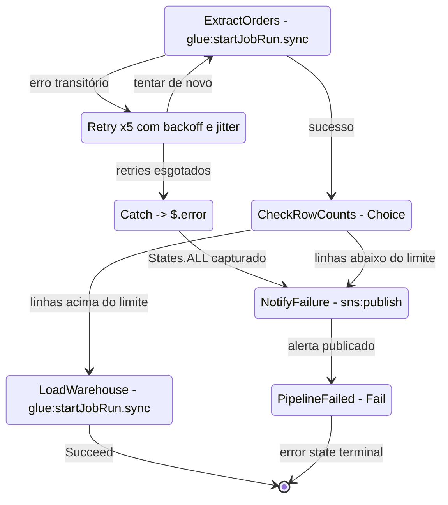
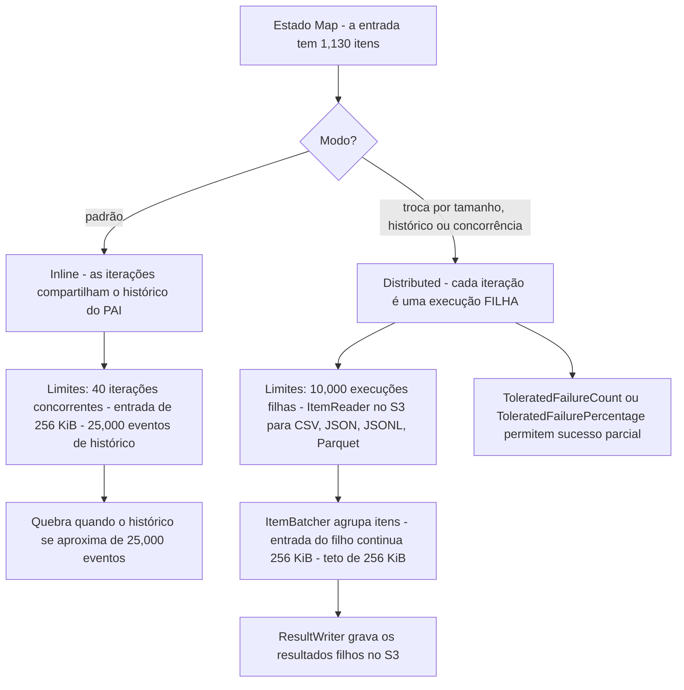
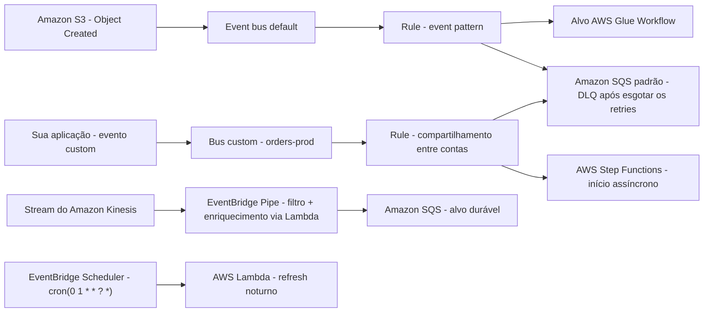
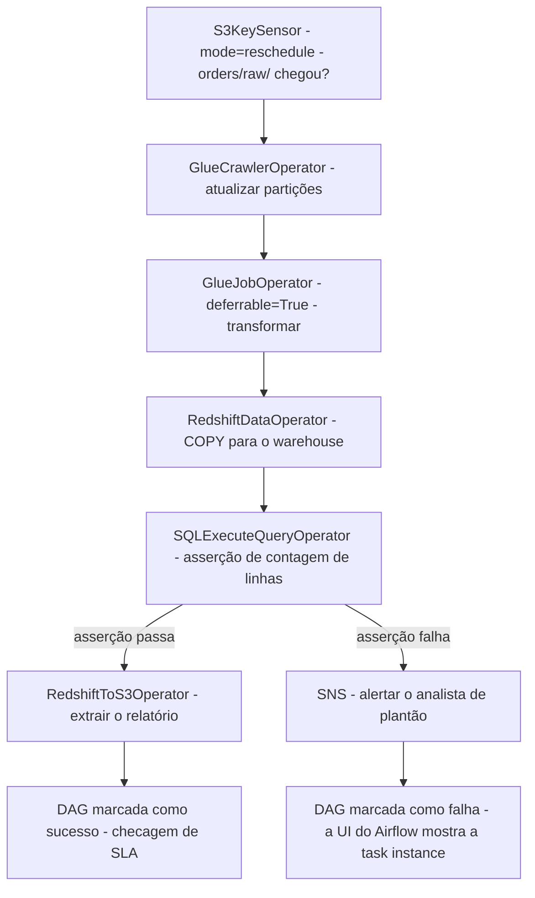
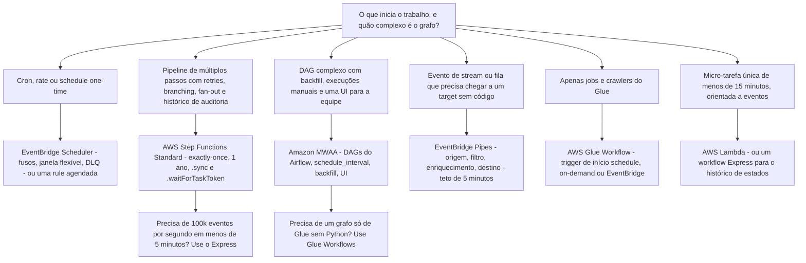

# Orquestrando Pipelines de Dados: Step Functions, EventBridge e Airflow

Um pipeline de dados que transforma corretamente mas **começa atrasado**, **roda duas vezes**, **pula em silêncio um passo que falhou** ou **não pode ser reproduzido** também falhou. Ingestão e transformação (Lições 02 e 03) decidem *o que* se move e *como* é remodelado; a orquestração decide **quando roda, em que ordem, o que acontece quando falha e como você se recupera**, e o DEA-C01 testa exatamente esse julgamento no Domínio 1, **Tarefa 1.3 "Orquestrar pipelines de dados"**, por meio de quatro habilidades: **1.3.1 serviços de orquestração** (AWS Lambda, Amazon EventBridge, Amazon MWAA, AWS Step Functions, AWS Glue workflows), **1.3.2 pipelines resilientes e escaláveis**, **1.3.3 workflows serverless** e **1.3.4 alertas via SNS e SQS** (guia do exame DEA-C01, acesso em outubro de 2026).

```text
====================================================================
 DEA-C01 DOMÍNIO 1 — TAREFA 1.3: ORQUESTRAR PIPELINES DE DADOS
====================================================================
  Step Functions .... Standard - 1 ano, exactly-once, histórico 90 dias,
                              $0.000025 por transição de estado
                              (em outubro de 2026)
                       Express  - 5 minutos, at-least-once, sem histórico
                              salvo, requisições + duração +
                              blocos de memória de 64 MB
  EventBridge ....... rules em UM bus: event pattern OU schedule
                       Pipes      - origem -> filtro -> enriquec. -> destino
                       Scheduler  - rate | cron | one-time, fusos horários,
                                    janelas flexíveis, DLQ por destino
  Amazon MWAA ....... Apache Airflow gerenciado: DAGs no S3, webserver +
                       scheduler + workers Celery no AWS Fargate,
                       banco de metadados Aurora PostgreSQL
  Glue Workflows .... jobs + crawlers + triggers rastreados como UM grafo
  Alertas ........... SNS (fan-out para humanos) + SQS (fila durável/DLQ)
---------------------------------------------------------------------
  HABILIDADES 1.3.1 serviços de orquestração  1.3.2 resiliente + escalável
            1.3.3 workflows serverless     1.3.4 alertas SNS/SQS
  NO ESCOPO Step Functions - EventBridge - MWAA - Glue - Lambda - SNS - SQS
====================================================================
```

Nesta lição você vai:

- separar workflows **Standard e Express** por duração, garantia de entrega, cobrança e padrões de integração suportados;
- ler e escrever **Amazon States Language**: os oito tipos de estado, `Retry`, `Catch`, nomes de erro embutidos e error states terminais;
- escolher entre **`Map` inline e Distributed** e dimensionar `ItemReader`, `ItemBatcher` e `ResultWriter`;
- construir rules do **EventBridge** sobre schedules e event patterns, entendendo **buses, targets, políticas de retry e DLQs**;
- usar **EventBridge Pipes** para fan-out de streams/filas sem código e **EventBridge Scheduler** para schedules conscientes de fuso horário;
- descrever um ambiente **Amazon MWAA**, seu armazenamento de DAGs, operators, classes de worker e versões do Airflow;
- ligar **AWS Glue Workflows e triggers** (schedule, on-demand, EventBridge, condicional) num único grafo;
- aplicar a **matriz de seleção de orquestração**: cron → EventBridge, retries em múltiplos passos → Step Functions, DAGs complexos → MWAA, fluxos reativos a eventos → Pipes;
- aplicar os padrões de **retry, DLQ, idempotência e backfill** que tornam um pipeline resiliente;
- estudar **quatro casos reais de clientes da AWS**, ler a **caixa de atualizações de outubro de 2026** e treinar com **14 questões no estilo de exame** mais verificações interativas.

---

## 1. A superfície de orquestração: cinco primitivas, um trabalho

### 1.1 O que a Tarefa 1.3 realmente pergunta

Toda questão de orquestração neste exame se reduz a quatro perguntas: **O que dá início à execução?** (schedule, evento, chamada de API, sucesso de uma etapa a montante) **Em que ordem os passos rodam?** (serial, paralelo, fan-out, condicional) **O que acontece na falha?** (retry, catch, alerta, estacionar numa DLQ) **Como rodar de novo sem corromper os dados?** (backfill, redrive, idempotência). Serviços diferentes respondem a essas quatro perguntas de maneiras diferentes, e os distratores do exame são sempre um *serviço correto usado para a pergunta errada*.

| Primitiva | O que detém | Serviço no escopo | Habilidade |
|---|---|---|---|
| **Máquinas de estados determinísticas de múltiplos passos** | Ordem, retries, branching, fan-out, histórico de auditoria | **AWS Step Functions** | 1.3.1 / 1.3.3 |
| **Reação a eventos e gatilho por tempo** | Buses, patterns, schedules, targets, Pipes, Scheduler | **Amazon EventBridge** | 1.3.1 |
| **Grafos acíclicos dirigidos com backfill e UI** | Dependências de tarefas, execuções manuais, janelas de catch-up | **Amazon MWAA** (Apache Airflow gerenciado) | 1.3.1 |
| **Grafo de ETL nativo dentro do serviço de transformação** | Jobs do Glue + crawlers + triggers condicionais | **AWS Glue Workflows** | 1.3.1 |
| **Cola de propósito único e alertas** | Micro-tarefas, notificações em fan-out, filas duráveis | **AWS Lambda**, **Amazon SNS**, **Amazon SQS** | 1.3.3 / 1.3.4 |

A categoria Application Integration na lista de serviços no escopo do DEA-C01 é exatamente esta família: **Amazon EventBridge, Amazon MWAA, Amazon SNS, Amazon SQS, AWS Step Functions**, com **AWS Lambda** como a computação que a maioria deles chama (página de serviços no escopo do DEA-C01, acesso em outubro de 2026).

### 1.2 Resiliente e escalável é uma checklist, não um adjetivo

A habilidade 1.3.2 espera que você nomeie os mecanismos, não que você os admire:

1. **Retry com backoff e jitter**: falhas transitórias são reexecutadas automaticamente antes que alguém seja acionado.
2. **Catch / error state**: falhas irreversíveis são roteadas para um lugar definido em vez de desaparecerem.
3. **Dead-letter queue (DLQ)**: eventos ou mensagens que esgotaram os retries são preservados para inspeção e reprodução.
4. **Idempotência**: a mesma entrada processada duas vezes produz a mesma saída uma única vez (escritas condicionais, chaves de idempotência, job bookmarks).
5. **Backfill e redrive**: reexecutar deliberadamente uma janela de histórico ou um conjunto de execuções que falharam.
6. **Alertas**: SNS para humanos, SQS para máquinas, alarmes do CloudWatch nas métricas (`ExecutionsFailed`, `ExecutionThrottled`, `FailedInvocations`, `InvocationThrottleCount`).

- **📚 Você sabia?** Os quatro nomes de métrica do CloudWatch acima são o atalho de troubleshooting mais barato do exame: `ExecutionsFailed` e `ExecutionThrottled` pertencem ao **Step Functions**, enquanto `FailedInvocations` e `InvocationThrottleCount` pertencem aos targets e Pipes do **EventBridge**. Uma questão que associa a métrica errada ao serviço errado está testando se você sabe *qual camada* falhou: a máquina de estados ou a entrega do evento ao seu target (documentação do AWS CloudWatch, acesso em outubro de 2026).

---

## 2. AWS Step Functions: Standard versus Express

### 2.1 O eixo central do exame

A AWS oferece dois tipos de workflow, e a diferença não é velocidade: é **duração, garantia de entrega, medidor e padrões de integração disponíveis** (guia do desenvolvedor do AWS Step Functions, *Standard vs Express*, acesso em outubro de 2026):

| | **Workflow Standard** | **Workflow Express** |
|---|---|---|
| Duração máxima | **1 ano** | **5 minutos** |
| Garantia de entrega | Execução de workflow **exactly-once** | Execução de workflow **at-least-once** |
| Taxa de início | 2,000 execuções/segundo | 100,000 execuções/segundo |
| Taxa de transições | 4,000/segundo | Ilimitada |
| Cobrança | **Por transição de estado** ($0.000025 cada, em outubro de 2026) | **Por requisição + duração + blocos de memória de 64 MB** |
| Free tier | 4,000 transições de estado/mês (em outubro de 2026) | nenhum em transições |
| Histórico de execução | Armazenado por **90 dias**, teto rígido de **25,000 eventos** | Não armazenado; **CloudWatch Logs** (custo extra) |
| Padrões de integração | Request-response **+ `.sync` + `.waitForTaskToken`** | **Somente request-response** |
| Payload de estado | 256 KiB | 256 KiB |
| Execuções abertas | 1,000,000 | Não conta para esse teto |
| Trabalho típico | ETL de várias horas, aprovação humana, trilhas de auditoria | Processamento de eventos em alto volume, micro-fluxos sub-segundo |

**A regra de uma linha:** tudo que precisa **esperar** (`.sync`, `.waitForTaskToken`, uma aprovação humana de dias, uma execução de um ano) ou que precisa ser **exactly-once** é um workflow **Standard**; tudo que é **curto, de alto volume e idempotente** é um workflow **Express**.

> [!WARNING]
> ⚠️ **Express não é "Standard, só que mais rápido."** Ele é **at-least-once**, limitado a **5 minutos**, **não armazena histórico de execução** e suporta **apenas integrações request-response**: sem `.sync`, sem `.waitForTaskToken`. Uma alternativa que oferece Express para um requisito de "esperar três dias pelo aceite, continuar em seguida, com trilha de auditoria completa" está errada em três pontos: o teto de 5 minutos, o padrão de callback ausente e o histórico armazenado ausente.

### 2.2 Exemplo resolvido E1: precificando um pipeline Standard

Um pipeline noturno tem **9 transições de estado por execução**; um estado faz retry **3 vezes** antes de ter sucesso, acrescentando 3 transições por execução (retries são transições de estado cobráveis). Ele roda **10,000 vezes por dia** num mês de 30 dias (preços do Step Functions, us-east-1, em outubro de 2026):

```text
transições por execução   = 9 + 3 = 12
transições por mês        = 12 x 10,000 x 30 = 3,600,000
free tier                 =        -   4,000
transições cobradas       = 3,596,000
custo = 3,596,000 x $0.000025          = $89.90 / mês
```

Duas lições saem daí: **retries custam dinheiro** (são transições), e um **estado `Wait` em loop** é um medidor que você liga de propósito.

### 2.3 Exemplo resolvido E2: mesmo pipeline, dois tipos de workflow

O mesmo job de **6 estados, 4 segundos, menos de 64 MB**, rodado **1,000 vezes**:

```text
Standard: 6 transições x 1,000 execs = 6,000 x $0.000025      = $0.150
Express : 6,000 requisições x $1.00 / 1,000,000                = $0.006
          duração 1,000 x 4 s x 0,0625 GB x $0.00001667/GB-s   = $0.0004
          total Express                                       ~= $0.006
```

Mais de **20x mais barato** para o Express nesse formato, e a diferença cresce conforme a duração aumenta, porque o Express cobra pela duração enquanto o Standard cobra apenas transições. O próprio post de otimização de custos da AWS de 2022 ilustra a mesma assimetria com uma comparação de **$0.42 no Standard versus $0.01 no Express** (AWS News Blog, 2022-08-30). A questão de exame corolária é a inversa: um workflow que **espera 12 horas** num estado `Wait` queimaria transições se você fizesse polling, enquanto um token de callback espera de graça (veja E9).

- **📚 Você sabia?** Os workflows Express são o único tipo de workflow que você pode iniciar com `StartSyncExecution` pelo console, e esse resultado síncrono do console **expira após 60 segundos**, então qualquer coisa mais longe pertence a uma chamada de SDK/CLI. Aninhar também é oficialmente recomendado: um **pai Standard pode iniciar um filho Express aninhado**, e iniciar um workflow aninhado custa exatamente **uma transição de estado** (páginas de preços e de boas práticas do AWS Step Functions, acesso em outubro de 2026).

---

## 3. Amazon States Language: os oito tipos de estado

### 3.1 O vocabulário

Máquinas de estados são definidas em **Amazon States Language (ASL)**: uma linguagem declarativa baseada em JSON (especificação states-language.net, acesso em outubro de 2026):

| Tipo de estado | O que faz | Detalhe relevante para o exame |
|---|---|---|
| **`Task`** | Executa trabalho: chama Lambda, integrações do Step Functions ou o SDK | Carrega `Retry` e `Catch`; pode usar `.sync` ou `.waitForTaskToken` |
| **`Choice`** | Faz branching sobre uma comparação | O ramo sem correspondência levanta `States.NoChoiceMatched` |
| **`Wait`** | Pausa por segundos, por um timestamp ou até um prazo | Transições cobráveis se você puser em loop (veja E9) |
| **`Parallel`** | Executa ramos concorrentemente e depois junta | Fan-out/fan-in; cada ramo pode ter seu próprio tratamento de erros |
| **`Map`** | Itera um array (ou um dataset) | **40** iterações concorrentes em linha versus **10,000** no Distributed (Seção 4) |
| **`Pass`** | Remodelagem pura de dados: sem trabalho | Injeta ou reestrutura a entrada com `Result` |
| **`Succeed`** | Sucesso terminal | Para sem erro |
| **`Fail`** | Falha terminal | Carrega as strings `Error` e `Cause` |

Cada estado declara `Type` e ou `Next` **xor** `End`, além dos filtros de entrada/saída `InputPath`, `ResultPath`, `OutputPath`, um `TimeoutSeconds` opcional e os arrays opcionais `Retry` e `Catch`. A linguagem de consulta é **JSONPath** (caminhos escritos com sufixo `.$`, por exemplo `"Bucket.$": "$.bucket"`) ou **JSONata** (blocos ``). Caminhos de contexto alcançam a própria execução: `$$.Execution.Id`, `$$.State.Name`, **`$$.Task.Token`** e `$$.Map.Item.*`.

### 3.2 Exemplo resolvido E3: um fragmento real de ASL

```json
{
  "Comment": "Nightly orders ETL with retry, catch and a branch",
  "StartAt": "ExtractOrders",
  "States": {
    "ExtractOrders": {
      "Type": "Task",
      "Resource": "arn:aws:states:::glue:startJobRun.sync",
      "TimeoutSeconds": 3600,
      "Retry": [
        { "ErrorEquals": ["States.Timeout"], "MaxAttempts": 0 },
        { "ErrorEquals": ["States.ALL"], "IntervalSeconds": 30,
          "MaxAttempts": 5, "BackoffRate": 2.0, "JitterStrategy": "FULL" }
      ],
      "Catch": [
        { "ErrorEquals": ["States.ALL"], "ResultPath": "$.error",
          "Next": "NotifyFailure" }
      ],
      "Next": "CheckRowCounts"
    },
    "CheckRowCounts": {
      "Type": "Choice",
      "Choices": [
        { "Variable": "$.row_count", "NumericGreaterThan": 1000,
          "Next": "LoadWarehouse" }
      ],
      "Default": "NotifyFailure"
    },
    "LoadWarehouse": {
      "Type": "Task",
      "Resource": "arn:aws:states:::glue:startJobRun.sync",
      "End": true
    },
    "NotifyFailure": {
      "Type": "Task",
      "Resource": "arn:aws:states:::sns:publish",
      "Next": "PipelineFailed"
    },
    "PipelineFailed": {
      "Type": "Fail",
      "Error": "PipelineFailed",
      "Cause": "Extract or load did not meet the row-count contract"
    }
  }
}
```

Leia como uma história: o job do Glue roda **de forma síncrona** (`.sync` espera o job terminar), **timeouts nunca são reexecutados** enquanto todo o resto tenta de novo até 5 vezes com backoff exponencial e jitter completo, erros irreversíveis são **capturados em `$.error`** e roteados para um alerta do SNS, um `Choice` impõe um contrato de dados, e o estado terminal é um `Fail` explícito: a definição de **error state** do exame.



### 3.3 Mecânica do retry: os arrays são varridos de cima para baixo

- **Retriers** (`Retry[]`) são varridos **na ordem do array**; a **primeira** entrada cujo `ErrorEquals` casa é a que manda. É por isso que `["States.Timeout"]` com `MaxAttempts: 0` precisa vir **antes** de `["States.ALL"]`: essa é a configuração canônica de *"repetir tudo exceto timeouts"*.
- **Padrões** (quando você omite um campo): `IntervalSeconds` **1**, `MaxAttempts` **3** (ou seja, **4 tentativas no total**), `BackoffRate` **2.0** (precisa ser ≥ 1.0), `JitterStrategy` **NONE** a menos que você defina `FULL`.
- **Catchers** (`Catch[]`) rodam **apenas** quando não há entrada de `Retry` correspondente ou os retries se esgotaram; cada um carrega `ErrorEquals`, `Next` e normalmente um `ResultPath` como `$.error`, para que o payload da falha não sobrescreva seus dados.

### 3.4 Nomes de erro embutidos que você não deve misturar

| Nome de erro | Regra |
|---|---|
| **`States.ALL`** | Precisa aparecer **sozinho** no seu array `ErrorEquals` e **por último** no array `Catch`; **não pode** capturar `States.DataLimitExceeded` nem `States.Runtime` |
| **`States.TaskFailed`** | curinga para qualquer falha de task **exceto** `States.Timeout` |
| **`States.Timeout`** | A task excedeu `TimeoutSeconds` (ou o heartbeat) |
| **`States.DataLimitExceeded`** | **Terminal**, o payload do estado passou do limite de 256 KiB; não pode ser capturado por `States.ALL` |
| **`States.Runtime`** | Defeito na definição da máquina de estados; **nunca** casado por `States.ALL` |
| **`States.Permissions` / `States.BranchFailed` / `States.NoChoiceMatched`** | Falha de IAM / um ramo de `Parallel` ou `Map` falhou / `Choice` não casou com nada |
| Específico de serviço | `Lambda.ServiceException`, `DynamoDB.ConditionalCheckFailedException`, `AmazonECS.Unknown`, … |

### 3.5 Exemplo resolvido E4: aritmética do tempo de retry

Com os padrões (`IntervalSeconds: 1`, `BackoffRate: 2.0`, `MaxAttempts: 3`):

```text
tentativa 1 falha -> espera  1 s
tentativa 2 falha -> espera  2 s
tentativa 3 falha -> espera  4 s
tentativa 4 falha -> desiste após 1 + 3 = 4 tentativas no total
espera total      = 1 + 2 + 4 = 7 segundos  (+ tempo de execução de cada tentativa)
```

Defina `IntervalSeconds: 30`, `MaxAttempts: 5`, `BackoffRate: 2.0` e as esperas passam a ser 30 + 60 + 120 + 240 + 480 = **930 segundos (15.5 minutos)** antes de a task ser declarada falha: a configuração do E3. `JitterStrategy: "FULL"` randomiza cada atraso dentro da sua janela, para que uma frota de execuções não faça retry em uníssono (documentação de tratamento de erros do AWS Step Functions, acesso em outubro de 2026).

### 3.6 Task tokens: esperar sem custar nada

Para trabalho que nenhum padrão `.sync` cobre, uma aprovação humana, uma API de terceiros, um worker externo, a máquina de estados injeta o token e espera:

```json
{
  "Type": "Task",
  "Resource": "arn:aws:states:::sqs:sendMessage.waitForTaskToken",
  "HeartbeatSeconds": 86400,
  "Parameters": {
    "QueueUrl.$": "$.queue_url",
    "MessageBody.$": "$.payload",
    "TaskToken.$": "$$.Task.Token"
  },
  "Next": "Approved"
}
```

Mais tarde, o worker externo chama **`SendTaskSuccess`**, **`SendTaskFailure`** ou **`SendTaskHeartbeat`**. A espera é **ilimitada** (até o limite de 1 ano do Standard), **não é cobrável** e **existe só no Standard**, então defina sempre `HeartbeatSeconds`, caso contrária um callback perdido fica pendurado até o timeout do estado em vez de falhar rápido com `States.Timeout`.

- **📚 Você sabia?** Um estado de aprovação humana que fica aberto três dias custa **zero transições de estado por hora**: as transições foram gastas entrando e saindo do estado, não esperando dentro dele. Essa assimetria é a razão pela qual os designs de longa duração mais baratos colocam um **`.waitForTaskToken`** onde um loop de `Wait` com polling viveria: 1,000 polls por hora custam $3.00 por mês, um callback com token custa uma única transição (exemplo resolvido E9; preços do Step Functions, em outubro de 2026).

### 3.7 Integrações de serviço: qual padrão cada serviço suporta

O Step Functions entrega **integrações otimizadas** (o serviço interpreta a chamada) mais uma **integração genérica de AWS SDK** que cobre **mais de 220 serviços da AWS** (AWS What's New, 2026-03-26: **+28 serviços / 1,100+ APIs**):

| Integração | Request-response | `.sync` (espera a conclusão) | `.waitForTaskToken` (callback) |
|---|---|---|---|
| **AWS Glue** (`glue:startJobRun`) | ✔ | ✔ |: |
| **Amazon EMR** | ✔ | ✔ (`addStep.sync`, `createCluster.sync`) |: |
| **Amazon ECS / AWS Batch / Amazon Athena / SageMaker / CodeBuild** | ✔ | ✔ | ✔ (ECS) |
| **AWS Lambda** | ✔ |: (sem `.sync`) | ✔ |
| **Amazon SQS / Amazon SNS / Amazon API Gateway / Amazon EventBridge** | ✔ |: | ✔ |
| **Amazon DynamoDB** | ✔ | **nenhum** | **nenhum** |
| Step Functions aninhado | ✔ | ✔ | ✔ |

Otimizado ≠ SDK: a integração **otimizada** do Lambda faz o parse do payload de resposta automaticamente, a integração otimizada do Glue devolve `JobName` + `JobRunID`, e o EMR renomeia `JobFlowId` para `ClusterId`. Chamadas de callback e `.sync` também precisam de permissões extras de IAM (`glue:GetJobRun`, `ecs:RunTask` mais `iam:PassRole`): um favorito do exame quando um pipeline "funciona no console e falha em produção".

---

## 4. O estado Map: inline versus Distributed

### 4.1 Quando acontece a troca

`Map` itera um array de entrada. **Inline** (o padrão) executa cada iteração dentro do próprio histórico de execução do pai; o modo **Distributed** executa cada iteração como uma **execução de workflow filho** com seu próprio histórico (guia do desenvolvedor do AWS Step Functions, *Map state*, acesso em outubro de 2026):

| | **Map Inline** | **Map Distributed** |
|---|---|---|
| Onde as iterações rodam | Histórico de execução do pai | **Execuções filhas** (Standard ou Express) |
| Concorrência máxima | **40** | **10,000** (padrão não definido/0) |
| Entrada | Array JSON, ou uma lista de objetos do S3 | Payload JSON **ou** um dataset grande no S3: CSV, JSON, JSONL, Parquet, lista de objetos, inventory |
| Troque para Distributed quando |: | entrada **> 256 KiB**, o histórico excederia **25,000 eventos** ou a concorrência **> 40** |
| Limite de payload do filho | n/a | 256 KiB por filho (8 MB por item se `ItemSelector` encolher) |
| Resultados | Devolvidos em linha | Gravados no **S3** via **`ResultWriter`** |
| Tolerância a falha | Tudo ou nada | `ToleratedFailureCount` / `ToleratedFailurePercentage` |

A configuração fica em `ProcessorConfig: { "Mode": "DISTRIBUTED", "ExecutionType": "EXPRESS" | "STANDARD" }` mais os campos abaixo:

- **`ItemReader`** (+ `ReaderConfig.InputType`): de onde vêm os itens; `MaxItems` ≤ **100,000,000**, e `MaxItems` XOR `MaxItemsPath`.
- **`ItemsPath` / `ItemSelector`**: quais itens, e como cada um é remodelado antes de o filho rodar.
- **`ItemBatcher`**: `MaxItemsPerBatch`, `MaxItemsPerBatchBytes` (≤ **256 KiB**).
- **`MaxConcurrency` / `MaxConcurrencyPath`**: nunca defina acima da capacidade a jusante.
- **`ResultWriter`**: os resultados caem no S3, não no histórico do pai.



### 4.2 Exemplo resolvido E5: aritmética do ItemBatcher

Um Map Distributed faz fan-out de **1,130 objetos** com `MaxItemsPerBatch: 100`:

$$
\text{batches} = \left\lceil \frac{1{,}130}{100} \right\rceil = \lceil 11.3 \rceil = \mathbf{12 \ batches}
$$

Lotes importam porque **cada lote vira uma execução filha**, e cada execução filha custa pelo menos uma transição de estado (ou, para filhos Express, uma requisição). **1,130 filhos** é 1,130 execuções; **12 filhos** é 12: mesmo trabalho, uma fração do overhead. Para um backfill de S3 com **1,000,000 de objetos** a aritmética é diferente em natureza: o Map inline esgotaria o histórico de **25,000 eventos** muito antes do último objeto, então você precisa de `ItemReader` sobre `s3:listObjectsV2`, `ItemBatcher`, `MaxConcurrency` dimensionado para a capacidade a jusante (por exemplo 1,000), filhos com `ExecutionType: "EXPRESS"`, `ToleratedFailurePercentage: 1` e `ResultWriter` para o S3.

> [!IMPORTANT]
> ⚠️ **O limite de 10,000 do Distributed Map conta execuções filhas, não itens.** Os itens são limitados por `ItemReader.MaxItems` (**100,000,000**), e os limiares de troca de modo são **256 KiB de entrada**, **25,000 eventos de histórico** ou **40 iterações concorrentes**. Uma alternativa que diz "o Distributed Map está limitado a 10,000 objetos" confundiu os dois contadores.

---

## 5. Amazon EventBridge: rules, buses, retries e DLQs

### 5.1 Três tipos de bus, uma rule por bus

| Tipo de bus | O que carrega | Compartilhamento |
|---|---|---|
| **Default** | Eventos dos serviços da AWS na sua conta | Automático |
| **Custom** | Eventos emitidos pelas suas aplicações | Compartilhável entre contas/regiões via resource policy |
| **Partner** | Eventos de provedores SaaS | Via a integração do parceiro |

Uma rule observa **exatamente um** bus. Schedules **nunca** são permitidos em **partner event buses**; a referência da API documenta expressões de schedule nos buses default e custom (API do AWS EventBridge `PutRule`, acesso em outubro de 2026), então trate *"schedule num bus partner"* como sempre errado.

### 5.2 Duas formas de rule, e um schedule

Uma rule casa com um **event pattern** (filtragem baseada em conteúdo sobre campos JSON, até **2,048 caracteres**) ou com uma **expressão de schedule**, ou ambos:

```text
rate(5 minutes)          -> a cada 5 minutos, numa grade de precisão de 1 minuto, UTC+0
cron(0 20 * * ? *)       -> 20:00 UTC todo dia (a expressão que a AWS publica
                             como exemplo de schedule)
```

### 5.3 Exemplo resolvido E6: escrevendo a rule do cron

Requisição: *"iniciar o load do warehouse às 20:00 UTC todo dia, e também sempre que um arquivo aterrissar no prefixo raw."* Uma rule não faz as duas coisas limpas numa única expressão do jeito que o exame espera: você cria **duas rules no mesmo bus**:

```json
{
  "Name": "nightly-warehouse-load",
  "ScheduleExpression": "cron(0 20 * * ? *)",
  "State": "ENABLED",
  "Targets": [
    { "Id": "start-pipeline",
      "Arn": "arn:aws:states:us-east-1:111122223333:stateMachine:NightlyETL",
      "RoleArn": "arn:aws:iam::111122223333:role/events-to-stepfunctions" }
  ]
}
```

```json
{
  "Name": "raw-object-created",
  "EventPattern": {
    "source": ["aws.s3"],
    "detail-type": ["Object Created"],
    "detail": {
      "bucket": { "name": ["raw-lake"] },
      "object": { "key": [{ "prefix": "incoming/" }] }
    }
  },
  "Targets": [
    { "Id": "start-glow-workflow",
      "Arn": "arn:aws:states:us-east-1:111122223333:stateMachine:NightlyETL" }
  ]
}
```

Repare nos detalhes que o exame cobra: a precisão do schedule é de **1 minuto** em **UTC+0**, então `cron(0 20 * * ? *)` é 20:00 UTC e *não* horário local; **os targets do Step Functions são invocados de forma assíncrona**; e uma rule carrega no máximo **5 targets**.

### 5.4 Política de retry e dead-letter queue

Por target você pode sobrescrever a política de retry de entrega e anexar uma DLQ (AWS EventBridge, *Retry policy and DLQ*, acesso em outubro de 2026):

| Configuração | Faixa | Padrão |
|---|---|---|
| `MaxRetryAttempts` | **0 to 185** | **185** (console) |
| `MaxEventAgeInSeconds` | **60 to 86,400** | 86,400 (**24 horas**) |
| Efeito dos padrões | Backoff exponencial **com jitter** por até **24 horas** e até **185 tentativas** |: |
| DLQ | **Fila padrão do Amazon SQS, mesma região** | nenhuma |

### 5.5 Exemplo resolvido E7: de retries de 24 horas para uma DLQ de 10 minutos

Uma equipe quer que as falhas apareçam em **10 minutos**, não em um dia:

```json
{
  "Id": "target-stepfunctions",
  "Arn": "arn:aws:states:us-east-1:111122223333:stateMachine:NightlyETL",
  "RetryPolicy": {
    "MaximumRetryAttempts": 5,
    "MaximumEventAgeInSeconds": 300
  },
  "DeadLetterConfig": {
    "Arn": "arn:aws:sqs:us-east-1:111122223333:events-dlq"
  }
}
```

```text
Política padrão: até 185 tentativas em 24 h    -> silencioso, lento, caro
Esta política  : até 5 tentativas em 300 s     -> a mensagem cai na DLQ
                 depois de 10 minutos, o alarme dispara em QueueDepth,
                 o engenheiro reproduz
```

A DLQ precisa ser uma **fila padrão do SQS na mesma região**: **uma fila FIFO não pode ser usada como DLQ do EventBridge**. As mensagens que chegam carregam atributos como `ERROR_CODE`, `EXHAUSTED_RETRY_CONDITION` e `RETRY_ATTEMPTS`, e uma fila criptografada com KMS precisa de `kms:Decrypt` para `events.amazonaws.com`.

- **📚 Você sabia?** Algumas falhas **nunca são reexecutadas**: uma permissão ausente, um recurso deletado ou DNS ruim vai **direto para a DLQ** com zero retries, e é por isso que "nenhum retry aconteceu" num ticket de suporte geralmente significa um problema de IAM ou de recurso, e não um bug na política de retry. E as DLQs do EventBridge são **filas padrão do SQS** comuns: você não pode usar uma fila FIFO, então uma questão que oferece "SQS FIFO como DLQ do EventBridge" é um distrator embutido (documentação de DLQ do AWS EventBridge, acesso em outubro de 2026).

### 5.6 Quotas que valem a pena decorar (em outubro de 2026)

| Quota | Valor |
|---|---|
| Event buses por região | **100** |
| Rules por bus por região | **300** (100 em af-south-1 e eu-south-1) |
| Rules com patterns curinga por bus | **30** |
| Targets por rule | **5** (não ajustável) |
| Tamanho do event pattern | **2,048 caracteres** |
| Throughput de destination de API | **300 requisições/segundo** |



- **📚 Você sabia?** O EventBridge também orquestra pipelines de *segurança*, não só de dados: o Amazon Macie emite seus findings para o bus default, e uma rule pode roteá-los para uma Lambda ou para um fluxo de remediação do Step Functions com a mesma política de retry e a mesma DLQ padrão do SQS que você usa para um load de warehouse: a conexão por trás da **95% de precisão na descoberta de dados sensíveis** e da **redução de 80% no tempo necessário para descobrir dados sensíveis** reportadas pela Oportun. A habilidade de orquestração não muda (casar em `source` / `detail-type`, limitar os retries, tornar a remediação idempotente); só o produtor muda (material de cliente do AWS Macie e o deck da sessão SEC215 do re:Invent, acesso em outubro de 2026).

---

## 6. EventBridge Pipes e EventBridge Scheduler

### 6.1 Pipes: origem → filtro → enriquecimento → destino, sem código

Pipes são **ponto a ponto** (não pub/sub): uma origem, um **filtro** opcional (só os eventos que casam são cobrados), uma etapa de **enriquecimento** opcional (Lambda ou Step Functions) e um destino (documentação do AWS EventBridge Pipes, acesso em outubro de 2026).

| Aspecto | Detalhe |
|---|---|
| **Origens** | DynamoDB stream, stream do Kinesis, Amazon MQ (ActiveMQ/OpenWire, RabbitMQ/AMQP 0-9-1), Amazon MSK (incluindo Serverless), **SQS**, Apache Kafka autogerenciado (Confluent Cloud, Redpanda) |
| **Destinos** | API destination, API Gateway, Batch, log group do CloudWatch, task do ECS, event bus da mesma região, Firehose, Kinesis, Lambda, Redshift Data API, SNS, SQS, **Step Functions**, Timestream |
| **Payload** | **6 MB** nos Pipes; o limite efetivo é o **menor** entre Pipes e destino (Lambda 6 MB, event bus 1 MB, **Step Functions 256 KB**) |
| **Batching** | O tamanho do lote da origem não pode exceder o máximo do destino, o Kinesis permite 10,000 registros, mas um destino SQS permite só 10, então o pipe fica limitado a **10** |
| **Concorrência** | DynamoDB/Kinesis = `ParallelizationFactor` × shards; Kafka = partições (teto 1,000); Amazon MQ 5; SQS 1,250 |
| **Teto rígido** | Timeout de execução do pipe de **5 minutos**, incluindo enriquecimento e destino: não elevável |
| **Preços** | **$0.40 por milhão de requisições**, cada bloco de **64 KB** conta como uma requisição, e **apenas os eventos filtrados são cobrados** (em outubro de 2026) |

### 6.2 Exemplo resolvido E8: cobrança dos Pipes com um filtro

Um pipe consome **10,000,000 de mensagens SQS**, um filtro deixa passar **25%**, e o batching é de **5 mensagens por requisição** (exemplo da página de preços do Step Functions, em outubro de 2026):

```text
eventos após o filtro = 10,000,000 x 0.25 = 2,500,000
requisições          = 2,500,000 / 5     =   500,000
custo                = 500,000 / 1,000,000 x $0.40 = $0.20
```

**$0.20 para dez milhões de mensagens**: porque o filtro roda antes da cobrança. O princípio examinável: **filtre cedo, faça batching até o máximo do destino e lembre-se do teto de 5 minutos do pipe.**

### 6.3 Scheduler: schedules sem rule

A AWS recomenda o **EventBridge Scheduler** para invocar targets por schedule, e o console rotula as **rules** agendadas como *"(legacy)"* (documentação do AWS EventBridge Scheduler, acesso em outubro de 2026).

| Recurso | EventBridge **Scheduler** | **Rule** agendada |
|---|---|---|
| Tipos de schedule | **rate**, **cron**, **one-time** (`at(2026-11-01T09:00:00)`) | apenas `rate()` e `cron()` |
| Fusos horários | **Fusos IANA**; horário de verão tratado automaticamente | **somente UTC** |
| Janela flexível | `Mode: FLEXIBLE` + `MaximumWindowInMinutes` **1 to 1440** | nenhuma |
| Targets | Templated (Lambda, SQS, Kinesis, SNS, ECS, Batch, **start do Glue**, **start do Step Functions**, SageMaker, SSM, API destination) ou universal (qualquer API da AWS) | Máx. **5** targets |
| Retry/DLQ por target | `RetryPolicy` ≤ **185** retries, idade ≤ **24 h**, mais uma **DLQ** | Mesmas faixas de retry |
| Quotas (em outubro de 2026) | **10,000,000** schedules/região, **500** grupos, **10 TPS** por schedule, precisão de **60 segundos** | **300** rules/bus |

A **janela de tempo flexível** é o recurso em que as questões de exame se apoiam: `MaximumWindowInMinutes: 60` significa que um job noturno agendado para 01:00 pode disparar **em qualquer momento entre 01:00 e 02:00**: perfeito para janelas de batch que precisam absorver picos de carga, errado para um job que precisa começar exatamente às 01:00:00.

### 6.4 Quatro coisas que "rodam por schedule" (não misture)

| Mecanismo | Escopo | Precisão / fuso | Melhor para |
|---|---|---|---|
| **EventBridge Scheduler** | Qualquer target, fusos horários, one-time, janela flexível | 60 s, fusos IANA | Schedules conscientes de fuso com DLQ |
| **Rule do EventBridge (schedule)** | Até 5 targets num bus | 1 min, **UTC** | Schedules legados que também precisam de um event pattern |
| **Trigger agendado do Glue** | **Apenas** jobs e crawlers do Glue | cron do Glue | Iniciar o próprio grafo do Glue |
| **`schedule_interval` do Airflow** | Um DAG, com **backfill** | parsing do Airflow | DAGs complexos que precisam de execuções de catch-up |

---

## 7. Amazon MWAA: Apache Airflow gerenciado

### 7.1 O que um ambiente realmente é

Um **ambiente Amazon MWAA** é um pacote de componentes gerenciados (documentação do AWS MWAA, acesso em outubro de 2026):

```text
 ------------------------------------------------------------------
  AMBIENTE MWAA
 ------------------------------------------------------------------
  DAGs + plugins ...... s3://seu-bucket/  (DAGs no S3, requirements.txt,
                         plugins.zip; tamanho combinado < 1 GB recomendado,
                         a instalação precisa terminar em 10 minutos)
  Webserver(s) ........ UI do Airflow, 1-5 por ambiente
  Scheduler(s) ......... faz o parse dos DAGs e agenda execuções; o triggerer
                         fica aqui (mais schedulers = mais triggerers)
  Workers .............. task instances do Celery no AWS Fargate, 20 GB de
                         armazenamento de task cada, com autoscaling automático
  Banco de metadados ... Amazon Aurora PostgreSQL (gerenciado pela AWS)
  Fila Celery .......... fila Amazon SQS gerenciada pela AWS que você NÃO PODE
                         criar nem substituir
 ------------------------------------------------------------------
```

Você abre mão de SSH, **imagens customizadas**, filas SQS customizadas e escolha de executor, **somente Celery**, em troca de a AWS rodar o plano de controle, o Aurora, o Fargate, o logging e a sua fiação de VPC. Atualizações em DAGs existentes são percebidas em cerca de **30 segundos**.

### 7.2 Classes de worker e autoscaling (em outubro de 2026)

| Classe | Máx. de DAGs | Máx. de tasks num worker | Autoscaling |
|---|---|---|---|
| `mw1.micro` | 25 | 3 | **Sem autoscaling** |
| `mw1.small` | 50 | 5 | Sim |
| `mw1.medium` | 250 | 10 | Sim |
| `mw1.large` | 1,000 | 20 | Sim |
| `mw1.xlarge`  | 2,000 | 40 | Sim |
| `mw1.2xlarge` | 4,000 | 80 | Sim |

Workers são adicionados conforme `(RunningTasks + QueuedTasks) / tasks-por-worker`, até `max-workers`. O padrão de `celery.worker_autoscale` por classe (3 / 5 / 10 / 20 / 40 / 80) é o que manda, e **`celery.worker_concurrency` é sobrescrito**: definir não faz nada.

### 7.3 Operators e dependências

Os DAGs ficam no **S3**, as dependências em `requirements.txt` (pip3) e `plugins.zip`; um novo `requirements.txt` exige uma atualização do ambiente. Os operators que importam para este exame:

| Operator / sensor | Papel |
|---|---|
| `S3KeySensor` (frequentemente `mode="reschedule"`) | Esperar um arquivo aterrissar |
| `GlueCrawlerOperator` / `GlueCrawlerSensor` | Rodar ou aguardar um crawler |
| **`GlueJobOperator`** (+ `Sensor`, `deferrable=True`) | Rodar ou aguardar um job do Glue: `AWSGlueJobOperator` está **depreciado** |
| `RedshiftDataOperator` | Rodar SQL pela Redshift Data API |
| `SQLExecuteQueryOperator` | Execução genérica de SQL |
| `RedshiftToS3Operator` | Descarregar dados do warehouse para o S3 |

Versões disponíveis em outubro de 2026: **Airflow 3.2.x** (anunciado em **2026-04-01**), **3.0.x** e **2.11.0** (lançado em **2026-01-07**, Python 3.12), além das linhas mais antigas 2.9.x/2.7.x/2.4.x. O Airflow 3 adiciona agendamento consciente de assets e partições, histórico de auditoria com humano no loop e `PythonOperator` assíncrono.



### 7.4 Exemplo resolvido E9: precificando um ambiente MWAA

O próprio exemplo worked da AWS para um ambiente `mw1.small` num mês de **31 dias**: **1 ambiente**, **49 workers rodando 1 hora por dia**, **10 GB** de armazenamento do banco de metadados (preços do MWAA, us-east-1, em outubro de 2026):

```text
ambiente      744 h x $0.49          = $364.56
workers extra 49 x 31 h x $0.055     =  $83.55
banco metad.  10 GB x $0.10/GB-mês   =   $1.00
                                              -------
total                                   $449.11 / mês
```

Para comparação, `mw1.large` custa **$0.99/h** para o ambiente, com workers e schedulers extras a **$0.22/h** e um web server extra a **$0.11/h**, e o MWAA Serverless cobra as AWS Managed Tasks a **$0.080 por hora de tempo de task** (mínimo de 1 minuto, cobrança de 1 segundo). Outras quotas: **10 ambientes por região** (5 de `mw1.xlarge`/`mw1.2xlarge`), **25 workers por ambiente** (50 após aumento de quota), **5 webservers**, **20 GB** de armazenamento de task.

- **📚 Você sabia?** A fila Celery do MWAA é uma **fila Amazon SQS gerenciada pela AWS que você não pode criar, substituir ou configurar**, e é por isso que questões que oferecem "trazer sua própria fila SQS para o MWAA" ou "ajustar `celery.worker_concurrency`" estão erradas. O que você *ajusta* de verdade é a **classe de worker**, e essa única escolha move tanto a capacidade de DAGs quanto a concorrência padrão de tasks: `mw1.small` → `mw1.medium` muda o padrão de **5 para 10** tasks por worker (documentação do AWS MWAA, acesso em outubro de 2026).

### 7.5 MWAA Serverless

O **MWAA Serverless** elimina o ambiente sempre ligado: DAGs em YAML mais um pacote de código no S3, agendamento **por task com pay-per-use** apoiado no EventBridge Scheduler, uma **role de execução por workflow** e computação isolada. É a resposta serverless dentro da família Airflow, mas os conceitos do Airflow, o arquivo de DAG e os operators são os mesmos. (Documentação do AWS MWAA Serverless, acesso em outubro de 2026; a disponibilidade por região não é repetida aqui porque a lista de lançamento não pôde ser verificada em outubro de 2026.)

---

## 8. AWS Glue Workflows e triggers

### 8.1 Uma entidade, dois grafos

Um **workflow** do Glue rastreia **jobs + crawlers + triggers como uma única entidade** com uma visão de grafo: um grafo **estático** (design) e um grafo **dinâmico** (status de runtime por nó) (AWS Glue, *Workflows* e *Triggers*, acesso em outubro de 2026).

### 8.2 Os três triggers de início

| Tipo de trigger de início | Comportamento |
|---|---|
| **Schedule** | Uma expressão cron dá início à execução |
| **On-demand** | Começa só quando você o chama; o trigger fica em `CREATED`, nunca em `ACTIVATED` |
| **Evento do EventBridge** | Começa com um evento, com um **batch size** e uma **batch window** opcionais (padrão = máximo de **900 s / 15 min**); a primeira condição atendida dá início, e sem condições de batching o tamanho cai para **1** por padrão |

Dentro do grafo, os **triggers condicionais** expressam dependências: o job J3 começa depois de **J1 AND J2 `SUCCEEDED`**; o job J4 começa depois de **J1 OR J2 `FAILED`**; um crawler começa depois que os jobs terminam. As **workflow run properties** são pares nome/valor compartilhados que os jobs leem e alteram durante a execução: passagem de estado **sem** XCom do Airflow.

### 8.3 A regra dura

> **Todos os jobs ou crawlers numa cadeia de dependência precisam ser descendentes de um único trigger agendado ou on-demand.** Dependentes disparam apenas se um trigger os iniciou: um crawler que você inicia **na mão** não vai disparar o próximo job do grafo. Cada trigger suporta **≤ 50 jobs** e **≤ 2 crawlers**, e um **Glue workflow é um target de primeira classe do EventBridge**, então uma rule do EventBridge ou um schedule do Scheduler pode iniciar o grafo inteiro.

```text
Trigger de schedule 02:00 UTC
      |
      +--> orders_etl (job, bookmarks)
                |
      +---------+--------- (condicional: SUCCEEDED)
      |                   |
 sales_crawler         quality_check (job)
 (crawler)                   |
                        SNS - alerta em caso de falha
```

### 8.4 Escolhendo entre Glue Workflows e Step Functions para o mesmo ETL

| Requisição | Glue Workflows | Step Functions |
|---|---|---|
| Somente jobs e crawlers do Glue | **Sim: grátis, nativo, um grafo** | Funciona, mas você paga por transição |
| Passos que não são do Glue (Redshift, Lambda, SNS, SQS, EMR) | Só via uma passagem pelo EventBridge | **Integrações otimizadas nativas** |
| Aprovação humana / callback | Não | **`.waitForTaskToken`** |
| Fan-out sobre um dataset grande | Não | **Distributed Map** |
| Reparar / retomar um grafo parcialmente executado | **Sim: suportado** | **Redrive** (Standard, 14 dias) |

---

## 9. A matriz de seleção de orquestração

### 9.1 O diagrama do dinheiro



### 9.2 A matriz em palavras

| Requisição | Resposta correta | Por que as alternativas perdem |
|---|---|---|
| **Cron / rate / one-time** | **EventBridge Scheduler** (ou uma rule agendada) | O Step Functions precisaria de um loop com `Wait`; o MWAA precisa de um DAG |
| **Múltiplos passos com retries, branching, auditoria** | **Step Functions Standard** | O Express trava em 5 minutos e não tem histórico armazenado |
| **DAGs complexos, backfill, UI humana** | **Amazon MWAA** | O Step Functions não tem janela nativa de catch-up |
| **Reativo a eventos, sem código** | **EventBridge Pipes** | Rules precisam de um bus; Pipes fazem polling de streams e filas e podem enriquecer |
| **Grafo só de Glue** | **Glue Workflows** | Grátis e nativo; o Step Functions cobra por transição |
| **Micro-tarefa de menos de 15 minutos** | **AWS Lambda** (ou Express para o histórico) | Um ambiente completo é exagero |
| **Aprovação humana por dias** | **Standard + `.waitForTaskToken`** | O Express não pode esperar; polling custa transições |

```matching
{
  "question": "Associe cada requisição de pipeline ao serviço de orquestração que o exame DEA-C01 espera:",
  "pairs": [
    {"left": "Job noturno às 01:00 America/New_York com janela flexível de 60 minutos e uma DLQ", "right": "Amazon EventBridge Scheduler: fusos IANA, janela de tempo flexível, RetryPolicy e DeadLetterConfig por target"},
    {"left": "ETL de três passos com até 5 retries por passo, um gate Choice e uma trilha de auditoria de 14 dias", "right": "AWS Step Functions Standard: exactly-once, duração de 1 ano, histórico de 90 dias, Retry e Catch em cada Task"},
    {"left": "Quarenta tarefas Python interdependentes, gatilho manual com janela de catch-up, UI para a equipe", "right": "Amazon MWAA - DAGs do Airflow no S3 com schedule_interval e backfill"},
    {"left": "Um stream do Kinesis precisa chegar a uma Lambda para enriquecimento e depois a uma fila SQS, sem código para manter", "right": "Amazon EventBridge Pipes: origem, filtro, enriquecimento, destino dentro de uma execução de 5 minutos"},
    {"left": "Um job do Glue seguido de um crawler, condicionado a SUCCESS, rastreado como um único grafo", "right": "AWS Glue Workflow: triggers condicionais, grafo estático e dinâmico, reparo/retomada"},
    {"left": "Fazer fan-out de 12 jobs do Glue particionados em paralelo e depois esperar o aceite humano por até três dias", "right": "AWS Step Functions Standard com Parallel ou Map mais.waitForTaskToken: o Express não espera além de 5 minutos"}
  ],
  "explanation": "O exame raramente pergunta qual serviço CONSEGUE fazer o trabalho; ele pergunta qual é o melhor ajuste. O Scheduler vence em fusos e schedules one-time, o Step Functions em retries/branching/auditoria, o MWAA em ergonomia de DAG e backfill, os Pipes em fan-out de stream sem código, os Glue Workflows em grafos só de Glue, e o Express é desqualificado no momento em que uma espera passa de 5 minutos ou um token de callback é necessário."
}
```

---

## 10. Padrões de retry, DLQ, idempotência e backfill

### 10.1 A escada de confiabilidade

```text
 1. Retry            falha transitória -> o mesmo passo re-roda com backoff + jitter
 2. Catch            retries esgotados -> rota para um error state, guarda $.error
 3. DLQ              evento/mensagem preservado após MaxRetryAttempts ou MaxEventAge
 4. Idempotência     a reprodução produz o mesmo resultado exatamente uma vez
 5. Redrive/replay   execuções Standard em 14 dias, ou republicar mensagens da DLQ
 6. Alarme + alerta  métrica do CloudWatch -> SNS para humanos, SQS para o job de remediação
```

### 10.2 Idempotência: a pré-condição de toda reprodução

A entrega é **at-least-once** quase em todo lugar (execuções Express, targets do EventBridge, SQS, Pipes), então a reprodução só é segura se o processamento for idempotente:

- **Escrita condicional no DynamoDB**: `ConditionExpression: attribute_not_exists(pk)` falha com `DynamoDB.ConditionalCheckFailedException`, que um `Catch` pode absorver; ramos paralelos competindo por um lock usam exatamente esse truque.
- **`@idempotent` do Lambda Powertools com TTL**: a segunda invocação do mesmo evento devolve o resultado em cache.
- **Cabeçalho `Idempotency-Key` a montante** para pipelines dirigidos por API.
- **Job bookmarks do Glue**, o equivalente do lado da transformação: o estado rastreado entre `job.init` e `job.commit` evita reprocessamento (Lição 03).

### 10.3 Redrive, retry e replay são três coisas diferentes

| Mecanismo | Escopo | Restrições (em outubro de 2026) |
|---|---|---|
| **`Retry`** | Dentro de **uma** execução, automático | A ordem do array importa; padrões 1 s / 3 tentativas / backoff 2.0 |
| **Redrive** | Reiniciar **execuções Standard que falharam** de onde pararam | **Somente Standard**, execuções dos **últimos 14 dias** que falharam, foram abortadas ou estouraram timeout, mesma entrada e mesma definição, histórico **< 24,999 eventos**, apenas para falhas *não tratadas* |
| **Replay da DLQ** | Republicar uma mensagem estacionada | Mensagem nova, então o downstream precisa ser **idempotente** |

O Step Functions também emite eventos de mudança de status de execução para o **bus default do EventBridge**, então uma rule pode observar `ExecutionFailed` e invocar uma Lambda que chama `RedriveExecution`: orquestração se curando sozinha.

### 10.4 Exemplo resolvido E10: projetando o caminho de recuperação

```text
Falha             : 40 execuções Standard falham em glue:startJobRun.sync
                     (nenhum Catch foi definido - o serviço Glue teve uma indisponibilidade)
Detecção          : rule do EventBridge no bus default casando eventos de
                     mudança de status de execução falha do Step Functions
                     -> Lambda RedriveExecution
Restrições verif. : tipo STANDARD (Express não tem redrive)
                     idade <= 14 dias
                     histórico < 24,999 eventos
                     mesma definição da máquina de estados + mesma entrada
Resultado         : 40 execuções retomam no estado que falhou; nenhuma
                     execução duplicada do Glue porque os job bookmarks (e o
                     target idempotente) absorvem qualquer escrita parcial
Alertas           : alarme do CloudWatch em ExecutionsFailed -> tópico SNS
                     -> plantão + fila SQS de remediação para o run book
```

### 10.5 Padrões de backfill

| Padrão | Mecanismo | Observação |
|---|---|---|
| **Backfill do Airflow** | Dispare o DAG com config, por exemplo `{"process_date": "2026-10-01"}`, e passe-a ao job do Glue via `dag_run.conf` | A janela nativa de catch-up pela qual o MWAA é escolhido |
| **Map sobre o histórico** | `ItemReader` do Map Distributed sobre os prefixos do S3 dos dias perdidos | Escala para milhões de objetos |
| **Execuções one-time do Scheduler** | Schedules `at()` por data perdida, ou reativar um schedule | Precisão de 60 segundos, DLQ por target |
| **Reparo de workflow do Glue** | Retomar uma execução de workflow parcialmente concluída | Somente jobs e crawlers do Glue |

```fillblank
{
  "question": "Complete as afirmações de resiliência com o próprio vocabulário do exame:",
  "template": "Um target de rule do EventBridge tenta de novo por até {{1}} horas e até {{2}} tentativas com backoff exponencial e jitter antes de o evento ser copiado para uma {{3}}, que precisa ser uma fila {{4}} na mesma região: uma fila FIFO não é permitida. Um workflow Standard do Step Functions que precisa retomar após uma falha não tratada pode ser {{5}} dentro dos últimos 14 dias, desde que seu histórico fique abaixo de 24,999 eventos.",
  "answers": {
    "1": "24",
    "2": "185",
    "3": "dead-letter queue",
    "4": "standard",
    "5": "redriven"
  },
  "distractors": ["12", "240", "5", "1,000", "FIFO", "partitioned", "replayed", "compensated", "throttled"],
  "explanation": "Entrega padrão de target do EventBridge: MaxEventAgeInSeconds padrão 86,400 (24 horas), MaxRetryAttempts padrão 185, backoff exponencial com jitter e então a DLQ: que a AWS declara precisar ser uma fila padrão do SQS na mesma região (não se pode usar uma fila FIFO como DLQ no EventBridge). O redrive é somente para Standard, cobre execuções que falharam, foram abortadas ou estouraram timeout nos últimos 14 dias e exige histórico abaixo de 24,999 eventos; workflows Express não têm histórico armazenado para redrive."
}
```

> [!WARNING]
> ⚠️ **Idempotência não é opcional, é a licença para reproduzir.** Workflows Express são **at-least-once**, targets do EventBridge podem entregar mais de uma vez, o SQS padrão é at-least-once, e o replay da DLQ cria uma mensagem **nova**. Todos os padrões desta seção, redrive, backfill, replay de DLQ, retries de Map distribuído, assumem que as escritas no destino são condicionais (`ConditionExpression` do DynamoDB), deduplicadas (chaves de idempotência do Lambda Powertools) ou rastreadas por estado (job bookmarks do Glue). Sem uma delas, um pipeline "resiliente" é simplesmente um pipeline que corrompe os dados duas vezes.

### Atualizações de 2026 (em outubro de 2026)

> [!NOTE]
> **O que mudou na orquestração entre 2024 e outubro de 2026**: cada linha foi conferida contra uma fonte primária da AWS em **outubro de 2026**, e cada uma é examinável porque o exame testa o comportamento *atual*:
> - **O Step Functions cresceu de novo**: em **2026-03-26** foram adicionadas **28 integrações / 1,100+ APIs** ao SDK (incluindo Bedrock AgentCore e S3 Vectors), levando o total a **mais de 220 serviços da AWS**: AWS What's New, 2026-03-26; *recent launches* do Step Functions, acesso em outubro de 2026.
> - **As fontes de dados do Distributed Map se expandiram**: em **2025-09-18** vieram fontes de **manifests do Athena e Parquet**, **iteração por prefixo do S3** (`Transformation: LOAD_AND_FLATTEN`, o prefixo precisa terminar em `/`) e **observabilidade** do Distributed Map; em **2025-02-07** chegou uma opção de saída para o Distributed Map: AWS What's New; blog da AWS, 2025-10-24 (o anúncio do `s3:listObjectsV2` com load-and-flatten).
> - **Os limites do Map não mudaram**: o Map inline continua com **40** iterações concorrentes, o Distributed Map continua com **10,000** execuções filhas, payload do filho de **256 KiB** (8 MB por item com `ItemSelector`), teto de histórico de **25,000** eventos: quotas de serviço do AWS Step Functions e *Map state*, acesso em outubro de 2026.
> - **As versões do Airflow no MWAA avançaram**: **Airflow 3.2** anunciado em **2026-04-01**, **Airflow 2.11.0** em **2026-01-07** com **Python 3.12**: AWS What's New, 2026-04-01; histórico de versões do MWAA, acesso em outubro de 2026. Diga "**Airflow 3.2.x e 2.11.x em outubro de 2026**"; a lista exata de patches não pôde ser verificada.
> - **Aviso de fato obsoleto, deriva de versão do Glue**: notas de 2024 dizendo "Glue 3.0/4.0" estão desatualizadas. **O Glue 5.1 é o padrão para jobs novos desde 2025-11-26** e o **Glue 6.0 foi para GA em 2026-08-21** com **redução de preço de 30%**; Glue **0.9/1.0/2.0 chegou ao end of life em 2026-04-01**, e o Python Shell 3.6 não pode ser criado depois de 2026-03-31, notas de versão do AWS Glue, política de suporte a versões e What's New, acesso em outubro de 2026. Um workflow que fixa uma versão do Glue em EOL é uma resposta errada.
> - **O Glue 6.0 quebra código antigo de jobs**: no Glue **6.0** (GA **2026-08-21**) **o EMRFS foi removido**, o S3A é o único filesystem Hadoop para S3 e as opções `fs.s3.consistent.*` ficaram obsoletas, o **AWS SDK for Java v1 foi removido** (somente v2, boto3 não afetado), e o binário do Scala vai de **2.12 → 2.13**: AWS Glue, *Migrating your AWS Glue jobs to version 6.0*, acesso em outubro de 2026. Um job do Glue ligado a um workflow que ainda importa `com.amazonaws.services.*` falha no 6.0, então verifique `GlueVersion` antes de aceitar um design de pipeline.
> - **Fósseis de nome de serviço em definições de pipeline**: o **Kinesis Data Analytics for SQL foi descontinuado em 2026-01-27**: use o **Amazon Managed Service for Apache Flink**, e embora a lista no escopo do DEA-C01 ainda imprima *Amazon Kinesis Data Firehose*, o produto é **Amazon Data Firehose** desde **2024-02-09**, **sem mudança em endpoints, APIs, CLI, policies de IAM ou métricas do CloudWatch**: página de recursos do AWS Kinesis Data Analytics (vigente a partir de 2026-01-27); AWS What's New, 2024-02-09; página de serviços no escopo do DEA-C01, acesso em outubro de 2026. Qualquer um dos nomes é válido numa alternativa de resposta; nunca "corrija" um contra o outro.
> - **A lista no escopo de Application Integration não mudou**: na **v1.1 (2025-12-12)** do guia do exame a categoria ainda lê **Amazon AppFlow, Amazon EventBridge, Amazon MWAA, Amazon SNS, Amazon SQS, AWS Step Functions**; as adições da v1.1 (Aurora, Amazon Q, Bedrock, Kendra, Data Exchange, S3 Tables) caíram em outras categorias, e Cloud9, CodeCommit e AWS SCT saíram da lista no escopo: revisões do guia do exame DEA-C01 e páginas no escopo, acesso em outubro de 2026.

- **📚 Você sabia?** A formulação **exactly-once / at-least-once** está estável desde o lançamento do Express em **2019-12-05**, enquanto tudo ao redor mudou: a cobertura de integrações mais que dobrou para **220+ serviços**, o Distributed Map ganhou fontes do S3 e do Athena, e o MWAA passou pelo Airflow 2.4 → 2.11 → 3.0 → 3.2. Para o exame, isso significa que a tabela de *garantias* da Seção 2 é material antigo e durável, enquanto nomes de integrações e números de versão são a parte que você precisa rechecar a cada ciclo de estudos (anúncio do AWS Step Functions, 2019-12-05; recent launches do Step Functions, acesso em outubro de 2026).

---

## Casos Reais

A AWS publica como essas abstrações aparecem em produção. Todo número abaixo é **afirmação do cliente ou da AWS e não auditado**, com a fonte nomeada para que você possa conferir, o ponto examinável é o **padrão** (qual problema de orquestração foi resolvido, qual serviço fez o trabalho, qual número se moveu), não o marketing.

### Caso A, Edmunds.com: um batch em fan-out serverless (700 milhões de derivativos em 8 dias)

| Elemento | Detalhe |
|---|---|
| Cliente | **Edmunds.com**, empresa de mídia automotiva |
| Desafio | Produzir derivativos de imagem numa escala em que provisionar clusters para um job de uso único não faz sentido |
| Serviços | **AWS Lambda + Amazon S3 + Amazon Athena**; uma segunda limpeza dirigida por Lambda |
| Resultados | **50 milhões de imagens de origem → 700 milhões de derivativos em 8 dias** por **$6,000 uma única vez**, contra **"pelo menos $10,000/mês"** para clusters, e **"construído em dias em vez de seis meses"**; uma limpeza com Lambda reduziu o bucket de **1.5 bilhão para 800 milhões de fotos (60 TB → 40 TB) em uma semana** |
| Domínio do exame | **Domínio 1** Tarefa 1.3 (orquestrar workflows serverless) com ganchos de custo do Domínio 3 |
| Fonte | `aws.amazon.com/solutions/case-studies/edmunds-serverless/` (acesso em outubro de 2026) |

Leia isto como a forma de orquestração por trás do **fan-out**: um driver enumera os itens de trabalho (a lista de objetos do S3), cada unidade roda como uma invocação independente, idempotente e curta, e o agregado completa sem um cluster. É a mesma forma de um **Distributed Map com `ItemReader` sobre um prefixo do S3** ou de um **EventBridge Pipe de um stream para uma Lambda**: a ideia examinável é *itens independentes + concorrência limitada + uma condição de conclusão definida*.

### Caso B, EOS Group: um pipeline de migração em estágios com zero perda de dados

| Elemento | Detalhe |
|---|---|
| Cliente | **EOS Group**, serviços financeiros |
| Desafio | Um data warehouse local em crescimento com **15% de crescimento anual de dados**, com o requisito rígido de que nada se perca durante a troca |
| Serviços | **AWS MAP** (Assess → Mobilize → Migrate & Modernize) com **AWS DMS → Amazon S3 → Amazon Redshift**, mais **dynamic data masking** do Redshift |
| Resultados | **Redução de 50% nos custos de infraestrutura**, **zero perda de dados**, **downtime mínimo** (afirmação do cliente, acesso em outubro de 2026) |
| Domínio do exame | **Domínio 1** (orquestrar um pipeline de múltiplos estágios, Tarefa 1.3) com ganchos de governança do Domínio 2 |
| Fonte | `aws.amazon.com/solutions/case-studies/eos-group-case-study/` (acesso em outubro de 2026) |

O ponto examinável é a **disciplina de estágio**: full load, CDC, validação e load são *passos separados, ordenados e reexecutáveis com um gate de validação entre eles*: a mesma topologia que você construiu na Seção 3 (Task → Choice → Task → Fail), só que implementada com ferramentas de migração. "Zero perda de dados" é o que um **estado `Choice` sobre um contrato de contagem de linhas** e um **target idempotente** compram para você; "downtime mínimo" é o que **rodar os estágios como um grafo reexecutável** em vez de um script monolítico compra.

### Caso C, Nasdaq: um batch noturno dirigido por prazo em todo o lake house

| Elemento | Detalhe |
|---|---|
| Cliente | **Nasdaq**, bolsa de valores |
| Desafio | Ordens, cotações e trades precisam ser carregados **antes da abertura do mercado** em todo dia de negociação; a empresa deixou um data warehouse local legado em **2014** e não podia se dar ao luxo de uma execução que começasse atrasada |
| Serviços | Data lake do **Amazon S3** como **caminho de escrita**, **Amazon Redshift** + **Redshift Spectrum** como **caminho de leitura**, arquivo do **S3 Glacier**, **S3 Object Lock** |
| Resultados | **90% do load concluído 5 horas antes**, **consultas 32% mais rápidas**, capacidade de saltar de **30 bilhões para 70 bilhões de registros por dia** (pico de **113 bilhões**, fevereiro de 2020), e um lake de **15 TB** consultado no lugar (afirmação do cliente, acesso em outubro de 2026) |
| Domínio do exame | **Domínio 1** Tarefa 1.3 (orquestração contra um prazo fixo) com ganchos de desacoplamento armazenamento/computação do Domínio 2 |
| Fonte | `aws.amazon.com/solutions/case-studies/nasdaq-case-study/` (acesso em outubro de 2026) |

Leia isto como um problema de **prazo**, não de ferramenta: como o caminho de escrita (S3) e o caminho de leitura (Redshift/Spectrum) estão desacoplados, carregar e consultar nunca disputam a mesma capacidade, então o orquestrador pode reiniciar um estágio que falhou sem pausar os analistas, e uma execução atrasada degrada um estágio em vez da noite inteira. É o mesmo raciocínio que torna um **grafo reexecutável com um gate de validação** (Caso B, Seção 3) a resposta padrão quando uma questão descreve um batch que simplesmente *não pode* se atrasar.

### Caso D, AGCO: um pipeline de streaming que uma pessoa só consegue operar

| Elemento | Detalhe |
|---|---|
| Cliente | **AGCO**, fabricante de máquinas agrícolas |
| Desafio | Telemetria de **centenas de milhares de máquinas**, antes medida por contratos caros de terceiros |
| Serviços | **Kinesis Data Streams → Kinesis Data Firehose → Amazon S3**, **Kinesis Data Analytics for Apache Flink**, mais Lambda, DynamoDB, OpenSearch e ECS (nomes de serviço como a AWS os publicou na fonte) |
| Resultados | No ar desde **janeiro de 2020**, **1,200 pontos de dados por minuto** por máquina (testado até **10,000**), **1.5 bilhão** de registros retidos, **redução de 78% no custo**, tempo de carregamento da tela **8 to 30 s → 600 ms**, operado por **1 pessoa em vez de 3 to 5** (afirmação do cliente, acesso em outubro de 2026) |
| Domínio do exame | **Domínio 1** Tarefa 1.3 com **1.3.2** (pipelines resilientes e escaláveis) |
| Fonte | AWS Architecture Monthly, dezembro de 2021 (p.10); blog AWS Industries, 2021-03-03 (acesso em outubro de 2026) |

Aqui o gatilho é **o stream, não um cron**: um pipeline em execução contínua é orquestrado por back-pressure e buffering em vez de por um schedule, então a checklist de resiliência da Seção 1.2 se move para dentro dos consumidores: retries com backoff na etapa de enriquecimento da Lambda, uma zona de aterrissagem durável (S3) para que uma falha a jusante reproduza a partir do buffer, e alarmes do CloudWatch em vez de um humano olhando um painel. "Uma pessoa em vez de três a cinco" é o dividendo operacional sobre o qual o exame realmente pergunta quando testa a habilidade **1.3.2**.

| Caso | Princípio de orquestração que ele demonstra | Domínio |
|---|---|---|
| Edmunds.com | Fan-out serverless em escala, idempotência por item, custo limitado pelo trabalho feito | D1 Tarefa 1.3 |
| EOS Group | Pipeline em estágios, ordenado e validado, com troca limpa | D1 Tarefa 1.3 |
| Nasdaq | Batch dirigido por prazo com caminho de escrita e caminho de leitura desacoplados | D1 Tarefa 1.3 |
| AGCO | Pipeline disparado por stream com buffering, fan-out e operação por uma pessoa | D1 Tarefa 1.3 / 1.3.2 |

```dragdrop
{
  "question": "Arraste os quatro estágios do pipeline de migração em estágios (padrão do EOS Group) para a ordem que o exame DEA-C01 espera:",
  "items": [
    "Change data capture reproduzido da origem",
    "Full load a partir do banco de dados de origem",
    "Load idempotente no warehouse de destino",
    "Gate de validação de contagem de linhas antes do load no destino"
  ],
  "correctOrder": [
    "Full load a partir do banco de dados de origem",
    "Change data capture reproduzido da origem",
    "Gate de validação de contagem de linhas antes do load no destino",
    "Load idempotente no warehouse de destino"
  ],
  "explanation": "A ordem é o ponto todo: o full load aterrissa primeiro, o CDC depois reproduz as mudanças que se acumularam enquanto ele rodava, o gate de validação estilo Choice prova as contagens de linhas antes de qualquer coisa ser publicada, e só então roda o load idempotente no warehouse. Cada estágio é separado e reexecutável, então uma falha reproduz um estágio em vez da migração inteira: a mesma topologia Task -> Choice -> Task -> Fail que você construiu na Seção 3, e a disciplina por trás da zero perda de dados reportada pela EOS Group."
}
```

- **📚 Você sabia?** O salto publicado pela Nasdaq de **30 bilhões para 70 bilhões de registros por dia** equivale a cerca de **810,000 registros por segundo sustentados** (70,000,000,000 ÷ 86,400 s, *aritmética derivada, não um número publicado pela AWS*) com uma parada rígida na abertura do mercado, enquanto o pipeline de streaming equivalente da AGCO é operado por **um engenheiro em vez de três a cinco**. Colocados lado a lado, eles fazem a distinção real do exame: um orquestrador de **batch** é julgado por terminar antes do seu prazo, um pipeline de **streaming** por uma pessoa conseguir mantê-lo saudável, as mesmas duas perguntas, feitas a dois modos de falha diferentes (estudo de caso da Nasdaq da AWS; AWS Architecture Monthly, dezembro de 2021, acesso em outubro de 2026).

- **📚 Você sabia?** Nenhum dos estudos de caso da AWS nomeia um orquestrador: a AWS publica os *resultados* e deixa a conexão para você. Isso é design deliberado de exame: o DEA-C01 nunca pede que você recorde a escolha de ferramenta de um cliente, ele pede que você reconheça que **700 milhões de itens independentes** implica fan-out com um limite de concorrência (Distributed Map ou Lambda), e que **zero perda de dados numa troca** implica estágios ordenados com validação e escritas idempotentes (estudos de caso da AWS, acesso em outubro de 2026).

---

## Perguntas de Prática (Practice Questions)

```question
{
  "id": "dea-05-q1",
  "type": "multiple-choice",
  "question": "Um pipeline precisa pausar por até três dias enquanto um analista aprova a publicação de dados e depois continuar, e a trilha de auditoria de cada execução precisa ser recuperável por 90 dias. Qual configuração está correta?",
  "options": [
    "Workflow Express com um estado Wait de 259,200 segundos",
    "Workflow Standard com uma task SQS sendMessage.waitForTaskToken, HeartbeatSeconds definido, e SendTaskSuccess chamado pelo analista",
    "Workflow Express com integração .sync na Lambda de aprovação",
    "Workflow Standard que faz polling de uma API de aprovação a cada 30 segundos em loop"
  ],
  "correct": 1,
  "explanation": "Esperar por dias exige Standard: o Express é limitado a 5 minutos, é at-least-once, não armazena histórico e suporta apenas integrações request-response: sem.sync e sem.waitForTaskToken. O padrão de callback com $$.Task.Token mais SendTaskSuccess (e HeartbeatSeconds para que um callback perdido vire States.Timeout) espera sem custo e deixa um histórico de execução de 90 dias. Polling em loop funciona, mas queima uma transição cobrável a cada 30 segundos."
}
```

```question
{
  "id": "dea-05-q2",
  "type": "multiple-choice",
  "question": "Qual afirmação sobre padrões de integração no AWS Step Functions está correta?",
  "options": [
    "Lambda suporta .sync, enquanto AWS Glue suporta apenas request-response",
    "Amazon DynamoDB suporta tanto .sync quanto .waitForTaskToken",
    "AWS Glue suporta .sync, Amazon ECS suporta .sync e .waitForTaskToken, Lambda suporta apenas .waitForTaskToken, e Amazon DynamoDB não suporta nenhum dos dois",
    "Todo serviço com integração otimizada suporta os três padrões"
  ],
  "correct": 2,
  "explanation": "A disponibilidade de padrões é específica de serviço: Glue, EMR, ECS, Athena e Batch têm.sync; Lambda tem.waitForTaskToken mas não.sync; DynamoDB não tem nenhum; workflows Express não têm nenhum dos padrões. A documentação do console mostra quais linhas oferecem request-response,.sync e.waitForTaskToken: uma alternativa que afirma suporte uniforme entre integrações otimizadas é o distrator clássico."
}
```

```question
{
  "id": "dea-05-q3",
  "type": "multiple-choice",
  "question": "O bloco Catch de uma máquina de estados está escrito como {\"ErrorEquals\": [\"States.ALL\"]}. Uma task então falha porque o payload do estado excedeu 256 KiB. O que acontece?",
  "options": [
    "O bloco Catch trata disso e roteia para o error state",
    "A execução falha com States.DataLimitExceeded, porque States.ALL não pode capturar States.DataLimitExceeded nem States.Runtime e precisa aparecer sozinho e por último no array Catch",
    "O erro é descartado em silêncio e a execução tem sucesso",
    "O bloco Retry tenta de novo até MaxAttempts ser atingido"
  ],
  "correct": 1,
  "explanation": "States.ALL é deliberadamente não universal: precisa aparecer sozinho num Catcher (e por último no array Catch), e nunca pode capturar o erro terminal States.DataLimitExceeded nem o erro de definição States.Runtime. States.DataLimitExceeded significa que o limite de payload de estado de 256 KiB foi ultrapassado, o que é uma condição terminal: a execução falha."
}
```

```question
{
  "id": "dea-05-q4",
  "type": "multiple-choice",
  "question": "Um estado Map precisa iterar 60,000 itens de um dataset Parquet no S3, com até 500 iterações concorrentes e resultados gravados no S3. Qual configuração é necessária?",
  "options": [
    "Map inline com MaxConcurrency definido como 500",
    "Map inline com um ItemReader apontando para o S3",
    "Distributed Map com ProcessorConfig Mode DISTRIBUTED, um ItemReader para o dataset do S3, MaxConcurrency 500 e um ResultWriter",
    "Estado Parallel com 500 ramos fixos"
  ],
  "correct": 2,
  "explanation": "Três gatilhos forçam o modo Distributed: concorrência acima de 40 (teto do inline), entrada que excederia o histórico de 25,000 eventos e datasets maiores que 256 KiB. Aqui, só as 500 iterações concorrentes já desqualificam o Map inline. O Distributed Map roda cada iteração como uma execução filha (até 10,000 filhos), lê o dataset pelo ItemReader (CSV, JSON, JSONL, Parquet, lista de objetos ou inventory) e grava os resultados no S3 pelo ResultWriter. Um estado Parallel não consegue iterar um dataset."
}
```

```question
{
  "id": "dea-05-q5",
  "type": "multiple-choice",
  "question": "Um Distributed Map com ItemBatcher MaxItemsPerBatch definido como 100 processa 1,130 itens. Quantas execuções filhas são iniciadas?",
  "options": ["10", "11", "12", "1,130"],
  "correct": 2,
  "explanation": "Os lotes são ceil(1,130 / 100) = ceil(11.3) = 12, e cada lote vira uma execução filha. O batching é a alavanca que converte 1,130 execuções em 12. Lembre-se da regra companheira de bytes: MaxItemsPerBatchBytes é limitado a 256 KiB, porque o limite de entrada do filho é 256 KiB (8 MB por item somente se o ItemSelector encolher)."
}
```

```question
{
  "id": "dea-05-q6",
  "type": "multiple-choice",
  "question": "Um target de rule do EventBridge precisa parar de tentar depois de 10 minutos e cair numa fila que um engenheiro possa reproduzir. Qual configuração está correta?",
  "options": [
    "MaximumEventAgeInSeconds 600, MaximumRetryAttempts dentro de 0-185, e um DeadLetterConfig apontando para uma fila padrão do SQS na mesma região",
    "MaximumEventAgeInSeconds 60, MaximumRetryAttempts 500, e uma fila FIFO do SQS como dead-letter queue",
    "MaximumEventAgeInSeconds 600 com uma dead-letter queue FIFO do SQS, porque FIFO preserva a ordem",
    "Sem política de retry, e um data stream do Kinesis como dead-letter queue"
  ],
  "correct": 0,
  "explanation": "MaxEventAgeInSeconds aceita 60-86,400 (padrão 86,400 = 24 h) e MaxRetryAttempts 0-185 (padrão do console 185), então 600 segundos mais o teto de tentativas é válido. A DLQ precisa ser uma fila PADRÃO do Amazon SQS na mesma região: a AWS declara explicitamente que não se pode usar uma fila FIFO como DLQ no EventBridge: e precisa ser SQS, não Kinesis. Idade de evento de apenas 10 minutos significa que a mensagem é descartada para a DLQ depois de 10 minutos mesmo que ainda reste retries."
}
```

```question
{
  "id": "dea-05-q7",
  "type": "multiple-choice",
  "question": "Uma equipe precisa que um job comece às 01:00 em America/New_York todos os dias, e o minuto exato não importa desde que a execução comece dentro de uma hora de 01:00. Qual serviço e configuração estão corretos?",
  "options": [
    "Rule do EventBridge com cron(0 1 * * ? *) - a rule já aceita uma janela de 60 minutos",
    "EventBridge Scheduler com um schedule cron, o fuso horário America/New_York, e Mode FLEXIBLE com MaximumWindowInMinutes 60",
    "Trigger agendado do AWS Glue com uma expressão cron e uma batch window de 900 segundos",
    "schedule_interval do Amazon MWAA definido como cron(0 1 * * ? *) sem catch-up"
  ],
  "correct": 1,
  "explanation": "Só o EventBridge Scheduler combina fusos IANA (America/New_York, horário de verão tratado automaticamente) com uma janela de tempo flexível: Mode FLEXIBLE mais MaximumWindowInMinutes entre 1 e 1440 deixa o target disparar em qualquer ponto dentro da janela. Rules agendadas são somente UTC, com precisão de 1 minuto e sem janela flexível. Um trigger agendado do Glue inicia apenas jobs e crawlers do Glue, e a batch window dele pertence a um trigger de início por EventBridge, não a um schedule. O Airflow consegue fazer isso, mas a pergunta é sobre o próprio schedule, e o MWAA acrescenta um ambiente inteiro para um único job."
}
```

```question
{
  "id": "dea-05-q8",
  "type": "multiple-choice",
  "question": "Um stream do Kinesis precisa ser filtrado, enriquecido por uma função Lambda e entregue a uma fila SQS sem código para manter. Qual serviço se encaixa, e qual é a principal restrição?",
  "options": [
    "Rules do EventBridge num bus custom: limitadas a 5 targets por rule",
    "EventBridge Pipes: um timeout de execução do pipe fixo em 5 minutos incluindo enriquecimento, e um limite de payload de 6 MB ainda reduzido pelo destino",
    "EventBridge Scheduler: precisão de schedule de 60 segundos",
    "AWS Glue Workflows: máximo de 50 jobs por trigger"
  ],
  "correct": 1,
  "explanation": "Pipes são o caminho de origem-para-destino sem código: origem (Kinesis, DynamoDB stream, SQS, MSK, Amazon MQ, Kafka) - filtro opcional: enriquecimento opcional (Lambda ou Step Functions) - destino. Os limites rígidos são uma execução de pipe de 5 minutos que não pode ser elevada e um payload de 6 MB ainda limitado pelo destino (o Step Functions aceita só 256 KB). Rules precisam de um bus e de um event pattern e não conseguem fazer polling de um stream; o Scheduler é para tempo, não para streams; Glue Workflows orquestram só Glue."
}
```

```question
{
  "id": "dea-05-q9",
  "type": "multiple-choice",
  "question": "Um pipe consome 10,000,000 de mensagens SQS, um filtro deixa passar 25%, e o batching é de 5 mensagens por requisição. A $0.40 por milhão de requisições (em outubro de 2026), qual é o custo?",
  "options": ["$0.20", "$2.00", "$4.00", "$40.00"],
  "correct": 0,
  "explanation": "10,000,000 x 0.25 = 2,500,000 eventos filtrados; 2,500,000 / 5 = 500,000 requisições; 500,000 / 1,000,000 x $0.40 = $0.20. Dois princípios tornam isso possível: apenas os eventos que passam pelo filtro são cobrados, e o batching divide a contagem de requisições. Cada bloco de 64 KB conta como uma requisição, e é por isso que payloads grandes demais são um multiplicador oculto."
}
```

```question
{
  "id": "dea-05-q10",
  "type": "multiple-choice",
  "question": "Um ambiente MWAA está rodando workers mw1.medium e um pipeline enfileira mais tasks do que os workers absorvem. Um engenheiro edita a configuração do Airflow para aumentar celery.worker_concurrency. O que acontece?",
  "options": [
    "A concorrência de tasks sobe para o valor configurado imediatamente",
    "Nada muda, porque celery.worker_concurrency é sobrescrito pelo MWAA: a capacidade é definida pela classe de worker e pelo celery.worker_autoscale, e o mw1.micro não tem autoscaling nenhum",
    "O ambiente falha na validação e o arquivo de configuração é rejeitado",
    "A concorrência dobra automaticamente mas o limite de contagem de DAGs cai"
  ],
  "correct": 1,
  "explanation": "O MWAA sobrescreve celery.worker_concurrency; a classe define a capacidade de DAGs e o padrão de tasks por worker (mw1.micro 3, small 5, medium 10, large 20, xlarge 40, 2xlarge 80) e o celery.worker_autoscale impulsiona (RunningTasks + QueuedTasks) / tasks-por-worker até max-workers. O mw1.micro não tem autoscaling. A alavanca correta para mais tasks paralelas é subir de classe de worker, não editar a configuração de concorrência."
}
```

```question
{
  "id": "dea-05-q11",
  "type": "multiple-choice",
  "question": "Um trigger condicional do Glue está configurado para iniciar o job2 apenas quando o job1 termina com SUCCEEDED. Um colega inicia o job1 manualmente pelo console; ele termina com sucesso, mas o job2 nunca começa. Por quê?",
  "options": [
    "Triggers condicionais do Glue só disparam para recursos que eles mesmos iniciaram: a cadeia precisa descer de um único trigger agendado ou on-demand",
    "O job2 exige uma rule do EventBridge porque triggers condicionais não podem referenciar jobs",
    "O crawler rodou primeiro, e um trigger pode conter no máximo dois crawlers",
    "Execuções manuais sempre contornam a lógica do workflow porque não são rastreadas no grafo"
  ],
  "correct": 0,
  "explanation": "A AWS declara que todos os jobs ou crawlers numa cadeia de dependência precisam ser descendentes de um único trigger agendado ou on-demand, e que dependentes disparam apenas se um trigger os iniciou. Um job1 iniciado manualmente quebra essa cadeia, então o trigger condicional nunca ativa. Execuções manuais SÃO rastreadas no grafo do workflow (que mostra status estático e dinâmico), e o limite de 50 jobs / 2 crawlers por trigger não tem relação com essa falha."
}
```

```question
{
  "id": "dea-05-q12",
  "type": "multiple-choice",
  "question": "Quarenta execuções de workflow Standard falharam dois dias atrás num estado glue:startJobRun.sync por causa de uma indisponibilidade de serviço, e nenhum Catch foi definido. Qual ação as retoma corretamente?",
  "options": [
    "Redrive das execuções: somente Standard, dentro dos últimos 14 dias, mesma entrada e mesma definição, histórico abaixo de 24,999 eventos",
    "Reproduzi-las por uma dead-letter queue, porque toda falha do Step Functions é armazenada numa DLQ do SQS por padrão",
    "Iniciar um workflow Express com a mesma definição para se aproveitar da entrega at-least-once",
    "Aumentar MaxAttempts na definição da máquina de estados e reexecutar do zero, já que o redrive reexecuta o workflow inteiro"
  ],
  "correct": 0,
  "explanation": "O redrive reinicia execuções Standard que falharam, foram abortadas ou estouraram timeout dos últimos 14 dias, a partir do estado que falhou, com a mesma entrada e a mesma definição, desde que o histórico fique abaixo de 24,999 eventos: e ele se aplica apenas a falhas não tratadas, que são estas. O Step Functions não cria DLQs para você (um Catch que publica no SQS/SNS é o padrão), o Express não tem histórico armazenado para redrive, e o redrive não reinicia do começo."
}
```

```question
{
  "id": "dea-05-q13",
  "type": "multiple-choice",
  "question": "Uma task está configurada com Retry: IntervalSeconds 30, MaxAttempts 5, BackoffRate 2.0, JitterStrategy NONE. A task falha em todas as tentativas. Qual é a espera total de backoff acumulada antes de a task ser declarada falha e o Catch assumir?",
  "options": [
    "30 segundos, apenas o primeiro backoff é aplicado",
    "480 segundos: o backoff final domina o cronograma",
    "930 segundos (15.5 minutos)",
    "465 segundos: a média das cinco esperas"
  ],
  "correct": 2,
  "explanation": "Os retriers são aplicados após cada tentativa falha com crescimento exponencial: 30 + 60 + 120 + 240 + 480 = 930 segundos (15.5 minutos) antes de a task ser declarada falha, momento em que a entrada de Catch correspondente roda: a aritmética trabalhada na Seção 3.5. BackoffRate 2.0 dobra o intervalo a cada vez, JitterStrategy NONE significa nenhuma randomização dentro da janela (FULL randomizaria cada atraso na sua janela), e as esperas são transições de estado cobráveis, então um Wait em loop ou uma task com muitos retries é um medidor que você liga de propósito."
}
```

```question
{
  "id": "dea-05-q14",
  "type": "multiple-choice",
  "question": "Um pipeline precisa de um job do Glue, depois de um crawler, depois de uma aprovação de publicação de dados que um humano pode segurar por dois dias, e então de um load no Redshift. Qual escolha de orquestração está correta?",
  "options": [
    "AWS Glue Workflow: adicionar um trigger condicional após o crawler que espera pela aprovação e então inicia o load",
    "EventBridge Scheduler: um schedule at() para o e-mail de aprovação e um segundo para o load 48 horas depois",
    "Amazon MWAA com um GlueCrawlerOperator e um schedule_interval de dois dias",
    "AWS Step Functions Standard -.sync no job do Glue e no crawler, depois um estado de aprovação.waitForTaskToken, e então o load no Redshift"
  ],
  "correct": 3,
  "explanation": "Aprovação humana com trilha de auditoria completa é o padrão de callback: workflow Standard mais.waitForTaskToken (e HeartbeatSeconds para que um callback perdido falhe rápido) - o Express não espera além de 5 minutos e não tem histórico armazenado. Glue Workflows orquestram apenas jobs e crawlers do Glue: não têm nenhuma primitiva de aprovação humana ou callback (Seção 8.4), então o design correto é ou um grafo do Step Functions ou uma passagem pelo EventBridge saindo do Glue. Um par de at() do Scheduler codifica tempo, não ordem nem estado de aprovação, e o MWAA só funcionaria acrescentando um ambiente inteiro mais um sensor para um pipeline de quatro passos."
}
```

> [!WARNING]
> ⚠️ **Armadilhas de dia de exame desta lição:**
> - **Express ≠ "Standard, só que mais rápido"**: ele é **at-least-once**, **5 minutos no máximo**, **sem `.sync` / `.waitForTaskToken`**, **sem histórico armazenado**, e cobra **requisições + duração + blocos de 64 MB** em vez de transições de estado.
> - **`States.ALL` não é universal**: sozinho no seu `ErrorEquals`, por último no array `Catch`, e ele **nunca** captura `States.DataLimitExceeded` nem `States.Runtime`; `States.TaskFailed` exclui `States.Timeout`.
> - **Retry antes do Catch, a ordem do array importa**: a primeira entrada de retrier que casa é a que manda, e é por isso que `["States.Timeout"], MaxAttempts 0` precisa preceder `["States.ALL"]`.
> - **Os gatilhos de modo do Map são três números**: entrada **> 256 KiB**, histórico **> 25,000 eventos**, concorrência **> 40**; os **10,000** do Distributed contam **execuções filhas**, não itens.
> - **Quatro mecanismos que "rodam por schedule"**: Scheduler (fusos, janela flexível, one-time), rule agendada (UTC, 1 min, 5 targets), trigger agendado do Glue (só Glue), `schedule_interval` do Airflow (com backfill).
> - **Os padrões de retry diferem por superfície**: target de rule do EventBridge: **24 h / 185 tentativas**; Scheduler: ≤185 retries, ≤24 h; Step Functions: **1 s / 3 tentativas / backoff 2.0**. DLQs são **SQS padrão, mesma região, nunca FIFO**.
> - **Pipes ≠ rules**: Pipes *fazem polling* de DynamoDB/Kinesis/SQS/MSK/Kafka/MQ e podem **enriquecer**; rules precisam de um bus e de um event pattern. Teto do pipe de **5 minutos**, payload de **6 MB** (limitado ainda pelo destino).
> - **MWAA é Celery no Fargate, e só**: sem executor Local ou Kubernetes, **`celery.worker_concurrency` é sobrescrito**, a fila SQS do Celery é gerenciada pela AWS, e o `mw1.micro` **não tem autoscaling**.
> - **Triggers condicionais do Glue só veem recursos iniciados por um trigger**: a cadeia desce de **um** único trigger agendado ou on-demand; **≤ 50 jobs / ≤ 2 crawlers** por trigger.
> - **Redrive ≠ retry ≠ replay**: retry é dentro de uma execução, redrive é somente Standard sobre **14 dias** com histórico **< 24,999 eventos**, o replay de DLQ republica uma mensagem **nova**.
> - **Idempotência sustenta toda reprodução**: Express, EventBridge, SQS e Pipes são todos at-least-once; use escritas condicionais, chaves de idempotência ou job bookmarks.
> - **Números de estudo de caso são afirmações não auditadas de clientes**: os **$6,000 / 700 milhões de derivativos** da Edmunds e os **50% / zero perda de dados** da EOS são o que esses clientes reportaram, nunca garantias.

> [!IMPORTANT]
> **Veredito Comparativo: como as escolhas de orquestração se comparam no dia do exame**
> - **Verso outras nuvens:** o exame testa **apenas serviços da AWS**: nada no DEA-C01 compara Step Functions com Azure Data Factory ou MWAA com outro Airflow gerenciado, e a lista no escopo é o universo inteiro de nomes examináveis. Qualquer alternativa que pivote para o produto de um concorrente, ou para um benchmark de terceiros não verificado, está fora de escopo por construção; responda com um serviço da AWS no escopo.
> - **Verso autogerenciado / on-premises:** rodar o Apache Airflow você mesmo significa operar o webserver, o scheduler, os workers, o banco de metadados, a fila e as atualizações; **o MWAA entrega à AWS o plano de controle, o Aurora, o Fargate, o logging e a VPC**, e você abre mão de SSH, **imagens customizadas**, filas SQS customizadas e escolha de executor (**somente Celery**): documentação do AWS MWAA, acesso em outubro de 2026. A preferência do exame é pela opção gerenciada, a menos que o requisito peça explicitamente pelo controle que o serviço gerenciado remove.
> - **Verso outro serviço da AWS:** os limites honestos são **Glue Workflows** (grátis, só Glue, ≤50 jobs/≤2 crawlers, reparo/retomada) vs **Step Functions** (qualquer serviço, retries/branching/fan-out, $0.000025 por transição em outubro de 2026) vs **MWAA** (DAGs em Python, backfill, UI para a equipe, a partir de $0.49/h para um ambiente `mw1.small` em outubro de 2026) vs **EventBridge** (a camada de gatilhos: Scheduler para tempo, Pipes para streams, rules para patterns) vs **Lambda** (a micro-tarefa). Escolha pela *forma do requisito*, nunca por hábito.
> - **Verso um processo manual e humano:** todo resultado de cliente publicado aqui, os **8 dias por $6,000** da Edmunds, a **zero perda de dados** da EOS, é resultado de *padrões* (fan-out com concorrência limitada, estágios ordenados com gates de validação), não de uma ferramenta. Trate percentuais como "o cliente alcançou", nunca como "a AWS garante".

> [!SUCCESS]
> **Pontos Principais (Key Takeaways):**
> 1. A Tarefa 1.3 tem quatro habilidades, **1.3.1 serviços de orquestração** (Lambda, EventBridge, MWAA, Step Functions, Glue workflows), **1.3.2 pipelines resilientes/escaláveis**, **1.3.3 workflows serverless**, **1.3.4 alertas SNS/SQS**, e o conjunto Application Integration no escopo é **EventBridge, MWAA, SNS, SQS, Step Functions**.
> 2. **Standard** = **1 ano**, **exactly-once**, **histórico de 90 dias / 25,000 eventos**, **$0.000025 por transição de estado** (4,000 grátis por mês), os três padrões de integração; **Express** = **5 minutos**, **at-least-once**, sem histórico armazenado, **requisições + duração + blocos de 64 MB**, somente request-response (em outubro de 2026).
> 3. ASL tem **oito tipos de estado**, `Task`, `Choice`, `Wait`, `Succeed`, `Fail`, `Parallel`, `Map`, `Pass`, com `Next` xor `End`, caminhos JSONPath ou JSONata, e caminhos de contexto como `$$.Task.Token`.
> 4. **Arrays de retry são varridos de cima para baixo** (padrões: 1 s, 3 tentativas, backoff 2.0, ou seja 4 tentativas e 7 s de espera total); **Catch** roda só quando não sobra retry; **`States.ALL`** precisa estar sozinho e por último e **não pode** capturar `States.DataLimitExceeded` nem `States.Runtime`; `States.TaskFailed` exclui `States.Timeout`.
> 5. **`.sync`** existe para Glue, EMR, ECS, Athena, Batch e afins; **`.waitForTaskToken`** existe para Lambda, ECS, SQS, SNS e API Gateway mas **não** para DynamoDB nem Express; esperar por um token custa **zero** transições por hora.
> 6. **Map**: o inline é limitado a **40** iterações concorrentes dentro do histórico de **25,000 eventos** do pai; o **Distributed** roda até **10,000 execuções filhas**, lê datasets do S3 pelo `ItemReader` (≤ **100,000,000** itens), agrupa com `ItemBatcher` (**1,130 ÷ 100 → 12** filhos) e grava os resultados no S3 via `ResultWriter`; troque em **>256 KiB**, **>25,000 eventos** ou concorrência **>40**.
> 7. **EventBridge**: uma rule por bus (**default / custom / partner**, nunca um schedule num bus partner), **5 targets** por rule, **100 buses** e **300 rules** por bus por região, patterns ≤ **2,048 caracteres**, schedules com precisão de **1 minuto em UTC**; os retries do target são **24 horas / 185 tentativas** por padrão com backoff + jitter, e então uma **DLQ padrão do SQS na mesma região** (nunca FIFO).
> 8. **Pipes** = origem → filtro → enriquecimento → destino com teto de execução de **5 minutos**, payload de **6 MB** (limitado pelo destino), **$0.40 por milhão de requisições** só em eventos filtrados: **10M de mensagens, 25% filtradas, batch 5 → $0.20**; **Scheduler** acrescenta **fusos IANA**, schedules **one-time** e uma **janela flexível de 1 to 1,440 minutos** com precisão de **60 segundos** e até **10,000,000 schedules** por região.
> 9. **MWAA** = DAGs no S3 + webserver + scheduler + workers Celery no Fargate + Aurora PostgreSQL + uma fila SQS gerenciada pela AWS que você não pode substituir; classes **mw1.micro (25/3, sem autoscaling) → mw1.2xlarge (4,000/80)**, `celery.worker_concurrency` é **sobrescrito**, `AWSGlueJobOperator` está depreciado em favor de `GlueJobOperator`, e Airflow **3.2.x / 2.11.x** estão atuais em outubro de 2026.
> 10. **Glue Workflows** = jobs + crawlers + triggers como um grafo com visões estática e dinâmica, três tipos de início (**schedule, on-demand, EventBridge** com batch window de **900 s**), triggers condicionais que só veem **recursos iniciados por um trigger**, **≤50 jobs / ≤2 crawlers** por trigger, e **workflow run properties** compartilhadas para passagem de estado.
> 11. A **matriz de seleção**: cron/rate/one-time → **EventBridge Scheduler**; retries em múltiplos passos, branching, auditoria → **Step Functions**; DAGs complexos com backfill → **MWAA**; fan-out de stream/fila reativo a eventos → **Pipes**; grafo só de Glue → **Glue Workflows**; micro-tarefa de menos de 15 minutos → **Lambda**.
> 12. **Confiabilidade** = Retry → Catch → **DLQ** → **idempotência** → **redrive** (Standard, **14 dias**, histórico **< 24,999 eventos**) → alarme do CloudWatch → **SNS/SQS**; os deltas de 2026 são **+28 serviços / 1,100+ APIs (2026-03-26) → 220+ serviços**, as **fontes Athena/Parquet e por prefixo do S3 do Distributed Map (2025-09-18)**, **MWAA Airflow 3.2 (2026-04-01)**, e **Glue 6.0 GA (2026-08-21)** com **0.9/1.0/2.0 end of life (2026-04-01)**.
