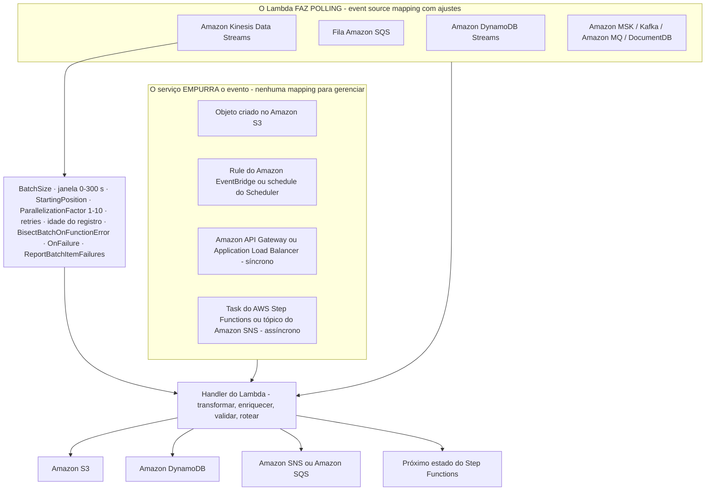
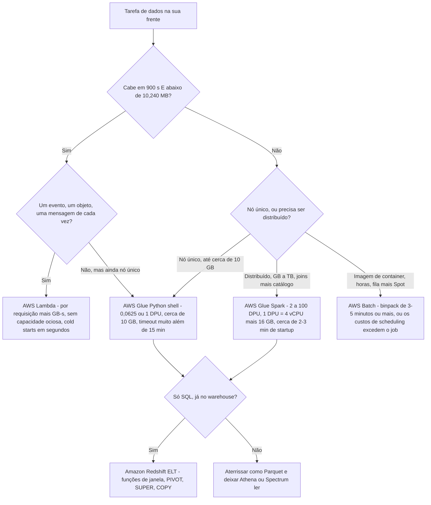
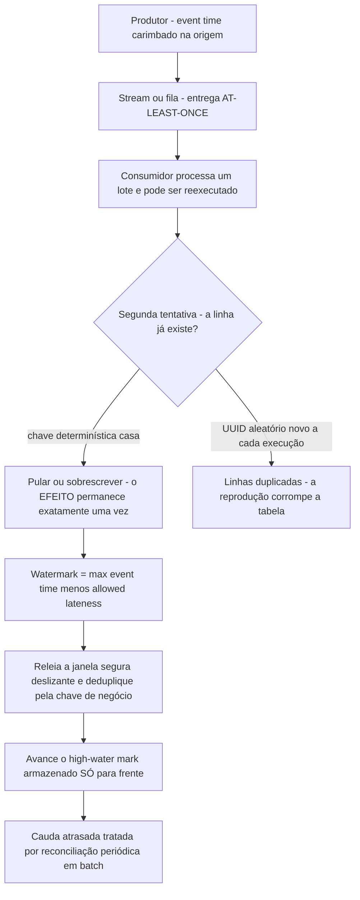
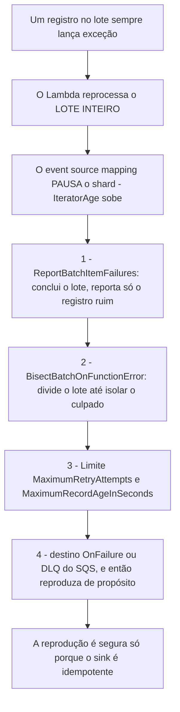

# Conceitos de Programação para Operações de Dados

Todo pipeline que você estudou até agora move e remodela dados. Esta lição pergunta a pergunta por baixo: **que código roda, e por que ele se comporta daquele jeito?** O DEA-C01 responde isso no Domínio 1, **Tarefa 1.4**, e o enunciado da tarefa é deliberadamente estreito. O guia do exame lista **"conceitos de programação agnósticos de linguagem"** como no escopo e **"sintaxe específica de linguagem de programação"** como fora do escopo, então nenhum item pedirá que você recorde um decorator, uma list comprehension ou um import de pacote. Em vez disso, o enunciado entrega um **problema de pipeline** (ranqueie estas linhas, deduplique esta reprodução, faça o parse deste campo aninhado, escolha um runtime) e espera de volta o **construto ou serviço** certo (guia do exame DEA-C01, acesso em outubro de 2026).

```text
====================================================================
 DEA-C01 DOMÍNIO 1 - TAREFA 1.4: APLICAR CONCEITOS DE PROGRAMAÇÃO
====================================================================
  Peso do Domínio 1 ...... 34% do conteúdo pontuado
  NO ESCOPO .............. conceitos de programação agnósticos de
                           linguagem, SQL + otimização de consultas,
                           IaC, Git, CI/CD, computação distribuída,
                           estruturas de dados e algoritmos,
                           concorrência/desempenho do Lambda,
                           AWS SAM, montagem de volumes no Lambda
  FORA DO ESCOPO ......... "sintaxe específica de linguagem"
---------------------------------------------------------------------
  CONCEITO            ->  A FORMA QUE ELE ASSUME NUM PIPELINE DE DADOS
  funções / tipos     ->  handler do Lambda, resolveChoice / cast: do Glue
  variáveis / escopo  ->  variáveis locais vs 4 KB de env vars do Lambda
  condicionais        ->  CASE WHEN, Choice do Step Functions, filtros
  loops               ->  GROUP BY, estado Map, fan-out por repartition
  fundamentos de POO   ->  layers do Lambda montadas em /opt (máx. 5, zip)
  APIs                ->  paginação, backoff em 429, acesso via SDK / CLI
  serialização        ->  escolha entre CSV / JSON / Avro / Parquet / ORC
---------------------------------------------------------------------
  ENVELOPE DE RUNTIME (em outubro de 2026)
  Lambda ........ 1-900 s · 128-10,240 MB · 1,769 MB ~ 1 vCPU
  Glue Spark .... 2-100 DPU · 1 DPU = 4 vCPU + 16 GB · padrão 10
  Glue PyShell .. 0,0625 ou 1 DPU · ~10 GB de dados · muito além de 15 min
  AWS Batch ..... imagem de container · fila + ambiente de compute · horas
====================================================================
```

Nesta lição você vai:

- separar **conceitos agnósticos de linguagem** da sintaxe específica de linguagem e mapear cada conceito para o construto que o exame espera;
- ler um **handler do Lambda** e uma **configuração de job do Glue** como programas, não como trivia;
- escolher entre **pandas num único nó** e **PySpark entre partições**, e nomear o ponto de cruzamento com honestidade;
- aplicar **avaliação lazy**: transformações constroem um plano, uma ação dispara a computação, e o shuffle é onde o custo aterrissa;
- dimensionar **partições**, escolher `coalesce` ou `repartition`, e explicar por que arquivos gzip atrapalham;
- subir a **escada de custo de UDF** do SQL embutido até o Python puro, e saber quando um UDF é justificável;
- escrever **funções de janela** em Spark SQL, Redshift e pandas, e saber por que `PARTITION BY` muda o paralelismo;
- usar **CTEs, joins, PIVOT e parsing de JSON** como os padrões de SQL que o exame repete;
- configurar **AWS Lambda** para trabalho de dados: event sources versus event source mappings, o pool de concorrência, o teto de 900 segundos, a CPU acoplada à memória e os layers;
- aplicar a **matriz de decisão Lambda vs Glue vs Batch** por tamanho, duração, frequência e limites de runtime;
- distinguir **entrega at-least-once** de um **efeito exactly-once** e construir **escritas idempotentes**;
- usar **watermarks** para limitar dados atrasados e subir a **escada de tratamento de poison pill**;
- achatar **JSON aninhado** e escolher entre **schema-on-read** e **schema-on-write**;
- ler a **caixa de atualizações de outubro de 2026**, estudar **dois casos reais de clientes da AWS** e treinar com **12 questões no estilo de exame** mais verificações interativas.
- **escopo expandido desta edição:** a lição agora traz **cinco casos reais de clientes da AWS** (EMX, AppsFlyer, Hearst, Nasdaq e PayU), **catorze questões de prática** (`dea-06-q1` até `dea-06-q14`) e **três verificações interativas**: matching, preenchimento de lacunas e arrastar e soltar.

---

## 1. Conceitos de programação que o exame realmente testa

### 1.1 O limite de escopo, nas palavras do próprio guia

Duas frases fazem todo o trabalho:

> **No escopo:** "conceitos de programação agnósticos de linguagem" · **Fora do escopo:** "sintaxe específica de linguagem de programação"

Tudo nesta seção, portanto, precisa sobreviver a um teste: *eu conseguiria perguntar isso sem nomear uma linguagem?* Se sim, é examinável. "O que `def handler(event, context)` significa como ponto de entrada?" é examinável, a forma é a mesma em Python e o conceito de ponto de entrada é universal. "Qual é a ordem exata de argumentos de `pd.merge()`?" não é, isso é sintaxe.

A lista de habilidades da Tarefa 1.4 faz o mesmo ponto pelo outro lado. As habilidades nomeadas são **otimizar o desempenho de runtime**, **concorrência e desempenho do Lambda**, **linguagens e frameworks** (Python, SQL, Scala, R, Java, Bash, PowerShell), **controle de versão, testes, logging e monitoramento**, **infraestrutura como código**, **AWS SAM**, **montar volumes de armazenamento no Lambda**, **CloudFormation/CDK**, **CI/CD**, **computação distribuída** e **estruturas de dados e algoritmos**: uma lista de *capacidades*, com as questões de Git mantidas **genéricas** depois que a AWS removeu o CodeCommit da lista no escopo no **v1.1 (2025-12-12)** do guia do exame (página de revisões do guia do exame DEA-C01, acesso em outubro de 2026).

### 1.2 O mapa conceito → construto

Esta tabela é a Seção 1 inteira comprimida no que uma questão realmente pode testar:

| Conceito de programação | A forma que ele assume num pipeline de dados | O que o exame pergunta |
|---|---|---|
| **Funções e tipos** | O handler do Lambda é o ponto de entrada; jobs do Glue declaram `resolveChoice` e `cast:` para coagir tipos antes de uma agregação | Nomear o ponto de entrada, ou para qual tipo uma coluna precisa ser convertida |
| **Variáveis e escopo** | Variáveis locais vivem uma invocação; as variáveis de ambiente do Lambda somam um **agregado de 4 KB** (em outubro de 2026) | Onde um segredo **não pode** ser armazenado |
| **Condicionais** | `CASE WHEN` no SQL · estado `Choice` no Step Functions · `filter()` no Spark | Fazer branching sobre **dados**, não sobre infraestrutura |
| **Loops** | `GROUP BY` elimina um loop em agregação · o estado `Map` faz fan-out · `foreach`/`repartition` paralelizam | Reconhecer quando a iteração precisa ser **serial** vs **paralela** |
| **Fundamentos de POO** | Composição e reuso → **layers** do Lambda montadas em `/opt`, máximo de **5**, somente zip (em outubro de 2026) | Reusar código compartilhado sem copiá-lo para cada pacote |
| **APIs** | Chamadas de lista paginadas, backoff em `429`/throttling, acesso programático via SDK e CLI | Escolher acesso programático e tratar throttling corretamente |
| **Serialização** | CSV → JSON/NDJSON → Avro → Parquet/ORC | Escolher o formato pelo **padrão de acesso**, não por hábito |
| **Computação distribuída** | Uma partição = uma task; shuffles são fronteiras de stage | Onde o paralelismo começa e onde o custo aterrissa |
| **Estruturas de dados e algoritmos** | Chaves hash para dedupe, janelas ordenadas para ranqueamento, joins como hash/broadcast | Escolher a estrutura que torna a operação barata |

### 1.3 Exemplo resolvido E1: ler um handler, não decorar sintaxe

O exame dá uma forma como esta e pergunta o que ela faz ou o que mudar. Leia como um **diagrama de fluxo de controle**:

```python
# Illustrative - the exam tests the SHAPE, not the boto3 calls.
def handler(event, context):
    """Entry point the platform invokes; the name and arity are fixed."""
    batch = event.get("records", [])     # variable holding a typed collection
    ok, bad = [], []                     # two accumulators = two code paths
    for record in batch:                 # loop over the batch, not over the table
        if record.get("amount") is None: # conditional on DATA
            bad.append(record)           # route poison records off the hot path
        elif record["amount"] < 0:
            bad.append(record)
        else:
            ok.append(record)
    if len(ok) > 1_000:                  # a conditional that changes STRATEGY
        write_partition_overwrite(ok)    # bulk, deterministic, replayable
    else:
        write_rows(ok)                   # small, row-at-a-time
    return {"ok": len(ok), "bad": len(bad)}
```

Três fatos examináveis caem daí: o **ponto de entrada** é uma função com assinatura fixa; **condicionais roteiam registros** em vez de reexecutá-los; e a **mudança de estratégia num limiar de tamanho** é exatamente a habilidade "otimizar o desempenho de runtime": conjuntos pequenos vão por linha, conjuntos grandes vão em bloco.

### 1.4 Condicionais e loops preferem SQL baseado em conjuntos

O padrão mais comum do Domínio 1 é um enunciado descrevendo um loop sobre linhas, com a resposta correta sendo uma **agregação ou uma função de janela**:

| Ideia imperativa | Resposta baseada em conjuntos | Por que o exame prefere |
|---|---|---|
| Loop contando por cliente | `GROUP BY customer_id` | O motor faz o loop em paralelo |
| Loop mantendo a linha mais nova por chave | `ROW_NUMBER() OVER (PARTITION BY k ORDER BY ts DESC)` | Ranqueamento sem self-join |
| Loop com `if/else` que grava colunas diferentes | `CASE WHEN … END` dentro da select list | Uma passada, sem branch no código da aplicação |
| Loop que faz fan-out sobre arquivos | estado `Map` / `repartition` / um map de DynamicFrame do Glue | Paralelismo declarado, não artesanal |
| Loop que espera uma condição | `Choice` + `Wait` do Step Functions, ou um watermark | Espera durável em vez de busy loop |

### 1.5 Orientação a objetos aparece como layers, não como classes

Hierarquias de classes não são examináveis. **Reuso** é. A resposta da AWS para "meu time tem três funções Lambda que todas precisam da mesma biblioteca auxiliar" é um **layer**: um arquivo zip montado sob `/opt`, com um máximo rígido de **5 layers por função**, e, este é o detalhe que as questões alcançam, os layers são **somente zip**, então uma função com **imagem de container** não pode usá-las de forma alguma (a imagem assa suas dependências, até **10 GB**) (documentação de limites e layers do AWS Lambda, acesso em outubro de 2026).

### 1.6 APIs aparecem como paginação e throttling

Um enunciado descrevendo "chamar um serviço que devolve 100 registros por vez até esgotar" está testando **paginação**; um enunciado descrevendo "o pipeline falha a cada poucos minutos com HTTP 429" está testando **backoff com jitter**, não uma biblioteca de retry específica. Ambos são agnósticos de linguagem, e ambos mapeiam para os mesmos controles do lado do serviço que você viu na Lição 05: políticas de retry, DLQs e escritas idempotentes.

### 1.7 Serialização é uma decisão, não uma sintaxe

| Formato | Orientação | Schema | Assinatura no exame |
|---|---|---|---|
| **CSV** | linha | nenhum | Apenas intercâmbio: sem pruning, sem tipos aninhados |
| **JSON / NDJSON** | linha | inferido na leitura | Aninhamento + schema-on-read; pesado de fazer parse |
| **Avro** | linha | **no header**, divisível | **Mova-o e evolua-o**: streaming e evolução de schema |
| **Parquet / ORC** | **colunar** | no footer | **Leia-o**: pruning, pushdown de min/max, compressão |

A regra a que a própria orientação da AWS se reduz: **Avro/JSON para movê-lo, Parquet/ORC para lê-lo.** Como o Athena cobra **bytes escaneados**, o formato *é* o custo: um arquivo colunar que deixa o motor pular colunas intocadas é mais barato que um formato de linha que não consegue (documentação do AWS Athena e do AWS Glue, acesso em outubro de 2026).

```matching
{
  "question": "Associe cada conceito de programação agnóstico de linguagem ao construto que o exame DEA-C01 espera que você nomeie:",
  "pairs": [
    {"left": "Condicional sobre dados", "right": "CASE WHEN no SQL, ou um estado Choice no Step Functions: fazer branching sobre os DADOS, nunca sobre a infraestrutura"},
    {"left": "Loop sobre linhas", "right": "GROUP BY, uma função de janela, ou um estado Map: baseado em conjuntos ou paralelo, nunca um loop de linhas escrito à mão"},
    {"left": "Reuso de código compartilhado", "right": "Layers do Lambda montadas em /opt: máximo 5, somente zip, então funções com imagem de container não podem usá-las"},
    {"left": "Onde um segredo vive", "right": "Secrets Manager ou SSM Parameter Store com KMS: as variáveis de ambiente do Lambda são limitadas a um agregado de 4 KB"},
    {"left": "Acesso a API paginado e com throttling", "right": "Paginação com backoff e jitter em 429: agnóstico de linguagem, então nenhuma biblioteca cliente é nomeada"},
    {"left": "Escolha do formato de serialização", "right": "Avro/JSON para movê-lo, Parquet/ORC para lê-lo: escolhido pelo PADRÃO DE ACESSO, não por hábito"}
  ],
  "explanation": "A Tarefa 1.4 testa o CONSTRUTO, nunca a sintaxe. Cada par é a resposta agnóstica de linguagem que um enunciado procura: condicionais viram CASE WHEN ou um estado Choice, loops viram GROUP BY / uma função de janela / um estado Map, o reuso vira layers do Lambda em /opt (máx. 5, somente zip), segredos saem do envelope de 4 KB de variáveis de ambiente para o Secrets Manager ou o SSM, o throttling vira paginação mais backoff, e a serialização vira uma decisão ditada por como os dados serão lidos."
}
```

- **📚 Você sabia?** O guia DEA-C01 da AWS mudou como ele *apresenta* este tópico, não o que ele contém: no **v1.1 (2025-12-12)** as listas separadas de "Knowledge of" e "Skills in" foram **consolidadas numa única lista de habilidades por tarefa**, adicionando **8 habilidades e nenhuma removida**. É por isso que o material de estudo atual cita uma lista plana e numerada como "1.4.1 otimizar o desempenho de runtime", enquanto material mais antigo cita um par Knowledge/Skills para o mesmo conteúdo (página de revisões do DEA-C01, acesso em outubro de 2026).

---

## 2. Padrões de Python e PySpark para operações de dados

### 2.1 Nó único versus distribuido: escolha antes de codificar

A primeira bifurcação em toda tarefa de dados é **onde o loop roda**. Errar isso é caro nos dois sentidos: um cluster distribuído para um arquivo de 40 MB desperdiça startup e capacidade ociosa, enquanto um único nó para um join de 200 GB fica sem memória.

| | **Nó único** | **Distribuído** |
|---|---|---|
| Serviço | **AWS Glue Python shell** · **AWS Lambda** · o driver de um job do Glue | **AWS Glue Spark (ETL)** · **Amazon EMR** · EMR Serverless |
| Capacidade | PyShell **0,0625 ou 1 DPU**, cerca de **10 GB** de dados · Lambda **128 to 10,240 MB** e **≤900 s** | Glue Spark **2 to 100 DPU** (mínimo de **2 DPU**), **1 DPU = 4 vCPU + 16 GB** |
| Execução | Um interpretador, um heap | Uma **partição = uma task** entre workers |
| Startup | Segundos (Lambda), pequeno (PyShell) | Jobs do Glue Spark normalmente pagam **~2 to 3 minutos** de startup antes da primeira task |
| Forma do custo | Por requisição + GB-s (Lambda), ou uma fração de um DPU | Uma DPU-hora inteira enquanto o job roda, incluindo workers ociosos |
| Falha quando | Fica sem memória ou bate no timeout | Skew, arquivos pequenos demais, ou um shuffle ruim |

**Regra prática do ponto de cruzamento:** algo como **10 milhões de linhas / 5 to 10 GB** é onde as pessoas param de recorrer ao pandas num único nó, e você precisa declarar a proveniência disso com honestidade. É uma **regra prática de terceiros de 2017, nunca um número publicado pela AWS**; os fatos de nível de exame são os *limites de serviço* acima, que são documentados pela AWS (em outubro de 2026).

> [!WARNING]
> ⚠️ **Pandas não reescrito num job do Glue Spark aumenta sua conta.** A orientação de migração do Glue Python-shell da AWS observa que um job do Glue Spark aloca **pelo menos dois workers do Spark**, então código que ainda roda pandas serialmente no driver deixa os workers **ociosos e cobrados**. A correção é ou mudar para um job **Python shell** (nó único, barato) ou mover a lógica para **pandas-on-Spark / PySpark** (distribuído). Escolher "Glue Spark porque é maior" é um bug de custo, não um padrão.

### 2.2 Avaliação lazy: planeje primeiro, compute uma vez

As transformações do Apache Spark são **lazy**: ler, filtrar, mapear e juntar constroem um **plano**, e nada roda até que uma **ação** (`write`, `count`, `collect`, `toPandas`) force a execução (AWS Prescriptive Guidance, *Tuning AWS Glue for Apache Spark*, acesso em outubro de 2026).

```mermaid
flowchart LR
    R["read - declarar a origem"] --> F["filter - só plano"]
    F --> M["map / withColumn - só plano"]
    M --> J["join - só plano, shuffle declarado"]
    J --> A["AÇÃO: write ou count - a computação começa"]
    A --> S["Stage se divide na fronteira do shuffle"]
    S --> T["Task por partição - 1 partição = 1 task"]
    T --> C["Cacheado só se você chamou persist ou cache"]
```



Duas consequências sobre as quais o exame constrói questões:

1. **Um dataset transformado é recomputado a cada ação** a menos que você o `cache()`/`persist()`. Duas ações na mesma linhagem pagam a linhagem duas vezes.
2. **Encadeie suas transformações e aja uma única vez.** Dez ações baratas vencem uma ação cara apenas se não compartilharem linhagem recomputada, o que elas geralmente compartilham.

```python
# PySpark - illustrative shape, not a memorisation exercise
from pyspark.sql import functions as F

df = spark.read.parquet("s3://lake/raw/orders/")   # plan: source scan declared
clean = (df
         .filter(F.col("amount") > 0)              # transformation - no compute
         .withColumn("order_day", F.to_date("ts")))# transformation - no compute
ranked = clean.withColumn(
    "rn",
    F.row_number().over(
        Window.partitionBy("customer_id", "order_day")
              .orderBy(F.col("amount").desc())))   # transformation - no compute
top = ranked.filter(F.col("rn") <= 3)              # still no compute
top.write.mode("overwrite").partitionBy("order_day") \
   .parquet("s3://lake/curated/top_orders/")       # ACTION - the plan executes
```

### 2.3 Partições: a unidade de paralelismo e de custo

| Fato | Valor | Fonte e data |
|---|---|---|
| Granularidade | **1 partição = 1 task** | AWS Prescriptive Guidance, out 2026 |
| Contagem alvo | **2 to 3× núcleos** para o Glue; **2 to 4 por CPU** para o Spark | AWS Prescriptive Guidance / guia de RDD do Spark, out 2026 |
| Partições padrão de shuffle | **200** | AWS Glue, ajuste de desempenho de SQL, out 2026 |
| Limiar de advisory de skew | **128 MB** por partição (advisory do Spark SQL: **64 MB**) | AWS Glue, ajustes, out 2026 |
| `maxResultSize` num shuffle grande | **1 GB** | AWS Glue, ajustes, out 2026 |
| Gzip | **Indivisível**: um arquivo, uma task | AWS Glue, orientação de parallelize-tasks, out 2026 |
| Execução adaptativa de consulta | Coalesce de partições pequenas automaticamente no Glue **≥4.0** / Spark **≥3.2** | AWS Glue, out 2026 |

#### Exemplo resolvido E2: aritmética de partições

Você tem **120 GB** de Parquet num job do Glue de **32 núcleos**:

```text
Partições alvo  = 2 a 3 x núcleos = 64 a 96
Considere 96    -> 120 GB / 96     = 1,25 GB por partição
Se a origem tem 120,000 arquivos minúsculos:
  120,000 tasks num job de 32 núcleos = OOM no driver + thrash do scheduler
  correção: coalesce(96) na leitura, ou repartition(96) antes da escrita
```

As duas funções **não** são intercambiáveis: `coalesce` funde partições **sem um shuffle completo** (use para ir **para baixo**), enquanto `repartition` realiza um **shuffle completo** para chegar a uma contagem exata (use para ir **para cima**, ou para espalhar skew por uma chave).

- **📚 Você sabia?** "Mais partições = mais rápido" é a concepção errada mais cara do Spark. Passado algo como **2 to 3× núcleos**, partições extras não adicionam paralelismo: adicionam overhead de scheduler, escrita de arquivos pequenos e pressão de GC. O erro oposto é igualmente ruim: uma única partição gzip de 60 GB é **uma task num único núcleo**, e como o gzip é **indivisível** o motor não consegue quebrá-la. O hábito que vale a pena construir é reparticionar **pelas colunas de partição antes da escrita**, para que o layout em que você aterrissa seja o layout que o leitor fará pruning (orientação de parallelize-tasks do AWS Glue, acesso em outubro de 2026).

### 2.4 A escada de custo de UDF

Uma **função definida pelo usuário** é o escape hatch para parsers de terceiros, scoring de modelos e lógica de linha stateful. Todo o resto deveria permanecer no SQL embutido. A própria orientação de desempenho da AWS coloca as opções numa escada, e o degrau de cima é algo como **cinco vezes** mais rápido que o de baixo:

| Degrau | Implementação | Por que custa o que custa |
|---|---|---|
| ① Mais barato | Funções **embutidas do Spark SQL** | Roda no JVM, permanece visível para o otimizador Catalyst, mantém predicate pushdown |
| ② | **UDF vectorizada pandas / Arrow** | Lotes Arrow em batch: a AWS mede algo como **5×** uma UDF Python simples |
| ③ | **UDF Python simples** | **Dá pickle em cada linha** através da fronteira JVM↔Python; o otimizador a trata como caixa-preta |
| ④ Mais caro | **UDF Scala / Java** | Sem fronteira Python, mas a menos portátil e ainda opaca a algumas otimizações |

```python
# Ladder rung 3 - AVOID on hot paths: one pickle round trip PER ROW
@F.udf(returnType="string")
def normalise_slow(raw):           # Catalyst cannot push this predicate down
    return raw.strip().lower()

# Ladder rung 1 - PREFERRED: vectorised built-in, stays in the JVM
clean = df.withColumn("sku", F.upper(F.trim(F.col("raw_sku"))))

# Ladder rung 2 - only when there is genuinely no built-in:
# a pandas UDF batches whole Arrow record batches instead of single rows
```

**Regra do exame:** recorra a um UDF apenas quando nenhum embutido consegue fazer o trabalho. Num job de 1 bilhão de linhas, o degrau ③ versus o degrau ① é a diferença entre minutos e horas, e é uma questão de *otimização de desempenho*, que é a habilidade "otimizar o desempenho de runtime" da Tarefa 1.4 (AWS Glue, *Optimize user-defined functions*, acesso em outubro de 2026).

### 2.5 Funções de janela: três enunciados, três respostas

| Enunciado | Construto |
|---|---|
| "mais recente / top **N** por chave" | `ROW_NUMBER() OVER (PARTITION BY key ORDER BY ts DESC)` |
| "total acumulado, delta período a período" | `SUM() OVER (ORDER BY …)` · `LAG(col) OVER (ORDER BY …)` |
| "quota do total" | `RATIO_TO_REPORT() OVER ()` (Redshift) ou `SUM() OVER ()` como divisor |

```sql
-- Redshift / Spark SQL: top 3 orders per customer per day
SELECT customer_id,
       order_date,
       amount,
       ROW_NUMBER() OVER (
           PARTITION BY customer_id, order_date
           ORDER BY amount DESC
       ) AS rn
FROM orders
QUALIFY rn <= 3;
```

**Pivô de paralelismo (um distrator favorito):** no **Amazon Redshift**, `PARTITION BY` é o que deixa a função de janela rodar **em paralelo entre slices**; sem ele a janela é computada **serialmente num único slice**. E funções de janela só são legais numa lista **SELECT** ou no **ORDER BY final**: não numa cláusula `WHERE` (documentação de funções de janela do Redshift, acesso em outubro de 2026).

Em **pandas**, o mesmo trabalho é `groupby().transform()` ou `groupby().cumcount()`: correto, mas **nó único**. Passado o tamanho do cruzamento, ele coleta tudo em **um** único processo, e é por isso que `df.toPandas()` / `collect()` dentro de um job do Glue Spark é o bug canônico de out-of-memory: ele puxa o frame distribuído inteiro para o **driver**.

---

## 3. Padrões de SQL que o exame insiste em repetir

### 3.1 CTEs colocam a lógica em estágios para cada passo ficar legível

Uma **common table expression** (`WITH`) é como você expressa "primeiro deduplicar, depois filtrar, depois ranquear" sem três statements separados, e como você torna uma query revisável. Ela também é o lugar natural do passo de dedupe num pipeline idempotente (Seção 6).

```sql
-- Stage 1: keep one row per (order_id, version) - the replay-safe row
WITH ranked AS (
    SELECT *, ROW_NUMBER() OVER (
        PARTITION BY order_id ORDER BY updated_at DESC, version DESC
    ) AS rn
    FROM raw_orders WHERE dt = '2026-10-09'
),
-- Stage 2: only the surviving rows join the aggregation
latest AS (
    SELECT order_id, customer_id, amount FROM ranked WHERE rn = 1
)
SELECT customer_id, COUNT(*) AS orders, SUM(amount) AS revenue
FROM latest
GROUP BY customer_id
ORDER BY revenue DESC;
```

### 3.2 Joins: qualifique os nomes, faça broadcast do lado pequeno

| Motor | Armadilha de join que o exame testa | Hábito correto |
|---|---|---|
| **Athena** | Duas tabelas com uma coluna de **mesmo nome** produzem erro de referência ambígua | Qualifique: `FROM a JOIN b ON a.id = b.customer_id` |
| **Spark / Glue** | Um join é o **gargalo principal de shuffle** | **Broadcast** no lado pequeno (`/*+ BROADCAST(small) */` ou `broadcast()`); mira na tabela pequena abaixo do limiar de advisory |
| **Redshift** | Ordem de join e chaves de distribuição decidem se a query redistribui dados | Prefira alinhamento de **DISTKEY/SORTKEY** e `ANALYZE` antes de joins grandes |
| Qualquer motor | Um join sem predicado é um **cross join** | Declare sempre as chaves de join explicitamente |

### 3.3 PIVOT, e o fallback portável

O Amazon Redshift suporta `PIVOT`, com limites rígidos que valem a pena decorar:

```sql
-- Redshift PIVOT: only COUNT, SUM, MIN, MAX, AVG are allowed as aggregates
SELECT region, pivot_alias
FROM sales
PIVOT (SUM(amount) FOR region IN ('EMEA', 'AMER', 'APAC')) AS p;
```

| Regra do `PIVOT` no Redshift | Consequência |
|---|---|
| Agregados limitados a **COUNT, SUM, MIN, MAX, AVG** | Qualquer outra coisa precisa da forma portável |
| Sem `JOIN`, sem CTE recursiva, sem `UNNEST` de SUPER na entrada | Pré-estágio isso numa CTE |
| A lista `IN` aceita **literais** | Pivô dinâmico precisa de SQL dinâmico ou da forma portável |

A forma portável, independente de motor: que é a resposta sempre que uma questão pede um pivô que o PIVOT não consegue expressar:

```sql
SELECT order_date,
       SUM(CASE WHEN region = 'EMEA' THEN amount ELSE 0 END) AS emea,
       SUM(CASE WHEN region = 'AMER' THEN amount ELSE 0 END) AS amer,
       SUM(CASE WHEN region = 'APAC' THEN amount ELSE 0 END) AS apac
FROM sales
GROUP BY order_date;
```

### 3.4 Parsing de JSON: dois motores, duas famílias

**Amazon Athena** (dialeto Presto/Trino) separa *extrair um valor JSON* de *extrair um escalar*:

```sql
-- Athena: json_extract returns JSON (quoted); json_extract_scalar returns text
SELECT json_extract_scalar(payload, '$.customer.id')  AS customer_id,
       json_extract_scalar(payload, '$.items[0].sku') AS first_sku
FROM events WHERE dt = '2026-10-09';

-- Nested arrays are flattened, then crossed with the parent row
SELECT e.order_id, i.sku, i.qty
FROM events e
CROSS JOIN UNNEST(e.items) AS i (sku, qty);
```

**Amazon Redshift** faz o parse de JSON **uma vez** para o tipo `SUPER` e depois o consulta com caminhos no estilo PartiQL: `JSON_PARSE(payload)` → `SUPER`, acesso com ponto e colchete, `UNNEST`, `UNPIVOT`. A AWS é explícita de que **JSON não é uma boa escolha para datasets grandes** porque não é colunar; faça o parse para `SUPER` uma única vez, ou aterre como **colunas Parquet/SUPER** (documentação de JSON e SUPER do Redshift, acesso em outubro de 2026).

> [!IMPORTANT]
> **O Athena não tem uma história de paginação profunda sem `OFFSET`.** `ORDER BY … LIMIT … OFFSET` é suportado, mas `ORDER BY` + `LIMIT` tem teto em **2,147,483,647 linhas**, e o Athena cobra **bytes escaneados**, então paginação com OFFSET profundo bate num teto e relê os mesmos bytes. A resposta amigável ao exame é **paginação por keyset** (`WHERE id >:last_id ORDER BY id LIMIT n`) sobre **Parquet particionado**, não offsets grandes sobre CSV.

### 3.5 Load em bloco: um `COPY`, não mil `INSERT`s

A própria orientação do Amazon Redshift é inequívoca: **use `COPY` para loads grandes**: `INSERT`s individuais "podem ser lentos a ponto de proibir". Regras de dimensionamento: **um `COPY` por tabela/prefixo** (COPYs concorrentes na mesma tabela **serializam**), arquivos gzip/JSON indivisíveis entre **1 MB e 1 GB**, contagem ≈ número de **slices**, e arquivos CSV/Parquet **≥128 MB** são divididos automaticamente (boas práticas de COPY do Redshift, acesso em outubro de 2026).

#### Exemplo resolvido E3: dimensionamento do COPY

```text
Source: 640 GB of gzip CSV   Cluster: 128 slices
Target = a multiple of 128 files, each between 1 MB and 1 GB
  128 x 5 GB -> over 1 GB, split it
  1,024 x 640 MB -> in range, 8 files per slice -> good
Then ONE COPY for the whole prefix: concurrent COPYs to the same
table serialize, so parallelism comes from FILE_COUNT inside one COPY.
```

---

## 4. AWS Lambda para tarefas de dados

### 4.1 Duas maneiras de um evento chegar: push (trigger) versus pull (event source mapping)

Essa distinção é a espinha de toda questão de dados sobre Lambda. Um **trigger** significa que o serviço **empurra** o evento para a sua função; um **event source mapping (ESM)** significa que o **Lambda faz polling** do stream ou da fila por você e agrupa os registros para você (documentação de event source mapping do AWS Lambda, acesso em outubro de 2026).



| Alavanca | Valores (em outubro de 2026) | O que ela troca |
|---|---|---|
| `BatchSize` (Kinesis) | padrão **100**, máximo **10,000** | Throughput por invocação vs latência |
| Janela de batching | **0 s** (Kinesis/DDB/SQS), **500 ms** (MSK/Kafka/MQ), máximo **300 s** | Latência vs eficiência de batching |
| `ParallelizationFactor` | **1 to 10** | Mais concorrência por shard vs pressão de ordenação |
| `MaximumRetryAttempts` | **−1 (infinito)** a **10,000** | Retenção de registros venenosos vs tempo de estancamento |
| `MaximumRecordAgeInSeconds` | **−1** a **604,800 (7 dias)** | Quanto tempo um shard continua tentando |
| `ReportBatchItemFailures` | ligado/desligado | Sucesso parcial de lote vs retry de lote inteiro |

> [!WARNING]
> ⚠️ **O modo de falha do ESM é o lote inteiro e o shard inteiro.** Na falha, o Lambda **reprocessa o lote inteiro** e **pausa o shard**, e é por isso que o primeiro sintoma de um registro ruim é um `IteratorAge` subindo, não uma taxa de erro. Os padrões são **infinitos**, então um único registro venenoso pode bloquear um stream do DynamoDB por **até um dia** e um shard do Kinesis por **até uma semana** (documentação de erros do DynamoDB/Kinesis do AWS Lambda, acesso em outubro de 2026).

### 4.2 Concorrência: reserved versus provisioned

A AWS dá a toda conta um pool de **1,000 execuções concorrentes por região**, compartilhado entre todas as funções, com um piso não reservado de **100**, e uma taxa de ingestão sustentável de cerca de **10 requisições/segundo por unidade de concorrência** (em outubro de 2026).

| | **Não reservado** | **Reservado** | **Provisionado** |
|---|---|---|---|
| O que é | O que sobra do pool de 1,000 | Um **mínimo *e* máximo** rígido para uma função | Ambientes de execução pré-aquecidos |
| Preço |: | **Grátis** | **Cobrado** (por GB-s e por hora, cobrança de 1 ms) |
| Aplica-se a |: | Qualquer função | Apenas **versões e aliases** de função |
| Uso canônico | Tráfego best-effort | **Garantir a capacidade de um pipeline**, *ou* **limitar uma função para que um pool pequeno de banco de dados não seja sobrecarregado** | **Latência interativa**: reduzindo cold starts |

**Aritmética de dimensionamento:** concorrência necessária ≈ `requisições/segundo × duração em segundos`, e a orientação de provisionamento da AWS acrescenta **~10%** de folga. Concorrência provisionada **não** é a resposta para "meu pipeline assíncrono deveria começar rápido": a AWS afirma que pipelines assíncronos normalmente não precisam dela (documentação de concorrência do AWS Lambda, acesso em outubro de 2026).

#### Exemplo resolvido E4: dimensionamento de concorrência

```text
Peak: 200 concurrent invocations, average duration 250 ms
Warm environments for provisioned concurrency:
    200 x 0.250 s = 50 concurrent executions
    +10% headroom                          -> provision 55
Account pool is 1,000 per Region:
    reserved for this function  <= 1,000 - 100 (unreserved floor) = 900
    provisioned concurrency must sit inside the reserved envelope
Requests per second ceiling at 200 concurrency:
    10 x 200 = 2,000 requests/second (as of Oct 2026)
```

### 4.3 Timeout e o acoplamento memória → CPU

**Não existe um botão de vCPU.** CPU, rede e GPU escalam **com a configuração de memória**, que é o fato de desempenho do Lambda mais testável de todos:

| Configuração | Valor (em outubro de 2026) |
|---|---|
| Timeout | **1 to 900 s**, padrão do console de **3 s**, teto rígido de **900 s (15 min)** |
| Memória | **128 to 10,240 MB** em incrementos de **1 MB** |
| **1,769 MB** | ≈ **1 vCPU** |
| **10,240 MB** | ≈ **6 vCPUs** |
| `/tmp` | **512 MB grátis**, depois cobrados, até **10,240 MB** |
| Variáveis de ambiente | **4 KB no agregado** |
| Pacote de deployment | **50 MB zipado / 250 MB descompactado**, incluindo até **5 layers** |
| Imagem de container | **10 GB** |
| Armazenamento de código | **300 GB descompactado**, não elevável |

#### Exemplo resolvido E5: memória, CPU e custo unitário

```text
Job needs about 1 vCPU. Current setting 1,024 MB (~0.6 vCPU) is too slow.
Fix: raise memory to 1,769 MB - there is no separate CPU setting.

Unit cost of ONE invocation at 1,769 MB x 500 ms:
    1.769 GB x 0.5 s = 0.8845 GB-s
    0.8845 x $0.0000166667 (x86 tier 1) = $0.0000147 per invocation

Monthly at 10 million invocations:
    duration  10,000,000 x 0.8845 GB-s = 8,845,000 GB-s
    less free  400,000 GB-s            = 8,445,000 billable GB-s
    8,445,000 x $0.0000166667          = $140.75
    requests  10,000,000 - 1,000,000 free = 9,000,000
    9,000,000 / 1,000,000 x $0.20      =   $1.80
    total                                ~ $142.55 / month
    (prices as of Oct 2026 - verify current pricing before use)
```

### 4.4 Layers, variáveis de ambiente e `/tmp`

- **Layers** são a história de reuso orientado a objetos (Seção 1.5): **≤5**, **somente zip**, montadas em **`/opt`**. Uma função com imagem de container não pode usar layers.
- **Variáveis de ambiente** são limitadas a **4 KB no agregado** e são **legíveis através da API**, então são configuração, **não um cofre de segredos**. Segredos pertencem ao **AWS Secrets Manager** ou ao **Systems Manager Parameter Store**, criptografados com **KMS**.
- **`/tmp`** é **transiente e por ambiente de execução**: sobrevive a invocações quentes do *mesmo* ambiente e desaparece quando o ambiente é reciclado. É um **cache**, nunca estado durável, e os primeiros **512 MB** são grátis (em outubro de 2026).
- **Montagem de armazenamento:** a Tarefa 1.4 nomeia explicitamente *montar volumes de armazenamento no Lambda*, o **Amazon EFS** é a resposta durável e multiambiente; o `/tmp` é a efêmera.

#### Exemplo resolvido E6, o Lambda é o runtime certo afinal?

```text
Requirement: a nightly Python merge of three CSV files, single node,
45 minutes, no distributed joins.

Lambda          : hard 900 s ceiling           -> impossible at any price
Glue Spark      : 2-3 min startup + 2 DPU min  -> a cluster for a loop
Glue Python shell: 0.0625 or 1 DPU, timeout far beyond 15 min
                                                   -> THE ANSWER
Selection logic: "single node + longer than 15 min = Python shell",
regardless of the exact byte count (the ~10 GB figure is the working-
set guidance that tells you when the shell stops being enough).
```

---

## 5. A matriz de decisão Lambda vs Glue vs Batch

### 5.1 A matriz

Esta tabela é o artefato único de maior rendimento da Tarefa 1.4. Cada linha é um **limite com fonte em outubro de 2026**:

| Sinal no enunciado | **Escolha** | Por quê, com o limite |
|---|---|---|
| Transformação de evento, segundos a minutos, escala de GB | **AWS Lambda** | Teto de **900 s**, memória de **10,240 MB**, cobrado por requisição + GB-s, sem capacidade ociosa |
| pandas em nó único, **mais de 15 min ou cerca de 10 GB** | **AWS Glue Python shell** | **0,0625 / 1 DPU**, cerca de **10 GB**, timeout muito mais longo que os 15 minutos rígidos do Lambda |
| ETL distribuído, joins, GB: TB, precisa do **Data Catalog** | **AWS Glue Spark (ETL)** | **2 to 100 DPU** (padrão **10**), **1 DPU = 4 vCPU + 16 GB**; espere **~2 to 3 min** de startup |
| Imagem de container, **horas**, fila + capacidade **Spot** | **AWS Batch** | Job Docker numa fila e num ambiente de compute; o overhead de scheduling exige fazer binpack de jobs para **3 to 5 minutos** ou mais |
| Estado Spark/Hadoop existente, escala de **petabytes** | **Amazon EMR** / EMR Serverless | Você traz a versão do framework e a configuração do cluster |
| Transformação só de SQL já no warehouse | **Amazon Redshift** ELT | Funções de janela, PIVOT, SUPER e `COPY` ficam dentro do motor |



### 5.2 Exemplo resolvido E7, o mesmo job em dois runtimes

```text
Job: 1.44 million invocations per month, 300 ms each, 512 MB

Lambda:
    GB-s      1,440,000 x 0.512 GB x 0.3 s = 221,184 GB-s
    free tier 400,000 GB-s  -> duration cost $0
    requests  (1,440,000 - 1,000,000) / 1,000,000 x $0.20 = $0.088
    total     ~ $0.09 per month

Same work as a Glue Spark job: 10 minutes a day on 4 DPU
    4 DPU x (10/60) h = 0.667 DPU-h per day
    0.667 x 30 days   = 20 DPU-h per month
    20 x $0.44/DPU-hour = $8.80 per month
    (Glue ETL $0.44 per DPU-hour as of Oct 2026 - verify current
     pricing before use; Lambda prices as of Oct 2026)

Delta: about 98x cheaper on Lambda - because the work is
INVOCATION-SHAPED, not JOB-SHAPED.
```

A lição não é "Lambda é sempre mais barato": é que **o preço segue a forma do trabalho**. Um merge noturno de 40 minutos não roda no Lambda a nenhum preço (o teto de **900 s**), e um job de 2 segundos não justifica o **AWS Batch**, onde o overhead de scheduling pode exceder o runtime.

- **📚 Você sabia?** A própria orientação de Glue da AWS põe o custo de startup por escrito: jobs do Glue Spark normalmente gastam **2 to 3 minutos** antes da primeira task rodar, o que é *mais* runtime do que o próprio job para payloads abaixo de 100 MB. É por isso que os enunciados "pequenos, frequentes, orientados a eventos" do exame apontam para o Lambda e os enunciados "grandes, agendados, cheios de join" apontam para o Glue, e por que um enunciado que diz *"arquivos pequenos e frequentes chegando a cada poucos segundos"* geralmente está dizendo para você rejeitar tanto o Glue **quanto** o Batch (documentação de boas práticas do AWS Glue e do AWS Batch, acesso em outubro de 2026).

---

## 6. Idempotência, watermarks e poison pills

### 6.1 Entrega at-least-once, *efeito* exactly-once

Streams e filas, Kinesis, SQS, DynamoDB Streams, MSK, entregam **at-least-once** por padrão. Não existe transporte exactly-once de ponta a ponta. O que os pipelines constroem em vez disso é um **efeito exactly-once**: **entrega at-least-once + um efeito colateral idempotente** (AWS Big Data Blog, *Build a fault-tolerant serverless data aggregation pipeline with exactly-once processing*, 2021-11-01).

| Caixa de ferramentas | Mecanismo | Quando |
|---|---|---|
| **Chaves determinísticas** | Hash ou chave de negócio, nunca um UUID novo | Qualquer dedupe ou upsert |
| **Partition overwrite** | `INSERT OVERWRITE PARTITION (dt=…)` | Reexecução de batch do dia inteiro |
| **MERGE / upsert** | `MERGE INTO … ON key` | CDC e mudanças que chegam atrasadas |
| **`INSERT … ON CONFLICT DO NOTHING`** | Unicidade imposta pelo banco | Tabelas de eventos append-only |
| **Escritas condicionais** | `attribute_not_exists(key)` / `ConditionExpression` | DynamoDB, guards de versão |
| **Chave hash-do-lote** | SHA-256 sobre o lote como chave de idempotência | Dedupe no nível do lote |
| **`ClientRequestToken`** | Token fornecido pelo cliente, válido por **≤10 min** | Chamadas de API resistentes a repetição |
| **Razão de execuções** | Uma tabela `pipeline_runs` verificada antes de o trabalho começar | Idempotência de pipeline inteiro |

```python
# Idempotent sink - illustrative shape
import hashlib

def batch_key(records):
    """Deterministic: the SAME batch always produces the SAME key."""
    ids = sorted(r["order_id"] for r in records)
    return hashlib.sha256("|".join(ids).encode()).hexdigest()

def sink(records, dt):
    # 1. Guard: has this exact batch already been committed?
    if runs.exists(batch_key(records), dt):
        return "skipped"            # replay is a no-op, not a duplicate
    # 2. Write deterministically: overwrite the partition, or upsert by key.
    #    NEVER append with uuid4() keys - that is the classic duplicate bug.
    write_partition_overwrite(records, dt=dt)
    runs.mark_complete(batch_key(records), dt)
    return "written"
```

> [!WARNING]
> ⚠️ **Um UUID novo por linha destrói a idempotência.** Se cada reprodução gera chaves novas, cada retry *parece* dados novos, e as duplicatas se acumulam em silêncio. A regra é: **chave de negócio determinística + partition overwrite / MERGE / escrita condicional**. Assuma que todo `foreachBatch`, retry de Lambda e redrive de DLQ **roda pelo menos duas vezes**.

### 6.2 Watermarking: quanto tempo você espera por dados atrasados

Um **watermark** é `max event time − allowed lateness`. Ele limita quanto tempo um job de streaming espera por registros atrasados antes de fechar uma janela e liberar o estado por trás dela. Mova-o **apenas para frente**: generoso demais e o estado cresce sem limite; apertado demais e os registros atrasados são descartados **em silêncio** (orientação de streaming da AWS e da comunidade, acesso em outubro de 2026).

Num job **incremental do Glue** a mesma ideia aparece como um high-water mark armazenado mais uma **janela segura deslizante**:

```text
Stored high-water mark : last_event_ts = 2026-02-01
Allowed lateness       : 2 days
Safe-window re-read    : WHERE event_ts > 2026-01-30   (2-day overlap)
Dedupe                 : dropDuplicates(["order_id"])   (or MERGE on the key)
Advance the mark       : last_event_ts = max(old, new)  - forward only
Residual risk          : records later than the window -> periodic batch
                         reconciliation, not a bigger watermark
```



#### Exemplo resolvido E8: a janela segura

```text
Watermark at 2026-02-01, allowed lateness 2 days.
Record arrives on 2026-02-02 with event_ts 2026-02-01 23:40
  -> inside the watermark: ACCEPTED, because the safe window
     re-read covers > 2026-01-30 and dropDuplicates(MERGE) removes
     anything already written.
Record arrives on 2026-02-09 with event_ts 2026-02-08
  -> BEHIND the watermark: silently dropped by a streaming source;
     recovered only by the scheduled batch reconciliation pass.
Cost of widening the window to 7 days: every run re-reads 7 days
  of data and holds 7 days of dedupe state - a latency/storage trade,
  never a free win.
```

```fillblank
{
  "question": "Complete as afirmações de confiabilidade usando o vocabulário exato que o exame usa:",
  "template": "Streams e filas entregam {{1}} por padrão, e um efeito {{2}} só é produzindo ao combinar essa entrega com uma escrita {{3}}. Um {{4}} equivale a max event time menos allowed lateness e só pode se mover para frente, enquanto um registro que sempre lança exceção é um {{5}} que pausa o shard até que retries e idade do registro sejam limitados.",
  "answers": {
    "1": "at-least-once",
    "2": "exactly-once",
    "3": "idempotent",
    "4": "watermark",
    "5": "poison pill"
  },
  "distractors": ["at-most-once", "effectively-once", "nondeterministic", "event-time skew", "dead-letter record", "batching window", "shard lease", "checkpoint offset"],
  "explanation": "As garantias de entrega descrevem o TRANSPORTE (at-least-once), o EFEITO é o que você constrói por cima (at-least-once + um sink idempotente), o watermark limita quanto tempo você espera por dados atrasados e só jamais se move para frente, e um poison pill é o registro cujo loop de retry bloqueia o shard até que MaximumRetryAttempts e MaximumRecordAgeInSeconds transformem o padrão infinito em um limitado."
}
```

### 6.3 Tratamento de poison pill: a escada

Um **poison pill** é um registro que sempre lança exceção. Como um ESM reexecuta o **lote inteiro** e **pausa o shard**, um registro ruim pode parar um stream inteiro, e os padrões são infinitos:



| Degrau | Alavanca | Efeito (em outubro de 2026) |
|---|---|---|
| 1 | **`ReportBatchItemFailures`** | Reporta falha por registro; os registros bons **não** são reexecutados |
| 2 | **`BisectBatchOnFunctionError`** | Divide repetidamente o lote que falha para isolar o culpado |
| 3 | **`MaximumRetryAttempts`** (**−1…10,000**) + **`MaximumRecordAgeInSeconds`** (**−1…604,800**) | Transforma retry infinito num estancamento limitado |
| 4 | Destino **`OnFailure`** (SQS/SNS/S3/Kafka) ou uma **DLQ** | Estaciona os registros ruins para inspeção e reprodução |
| Variante SQS | **`maxReceiveCount` → DLQ** | A versão nativa do SQS do degrau 4 |
| Pré-filtro | **`FilterCriteria`** | Descarta eventos que não casam **antes** de chegarem à função |

```dragdrop
{
  "question": "Coloque a escada de tratamento de poison pill na ordem em que um engenheiro de dados a aplica, do primeiro controle que não custa nada até a última linha de defesa:",
  "items": [
    "ReportBatchItemFailures, concluir o lote e reportar apenas o registro que falhou, para que registros bons não sejam reexecutados",
    "BisectBatchOnFunctionError: dividir ao meio o lote que falha repetidamente até isolar o registro culpado",
    "Limitar MaximumRetryAttempts (0 a 10,000) e MaximumRecordAgeInSeconds (até 604,800 s) para que o retry infinito se torne um estancamento limitado",
    "Destino OnFailure ou uma dead-letter queue do SQS: estacionar os registros ruins para inspeção em vez de bloquear o shard",
    "Reprodução deliberada a partir da DLQ: segura só porque o sink foi tornado idempotente na Seção 6.1"
  ],
  "correctOrder": [
    "ReportBatchItemFailures, concluir o lote e reportar apenas o registro que falhou, para que registros bons não sejam reexecutados",
    "BisectBatchOnFunctionError: dividir ao meio o lote que falha repetidamente até isolar o registro culpado",
    "Limitar MaximumRetryAttempts (0 a 10,000) e MaximumRecordAgeInSeconds (até 604,800 s) para que o retry infinito se torne um estancamento limitado",
    "Destino OnFailure ou uma dead-letter queue do SQS: estacionar os registros ruins para inspeção em vez de bloquear o shard",
    "Reprodução deliberada a partir da DLQ: segura só porque o sink foi tornado idempotente na Seção 6.1"
  ],
  "explanation": "A escada vai do mais barato e menos disruptivo para o mais deliberado: primeiro pare de reexecutar registros bem-sucedidos (ReportBatchItemFailures), depois isole o culpado (BisectBatchOnFunctionError), depois limite o orçamento de retry para que um único registro não consiga estancar o shard por um dia ou uma semana (MaximumRetryAttempts e MaximumRecordAgeInSeconds), depois desvie o que resta para um destino OnFailure ou uma DLQ, e só então reproduza. A reprodução é o último passo porque é o único que pode criar duplicatas: e é por isso que as chaves determinísticas e o partition overwrite ou MERGE da Seção 6.1 precisam estar em vigor antes de você puxar a DLQ pela primeira vez. Os padrões sem esta escada são infinitos: até um dia bloqueado num stream do DynamoDB e até uma semana num shard do Kinesis (documentação de event source mapping do AWS Lambda, acesso em outubro de 2026)."
}
```

#### Exemplo resolvido E9: de um estancamento de uma semana para uma hora

```text
BEFORE (defaults): one bad Kinesis record
    retries       = infinite
    record age    = infinite
    result        = shard blocked for UP TO ONE WEEK
                    (DynamoDB Streams: up to ONE DAY)

AFTER (configured):
    MaximumRetryAttempts        = 5
    MaximumRecordAgeInSeconds   = 3,600
    BisectBatchOnFunctionError  = true
    OnFailure -> SQS DLQ
    result: about 1 hour of bounded retry, 5 attempts, the bad
            records parked in an SQS queue, shard released.
Replay from the DLQ is safe ONLY because Section 6.1 made the
sink idempotent - otherwise replaying is how you double the table.
```

- **📚 Você sabia?** Os três *donos* de retry neste exame são diferentes, e as questões normalmente os confundem: para invocações **síncronas** o **chamador** reexecuta; para invocações **assíncronas** o **Lambda** reexecuta a função **duas vezes** (aos 1 e 2 minutos) antes de um destino de falha; e para **event source mappings** a própria **mapping** reexecuta o lote e pausa o shard. O mesmo `429` num enunciado tem, portanto, três respostas diferentes dependendo de como a função foi invocada (documentação de invocações assíncronas e de ESM do AWS Lambda, acesso em outubro de 2026).

---

## 7. Dados aninhados: achatamento, e schema-on-read versus schema-on-write

### 7.1 Duas filosofias de schema

| | **Schema-on-write** | **Schema-on-read** |
|---|---|---|
| Quando o schema é aplicado | **No load**, defina e imponha antes dos dados aterrissarem | **Na hora da consulta**, aterre cru, aplique o schema quando ler |
| Forma típica de serviço | Definições de tabela e constraints do Amazon Redshift | **Amazon S3 + AWS Glue Data Catalog + Amazon Athena** |
| Desempenho de consulta | Mais rápido, tipos e layouts já estão fixos | Mais lento por consulta, parsing e coação acontecem na leitura |
| Custo de um erro | Rejeitar o load, corrigir a montante | **O drift aparece como erro do consumidor** |
| Flexibilidade | Baixa, contrato antecipadamente | Alta, novos consumidores, novas formas |
| Resposta no exame | Warehouses e camadas de serving curadas | Data lakes e zonas raw/bronze |

> [!IMPORTANT]
> **Schema-on-read não significa "nenhum trabalho de schema".** A própria orientação de arquitetura da AWS é manter uma **camada raw armazenada como está** e colocar uma **camada padronizada com validação de schema e controle de evolução** acima dela: uma camada de contrato. Sem ela, o drift de schema na zona raw se torna uma **indisponibilidade do lado do consumidor**, que é o modo de falha que uma questão vai descrever quando quiser essa resposta (AWS Prescriptive Guidance, *Modern data architecture*, acesso em outubro de 2026).

### 7.2 Achatando dados aninhados, por motor

| Motor | Mecanismo |
|---|---|
| **AWS Glue** | `UnnestFrame` / `Relationalize` num DynamicFrame |
| **Amazon Athena** | `flatten()` para arrays · `CROSS JOIN UNNEST … WITH ORDINALITY` para expansão de struct/array |
| **Amazon Redshift** | Tipo `SUPER` com `UNNEST` / `UNPIVOT` e caminhos PartiQL |
| **Apache Spark** | `explode()` / `explode_outer()` para transformar uma coluna array em linhas |

```sql
-- Athena: one row in, one row per array element out
SELECT e.order_id,
       i.sku,
       i.qty,
       i.price
FROM orders e
CROSS JOIN UNNEST(e.items) AS i (sku, qty, price);
-- A NULL array yields NO rows with CROSS JOIN UNNEST;
-- use LEFT JOIN UNNEST (or explode_outer) when you must keep the parent.
```

Duas consequências que valem a pena decorar: **um array NULL produz nenhuma linha** sob um cross-unnest (encolhendo seu resultado em silêncio), e um **schema explícito na leitura vence a inferência de schema**: a inferência é conveniente uma vez e imprevisível para sempre.

### 7.3 O formato segue o padrão de acesso, e o formato *é* o custo

```text
raw landing     : JSON or CSV, stored as-is  (schema-on-read, cheap to write)
                        |
                        v   AWS Glue ETL or Athena CTAS
curated         : Snappy-Parquet, Hive layout  year=/month=/day=
                        |
                        v
serving         : Athena / Redshift Spectrum / QuickSight
                  - column pruning skips untouched columns
                  - min/max statistics prune whole row groups
                  - Athena bills BYTES SCANNED, so pruning IS the bill
```

#### Exemplo resolvido E10: a decisão de formato, precificada

```text
Scenario: 1 TB table, a query touching 3 of 30 columns.
Athena list price: $5.00 per TB scanned (as of Oct 2026 - verify
current pricing before use), 10 MB minimum per query.

CSV, no pruning      : scans ~1 TB      -> about $5.00 per run
Parquet, columnar    : scans only the 3 needed columns plus metadata
                       -> typically an order of magnitude less
Ten runs a day x 30 days:
    CSV      300 x $5.00  = $1,500 / month
    Parquet  300 x ~$0.50 =   ~$150 / month   (illustrative)
The conversion (CTAS or a Glue job) is a ONE-TIME cost against a
RECURRING saving - which is why "convert to Parquet" is almost
always the right answer in an Athena cost stem.
```

- **📚 Você sabia?** A questão de linhagem adora o contraste entre os quatro formatos porque é puramente *forma*: **CSV** não tem schema e não tem pruning, **JSON** aninha mas precisa ser parseado inteiro, **Avro** carrega seu **schema no header** e é **divisível**, que é exatamente por que jobs de streaming e de evolução de schema o preferem, e **Parquet/ORC** são **colunares**, que é por que os motores de analítica o preferem. A memória de uma linha é *Avro/JSON para movê-lo, Parquet/ORC para lê-lo* (orientação de formatos do AWS Glue e do Athena, acesso em outubro de 2026).

---

### Atualizações de 2026 (em outubro de 2026)

> [!NOTE]
> **O que mudou em programação e operações de dados entre 2024 e outubro de 2026**: cada linha foi conferida contra uma fonte primária da AWS em **outubro de 2026**, e cada uma é examinável porque o exame testa o comportamento *atual*:
> - **O próprio guia do exame foi reconstruído**: o **v1.1 (2025-12-12)** consolidou as listas separadas de "Knowledge of" e "Skills in" em **uma única lista de habilidades por tarefa**, adicionando **8 habilidades e nenhuma removida**; **Cloud9, CodeCommit e AWS Schema Conversion Tool** saíram da lista no escopo, então **as questões de Git permanecem genéricas** (clone, commit, branch, merge) e nunca nomeiam um serviço Git específico da AWS: revisões do guia do exame DEA-C01 e páginas no escopo, acesso em outubro de 2026.
> - **As gerações de runtime do Glue avançaram**: o **Glue 5.1 virou o padrão para jobs novos em 2025-11-26** (Spark 3.5.6), e o **Glue 6.0 foi para GA em 2026-08-21** com **Spark 4.1.1, Python 3.13, Scala 2.13** e **redução de preço de 30%**; Glue **0.9/1.0/2.0 chegou ao end of life em 2026-04-01**, e o **Python Shell 3.6** não pode mais ser criado depois de **2026-03-31**: notas de versão do AWS Glue, política de suporte a versões e What's New, acesso em outubro de 2026. Um enunciado que fixa uma versão do Glue em EOL é uma resposta errada.
> - **O Glue 6.0 remove dois caminhos de compatibilidade**: **o EMRFS foi embora** (o S3A é o único filesystem do S3) e o **AWS SDK for Java v1 foi removido**: AWS Glue, *Migrating to version 6.0*, acesso em outubro de 2026. Qualquer alternativa que dependa de `fs.s3.consistent.*` ou de imports `com.amazonaws.*` está obsoleta.
> - **Os UDFs de Python do Redshift estão sendo aposentados**: **sem novos UDFs escalares de Python depois de 2025-10-30** e **sem suporte depois de 2026-06-30**: página de mudanças de comportamento do Amazon Redshift, acesso em outubro de 2026. Isso remodela diretamente a escada de UDF da Seção 2.4: no Redshift, a resposta amigável ao exame migra para **SQL, stored procedures e ML**, não para novos UDFs de Python.
> - **O piso de custo do Athena caiu**: os **resultados de consulta gerenciados** (2025-06-03) são criptografados, gerenciados pelo serviço e **não custam nada extra**: nenhum bucket de resultados obrigatório, e as **Capacity Reservations agora começam em 4 DPU por 1 minuto** (eram 24 DPU / 60 min) a partir de **2026-02-11**: AWS What's New e blog de controle de capacidade do Athena, acesso em outubro de 2026.
> - **O Kinesis Data Streams agora tem três modos de capacidade**: Provisioned, On-demand Standard e **On-demand Advantage (2025-11-04)**, que remove a cobrança horária por stream mas aplica um **piso de 25 MB/s de ingestão + 25 MB/s de recuperação** em toda a conta; a partir de **2026-08-28** um stream pode ser materializado diretamente em **Iceberg em S3 Tables**: AWS What's New, acesso em outubro de 2026. "Kinesis tem dois modos de capacidade" agora é uma afirmação obsoleta.
> - **Os workers do EMR Serverless cresceram**: **até 32 vCPU / 244 GB por worker** a partir de **2026-07-07**, com armazenamento local de jobs Spark de **200 GiB → 1 TiB**: AWS What's New, acesso em outubro de 2026.
> - **Aviso de fato obsoleto, fósseis de nome de serviço**: a lista no escopo do guia ainda imprime **"Amazon Kinesis Data Firehose"**, enquanto o produto é **Amazon Data Firehose** desde **2024-02-09** com **nenhuma mudança de API, endpoint, CLI, policy ou métrica**. Qualquer um dos nomes é válido, nunca "corrija" uma alternativa que usa o antigo (AWS What's New, 2024-02-09).
> - **O Redshift agora grava no lake, não só lê**: as escritas em Iceberg foram para GA em **2025-11-17** (CREATE/SHOW/DROP mais INSERT append-only, catalogadas no **Glue Data Catalog**), **UPDATE / DELETE / MERGE** vieram em **2026-04-23** (incluindo **Amazon S3 Tables** e permissões do Lake Formation), e as **materialized views do Iceberg** chegaram em **2026-10-05**, e as permissões apertaram junto: numa tabela do Lake Formation um **DELETE** em Iceberg precisa de **DELETE**, **UPDATE/MERGE** precisam de **INSERT + DELETE**, e **toda** instrução DML de Iceberg também precisa de **ALTER**, What's New e página de mudanças de comportamento do Amazon Redshift (Patch 202), acesso em outubro de 2026. Qualquer alternativa dizendo que o Redshift só consegue *consultar* Iceberg está obsoleta, e uma grant de laboratório apenas de INSERT não roda mais um `MERGE`.
> - **Step Functions virou um motor de fan-out de primeira classe para jobs de dados**: o **Distributed Map** ganhou **manifests do Athena e entradas em Parquet** mais **iteração por prefixo do S3** (`LOAD_AND_FLATTEN`) em **2025-09-18**, e em **2026-03-26** a AWS adicionou **28 serviços / 1,100+ integrações de AWS SDK**, levando o total a **mais de 220 serviços da AWS** (incluindo Bedrock AgentCore e S3 Vectors). Decorre os limites divididos: **Distributed Map ≤ 10,000 filhos** com origem no S3 em CSV/JSON/JSONL/Parquet, versus **Inline Map ≤ 40 filhos concorrentes**, somente array JSON, payload de gatilho de 256 KiB: documentação de recent launches e de Map state do AWS Step Functions, acesso em outubro de 2026. Esta é a linha "loops → estado Map" da Seção 1.4 tornada diretamente testável.
> - **O compartilhamento de dados entre contas virou uma operação de um único share**: **AWS Lake Formation cross-account sharing v5 (2026-02-11)** permite que um único share do **AWS RAM** carregue **centenas de milhares de tabelas** usando **patterns curinga** em vez de associações por recurso, compõe com resource links entre regiões para Athena/EMR/Glue ETL, mantém todo share e API existentes funcionando e é **opt-in**: AWS What's New, acesso em outubro de 2026. Combine com as permissões apertadas do Redshift em Iceberg acima: compartilhar ficou mais fácil enquanto as permissões de escrita ficaram mais rígidas.

- **📚 Você sabia?** Nada no *ranking* de runtimes mudou entre 2024 to 2026, mesmo que quase todo número ao redor dele tenha mudado. O Lambda ainda para em **900 s** com CPU amarrada à memória, o Glue Python shell ainda roda em nó único a **0,0625 ou 1 DPU** muito além de 15 minutos, e o Glue Spark ainda começa em **2 DPU** com **~2 to 3 minutos** de startup: enquanto o que se moveu foi tudo *ao redor* desses tetos (Glue **6.0** em **2026-08-21**, workers do EMR Serverless até **32 vCPU / 244 GB**, Capacity Reservations do Athena até **4 DPU por 1 minuto**). É por isso que a matriz de decisão da Seção 5 sobrevive ao ruído das notas de versão: ela está ancorada na *forma* do trabalho: duração, tamanho, frequência, distribuição, e não em um número de versão (AWS What's New e documentação de serviços, acesso em outubro de 2026).

---

## Casos Reais

A AWS publica como essas abstrações aparecem em produção. Todo número abaixo é **afirmação do cliente ou da AWS e não auditado**, com a fonte nomeada para que você possa conferir, o ponto examinável é o **padrão** (qual decisão de programação foi aplicada, qual serviço fez o trabalho, qual número se moveu), não o marketing.

### Caso A, EMX: uma exchange programática reconstruída sobre S3 e Athena

| Elemento | Detalhe |
|---|---|
| Cliente | **EMX**, uma exchange programática de mídia/publicidade que processa mais de **2 TB de dados brutos por hora** |
| Desafio | Custos de ETL e armazenamento de backend que cresciam linearmente com a ingestão, num workload que era majoritariamente consulta ad hoc |
| Serviços | **Amazon S3** como armazenamento mais **Amazon Athena** como camada de consulta: nenhum cluster de warehouse no caminho de serving |
| Resultados | **85% de economia nos custos de armazenamento de dados**; consultas reportadas como **"pelo menos quatro vezes mais baratas que outras ferramentas de ETL de backend"** (afirmação do cliente, acesso em outubro de 2026) |
| Domínio do exame | **Domínio 1** Tarefa 1.4 (escolher o runtime e o formato certos) com ganchos de custo do Domínio 3 |
| Fonte | AWS Big Data Blog, *How EMX reduced data pipeline costs by 85% with Amazon Athena*, 2021-02-02 (acesso em outubro de 2026) |

Leia a EMX como **a Seção 7.3 em produção**: a economia veio de *onde a computação acontece e quanto do arquivo é lido*, não de um desconto. O Athena cobra **bytes escaneados**, então aterrar arquivos colunares e fazer pruning deles com partições é uma **decisão de programação**: a mesma decisão de escolher uma função de janela em vez de um loop em Python.

### Caso B, AppsFlyer: um workload interativo tirado do HBase para o Athena

| Elemento | Detalhe |
|---|---|
| Cliente | **AppsFlyer**, plataforma de atribuição e analítica mobile |
| Desafio | Um workload interativo rodando em **Apache HBase** cujo custo e carga operacional estavam crescendo além do seu valor |
| Serviços | **Amazon Athena** sobre dados no **Amazon S3**, substituindo o caminho de serving do HBase para aquele workload |
| Resultados | **Redução de 80% no custo mensal** do workload interativo (afirmação do cliente, acesso em outubro de 2026) |
| Domínio do exame | **Domínio 1** Tarefa 1.4 (seleção de runtime e otimização de consultas) com ganchos de custo do Domínio 3 |
| Fonte | AWS Big Data Blog, *How AppsFlyer modernized their interactive workload by moving to Amazon Amazon Athena and saved 80% of costs*, 2024-08-08 (acesso em outubro de 2026) |

O ponto examinável é a **lógica de seleção**, não o percentual: uma armazenamento *de baixa latência e orientada a chave* (HBase) era a forma errada para um workload *analítico, de scan e filtro*, e a resposta foi mover o caminho de leitura para um **lake colunar mais um motor SQL serverless**. É a mesma bifurcação da Seção 5, **escolha o runtime pela forma do trabalho**, e é por que "nós já temos um banco de dados, então consulte ele" é um distrator num enunciado de custo do Domínio 1.

### Caso C, Hearst: um pipeline de clickstream de 30 TB/dia construído sobre Kinesis

| Elemento | Detalhe |
|---|---|
| Cliente | **Hearst**, um grupo de mídia com 250+ sites, 15 jornais diários e 36 semanais, 300+ revistas e 31 emissoras de televisão |
| Desafio | O clickstream de toda propriedade precisava ser coletado continuamente; o cliente afirma que construir o pipeline sem o Amazon Kinesis "teria envolvido muitas semanas de engenharia" |
| Serviços | **Amazon Kinesis Data Streams** → **Amazon Data Firehose** (então Kinesis Data Firehose) → streaming de Spark para o **Amazon S3** para BI |
| Resultados | O pipeline **ingere 30 TB de dados por dia**; o cliente credita os dois serviços por tornar "o processo inteiro extremamente simples e confiável" (afirmação do cliente, acesso em outubro de 2026) |
| Domínio do exame | **Domínio 1** Tarefa 1.4 (fontes de eventos, streaming versus batch, serialização) com ingestão do Domínio 2 |
| Fonte | Página de produto/cliente do Amazon Kinesis Data Streams, aws.amazon.com/kinesis/data-streams, acesso em outubro de 2026 |

Leia a Hearst como **a Seção 4.1 em produção**. Escolher um *stream* em vez de um batch noturno é uma decisão de programação sobre **forma do evento e latência**, e o buffering e a entrega gerenciados do Firehose são precisamente o que remove as "semanas de engenharia" que o cliente descreve. Quando um enunciado diz *"arquivos pequenos e frequentes chegando a cada poucos segundos"*, a Hearst é a forma que ele está descrevendo, e a resposta é um stream mais um consumidor Lambda ou Kinesis (um **event source mapping** que faz polling e agrupa), nunca um job do Glue agendado cujo startup de **2 to 3 minutos** engole o trabalho.

### Caso D, Nasdaq: uma bolsa desacopla seu caminho de escrita do caminho de leitura

| Elemento | Detalhe |
|---|---|
| Cliente | **Nasdaq**, uma bolsa nacional de valores |
| Desafio | Ordens, cotações e trades eram carregados numa janela de batch noturna a partir de um data warehouse local legado, e o load disputava com a consulta pela mesma capacidade |
| Serviços | Data lake do **Amazon S3** como caminho de escrita (mais o arquivo **Amazon S3 Glacier** e o **S3 Object Lock**), com **Amazon Redshift** e **Redshift Spectrum** como caminho de leitura |
| Resultados | O volume diário passou de **30 bilhões para 70 bilhões de registros por dia** (pico de **113 bilhões**, fevereiro de 2020); **90% do load concluído 5 horas antes**; **consultas 32% mais rápidas**; uma fatia de **15 TB** do lake é consultada no lugar (afirmação do cliente, acesso em outubro de 2026) |
| Domínio do exame | **Domínio 1** Tarefa 1.4 (particionamento, formato, armazenamento e computação desacoplados) com design de lake do Domínio 2 |
| Fonte | Estudo de caso da AWS *Nasdaq*, aws.amazon.com/solutions/case-studies/nasdaq-case-study/, acesso em outubro de 2026 |

A citação de engenharia por trás do caso é sobre **contenção**: com o S3 guardando os bytes e o Redshift guardando a computação, "carregar e consultar dados" para de disputar os mesmos recursos. Essa é a lição de partições da Seção 2.3 em escala, o lake é escrito num layout que o leitor pode fazer pruning, e o motor de consulta escala de forma independente da janela de ingestão. Note também o que o caso *não* é: não é uma afirmação de que o Redshift foi substituído. O Spectrum mantém o warehouse como motor SQL enquanto o S3 se torna a camada de armazenamento, que é exatamente o padrão de **lake house** que o exame testa.

### Caso E, PayU: consolidação, compartilhamento de dados, e então racionalização de demanda

| Elemento | Detalhe |
|---|---|
| Cliente | **PayU**, empresa de fintech/pagamentos |
| Desafio | Consultas lentas e dados siloados em cerca de **40 bancos de dados de produção**, com frescor de dados limitado a uma vez por dia |
| Serviços | ETL do **AWS Glue** → **Amazon S3** → **Amazon Redshift**, mais **Redshift Data Sharing** entre **5 clusters** (2 de ETL, 3 consumidores) |
| Resultados | As consultas passaram de **10 to 15 minutos para menos de 1 minuto**; o frescor passou de **uma vez por dia para menos de 30 minutos**; cerca de **$20,000 por mês** economizados enquanto se escaneava cerca de **200 TB por dia**; o volume mensal de consultas caiu de **150,000 para 35,000 (−77%)** num único mês (afirmação do cliente, acesso em outubro de 2026) |
| Domínio do exame | **Domínio 1** Tarefa 1.4 (racionalização de consultas) com **Domínio 3** otimização de custos |
| Fonte | Estudo de caso da AWS *PayU*, aws.amazon.com/solutions/case-studies/payu-redshift-case-study/, acesso em outubro de 2026 |

Dois alavancas precisam ficar separadas aqui, e o exame vai tentar borrá-las. O movimento de **plataforma** (40 bancos de dados → um warehouse mais S3, com o Data Sharing isolando consumidores sem copiar dados) comprou o frescor e a economia de **$20,000/mês**; o movimento de **demanda** (150,000 → 35,000 consultas por mês) é *menos consultas*, não consultas mais baratas. A AWS cita o cliente: **"Em 1 mês, reduzimos as consultas em 77 por cento, o que teria sido um exercício de 6 meses no ambiente anterior."** A lição para a Tarefa 1.4: **racionalize o workload antes de comprar capacidade**: uma CTE reescrita ou uma agregação em cache remove custo permanentemente, enquanto right-sizing apenas move a conta.

| Caso | Decisão de programação que ele demonstra | Domínio |
|---|---|---|
| EMX | Formato e motor de consulta *são* o custo: colunar + SQL serverless | D1 Tarefa 1.4 |
| AppsFlyer | A seleção de runtime segue a forma do workload | D1 Tarefa 1.4 |
| Hearst | A forma do evento decide o runtime: um stream mais entrega gerenciada vence um batch noturno a 30 TB/dia | D1 Tarefa 1.4 |
| Nasdaq | Desacoplar o caminho de escrita do caminho de leitura para load e consulta pararem de disputar | D1 Tarefa 1.4 |
| PayU | Racionalizar a demanda (150k → 35k consultas/mês) antes de comprar capacidade; Data Sharing isola consumidores sem cópias | D1 Tarefa 1.4 |

- **📚 Você sabia?** Nenhum estudo de caso da AWS nomeia uma única função, classe ou biblioteca: a AWS publica os *resultados* e deixa o código para você. Isso espelha o próprio limite do exame: o DEA-C01 pede que você reconheça que **85% de economia de armazenamento num workload de consulta ad hoc** implica um **formato colunar mais um motor de bytes escaneados**, e que **80% de desconto num workload interativo** implica uma **reseleção de runtime**, nunca que você recorde o código de um cliente (estudos de caso do AWS Big Data Blog, acesso em outubro de 2026).

- **📚 Você sabia?** O **Amazon Kinesis Data Streams foi lançado em 2013** e a AWS o chama de "o primeiro serviço de streaming de dados serverless nativo de nuvem", é por isso que toda história de cliente escrita antes de 2024 usa nomes de serviço *antigos*. O **Kinesis Data Analytics** virou o **Amazon Managed Service for Apache Flink** em **2023-08-30**, e o **Kinesis Data Firehose** virou **Amazon Data Firehose** em **2024-02-09** com **nenhuma mudança de API**, a action de IAM continua `firehose:*`, e a lista no escopo do DEA-C01 ainda imprime o nome antigo do Firehose. Estudos de caso mais antigos (Hearst, AGCO, Baqend) portanto parecem uma stack diferente da documentação atual: mapeie os nomes, nunca os trate como dois serviços (retrospectiva do AWS Kinesis, AWS What's New e página de serviços no escopo do DEA-C01, acesso em outubro de 2026).

---

## Perguntas de Prática (Practice Questions)

```question
{
  "id": "dea-06-q1",
  "type": "multiple-choice",
  "question": "Qual dos itens abaixo está FORA DO ESCOPO para a Tarefa 1.4 do DEA-C01?",
  "options": [
    "Escolher entre uma CTE e uma subquery aninhada para colocar uma deduplicação em estágios",
    "Explicar a ordem exata de argumentos de pandas.merge() em Python",
    "Explicar por que a concorrência reservada pode fazer throttle de uma função para que um pool pequeno de banco de dados sobreviva",
    "Selecionar um formato de serialização a partir do padrão de acesso"
  ],
  "correct": 1,
  "explanation": "O guia do exame lista 'conceitos de programação agnósticos de linguagem' no escopo e 'sintaxe específica de linguagem' fora do escopo. A ordem de argumentos de uma chamada de biblioteca é sintaxe; as outras três alternativas são conceitos agnósticos de linguagem: lógica em estágios, design de concorrência e seleção de formato."
}
```

```question
{
  "id": "dea-06-q2",
  "type": "multiple-choice",
  "question": "Um job do Glue Spark lê 120 GB de Parquet num cluster de 32 núcleos e grava arquivos minúsculos. Usando a orientação da AWS de 2 a 3 partições por núcleo, qual é a contagem-alvo de partições e o tamanho resultante por partição?",
  "options": [
    "64 a 96 partições, cerca de 1,25 GB cada com 96",
    "32 partições, cerca de 3,75 GB cada",
    "200 partições, cerca de 600 MB cada",
    "1 partição por arquivo, independentemente do tamanho"
  ],
  "correct": 0,
  "explanation": "2 a 3 x 32 núcleos = 64 a 96 partições. Com 96, 120 GB / 96 = 1,25 GB por partição. 200 é a contagem PADRÃO de partições de shuffle, não o alvo de dimensionamento; 1 partição por arquivo ignora completamente a contagem de núcleos."
}
```

```question
{
  "id": "dea-06-q3",
  "type": "multiple-choice",
  "question": "Você precisa normalizar uma coluna de string em um bilhão de linhas num job do Glue Spark e nenhuma função embutida faz o trabalho. Qual degrau da escada de custo de UDF você deve escolher, e por quê?",
  "options": [
    "Uma UDF Python simples, porque Python é a linguagem do job e pickle é rápido",
    "Uma UDF vectorizada pandas/Arrow: a AWS a mede em cerca de 5x uma UDF Python simples, porque lotes cruzam a fronteira JVM em vez de linhas",
    "Uma UDF Scala/Java, porque só código JVM pode rodar no Spark",
    "Uma função embutida do Spark SQL, porque funções embutidas estão sempre disponíveis para trabalho de string"
  ],
  "correct": 1,
  "explanation": "A escada é SQL embutido (mais barato) -> UDF vectorizada pandas/Arrow (~5x a simples) -> UDF Python simples (pickle por linha, caixa-preta do otimizador) -> Scala/Java. Uma UDF Python simples é a PIOR escolha a um bilhão de linhas, funções embutidas estão indisponíveis pela premissa, e Scala/Java não é obrigatório: lotes Arrow vectorizados são o compromisso correto."
}
```

```question
{
  "id": "dea-06-q4",
  "type": "multiple-choice",
  "question": "Uma query do Redshift calcula ROW_NUMBER() OVER (ORDER BY event_ts DESC) sem PARTITION BY sobre uma tabela grande e roda devagar. Qual é o diagnóstico correto?",
  "options": [
    "Funções de janela não são suportadas numa lista SELECT",
    "Sem PARTITION BY a janela é computada serialmente num único slice, então o paralelismo do cluster nunca é usado",
    "A query deveria usar PIVOT em vez de ROW_NUMBER",
    "O Redshift exige que a função de janela apareça na cláusula WHERE"
  ],
  "correct": 1,
  "explanation": "PARTITION BY é o que permite ao Redshift avaliar a janela em paralelo entre slices; sem ele a computação é serial num slice. Funções de janela SÃO legais na lista SELECT (e no ORDER BY final) mas NÃO no WHERE, e o PIVOT resolve uma forma de problema completamente diferente."
}
```

```question
{
  "id": "dea-06-q5",
  "type": "multiple-choice",
  "question": "Você precisa fazer um pivô dos dados de vendas do Redshift por trimestre usando MEDIAN como agregado. Qual afirmação está correta?",
  "options": [
    "O PIVOT do Redshift aceita MEDIAN desde que a entrada não tenha JOINs",
    "O PIVOT do Redshift é limitado a COUNT, SUM, MIN, MAX e AVG, então você precisa usar a forma portável de agregação MAX(CASE WHEN ...) ou estagiar o MEDIAN numa CTE antes",
    "O PIVOT aceita qualquer agregado, mas a lista IN deve conter expressões em vez de literais",
    "O PIVOT não pode ser usado de forma alguma se a origem contiver uma CTE recursiva: você precisa reescrever a query inteira como um self-join"
  ],
  "correct": 1,
  "explanation": "O PIVOT do Redshift permite apenas COUNT, SUM, MIN, MAX e AVG, proíbe entradas com JOIN e CTE recursiva, e aceita valores literais no IN. MEDIAN portanto precisa da forma portável SUM/MAX(CASE WHEN...) (ou de uma CTE pré-agregada). As outras alternativas afirmam erradamente uma ou mais dessas três regras."
}
```

```question
{
  "id": "dea-06-q6",
  "type": "multiple-choice",
  "question": "No Amazon Athena você precisa do valor em texto puro de um campo JSON aninhado para usar numa cláusula WHERE. Qual expressão você usa?",
  "options": [
    "json_extract, porque ele devolve o valor sem aspas",
    "json_extract_scalar, porque json_extract devolve JSON (ainda entre aspas) e não um escalar",
    "JSON_PARSE, porque o Athena armazena JSON no tipo SUPER",
    "json_extract_path_text, porque o Athena só suporta as funções JSON do Redshift"
  ],
  "correct": 1,
  "explanation": "O Athena distingue json_extract (devolve JSON, então strings continuam entre aspas) de json_extract_scalar (devolve o escalar puro). JSON_PARSE é uma função do Redshift que produz SUPER, e auxiliares de caminho específicos do Redshift não são sintaxe do Athena."
}
```

```question
{
  "id": "dea-06-q7",
  "type": "multiple-choice",
  "question": "Uma função Lambda que faz parse de registros está limitada por CPU em 1,024 MB. A equipe propõe definir uma contagem de vCPU. Qual é a ação correta?",
  "options": [
    "Definir o parâmetro vCPU na configuração da função: o Lambda expõe um controle separado de CPU",
    "Aumentar a memória na direção de 1,769 MB, porque a CPU escala com a memória (cerca de 1 vCPU a 1,769 MB, cerca de 6 vCPUs a 10,240 MB) - não existe configuração de vCPU",
    "Mudar para concorrência provisionada, que aloca vCPUs dedicadas",
    "Dividir a função em 10 slots de concorrência reservada, o que adiciona uma vCPU cada"
  ],
  "correct": 1,
  "explanation": "O Lambda não tem configuração de CPU: CPU, rede e GPU escalam com a configuração de memória - 1,769 MB equivale a cerca de 1 vCPU e 10,240 MB a cerca de 6 vCPUs (em outubro de 2026). Concorrência provisionada e reservada mudam o AQUECIMENTO e a CAPACIDADE, não a CPU por invocação."
}
```

```question
{
  "id": "dea-06-q8",
  "type": "multiple-choice",
  "question": "Um job Python agendado faz merge de três arquivos CSV num único nó e rotineiramente roda 45 minutos. Qual serviço se encaixa melhor?",
  "options": [
    "AWS Lambda, porque é a opção serverless mais barata",
    "AWS Batch, porque qualquer job acima de 15 minutos precisa ser containerizado",
    "AWS Glue Python shell: nó único a 0,0625 ou 1 DPU com um timeout muito mais longo que o teto rígido de 900 segundos do Lambda",
    "AWS Glue Spark, porque todos os jobs do Glue rodam distribuídos"
  ],
  "correct": 2,
  "explanation": "45 minutos excede o teto absoluto de 900 segundos do Lambda, então o Lambda é impossível a qualquer preço. O job é de nó único, então o mínimo de 2 DPU e o startup de 2-3 minutos do Glue Spark são desperdício: o Glue Python shell é nó único com um timeout muito mais longo. O AWS Batch é para trabalho containerizado e dirigido por fila onde o overhead de scheduling é justificado (binpack de 3-5 minutos ou mais)."
}
```

```question
{
  "id": "dea-06-q9",
  "type": "multiple-choice",
  "question": "A função Lambda de um pipeline de dados nunca pode exceder 50 execuções concorrentes, porque o banco de dados relacional de suporte só tolera 50 conexões. Qual configuração está correta?",
  "options": [
    "Definir concorrência provisionada como 50, para que a função esteja sempre quente e portanto limitada",
    "Definir concorrência reservada como 50, que atua como mínimo e máximo e é gratuita",
    "Definir o pool de concorrência da conta como 50, porque o pool de 1,000 é configurável por conta",
    "Habilitar concorrência provisionada em 50 e também definir a idade máxima do evento, porque ambas limitam a concorrência"
  ],
  "correct": 1,
  "explanation": "A concorrência reservada é um MÍNIMO e MÁXIMO rígidos para uma função e é gratuita: é a forma canônica de cercar a capacidade para que um pool pequeno de banco de dados não seja sobrecarregado. A concorrência provisionada aquece ambientes (e é cobrada); ela não limita concorrência. O pool de 1,000 por região da conta é um teto compartilhado, não um limite por função que você define como 50."
}
```

```question
{
  "id": "dea-06-q10",
  "type": "multiple-choice",
  "question": "Um job noturno acrescenta linhas a uma tabela usando uuid4() como chave primária. Após um retry, a tabela contém duplicatas. Qual é a correção correta?",
  "options": [
    "Aumentar a contagem de retries para que a primeira tentativa tenha mais chance de sucesso",
    "Mudar para uma chave de negócio determinística e gravar com partition overwrite ou MERGE, para que uma reprodução produza as mesmas chaves e a escrita seja idempotente",
    "Mudar o modo de entrega do stream de origem para exactly-once, porque streams podem ser configurados para isso",
    "Adicionar um sal aleatório à chave para que os retries sejam distinguíveis"
  ],
  "correct": 1,
  "explanation": "Streams e filas são AT-LEAST-ONCE por padrão; efeito EXACTLY-ONCE = at-least-once + um efeito colateral idempotente. Chaves aleatórias novas fazem cada reprodução parecer dados novos, então a correção é chaves determinísticas mais partition overwrite / MERGE / escrita condicional. Sal aleatório piora o problema de duplicatas, e não existe um interruptor de entrega exactly-once para virar."
}
```

```question
{
  "id": "dea-06-q11",
  "type": "multiple-choice",
  "question": "O IteratorAge de um event source mapping do Kinesis está subindo de forma constante, o produtor está saudável, e um único registro malformado está no shard. Qual conjunto de ações aborda a causa raiz?",
  "options": [
    "Aumentar a memória da função para que o lote seja parseado mais rápido, e aumentar BatchSize para 10,000 para drenar o shard",
    "Habilitar ReportBatchItemFailures, habilitar BisectBatchOnFunctionError, limitar MaximumRetryAttempts e MaximumRecordAgeInSeconds, e adicionar um destino OnFailure para que o registro ruim seja estacionado em vez de bloquear o shard",
    "Definir a janela de batching em 300 segundos, porque uma janela mais longa dá ao Lambda mais tempo para ter sucesso",
    "Deletar e recriar o event source mapping, porque mappings nunca pausam um shard"
  ],
  "correct": 1,
  "explanation": "Um lote que falha faz o Lambda reprocessar o LOTE INTEIRO e PAUSAR o shard, e os padrões são infinitos: até 1 semana bloqueado para o Kinesis (1 dia para o DynamoDB Streams). A escada é reporte de lote parcial, bisect, retries e idade limitados, e então um destino OnFailure/DLQ. Lotes maiores e janelas mais longas pioram o estancamento, e recriar uma mapping descarta o progresso do checkpoint em vez de corrigir o registro venenoso."
}
```

```question
{
  "id": "dea-06-q12",
  "type": "multiple-choice",
  "question": "Um data lake armazena JSON cru no S3 com schema aplicado na hora da consulta. Depois que um produtor adiciona um campo obrigatório, várias consultas downstream do Athena falham. O que a orientação da AWS recomenda?",
  "options": [
    "Mudar inteiramente para schema-on-write e rejeitar todos os dados brutos que não têm um schema publicado",
    "Manter a camada raw armazenada como está e acrescentar uma camada padronizada acima dela com validação de schema e controle de evolução, para que o drift não chegue aos consumidores sem aviso",
    "Desabilitar o Glue Data Catalog para que as consultas parem de depender de schemas",
    "Converter todo objeto bruto em CSV, porque CSV não tem schema para violar"
  ],
  "correct": 1,
  "explanation": "A orientação de arquitetura moderna de dados da AWS é exatamente esta: raw armazenado como está, mais uma camada padronizada com validação de schema e controle de evolução acima dela. Schema-on-write em blocos derrota a flexibilidade do lake, remover o catálogo remove a capacidade de consultar de forma alguma, e o CSV não tem schema precisamente porque não consegue expressar dados aninhados ou tipados: ele não resolve o drift."
}
```

```question
{
  "id": "dea-06-q13",
  "type": "multiple-choice",
  "question": "Uma equipe do Redshift reproduz CDC numa tabela Apache Iceberg que vive no Amazon S3 Tables e está registrada no AWS Lake Formation. A reprodução roda MERGE INTO ... ON key. Qual conjunto de permissões o comportamento atual do Redshift exige?",
  "options": [
    "Somente INSERT, porque o ramo casado de um MERGE só adiciona linhas",
    "Somente DELETE, porque o ramo casado remove a versão antiga da linha",
    "INSERT e DELETE, além de ALTER - UPDATE e MERGE precisam de INSERT + DELETE, e toda instrução DML de Iceberg adicionalmente precisa de ALTER",
    "Nenhuma permissão do Lake Formation, porque DML executado dentro do warehouse nunca passa pelo Lake Formation"
  ],
  "correct": 2,
  "explanation": "A página de mudanças de comportamento do Redshift (Patch 202) declara que numa tabela do Lake Formation um DELETE de Iceberg precisa de permissão de DELETE, UPDATE e MERGE precisam de INSERT + DELETE, e TODO DML de Iceberg precisa de ALTER. Grants de somente INSERT ou somente DELETE portanto falham em runtime, e o Lake Formation se aplica porque a tabela é governada: esta é a forma de permissão por trás da reprodução idempotente com MERGE da Seção 6.1 (documentação de mudanças de comportamento do Amazon Redshift, acesso em outubro de 2026)."
}
```

```question
{
  "id": "dea-06-q14",
  "type": "multiple-choice",
  "question": "Uma máquina de estados do Step Functions precisa fazer fan-out de um filho por arquivo Parquet ao longo de cerca de 6,000 objetos sob um prefixo do S3, cada filho rodando um job curto do Glue. Qual construto se encaixa, e qual é o seu limite?",
  "options": [
    "Map inline com a lista de arquivos embutida na entrada do estado, porque maps inline não têm limite de contagem de filhos",
    "Um estado Choice dentro de um loop, reexecutado até o prefixo se esgotar",
    "Um estado Map configurado com BatchSize = 10,000, porque BatchSize controla quantos filhos rodam em paralelo",
    "Distributed Map: até 10,000 filhos paralelos, com origem no S3 em CSV, JSON, JSONL ou Parquet e iteração por prefixo do S3 adicionada em 2025-09-18"
  ],
  "correct": 3,
  "explanation": "O Distributed Map roda até 10,000 filhos e pode ler sua lista de trabalho direto do S3 (CSV/JSON/JSONL/Parquet); em 2025-09-18 a AWS adicionou manifests do Athena, entradas em Parquet, iteração por prefixo do S3 (LOAD_AND_FLATTEN) e observabilidade do Distributed Map, e em 2026-03-26 as integrações cresceram em 28 serviços e 1,100+ APIs. O Map inline é somente array JSON com no máximo 40 filhos concorrentes e payload de gatilho de 256 KiB; um estado Choice nunca faz fan-out; e BatchSize é uma alavanca de batching do Lambda/Kinesis, não do Step Functions (documentação de recent launches e de Map state do AWS Step Functions, acesso em outubro de 2026)."
}
```

> [!WARNING]
> ⚠️ **Armadilhas de dia de exame desta lição:**
> - **Agnóstico de linguagem ≠ sem código**: você precisa *ler* handlers, SQL e pipelines; você nunca deve decorar sintaxe de biblioteca. Uma alternativa que gira em torno de uma ordem de argumentos, de um decorator ou de um caminho de import está testando a cláusula fora do escopo.
> - **Não existe botão de vCPU no Lambda**: a CPU segue a memória: **1,769 MB ≈ 1 vCPU**, **10,240 MB ≈ 6 vCPUs**; timeout é **1 to 900 s** (padrão **3 s**).
> - **Concorrência reservada ≠ concorrência provisionada**: reservada é **grátis** e é um **mínimo e máximo** rígidos (limite ou garantia); provisionada é **cobrada**, aplica-se a **versões/aliases** e compra **aquecimento para latência interativa**.
> - **1,000 é o pool da conta, não o limite da sua função**: é compartilhado por região, com um piso não reservado de **100**, e o throughput roda a cerca de **10 requisições/s por unidade de concorrência**.
> - **Layers são somente zip e limitadas a 5**: uma função com imagem de container não pode usá-las; `/opt` é o ponto de montagem.
> - **4 KB de variáveis de ambiente não é um cofre de segredos**: use Secrets Manager ou SSM Parameter Store com KMS.
> - **At-least-once é o padrão; exactly-once é um *efeito*** construído a partir de at-least-once mais uma **escrita idempotente**: nunca diga que um stream é exactly-once.
> - **Um UUID novo por linha destrói a idempotência**: chave de negócio determinística + partition overwrite / MERGE / escrita condicional.
> - **Uma falha de ESM reexecuta o lote inteiro e pausa o shard**, e os padrões são **infinitos** → **1 dia (DynamoDB Streams) / 1 semana (Kinesis)** bloqueados.
> - **1 partição = 1 task**: alvo de **2 to 3× núcleos**, `coalesce` para **baixo**, `repartition` para **cima**, e o gzip é **indivisível**.
> - **SQL embutido vence a UDF vectorizada que vence a UDF Python simples (~5×)**, e no Redshift, **UDFs escalares de Python não têm suporte depois de 2026-06-30**.
> - **O ponto de cruzamento do pandas (≈10 M linhas / 5 to 10 GB) é uma regra prática de terceiros de 2017**, nunca um número da AWS: os fatos com fonte são os limites de serviço.
> - **Formato é custo**, o Athena cobra **bytes escaneados**, então o pruning de Parquet/ORC é uma decisão de cobrança; **Avro/JSON para movê-lo, Parquet/ORC para lê-lo**.
> - **Números de estudo de caso são afirmações não auditadas de clientes**: os **85%** da EMX e os **80%** da AppsFlyer são o que esses clientes reportaram, nunca garantias.

> [!IMPORTANT]
> **Veredito Comparativo: como as escolhas de programação se comparam no dia do exame**
> - **Verso outras nuvens:** o exame testa **apenas serviços da AWS**: nada no DEA-C01 compara Lambda com Azure Functions ou Glue com outro ETL gerenciado, e a lista no escopo é o universo inteiro de nomes examináveis. Qualquer alternativa que pivote para o produto de um concorrente, ou para um benchmark de terceiros não verificado (incluindo o cruzamento de pandas de 2017), está fora de escopo por construção; responda com um serviço da AWS no escopo ou com um limite publicado pela AWS.
> - **Verso autogerenciado / on-premises:** rodar Spark, um consumidor de fila ou um scheduler você mesmo significa operar o cluster, o ajuste de shuffle, a semântica de retry e as atualizações. As respostas gerenciadas da AWS, **Lambda** (sem servidores, cobrança por requisição), **Glue** (Spark/Python shell serverless com um Data Catalog), **Batch** (filas + ambientes de compute gerenciados), trocam esse controle por tetos: **900 s**, **mínimo de 2 DPU** e overhead de scheduling. O exame prefere a opção gerenciada, a menos que o requisito nomeie explicitamente um controle que o serviço gerenciado remove.
> - **Verso outro serviço da AWS:** os limites honestos são **Lambda** (com forma de evento, ≤900 s, ≤10,240 MB, por requisição + GB-s) vs **Glue Python shell** (nó único, ~10 GB, muito além de 15 min, 0,0625/1 DPU) vs **Glue Spark** (distribuído, 2 to 100 DPU, nativo de catálogo, ~2 to 3 min de startup) vs **AWS Batch** (imagens de container, horas, fila + Spot, binpack de **3 to 5 min**) vs **Amazon Redshift** (ELT só de SQL dentro do warehouse). Escolha pela **forma do requisito**, duração, tamanho, frequência, distribuição, nunca por hábito.
> - **Verso um processo manual e humano:** todo resultado de cliente publicado aqui, a economia de **85%** em armazenamento da EMX, a redução de **80%** no workload interativo da AppsFlyer, é resultado de *padrões* (formato colunar mais motor de bytes escaneados, runtime reselecionado para se ajustar à forma do workload), não de uma ferramenta. Trate percentuais como "o cliente alcançou", nunca como "a AWS garante".

> [!SUCCESS]
> **Pontos Principais (Key Takeaways):**
> 1. A Tarefa 1.4 desenha uma linha: **conceitos agnósticos de linguagem estão no escopo, sintaxe específica de linguagem está fora**: você lê handlers, SQL e pipelines, e mapeia funções/variáveis/condicionais/loops/POO/APIs/serialização para construtos de pipeline (ponto de entrada do handler, `CASE WHEN`/`Choice`, `Map`, layers em `/opt`, paginação e backoff em 429, escolha de formato).
> 2. **pandas é de nó único** (Glue Python shell 0,0625/1 DPU ~10 GB; Lambda ≤10,240 MB e ≤900 s); **PySpark é distribuído** (Glue Spark 2 to 100 DPU, 1 DPU = 4 vCPU + 16 GB, ~2 to 3 min de startup), e pandas não reescrito num job do Spark deixa no mínimo **dois workers ociosos e cobrados**.
> 3. **Avaliação lazy**: transformações constroem um plano, uma **ação** dispara a computação, um dataset é **recomputado a cada ação** a menos que cacheado, e um **shuffle** é a fronteira de stage cara; **1 partição = 1 task**, alvo de **2 to 3× núcleos**, partições padrão de shuffle **200**, advisory de skew **128 MB**, `maxResultSize` **1 GB**, gzip **indivisível**, `coalesce` para baixo / `repartition` para cima.
> 4. A **escada de custo de UDF** é SQL embutido → pandas/Arrow vectorizada (**≈5×** a simples) → Python simples (pickle por linha) → Scala/Java; use um UDF apenas para parsers de terceiros, scoring de modelos ou lógica de linha stateful, e note que **UDFs escalares de Python do Redshift não têm suporte depois de 2026-06-30**.
> 5. **Funções de janela**: mais recente por chave → `ROW_NUMBER()`; total acumulado/delta → `SUM() OVER`/`LAG`; quota → `RATIO_TO_REPORT`. No **Redshift**, `PARTITION BY` é o que torna a janela **paralela entre slices**, e funções de janela pertencem apenas a **SELECT ou ao ORDER BY final**.
> 6. **Padrões de SQL**: CTEs com `WITH` estagiam dedupe→filtro→ranqueamento; qualifique colunas de join de mesmo nome na **Athena**; faça **broadcast** do lado pequeno no Spark; o `PIVOT` do Redshift permite apenas **COUNT/SUM/MIN/MAX/AVG** com listas `IN` literais (fallback portável: `MAX(CASE WHEN …)`); **Athena** usa `json_extract_scalar` + `UNNEST`, **Redshift** usa `JSON_PARSE` → `SUPER`; load em bloco com **um `COPY`**, nunca `INSERT`s por linha.
> 7. **Fontes de eventos do Lambda**: **triggers** = o serviço empurra (S3, EventBridge, API Gateway, Step Functions, SNS); **event source mappings** = o Lambda faz polling (Kinesis, DynamoDB Streams, SQS, MSK, Kafka, MQ, DocumentDB) com `BatchSize`, janela de **0 to 300 s**, `ParallelizationFactor` **1 to 10**, retries/idade limitados, `BisectBatchOnFunctionError`, `OnFailure` e `ReportBatchItemFailures`.
> 8. **Concorrência**: pool da conta de **1.000/região**, piso não reservado de **100**, **~10 rps por unidade de concorrência**; **reservada = mínimo+máximo grátis** (garantia ou throttle); **provisionada = cobrada, só versão/alias**, dimensionada como `req/s × duração s` **+10%**: pipelines assíncronos normalmente **não** precisam dela.
> 9. **Envelope de runtime do Lambda**: timeout de **1 to 900 s** (padrão **3 s**), memória **128 to 10,240 MB** com **1,769 MB ≈ 1 vCPU** e **10,240 MB ≈ 6**, `/tmp` **512 MB grátis** depois cobrados, env vars **4 KB**, pacote **50/250 MB** com **≤5 layers** em `/opt` (somente zip), imagens **10 GB**, armazenamento de código **300 GB** (em outubro de 2026).
> 10. **Matriz de decisão**: segundos a minutos e forma de evento → **Lambda**; nó único >15 min ou ~10 GB → **Glue Python shell**; distribuído GB: TB com catálogo → **Glue Spark**; imagem de container, horas, fila + Spot → **AWS Batch** (binpack de **3 to 5 min**); petabyte/Spark existente → **EMR**; só SQL → **Redshift**.
> 11. **Confiabilidade**: streams são **at-least-once**; um **efeito exactly-once** = at-least-once + **escrita idempotente** (chaves determinísticas, partition overwrite, MERGE/`ON CONFLICT`, escritas condicionais, hash-do-lote, `ClientRequestToken` ≤10 min, razão de execuções); o **watermark** = `max event time − allowed lateness`, avançado **só para frente** com uma janela segura deslizante e `dropDuplicates`, mais reconciliação em batch para a cauda.
> 12. **Poison pills**: um ESM reexecuta o **lote inteiro** e **pausa o shard**; os padrões são infinitos → bloqueio de **até 1 dia (DynamoDB Streams)** / **até 1 semana (Kinesis)**. Escada: `ReportBatchItemFailures` → `BisectBatchOnFunctionError` → limitar retries/idade (máx. **10,000** / **604,800 s**) → `OnFailure`/DLQ; **schema-on-read** precisa de uma **camada de contrato padronizada** sobre o raw, e **Parquet/ORC** para leituras com **Avro/JSON** para movimentação.
