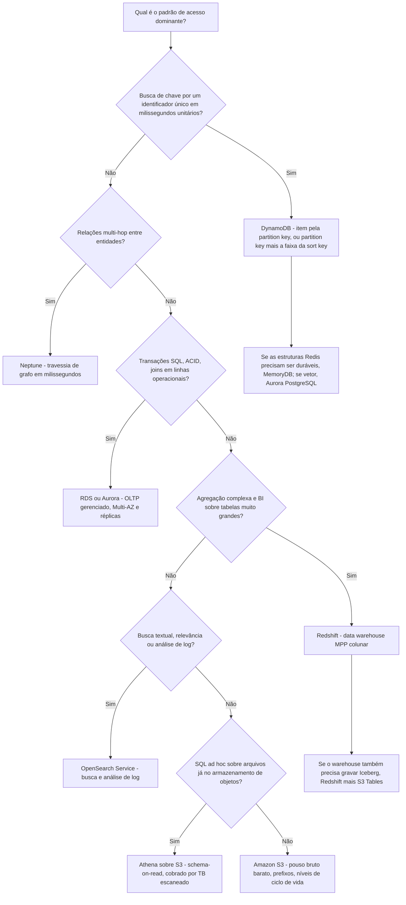
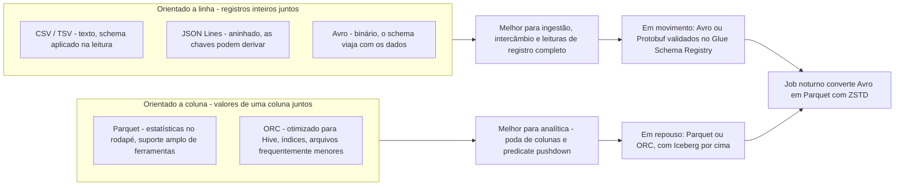
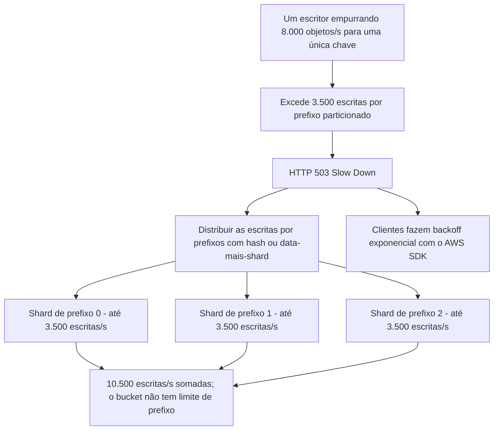
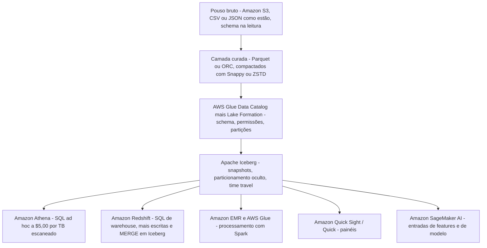
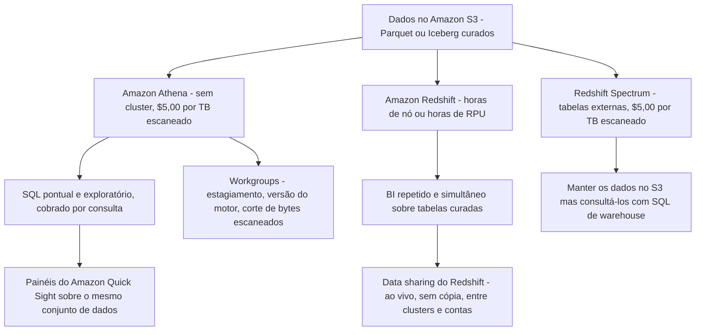

# Escolhendo os Armazenamentos e os Formatos de Arquivo

Pergunte a dez candidatos como eles escolhem um banco de dados e você ouvirá dez versões de "depende", e no DEA-C01 essa resposta não vale ponto algum. O exame não recompensa um gosto vago de arquitetura; ele recompensa um **mapeamento determinístico**: um padrão de acesso no enunciado, um serviço para fora da lista no escopo, um formato em repouso, um codec de compactação. O Domínio 2 vale **26%** do exame, e a tarefa **2.1** é o núcleo de seleção de armazenamento desse domínio, as habilidades **2.1.1** (implementar armazenamento para custo e desempenho), **2.1.2** (configurar armazenamento para padrões de acesso), **2.1.3** (aplicar armazenamentos a casos de uso), **2.1.7** (gerenciar formatos de tabela abertos, por exemplo o Apache Iceberg) e **2.1.8** (descrever tipos de índice vetorial, por exemplo HNSW e IVF).

```text
====================================================================
 A SUPERFÍCIE DE DECISÃO DE ARMAZENAMENTO — DEA-C01 Domínio 2, tarefa 2.1
====================================================================
  Busca pontual por chave, ms unitários ........ Amazon DynamoDB
  Faixa ordenada dentro de uma partição ........ consulta no DynamoDB (PK + SK)
  API Redis + primária durável ................ Amazon MemoryDB for Redis
  Grafo / travessia multi-hop .................. Amazon Neptune
  OLTP gerenciado, ACID, joins ................ Amazon RDS / Amazon Aurora
  Similaridade vetorial com SQL ................ Aurora PostgreSQL (HNSW/IVF)
  Agregação + BI, muitas tabelas grandes ....... Amazon Redshift
  SQL ad hoc sobre arquivos no S3 .............. Amazon Athena ($5,00/TB)
  Texto completo, relevância, análise de log ... Amazon OpenSearch Service
  Pouso bruto barato + níveis de ciclo de vida .. Amazon S3 (+ S3 Glacier)
  Camada de lakehouse transacional ............. S3 + Iceberg (S3 Tables, Glue)
  Formatos em repouso ....... Parquet / ORC (colunares) para analítica
                   Avro / Protobuf em movimento, CSV / JSON no pouso
  Codecs .... Snappy (leitura rápida) · GZIP (razão, Hive)
              ZSTD (padrão do Iceberg, níveis 1-22, padrão do Athena 3)
              ZLIB (escritas em ORC)
  Não é isto ..... analítica em DynamoDB · joins em OpenSearch ·
                    agregação em escala de lago em um cache
====================================================================
```

Nesta lição você vai:

- ler **a tarefa 2.1 habilidade por habilidade** e montar a taxonomia de armazenamentos no escopo de onde o exame extrai suas respostas;
- mapear **padrão de acesso → serviço** com uma tabela-mestre e uma árvore de decisão que você percorre em segundos;
- dimensionar o **DynamoDB** com aritmética real de unidades de capacidade e seus tetos de 400 KB e 10 GB;
- posicionar **RDS, Aurora, Neptune, MemoryDB e DocumentDB** para nunca escolher dois serviços para um mesmo padrão;
- separar **Redshift, Athena e OpenSearch** pelo que a consulta realmente faz;
- escolher um formato na matriz **CSV / JSON / Avro / Parquet / ORC**: layout, schema, evolução e quando usar;
- escolher um **codec de compactação** pelo vocabulário da própria AWS (Snappy, GZIP, ZSTD, ZLIB) e pelos padrões que viram alternativas erradas;
- operar **S3 como núcleo do lago**: 3.500 / 5.500 requisições por prefixo particionado, **nenhum limite de prefixo**, consistência forte desde **1º de dezembro de 2020** e a correção do prefixo quente no 503;
- raciocinar sobre **formatos de tabela de lakehouse**, Iceberg, Hudi e Delta, exatamente na profundidade que a habilidade 2.1.7 exige;
- aplicar **tabelas de decisão** aos cenários do exame e separar **Athena versus Redshift** na camada de consumo;
- estudar **dois estudos de caso de clientes da AWS** e uma **caixa de atualizações de outubro de 2026 com fonte**;
- praticar com **12 questões no estilo do exame** mais três verificações interativas.

---

## 1. O que a tarefa 2.1 realmente testa

### 1.1 As cinco habilidades por trás desta lição

| Habilidade | Foco literal | O que a questão precisa te fazer fazer |
|---|---|---|
| **2.1.1** | Implementar armazenamento para custo e desempenho | Trocar classe de armazenamento, formato e motor contra um orçamento ou meta de latência declarados |
| **2.1.2** | Configurar armazenamento para padrões de acesso | Ler o padrão (busca por chave, varredura, join, busca textual) e nomear o armazenamento |
| **2.1.3** | Aplicar armazenamentos a casos de uso | Exemplos nomeados no guia: **HNSW no Aurora PostgreSQL**, **MemoryDB para acesso rápido a chave/valor** |
| **2.1.7** | Gerenciar formatos de tabela abertos (por exemplo **Apache Iceberg**) | Snapshots, time travel, particionamento oculto, compactação: profundidade de reconhecimento |
| **2.1.8** | Descrever tipos de índice vetorial (**HNSW**, **IVF**) | Reconhecer qual índice uma carga vetorial precisa, com o motor que o oferece |

Duas fronteiras importam mais que as próprias listas. **Afinação profunda de motor está fora**: os internos do Redshift pertencem à Lição 4, e a orquestração à Lição 5. O que sobra aqui é *seleção*: padrão entra, serviço sai, formato anexado.

### 1.2 A taxonomia de armazenamentos no escopo

Tudo o que você pode nomear como resposta correta vem desta tabela (listas no escopo do DEA-C01, conferidas em outubro de 2026):

| Categoria | Serviços no escopo | Identidade do exame em uma linha |
|---|---|---|
| Objetos / núcleo do lago | **S3**, **S3 Tables**, **S3 Glacier** | Objetos em escala, taxas de requisição por prefixo, níveis de ciclo de vida |
| Data warehouse (OLAP) | **Redshift** | MPP + colunar, joins complexos em tabelas enormes, concorrência de BI |
| NoSQL chave-valor / documento | **DynamoDB**, **DocumentDB**, **Keyspaces** | Buscas por chave em milissegundos unitários; coleções estilo JSON; API Cassandra |
| Relacional (OLTP) | **RDS**, **Aurora** | SQL gerenciado, ACID, joins, Multi-AZ e réplicas |
| Busca | **OpenSearch Service** | Relevância textual completa mais analítica de log, quase em tempo real |
| Em memória / chave-valor rápido | **MemoryDB for Redis** | Leituras em microssegundos com primária Multi-AZ durável |
| Grafo | **Neptune** | Bilhões de relações, milissegundos, Gremlin / openCypher / SPARQL |
| Streams (transporte, não um armazenamento) | **Kinesis Data Streams**, **MSK** | Buffer que *alimenta* os armazenamentos acima |
| Camada de lakehouse | **Glue** (+ Data Catalog), **Lake Formation**, **S3 Tables**, **Athena** | Catálogo, governança, gerenciamento de Iceberg, SQL ad hoc |

> [!IMPORTANT]
> **Streams não são armazenamentos.** Kinesis Data Streams e Amazon MSK aparecem na lista de armazenamento da habilidade 2.1.1 porque eles *movem* dados, mas uma pergunta que pergunta "onde você guarda três anos de clickstream para relatórios trimestrais?" nunca é respondida com um stream. Poupe no S3, consulte com Athena e mantenha o stream apenas como entrada.

- **📚 Você sabia?** **Amazon ElastiCache** e **Amazon Timestream** estão **nem** na lista no escopo **nem** na lista fora do escopo (ambas conferidas em outubro de 2026), enquanto a habilidade 2.1.3 nomeia **MemoryDB** explicitamente. A leitura prática: quando o enunciado usa o vocabulário do próprio guia, *"acesso rápido a chave/valor"*, o palpite no escopo é o MemoryDB, e o ElastiCache continua sendo a resposta de cache do mundo real que você encontra em diagramas de produção. Nunca gaste minutos do exame discutindo higiene de lista; responda com o serviço cujo vocabulário combina com o enunciado.

---

## 2. Padrão de acesso → serviço: o mapa mestre

### 2.1 A tabela que você deve decorar de cor

| Formulação do enunciado | Palpite do exame | Por quê (fonte) |
|---|---|---|
| Busca pontual por chave, milissegundos unitários, qualquer escala (carrinho, sessão, perfil) | **DynamoDB** | "single-digit millisecond performance at any scale"; omite deliberadamente JOINs |
| Faixa ordenada dentro de uma chave ("pedidos do cliente X, de 1 a 9 de outubro") | **consulta no DynamoDB** (partition key + sort key) | Faixa ordenada dentro de uma partição |
| Buscas secundárias ou esparsas | **GSI do DynamoDB** | Caminhos alternativos de acesso sobre os mesmos itens |
| Agregação complexa sobre bilhões de linhas + dashboards de BI concorrentes | **Redshift** | MPP, colunar, otimização de consultas |
| SQL ad hoc sobre arquivos já no S3, cobrado por consulta | **Athena** | Schema-on-read, **$5,00 por TB escaneado** |
| Texto completo, relevância, busca difusa ou por frase | **OpenSearch Service** | Segmento de busca textual |
| Logs de séries temporais gerados por máquina + análise por palavra-chave | **Analítica de log do OpenSearch** | "semi-structured, machine-generated time series data" |
| Ingestão de eventos em alta taxa, analítica depois | **Kinesis / MSK → S3** | Streams no escopo como transporte, S3 como armazenamento |
| Travessia multi-hop (redes de fraude, recomendações, grafo de conhecimento) | **Neptune** | Travessia de grafo em milissegundos |
| API Redis como primária durável, leituras em microssegundos | **MemoryDB** | Palavra por palavra da habilidade 2.1.3 |
| Camada só de cache na frente de um banco relacional | **ElastiCache** em produção; formulação no escopo → **MemoryDB** | Veja a nota da Seção 1.2 |
| Registros documentais / JSON com índices | **DocumentDB** | Lista no escopo |
| Relacional gerenciado padrão para OLTP | **RDS** | "We recommend Amazon RDS as your default choice…" |
| Similaridade vetorial ao lado de dados SQL | **Aurora PostgreSQL** | Habilidades 2.1.3 / 2.1.8 (HNSW, IVF) |
| Pouso bruto barato + níveis ao longo do tempo | **S3** (+ S3 Glacier) | Classes de armazenamento e ciclo de vida |
| Atualizações ACID, snapshots, time travel no lago | **S3 + Iceberg** (S3 Tables / Glue) | Habilidade 2.1.7 |

**Regra didática:** *chave + latência → DynamoDB ou MemoryDB · joins e BI → Redshift · SQL no lago → Athena · texto → OpenSearch · relações → Neptune · OLTP → RDS ou Aurora · escala bruta barata → S3.*



### 2.2 Exemplo trabalhado E1: um sistema, dois armazenamentos

Um serviço de varejo tem dois requisitos no mesmo chamado:

```text
Requisito A  "Adicionar ao carrinho" deve responder em ms unitários para
             40.000 compradores simultâneos, com chave na sessão (session ID)
Requisito B  "Cesta média por região, por semana" sobre 2 anos de pedidos
             para a equipe de BI, com 30 visualizadores de relatório simultâneos

A  -> DynamoDB     chave = session ID, item < 400 KB, nenhum join necessário
B  -> Redshift     joins + agregação + concorrência de BI

Errado: "DynamoDB para os dois" (agregação = Scan = leitura da tabela inteira,
        sem joins)
Errado: "Redshift para os dois" (um warehouse tem a forma errada para buscas
        pontuais por requisição em ms unitários)
```

O enunciado sempre traz **dois** requisitos de propósito. Divida a carga; nunca force um armazenamento a responder um padrão para o qual ele não foi desenhado.

### 2.3 Verificação interativa: combine padrão com serviço

```matching
{
  "question": "Combine cada padrão de acesso com o armazenamento da AWS que a prova do DEA-C01 seleciona:",
  "pairs": [
    {"left": "Busca pontual por chave, milissegundos unitários, qualquer escala", "right": "Amazon DynamoDB - NoSQL serverless, item máximo de 400 KB"},
    {"left": "Joins e agregação complexos sobre bilhões de linhas com relatórios de BI simultâneos", "right": "Amazon Redshift: data warehouse MPP colunar"},
    {"left": "SQL ad hoc sobre arquivos já existentes no Amazon S3, cobrado por consulta", "right": "Amazon Athena: schema-on-read, $5,00 por TB escaneado"},
    {"left": "Relevância textual, busca difusa e por frase sobre dados de log", "right": "Amazon OpenSearch Service: índice invertido mais analítica de log"},
    {"left": "Travessia multi-hop, como uma rede de fraude entre contas, cartões e dispositivos", "right": "Amazon Neptune: banco de dados de grafos gerenciado"},
    {"left": "OLTP gerenciado com transações ACID, joins e failover Multi-AZ", "right": "Amazon RDS ou Amazon Aurora: motores relacionais gerenciados"},
    {"left": "Estruturas da API Redis que precisam sobreviver a uma falha de Availability Zone", "right": "Amazon MemoryDB for Redis: leituras em microssegundos, primária Multi-AZ durável"},
    {"left": "Zona de pouso bruto barata com níveis de ciclo de vida até o Glacier", "right": "Amazon S3 com as classes de armazenamento Amazon S3 Glacier"}
  ],
  "explanation": "Cada par é uma frase de enunciado tirada da formulação da tarefa 2.1 do guia do exame. O padrão vem primeiro e o serviço decorre dele: nunca ao contrário. Duas armadilhas se escondem aqui: um Scan sobre o DynamoDB não é uma estratégia de agregação, e uma questão de grafo nunca é respondida com self-joins repetidos num motor relacional."
}
```

---

## 3. Armazenamentos chave-valor, documentais, de grafo e em memória

### 3.1 DynamoDB: as restrições que o exame cita

| Restrição / métrica | Valor (em outubro de 2026) | Por que aparece num enunciado |
|---|---|---|
| Tamanho máximo do item | **400 KB** (nomes de atributo contam) | Um blob de 900 KB não cabe: guarde uma chave mais o S3, ou divida atributos |
| Teto de partição com índices secundários locais | **10 GB** | Projetos com chave única grande demais |
| Capacidade de projeto por partição | **3.000 RCU + 1.000 WCU por segundo** | Diagnóstico de partição quente |
| 1 RCU | 1 leitura consistente forte/s de ≤ **4 KB** (eventual = metade; transacional = 2) | Cálculo de capacidade |
| 1 WCU | 1 escrita/s de ≤ **1 KB** (transacional = 2) | Cálculo de capacidade |
| On-demand para tabelas novas | **4.000 escritas/s**, **12.000 leituras/s**, absorve **2× o pico anterior** | Tráfego espinhoso e desconhecido |
| Prova de escala | Tabelas acima de **200 TB**; mais de **1 bilhão de requisições/hora**; pico do Prime Day 2021 de **89,2M requisições/s** | Afirmações de "qualquer escala" |

A identidade de exame do DynamoDB é **acesso por chave em milissegundos unitários a qualquer escala**, e o seu silêncio deliberado sobre JOINs é justamente o ponto. Qualquer alternativa que proponha o DynamoDB para agregação em escala de lago leu o serviço errado.

### 3.2 Exemplo trabalhado E2: unidades de capacidade na mão

```text
Leitura : 500 leituras consistentes fortes/segundo de itens de 8 KB
          ceil(8 / 4) = 2 RCU cada  ->  500 x 2 = 1.000 RCU
Escrita : 200 escritas/segundo de itens de 1,6 KB
          ceil(1,6 / 1) = 2 WCU cada ->  200 x 2 = 400 WCU

Conferência contra o teto de projeto por partição (3.000 RCU + 1.000 WCU/s):
1.000 RCU e 400 WCU cabem com folga dentro do orçamento de UMA partição,
então uma única partition key bem escolhida basta - o risco é o DESBALANCE
de chave (skew), não o volume.
```

### 3.3 Exemplo trabalhado E3, o teste de folga do item de 400 KB

| Carga | Tamanho | Cabe num item do DynamoDB? | Projeto |
|---|---|---|---|
| Documento de perfil de cliente | 300 KB | **Sim** (≤ 400 KB) | Item único, busca pontual |
| Blob de sessão com anexos em base64 | 900 KB | **Não** | Guarde `session_id` + atributos pequenos no DynamoDB, blob no **S3**, chave como ponteiro |
| Cabeçalho de pedido + 40 itens do pedido | 120 KB | Sim, mas desperdiçado | Modele como itens separados compartilhando uma partition key, para que uma consulta de faixa devolva um pedido inteiro |

A versão favorita desta questão no exame coloca o número **logo acima de 400 KB** no enunciado. A resposta nunca é "aumentar o limite do item": não existe esse botão.

### 3.4 Os vizinhos: DocumentDB, MemoryDB, Neptune

| Armazenamento | Para que serve | Fato-assinatura |
|---|---|---|
| **DocumentDB** | Registros documentais estilo JSON **com índices** | Opção NoSQL documental no escopo |
| **MemoryDB for Redis** | Estruturas compatíveis com Redis com **primária Multi-AZ durável** | Leituras em microssegundos, escritas em ms unitários, até **160M TPS por cluster**; cerca de **390K leituras/s + 100K escritas/s por nó** |
| **Neptune** | Dados altamente conectados | "optimized for storing billions of relationships and querying the graph with milliseconds latency" |
| **Keyspaces** | Cargas com API Cassandra | Opção compatível com Cassandra no escopo |

- **📚 Você sabia?** A fama de exame do MemoryDB vem de uma única frase na habilidade **2.1.3**, *"MemoryDB for fast key/value access"*, e é por isso que ele vence qualquer outra alternativa com cheiro de cache quando o enunciado pede estruturas Redis **mais** durabilidade. Um cache simples na frente de um banco é uma arquitetura real, mas o caso de uso nomeado no guia é o durável: se os dados precisam sobreviver a uma falha de nó sem reconstrução a partir da fonte da verdade, você está lendo a linha do MemoryDB.

---

## 4. OLTP relacional: Amazon RDS e Amazon Aurora

### 4.1 O RDS é o padrão documentado

O Amazon RDS apresenta a **escolha relacional gerenciada padrão** do exame: você escolhe um motor, Multi-AZ para failover, réplicas de leitura para escala e backups automáticos: a AWS cuida do SO e do patch do motor. A própria página de boas-vindas do serviço recomenda **o RDS como escolha padrão** para cargas relacionais, e é por isso que qualquer enunciado descrevendo OLTP convencional (transações, joins, chaves estrangeiras, um schema aplicado na escrita) se resolve no RDS, a menos que uma capacidade específica do Aurora seja nomeada.

### 4.2 Aurora: os deltas que o enunciado nomeia

| Atributo | Valor do Aurora (em outubro de 2026) |
|---|---|
| Compatibilidade | Compatível com MySQL e PostgreSQL |
| Afirmação de throughput | Até **6×** o desempenho do MySQL |
| Volume do cluster | Até **256 TiB** |
| Réplicas de leitura | Até **15** dentro do cluster |
| Busca vetorial (habilidades 2.1.3 / 2.1.8) | **Aurora PostgreSQL** com índices **HNSW** e **IVF** |

```text
Escada de escolha para um enunciado relacional
-----------------------------------------------
OLTP convencional, quer o padrão gerenciado ............... RDS
Precisa de compatibilidade MySQL/PostgreSQL a 6x, 256 TiB,
  15 réplicas de leitura, ou busca vetorial com HNSW/IVF ... Aurora
Precisa de agregação de nível warehouse sobre bilhões de linhas ... Redshift
Precisa de acesso por chave em ms unitários, sem joins ........... DynamoDB
```

A linha vetorial é a armadilha mais nova deste domínio: **HNSW** (hierarchical navigable small world, orientado a recall, faminto de memória) e **IVF** (inverted file, construção mais rápida, busca baseada em clusters) são *tipos de índice*, não serviços. O enunciado nomeia o índice, a alternativa nomeia **Aurora PostgreSQL**.

### 4.3 Exemplo trabalhado E4: qual sabor relacional?

```text
Enunciado 1  "Autorizações de pagamento devem confirmar numa única
              transação, com chaves estrangeiras para merchants e
              chargebacks, e failover em menos de 60 segundos"
             -> RDS (ou Aurora), Multi-AZ
Enunciado 2  "Extrações financeiras mensais juntando 40 tabelas ao
              longo de 8 TB com 40 analistas simultâneos"
             -> Redshift (OLAP, não OLTP)
Enunciado 3  "Busca semântica sobre 3 milhões de descrições de produto
              embutidas como vetores, ao lado da tabela de produtos"
             -> Aurora PostgreSQL
Enunciado 4  "Estado de sessão de um jogo mobile, chaveado por ID de
              jogador, sem joins" -> DynamoDB - escolher um motor
              relacional aqui é a alternativa errada
```

Todo enunciado esconde uma palavra de **forma**: *transação, chave estrangeira, failover* = OLTP; *extração, junção entre muitas tabelas, analistas* = OLAP; *vetor, embedding, similaridade* = Aurora PostgreSQL com HNSW/IVF; *chaveado por, por ID, ms unitários* = DynamoDB.

---

## 5. Armazenamentos analíticos: Redshift, Athena e OpenSearch

### 5.1 Três formas analíticas, três serviços

| Sinal no enunciado | Palpite | Forma de cobrança (em outubro de 2026) |
|---|---|---|
| BI repetido e simultâneo sobre tabelas curadas grandes; joins complexos | **Redshift** | Horas de nó ou horas de RPU |
| SQL pontual sobre arquivos já no S3; "sem infraestrutura" | **Athena** | **$5,00 por TB escaneado**, mínimo de 10 MB por consulta |
| Relevância, busca difusa ou por frase; análise de log com agregações | **OpenSearch Service** | Domínio: horas de instância + armazenamento; Serverless: OCU + armazenamento |
| Processamento completo de Spark / Hive / Presto | **EMR** | Tempo de cluster ou DPU serverless |

O enquadramento da própria AWS é citável: o Athena é para *"interactive ad hoc SQL queries against data on Amazon S3, without … infrastructure or clusters"*, enquanto o Redshift é *"optimized … on complex queries that join large numbers of very large database tables"*.

### 5.2 OpenSearch: a identidade de analítica de log

| Propriedade | Valor (em outubro de 2026) |
|---|---|
| Modos de domínio | **General Purpose** (relevância, objetos aninhados, atualizações frequentes) vs **Otimizado / analítica de log** (Parquet colunar + índice Lucene retido, PPL/SQL) |
| Refresh do Serverless | Cerca de **10 segundos** |
| Afirmações do motor otimizado | Até **4×** de desempenho por custo, **2×** de ingestão, **2×** de velocidade de consulta |
| Grupos de coleção do Serverless | Busca, séries temporais e busca vetorial; **1 OCU ≈ 6 GiB de RAM + vCPU** |

A divisão que aparece nos enunciados: **agregar erros 5xx por serviço *e* fazer busca textual dentro de um stack trace** é uma forma de consulta, OpenSearch. "Juntar as contagens de erro à dimensão de cliente" é outra forma, Athena ou Redshift.

---

## 6. A matriz de formatos de armazenamento

### 6.1 CSV, JSON, Avro, Parquet, ORC, e Protobuf por completeza

| Formato | Layout | Schema | Evolução | Use quando | Fonte |
|---|---|---|---|---|---|
| **CSV / TSV** | Linha, texto | Catálogo externo: **schema-on-read** | Nenhum nativamente | Intercâmbio, dumps legíveis, pouso bruto | Docs de armazenamento colunar do Athena |
| **JSON (Lines)** | Linha, texto, **aninhado** | Aplicado na leitura; crawler infere | Frouxo: chaves derivam | Cargas de evento, APIs, exploração | Docs do Glue Schema Registry |
| **Avro** | **Linha**, binário | Schema guardado **com os dados** (schema = JSON, dados = binário) | Excelente (registro BACKWARD / FORWARD) | Serialização de streaming: Kafka / Kinesis | Docs do Glue Schema Registry |
| **Parquet** | **Colunar**, binário | Rodapé do arquivo | Suportado | Analítica: poda de colunas + **predicate pushdown** por min/máx | Docs de armazenamento colunar do Athena |
| **ORC** | **Colunar**, binário, otimizado para Hive | Rodapé do arquivo | Suportado | Cargas centradas no Hive; arquivos frequentemente menores, índices embutidos | Docs de armazenamento colunar do Athena |
| **Protobuf** | Linha, binário, neutro de linguagem | Definições `.proto` | Forte (números de campo) | Contratos de RPC/serviço; `DataFormat` do registro = AVRO \| JSON \| PROTOBUF | Docs do Glue Schema Registry |

Três comparações que o exame reusa sem parar:

| Par | A distinção |
|---|---|
| **Linha vs colunar** | Avro = "fast reads and writes of complete records", melhor para ingestão, "not optimized for analytics"; Parquet / ORC = analítica |
| **Parquet vs ORC** | Parquet = tipos de consulta mais amplos, otimizado com Arrow, consultas complexas; ORC = arquivos frequentemente menores, índices podem acelerar consultas, structs/maps/lists fortes: **ambos** são colunares com pushdown |
| **CSV/JSON vs qualquer um colunar** | CSV e JSON **não têm predicate pushdown**, então toda consulta paga pelos bytes escaneados, e o Athena cobra por bytes escaneados |



### 6.2 Predicate pushdown em um quadro só

A documentação do Athena diz isso de forma direta: *"predicate pushdown em Parquet e ORC permite que as consultas do Athena busquem apenas os blocos de que precisa… ele usa estatísticas dos predicados de bloco, como valores máximos/mínimos, para decidir se lê ou pula o bloco."* Um arquivo de totais diários onde a consulta pede uma única data deixa o motor **pular grupos de linhas inteiros**: esse pulo é o modelo de custo, não uma micro-otimização.

### 6.3 Padrões de dimensionamento que valem a memória

| Parâmetro | Valor (em outubro de 2026) |
|---|---|
| Tamanho-alvo de divisão (split) | Cerca de **128 MB** |
| Padrão de bloco Parquet no Athena | **128 MB** |
| Padrão de faixa (stripe) ORC no Athena | **64 MB** (faixas abaixo de **8 MB** são lidas inteiras) |
| Caminho de conversão | CSV/JSON → Parquet/ORC via Glue ETL ou `CREATE TABLE AS` do Athena |

### 6.4 Exemplo trabalhado E5: a escada de custo da própria AWS

A página de preços do Athena carrega exatamente este exemplo trabalhado (em outubro de 2026):

```text
3 TB de TEXT, a consulta toca 1 de 4 colunas
  Passo 1  texto bruto        : 3 TB  x $5,00/TB = $15,00
  Passo 2  + GZIP 3:1         : 1 TB  x $5,00/TB =  $5,00   (AWS: "3x savings
                                from compression")
  Passo 3  converter p/ Parquet: 0,25 TB x $5,00/TB =  $1,25  (AWS: "4x savings
                                for reading only one column")

Mesma consulta, mesmo painel, mesma ferramenta de BI: $15,00 -> $5,00 -> $1,25
```

**Lição para o exame:** a compactação sozinha dá o primeiro corte; o **layout colunar** dá o segundo; nenhum dos dois é opcional, e nenhum dos dois muda a consulta. Quando um enunciado diz *"reduzir o custo da consulta sem trocar a ferramenta de BI"*, a resposta é converter para colunar: não comprar um cluster maior.

---

## 7. Codecs de compactação: Snappy, GZIP, ZSTD, ZLIB

### 7.1 O vocabulário da própria AWS

| Codec | Formulação da AWS (docs de compactação do Athena) | Padrão para | Leitura de exame |
|---|---|---|---|
| **Snappy** | "Lempel-Ziv 77 (LZ7) family … focuses on high compression and **decompression speed** rather than the maximum compression" | Escolha comum em Parquet / Hive / Spark | Leituras rápidas, o padrão analítico quando a CPU importa |
| **GZIP** | "based on Deflate"; texto comprimido **não é divisível (splittable)** | **Escritas em Parquet/texto do Athena com Hive** | Melhor razão, mais lento, divisões paralelas ruins |
| **ZSTD** | "fast compression algorithm that provides **high compression ratios**"; níveis **1 to 22**, padrão do Athena **3** | **Tabelas Iceberg** | Melhor equilíbrio ajustável: a resposta do lakehouse |
| **ZLIB** | Baseado em Deflate | **Escritas em ORC** | Padrão do ecossistema ORC |
| LZO / LZ4 / BZIP2 | Somente leitura em lugares; o Athena **não consegue gravar** Parquet com LZ4 ou LZO |: | Material de alternativa errada |

O princípio que rege tudo, tirado do guia de tuning do Athena: **razão maior custa CPU**. Compacte o lago e deixe o layout colunar mais o predicate pushdown cortarem a E/S.

> [!WARNING]
> **⚠️ Compactação não é colunar.** CSV com GZIP continua sendo totalmente escaneado, o codec encolhe os bytes, mas o motor ainda lê cada linha para achar uma coluna. As duas alavancas são independentes: o **formato** decide *quantos dados o motor precisa tocar*, o **codec** decide *de que tamanho são aqueles bytes*. Um enunciado oferecendo "trocar de Parquet para CSV compactado com GZIP para economizar" trocou as alavancas de lugar.

### 7.2 Padrões que viram alternativas erradas de três vias

```text
ZSTD -> tabelas Iceberg        (padrão de compactação do Athena para Iceberg)
GZIP -> Parquet/texto com Hive (padrão de escrita do Athena com Hive)
ZLIB -> escritas em ORC        (padrão do ecossistema ORC)
```

Aprenda-os como um trio: qualquer questão que pare "qual compactação o X usa por padrão" com três desses quatro nomes está testando a memorização exatamente desse mapeamento.

```fillblank
{
  "question": "Complete as afirmações de codec usando os padrões e os tradeoffs da própria AWS:",
  "template": "{{1}} é a compactação padrão das tabelas Iceberg, onde o Athena grava no nível {{2}} de uma faixa que vai de 1 a {{3}}. Escritas de Parquet e texto com Hive usam {{4}} por padrão, escritas em ORC usam {{5}}, e {{6}} é o favorito de Parquet/Spark porque otimiza para {{7}} em vez da razão máxima de compressão.",
  "answers": {
    "1": "ZSTD",
    "2": "3",
    "3": "22",
    "4": "GZIP",
    "5": "ZLIB",
    "6": "Snappy",
    "7": "decompression speed"
  },
  "distractors": ["Snappy", "GZIP", "ZLIB", "BZIP2", "LZ4", "LZO", "level 6", "level 9", "compression ratio", "splittability", "ratio"],
  "explanation": "Documentação de compactação do Athena da AWS: ZSTD é o padrão para tabelas Iceberg no nível 3 de 1-22; escritas de Parquet/texto com Hive usam GZIP; escritas em ORC usam ZLIB; Snappy pertence à família Lempel-Ziv 77 e prioriza a velocidade de descompressão em vez da compressão máxima. As respostas-armadilha são padrões trocados: em especial parecer GZIP com Iceberg ou Snappy com ORC."
}
```

### 7.3 Exemplo trabalhado E6: a decisão de codec num enunciado

```text
Enunciado 1  "Tabela Iceberg no S3 consultada pelo Athena; equilibrar
              razão e custo de varredura" -> ZSTD (o Athena usa o nível 3
              por padrão em escritas ZSTD)
Enunciado 2  "Jobs do Spark decodificam mais rápido do que codificam;
              a CPU é a restrição" -> Snappy (velocidade de descompressão
              é o objetivo de projeto declarado)
Enunciado 3  "Tabelas Hive gravadas pelo EMR, saída em texto,
              divisibilidade importa" -> GZIP (e lembre: texto comprimido
              NÃO é divisível)
Enunciado 4  "Arquivos ORC num pipeline do ecossistema Hive"
              -> ZLIB (o padrão de escrita do ORC)
Enunciado 5  "Arquivo histórico de CSV bruto o mais barato possível,
              que ninguém consulta" -> GZIP no S3, depois níveis até o
              S3 Glacier - só escolha de codec; o formato (CSV) ainda
              significa varredura completa para quem consultar
```

### 7.4 Exemplo trabalhado E7: aritmética de conversão

```text
Antes : 3,6 TB de CSV no S3, painéis leem 2 de 12 colunas
Depois: CTAS com format='PARQUET', write_compression='GZIP'
        -> cerca de 1,2 TB em repouso (aproximadamente 3:1 em texto já compacto)
        -> um painel de coluna única toca cerca de 0,3 TB

Custo do Athena, em outubro de 2026:
  antes: 3,6 TB x $5,00        = $18,00 por atualização de painel
  depois: 0,3 TB x $5,00       =  $1,50 por atualização de painel

(aritmética ilustrativa; o modelo com fonte da própria AWS é a escada de
 texto -> GZIP -> Parquet de 3 TB da Seção 6.4: $15,00 -> $5,00 -> $1,25)
```

- **📚 Você sabia?** O Amazon Athena **infere a compactação pela extensão do arquivo** nos formatos de texto e JSON, então renomear um `.csv.gz` para `.csv` não "descomprime" nada, apenas diz ao motor para esperar texto puro que ele não vai encontrar. É por isso que questões de formato e questões de codec são itens de exame separados: o formato é o que você *declara*, o codec é em grande parte o que o motor *descobre*.

---

## 8. O Amazon S3 como núcleo do lago de dados

### 8.1 Taxas de requisição: por prefixo, não por bucket

A documentação de desempenho da AWS (acesso em outubro de 2026) afirma:

> "Sua aplicação pode alcançar pelo menos **3.500 requisições PUT/COPY/POST/DELETE ou 5.500 GET/HEAD por segundo por prefixo particionado do Amazon S3**. Não há limites ao número de prefixos em um bucket."

| Métrica | Valor (em outubro de 2026) |
|---|---|
| Escritas por prefixo particionado | ≥ **3.500** PUT/COPY/POST/DELETE por segundo |
| Leituras por prefixo particionado | ≥ **5.500** GET/HEAD por segundo |
| Limite de prefixos | **Nenhum** |
| Exemplo de paralelização da AWS | **10 prefixos ⇒ 55.000 leituras/s** |
| Sinal de throttling | **> 5.000 requisições/s** sustentadas para poucos objetos ⇒ possível **HTTP 503 Slow Down** |
| S3 Express One Zone | Milissegundos unitários, até **2.000.000 requisições/s** por directory bucket |

### 8.2 Exemplo trabalhado E8: a correção do prefixo quente

```text
Incidente : um escritor empurra 8.000 objetos/segundo para uma única chave
Diagnóstico: 8.000 > 3.500 escritas por prefixo particionado -> 503 Slow Down
Correção  : distribuir as escritas por prefixos com hash ou data-mais-shard
            10.500 objetos/s / 3.500 por prefixo = 3 prefixos distintos
            no mínimo, antes de depender do particionamento automático do S3

Não é correção : "aumentar o limite do bucket" - não existe cota de
                 requisição em nível de bucket para aumentar; o eixo é o PREFIXO.
```



### 8.3 Partições e prefixos são eixos diferentes

| Eixo | O que otimiza | Mecanismo |
|---|---|---|
| **Partições no estilo Hive** (`dt=2026-10-09/`) | **Poda de consulta (pruning)**, o Athena lê só as partições correspondentes | Chaves de partição no Glue Data Catalog |
| **Prefixos gravados** | **Taxa de requisição**: cada prefixo particionado ganha sua própria faixa de 3.500 / 5.500 | Layout das chaves sob o bucket |

Sobre-particionar produz **arquivos pequenos** e sobrecarga do planejador (erros no estilo "reduce your request rate" aparecem no guia de tuning do Athena em tamanhos de split minúsculos). A regra: particione pela cláusula `WHERE`, distribua prefixos pela taxa de escrita, e mire divisões de cerca de **128 MB**.

### 8.4 Consistência: a mudança de 2020 que matou duas respostas

O anúncio da AWS de **1º de dezembro de 2020**:

> "Com efeito imediato, todas as operações GET, PUT e LIST do S3, assim como operações que alteram tags, ACLs ou metadados de objetos, agora são fortemente consistentes."

- **Grátis**, vale para **todas as Regiões** e todos os objetos.
- Consequências: **EMRFS Consistent View** e **S3Guard** estão obsoletos: qualquer alternativa cuja correção *dependa* deles está desatualizada e errada.
- Uma alternativa do tipo "leitura após escrita é eventualmente consistente no S3" está falsa em qualquer exame desde 2021.

- **📚 Você sabia?** A escada de classes de armazenamento do S3 é em si uma alavanca de custo para o lago: o **Intelligent-Tiering** move objetos intocados por **30 dias** para Standard-IA (**−40%**), **90 dias** para Glacier Instant Retrieval (**−68%**) e, opcionalmente, **180 dias** para Deep Archive (**−95%**), enquanto o **S3 Express One Zone** troca uma Availability Zone única por latência de milissegundos unitários a até **2.000.000 requisições/s** por directory bucket (em outubro de 2026). Escolher a *classe* é a metade de custo/desempenho da tarefa 2.1; escolher o *formato* é a Seção 6 desta lição.

- **📚 Você sabia?** O Amazon S3 é um serviço público desde **13 de março de 2006**, e a retrospectiva de 20 anos da própria AWS (2026-03-13) relata uma redução de preço de aproximadamente **85% desde o lançamento** mais mais de **US$ 6 bilhões** economizados em conjunto por clientes que escolheram o **S3 Intelligent-Tiering** em vez do S3 Standard: junto do lembrete de que *"o código que você escreveu para o S3 em 2006 ainda funciona hoje, sem mudanças"*. É por isso que o Intelligent-Tiering é o padrão do lago quando o padrão de releitura é desconhecido: a AWS move um objeto intocado por **30 dias** para Standard-IA (−40%), **90 dias** para Glacier Instant Retrieval (−68%) e opcionalmente **180 dias** para Deep Archive (−95%), então a decisão de custo se resolve sozinha enquanto a decisão de formato (Seção 6) continua sendo sua.

---

## 9. A camada de lakehouse: Iceberg, Hudi e Delta

### 9.1 Por que existem formatos de tabela

Os formatos de arquivo "só permitem a gravação de arquivos inteiros", então captura de mudanças (CDC), exclusões e streaming contínuo criam dor de arquivos pequenos e não oferecem semântica transacional em armazenamento de objetos. Os **formatos de tabela** acrescentam **snapshots, compactação, time travel e semântica transacional** por cima dos arquivos Parquet/ORC/Avro no S3. Um lago de dados simples, observa a Prescriptive Guidance da AWS, *não oferece suporte a atomicidade, consistência, isolamento e durabilidade (ACID)* até que um formato de tabela como o Iceberg seja adicionado.

**O Iceberg é o que o guia nomeia** (habilidade **2.1.7**), então é o que você precisa conhecer em profundidade:

| Recurso do Iceberg | O que faz (formulação de exame) |
|---|---|
| **Snapshots** | Cada escrita cria um novo snapshot; listas de manifesto e manifestos carregam estatísticas de **mínimo/máximo por coluna** para salto de dados |
| **Particionamento oculto** | "This feature prevents reading unnecessary partitions automatically": `day(ts)` deriva o valor em tempo de execução, **sem coluna extra**, sem controle manual de `WHERE dt=` |
| **Time travel** | `FOR VERSION AS OF <snapshot_id>` / `FOR TIMESTAMP AS OF <timestamp>` |
| **Catálogo padrão** | **AWS Glue Data Catalog** |
| **Suporte de motores** | Athena, EMR, Redshift, Glue, SageMaker |
| **Opção gerenciada** | **Amazon S3 Tables** = Iceberg gerenciado no S3 |

### 9.2 Hudi e Delta: reconhecimento, não internos

A própria orientação da AWS diz **"no single table format is a 'one size fits all'"**. A matriz comparativa publicada pela AWS (acesso em outubro de 2026):

| Capacidade | **Hudi** | **Iceberg** | **Delta** |
|---|---|---|---|
| Copy-on-write | Sim | Sim | Sim |
| Merge-on-read | Sim | Sim | Não |
| Formatos de arquivo de dados | Parquet, ORC, HFile | Parquet, ORC, Avro | **Somente Parquet** |
| Time travel | Sim | Sim | Sim |

Como o guia nomeia só o Iceberg, não memorize internos dos outros dois: reconheça os nomes e saiba que a AWS se recusa a coroar um vencedor.



### 9.3 Schema-on-read versus schema-on-write

| | **Schema-on-write** (warehouse) | **Schema-on-read** (lago) |
|---|---|---|
| Ordem das operações | Definir schema, conformar na carga, rejeitar mudanças incompatíveis | Poupar os dados como estão, aplicar o schema **no momento da consulta** |
| Formulação da AWS | Estagiamento tradicional de warehouse | "the data can be stored as is and you apply a schema at the time that you read it" |
| Força | Dados pré-estruturados consultam mais rápido; aplicado | Flexível, rápido para começar |
| Fraqueza | Entrada rígida | A derivação aparece na hora da consulta |
| Lar na AWS | Tabelas do **Redshift** | **Athena + Glue Data Catalog sobre o S3** |

Formulação de exame: **lago = schema-on-read, armazenamento barato, computação desacoplada; warehouse = schema-on-write, curado, aplicado, afinado para BI.** Dashboards fixos com muitos joins → escrita; bruto, estruturas variáveis → leitura.

### 9.4 Exemplo trabalhado E9: particionamento oculto e time travel

```text
Tabela: eventos de clickstream, coluna `ts` (timestamp)

Projeto no estilo Hive
  PARTITIONED BY (dt)  +  arquivos sob dt=2026-10-09/
  A consulta PRECISA conter WHERE dt = '2026-10-09' ou o Athena varre tudo

Projeto no Iceberg
  PARTITIONED BY (day(ts))  -> NÃO acrescenta coluna ao schema
  O Athena deriva a partição a partir de `ts`; um WHERE em ts faz pruning,
  e você nunca mantém à mão o controle de dt=

Pergunta do auditor, "o que a tabela continha ao meio-dia de ontem?":
  SELECT * FROM clickstream
   FOR TIMESTAMP AS OF '2026-10-09 12:00:00 UTC';
  -> respondido a partir dos snapshots, sem copiar a tabela
```

---

## 10. Tabelas de decisão para cenários de exame

### 10.1 A tabela mestre de cenários

| # | Padrão de acesso / restrição | Armazenamento | Formato em repouso | Codec |
|---|---|---|---|---|
| 1 | Busca pontual por chave, ms unitários, qualquer escala | **DynamoDB** | Item (estilo JSON) |: |
| 2 | Faixa ordenada dentro de uma chave | **consulta no DynamoDB** (PK + SK) |, |, |
| 3 | Buscas secundárias / esparsas | **GSI do DynamoDB** |, |, |
| 4 | Joins complexos + agregação, concorrência de BI | **Redshift** | Colunar interno; `COPY` de Parquet/CSV/Avro/ORC/JSON | Snappy / ZSTD |
| 5 | SQL ad hoc no lago, cobrado por consulta | **Athena sobre S3** | **Parquet** (ou ORC) | ZSTD (Iceberg) / GZIP (Hive) |
| 6 | Busca textual / difusa / por relevância | **OpenSearch** | Documentos JSON indexados |: |
| 7 | Log + séries temporais de máquina com análise por palavra-chave | **Analítica de log do OpenSearch** | Parquet + índice Lucene | Colunar |
| 8 | Ingestão de eventos em alta taxa, analítica depois | **Kinesis / MSK → S3** | **Avro em movimento → Parquet em repouso** | ZSTD |
| 9 | Relações multi-hop, fraude ou recomendação | **Neptune** | Grafo |: |
| 10 | OLTP gerenciado: ACID, joins, transações | **RDS / Aurora** | Linhas do motor | Motor |
| 11 | API Redis como primária durável, leituras em microssegundos | **MemoryDB** | Estruturas Redis |: |
| 12 | Pouso bruto barato + níveis ao longo do tempo | **S3** (+ Glacier) | CSV / JSON bruto | GZIP |
| 13 | Atualizações ACID, snapshots, time travel no lago | **S3 + Iceberg** (S3 Tables / Glue) | Parquet | ZSTD |
| 14 | Similaridade vetorial ao lado de dados SQL (HNSW / IVF) | **Aurora PostgreSQL** | Motor + índice vetorial |: |
| 15 | Reconsultar a tabela curada de ontem | **Athena / time travel do Iceberg** | Parquet | ZSTD |

### 10.2 Ciclo de vida do formato: ordenação interativa

```dragdrop
{
  "question": "Ordene este ciclo de vida de dados da ingestão até a retenção de longo prazo, exatamente como o exame espera que um lago bem projetado progrida:",
  "items": [
    "O produtor serializa Avro e registra o schema no AWS Glue Schema Registry com compatibilidade BACKWARD",
    "O ETL do Glue reescreve os arquivos aterrados do stream em Parquet compactado com ZSTD",
    "O Amazon S3 guarda os arquivos curados e o AWS Glue Data Catalog guarda o schema e as partições deles",
    "O Apache Iceberg acrescenta snapshots, particionamento oculto e time travel sobre aqueles arquivos",
    "Analistas consultam com o Amazon Athena; painéis leem através do Amazon Quick Sight",
    "Regras de ciclo de vida sobem partições frias para o S3 Glacier Instant Retrieval e depois para o Deep Archive"
  ],
  "correctOrder": [
    "O produtor serializa Avro e registra o schema no AWS Glue Schema Registry com compatibilidade BACKWARD",
    "O ETL do Glue reescreve os arquivos aterrados do stream em Parquet compactado com ZSTD",
    "O Amazon S3 guarda os arquivos curados e o AWS Glue Data Catalog guarda o schema e as partições deles",
    "O Apache Iceberg acrescenta snapshots, particionamento oculto e time travel sobre aqueles arquivos",
    "Analistas consultam com o Amazon Athena; painéis leem através do Amazon Quick Sight",
    "Regras de ciclo de vida sobem partições frias para o S3 Glacier Instant Retrieval e depois para o Deep Archive"
  ],
  "explanation": "Formatos de linha pertencem ao movimento (Avro com schema gerenciado por registro), formatos colunares pertencem ao repouso (Parquet com ZSTD), a camada de catálogo e governança fica acima dos arquivos, o formato de tabela acrescenta semântica transacional acima do catálogo, o consumo vem em seguida e o nível por classe de armazenamento é o passo final. Pular a etapa de conversão: analisar Avro ou CSV bruto, é o erro mais caro da sequência, porque o Athena cobra pelos bytes escaneados."
}
```

### 10.3 Os dez pares de armadilha

| Alternativa errada | Por que está errada |
|---|---|
| "Usar DynamoDB para a agregação mensal" | Sem joins; um `Scan` lê a tabela inteira |
| "Comprimir o CSV para cortar o custo do Athena" | Compactação ≠ colunar: as varreduras completas continuam |
| "S3 é eventualmente consistente para leituras" | Fortemente consistente desde **2020-12-01** |
| "Aumentar a cota de requisições do bucket" | O eixo é o **prefixo**; não existe limite de prefixo |
| "Adicionar `S3Guard` para consistência" | Obsoleto; o EMRFS Consistent View também |
| "Iceberg é um formato de arquivo" | É um **formato de tabela** sobre Parquet / ORC / Avro |
| "Timestream para o armazenamento de métricas" | Fora da lista no escopo (conferida em outubro de 2026): use **OpenSearch** ou streams → S3 → Athena |
| "Grafo via self-joins repetidos no RDS" | O **Neptune** existe exatamente para isto |
| "ElastiCache é o caso de uso nomeado para chave/valor rápido" | A habilidade 2.1.3 nomeia **MemoryDB** |
| "Partições do Hive e prefixos do S3 são a mesma coisa" | Eixo de pruning vs eixo de taxa de requisição |

---

## 11. Consumo entre serviços: Athena versus Redshift

A seleção de armazenamento não termina no armazenamento, o exame pergunta qual **motor** o lê. A orientação comparativa da AWS (acesso em outubro de 2026) é inequívoca: **Athena** = SQL ad hoc ANSI interativo no S3 sem clusters; **Redshift** = o warehouse; **EMR** = Spark/Hive completos.

| Sinal | Athena | Redshift |
|---|---|---|
| Cluster | Nenhum | Nós provisionados ou RPUs Serverless |
| Cobrança | **$5,00 por TB escaneado** (mínimo de 10 MB), ou Capacity Reservations | Horas de nó / horas de RPU, com ou sem alguém consultando |
| Melhor forma | Pontual, exploratório, schema-on-read | BI repetido e simultâneo sobre tabelas curadas |
| Isolamento / grades de proteção | **Workgroups**: local de estagiamento, versão do motor, criptografia e um **corte de bytes escaneados** por consulta | Workgroups, concurrency scaling, WLM |
| Alcance em outros sistemas | **Federated queries** (cobradas por TB agregados entre fontes, mais Lambda) | Consultas federadas para RDS/Aurora, Spectrum, data sharing |
| Resultados | Estagiados no S3; os **managed query results** (2025-06-03) tornam a localização opcional e não custam nada a mais | A Data API devolve resultados por **24 horas** |

Alavancas de custo que aparecem nos enunciados, em ordem de impacto:

1. **Formato colunar + codec**: a escada de $15 → $5 → $1,25 da própria AWS.
2. **Pruning de partições**: só ajuda quando o `WHERE` usa a chave de partição; `SELECT *` joga fora a economia de colunas.
3. **Partição por projeção (partition projection)**, o Athena deriva as partições das propriedades da tabela em vez de chamar `GetPartitions`; a AWS relata acelerações de consulta como **137 s → 10 s (~92%)**.
4. **Corte de bytes escaneados do workgroup**: `BytesScannedCutoffPerQuery` tem um **mínimo de 10.000.000 de bytes**, limitando o pior caso de gasto por consulta.
5. **Reuso de resultados de consulta**: **60 minutos** por padrão, máximo de **7 dias**, por workgroup.

### 11.1 Exemplo trabalhado E10: aritmética de pruning

```text
Tabela    : 2 TB de Parquet no S3, 730 partições diárias (~2,74 GB cada)
Consulta A: SELECT ... WHERE dt = '2026-10-09'
            varredura podada ~ 0,00268 TB x $5,00/TB  ~= $0,013
Consulta B: SELECT ... (sem predicado de partição)
            varredura completa 2 TB x $5,00/TB        = $10,00

Mesmos dados, mesmo motor, mesma forma de resultado:
a cláusula WHERE é o controle de custo. (ilustrativo sobre o preço de
$5,00/TB do Athena, em outubro de 2026)
```



> [!IMPORTANT]
> **Não invente um ponto de cruzamento.** Artigos de terceiros adoram afirmar que "o Redshift vence o Athena acima de X TB por mês": **a AWS não publica nenhum número assim**, então nenhuma resposta de exame pode conter um. O que a AWS publica é a *forma de cobrança*: por varredura para o Athena, capacidade sempre ligada para o Redshift, e os **$5,00 por TB escaneado** do Spectrum para dados no S3 consultados a partir do Redshift (em outubro de 2026).

### Atualizações de 2026 (em outubro de 2026)

> [!NOTE]
> **O que mudou na seleção de armazenamentos e formatos entre 2025 e outubro de 2026**: cada linha conferida contra uma fonte primária da AWS, e cada uma é examinável porque o exame testa o comportamento *atual*:
> - **O guia v1.1 (2025-12-12) acrescentou as duas habilidades sobre as quais esta lição se apoia**: **2.1.7 "Gerenciar formatos de tabela abertos (por exemplo Apache Iceberg)"** e **2.1.8 "Descrever tipos de índice vetorial (por exemplo HNSW, IVF)"**, oito habilidades adicionadas, nenhuma removida, página de revisões do DEA-C01, 2025-12-12.
> - **Os armazenamentos no escopo mudaram no v1.1**: **Aurora** e **Amazon S3 Tables** foram acrescentados (junto com Amazon Q, Bedrock, Kendra e Data Exchange), enquanto Cloud9, CodeCommit e AWS SCT foram removidos: página de serviços no escopo do DEA-C01, acesso em outubro de 2026.
> - **O Redshift agora grava Iceberg, não só lê**: `CREATE`/`INSERT` foi para GA em **2025-11-17** sobre o Glue Data Catalog, `UPDATE`/`DELETE`/`MERGE` em tabelas Iceberg (incluindo **S3 Tables**) chegaram em **2026-04-23**, e as **materialized views de Iceberg** em **2026-10-05**: AWS What's New, 2025-11-17 / 2026-04-23 / 2026-10-05.
> - **Streams agora aterram direto em formatos de tabela**: as **streaming tables** do Kinesis Data Streams materializam um stream em **Iceberg no S3 Tables** (auto-Parquet, compactação inline) desde **2026-08-28**, com entrega em S3 de propósito geral desde **2026-08-29**, e os brokers Express do Amazon MSK fizeram o mesmo em **2026-07-30**: AWS What's New.
> - **S3 Express One Zone ficou mais barato e mais amplo**: armazenamento **−31%**, PUT **−55%**, GET **−85%** (2025-04-10), e as Regiões passaram de 8 para **15 até 2026-09-17**; o **S3 Tables** ganhou o tipo **Variant** para Iceberg v3 (2026-07-28): AWS What's New.
> - **Athena não precisa de bucket de resultados nem de reserva grande**: os **managed query results** (2025-06-03) são gerenciados pelo serviço, criptografados e gratuitos, e as Capacity Reservations agora começam em **4 DPU por 1 minuto** em vez de 24 DPU por 60 minutos (2026-02-11): AWS What's New.
> - **O AWS Glue 6.0 rebasou a cadeia de ferramentas de formato (2026-08-21)**: **Spark 4.1.1**, **Python 3.13**, **Scala 2.13.17**, Iceberg **1.11.0** com **format v3** (VARIANT, deletion vectors) e **redução de preço de 30%**, enquanto **EMRFS e AWS SDK for Java v1 foram removidos** e Glue **0.9 / 1.0 / 2.0 chegaram ao end of life em 2026-04-01**, assim, uma alternativa `fs.s3.consistent.*` ou `com.amazonaws.services.*` agora é distração, AWS What's New, 2026-08-21; notas de versão e política de suporte do Glue, acesso em outubro de 2026.
> - **Lake Formation cross-account sharing v5 (2026-02-11)**: um único share do AWS RAM agora pode carregar tabelas ilimitadas usando **padrões de grant curinga** em vez de uma associação de recurso por tabela, e links de recurso entre Regiões compõem com isso, então "criar uma associação para cada tabela" é a resposta desatualizada, AWS What's New, 2026-02-11; docs do Lake Formation, acesso em outubro de 2026.
> - **Kinesis Data Streams agora tem três modos de capacidade**: Provisioned, On-demand Standard e **On-demand Advantage** (2025-11-04), que derruba a cobrança horária por stream e corta as taxas de GB, mas cobra um piso de **25 MB/s de ingestão + 25 MB/s de recuperação** em toda a conta; o tamanho máximo de registro é **10 MiB**: AWS What's New, 2025-11-04; guia do desenvolvedor do Kinesis Data Streams, acesso em outubro de 2026.
> - **Avisos de fato obsoleto**: qualquer alternativa afirmando que **o Redshift só consegue ler Iceberg** está errada desde 2025-11-17, e qualquer alternativa que exija você **configurar uma localização de resultados no S3 para o Athena** está errada desde 2025-06-03.

- **📚 Você sabia?** O **AWS Glue Schema Registry**, o componente que torna o Avro em movimento seguro: é **serverless e gratuito**, e valida exatamente três formatos: **AVRO (1.11.4), JSON e PROTOBUF**. O modelo de Avro dele é a única frase que vale a memória: **o schema é JSON, os dados são binário**, e é por isso que um arquivo Avro só é legível com o seu schema, e por que "o schema viaja com os dados" é a explicação correta de exame para o comportamento de evolução excelente do Avro.

---

## Casos Reais

A AWS publica como essas abstrações aparecem em produção. Todo número abaixo é **afirmação do cliente ou da AWS e não auditado**, com a fonte nomeada para que você possa conferir, o ponto examinável é o **padrão** (qual armazenamento, qual formato, qual número se moveu), não o marketing.

### Caso A, Nasdaq: um caminho de escrita no S3 e um caminho de leitura no Redshift

| Elemento | Detalhe |
|---|---|
| Cliente | **Nasdaq**, bolsa de valores (fora de um warehouse local legado desde 2014) |
| Desafio | O lote noturno de ordens, cotações e negociações precisa terminar **antes da abertura do mercado**, enquanto analistas consultam o histórico de forma simultânea |
| Serviços | **Data lake no Amazon S3** (caminho de escrita) + **Amazon Redshift** e **Redshift Spectrum** (caminho de leitura) + arquivo **S3 Glacier** + **S3 Object Lock** |
| Resultados | **70 bilhões de registros/dia** (pico de **113 bilhões**, fevereiro de 2020); **90% do load concluído 5 horas antes**; **consultas 32% mais rápidas**; um lago de **15 TB** consultado **no lugar** |
| Domínio do exame | **Domínio 2** (seleção de armazenamento: lago vs warehouse, armazenamento e computação desacoplados) |
| Fonte | `aws.amazon.com/solutions/case-studies/nasdaq-case-study` (acesso em outubro de 2026) |

> "Nós conseguimos suportar com facilidade o salto de 30 bilhões para 70 bilhões de registros por dia por causa da flexibilidade e da escalabilidade do Amazon S3 e do Amazon Redshift.": Robert Hunt, VP de Engenharia de Software, Nasdaq (estudo de caso da AWS, acesso em outubro de 2026)

Leia a Nasdaq como **um sistema, dois armazenamentos**: o S3 absorve o pico de escrita de forma barata e durável, o Redshift serve as leituras simultâneas, e o Spectrum fecha o intervalo para que o lago de 15 TB nunca seja copiado. A frase destacada pela página da AWS é *"zero contention between data loading and querying"*: esse é o argumento de armazenamento desacoplado da Seção 9, visível num prazo de produção.

### Caso B, EMX: S3 e Athena em vez de um warehouse de backend

| Elemento | Detalhe |
|---|---|
| Cliente | **EMX**, empresa de mídia programática / ad-tech |
| Desafio | Um pipeline com pesados custos de ETL e armazenamento de backend, ingerindo **mais de 2 TB de dados brutos por hora** |
| Serviços | **Amazon S3** como lago mais **Amazon Athena** para consulta |
| Resultados | **85% de economia nos custos de armazenamento de dados**; consultas **pelo menos quatro vezes mais baratas que outras ferramentas de ETL de backend** (afirmação do cliente, acesso em outubro de 2026) |
| Domínio do exame | **Domínio 2** tarefa 2.1 (seleção de armazenamento + formato) alimentando o consumo do **Domínio 3** |
| Fonte | AWS Big Data Blog, "How EMX reduced data pipeline costs by 85% with Amazon Athena" (2021-02-02, acesso em outubro de 2026) |

A EMX é a versão em funcionamento da Seção 6: manter os dados brutos no **S3**, converter para um layout **colunar** e deixar a **cobrança por terabyte do Athena** substituir um backend sempre ligado. O padrão examinável é a *forma*, armazenamento de objetos barato mais SQL por consulta vence um cluster que você paga com ou sem alguém consultando, nunca o percentual específico.

### Caso C, EOS Group: DMS para S3 para Redshift, com PII mascarado no lugar

| Elemento | Detalhe |
|---|---|
| Cliente | **EOS Group**, serviços financeiros (warehouse local em crescimento, **crescimento de dados de 15% ao ano**) |
| Desafio | Estimativas de capacidade a cada upgrade, mais um requisito de conformidade para exibir PII mascarado a analistas padrão |
| Serviços | **AWS MAP** + **AWS DMS** aterrando o banco de dados no **Amazon S3**, depois **Amazon Redshift**; **dynamic data masking do Redshift** dirigido pelas permissões do usuário que consulta |
| Resultados | **50% de redução nos custos de infraestrutura**, **zero perda de dados**, **downtime mínimo** (afirmação da AWS/cliente, acesso em outubro de 2026) |
| Domínio do exame | **Domínio 2** tarefa 2.1 (seleção de armazenamento: migração de warehouse) com proteção por coluna do **Domínio 4** |
| Fonte | `aws.amazon.com/solutions/case-studies/eos-group-case-study` (acesso em outubro de 2026) |

> "Ao remover a necessidade de infraestrutura local, a EOS Group alcançou uma redução de 50 por cento nos custos de infraestrutura…": estudo de caso AWS EOS Group (acesso em outubro de 2026)

Leia a EOS como **a sequência de migração que o exame insiste em testar**: o **DMS** aterruga o banco de dados no **S3**, o **Redshift** carrega a partir do S3, e a mascaragem acontece **dentro do warehouse contra as permissões do usuário**: uma tabela, duas visões dela, nenhuma cópia mascarada secundária para manter em sincronia. Três armadilhas se escondem aqui: o DMS não é o DataSync (ele move schemas e linhas, não arquivos), o Macie não mascara nada (ele descobre dados sensíveis **no Amazon S3**), e os 50% são o resultado da própria EOS sobre a sua linha de base, nunca uma garantia de migração.

### Caso D, GE Aerospace: modernizando um armazenamento operacional legado

| Elemento | Detalhe |
|---|---|
| Cliente | **GE Aerospace**, aeroespacial e cadeia de suprimentos |
| Desafio | Um grande armazenamento operacional de dados (ODS) alimentando **mais de 150 relatórios**, alguns com **mais de 10.000 linhas de código**, sob restrições de conformidade e desempenho |
| Serviços | **Amazon Redshift** com apoio de Solutions Architects e engenharia do Redshift; PoC em nov: dez 2022, depois uma **migração de 9 meses de janeiro a setembro de 2023** |
| Resultados | Consultas que rodavam **90 minutos agora rodam em 7 minutos**; cerca de **70% mais desempenho de consulta**; economia estimada de mais de **US$ 500.000 por ano** (estimativa do cliente, acesso em outubro de 2026) |
| Domínio do exame | **Domínio 2** tarefa 2.1 (seleção de armazenamento) alimentando custo e desempenho do **Domínio 3** |
| Fonte | `aws.amazon.com/solutions/case-studies/ge-aerospace-case-study` (acesso em outubro de 2026) |

> "Nós estávamos vendo consultas que costumavam levar uma hora e meia rodando em 7 minutos usando o Amazon Redshift.": Bejoy John, Diretor Sênior de Análise de Dados, GE Aerospace (estudo de caso da AWS, acesso em outubro de 2026)

A GE Aerospace é a história de **right-sizing** por trás do RA3 e do armazenamento gerenciado: computação e armazenamento são separados, então a correção para uma consulta de uma hora é um warehouse de forma melhor, não uma cópia maior do mesmo projeto. Enquadramento seguro para o exame: **70%** e **>US$ 500.000/ano** são estimativas da GE contra a linha de base da GE, o fato transferível é a *seleção* (uma carga com forma de BI e curada pertence ao Redshift), não o número.

```plot
{
  "type": "bar",
  "title": "Armazenamento operacional de dados da GE Aerospace: tempo de consulta antes e depois do Amazon Redshift (minutos, conforme publicado pela AWS, acesso em outubro de 2026)",
  "xLabel": "Onde a consulta roda",
  "yLabel": "Tempo de consulta (minutos)",
  "xKey": "stage",
  "yKey": "minutes",
  "data": [
    {"stage": "On-premises ODS (before)", "minutes": 90},
    {"stage": "Amazon Redshift (after)", "minutes": 7}
  ]
}
```

| Caso | Padrão de seleção de armazenamento que demonstra | Domínio |
|---|---|---|
| Nasdaq | S3 como caminho de escrita durável, Redshift como caminho de leitura simultânea, Spectrum sobre o lago | D2 Data Store Selection |
| EMX | S3 + Athena + conversão colunar em vez de um backend sempre ligado | D2 → D3 Analyze and Visualize |
| EOS Group | Migração DMS → S3 → Redshift, com mascaragem dinâmica de PII por permissões de usuário | D2 Data Store Selection + D4 Security |
| GE Aerospace | Armazenamento operacional legado modernizado num cluster Redshift com right-sizing | D2 → D3 Cost and Performance |

- **📚 Você sabia?** Os casos de governança leem como o mesmo número escrito duas vezes: a **Integral Ad Science (IAS)** usou controles de acesso baseados em tags do Lake Formation para reduzir **centenas de regras de permissão a exatamente duas**, enquanto o hub-and-spoke data mesh da **GoDaddy** agora concentra **mais de 2.000 produtos de dados** em **vários petabytes distribuídos por centenas de contas** (AWS Big Data Blog, 2021-09-23 e 2022-11-21, acesso em outubro de 2026). Nenhum dos números se generaliza para a sua carga, mas os dois enunciados colapsam numa regra de seleção só: quando o requisito é *acesso centralmente governado a dados que você não pode copiar*, a resposta é **Lake Formation sobre o Amazon S3** com Athena ou EMR por cima, nunca um segundo banco de dados fazendo as vezes de um modelo de permissão.

---

## Perguntas de Prática (Practice Questions)

```question
{
  "id": "dea-07-q1",
  "type": "multiple-choice",
  "question": "Um serviço de carrinho de compras precisa devolver um item pela session ID em milissegundos unitários para 40.000 usuários simultâneos, sem joins. Qual armazenamento a tarefa 2.1 seleciona?",
  "options": [
    "Amazon Redshift, usando uma chave de distribuição em session_id",
    "Amazon DynamoDB, chaveado pela session ID",
    "Amazon RDS com uma réplica de leitura por Availability Zone",
    "Amazon OpenSearch Service com uma term query"
  ],
  "correct": 1,
  "explanation": "Buscas pontuais por chave em milissegundos unitários a qualquer escala é a identidade declarada do DynamoDB, e o DynamoDB omite deliberadamente os JOINs: que é exatamente o que este enunciado não precisa. O Redshift é para agregação e BI sobre tabelas grandes, o RDS é para transações ACID e joins (e uma busca pontual através de um motor relacional tem a forma de latência errada), e o OpenSearch responde consultas de relevância, não buscas por chave."
}
```

```question
{
  "id": "dea-07-q2",
  "type": "multiple-choice",
  "question": "A equipe de BI roda 30 dashboards simultâneos que juntam oito tabelas ao longo de 8 TB e agregam bilhões de linhas. Qual armazenamento é a resposta correta?",
  "options": [
    "Amazon DynamoDB com índices secundários globais",
    "Amazon S3 com arquivos CSV e regras de ciclo de vida",
    "Amazon Redshift",
    "Amazon MemoryDB for Redis"
  ],
  "correct": 2,
  "explanation": "Agregação complexa sobre bilhões de linhas mais relatórios de BI simultâneos é a assinatura do Redshift: processamento massivamente paralelo com armazenamento colunar e otimização de consultas. O DynamoDB não consegue juntar tabelas, o S3 é armazenamento de objetos e precisa de um motor de consulta como o Athena, e o MemoryDB é um armazenamento chave-valor de microssegundos, não um data warehouse analítico."
}
```

```question
{
  "id": "dea-07-q3",
  "type": "multiple-choice",
  "question": "Uma consulta sobre 3 TB de arquivos de texto toca 1 de 4 colunas. Segundo o exemplo de preços do próprio Athena, qual é o custo após converter para um formato colunar com predicate pushdown?",
  "options": [
    "$15,00, porque o conjunto de dados inteiro ainda é escaneado",
    "$5,00, porque só a compactação muda a conta",
    "$1,25, porque a poda de colunas mais as estatísticas de bloco cortam a varredura para 0,25 TB",
    "$0,00, porque o Athena só cobra pelas linhas devolvidas"
  ],
  "correct": 2,
  "explanation": "Exemplo trabalhado da AWS: 3 TB de texto = 3 x $5 = $15,00; GZIP a 3:1 = $5,00; Parquet lendo 1 de 4 colunas = 0,25 TB x $5 = $1,25 (em outubro de 2026). O Athena cobra pelos bytes ESCANEADOS, não pelas linhas devolvidas, e o predicate pushdown em Parquet e ORC deixa o motor pular blocos usando estatísticas de mínimo/máximo, então nem a cifra de $15 nem a de $5 sobrevivem à mudança de formato."
}
```

```question
{
  "id": "dea-07-q4",
  "type": "multiple-choice",
  "question": "Um produtor no Kinesis Data Streams precisa serializar eventos de modo que mudanças de schema não quebrem os consumidores downstream. Qual formato e mecanismo o exame espera?",
  "options": [
    "Arquivos CSV gravados sem schema, lidos com schema-on-read",
    "Avro registrado no AWS Glue Schema Registry com compatibilidade BACKWARD",
    "Parquet gravado diretamente pelo produtor para máxima velocidade de leitura",
    "ORC com compactação ZLIB, validado pelo AWS Lake Formation"
  ],
  "correct": 1,
  "explanation": "Avro é um formato de linha binário cujo schema viaja com os dados, e o Glue Schema Registry (serverless, gratuito) valida AVRO, JSON e PROTOBUF com regras de compatibilidade como BACKWARD: esse é o padrão em movimento. Parquet e ORC são formatos analíticos para dados em repouso; CSV não tem mecanismo de schema algum."
}
```

```question
{
  "id": "dea-07-q5",
  "type": "multiple-choice",
  "question": "Um pipeline grava 8.000 objetos por segundo sob uma única chave e começa a receber respostas HTTP 503 Slow Down. Qual é a correção correta?",
  "options": [
    "Aumentar a cota de requisições do bucket com um caso de suporte",
    "Distribuir as escritas por prefixos com hash ou data-mais-shard",
    "Mudar o bucket inteiro para S3 Express One Zone",
    "Habilitar o S3Guard para o cliente repetir escritas inconsistentes"
  ],
  "correct": 1,
  "explanation": "O S3 garante pelo menos 3.500 escritas (e 5.500 leituras) por PREFIXO PARTICIONADO, sem limite de prefixos: então 8.000 escritas/s numa única chave excedem a faixa de um prefixo e o throttling vem em seguida. A correção é distribuir entre prefixos; não existe cota de requisição em nível de bucket para aumentar. S3Guard e EMRFS Consistent View estão obsoletos desde que o S3 ficou fortemente consistente em 2020-12-01."
}
```

```question
{
  "id": "dea-07-q6",
  "type": "multiple-choice",
  "question": "Um engenheiro de dados defende que o job de ingestão precisa de uma passagem de verificação porque as leituras do Amazon S3 são eventualmente consistentes após um PUT. Qual é a resposta correta?",
  "options": [
    "Correto: o S3 oferece consistência eventual para GET após PUT, então a verificação é obrigatória",
    "Correto apenas nas Regiões que abriram depois de 2020",
    "Incorreto: desde 1º de dezembro de 2020 todas as operações GET, PUT e LIST do S3 são fortemente consistentes, gratuitas, em todas as Regiões, então EMRFS Consistent View e S3Guard estão obsoletos",
    "Incorreto: o S3 é fortemente consistente apenas para objetos abaixo de 1 GB"
  ],
  "correct": 2,
  "explanation": "A AWS anunciou consistência forte de leitura após escrita para todas as operações do S3: incluindo GET, PUT, LIST, tags, ACLs e metadados: em 1º de dezembro de 2020, de graça e para todas as Regiões e objetos. Qualquer resposta cuja correção dependa de S3Guard ou EMRFS Consistent View está desatualizada, e não existe exceção por tamanho nem por Região."
}
```

```question
{
  "id": "dea-07-q7",
  "type": "multiple-choice",
  "question": "Qual mapeamento de compactação está correto em outubro de 2026?",
  "options": [
    "Tabelas Iceberg usam GZIP por padrão; escritas em ORC usam Snappy; Parquet com Hive usa ZSTD",
    "Tabelas Iceberg usam ZSTD por padrão (o Athena usa o nível 3); escritas de Parquet/texto com Hive usam GZIP; escritas em ORC usam ZLIB",
    "Tabelas Iceberg usam ZLIB por padrão; escritas em ORC usam BZIP2; texto com Hive usa LZ4",
    "Os quatro formatos usam Snappy por padrão porque velocidade de descompressão é a única consideração"
  ],
  "correct": 1,
  "explanation": "Documentação do Athena da AWS: ZSTD é a compactação padrão das tabelas Iceberg (nível 3 de 1-22), escritas de Parquet e texto com Hive usam GZIP, e escritas em ORC usam ZLIB. Snappy é a escolha comum do Spark/Parquet porque prioriza a velocidade de descompressão, mas não é o padrão do Iceberg, e o Athena não consegue gravar Parquet com LZ4 ou LZO."
}
```

```question
{
  "id": "dea-07-q8",
  "type": "multiple-choice",
  "question": "Uma equipe quer aterrar dados brutos de eventos sem validá-los e aplicar um schema quando os analistas consultarem. Qual par descreve corretamente esse projeto?",
  "options": [
    "Schema-on-write; lar é Amazon Redshift tabelas; mudanças incompatíveis são rejeitadas na carga",
    "Schema-on-read; lar é Amazon Athena mais o AWS Glue Data Catalog sobre o Amazon S3; a derivação aparece na hora da consulta",
    "Schema-on-read; lar é Amazon DynamoDB; mudanças incompatíveis são rejeitadas na carga",
    "Schema-on-write; lar é Amazon OpenSearch; a derivação aparece na hora da consulta"
  ],
  "correct": 1,
  "explanation": "Schema-on-read guarda os dados como estão e aplica o schema na hora da leitura: a formulação da própria AWS, e o seu lar é o Athena com o Glue Data Catalog sobre o S3. Schema-on-write define, conforma e aplica na carga, que é o padrão do warehouse (Redshift). DynamoDB é nenhuma das duas: é um armazenamento chave-valor, e OpenSearch é um mecanismo de busca."
}
```

```question
{
  "id": "dea-07-q9",
  "type": "multiple-choice",
  "question": "Um auditor pergunta o que uma tabela curada continha às 12:00 UTC de ontem, e analistas reclamam que precisam acrescentar predicados WHERE dt = ... à mão. Qual capacidade do Iceberg responde às duas reclamações?",
  "options": [
    "Merge-on-read, que reescreve o histórico num novo prefixo do S3 toda noite",
    "Time travel com FOR TIMESTAMP AS OF, mais particionamento oculto que deriva os valores de partição automaticamente",
    "Compactação copy-on-write, que tira snapshot de cada arquivo por consulta",
    "Bookmarks de job de crawler do Glue, que congelam os metadados de partição do dia"
  ],
  "correct": 1,
  "explanation": "O time travel do Iceberg responde ao auditor com FOR TIMESTAMP AS OF (ou FOR VERSION AS OF um snapshot id) sem copiar a tabela, e o particionamento oculto: formulação da AWS: 'prevents reading unnecessary partitions automatically': significa que PARTITIONED BY (day(ts)) não acrescenta coluna e não precisa de filtro manual dt=. A compactação gerencia arquivos pequenos; crawlers registram partições, e nenhum dos dois restaura estado pontual no tempo."
}
```

```question
{
  "id": "dea-07-q10",
  "type": "multiple-choice",
  "question": "Uma equipe precisa de SQL ocasional sobre 4 TB de Parquet já no S3, sem gerenciar cluster, e de uma conta que acompanhe só o que cada consulta lê. Qual combinação está correta?",
  "options": [
    "Amazon Athena a $5,00 por TB escaneado, isolado por um workgroup com corte de bytes escaneados",
    "Amazon Redshift, cobrado por horas de nó, porque também não tem cluster se usar Serverless",
    "Amazon OpenSearch Service, porque agregações têm forma de SQL",
    "Amazon EMR, porque só o EMR consegue ler Parquet"
  ],
  "correct": 0,
  "explanation": "SQL ocasional (ad hoc) sobre arquivos já no S3 com cobrança por consulta é o Athena: $5,00 por TB escaneado com mínimo de 10 MB, e os workgroups acrescentam estagiamento, versão do motor e um BytesScannedCutoffPerQuery com piso de 10.000.000 de bytes (em outubro de 2026). O Redshift cobra capacidade com ou sem alguém consultando, o OpenSearch é para relevância e análise de log, e o EMR é um cluster completo de Spark/Hive: o oposto de 'sem gerenciar cluster'."
}
```

```question
{
  "id": "dea-07-q11",
  "type": "multiple-choice",
  "question": "Um placar precisa de estruturas compatíveis com Redis, leituras em microssegundos e uma primária que sobreviva a uma falha de Availability Zone sem reconstrução a partir da fonte da verdade. A formulação da tarefa 2.1.3 aponta para qual serviço?",
  "options": [
    "Amazon MemoryDB for Redis",
    "Amazon ElastiCache como a única resposta correta para toda questão de cache",
    "Amazon Redshift com cache de resultados",
    "Amazon Keyspaces com a API Cassandra"
  ],
  "correct": 0,
  "explanation": "A habilidade 2.1.3 nomeia 'MemoryDB for fast key/value access': o MemoryDB mantém todos os dados em memória para leituras em microssegundos e escritas em milissegundos unitários enquanto a primária é durável e Multi-AZ (até 160M TPS por cluster, cerca de 390K leituras/s + 100K escritas/s por nó, em outubro de 2026). O ElastiCache é a camada de cache do mundo real mas não aparece em nenhuma das duas listas, o Redshift é um warehouse, e o Keyspaces é a API Cassandra."
}
```

```question
{
  "id": "dea-07-q12",
  "type": "multiple-choice",
  "question": "Durante um incidente, engenheiros precisam agregar contagens HTTP 5xx por serviço E fazer busca textual dentro de um stack trace específico em segundos. Qual armazenamento serve às duas metades desse padrão?",
  "options": [
    "Amazon Neptune, porque as relações entre serviços são um grafo",
    "Amazon OpenSearch Service com o seu motor de analítica de log",
    "Amazon DynamoDB, usando um índice secundário global esparsa",
    "Somente o Amazon S3, consultado com SELECT * sempre"
  ],
  "correct": 1,
  "explanation": "Dados de log e de séries temporais gerados por máquina com análise por palavra-chave é o uso declarado do OpenSearch: o motor otimizado de analítica de log mantém armazenamento colunar Parquet mais um índice Lucene retido, então agregações e busca textual rodam numa única instrução (em outubro de 2026). O Neptune é para travessias multi-hop, o DynamoDB não tem busca por relevância, e o S3 sozinho não tem índice: ele precisa de um motor de consulta como o Athena."
}
```

```question
{
  "id": "dea-07-q13",
  "type": "multiple-choice",
  "question": "Um engenheiro de dados afirma que o Amazon Redshift só consegue LER tabelas Apache Iceberg e que todo INSERT, UPDATE e DELETE em Iceberg precisa ser feito pelo Amazon Athena. Qual é a resposta correta em outubro de 2026?",
  "options": [
    "Correto: o Redshift lê Iceberg apenas por schemas externos, e o Athena é dono de toda manipulação de dados em Iceberg",
    "Incorreto: o Redshift cria tabelas Iceberg e faz INSERT nelas através do AWS Glue Data Catalog desde 2025-11-17, e acrescentou UPDATE, DELETE e MERGE (incluindo no Amazon S3 Tables) em 2026-04-23",
    "Correto: escritas em Iceberg são restritas a jobs do AWS Glue ETL, porque só o Glue é dono dos metadados da tabela",
    "Incorreto: o Redshift grava Iceberg, mas só do Redshift Serverless; clusters provisionados não podem"
  ],
  "correct": 1,
  "explanation": "A AWS tornou o Redshift um cidadão completo do Iceberg em estágios: CREATE, SHOW, DROP e INSERT append-only foram para GA em 2025-11-17 sobre o AWS Glue Data Catalog, o ANALYZE JIT veio em 2025-11-18, UPDATE, DELETE e MERGE chegaram em 2026-04-23 (incluindo Amazon S3 Tables, guardados por permissões do Lake Formation), e as materialized views de Iceberg em 2026-10-05: AWS What's New, em outubro de 2026. Glue é o catálogo padrão mas não o escritor exclusivo, Athena não é obrigatório para DML, e a capacidade de escrita não está amarrada a um único modo de computação do Redshift. Lição de seleção de armazenamento: a tabela de lakehouse agora é um formato de intercâmbio compartilhado que tanto o warehouse quanto o motor ad hoc leem E escrevem."
}
```

```question
{
  "id": "dea-07-q14",
  "type": "multiple-choice",
  "question": "Uma empresa de serviços financeiros migra seu warehouse para o Amazon Redshift e precisa exibir PII mascarado a analistas padrão enquanto usuários privilegiados veem os valores reais: sem manter uma segunda cópia mascarada de cada tabela. Qual capacidade a tarefa 2.1 espera?",
  "options": [
    "Descobertas de dados sensíveis do Amazon Macie na zona de pouso do Amazon S3",
    "Dynamic data masking do Amazon Redshift, aplicado pelas permissões do usuário que consulta",
    "AWS KMS com uma chave gerenciada pelo cliente por equipe de analistas",
    "Retenção do S3 Object Lock no prefixo bruto de ingestão"
  ],
  "correct": 1,
  "explanation": "Este é o padrão da EOS Group: o AWS DMS moveu o banco de dados através do Amazon S3 para o Amazon Redshift, e o dynamic data masking foi aplicado dentro do warehouse para que uma tabela responda de forma diferente por usuário (estudo de caso AWS EOS Group, acesso em outubro de 2026). O Macie descobre dados sensíveis no S3 mas nunca muda o que uma consulta devolve; o KMS criptografa em repouso e não oculta colunas; o Object Lock é um controle de retenção sobre objetos, não uma visão de coluna deles."
}
```

> [!WARNING]
> ⚠️ **Armadilhas de dia de exame desta lição:**
> - **Padrão primeiro, serviço depois**: chave+latência → DynamoDB/MemoryDB · joins/BI → Redshift · SQL no lago → Athena · texto → OpenSearch · relações → Neptune · OLTP → RDS/Aurora · escala bruta barata → S3.
> - **O DynamoDB não é um motor analítico**: item máximo de 400 KB, teto de partição de **10 GB** com LSI, sem JOINs, e um `Scan` lê a tabela inteira.
> - **Compactação ≠ colunar**: CSV com GZIP ainda é totalmente escaneado; o formato decide os bytes tocados, o codec decide os bytes armazenados.
> - **Os padrões de codec são uma armadilha de três vias**: **ZSTD → Iceberg**, **GZIP → Parquet/texto com Hive**, **ZLIB → ORC**.
> - **As taxas de requisição do S3 são por prefixo particionado**: **3.500 escritas / 5.500 leituras por segundo**, **nenhum limite de prefixo**; a correção de um 503 Slow Down é distribuir prefixos, nunca "aumentar o limite do bucket".
> - **O S3 é fortemente consistente desde 1º de dezembro de 2020**: alternativas que exigem S3Guard ou EMRFS Consistent View estão desatualizadas.
> - **Partições do Hive ≠ prefixos do S3**: um é o eixo de pruning do `WHERE`, o outro é o eixo de taxa de requisição; sobre-particionar significa dor de arquivos pequenos.
> - **Iceberg é um formato de tabela, não de arquivo**: ele fica sobre Parquet/ORC/Avro, e o particionamento oculto ainda precisa de um filtro na coluna base para podar.
> - **ElastiCache e Timestream não estão em nenhuma das listas** (conferido em outubro de 2026), o palpite no escopo para chave-valor rápido é **MemoryDB**, o palpite para log de séries temporais é **OpenSearch** ou streams → S3 → Athena.
> - **Grafo ⇒ Neptune**, nunca uma solução de self-join; **vetor ⇒ Aurora PostgreSQL** com HNSW ou IVF.
> - **Nunca invente um ponto de cruzamento de custo Athena/Redshift**: a AWS publica formas de cobrança, não um limiar em TB.
> - **Números de estudo de caso são afirmações não auditadas de clientes**: os 70 bilhões de registros/dia da Nasdaq e os 85% da EMX são resultados deles, nunca garantias.

> **Veredito Comparativo: como este tópico se compara no dia do exame**
> - **Verso outras nuvens:** o DEA-C01 testa **apenas serviços da AWS**: nenhuma questão pede que você compare DynamoDB ou Redshift com a oferta de um concorrente. Responda com um comportamento documentado pela AWS (itens de 400 KB, 3.500/5.500 por prefixo, $5,00/TB escaneado, snapshots do Iceberg); uma alternativa que se apoie num benchmark de terceiros não verificado está fora de escopo por construção.
> - **Verso autogerenciado / on-premises:** rodar seu próprio Hadoop, cache ou cluster de busca significa patch, estimativa de capacidade e hardware ocioso. A preferência do exame é **gerenciado e cobrado por consumo**, S3 para escala bruta, DynamoDB para acesso por chave, Athena para cobrança por consulta, respeitando ainda o contrarrequisito: se o requisito declarado é um motor autogerenciado com hardware específico, esse requisito vence. Nunca afirme que gerenciado é sempre certo; afirme que é certo **para o padrão declarado**.
> - **Verso outro serviço da AWS:** **Redshift** quando a consulta é BI repetido e simultâneo sobre tabelas curadas; **Athena** quando é SQL ad hoc sobre arquivos no S3; **Spectrum** quando os dados precisam ficar no S3 mas serem consultados com SQL de warehouse; **OpenSearch** para relevância e análise de log; **Glue + Lake Formation** para o catálogo e a governança acima deles. Respostas erradas quase sempre dimensionam o motor pelo hábito, não pela forma da consulta.
> - **Verso um processo manual e humano:** registrar partições à mão, passagens manuais de verificação de consistência e limpeza manual de arquivos pequenos perdem para **snapshots do Iceberg com particionamento oculto**, **S3 fortemente consistente** e **compactação automatizada**: escolha a alternativa com menos esforço manual não gerenciado, mas não confunda "gerenciado" com "gratuito": o Athena ainda cobra bytes escaneados, e as classes de armazenamento do S3 ainda cobram pelo que você guarda.

> [!SUCCESS]
> **Pontos Principais (Key Takeaways):**
> 1. **A tarefa 2.1 é um teste de mapeamento**: padrão entra, um serviço no escopo sai: **2.1.1** custo/desempenho, **2.1.2** padrões de acesso, **2.1.3** casos de uso (HNSW no Aurora, chave/valor no MemoryDB), **2.1.7** Iceberg, **2.1.8** HNSW/IVF.
> 2. **A regra didática**: *chave+latência → DynamoDB/MemoryDB · joins/BI → Redshift · SQL-no-lago → Athena · texto → OpenSearch · relações → Neptune · OLTP → RDS/Aurora · escala bruta barata → S3*, e streams (Kinesis, MSK) **alimentam** armazenamentos, não são armazenamentos.
> 3. **Tetos do DynamoDB**: item máximo de **400 KB**, partição de **10 GB** com LSI, capacidade de projeto de **3.000 RCU + 1.000 WCU/s**, 1 RCU = leitura forte/s de ≤4 KB, 1 WCU = escrita/s de ≤1 KB: 500 leituras de 8 KB = **1.000 RCU**, 200 escritas de 1,6 KB = **400 WCU**.
> 4. **O RDS é o padrão documentado para OLTP**; o **Aurora** acrescenta até **6×** de throughput, **256 TiB**, **15 réplicas de leitura** e **busca vetorial com HNSW e IVF** no PostgreSQL.
> 5. **Matriz de formatos**: CSV/JSON = linha em texto com schema-on-read e **sem pushdown**; **Avro** = linha binária, schema com os dados, para streaming; **Parquet/ORC** = colunar com predicate pushdown por mínimo/máximo: Parquet para suporte amplo de ferramentas, ORC para Hive com arquivos menores e índices.
> 6. **A escada do próprio Athena** (em outubro de 2026): 3 TB de texto **$15,00** → GZIP 3:1 **$5,00** → Parquet 1 de 4 colunas **$1,25**; splits alvo de **~128 MB**, blocos Parquet **128 MB**, faixas ORC **64 MB** (abaixo de **8 MB** lidas inteiras).
> 7. **Trio de codecs**: **ZSTD = Iceberg** (níveis 1 to 22, padrão do Athena **3**), **GZIP = Parquet/texto com Hive** (não divisível quando comprimido), **ZLIB = ORC**; **Snappy** troca razão por **velocidade de descompressão**.
> 8. **S3 como núcleo do lago**: ≥ **3.500** escritas e **5.500** leituras por **prefixo particionado**, **nenhum limite de prefixo** (10 prefixos ⇒ **55.000 leituras/s**), **503 Slow Down** acima de ~**5.000** requisições/s para poucos objetos → distribua prefixos; **fortemente consistente desde 1º de dezembro de 2020**; Intelligent-Tiering move aos **30 / 90 / 180 dias** (−40% / −68% / −95%).
> 9. **Partições vs prefixos**: partições no estilo Hive dão **poda de consulta**, prefixos gravados dão **taxa de requisição**: eixos diferentes, e sobre-particionar significa dor de arquivos pequenos.
> 10. **Lakehouse na profundidade do exame**: Iceberg acrescenta **snapshots, particionamento oculto, time travel (`FOR TIMESTAMP AS OF`)**, Glue como catálogo padrão; Hudi e Iceberg suportam copy-on-write **e** merge-on-read, **Delta é só copy-on-write** com arquivos **somente Parquet**, e a AWS diz que **nenhum formato serve para tudo**.
> 11. **Lago vs warehouse**: **schema-on-read** (Athena + Glue sobre S3, flexível, derivação na consulta) versus **schema-on-write** (Redshift, aplicado, afinado para BI).
> 12. **Divisão de consumo**: **Athena** = sem cluster, **$5,00/TB escaneado**, mínimo de 10 MB, workgroups com cortes de bytes, reuso de resultados até **7 dias**; **Redshift** = horas de nó/RPU para BI simultâneo; **Spectrum** = **$5,00/TB** a partir do Redshift; **OpenSearch** para relevância e logs, e **a AWS não publica nenhum cruzamento de custo** entre Athena e Redshift.
