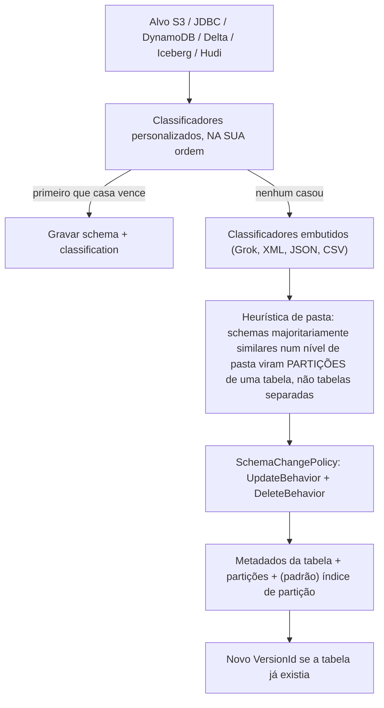
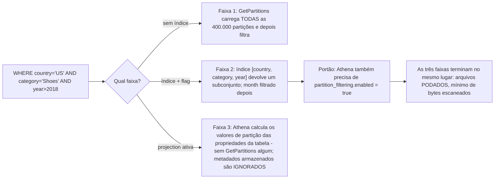
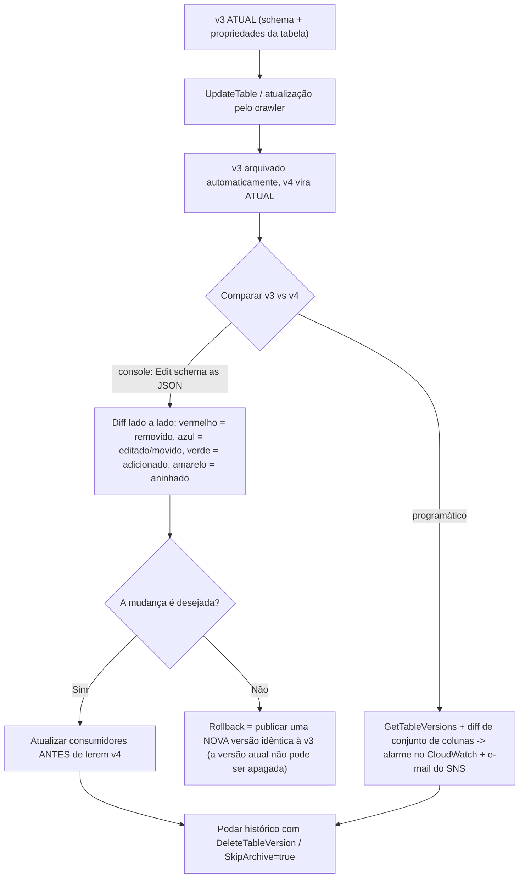
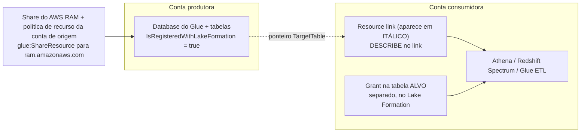
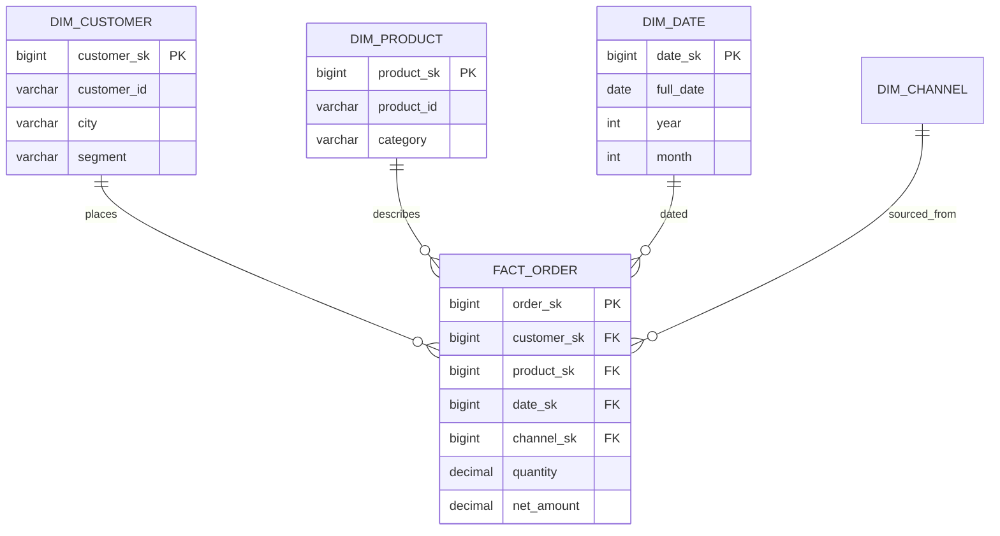
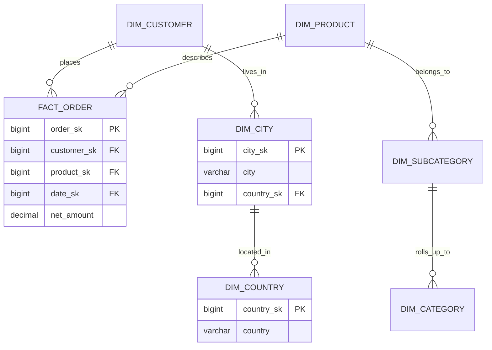
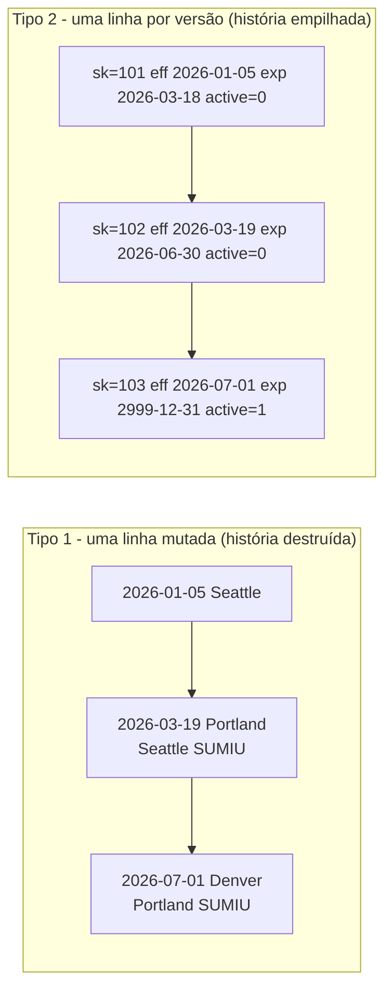

# Modelagem de Dados, Catálogo Glue e Evolução de Schema

Duas tarefas do Domínio 2 do DEA-C01 se encontram nesta lição. **Tarefa 2.2, entender sistemas de catalogação de dados**, pede que você construa e referencie um catálogo técnico de dados (AWS Glue Data Catalog, Apache Hive metastore), descubra schemas com crawlers, sincronize partições e crie conexões de origem/destino. **Tarefa 2.4, projetar modelos de dados e evolução de schema**, pede que você designe schemas para Amazon Redshift, DynamoDB e Lake Formation, trate mudanças nas características dos dados e descreva boas práticas de indexação, estratégias de particionamento e compactação. O exame trata as duas como uma história só: um **modelo** só é tão bom quanto o **catálogo** que o descreve, e um catálogo só é seguro se você puder **mudar** o que ele descreve sem quebrar todo consumidor.

```text
====================================================================
 DEA-C01 DOMÍNIO 2 - TAREFAS 2.2 (CATALOGAÇÃO) + 2.4 (MODELOS & SCHEMA)
====================================================================
 Catálogo ...... conta/Região -> catálogo -> database -> tabela
                 -> partições   (SÓ metadados, não guarda dados)
 Descoberta .... crawler -> classificadores personalizados ordenados
                 -> embutidos -> inferir -> gravar metadados (+ índices de partição)
 Sincronizar ... crawler agendado/por evento | MSCK REPAIR (máx 100/instrução)
                 | BatchCreatePartition | Glue ETL updateCatalog
                 | partition projection do Athena (nenhum metadado)
 Acelerar ...... índice de partição (máx 3/tabela) -> pruning -> projection
 Versionar ... UpdateTable arquiva antes -> VersionId + 1
                 100.000 versões/tabela, 1.000.000/conta (out 2026)
 Trocar ........ um PADRÃO montado: view de catálogo / resource link /
                 publicar nova versão - não é uma feature nomeada do Glue
 Compartilhar .. resource link = DESCRIBE no link + grant no alvo,
                 entre contas via Lake Formation ou IAM legado
 Modelar ........ estrela | floco de neve; decidir a GRANULARIDADE primeiro;
                 carregar dimensões antes
 História ....... SCD 1 sobrescreve | SCD 2 linha nova (início/fim/flag)
 Evoluir ........ aditivo vs quebrador; Hive estático vs metadados do Iceberg
 NoSQL .......... tabela única DynamoDB: padrões de acesso -> PK/SK -> GSI
 Otimizar ....... compactar -> colunar -> estatísticas de ordenação ->
                  buckets -> partições: cada camada remove cerca de
                  uma ordem de grandeza
====================================================================
```

Nesta lição você vai:

- ler o **modelo de objetos do Glue Data Catalog** — catálogo, database, tabela, `StorageDescriptor`, `PartitionKeys`, `classification` — e as cotas que o esculpem;
- rodar um crawler na sua cabeça: **classificadores personalizados em ordem, primeiro sucesso vence, embutidos só se nenhum casou**, heurísticas de pasta e `SchemaChangePolicy`;
- separar **indexação de partição, pruning e partition projection**, incluindo as duas configurações que o Athena precisa para usar um índice;
- operar **versionamento de tabela**: o que o `UpdateTable` arquiva, como você compara duas versões e como uma **troca azul/verde de tabela** é montada a partir de blocos verificados;
- ligar **resource links** para compartilhamento entre contas e entre Regiões, com a regra do duplo grant;
- escolher **estrela versus floco de neve**, fixar a **granularidade**, identificar fatos, dimensões e **chaves substitutas**, e desnormalizar para a distribuição do Redshift;
- implementar **SCD Tipo 1 versus Tipo 2** (e por que o Tipo 2 é o clássico do exame) com um merge trabalhado;
- classificar uma mudança proposta de schema como **aditiva ou quebradora** em tabelas no estilo Hive, Parquet/JSON/Avro e Iceberg, incluindo **evolução de partição**;
- projetar um modelo de **tabela única** do DynamoDB a partir de padrões de acesso, chaves e GSIs;
- empilhar **particionamento, bucketing, ordenação, compactação e tamanho de arquivo** numa única escada de eliminação de varredura;
- estudar **três estudos de caso de clientes da AWS** (BMW Group, GoDaddy e Integral Ad Science) e uma **caixa de atualizações de outubro de 2026 com fonte**;
- praticar com **14 questões no estilo do exame** mais quatro verificações interativas.

---

## 1. O modelo de objetos do Glue Data Catalog

### 1.1 A árvore, e a frase que importa

O Data Catalog é uma hierarquia de **metadados**: `conta/Região → catálogo → database → tabela → partições`, mais `functions`. A documentação de crawlers da AWS enuncia o fato sobre o qual toda questão de catálogo se apoia: *"As tabelas no Data Catalog não contêm dados."* Uma linha de tabela aponta para dados (`Location` do S3, `InputFormat`, `OutputFormat`, `SerdeInfo`); ela nunca os guarda. É por isso que apagar uma tabela do catálogo não apaga os objetos, e por que dois catálogos podem apontar para os mesmos prefixos.

```text
catálogo (padrão, ou um catálogo federado ao Redshift)
└── database                        (máx 10.000 por conta)
    └── tabela  ── StorageDescriptor: colunas, Location, InputFormat,
    │               OutputFormat, SerdeInfo, Compressed,
    │               BucketColumns, SortColumns, SkewedInfo
    │           ── PartitionKeys: a ordem de chaves no estilo Hive
    │           ── TableType: EXTERNAL_TABLE | GOVERNED
    │           ── Parameters: classification=parquet, etc.
    │           ── TargetTable: ponteiro se for um resource link
    │           ── SchemaReference: ponteiro para o Schema Registry
    │           ── IsRegisteredWithLakeFormation
    └── partitions (uma por combinação de chaves; 10.000.000 por tabela)
```

Uma única camada de metadados alimenta **Athena, Redshift Spectrum, EMR, Glue ETL e SageMaker AI** — que é o ponto inteiro: crawlee uma vez, consulte de vários motores. Catálogos também podem ser **federados**, então um catálogo federado ao Redshift (ou um catálogo com resource links para bancos do Redshift em outra conta ou Região) aparece na mesma árvore.

### 1.2 A tabela de cotas (em outubro de 2026)

| Objeto | Cota | Por que isso importa |
|---|---|---|
| Databases por conta | **10.000** | Um database por equipe é um projeto inicial comum que morre aqui |
| Tabelas por database / por conta | **200.000** / **1.000.000** | Agrupamento errado de crawler queima isso rápido |
| Partições por tabela / por conta | **10.000.000** / **20.000.000** | O Athena ainda não lê mais de **1.000.000** numa única varredura |
| **Versões de tabela por tabela / por conta** | **100.000** / **1.000.000** | Atualizações sem governança degradam as leituras |
| Crawlers por conta / simultâneos | **1.000** / **150** | Concorrência, não contagem, é a restrição real |
| Índices de partição por tabela | **3** | Planeje o subconjunto de chaves, não borrife índices |
| Profundidade de travessia do S3 no crawler | padrão **10**, máx **20** | Layouts profundos de lago param de crawlear em silêncio |
| Views do Data Catalog | até **10** tabelas base | A primitiva de "nome estável" do azul/verde |
| `ALTER TABLE … ADD PARTITION` | **100** por instrução | Por que o `MSCK REPAIR` existe |
| Colunas de tabela externa do Redshift (Glue) | **1.597** com pseudocolunas / **1.600** sem | Tabelas de catálogo largas batem num muro |

- **📚 Você sabia?** O próprio Data Catalog tem uma **camada gratuita**: os primeiros **1.000.000 objetos de metadados** e **2.000.000 requisições de metadados** são gratuitos (preços do AWS Glue, acesso em outubro de 2026). Crawling e ETL são cobrados separadamente a **$0,44 por DPU-hora**, então uma equipe pode rodar um catálogo movimentado de graça e ainda receber uma conta surpresa dos seus crawlers — as duas linhas da conta respondem perguntas diferentes.

```fillblank
{
  "question": "Complete as afirmações do modelo de objetos do Data Catalog usando o vocabulário da própria AWS:",
  "template": "A árvore do Glue Data Catalog corre conta/Região -> {{1}} -> {{2}} -> {{3}} -> {{4}}. Uma tabela é só metadados - a documentação de crawlers da AWS afirma que as tabelas no Data Catalog não contêm {{5}} - e o rótulo de formato que um classificador grava no mapa Parameters da tabela se chama {{6}}, que é o que o Athena usa para decidir como ler os arquivos no Location da tabela.",
  "answers": {
    "1": "catalog",
    "2": "database",
    "3": "table",
    "4": "partitions",
    "5": "data",
    "6": "classification"
  },
  "distractors": ["cluster", "schema", "partition", "index", "files", "metadata", "serde", "column", "format", "compression"],
  "explanation": "A hierarquia é conta/Região -> catálogo -> database -> tabela -> partições (mais functions), e é só metadados: a tabela aponta para objetos do S3 através de Location/InputFormat/OutputFormat/SerdeInfo em vez de guardar linhas. O rótulo de formato do classificador cai em Parameters.classification (por exemplo classification=parquet), que é por que duas tabelas sobre os mesmos prefixos podem ser lidas de forma diferente, e por que um classification errado aparece como erro de parse, não como tabela ausente."
}
```

---

## 2. Crawlers e classificadores: como um schema é descoberto

### 2.1 A ordem de execução — o fato de crawler mais testado

A AWS documenta um pipeline fixo: o crawler **executa quaisquer classificadores personalizados que você escolher… na ordem que você especificar**, e *"The first custom classifier to successfully recognize the structure of your data is used to create a schema. Custom classifiers lower in the list are skipped."* Só se **nenhum** classificador personalizado casar é que os classificadores **embutidos** tentam. Depois o crawler conecta, infere o schema e grava os metadados.



Duas consequências que os autores de questões adoram. Primeiro, um **classificador** é um reconhecedor de formato/schema (ele *"verifica se um dado arquivo está num formato que o crawler consegue tratar"* e emite um `StructType`); o **crawler** é o orquestrador que descobre, agrupa, versiona e grava. Segundo, **prioridade é posicional**: um classificador CSV com `delimiter=;` listado primeiro vence um classificador JSON listado em segundo, e tudo abaixo do vencedor é ignorado.

### 2.2 Alvos, agendamento e re-crawling

| Configuração | Opções | Observação de exame |
|---|---|---|
| `Targets` | `S3Targets`, `JdbcTargets`, `DynamoDBTargets`, `MongoDBTargets`, `CatalogTargets`, `DeltaTargets`, `IcebergTargets`, `HudiTargets` | **Fontes de tabela de catálogo não podem ser misturadas** com outros tipos de alvo |
| `Schedule` | expressão cron, ex.: `cron(15 12 * * ? *)` | Agendamento é expressão cron, não intervalo |
| Recrawl | todas as subpastas / só subpastas novas / **com base em eventos** (S3 → SQS) | Dirigido por evento é a resposta de custo |
| Extras de `S3Targets` | `Exclusions`, `SampleSize`, `ConnectionName`, `EventQueueArn`, `DlqEventQueueArn` | Uma conexão de rede por crawler, compartilhada por todos os alvos S3 |
| Profundidade | padrão 10, máx 20 | Alvos Iceberg/Hudi apontam para o **caminho de metadados** |
| `Role` do IAM | leitura nos dados **e** escrita no catálogo | O assistente emite `AWSGlueServiceRole-<nome>` mais `s3:GetObject` inline |

### 2.3 SchemaChangePolicy — e como congelar um schema curado

`UpdateBehavior` ∈ {`LOG`, `UPDATE_IN_DATABASE`}; `DeleteBehavior` ∈ {`LOG`, `DELETE_FROM_DATABASE`, `DEPRECATE_IN_DATABASE` (acrescenta um marcador `DEPRECATED` mais um timestamp)}. A armadilha crítica: a política *"não afeta se nem como novas tabelas e partições são acrescentadas."*

> [!WARNING]
> **⚠️ `UpdateBehavior=LOG` não é "congele meu schema".** Defini-lo como `LOG` impede o crawler de **atualizar tabelas existentes**, mas tabelas inteiramente novas e novas partições ainda são criadas. Para congelar os dois, acrescente `UpdateBehavior=LOG` **mais** a configuração `{"CrawlerOutput":{"Partitions":{"AddOrUpdateBehavior":"InheritFromTable"}}}`. Uma alternativa afirmando que só o `LOG` para todas as escritas está testando se você leu a frase acima.

### 2.4 Exemplo trabalhado E1 — um crawler que não pode destruir três colunas curadas à mão

Entrada: `s3://acme-raw/orders/dt=2026-10-0*/`, CSV delimitado por ponto e vírgula com campos entre aspas, timestamps atualmente inferidos como `string`, três colunas de catálogo editadas à mão por um analista que precisam sobreviver a todo crawl.

```text
1. Registrar um classificador CSV PERSONALIZADO (delimiter ';', caractere
   de aspas) e listá-lo PRIMEIRO -> primeiro sucesso vence, embutidos pulados
2. Fonte do crawler = tabelas de CATÁLOGO existentes
                            -> partições atualizam, tabelas nunca recriadas
3. UpdateBehavior = LOG + AddOrUpdateBehavior = InheritFromTable
                            -> schema e layout de partição congelados
4. Schedule = cron(0 2 * * ? *)  OU  evento S3 -> crawl por evento SQS
                            -> mínimo de cobrança de 10 minutos evitado
5. Role = AWSGlueServiceRole + s3:GetObject/ListBucket no prefixo
6. Confirmar CreatePartitionIndex = true (padrão para alvos S3)
   e definir partition_filtering.enabled = true para o Athena
```

Checagem de custo em outubro de 2026: crawlers cobram **$0,44 por DPU-hora**, por segundo, com **mínimo de 10 minutos** por crawl (1 DPU = 4 vCPU + 16 GB). Um crawl noturno que roda duas DPUs pelo mínimo de dez minutos custa **2 × (10/60) × 0,44 ≈ $0,15 por noite ≈ $4,5 por mês**, e isso é antes de qualquer fila ociosa — que é por que crawls incrementais dirigidos por evento são a recomendação padrão para tabelas que mudam uma vez por dia.

- **📚 Você sabia?** A heurística de pasta é uma *votação majoritária*, não uma regra: *"When the majority of schemas at a folder level are similar, the crawler creates partitions of a table instead of separate tables."* Assim uma pasta de CSVs limpos mais dois arquivos JSON malformados produz **uma tabela com partições** e o ruído JSON é absorvido — enquanto forçar conjuntos de dados genuinamente diferentes a separar significa acrescentar cada raiz como um **data store separado**, não mexer num flag (documentação do crawler do AWS Glue, acesso em outubro de 2026).

---

## 3. Sincronizando partições: indexação, pruning e projection

### 3.1 Cinco mecanismos, um trabalho

| Mecanismo | Onde roda | Teto / observação |
|---|---|---|
| Crawler agendado ou dirigido por evento | Glue | Lê pastas `key=value` no estilo Hive; pode substituir o `MSCK REPAIR` custoso |
| `MSCK REPAIR` / `ALTER TABLE ADD PARTITION` | Athena/Spark SQL | Imperativo; **máx 100 partições por ALTER** |
| API `BatchCreatePartition` | seu pipeline | Use quando o pipeline já conhece o novo prefixo |
| Glue ETL gravando o catálogo | job do Glue | `enableUpdateCatalog=True` + `setCatalogInfo`; `partitionKeys` precisa casar com a ordem do catálogo; schemas aninhados sem suporte |
| **Partition projection** | só Athena | Nenhum metadado de partição |

O schema de partição existe no **nível da tabela e por partição**, e o Athena valida os dois — uma divergência falha rápido com `HIVE_PARTITION_SCHEMA_MISMATCH` em vez de ler dados errados em silêncio.

### 3.2 Índice versus pruning versus projection

- **Pruning** é o *resultado*: descartar partições que não correspondem antes de qualquer arquivo ser lido. O Athena poda para toda tabela particionada, as projetadas incluídas.
- Um **índice de partição** é um índice armazenado no Data Catalog sobre um subconjunto ordenado de chaves de partição, para que `GetPartitions` busque um subconjunto em vez de tudo. Regras: **máx 3 por tabela**; tipos de chave String/Numeric/Date; operadores `=`, `>`, `>=`, `<`, `<=`, `BETWEEN` e **somente `AND`** (`LIKE`, `IN`, `OR`, `NOT` são ignorados e aplicados depois); **a primeira chave do índice precisa aparecer na expressão, ou o índice não é usado de forma alguma.**
- **Projection** é o Athena calculando valores e localizações de partição em memória a partir das propriedades da tabela que você configura na tabela do Glue — *"Enabling partition projection on a table causes Athena to ignore any partition metadata registered to the table in the AWS Glue Data Catalog or Hive metastore."*



### 3.3 Exemplo trabalhado E2 — 400.000 partições, um índice, quatro consultas

Índice: `[country, category, year]` em uma tabela com 400.000 partições.

| Predicado da consulta | Índice usado? | Comportamento |
|---|---|---|
| `country='US' AND category='Shoes' AND year>2018` | **Sim** | Subconjunto buscado; `month` filtrado depois |
| `category='Shoes'` sozinho | **Não** | Primeira chave faltando → carrega as 400.000 |
| `country='US' OR country='UK'` | **Não** | `OR` ignorado → carrega tudo |
| `country='US' AND category IN ('Shoes','Bags')` | **Sim** | `IN` ignorado; índice ainda usado em `country` (+`category`), resto aplicado depois |
| `category='Shoes' AND country='US'` | **Sim** | As chaves estão presentes; o índice ainda dirige, a ordem dos seus `AND`s não importa |

Duas configurações, então dois consumidores diferentes:

| | Índice de partição | Partition projection |
|---|---|---|
| Quem cria | Crawler por padrão para alvos S3/Delta (**não** para partições criptografadas) | Você, através de propriedades da tabela |
| O que o Athena precisa | índice **e** `partition_filtering.enabled=true` | projection configurada; metadados armazenados depois ignorados |
| Quem mais usa | Redshift Spectrum, EMR e DataFrames do Glue Spark usam um índice `ACTIVE` **sem** essa flag | **Só o Athena** — Spectrum/EMR ainda leem o catálogo |
| Custo do projeto | Armazenamento mais tráfego de `GetPartitions` | `SHOW PARTITIONS` fica vazio; **>50% de partições projetadas vazias** → reverta |

- **📚 Você sabia?** O Glue ETL dá duas alavancas de pushdown diferentes, e elas podam em lugares diferentes: `push_down_predicate` é Spark SQL aplicado **do lado do cliente depois de listar todas as partições**, enquanto `catalogPartitionPredicate` é JSQL aplicado **do lado do servidor** através do índice de partição — a que se alcança quando a tabela tem milhões de partições (boas práticas do AWS Glue, acesso em outubro de 2026).

---

## 4. Versionamento de tabela, comparação e trocas azul/verde

### 4.1 Versionamento está sempre ligado

*"By default, `UpdateTable` always creates an archived version of the table before updating it. However, if `skipArchive` is set to true, `UpdateTable` does not create the archived version."* Todo crawl que muda um schema portanto incrementa `VersionId` em 1, contra um teto de **100.000 versões por tabela** e **1.000.000 por conta** (em outubro de 2026).



Não existe **rollback de verdade**: a versão atual não pode ser apagada, e restaurar significa *publicar uma nova versão idêntica àquela que você quer de volta*. (O Apache Iceberg consegue voltar para um snapshot id — um recurso diferente, não uma operação de versão de catálogo.)

### 4.2 Trocas azul/verde de tabela — um padrão, não um produto

A AWS não entrega **nenhuma** feature nomeada de "implantação azul/verde de tabela" para o Glue Data Catalog. O que está verificado são os blocos de construção, e a forma segura de responder no exame é como um **padrão** montado:

| Bloco de construção | O que ele dá para a troca |
|---|---|
| `CreateTable` com `TargetTable` | Um resource link pode ser apontado de novo para `_green` |
| Views do Data Catalog (até **10** tabelas base; dialetos Athena/Redshift/Spark) | Um **nome estável** que os consumidores continuam consultando |
| Arquivamento de versão + publicar nova versão | "Rollback" para frente |
| `CREATE OR REPLACE VIEW … AS SELECT * FROM …_green` no Athena | Chaveamento numa única instrução (padrão de terceiros) |
| Regra de orientação azul/verde | **Mudanças aditivas antes do deploy de código, mudanças deletivas depois do deploy de código** |

> [!IMPORTANT]
> **Em deploys azul/verde de RDS/Aurora, o DDL não é replicado** — *"Data definition language (DDL) changes aren't supported for blue/green deployments… switchover will be blocked."* Mesma frase, duas camadas: uma troca de tabela do Glue é um padrão de metadados montado, enquanto um deploy azul/verde do RDS é uma feature gerenciada com uma regra rígida de DDL. Nunca responda "implantação azul/verde do AWS Glue" como se a AWS a entregasse para catálogos.

---

## 5. Resource links e compartilhamento entre contas

Um **resource link** é uma tabela local (ou database) cujo `TargetTable` é `{CatalogId, DatabaseName, Name, Region}` — então ele pode apontar para outra conta **e** para outra Região. Criar um exige `CREATE_TABLE`/`CREATE_DATABASE` do Lake Formation **e** `glue:CreateTable`/`glue:CreateDatabase` do IAM.



As regras que geram questões:

- *"granting permissions on a resource link doesn't grant permissions on the target"* — você precisa de **`DESCRIBE` no link mais um grant separado no alvo**. Dois passos, sempre.
- Links aparecem em **itálico** no console; não existe **checagem de existência** na criação, então um link pode apontar para nada.
- **Cadeias são inúteis**: as APIs seguem apenas o **primeiro** resource link, então um link para um link não resolve.
- Existem duas pilhas de compartilhamento: **Lake Formation** (controle de acesso por recurso nomeado ou por tag, exigindo que a política de recurso da conta de origem permita `glue:ShareResource` para `ram.amazonaws.com`) ou **permissões legadas do Glue só com IAM**. Desligar *"Usar somente controle de acesso por IAM para databases/tabelas novos"* impede que objetos novos recebam `Super` para `IAMAllowedPrincipals`.
- LF-Tags são pares chave-valor como `department=sales` ou `classification=restricted`, e *"Tables inherit LF-Tags from databases and columns inherit LF-Tags from tables"* — que é como a marcação de PII escala: grants contam como `n(principais) + n(recursos)` em vez de um produto.

- **📚 Você sabia?** Ninguém no GoDaddy digitou aqueles resource links. O pipeline de provisionamento do mesh deles usou **AWS Service Catalog e AWS Lambda** para criar automaticamente os links do lado do consumidor, então um produto de dados novo aparecia numa conta consumidora *já vinculado* e ainda a exatamente um grant de distância de ser consultável. Automatizar o objeto de **metadados** — não a cópia de dados — é o que impede que "centenas de contas" se transformem em centenas de tickets manuais, e a regra de dois passos de `DESCRIBE` mais alvo continuou valendo para cada uma delas (AWS Big Data Blog, acesso em outubro de 2026).

---

## 6. Modelagem dimensional: granularidade, fatos, dimensões, estrela vs floco de neve

### 6.1 Granularidade primeiro — a decisão de onde todas as outras penduram

**Granularidade** é o que **uma linha** de uma tabela de fatos significa: "uma linha por item de pedido", não "uma linha por pedido", não "uma linha por dia por loja". Decida **antes** de escolher as chaves, porque ela determina quais eventos podem dividir uma tabela e de que tamanho é cada linha. (Os posts de modelagem do Redshift da AWS usam granularidade o tempo todo mas nunca publicam uma definição formal — a formulação de exame é o enquadramento da indústria/Kimball.)

| Elemento | O que é | O que carrega |
|---|---|---|
| **Tabela de fatos** | As medições de um processo de negócio | Medidas aditivas + chaves estrangeiras para dimensões (e para chaves substitutas) |
| **Tabela de dimensões** | O contexto que *"provide[s] the business meaning to the measures"* | Atributos descritivos e hierarquias pelas quais você agrupa e filtra |
| **Granularidade** | Uma linha = um… | Defina primeiro; ela fixa as chaves |
| **Chave substituta** | *"Artificial keys… typically generated as a sequential integer, and they don't have any meaning in the business domain"* | Pequena, imutável, sem colisão entre sistemas |
| **Ordem de carga** | Dimensões **antes** dos fatos | *"If the dimension load fails, the fact load will not run"* |

O Redshift constrói chaves substitutas com **`IDENTITY`**, e você deve declarar chaves primárias/estrangeiras de qualquer jeito: *"Redshift will not enforce them, but declaring them will help the optimizer arrive at optimal query plans."* Mantenha uma **dimensão de data** — toda tabela de fatos precisa de um `date_sk`.

### 6.2 Estrela versus floco de neve

*"Snowflake schemas extend the star concept by further normalizing the dimensions into multiple tables."* A AWS escolhe a estrela onde ela *"se alinha de perto com o processo de negócio"*, e a compactação colunar torna as chaves desnormalizadas *"relatively inexpensive to store"* — então os joins extras de um floco de neve compram pouco e custam tempo de consulta.





Leia os dois diagramas como um trade: a **estrela** junta o fato a quatro dimensões planas em quatro saltos; o **floco de neve** normaliza `city → country` e `subcategory → category`, então um salto vira dois e cada join extra é trabalho que o motor precisa planejar. Neste exame, "o processo de negócio se alinha a um fato e a dimensões planas" ⇒ **estrela**; "o requisito é dimensões conformadas normalizadas e reutilizáveis" ⇒ **floco de neve**, com o custo de join nomeado.

### 6.3 Formas de tabela de fatos (reconhecimento)

| Tipo | Uma linha significa | Como contar |
|---|---|---|
| **Transacional** | Um evento (pedido, pagamento, clique) | Maior, granularidade mais fina |
| **Snapshot periódico** | Um conjunto de dimensões em intervalo fixo (saldo de fim de dia) | Repetível e finito |
| **Snapshot acumulativo** | Uma linha por processo longo, **atualizada no lugar** | Várias chaves de data de marco; precisa de estratégia de atual mais histórico |
| **Sem fato** | Um evento sem medida (presença) | Você conta, não soma |

---

## 7. Dimensões de mudança lenta: Tipo 1 versus Tipo 2

### 7.1 Os quatro tipos que você pode definir

| Tipo | Comportamento | Trade |
|---|---|---|
| **0 — Fixo** | O atributo nunca muda (data de nascimento) | Nenhuma história necessária |
| **1 — Sem histórico** | Sobrescrever o valor; a dimensão reflete a versão mais recente | Barato, perde auditoria — *"no history is maintained"* |
| **2 — Manter histórico** | *"All changes are recorded and versions are tracked with dates and flags"* | Correto, e o clássico do exame |
| **3 — Valor anterior** | Manter o valor **anterior** em uma coluna extra | Só um passo atrás é conhecível |

> [!WARNING]
> **⚠️ Um "Tipo 2" que atualiza a linha é um Tipo 1.** O Tipo 2 exige uma **linha nova por mudança**, com `record_start_date`, `record_end_date` (uma data alta como `2999-12-31` para a linha atual), `active_flag`, um **record hash** opcional sobre as colunas rastreadas, e timestamps de inserção/atualização. Expirar a linha antiga e inserir a nova **na mesma transação**. A fonte da AWS define só os Tipos 0–3; não invente Tipos 4–7 numa resposta.



```matching
{
  "question": "Combine cada tipo de dimensão de mudança lenta com o comportamento que a AWS documenta para ele:",
  "pairs": [
    {"left": "Tipo 0 - Fixo", "right": "O atributo nunca muda (por exemplo data de nascimento), então nenhum mecanismo de versionamento é aplicado"},
    {"left": "Tipo 1 - Sem histórico", "right": "A dimensão reflete a versão mais recente; o valor é sobrescrito e nenhum histórico é mantido"},
    {"left": "Tipo 2 - Manter histórico", "right": "Todas as mudanças são registradas e as versões são rastreadas com datas e flags - uma linha nova por mudança"},
    {"left": "Tipo 3 - Valor anterior", "right": "O valor atual mais uma coluna extra que guarda só o valor mais-recente-menos-um"}
  ],
  "explanation": "A orientação de SCD do Redshift da AWS define exatamente estes quatro comportamentos (0, 1, 2 e 3) e afirma que existem tipos até 7 definindo só estes - então nunca defina um Tipo 4 ou além numa resposta. O Tipo 2 é o clássico do exame porque é o único que deixa um fato histórico se juntar à versão da dimensão que estava vigente na época; o Tipo 1 é a distractor que destrói a auditoria, e o Tipo 3 só consegue mostrar um passo atrás."
}
```

### 7.2 Exemplo trabalhado E3 — um merge de Tipo 2, instrução por instrução

O staging guarda o delta; a dimensão guarda o histórico. Combine pela **chave de negócio** com um **left outer join**, faça hash das colunas rastreadas para decidir update versus insert, e faça isso como **operações em bloco, nunca cursores linha a linha**:

```sql
-- 1) expire the current row for every changed business key
UPDATE dim_customer
SET    rec_exp_dt = CURRENT_DATE - 1,
       is_active  = 0
WHERE  customer_id = :id
  AND  is_active   = 1;

-- 2) insert the new active version in the same transaction
INSERT INTO dim_customer
       (customer_sk, customer_id, city, rec_eff_dt, rec_exp_dt, is_active)
SELECT NEXTVAL('dim_customer_sk'), :id, :city,
       CURRENT_DATE, DATE '2999-12-31', 1;
```

Mecânica que vale a memória:

- **Detecção de correspondência:** left outer join staging ↔ dimensão pela chave de negócio; linhas casadas são candidatas a update/expiração, linhas não casadas são inserts.
- **Detecção de mudança:** `sha2` entre fontes, `FNV_HASH` (64-bit) para dimensões grandes, `CHECKSUM` (32-bit) para as pequenas — hash mudado significa que a linha precisa versionar.
- **Detecção de exclusão:** extrações completas → compare versões anterior e atual; extrações só de mudança → use uma coluna de status.
- **Distribuição:** dê ao staging e ao alvo **chaves de distribuição correspondentes** para que o merge seja local ao nó no Redshift.
- **Contrato:** carregue **dimensões primeiro, depois fatos** — uma carga de dimensão que falha precisa bloquear a carga do fato.

- **📚 Você sabia?** A convenção de data alta `2999-12-31` não é enfeito: ela deixa uma consulta encontrar "o endereço atual de cada cliente" com `WHERE is_active = 1` **ou** com `WHERE CURRENT_DATE BETWEEN rec_eff_dt AND rec_exp_dt`, e deixa um fato histórico se juntar com `f.order_date BETWEEN d.rec_eff_dt AND d.rec_exp_dt` — que é exatamente como um esquema estrela responde "como era o pedido *na época*". O Tipo 1 não tem equivalente porque não existe intervalo sobre o qual juntar (orientação de SCD do Amazon Redshift, acesso em outubro de 2026).

---

## 8. Desnormalização e projeto físico no Redshift

As dimensões planas do esquema estrela são uma decisão de **desnormalização**, e o Redshift a recompensa fisicamente:

| Alavanca | Regra da orientação da AWS |
|---|---|
| `DISTKEY` do fato | *"Choose the foreign key for the largest frequently joined dimension as a distribution key in the fact table and the primary key in the dimension table"* — então o join é colocado no mesmo slice e não precisa de redistribuição |
| Dimensões pequenas/médias | `DISTSTYLE ALL` (replicada, evita shuffle) |
| Dimensões atualizadas com frequência | Prefira `DISTSTYLE KEY` |
| Ordenação | `SORTKEY` (composto ou interleaved) para que as estatísticas de mínimo/máximo por grupo de linha pulem blocos |
| Chaves | Declare PK/FK de qualquer jeito — não aplicadas, mas o otimizador as usa |
| Depois das cargas | `ANALYZE` (e `VACUUM` onde aplicável) |

```text
Exemplo trabalhado E4 - escolhendo a chave de distribuição por tamanho,
não por hábito

Tabela de fatos   fact_order_lines      4.200.000.000 linhas
Dimensão A        dim_customer            48.000.000 linhas  <- maior dim juntada
Dimensão B        dim_product                 180.000 linhas
Dimensão C        dim_date                       3.650 linhas

Regra: fact.DISTKEY  = customer_sk   (maior FK juntado com frequência)
       dim_customer.DISTSTYLE = KEY(customer_sk)   <- combina com o fato
       dim_product / dim_date   = DISTSTYLE ALL    <- pequenas o bastante p/ copiar

Por quê: um join em customer_sk acontece dentro de cada slice, sem
passo de redistribuição, enquanto as duas dimensões minúsculas já estão
presentes em cada nó. Ordenar fact_order_lines por date_sk adicionalmente
deixa o motor pular grupos de linhas inteiros para um filtro de faixa de data.
```

A desnormalização também responde fisicamente à questão do **floco de neve**: tabelas normalizadas a mais significam joins a mais, e num warehouse colunar esses joins custam bem mais do que o disco que economizam.

---

## 9. Evolução de schema: aditivo versus quebrador

### 9.1 A tabela de auditoria

Uma mudança é **aditiva** quando leitores antigos e arquivos antigos continuam funcionando; é **quebradora** quando um consumidor falha, coage silenciosamente, ou o layout de partição deixa de casar com a consulta.

| Mudança proposta | Externo no estilo Hive (Athena/Glue) | Iceberg |
|---|---|---|
| `ADD COLUMN channel string` (acréscimo, anulável) | Seguro; arquivos antigos leem NULL | Seguro; só metadados, novo field ID |
| Renomear `cust` → `customer` | Só catálogo; leitores chaveados pelo nome antigo quebram | Seguro — o field ID é estável |
| Remover `legacy_ref` | Quebra `SELECT *`; um re-crawl pode deslocar posições | Seguro, sem efeitos colaterais |
| Reduzir/re-typar `DECIMAL(12,2)` → `DECIMAL(9,2)` | Pode falhar ou coagir silenciosamente | Só promoções de **alargamento** permitidas (`int`→`long`, `float`→`double`, precisão decimal para cima) |
| Reordenar / inserir no meio da tabela | Pode levantar `HIVE_PARTITION_SCHEMA_MISMATCH` | Seguro |
| Nova **chave de partição** | Reescrever chaves de objeto sob novos prefixos | Nova spec; arquivos antigos mantêm o layout (**split planning**) |
| Mudança em `struct`/`array`/`map` aninhado | Atualização de catálogo do Glue ETL não suportada para aninhado | add/drop/rename/reorder dentro de um `struct` suportado |

Dois pontos de apoio: *"Iceberg schema updates are metadata-only changes. No data files are changed when you perform a schema update"*, e a correção do Iceberg repousa em **field IDs únicos** — *"Added columns never read existing values from another column"*. O Athena, em contraste, falha rápido em vez de ler errado: um schema de partição que diverge do schema da tabela levanta `HIVE_PARTITION_SCHEMA_MISMATCH`.

### 9.2 Evolução de partição é a armadilha dentro da armadilha

*"Hive table partitioning cannot change so moving from a daily partition layout to an hourly partition layout requires a new table. And because queries are dependent on partitions, queries must be rewritten for the new table."* Para o Iceberg: *"Quando você evolui uma spec de partição, os dados antigos gravados com uma spec anterior permanecem inalterados. Dados novos são gravados usando a nova spec num novo layout… A evolução de partição é uma operação de metadados e não reescreve arquivos ansiosamente."* As duas frases são examináveis e apontam em direções opostas: as chaves de partição no estilo Hive **são** as chaves de objeto do S3, então mudar o esquema é uma migração; as specs de partição do Iceberg são metadados, então layouts antigo e novo coexistem — ao custo de **split planning** extra.

### 9.3 Como Parquet, JSON e Avro cada um lida com a mudança

| Formato | Onde o schema vive | Comportamento de evolução (enquadramento de exame) |
|---|---|---|
| **Parquet** | No rodapé de cada arquivo, colunar | Acrescente uma coluna anulável e os arquivos antigos ainda leem (NULL); leitores leem só as colunas que nomeiam, então uma coluna acrescentada não custa nada às consultas antigas. Codec padrão **Snappy** |
| **JSON** | Schema não aplicado — schema aplicado na leitura | O clássico payload de **schema-on-read**: o crawler infere um schema, e *"if this column is changed to a string by the source, without notifying the consumer, the pipeline will certainly fail"* |
| **Avro** | Schema de escritor embutido, field IDs | O schema viaja com os dados; compatibilidade é decidida por regras, que é por que o Glue Schema Registry (streaming, **serverless e gratuito**, 8 modos de compatibilidade, padrão/recomendado **BACKWARD**) valida registros no momento da serialização |
| **ORC** | Dentro do arquivo, colunar com índices embutidos | Codec padrão **ZLIB**; geralmente arquivos menores que o Parquet |

> [!NOTE]
> Chamada de escopo: a lista no escopo do guia do exame diz **"AWS Glue"** e nunca nomeia o **Glue Schema Registry**, e nenhuma habilidade o nomeia também. Aprenda-o como **reconhecimento para schemas de streaming** — `SchemaArn` e números de versão — e nunca como resposta de uma questão sobre a versão de uma **tabela do Data Catalog** (`Table.VersionId`). Uma tabela pode *referenciar* um schema de registro através de `StorageDescriptor.SchemaReference`, mas compatibilidade de registro não é um incremento de versão de catálogo.

### 9.4 Exemplo trabalhado E5 — classifique cinco pedidos antes de despachá-los

```text
Pedido 1  ADD COLUMN channel (acréscimo, anulável)   -> ADITIVO
           despachar ANTES do deploy do consumidor;
           arquivos antigos leem NULL
Pedido 2  DROP COLUMN legacy_ref                     -> QUEBRADOR
           despachar DEPOIS do deploy do consumidor
           (aditivo primeiro, deletivo depois do deploy de código)
Pedido 3  RETYPE amount DECIMAL(12,2) -> DECIMAL(9,2) -> QUEBRADOR
           reduzir não é promoção de alargamento; Hive pode coagir
Pedido 4  partições por hora em vez de por dia        -> QUEBRADOR (Hive)
           tabela nova + consultas reescritas; SÓ METADADOS no Iceberg
Pedido 5  RENAME cust -> customer                    -> QUEBRADOR (Hive)
           seguro no Iceberg (field ID estável); consumidores
           chaveados pelo nome antigo da coluna ainda quebram
           nos dois mundos
```

A regra de ordenação — **aditivo antes do deploy de código, deletivo depois do deploy de código** — é a frase mais reutilizável desta seção.

---

## 10. Design de tabela única do DynamoDB: padrões de acesso primeiro

*"Single table design is a pattern that allows you to store multiple types (entities) of data in a single DynamoDB table."* O fluxo documentado pela AWS roda **caso de uso → relacionamento entre entidades → padrões de acesso (escritos como SQL) → schema → PK/SK por tabela e GSI → repita**, e começa por **consultas, não por entidades**.

| Conceito | O que faz |
|---|---|
| **Padrão de acesso** | Uma frase como "buscar um pedido por id" ou "listar pedidos de um cliente do mais recente para o mais antigo" — a entrada do design |
| **Partition key** | A condição de **igualdade**; precisa ser de **alta cardinalidade** para que os itens se espalhem uniformemente |
| **Sort key** | Faixa / `begins_with` — dá um-para-muitos, hierarquia e coleções ordenadas |
| **Prefixos compostos** | `ORDER#123`, `INVOICE#123` separam tipos de entidade numa tabela (coleções de itens compartilhando uma partition key) |
| **Nomes genéricos** | Tabelas sobrecarregadas usam `PK`/`SK` em vez de nomes específicos de entidade |
| **GSI** | Uma tabela sombra com **suas próprias** PK/SK, **throughput independente**, sincronização assíncrona e eventualmente consistente, projeções `KEYS_ONLY` / `INCLUDE` / `ALL` |
| **Índice esparsa** | Só itens que carregam a chave do GSI são indexados — um flag opcional não custa nada para itens sem ele |
| **Sobrecarga de índice** | Um GSI serve muitos tipos de entidade |
| **Sharding de escrita** | Acrescente `rand(0,N)` quando uma única partition key excederia **3.000 RCU/s ou 1.000 WCU/s** |
| **Chaves multi-atributo** | Até **4 PK + 4 SK = 8** atributos; todos os atributos PK precisam de igualdade; atributos SK são consultáveis da esquerda para a direita sem pular |
| **Particionamento vertical** | Divida um documento grande em itens que compartilham PK com prefixos de SK — vence o limite de item de **400 KB** e mantém as escritas pequenas (escritas são cobradas em passos de **1 KB**) |

### 10.1 Exemplo trabalhado E6 — quatro padrões de acesso para um design

```text
Padrões: (a) buscar cliente por id
         (b) listar pedidos de um cliente, mais recente primeiro
         (c) buscar um pedido por order id
         (d) listar falhas escalonadas

Tabela base    PK = customerId, SK = ROOT                -> (a)
  item         PK = customerId, SK = ORDER#<iso8601>      -> (b)
               consulta com ScanIndexForward = false (mais recente primeiro)
  GSI1         PK = orderId, SK = ROOT                    -> (c)
               ESPARSO: só itens de pedido carregam orderId, então
               o custo do índice é proporcional a pedidos, não a itens
  GSI2         PK = escalatedTo, SK = ...                 -> (d)
               ESPARSO: presente só em itens de falha

Checagem de teto (em outubro de 2026): uma partition key para em
3.000 RCU/s e 1.000 WCU/s -> se orderId exceder isso, faça shard
como orderId#<0..N> e consulte as N partições em paralelo.
Teto de item: 400 KB; um documento de pedido de 900 KB PRECISA ser
dividido em itens que compartilham PK = ORDER#123 com prefixos de SK
(HEADER#, LINE#n).
```

Escolha **tabela única** quando as entidades são consultadas **juntas** com necessidades operacionais semelhantes; escolha **tabelas separadas** quando retenção, backup, chaves KMS por inquilino ou classe de tabela divergem. A AWS declara os dois lados — isto é uma questão de julgamento, não uma questão de "tabela única é sempre melhor".

---

## 11. Particionamento, bucketing, ordenação, compactação — a escada de eliminação

Cada camada remove trabalho **antes** da próxima rodar, da mais externa para a mais interna:

| # | Camada | O que elimina | Teto / padrão (out 2026) |
|---|---|---|---|
| 1 | **Particionamento** (data, região) | Diretórios/prefixos inteiros | O Athena lê no máximo **1.000.000** partições numa varredura; partições finas demais inflam `GetPartitions` |
| 2 | **Bucketing / clustering** | Buckets de hash dentro de uma partição | Campos do Glue `NumberOfBuckets` / `BucketColumns`; Iceberg `bucket(N, col)` |
| 3 | **Ordenação** | Grupos de linha/faixas, via estatísticas de mínimo/máximo | *"data within the files are sorted… Athena can use the minimum and maximum values in the file metadata to skip the unneeded parts"* |
| 4 | **Formato colunar** | Colunas intocadas | Parquet para misturas de consulta largas/complexas; ORC para tipos complexos e índices embutidos |
| 5 | **Compactação** | Bytes antes da descompressão | *"Querying compressed data is faster and also cheaper because you pay for the number of bytes scanned before decompression."* |
| 6 | **Tamanho de arquivo** | Overhead de listagem/requisição | O Glue habilita agrupamento de arquivo acima de **50.000** arquivos de entrada; grupos de linha do Parquet **128 MB**, faixas do ORC **64 MB** (faixas abaixo de 8 MB são lidas inteiras) |

Escolha de codec (da tabela de codecs das boas práticas do AWS Glue): **Snappy** — rápido, razão moderada, **padrão para Parquet**; **GZIP** — razão alta, intensivo de CPU e **não divisível**, então só texto frio/arquivamento; **Bzip2** — razão muito alta, divisível, lento; **ZLIB** — **padrão para ORC**; **Zstd** — equilibrado. Compactação versus paralelismo é um trade real: Gzip em texto quente perde a divisibilidade.

### 11.1 Exemplo trabalhado E7 — a escada de custo de varredura

CSV de **100 colunas**, **4 TB** sem compactação, uma consulta selecionando **uma coluna** para **um dia de 365**:

```text
CSV bruto, varredura completa                 4.000.000 MB   (linha de base)
+ GZIP a 4:1                                  1.000.000 MB   -> ~1 TB
+ Parquet, 1 de 100 colunas                      10.000 MB   -> ~10 GB
+ pruning de partições, 1 de 365                   ~28 MB
+ pulo por ordenação min/max                  menos grupos de linha lidos

Cada passo remove cerca de uma ordem de grandeza, e as camadas se
compõem: a compactação encolhe a varredura, o colunar pula colunas,
as estatísticas de ordenação pulam grupos de linha, os buckets pulam
buckets, as partições pulam diretórios.
```

O Athena precifica o resultado: a **$5,00 por TB escaneado** com **mínimo de 10 MB por consulta** (preços do Athena, acesso em outubro de 2026), a varredura bruta fica em cerca de **$20,00**, a varredura com GZIP **$5,00**, a varredura de coluna única em Parquet **$0,05**, e a varredura particionada é medida em frações de centavo. Formato e layout são **controles de custo**, não apenas controles de desempenho.

```dragdrop
{
  "question": "Ordene a escada de otimização de dados da camada externa de eliminação (remove mais trabalho primeiro) até a mais interna:",
  "items": [
    "Particionamento - pula prefixos inteiros do S3 (diretórios key=value no estilo Hive)",
    "Bucketing / clustering - pula buckets de hash dentro de uma partição",
    "Ordenação - estatísticas de mínimo/máximo por grupo de linha e por faixa pulam blocos dentro de um arquivo",
    "Formato colunar - lê só as colunas nomeadas (Parquet / ORC)",
    "Compactação - menos bytes escaneados antes da descompressão",
    "Tamanho e agrupamento de arquivo - evita o imposto de listagem de arquivos pequenos (auto-agrupamento acima de 50.000 arquivos)"
  ],
  "correctOrder": [
    "Particionamento - pula prefixos inteiros do S3 (diretórios key=value no estilo Hive)",
    "Bucketing / clustering - pula buckets de hash dentro de uma partição",
    "Ordenação - estatísticas de mínimo/máximo por grupo de linha e por faixa pulam blocos dentro de um arquivo",
    "Formato colunar - lê só as colunas nomeadas (Parquet / ORC)",
    "Compactação - menos bytes escaneados antes da descompressão",
    "Tamanho e agrupamento de arquivo - evita o imposto de listagem de arquivos pequenos (auto-agrupamento acima de 50.000 arquivos)"
  ],
  "explanation": "As camadas são aninhadas, então precisam ser aplicadas de fora para dentro: as partições podam diretórios antes de qualquer arquivo ser aberto, os buckets podam dentro de uma partição, a ordenação poda grupos de linha dentro de um arquivo, o formato colunar poda colunas dentro de um grupo de linha, a compactação reduz os bytes realmente puxados, e o agrupamento de arquivos remove o overhead de listagem que de outro modo domina quando existem milhões de arquivos minúsculos. Pular uma camada não quebra as outras - só deixa aquela ordem de grandeza na conta."
}
```

- **📚 Você sabia?** A ordenação ajuda **apenas** filtros na coluna de ordenação — as estatísticas de mínimo/máximo descrevem a chave de ordenação, então um predicado em qualquer outra coluna não pula nada. É por isso que "acrescentar um SORTKEY em `customer_id`" responde a uma consulta filtrada por cliente e não faz nada por uma filtrada por produto (orientação de desempenho do Amazon Athena, acesso em outubro de 2026).

A outra metade de uma conta do Athena é o **mínimo de reserva** em vez dos bytes escaneados — e esse mínimo ele próprio mudou em 2026. Pegue a mesma janela de lote noturno, **12 DPU rodando por 10 minutos**, e leia-a em DPU-horas (DPU × horas) sob a regra antiga e a nova:

```plot
{
  "type": "bar",
  "title": "Uma janela de lote noturna do Athena de 12 DPU e 10 minutos (DPU-horas cobradas)",
  "data": [
    {"rule": "Before 11 Feb 2026: 24 DPU x 60 min minimum", "dpuHours": 24},
    {"rule": "After 11 Feb 2026: 12 DPU x 10 min (floor 4 DPU / 1 min)", "dpuHours": 2}
  ],
  "xKey": "rule",
  "yKey": "dpuHours",
  "xLabel": "Regra da Capacity Reservation",
  "yLabel": "DPU-horas cobradas"
}
```

Lendo o gráfico: o *trabalho* nunca mudou — 12 DPU por 10 minutos de qualquer jeito — mas a quantidade cobrável caiu de **24 × 1 = 24 DPU-horas** para **12 × (10/60) = 2 DPU-horas**, um corte de **12×** produzido puramente pela redução do mínimo do serviço de 24 DPU / 60 minutos para **4 DPU / 1 minuto** (AWS Big Data Blog, 11 de fevereiro de 2026, acesso em outubro de 2026). O layout ainda decide quantos bytes você varre; a regra de reserva decide quantos daqueles minutos você é forçado a comprar.

### Atualizações de 2026 (em outubro de 2026)

> [!NOTE]
> **O que mudou neste tópico entre o guia da época do lançamento e o guia que você baixa hoje** — cada linha conferida contra uma fonte primária da AWS em **outubro de 2026**:
> - **Guia do exame v1.1 (12 de dezembro de 2025)** consolidou conhecimentos/habilidades numa única lista de habilidades e acrescentou **8 habilidades, sem remover nenhuma**. Para esta lição: **2.1.7 "Gerenciar formatos de tabela abertos (por exemplo Apache Iceberg)"** torna a evolução de schema e de partição do Iceberg diretamente testável; **2.2.6 "Criar e gerenciar catálogos de dados de negócio (por exemplo Amazon SageMaker Catalog)"** é uma nova habilidade de catalogação; **2.4.6** acrescenta conceitos de vetorização. No escopo **+6 / −3**: **Amazon S3 Tables** acrescentado, **AWS SCT removido** — assim a habilidade de conversão de schema da Tarefa 2.4.3 agora lê **AWS DMS Schema Conversion**, com SCT apenas como vocabulário legado (página de revisões do guia do exame, acesso em outubro de 2026).
> - **AWS Glue 6.0 (21 de agosto de 2026)**: preço **30% menor**, Spark **4.1.1**, Python **3.13**, Hudi 1.1.1, Iceberg **1.11.0**, Delta 4.2.0 e **formato v3 do Iceberg** (deletion vectors, linhagem de linha). Mudanças quebradoras para jobs: **EMRFS removido** (S3A é o único filesystem do S3) e **AWS SDK for Java v1 removido** — uma alternativa ainda citando `fs.s3.consistent.*` ou `com.amazonaws.services.*` está desatualizada (anúncio e página de migração do AWS Glue 6.0, 21 de agosto de 2026 / acesso em outubro de 2026).
> - **Higiene de versão do Glue**: Glue **0.9/1.0/2.0 chegou ao end of life em 1º de abril de 2026**, e **Python Shell 3.6** não consegue criar jobs novos depois de **31 de março de 2026** (jobs existentes ainda rodam). **Glue 5.1** é o padrão para jobs novos desde 26 de novembro de 2025 (política de suporte a versões do AWS Glue, acesso em outubro de 2026).
> - **Lake Formation cross-account sharing v5 (11 de fevereiro de 2026)**: um **único share do AWS RAM** agora pode carregar tabelas ilimitadas (a AWS diz "centenas de milhares"), grants novos usam **padrões curinga** em vez de associações por recurso, shares existentes continuam funcionando, e o upgrade é opt-in — a regra de resource link mais grant de alvo da Seção 5 não muda (AWS What's New, 11 de fevereiro de 2026).
> - **Iceberg agora é gravado a partir do Redshift**: escritas em Iceberg **GA em 17 de novembro de 2025** (registradas no **Glue Data Catalog**), **UPDATE/DELETE/MERGE em 23 de abril de 2026**, **materialized views em 5 de outubro de 2026** — e um **DELETE** de Iceberg em tabelas do Lake Formation exige a permissão **DELETE**, com todo DML de Iceberg precisando de **ALTER**. Qualquer alternativa afirmando que o Redshift só consegue *ler* tabelas de lago está desatualizada (AWS What's New e página de mudanças de comportamento do Redshift, acesso em outubro de 2026).
> - **O lado do catálogo do Athena também mudou**: **materialized views do Glue Data Catalog (30 de novembro de 2025)**, otimização de custo baseada em estatísticas para Iceberg que funciona *com* filtros de linha e máscaras de coluna do Lake Formation **(21 de novembro de 2025)**, **managed query results** que não precisam de bucket de resultados no S3 e não custam nada a mais **(3 de junho de 2025)**, **conectores gerenciados para 12 fontes (23 de abril de 2026)**, e um piso de Capacity Reservation cortado de **24 DPU / 60 minutos** para **4 DPU / 1 minuto (11 de fevereiro de 2026)** — uma alternativa exigindo um bucket de resultados obrigatório, ou cobrando uma hora cheia para um lote de dez minutos, está desatualizada (notas de versão do Amazon Athena e AWS What's New, acesso em outubro de 2026).
> - **A maquinaria de schema do Iceberg foi para a v3**: **Amazon S3 Tables** agora está no escopo (guia v1.1) e entregou o tipo **Variant** para o **formato v3 do Iceberg em 28 de julho de 2026**; **Glue 6.0** roda Iceberg **1.11.0** com suporte a v3 — VARIANT mais shredding, **deletion vectors** e linhagem de linha. Deletion vectors são o que mantém `DELETE`s de linha baratos, que é exatamente a operação que o `UPDATE/DELETE/MERGE` do Redshift agora executa, e a habilidade **2.1.7 "Gerenciar formatos de tabela abertos"** do guia do exame coloca evolução de schema, snapshots e compactação diretamente no escopo (AWS What's New, 28 de julho de 2026; anúncio do AWS Glue 6.0, 21 de agosto de 2026, acesso em outubro de 2026).
> - **Permissões apertaram enquanto o compartilhamento ficou mais fácil** — a matriz completa depois da mudança de comportamento do Redshift: `INSERT` → **INSERT**, `DELETE` → **DELETE**, **`UPDATE`/`MERGE` → INSERT + DELETE**, e *toda* instrução DML de Iceberg também precisa de **ALTER**. Um laboratório (ou um papel entre contas) que concede só `INSERT` agora é insuficiente para fazer merge de uma tabela de lago, enquanto o share por curinga v5 do Lake Formation no item acima torna o próprio granting mais barato (página de mudanças de comportamento do Amazon Redshift, Patch 202, acesso em outubro de 2026).

---

## Casos Reais

Todo número abaixo é **afirmação do cliente ou da AWS e não auditado**, com a fonte nomeada para que você possa conferir. O ponto examinável é o **padrão** — qual objeto de catálogo foi compartilhado, qual contrato de schema foi aplicado — não o marketing.

### Caso A — BMW Group: schemas no Glue, dados no S3

| Elemento | Detalhe |
|---|---|
| Cliente | **BMW Group**, fabricante automotivo |
| Desafio | Um lago de dados local construído em **2015** não conseguia servir múltiplos inquilinos com separação clara de produtor/consumidor |
| Serviços | **Amazon Kinesis Data Firehose + AWS Lambda + AWS Glue + Amazon EMR** no lado do produtor; **Amazon Athena, Amazon SageMaker AI, Amazon EMR** no lado do consumidor; **camadas no Amazon S3, schemas no AWS Glue Data Catalog** |
| Resultados | **10 TB/dia** ingeridos de **1,2 milhão de veículos**; um Cloud Data Hub servindo **mais de 500 usuários**; telemetria anonimizada |
| Domínio do exame | **Domínio 2, Tarefa 2.2** — o catálogo é o contrato compartilhado entre contas de produtor e de consumidor |
| Fonte | `aws.amazon.com/solutions/case-studies/bmw-group-case-study/` (acesso em outubro de 2026) |

O padrão examinável: **os dados nunca saíram do S3 enquanto a propriedade se dividia entre contas** — o Glue guarda os schemas, Athena e SageMaker os consomem no lugar. Esse é exatamente o arranjo de resource link mais Lake Formation da Seção 5, e é por que "copiar os dados para a conta de cada equipe" é uma distractor: o compartilhamento pertence à camada de **metadados**.

### Caso B — GoDaddy: um data mesh sobre um catálogo compartilhado

| Elemento | Detalhe |
|---|---|
| Cliente | **GoDaddy**, empresa de internet/tecnologia |
| Desafio | Um cluster Hadoop local compartilhado, cópias de HDFS proliferando e permissões ingovernáveis |
| Serviços | **AWS Lake Formation + AWS Glue Data Catalog + Amazon S3 + shares entre contas do AWS RAM + Amazon Athena / Amazon EMR + AWS Service Catalog + AWS Lambda** |
| Resultados | Um data mesh hub-and-spoke com **mais de 2.000 produtos de dados**, **vários petabytes distribuídos por centenas de contas**, centenas de produtores e milhares de consumidores, e uma conta central de governança |
| Domínio do exame | **Tarefas 2.2/2.4 do Domínio 2** com ganchos do Domínio 4 (governança, compartilhamento entre contas) |
| Fonte | AWS Big Data Blog, "How GoDaddy built a data mesh to decentralize data ownership using AWS Lake Formation" (acesso em outubro de 2026) |

> "Existem mais de 2.000 produtos de dados construídos sobre o data mesh da GoDaddy na AWS … Nosso data mesh gerencia vários petabytes de dados distribuídos por centenas de contas."

Leia o número corretamente: **2.000 produtos de dados é um problema de escala de catálogo**, não de armazenamento. Resource links (que aparecem em itálico, precisam de `DESCRIBE` mais um grant no alvo, e resolvem apenas o primeiro link de uma cadeia) mais shares do AWS RAM são o que faz centenas de consultarem um database do Glue sem copiá-lo.

- **📚 Você sabia?** Os três estudos de caso colocam o **AWS Glue Data Catalog no meio** e nenhum deles moveu dados para dar acesso a uma equipe — BMW para separação de produtor/consumidor, GoDaddy para compartilhamento em todo o mesh, IAS para acesso baseado em classificação. Essa repetição é a dica: no DEA-C01, "tornar os dados disponíveis para outra conta ou motor" na maioria das vezes se resolve numa resposta de **catálogo ou permissão** (resource link, grant do LF, share do RAM, view de catálogo), nunca numa resposta de **cópia** (COPY, export, snapshot) (estudo de caso da AWS e AWS Big Data Blog, acesso em outubro de 2026).

### Caso C — Integral Ad Science: centenas de regras viram duas tags

| Elemento | Detalhe |
|---|---|
| Cliente | **Integral Ad Science (IAS)**, empresa de medição em ad-tech |
| Desafio | Um lago de dados autoserviço abrangendo contas de produtor e consumidor sob GDPR/CCPA, onde o acesso precisia seguir a **classificação e o papel de trabalho** de cada usuário em vez de uma regra escrita à mão por pessoa |
| Serviços | **AWS Lake Formation com tag-based access control + AWS Glue Data Catalog + Amazon S3 + Amazon Athena + Amazon EMR + federação com Okta**; S3 alcançado apenas através de um **papel de acesso a dados do Lake Formation** |
| Resultados | Controle de acesso em **nível de coluna**; **centenas de regras de permissão reduzidas a exatamente duas**; um workgroup do Athena por unidade de negócio (tags de cobrança mais limites de consulta); LF-Tags em nível de database **herdadas** por tabelas e colunas |
| Domínio do exame | **Tarefas 2.2/2.4 do Domínio 2** com ganchos do Domínio 4 (controle de acesso por tag, identidade federada) |
| Fonte | AWS Big Data Blog, "Integral Ad Science secures self-service data lake using AWS Lake Formation", 23 de setembro de 2021 (acesso em outubro de 2026) |

> "Com o controle de acesso por tag do Lake Formation, a IAS reduziu centenas de regras de permissão a exatamente duas regras."

Leia a aritmética, não o marketing: **duas regras é um tipo diferente de grant, não uma lista mais curta.** Uma política por tabela custa aproximadamente `n(principais) × n(tabelas)`; um grant por tag custa `n(principais) + n(valores de tag)` — e porque *"Tables inherit LF-Tags from databases and columns inherit LF-Tags from tables"* (Seção 5), etiquetar o **database uma única vez** puxa toda tabela e coluna futura para a mesma política sem ninguém editar regra. O grant é escrito contra `classification=restricted`, não contra um nome de tabela, e é por isso que o controle de PII em nível de coluna sobrevive a mil tabelas novas.

- **📚 Você sabia?** A IAS separou **quem pode consultar** de **quanto uma equipe pode rodar**: o acesso a colunas individuais era decidido por tags do Lake Formation, enquanto cada unidade de negócio ganhava o seu próprio **workgroup do Athena** com limites de consulta e tags de alocação de custo. Dois planos de controle independentes — grants respondem "posso ler esta coluna?", workgroups respondem "até onde esta equipe pode ir e quem paga?" — e as alternativas de exame adoram trocá-los (AWS Big Data Blog, acesso em outubro de 2026).

---

## Perguntas de Prática (Practice Questions)

```question
{
  "id": "dea-08-q1",
  "type": "multiple-choice",
  "question": "Um crawler do Glue roda dois classificadores personalizados para o mesmo arquivo: um classificador CSV (delimiter ';') listado primeiro e um classificador JSON listado em segundo. O arquivo é um CSV delimitado por ponto e vírgula. Qual afirmação está correta?",
  "options": [
    "O classificador CSV vence porque classificadores personalizados rodam na ordem especificada e a primeira correspondência bem-sucedida é usada; os classificadores mais abaixo na lista são pulados",
    "O classificador JSON vence porque os classificadores embutidos sempre rodam antes dos personalizados",
    "Os dois classificadores rodam e o Glue mescla as saídas deles num único schema",
    "O crawler escolhe o classificador com mais colunas no schema inferido dele"
  ],
  "correct": 0,
  "explanation": "A AWS documenta a ordem de execução explicitamente: classificadores personalizados rodam na ordem que você especifica, o PRIMEIRO a reconhecer com sucesso a estrutura cria o schema, e os abaixo são pulados. Classificadores embutidos só rodam quando nenhum personalizado corresponde."
}
```

```question
{
  "id": "dea-08-q2",
  "type": "multiple-choice",
  "question": "Você quer que um crawl recorrente pare de sobrescrever três colunas editadas à mão mas ainda registre tabelas e partições inteiramente novas. Qual é a configuração correta?",
  "options": [
    "Definir UpdateBehavior=LOG e AddOrUpdateBehavior=InheritFromTable",
    "Definir só UpdateBehavior=LOG",
    "Definir só DeleteBehavior=DEPRECATE_IN_DATABASE",
    "Desligar o agendamento do crawler e depender de chamadas manuais de UpdateTable"
  ],
  "correct": 0,
  "explanation": "A SchemaChangePolicy 'does not affect whether or how new tables and partitions are added', então só o UpdateBehavior=LOG ainda deixa tabelas e partições novas passarem. Congelar os dois exige LOG mais a configuração do crawler CrawlerOutput.Partitions.AddOrUpdateBehavior=InheritFromTable."
}
```

```question
{
  "id": "dea-08-q3",
  "type": "multiple-choice",
  "question": "Uma tabela do Glue tem um índice de partição em [country, category, year] e 400.000 partições. Qual consulta NÃO vai usar esse índice?",
  "options": [
    "WHERE country='US' AND category='Shoes' AND year>2018",
    "WHERE category='Shoes' AND country='US'",
    "WHERE country='US' OR country='UK'",
    "WHERE country='US' AND category IN ('Shoes','Bags')"
  ],
  "correct": 2,
  "explanation": "Só =, >, >=, <, <=, BETWEEN e AND dirigem o índice; OR, IN, LIKE e NOT são ignorados e aplicados depois, então um predicado com OR força o Glue a carregar as 400.000 partições. A primeira chave também precisa aparecer na expressão - 'category' sozinho também não usaria o índice - enquanto IN degrada de forma graciosa porque country ainda corresponde."
}
```

```question
{
  "id": "dea-08-q4",
  "type": "multiple-choice",
  "question": "Uma equipe habilita partition projection numa tabela do Glue para o Athena e depois executa SHOW PARTITIONS. O que acontece, e quem mais pode usar?",
  "options": [
    "O Athena calcula os valores de partição das propriedades da tabela, SHOW PARTITIONS retorna vazio porque os metadados de partição armazenados são ignorados, e só o Athena usa a projection",
    "O Athena devolve as partições armazenadas porque a projection lê o Data Catalog primeiro",
    "SHOW PARTITIONS devolve os valores projetados e o Redshift Spectrum também muda para projection automaticamente",
    "Projection é um índice do Data Catalog, então Spectrum e EMR o usam enquanto o Athena o ignora"
  ],
  "correct": 0,
  "explanation": "A AWS afirma que habilitar a partition projection faz o Athena ignorar metadados de partição registrados no Glue Data Catalog ou no Hive metastore - então SHOW PARTITIONS fica vazio. Projection é exclusiva do Athena; Spectrum, EMR e Glue Spark ainda leem metadados do catálogo (e índices)."
}
```

```question
{
  "id": "dea-08-q5",
  "type": "multiple-choice",
  "question": "Uma consulta do Athena numa tabela particionada falha com HIVE_PARTITION_SCHEMA_MISMATCH. Qual é a causa?",
  "options": [
    "O schema de uma partição difere do schema da tabela",
    "A tabela excedeu 100.000 versões de tabela",
    "O crawler foi agendado com uma expressão cron em vez de um intervalo",
    "O índice de partição tem mais de três chaves"
  ],
  "correct": 0,
  "explanation": "O Athena valida o schema de partição no nível da tabela contra o schema de cada partição e falha rápido com HIVE_PARTITION_SCHEMA_MISMATCH quando divergem - ele se recusa a adivinhar em vez de ler dados errados. Índices de partição são limitados a três CHAVES em um índice, não por alguma regra de versão de tabela."
}
```

```question
{
  "id": "dea-08-q6",
  "type": "multiple-choice",
  "question": "Qual afirmação sobre o versionamento de tabelas do AWS Glue Data Catalog está correta?",
  "options": [
    "UpdateTable arquiva a versão anterior por padrão, então VersionId incrementa; restaurar um schema mais antigo significa publicar uma nova versão idêntica a ele, porque a versão atual não pode ser apagada",
    "Versões são arquivadas só quando o crawler detecta uma mudança quebradora",
    "Definir SkipArchive=true mantém versões antigas consultáveis enquanto para o contador de versões",
    "Voltar para a v3 apaga automaticamente a v4 e reaponta todo consumidor"
  ],
  "correct": 0,
  "explanation": "Por padrão o UpdateTable sempre arquiva a versão que substitui (skipArchive=true opta por fora), VersionId incrementa, e a cota é 100.000 versões por tabela em outubro de 2026. Não existe rollback de verdade: você publica uma nova versão idêntica àquela que quer, depois reaponta os consumidores você mesmo."
}
```

```question
{
  "id": "dea-08-q7",
  "type": "multiple-choice",
  "question": "Uma conta consumidora tem um resource link para a sua tabela do Glue mas as consultas ainda falham com erro de acesso. O que falta?",
  "options": [
    "Um grant separado do Lake Formation na tabela ALVO - conceder permissões em um resource link não concede permissões no alvo",
    "Um segundo resource link que aponta para o primeiro link",
    "Uma política IAM permitindo glue:DeleteTable no link",
    "Permissão para apagar a tabela alvo para que o link possa ser recriado"
  ],
  "correct": 0,
  "explanation": "Resource links são um grant de dois passos: DESCRIBE (ou mais) no link MAIS um grant na tabela alvo. Cadeias não ajudam porque as APIs seguem apenas o primeiro resource link, e apagar o alvo nunca faz parte do caminho de acesso."
}
```

```question
{
  "id": "dea-08-q8",
  "type": "multiple-choice",
  "question": "Qual par de afirmações sobre esquemas estrela e floco de neve está correto?",
  "options": [
    "Esquemas floco de neve normalizam ainda mais as dimensões em múltiplas tabelas, acrescentando joins; a AWS prefere a estrela onde ela se alinha de perto ao processo de negócio porque chaves desnormalizadas são relativamente baratas de armazenar num armazenamento colunar",
    "Esquemas floco de neve acrescentam uma segunda tabela de fatos; esquemas estrela não conseguem guardar hierarquias",
    "Esquemas estrela exigem chaves substitutas enquanto esquemas floco de neve exigem chaves naturais",
    "Esquemas floco de neve são sempre mais rápidos porque contêm menos linhas"
  ],
  "correct": 0,
  "explanation": "A formulação da própria AWS: 'Snowflake schemas extend the star concept by further normalizing the dimensions into multiple tables.' O custo são os joins, e a compactação colunar torna as chaves duplicadas da estrela baratas - então a estrela é o padrão onde ela combina com o processo de negócio. Hierarquias e chaves estão disponíveis nos dois."
}
```

```question
{
  "id": "dea-08-q9",
  "type": "multiple-choice",
  "question": "Uma linha de dimensão do cliente 7781 muda de Seattle para Portland. Requisito: todo pedido histórico ainda precisa se juntar ao endereço vigente na hora do pedido. Qual projeto atende?",
  "options": [
    "Tipo 2 - inserir uma linha nova com sua própria chave substituta, record_start_date, record_end_date (2999-12-31 para a linha ativa) e active_flag; expirar a linha antiga na mesma transação",
    "Tipo 1 - UPDATE na coluna city no lugar, porque sobrescrever mantém a tabela pequena",
    "Tipo 3 - manter só a cidade anterior numa segunda coluna, e parar por aí",
    "Tipo 0 - a cidade é dado fixo, então nenhum mecanismo de versionamento é necessário"
  ],
  "correct": 0,
  "explanation": "Só o Tipo 2 mantém o histórico como linhas empilhadas com datas de início/fim, que é o que um join temporal entre o fato e a dimensão precisa (data do fato BETWEEN rec_eff_dt AND rec_exp_dt). Um Tipo 2 que atualiza a linha é na verdade Tipo 1; o Tipo 3 guarda exatamente um valor anterior e não serve para histórico arbitrário."
}
```

```question
{
  "id": "dea-08-q10",
  "type": "multiple-choice",
  "question": "Um job do Glue ETL precisa acrescentar particionamento por hora onde a tabela hoje tem partições diárias, usando uma tabela externa no estilo Hive no S3. Qual é a avaliação correta?",
  "options": [
    "Quebrador - o particionamento de tabela Hive não pode mudar, então uma tabela nova e consultas reescritas são necessárias; com Iceberg a mesma mudança é uma operação de metadados e os arquivos antigos mantêm o layout",
    "Aditivo - o Athena reescreve as chaves de objeto automaticamente na hora da consulta",
    "Aditivo - acrescentar uma chave de partição é sempre só metadados, independentemente do formato da tabela",
    "Quebrador em qualquer formato, porque os valores de partição são guardados dentro dos rodapés do Parquet"
  ],
  "correct": 0,
  "explanation": "Para tabelas no estilo Hive os valores de partição SÃO as chaves de objeto, então mudar o layout significa novos prefixos, uma tabela nova e consultas reescritas. O Iceberg evolve a spec de partição como metadados sem reescrever arquivos ansiosamente - layouts antigo e novo coexistem (ao custo de split planning). O Athena nunca reescreve chaves para você."
}
```

```question
{
  "id": "dea-08-q11",
  "type": "multiple-choice",
  "question": "Projete uma tabela do DynamoDB para: buscar cliente por id; listar os pedidos daquele cliente do mais recente para o mais antigo; buscar um pedido por order id; os itens têm até 900 KB. Qual design está correto?",
  "options": [
    "PK=customerId com SK=ORDER#<iso8601> e ScanIndexForward=false para mais-recente-primeiro, um GSI esparsa em orderId para buscas pontuais, e o pedido de 900 KB dividido em itens que compartilham PK com prefixos de SK",
    "PK=orderId sozinho, porque uma chave por entidade é sempre a mais barata",
    "PK=customerId com um GSI cuja partition key é a data do pedido, mais um item por pedido mantido inteiro em 900 KB",
    "Tabelas separadas por entidade com só a partition key customerId, sem sort key e sem GSIs"
  ],
  "correct": 0,
  "explanation": "A sort key na tabela base dá a lista ordenada um-para-muitos; uma GSI esparsa em orderId responde à busca pontual sem varrer; e o limite de item de 400 KB força o particionamento vertical em sub-itens (escritas também são cobradas em passos de 1 KB, então documentos grandes são caros de qualquer jeito). Padrões de acesso dirigem as chaves - não as entidades."
}
```

```question
{
  "id": "dea-08-q12",
  "type": "multiple-choice",
  "question": "Uma tabela CSV de 4 TB com 100 colunas sem compactação é consultada para uma coluna ao longo de um dia de 365. Qual sequência descreve corretamente o efeito cumulativo?",
  "options": [
    "GZIP ~1 TB, Parquet coluna única ~10 GB, pruning de partições ~28 MB - compactação, formato colunar e pruning se compõem, e porque o Athena cobra bytes escaneados o custo cai a cada passo",
    "Parquet sozinho deixa a consulta gratuita; a compactação só afeta o tempo de carga",
    "Particionamento é a única camada que muda bytes escaneados; formato colunar e compactação mudam só a latência",
    "Ordenação substitui o particionamento, então acrescentar os dois é redundante"
  ],
  "correct": 0,
  "explanation": "As camadas se aninham: GZIP 4:1 leva 4 TB a ~1 TB, Parquet lendo 1 de 100 colunas leva ~1 TB a ~10 GB, e pruning de 1 de 365 dias leva ~10 GB a ~28 MB. O Athena cobra por bytes escaneados (5 USD/TB em outubro de 2026, mínimo de 10 MB), então cada camada é um controle de custo tanto quanto de velocidade."
}
```

```question
{
  "id": "dea-08-q13",
  "type": "multiple-choice",
  "question": "Um papel entre contas precisa rodar MERGE e depois DELETE numa tabela Apache Iceberg registrada no AWS Glue Data Catalog e governada pelo Lake Formation, depois da mudança de comportamento do Redshift em 2026 (Patch 202). Qual conjunto de permissões está correto?",
  "options": [
    "INSERT mais DELETE para o MERGE, DELETE para o DELETE, e ALTER na tabela para toda instrução DML de Iceberg",
    "Somente INSERT, porque um MERGE é um upsert e se comporta como um INSERT",
    "Somente ALTER, porque ALTER é a permissão- guarda-chuva para todas as operações de Iceberg",
    "DATA_EXTERNAL_WRITE no prefixo do S3 mais glue:UpdateTable na tabela do catálogo"
  ],
  "correct": 0,
  "explanation": "O Patch 202 apertou exatamente este caminho: instruções INSERT precisam de INSERT, DELETE precisa de DELETE, UPDATE e MERGE precisam de INSERT + DELETE juntos, e toda instrução DML de Iceberg também precisa de ALTER na tabela. ALTER sozinho não cobre mais nada, e só INSERT já não cobre um merge - a metade de DELETE do MERGE falha. A entrada do catálogo em si não é tocada pela mudança de permissão: é o grant do Lake Formation na tabela (mais acesso ao S3 através do papel de acesso a dados do Lake Formation) que controla o DML (página de mudanças de comportamento do Amazon Redshift, Patch 202, acesso em outubro de 2026)."
}
```

```question
{
  "id": "dea-08-q14",
  "type": "multiple-choice",
  "question": "A Integral Ad Science rodava um lago com centenas de principais consumidores e milhares de tabelas, e uma tabela criada no mês que vem precisa ser coberta sem que ninguém edite regra. Qual design reduziu centenas de regras de permissão a duas, e por que ele continua correto ao longo do tempo?",
  "options": [
    "Controle de acesso por tag do Lake Formation: o grant é escrito contra uma LF-Tag como classification=restricted, e as tabelas herdam LF-Tags do seu database enquanto as colunas herdam da sua tabela - então a tabela nova está coberta no momento em que seu database é etiquetado",
    "Uma política IAM por conta consumidora que lista cada ARN de tabela, reescrita sempre que uma tabela é acrescentada",
    "Uma cadeia de resource links a partir da conta de governança, para que cada tabela nova herde permissões através do último link da cadeia",
    "Um workgroup do Athena por unidade de negócio, porque workgroups replicam grants de tabela entre contas"
  ],
  "correct": 0,
  "explanation": "O controle de acesso por tag escreve o grant contra um valor de tag em vez de uma lista de recursos, e a herança (database -> tabela -> coluna) significa que uma tabela criada no mês que vem já está dentro da política - o custo escala como n(principais) + n(valores de tag), não como um produto. As distractors são as três armadilhas desta lição: uma política IAM por ARN escala como produto, cadeias de resource link resolvem só o PRIMEIRO link e não concedem nada no alvo de qualquer jeito, e workgroups do Athena governam limites de consulta e alocação de custo, nunca acesso a tabelas (AWS Big Data Blog sobre Integral Ad Science; documentação do AWS Lake Formation, acesso em outubro de 2026)."
}
```

> [!WARNING]
> ⚠️ **Armadilhas de dia de exame desta lição:**
> - **Crawler ≠ classificador** — o crawler orquestra e grava; o classificador reconhece o formato e emite o schema, **primeiro sucesso vence**, embutidos só se nenhum casou.
> - **`UpdateBehavior=LOG` ainda acrescenta tabelas e partições** — combine-o com `AddOrUpdateBehavior=InheritFromTable` para congelá-los.
> - **Índice ≠ projection ≠ pruning** — um índice é metadado de catálogo armazenado (o Athena além disso precisa de `partition_filtering.enabled=true`); projection é o Athena calculando partições e **ignorando** metadados armazenados; pruning é o resultado compartilhado.
> - **Um índice inútil** — primeira chave ausente da expressão, ou um `OR`/`IN`/`LIKE`/`NOT` nela.
> - **Versionamento está sempre ligado** — `UpdateTable` arquiva por padrão; **100.000 versões/tabela**; não existe rollback, só publicar-uma-nova-versão.
> - **Azul/verde para tabelas de catálogo é um padrão montado, não uma feature entregue do Glue**; DDL não é replicado em blue/green de RDS/Aurora e bloqueia o switchover.
> - **Resource links são de dois passos** — `DESCRIBE` no link **e** um grant no alvo; cadeias resolvem só o primeiro link; links aparecem em itálico.
> - **Tipo 2 precisa de linhas de histórico** — data de início, data de fim (2999-12-31 para a atual), flag ativa, e um expirar-depois-inserir em **uma transação**; um Tipo 2 que atualiza é um Tipo 1.
> - **Substituta ≠ natural ≠ chave primária** — chaves substitutas são geradas, imutáveis e sem significado de negócio; o Redshift não aplica nem PK nem FK, só as usa para planejar.
> - **Esquema floco de neve = dimensões normalizadas**, não uma segunda tabela de fatos; **granularidade primeiro**, depois chaves, e **dimensões carregam antes dos fatos**.
> - **Aditivo ≠ sempre seguro** — acrescentar anulável é seguro; inserir no meio da tabela, reordenar, remover e re-typar são quebradores em tabelas no estilo Hive; Iceberg é onde add/drop/rename/reorder são só metadados.
> - **Schema Registry governa streams, não tabelas de catálogo** — `SchemaArn` versus `Table.VersionId`; é escopo de reconhecimento apenas.
> - **Compactação vs paralelismo** — GZIP não é divisível; Snappy é o padrão do Parquet, ZLIB o do ORC.
> - **Números de estudo de caso são afirmações não auditadas de clientes** — os 10 TB/dia da BMW e os mais de 2.000 produtos de dados da GoDaddy são números relatados, não garantias.
> - **DML de Iceberg precisa de mais que `INSERT`** — depois do Patch 202 do Redshift: `DELETE` → **DELETE**, `UPDATE`/`MERGE` → **INSERT + DELETE**, e *toda* instrução DML de Iceberg também precisa de **ALTER**; um papel concedido só com `INSERT` falha no meio de um merge.
> - **Grants por tag, não listas de tabelas** — o controle de acesso por tag do Lake Formation escala como `n(principais) + n(valores de tag)` porque tabelas herdam LF-Tags de databases e colunas herdam de tabelas (IAS: centenas de regras → exatamente **duas**); **workgroups** do Athena definem limites de consulta e alocação de custo, nunca acesso a tabelas.

> **Veredito Comparativo — como este tópico se compara no dia do exame**
> - **Verso outras nuvens:** o guia do DEA-C01 testa **apenas serviços da AWS** — AWS Glue Data Catalog, AWS Lake Formation, Amazon Athena, Amazon Redshift, Amazon DynamoDB. Nada no guia compara a AWS com outro provedor, então qualquer alternativa que pivote para o metastore, catálogo ou formato de tabela de um concorrente está fora de escopo por construção; responda com um serviço da AWS no escopo ou com um princípio publicado pela AWS.
> - **Verso autogerenciado / on-premises (Hive metastore que você roda):** você pode construir a mesma árvore no Hadoop, mas aí você é dono da disponibilidade do metastore, do seu IAM, da sua história entre contas e do seu scaling. A preferência do exame é a **camada de metadados gerenciada e compartilhada** — Glue mais grants do Lake Formation — com o Apache Hive metastore aparecendo como o *conceito* que o Data Catalog implementa (a Tarefa 2.2.2 nomeia os dois). Escolha a alternativa com menos trabalho operacional não diferenciado.
> - **Verso outro serviço da AWS na mesma camada:** **Glue Data Catalog é o armazenamento de metadados; Athena é o motor de consulta; Lake Formation é o plano de permissões; Amazon SageMaker Catalog é o catálogo de negócio/governança (habilidade 2.2.6); crawlers do Glue são o mecanismo de descoberta.** Uma pergunta sobre "onde o schema é registrado" nunca responde "Athena", e uma sobre "quem pode ler esta coluna" nunca responde "Glue" — grants do Lake Formation e LF-Tags fazem isso.
> - **Verso um processo manual e humano:** os mais de 2.000 produtos de dados da GoDaddy e os 10 TB/dia da BMW (afirmações de clientes, acesso em outubro de 2026) são resultados de *mecanismos* — crawls, resource links, grants do LF, índices de partição — não de alguém mantendo uma planilha de localizações de tabelas. No exame, prefira a alternativa que automatiza registro, sincronização ou permissão sobre a que exige que um engenheiro se lembre.

> [!SUCCESS]
> **Pontos Principais (Key Takeaways):**
> 1. O Glue Data Catalog é uma árvore de **só metadados** — `catálogo → database → tabela → partições` — onde um único conjunto de definições alimenta **Athena, Redshift Spectrum, EMR, Glue ETL e SageMaker AI**; cotas em outubro de 2026 incluem **10.000 databases**, **200.000 tabelas/database**, **10.000.000 partições/tabela**, **100.000 versões/tabela** e **3 índices de partição/tabela**.
> 2. Crawlers rodam **seus classificadores personalizados na sua ordem, primeiro sucesso vence, embutidos só se nenhum casou**; semelhança majoritária de pasta cria **partições em vez de tabelas**, e `SchemaChangePolicy` **nunca impede tabelas/partições novas** a menos que você acrescente `AddOrUpdateBehavior=InheritFromTable`.
> 3. Crawlers cobram **$0,44/DPU-hora com mínimo de 10 minutos** (1 DPU = 4 vCPU + 16 GB) — então crawls incrementais dirigidos por evento, não agendamentos horários, são a resposta de custo.
> 4. **Índice de partição** = busca de subconjunto armazenada para `GetPartitions` (máx 3, primeira chave precisa aparecer, só `AND`; o Athena além disso precisa de `partition_filtering.enabled=true`); **projection** = o Athena calcula partições e **ignora** metadados armazenados (só Athena, `SHOW PARTITIONS` vazio, >50% vazio ⇒ reverta); **pruning** = o resultado compartilhado.
> 5. **Versionamento de tabela está sempre ligado** (`UpdateTable` arquiva, `VersionId`+1), **não existe rollback** — só publicar-uma-nova-versão — e uma **troca azul/verde de tabela é um padrão montado** (view de catálogo, resource link, publicação de versão) com a regra **aditivo antes do deploy de código, deletivo depois**.
> 6. **Resource links são de dois passos**: `DESCRIBE` no link (em *itálico*) **mais** um grant no alvo; eles cruzam contas e Regiões; cadeias resolvem só o primeiro link; o compartilhamento roda via **Lake Formation + AWS RAM** ou permissões legadas do Glue só com IAM.
> 7. **Granularidade primeiro, depois chaves**: fatos guardam medidas e chaves estrangeiras, dimensões dão significado de negócio às medidas, **chaves substitutas** são geradas/imutáveis/sem significado de negócio (`IDENTITY` no Redshift), e **dimensões carregam antes dos fatos** — uma carga de dimensão que falha precisa bloquear a carga do fato.
> 8. **Estrela vs floco de neve**: floco de neve *"further normalizes the dimensions into multiple tables"* (mais joins); a AWS prefere a **estrela** onde ela se alinha ao processo de negócio porque a compactação colunar torna chaves desnormalizadas baratas.
> 9. **SCD Tipo 1 sobrescreve (sem histórico); Tipo 2 insere uma linha nova** com `record_start_date`, `record_end_date` (`2999-12-31` quando atual) e `active_flag`, expirada e inserida **numa única transação**, casada por left outer join e com hash (`sha2`/`FNV_HASH`/`CHECKSUM`); Tipo 3 guarda só o valor anterior — Tipos 4–7 não estão definidos nas fontes da AWS.
> 10. **Desnormalização no Redshift**: `DISTKEY` do fato = FK da **maior dimensão frequentemente junta**, casada naquela dimensão, dimensões pequenas com `DISTSTYLE ALL`, PK/FK declaradas usadas **só pelo otimizador**, mais `SORTKEY` para pulo por mínimo/máximo.
> 11. **Evolução de schema**: aditivo = acrescentar anulável; quebrador = remover, re-typar/reduzir, reordenar, renomear (Hive) e **qualquer mudança de layout de partição** — *"Hive table partitioning cannot change…"*, enquanto schema e evolução de partição do Iceberg são **só metadados** com field IDs estáveis e split planning.
> 12. **O design de tabela única do DynamoDB começa nos padrões de acesso**: partition key de alta cardinalidade (igualdade), sort key para um-para-muitos e ordenação, **GSIs esparsas/sobrecarregadas** com projeções `KEYS_ONLY`/`INCLUDE`/`ALL`, sharding de escrita em **3.000 RCU/s / 1.000 WCU/s**, limite de item de **400 KB** e passos de cobrança de escrita de **1 KB** (≤4 PK + 4 SK = 8 atributos de chave).
> 13. **A escada de otimização se compõe de fora para dentro** — partição → bucket → ordenação → colunar → compactação → tamanho de arquivo — e cada camada remove cerca de uma ordem de grandeza: 4 TB de CSV → ~1 TB com GZIP → ~10 GB de Parquet 1 coluna → ~28 MB particionado, o qual nos **$5/TB escaneados** do Athena (mínimo de 10 MB, em outubro de 2026) dá cerca de **$20 → $5 → $0,05 → frações de centavo**.
> 14. **Estado do tópico em outubro de 2026**: guia do exame **v1.1 (12 de dezembro de 2025)** acrescenta a habilidade **2.1.7 formatos de tabela abertos** e **2.2.6 catálogos de negócio (SageMaker Catalog)** com **SCT removido** em favor de **DMS Schema Conversion**; **Glue 6.0 (21 de agosto de 2026)** corta o preço em **30%** e remove EMRFS e AWS SDK for Java v1; Glue **0.9/1.0/2.0 EOL em 1º de abril de 2026**; **compartilhamento v5 do Lake Formation (11 de fevereiro de 2026)** deixa um share do RAM carregar tabelas ilimitadas; **Redshift** agora grava, faz MERGE e materializa tabelas Iceberg registradas no Glue Data Catalog.
> 15. **Adições de 2026 do lado do catálogo que valem a memória**: o Glue Data Catalog ganhou **materialized views (30 de novembro de 2025)**; o Athena acrescentou otimização de custo baseada em estatísticas para Iceberg que funciona *com* filtros de linha e máscaras de coluna do Lake Formation **(21 de novembro de 2025)** e cortou o piso da Capacity Reservation para **4 DPU / 1 minuto** (eram 24 DPU / 60 min, **11 de fevereiro de 2026**); **formato v3 do Iceberg** (VARIANT, deletion vectors, linhagem de linha) chega no **Glue 6.0** com o tipo **Variant** no **S3 Tables (28 de julho de 2026)**; o **Patch 202** do Redshift significa que `UPDATE`/`MERGE` precisam de **INSERT + DELETE** e todo DML de Iceberg precisa de **ALTER**; e a **Integral Ad Science provou o modelo de tag** — o controle de acesso por tag do Lake Formation colapsou **centenas de regras de permissão em exatamente duas**, porque grants são escritos contra LF-Tags que as tabelas herdam do seu database e as colunas herdam da sua tabela (todos os números publicados pela AWS, acesso em outubro de 2026).
