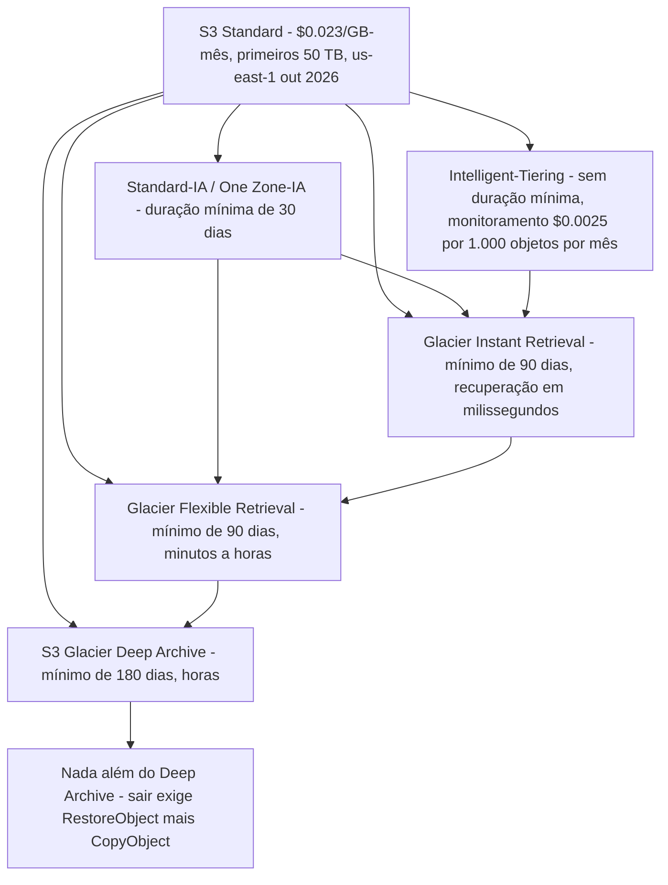
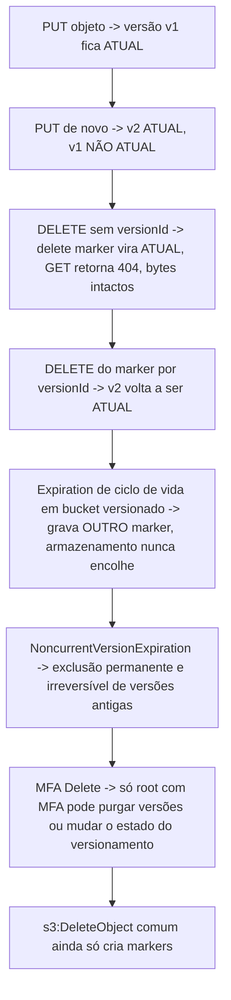
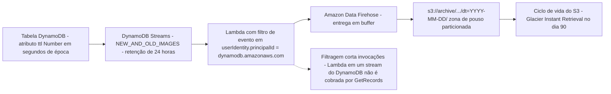
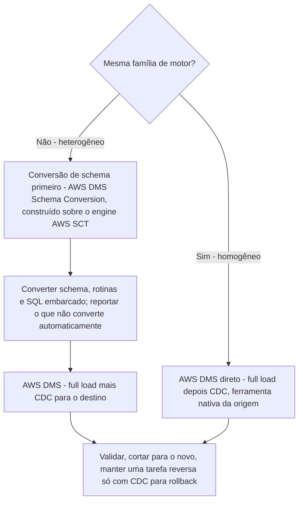
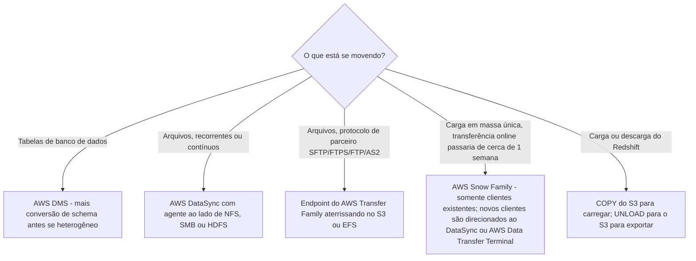
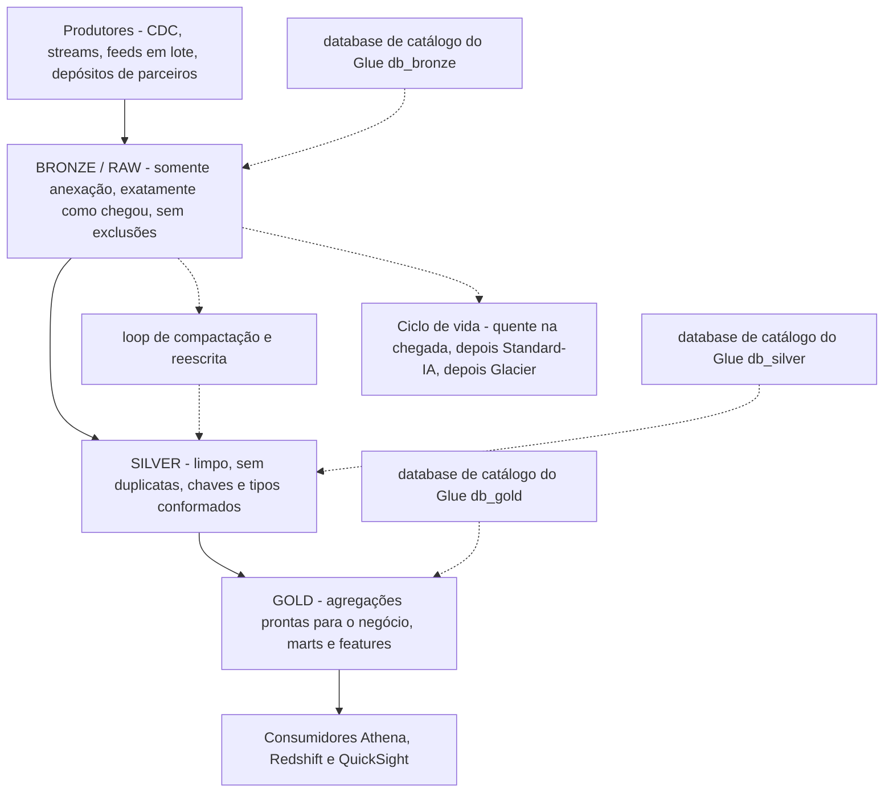

# Ciclo de Vida de Dados, Migração e Organização de Lago

**Tarefa 2.3, "Gerenciar o ciclo de vida dos dados,"** é onde o engenheiro de dados para de ser construtor e vira guardião. A lista de conhecimentos da tarefa é deliberadamente sem glamour, soluções de armazenamento quente e frio, otimização de custo ao longo do ciclo de vida, exclusão guiada por requisitos de negócio e legais, políticas de retenção e estratégias de arquivo, proteção de resiliência, e suas habilidades são concretas: executar operações de carga e descarga entre Amazon S3 e Amazon Redshift, gerenciar políticas do S3 Lifecycle para mudar o tier de armazenamento, expirar dados com base na idade e gerenciar o versionamento do S3 e o TTL do DynamoDB. O exame, portanto, recompensa um hábito acima de todos os outros: **saber exatamente o que acontece com um objeto específico, em um dia específico, a um preço específico.**

```text
====================================================================
 DEA-C01 DOMÍNIO 2 - TAREFA 2.3 "GERENCIAR O CICLO DE VIDA DOS DADOS"
====================================================================
 S3 Lifecycle ... regra = ID + Status + Filtro + AÇÕES
                   Transition | Expiration | NoncurrentVersion*
                   | AbortIncompleteMultipartUpload
                   | ExpiredObjectDeleteMarker
                 ... 1.000 regras por bucket (fixo, out 2026)
                 ... avaliadas diariamente; UMA ação por objeto
                     por dia; colisões -> ação MENOS CUSTOSA
 Transitions .... cascata de mão única; gate de idade de 30 d para
                     IA REMOVIDO em 2026-07-16; durações MÍNIMAS
                     30/90/180 d continuam
                 ... objetos < 128 KB não transitam por padrão
 Versioning ..... DELETE insere um marker (GET 404, dados intactos)
                 ... MFA Delete: só root, só CLI/REST
                 ... replicação exige versionamento em AMBOS os
                     buckets
 Object Lock .... WORM; versioning implícito; Compliance é absoluto
 DynamoDB TTL .... atributo Number, época Unix em SEGUNDOS, grátis,
                     exclui "em até dois dias" (até 48 h)
                 ... TTL + Streams -> Lambda -> Firehose -> S3
 Archives ....... Glacier Instant (ms) | Flexible (min-h) |
                     Deep Archive (h, sem Expedited)
 Migration ...... DMS (homogêneo / heterogêneo + conversão)
                     Snow Family | DataSync | Transfer Family
                 ... Redshift COPY para dentro / UNLOAD para fora
 Lake ........... bronze (raw) -> silver -> gold, catalogado por
                     zona, <= 1.000 arquivos por partição
====================================================================
```

Nesta lição você vai:

- ler uma **regra do S3 Lifecycle** como a AWS a define, `ID`, `Status`, `Filter` e os cinco tipos de ação, incluindo as peculiaridades de avaliação que decidem qual ação realmente roda;
- percorrer a **cascata de transição de mão única** e separar a **idade mínima de transição** (removida para as classes IA em 16 de julho de 2026) da **duração mínima de armazenamento** (30 / 90 / 180 dias, inalterada);
- aplicar o **piso padrão de 128 KB**, a **aritmética de transições encadeadas** e os **filtros de tag, prefixo e tamanho**;
- calcular dinheiro de ciclo de vida: **taxas de requisição de transição, ponto de equilíbrio Standard versus IA, o precipício da duração mínima e uma comparação de classes de um ano** (em outubro de 2026);
- separar **expiração, expiração de versões não atuais, aborto de upload multipart e limpeza de delete markers**, e explicar por que `Expiration` sozinho nunca encolhe um bucket versionado;
- operar **versionamento, delete markers e MFA Delete**, e nomear os **pré-requisitos de replicação** para CRR e SRR;
- aplicar os modos do **S3 Object Lock** (Compliance, Governance, legal hold) como restrição de ciclo de vida;
- configurar o **TTL do DynamoDB**, segundos de época, atraso de exclusão, comportamento de capacidade, e montar o **pipeline de arquivamento TTL plus Streams**;
- escolher uma **classe Glacier pelo SLA de recuperação**, não só pelo preço;
- escolher a **ferramenta de migração** certa: AWS DMS com conversão de schema (homogêneo versus heterogêneo), Snow Family, AWS DataSync e AWS Transfer Family;
- executar **carga e descarga no Redshift** do jeito que a primeira habilidade da Tarefa 2.3 exige;
- desenhar as **zonas medallion bronze, silver e gold**, corrigir o **problema dos arquivos pequenos** com compactação e **catalogar cada zona separadamente**;
- estudar **quatro estudos de caso de clientes da AWS** (Nasdaq, EOS Group, FINRA e BMW Group) e uma **caixa de atualização de outubro de 2026 com fontes**;
- praticar com **14 questões no estilo do exame** mais quatro verificações interativas.

---

## 1. S3 Lifecycle: como uma regra é realmente construída

### 1.1 Uma configuração por bucket, 1.000 regras

Cada bucket do S3 carrega **uma** configuração de ciclo de vida contendo **até 1.000 regras** (uma cota fixa, em outubro de 2026). Uma regra é um objeto pequeno:

| Elemento | Restrição | Relevância no exame |
|---|---|---|
| `ID` | até 255 caracteres, único dentro da configuração | Identificador humano para suporte e auditorias |
| `Status` | `Enabled` ou `Disabled` | Uma regra desabilitada ainda existe: ela só não faz nada |
| `Filter` | prefixo, tags de objeto, tamanho (`ObjectSizeGreaterThan` / `ObjectSizeLessThan`), combinados com `AND` / `OR` | Vive **dentro** do `Filter`, nunca como uma chave `Prefix` de topo em configurações atuais |
| Actions | os cinco tipos de ação abaixo | Somente as ações listadas disparam; todo o resto é ignorado |

### 1.2 Os cinco tipos de ação

| Ação | O que ela faz | A armadilha ligada a ela |
|---|---|---|
| **`Transition`** | Move a versão **atual** para outra classe de armazenamento depois de `Days` (idade a partir da criação) ou em uma `Date` | A cobrança do Glacier começa no dia em que a regra é satisfeita, **mesmo antes da movimentação física**: Intelligent-Tiering é a única exceção |
| **`Expiration`** | Encerra a vida da versão **atual** | Em um bucket versionado ela apenas **acrescenta um delete marker**; ela nunca toca versões não atuais |
| **`NoncurrentVersionTransition` / `NoncurrentVersionExpiration`** | Aplica uma vez que **ambos** `NoncurrentDays` **e** `NewerNoncurrentVersions` (1 to 100) são excedidos | A expiração aqui é uma **exclusão permanente e irreversível** |
| **`AbortIncompleteMultipartUpload`** | Aborta depois de `DaysAfterInitiation`, excluindo todas as partes enviadas | A **única** ação que limpa uploads multipart incompletos; ela **não tem taxa de exclusão antecipada** e sua regra **não pode usar filtro de tag** |
| **`ExpiredObjectDeleteMarker`** | Remove um delete marker que **não tem versões atrás dele** | Não pode ser combinada com `Days` no mesmo `Expiration` |

### 1.3 Filtros: prefixo, tags e tamanho

O `Filter` de uma regra delimita quais objetos ela pode tocar. O prefixo estreita para um caminho, as tags estreitam para objetos que carregam um par chave/valor (por exemplo `tier=hot`), e os predicados de tamanho estreitam objetos acima ou abaixo de um limiar em bytes. Duas regras para um mesmo bucket são comuns e legítimas, uma regra ampla de transição mais uma regra estreita guiada por tag, mas lembre de que **os filtros são avaliados contra o objeto no momento da execução**: remover a tag de um objeto *normalmente* impede que uma ação com escopo de tag se aplique a ele, embora a AWS documente que isso não é garantido, então um ciclo de vida guiado por tag nunca deve ser seu único controle de segurança.

> [!IMPORTANT]
> **Uma regra de ciclo de vida é uma política, não um script.** As regras se aplicam a objetos que já existem **e** a objetos criados depois, elas são avaliadas **uma vez por dia**, um objeto tem direito a **apenas uma ação de ciclo de vida por dia**, e quando várias regras correspondentes competem, **o Amazon S3 aplica a ação menos custosa** (documentação do S3 Lifecycle da AWS, acesso em outubro de 2026). É por essa última frase que “escrevi duas regras e as duas dispararam” nunca é uma reclamação válida, o S3 não vai te cobrar em dobro para satisfazer seu desenho.

```fillblank
{
  "question": "Complete as frases sobre S3 Lifecycle e TTL do DynamoDB usando o próprio vocabulário da AWS:",
  "template": "Uma configuração de ciclo de vida guarda no máximo {{1}} regras por bucket. Um objeto tem direito a apenas {{2}} ação de ciclo de vida por dia, e quando várias regras casam, o Amazon S3 aplica a ação {{3}}. A expiração dentro de um bucket versionado acrescenta um {{4}}, enquanto o NoncurrentVersionExpiration faz uma exclusão {{5}}. O TTL do DynamoDB guarda a expiração em um atributo Number com tempo Unix em {{6}}, e os itens expirados são tipicamente excluídos em {{7}} dias.",
  "answers": {
    "1": "1.000",
    "2": "uma",
    "3": "menos custosa",
    "4": "delete marker",
    "5": "permanente",
    "6": "segundos",
    "7": "dois"
  },
  "distractors": ["100", "10.000", "duas", "mais antiga", "mais barata", "mais rápida", "temporária", "suave", "milissegundos", "minutos", "horas", "sete", "trinta"],
  "explanation": "O limite de regras é 1.000 por bucket; a avaliação é diária com uma ação por objeto por dia e a ação menos custosa vencendo as colisões; a Expiration em um bucket versionado só grava um delete marker, então o armazenamento segue crescendo até existir um NoncurrentVersionExpiration; NoncurrentVersionExpiration é permanente; o TTL usa um atributo Number em segundos de época Unix: um valor em milissegundos é silenciosamente ignorado: e a AWS afirma que itens expirados são tipicamente excluídos em até dois dias."
}
```

- **📚 Você sabia?** Duas ações de ciclo de vida são rotundamente confundidas porque ambas “removem” coisas: **`AbortIncompleteMultipartUpload`** é o *único* mecanismo que limpa uploads multipart incompletos, a expiração comum de objeto não os toca (AWS: *“Object expiration lifecycle configurations don't remove incomplete multipart uploads”*), enquanto **`ExpiredObjectDeleteMarker`** faz o trabalho oposto: ele exclui um *marker* que não está escondendo nada, então a versão anterior volta a ser a atual. Uma libera bytes abandonados, a outra desesconde dados que você ainda possui (documentação do S3 Lifecycle da AWS, acesso em outubro de 2026).

---

## 2. Transições: a cascata e os gates de idade

### 2.1 A cascata de mão única

As classes de armazenamento são uma encosta. Os objetos podem descer para uma classe abaixo da classe atual, nunca voltar o degrau na mesma hora:



Duas regras estruturais decorrem desse diagrama: **`Glacier Flexible Retrieval` só pode ser reclassificado para `Deep Archive`**, e **`Deep Archive` não tem transição de saída nenhuma**: escapar dele significa restaurar o objeto e copiá-lo para outro lugar, o que é uma operação de restauração mais armazenamento novo, não uma transição. Um status de replicação pendente ou com falha também bloqueia transições em buckets versionados, então uma regra de replicação quebrada congela silenciosamente seu plano de tiering.

### 2.2 Idade mínima de transição versus duração mínima de armazenamento: a mudança de 16 de julho de 2026

São dois números diferentes e o exame cobra a diferença:

| Conceito | O que é | Situação em outubro de 2026 |
|---|---|---|
| **Idade mínima de transição** para Standard-IA / One Zone-IA | O menor tempo que um objeto deve ficar em Standard antes de uma regra poder movê-lo | **Removida em 16 de julho de 2026**: *“Agora você pode transicionar objetos para o S3 Standard-Infrequent Access … já no dia em que eles são criados, sem a retenção mínima anterior de 30 dias”*; uma transição com `Days: 0` é legal |
| **Duração mínima de armazenamento** | O número de dias que você precisa **pagar** assim que um objeto aterrissa em uma classe | **Inalterada**: **30 dias** (Standard-IA, One Zone-IA), **90 dias** (Glacier Instant, Glacier Flexible), **180 dias** (Deep Archive) |

A armadilha é que remover o *gate de elegibilidade* não fez nada com o *piso de cobrança*. Um objeto transicionado para Standard-IA no dia 0 e excluído no dia 7 ainda é cobrado por **30 dias** de Standard-IA, porque a duração mínima de armazenamento é uma cobrança, não uma regra. Um material de estudo que ainda diz “você precisa esperar 30 dias antes de transicionar para IA” está desatualizado; um material que diz “sair da IA antes da hora é grátis” sempre esteve errado.

### 2.3 O piso de 128 KB

Desde **setembro de 2024**, objetos menores que **128 KB não são transicionados por padrão**: um objeto abaixo de 128 KB configurado com uma transição simples baseada em `Days` simplesmente permanece em Standard, a menos que você opte com um filtro `ObjectSizeGreaterThan` ou com a configuração de nível de bucket `x-amz-transition-default-minimum-object-size`. Configurações legadas criadas antes dessa mudança mantêm o comportamento antigo até serem editadas. E o piso corta dois vezes: esses objetos pequenos também **são cobrados pelo piso de 128 KB** nas classes IA e Glacier Instant, então um bucket cheio de arquivos JSON de 20 KB paga mais por objeto do que sua contagem de bytes sugere (considerações de transição do S3 Lifecycle da AWS, acesso em outubro de 2026).

### 2.4 Transições encadeadas precisam respeitar as durações mínimas: Exemplo trabalhado E5

Uma única regra que pula por duas classes precisa sair de cada classe só depois que a duração mínima daquela classe tiver corrido. O exemplo da própria AWS afirma que você não pode especificar uma regra que transicione objetos para **Glacier Instant Retrieval depois de 4 dias** e depois para **Deep Archive depois de 20 dias**, o segundo salto deve ser **depois de pelo menos 94 dias**:

```text
Tentativa de regra         1º salto           2º salto           Veredito
[{Days:4,  GLACIER_IR},   sai do GIR no      sai no dia 24,      ILEGAL
 {Days:24, DEEP_ARCHIVE}] dia 4 (mín 90 d)   só 20 dias depois

Legalmente equivalente     1º salto           2º salto           Veredito
[{Days:4,  GLACIER_IR},   sai do GIR no      sai no dia 94,      LEGAL
 {Days:94, DEEP_ARCHIVE}] dia 4              90 dias depois
                                              4 + 90 = 94
```

Duas regras *separadas* podem expressar a mesma intenção (o S3 não as rejeita), mas você paga de qualquer jeito a cobrança de duração mínima de cada classe: a restrição passa de “rejeitada na hora da configuração” para “cobrada na hora da fatura”.

## 3. Expiração: o que “excluir” significa, conforme o estado do versionamento

### 3.1 A mesma ação, três resultados diferentes

| Estado de versionamento do bucket | `Expiration` na versão atual | O que acontece com os bytes do objeto |
|---|---|---|
| **Desabilitado (sem versionamento)** | O objeto é **permanentemente removido** | Sumiu |
| **Habilitado** | Um **delete marker** é acrescentado; a versão anterior vira não atual | **Ainda armazenado e ainda cobrado** |
| **Suspenso** | Um marker com version ID `null` é acrescentado; uma versão atual cujo ID é `null` é permanentemente excluída | Depende de qual versão você atinge |

### 3.2 Versões não atuais: `NoncurrentDays` mais `NewerNoncurrentVersions`

O `NoncurrentVersionExpiration` dispara apenas quando **ambas** as condições são excedidas: a versão não atual é mais antiga que `NoncurrentDays` **e** está além das `NewerNoncurrentVersions` versões mais recentes que você escolhe reter (1 to 100). Essa é a diferença entre um bucket com trilha de auditoria e um bucket com uma fatura que só cresce: `NewerNoncurrentVersions: 5` com `NoncurrentDays: 30` significa “manter as cinco versões não atuais mais recentes por pelo menos 30 dias cada, depois purgá-las permanentemente”.

> [!WARNING]
> **⚠️ A armadilha de custo do bucket versionado.** O `Expiration` em um bucket versionado **só grava delete markers**, então o armazenamento cresce monótono não importa quão agressivamente você expire. Reprodutibilidade e custo puxam para direções opostas, e o objeto que reconcilia é o `NoncurrentVersionExpiration`. Se uma questão descrever um bucket onde “todo objeto é expirado diariamente mas a fatura continua subindo”, a regra que falta é a expiração de versões não atuais: não um `Expiration` mais agressivo.

### 3.3 O par canônico de regras

```json
{ "Rules": [
  { "ID": "tier-down", "Status": "Enabled",
    "Filter": { "And": { "Prefix": "events/", "Tags": [{ "Key": "tier", "Value": "hot" }] } },
    "Transitions": [
      { "Days": 0,   "StorageClass": "STANDARD_IA" },
      { "Days": 90,  "StorageClass": "GLACIER_IR" },
      { "Days": 365, "StorageClass": "DEEP_ARCHIVE" } ],
    "NoncurrentVersionTransitions": [
      { "NoncurrentDays": 30, "StorageClass": "STANDARD_IA" } ],
    "NoncurrentVersionExpiration": { "NoncurrentDays": 30, "NewerNoncurrentVersions": 5 },
    "Expiration": { "Days": 2555 } },
  { "ID": "abort-mpu", "Status": "Enabled", "Filter": { "Prefix": "" },
    "AbortIncompleteMultipartUpload": { "DaysAfterInitiation": 7 } } ] }
```

Ler o que está escrito de volta é a habilidade sendo testada: objetos `tier=hot` sob `events/` entram no Standard-IA **imediatamente** (`Days: 0`, legal desde 16 de julho de 2026), Glacier Instant no dia 90, Deep Archive no dia 365, a versão atual expira no dia 2555 (cerca de sete anos), as versões não atuais migram para IA depois de 30 dias e são purgadas assim que passarem de 30 dias **e** das cinco mais recentes, e os uploads multipart incompletos são abortados depois de sete dias. A regra de aborto **não tem filtro de tag**: é por isso que ela fica em sua própria regra com um filtro de prefixo vazio em vez de dentro do `tier-down`.

---

## 4. Matemática de custo de ciclo de vida: quatro exemplos resolvidos

Todos os preços abaixo são **preços de lista do Amazon S3 para us-east-1, em outubro de 2026**: sempre confira `aws.amazon.com/s3/pricing/` para a sua Região antes de depender de um número.

### 4.1 A tabela de preços a partir da qual você constrói as respostas

| Classe | $/GB-mês | Duração mínima | Tamanho mínimo cobrável | Recuperação $/GB | Transições $/1.000 |
|---|---|---|---|---|---|
| Standard (primeiros 50 TB) | **$0,023** |: |: | grátis |: |
| Intelligent-Tiering (Frequent) | **$0,023** | **nenhuma** | auto-tier de 128 KB | grátis | $0,01 |
| Standard-IA | **$0,0125** | **30 d** | **128 KB** | $0,01 | $0,01 |
| One Zone-IA | **$0,01** | **30 d** | **128 KB** | $0,01 | $0,01 |
| Glacier Instant Retrieval | **$0,004** | **90 d** | **128 KB** | $0,03 | $0,02 |
| Glacier Flexible Retrieval | **$0,0036** | **90 d** | 40 KB de overhead | $0,01 (Standard) | $0,03 |
| S3 Glacier Deep Archive | **$0,00099** | **180 d** | 40 KB de overhead | $0,02 (Standard) | **$0,05** |

Outros fatos de requisição da mesma página: `PUT` **$0,005 por 1.000** (tier Standard), `GET` **$0,0004 por 1.000**, **DELETE é grátis**, o monitoramento do Intelligent-Tiering é **$0,0025 por 1.000 objetos por mês**, os arquivos de arquivo carregam um **overhead de 40 KB por objeto** (8 KB na taxa Standard mais 32 KB na taxa de arquivo), e sair de uma classe antes da duração mínima cobra **a cobrança normal mais o resto proporcional**.

### 4.2 Exemplo trabalhado E1: taxas de requisição de transição em escala

Você faz o tier de **1.000.000 objetos** em uma execução noturna. A $0,01 por 1.000 requisições a taxa parece trivial até você multiplicar:

```text
Alvo da transição        taxa / 1.000     1.000.000 objetos
S3 Standard-IA               $0,01        1.000.000 / 1.000 x 0,01  =  $10,00
S3 Glacier Instant           $0,02        mesmo                      =  $20,00
S3 Glacier Flexible          $0,03        mesmo                      =  $30,00
S3 Glacier Deep Archive      $0,05        mesmo                      =  $50,00
```

A lição não é o valor em dólares, é o **golpe duplo em objetos pequenos**: se esses 1.000.000 objetos tiverem 20 KB cada, a taxa de transição se aplica a todos **e** cada um passa a ser cobrado pelo piso de **128 KB** na classe de destino: 6,4x seu tamanho real, 20.000.000 KB cobrados em vez de 3.125.000 KB.

### 4.3 Exemplo trabalhado E2: ponto de equilíbrio Standard versus Standard-IA

Com que idade viver em Standard-IA custa o mesmo que viver em Standard? Igual as duas cobranças para um GB mantido por L dias:

```text
Standard     : $0,023  x L/30
Standard-IA  : $0,0125 x 30/30   (um mês cheio, sua duração mínima)

$0,023 x L/30 = $0,0125   ->   L = 0,0125 x 30 / 0,023 = 16,3 dias
One Zone-IA equivalente    ->   L = 0,0100 x 30 / 0,023 = 13,0 dias
```

Então um objeto esperado para viver **mais que cerca de 16 dias** é mais barato em Standard-IA antes de qualquer recuperação ser considerada; **menos que cerca de 16 dias** ele deve ficar em Standard, ou usar Intelligent-Tiering, que **não tem duração mínima** e não cobra taxa de recuperação. A recuperação vira a aritmética de novo: o Standard-IA cobra **$0,01/GB** para ler, então um objeto lido 20 vezes por mês nunca vence só no armazenamento. (Aritmética derivada dos preços de lista da AWS S3, us-east-1, em outubro de 2026.)

### 4.4 Exemplo trabalhado E3, o precipício da duração mínima

Um terabyte (tratado aqui como 100.000 GB para a aritmética) transiciona para Standard-IA no **dia 0** e é excluído no **dia 7**:

```text
Standard-IA cobrado : mínimo de 30 dias  ->  100.000 x $0,0125        = $1.250,00
Mesmos 7 dias em Standard               ->  100.000 x $0,023 x 7/30  =   $536,67
Razão                                         $1.250,00 / $536,67     =     2,3 x
```

E o precipício não suaviza com o tempo: excluído no **dia 1** em vez do dia 7, a conta do Standard-IA é **idêntica** ($1.250,00) enquanto um dia de Standard custa **$76,67**, uma diferença de **16x**. A duração mínima de armazenamento é um piso fixo, não uma assinatura proporcional: *o dia em que você transiciona define a fatura, não o dia em que você sai.* (Aritmética derivada dos preços de lista da AWS S3, us-east-1, em outubro de 2026, não publicada pela AWS.)

### 4.5 Exemplo trabalhado E4: dez terabytes, um ano, cinco classes

```text
10 TB = 10.000 GB mantidos por 12 meses (somente armazenamento, us-east-1, out 2026)

S3 Standard             10.000 x $0,023    x 12 =  $276,00
S3 Standard-IA          10.000 x $0,0125   x 12 =  $150,00
S3 One Zone-IA          10.000 x $0,0100   x 12 =  $120,00
Glacier Instant         10.000 x $0,004    x 12 =   $48,00
Glacier Flexible        10.000 x $0,0036   x 12 =   $43,20  (+ taxas de restauração)
S3 Glacier Deep Archive 10.000 x $0,00099  x 12 =   $11,88  (+ taxas de restauração)
```

Escale a última linha para **100 TB**: Standard é **$27.600 por ano** contra **$1.188 por ano** do Deep Archive: uma diferença de **23x** que é todo o argumento econômico das políticas de ciclo de vida. O que a tabela esconde é igualmente examinável: Flexible e Deep Archive acrescentam **taxas de restauração mais uma cópia temporária em S3 Standard** enquanto você lê, e cada salto acima acrescenta uma cobrança de requisição de transição.

```plot
{
  "type": "bar",
  "title": "Custo de armazenamento de um ano para 10 TB (preços de lista us-east-1, em outubro de 2026)",
  "data": [
    {"Storage class": "S3 Standard", "USD per year": 276.00},
    {"Storage class": "Standard-IA", "USD per year": 150.00},
    {"Storage class": "One Zone-IA", "USD per year": 120.00},
    {"Storage class": "Glacier Instant", "USD per year": 48.00},
    {"Storage class": "Glacier Flexible", "USD per year": 43.20},
    {"Storage class": "Deep Archive", "USD per year": 11.88}
  ],
  "xKey": "Storage class",
  "yKey": "USD per year",
  "xLabel": "Classe de armazenamento",
  "yLabel": "USD por um ano de 10 TB (somente armazenamento)"
}
```

Passe o mouse sobre qualquer barra para ler o número do Exemplo trabalhado E4: os mesmos 10 TB mantidos por doze meses custam **$276,00** em Standard e **$11,88** em Deep Archive: uma aritmética só de armazenamento que deliberadamente exclui taxas de restauração, cobranças de requisição de transição e os precipícios de duração mínima, tudo o que o exame pode acrescentar por cima.

- **📚 Você sabia?** A retrospectativa de 20 anos do S3 pela própria AWS (13 de março de 2026) relata que os clientes economizaram **mais de US$ 6 bilhões** em custos de armazenamento usando **S3 Intelligent-Tiering** em vez de S3 Standard, e coloca o preço de destaque de armazenamento em **pouco mais de 2 centavos por gigabyte**, cerca de **85% abaixo** do preço de lançamento de 2006 de 15 centavos (em outubro de 2026, verifique a precificação atual antes de usar). A própria economia do Intelligent-Tiering é sutil: ele **não tem duração mínima nem taxa de recuperação**, mas cobra **$0,0025 por 1.000 objetos por mês** para monitorá-los, para 10 milhões de objetos pequenos, só essa linha de monitoramento é **$25 por mês**, e é por isso que filtros de tamanho e regras de ciclo de vida ainda batem o tiering automático em buckets com muitos objetos.

---

## 5. Versionamento, delete markers e MFA Delete

### 5.1 O que realmente acontece em cada chamada de API

Cada `PUT` atribui um **version ID** único; o bucket guarda uma versão **atual** mais qualquer número de versões **não atuais**. Um `DELETE` sem `versionId` **insere um delete marker**, tornando a versão anterior não atual: o `GET` retorna **404** enquanto os bytes estão totalmente intactos e ainda são cobrados. A remoção permanente exige `DELETE ?versionId=...`, e excluir o próprio marker restaura a versão anterior.



### 5.2 MFA Delete

| Propriedade | Regra |
|---|---|
| O que protege | **A exclusão permanente de uma versão** e **mudanças no estado do versionamento** |
| Quem pode habilitar ou desabilitar | **Somente o usuário root** (o próprio versionamento pode ser alternado por qualquer principal autorizado) |
| Qual interface | **Só CLI / REST, o console não o suporta** (`put-bucket-versioning... --mfa "SERIAL CODE"`, `x-amz-mfa` enviado por **HTTPS**) |
| O que ele *não* bloqueia | `s3:DeleteObject` comum, que apenas cria markers |

O efeito líquido é o ponto da feature: com o MFA Delete ligado, um atacante com permissões normais de exclusão pode esconder dados mas não pode destruí-los, e só um root autenticado por MFA pode purgar versões ou suspender o versionamento.

- **📚 Você sabia?** MFA Delete e versionamento respondem perguntas diferentes e são frequentemente confundidos: **versionamento é um comportamento de armazenamento** (manter cada versão), **MFA Delete é um controle de destruição** (tornar a destruição cara). Você pode rodar o versionamento por anos sem MFA Delete, e habilitar o MFA Delete não muda o que um `DELETE` faz: ele muda quem pode fazer aquela exclusão *permanente* (documentação de Versioning e MFA Delete do S3 da AWS, acesso em outubro de 2026).

---

## 6. Replicação: pré-requisitos de CRR e SRR

**Replicação copia objetos entre buckets; regras de ciclo de vida movem objetos dentro de um bucket.** Manter esses dois mecanismos separados é metade das questões de ciclo de vida do Domínio 2.

| Requisito | Detalhe |
|---|---|
| **Versionamento** | **Precisa estar habilitado no bucket de origem e no de destino**; este é o pré-requisito mais cobrado de todos |
| **Permissões** | Uma **role do IAM**: `s3:GetObjectVersionForReplication`, `s3:GetObjectVersionAcl`, `s3:GetObjectVersionTagging` na origem, mais `s3:ReplicateObject`, `s3:ReplicateDelete`, `s3:ReplicateTags` no destino |
| **Regras** | 1 to 1.000 regras de replicação por bucket, filtradas por prefixo e/ou tags |
| **Desabilitar o versionamento no destino** | O status da replicação vira **`FAILED`**: não “parcial”, não “atrasado” |
| **Objetos pré-existentes** | A replicação **não é retroativa**: preencha com **S3 Batch Replication** |
| **Opções** | Classe de armazenamento da réplica, propriedade da réplica, replicação de delete markers, múltiplos destinos |
| **CRR versus SRR** | **Cross-Region Replication** incorre em custo de transferência de dados entre Regiões; **Same-Region Replication** não |

O **S3 Replication Time Control (RTC)** carrega um SLA: **99,99% dos objetos novos replicados em 15 minutos**. Sem RTC, a replicação é melhor esforço sem SLA (a AWS documenta 24 to 48 horas como expectativa geral). O RTC é a resposta sempre que uma questão nomear um *prazo de replicação*; “eventualmente” não é nível de serviço.

---

## 7. S3 Object Lock: retenção que o ciclo de vida não pode anular

O Object Lock é uma **feature do serviço Amazon S3 que está no escopo**: ele não é uma entrada separada na lista de serviços no escopo do DEA-C01, e nenhuma declaração de tarefa nomeia WORM explicitamente, então trate-o como jogo justo exatamente porque o próprio S3 está no escopo. Ele precisa ser **habilitado na criação do bucket**, e habilitá-lo **implica versionamento**.

| Modo | Quem pode anular | Observações |
|---|---|---|
| **Compliance** | **Ninguém: incluindo o usuário root** | O modo não pode ser alterado e a retenção não pode ser encurtada ou excluída durante o prazo; a única saída é excluir a conta da AWS |
| **Governance** | Princípios com `s3:BypassGovernanceRetention` **e** que enviem o cabeçalho `x-amz-bypass-governance-retention:true` | O modo do dia a dia para retenção interna com trilha de auditoria |
| **Legal hold** | Qualquer um com `s3:PutObjectLegalHold` | Sem data de expiração; independente do período de retenção |

A retenção se conecta às **versões de objeto**; **delete markers nunca são protegidos por WORM**; uma política de bucket pode elevar a retenção máxima para **100 anos**; e um `Expiration` de ciclo de vida **não pode excluir uma versão sob retenção ou legal hold**: que é exatamente por que arquivos regulados combinam Object Lock com tiering de ciclo de vida em vez de escolher um dos dois. Os ganchos regulatórios nomeados são SEC 17a-4, FINRA 4511 e CFTC 1.31.

## 8. TTL do DynamoDB: segundos de época, atraso de exclusão e o pipeline de arquivamento

### 8.1 O contrato do atributo

O TTL é habilitado por tabela e lê **um único atributo**, o nome é **sensível a maiúsculas/minúsculas**, cujo valor deve ser um **Number** contendo **tempo Unix em segundos**:

| Regra | Valor |
|---|---|
| Tipo do atributo | **Number** (uma String é ignorada) |
| Unidade | **Segundos de época**: `1724241326000` (milissegundos) é ignorado |
| Correspondência de nome | Sensível a maiúsculas: `expireAt` e `ExpireAt` são atributos diferentes |
| Tolerância máxima para o passado | Uma expiração mais de **5 anos no passado** é ignorada; não existe janela mínima no futuro |
| Custo da exclusão | **Grátis**, o TTL não consome capacidade de escrita |
| Habilitar ou propagar mudança | Cerca de **1 hora** (chamadas extras de `UpdateTimeToLive` depois disso levantam `ValidationException`); depois de desabilitar, o processamento continua por cerca de **30 minutos** |
| Observabilidade | `TimeToLiveDeletedItemCount` atualiza cerca de **uma vez por minuto** |

### 8.2 Atraso de exclusão: “em até dois dias”

A referência de API da AWS afirma que o DynamoDB *“tipicamente exclui itens expirados em até dois dias”* e avisa que *“itens que expiraram e não foram excluídos ainda aparecem em leituras, consultas e scans”* (em outubro de 2026). Três consequências disso:

1. **O TTL não é uma exclusão de conformidade.** Se uma regulação exigir apagamento instantâneo, só o TTL não satisfaz.
2. **As leituras precisam filtrar.** Acrescente `FilterExpression: "ttl > :now"` ou proteja as escritas com uma `ConditionExpression` até a exclusão acontecer.
3. **O armazenamento continua sendo cobrado** por até 48 horas após a expiração nominal.

### 8.3 Exemplo trabalhado E6: transformando uma política de retenção em época

Um dispositivo se registra em `1770000000` (segundos de época) e a política diz “excluir 90 dias após a criação”:

```text
retenção        = 90 dias = 90 x 86.400 = 7.776.000 segundos
atributo ttl    = 1770000000 + 7776000  = 1777776000   <- Number, SEGUNDOS

Forma errada A  = "2026-11-12T00:00:00Z"  -> String, IGNORADA
Forma errada B  = 1777776000000           -> milissegundos, IGNORADA
Forma errada C  = ttl = now               -> expira na hora, sem benefício de atraso

Filtro de segurança = FilterExpression "ttl > :now" esconde itens que
                 expiraram mas ainda estão dentro da janela de 48 h
```

A distractor clássica do exame é um timestamp em milissegundos: ele faz parse como Number, então nada dá erro, o item simplesmente nunca é excluído, silenciosamente. O mesmo tipo de falha silenciosa vale para um nome de atributo digitado errado, porque a busca é sensível a maiúsculas/minúsculas.

### 8.4 TTL mais Streams: o pipeline de arquivamento

As exclusões do TTL são observáveis antes de estarem completas, e é isso que faz o padrão de arquivo funcionar:



Como as exclusões do TTL são executadas pelo serviço, os registros do stream carregam `userIdentity.type = "Service"` e `principalId = "dynamodb.amazonaws.com"`; um filtro de origem de evento naquela identidade derruba todo o resto. A orientação da AWS mostra o efeito prático: filtrar pode cortar as invocações do Lambda de cerca de **2 milhões de modificações por hora para 100.000 por hora**, e **o Lambda processando um stream do DynamoDB não é cobrado por `GetRecords`**. Duas restrições importam para o exame: as exclusões do TTL são identificáveis **apenas na Região onde ocorreram**, e **os Streams retêm 24 horas**, então um consumidor quebrado precisa ser reparado dentro de um dia, não de uma semana. Dashboards construídos sobre esse padrão precisam tolerar **até 48 horas** de visibilidade pós-expiração.

- **📚 Você sabia?** O padrão de arquivo existe porque o TTL te dá *exclusão barata* mas nenhuma *cópia durável*: o item sai do DynamoDB de graça, mas se ninguém capturou o registro do stream antes, sete anos de histórico simplesmente desaparecem. Capturar o evento de exclusão (ou a imagem final do item) no S3 antes da janela de dois dias fechar, e depois aplicar uma regra de ciclo de vida do S3 para fazê-lo subir de tier, transforma uma purga em um arquivo, e o custo de invocação do Lambda é a única linha nova na fatura (orientação de TTL do DynamoDB com DynamoDB Streams da AWS, acesso em outubro de 2026).

---

## 9. Escolha de arquivo: escolha pelo SLA de recuperação, não pelo preço

| Classe | Duração mínima | Acesso pretendido | Tempo de recuperação | Mecânica de restauração |
|---|---|---|---|---|
| **Glacier Instant Retrieval** | **90 dias** | Uma vez por trimestre | **Milissegundos**: um `GET` normal | Nenhuma; tamanho mínimo cobrável de 128 KB |
| **Glacier Flexible Retrieval** | **90 dias** | 1 to 2 vezes por ano | Expedited **1 to 5 min** · Standard **3 to 5 h** · Bulk **5 to 12 h (grátis)** | Exige `RestoreObject`; overhead de objeto de 40 KB |
| **S3 Glacier Deep Archive** | **180 dias** | Menos de uma vez por ano | Standard **≤12 h** · Bulk **≤48 h** · **sem Expedited** | Exige `RestoreObject`; overhead de 40 KB |

Restaurar custa **a taxa de recuperação do arquivo mais uma cópia temporária em S3 Standard** enquanto a cópia restaurada existir: um arquivo é barato de manter e deliberadamente caro de ler. A AWS documenta uma taxa de restauração de cerca de **1 to 2 PB por dia por conta**. O S3 Intelligent-Tiering oferece um caminho adjacente: as recuperações Standard e Bulk de sua camada Archive Access (depois de **90 dias** sem acesso) e de sua camada Deep Archive Access (depois de **180 dias**) são gratuitas.

### 9.1 Exemplo trabalhado E7: durações mínimas quando você sai cedo

```text
-> Glacier Instant no dia 90, excluído no dia 150
   tempo mantido = 60 dias   <   mínimo de 90 dias
   cobrado       = 90 dias a $0,004/GB-mês  ->  um resto de 30 dias é cobrado

-> Deep Archive no dia 0, excluído no dia 100
   tempo mantido = 100 dias  <   mínimo de 180 dias
   cobrado       = 180 dias a $0,00099/GB-mês -> um resto de 80 dias é cobrado
```

Exclusão antecipada (e sobrescrita antecipada) antes da duração mínima cobra **a cobrança normal mais o resto proporcional**: a mesma cláusula que faz o precipício do Standard-IA do Exemplo E3 funcionar. E lembre da saída de emergência: **o Deep Archive é de mão única dentro da cascata de ciclo de vida**; trazer um objeto de volta para o Standard exige `RestoreObject` e depois `CopyObject`.

---

## 10. Ferramentas de migração I: AWS DMS e conversão de schema

### 10.1 Homogêneo versus heterogêneo

O **AWS Database Migration Service** move bancos de dados, nada além disso. Suas duas formas são a primeira bifurcação do exame:

| Situação | Caminho | Exemplo |
|---|---|---|
| **Homogêneo**: mesma família de motor | **Só o DMS**, usando a ferramenta nativa do motor de origem para a carga total | PostgreSQL on-premises → Amazon RDS PostgreSQL |
| **Heterogêneo**: motores diferentes | **Converter o schema e o código primeiro, depois mover os dados com o DMS** | Oracle → Aurora PostgreSQL; SQL Server, Db2, SAP ASE → Aurora PostgreSQL |

Duas features do DMS decidem se a conversão é sequer necessária: a **change data capture (CDC)** lê os logs de transação nativos da origem (então não são necessárias mudanças de aplicação para a sincronização contínua), e a **conversão de schema** reescreve DDL, procedimentos armazenados, funções e SQL embarcado para o motor de destino.

### 10.2 Tipos de tarefa e as ressalvas operacionais

| Tipo de tarefa | Uso |
|---|---|
| **Full load** | Cópia única; o destino é escrito em massa |
| **Full load + CDC** | Migrar com downtime mínimo, e note que ele **exclui objetos existentes no destino**: faça backup antes |
| **Somente CDC** | Replicação contínua após uma carga total, incluindo tarefas reversas e de rollback |

Ressalvas que valem decorrer: o DMS roda em uma **replication instance** (Multi-AZ opcional) ou como **DMS Serverless**; a AWS afirma claramente que *“a CDC do AWS DMS não fornece replicação em tempo real … Não existem SLAs para a latência da CDC”*, então uma questão prometendo replicação “instantânea e garantida” via CDC está errada.

### 10.3 O fluxo heterogêneo



### 10.4 A questão do status do SCT (guia do exame v1.1)

O **AWS Schema Conversion Tool** baixável varria o código de aplicação em busca de SQL embarcado e suportava mais motores que seu sucessor gerenciado. A partir do **guia do exame v1.1 (12 de dezembro de 2025)**, porém, o **AWS SCT foi removido da lista de serviços no escopo do DEA-C01**, o **DMS Schema Conversion** gerenciado (baseado na web, construído sobre o engine do SCT) é o que o guia agora aponta. Regra prática para o dia do exame: “SCT” ainda pode aparecer como **vocabulário legado** dentro de uma narrativa de conversão, mas ele não pode mais ser o *serviço no escopo nomeado* que lhe pedem para selecionar; prefira **AWS DMS** e **DMS Schema Conversion** (página de revisões do guia do exame, acesso em outubro de 2026).

- **📚 Você sabia?** Uma janela de CDC do DMS de vários meses é uma *conta de compute*, não só uma escolha de arquitetura: desde **2 de dezembro de 2025**, os **AWS Database Savings Plans** cobrem **Aurora, RDS, DynamoDB, ElastiCache, DocumentDB, Neptune, Keyspaces, Timestream e AWS DMS** com descontos de **até 35%** (anúncio dos AWS Database Savings Plans, 2 de dez de 2025; acesso em outubro de 2026). Então quando um estudo de caso como o da EOS Group relata uma **redução de 50% em infraestrutura**, parte dessa história é o *mecanismo* de migração (DMS → S3 → Redshift) e parte é a alavanca *comercial* sobre os bancos de dados que restam: uma questão do Domínio 2 sobre “minimizar o custo de uma replicação de longa duração” pode legitimamente ser respondida com um desconto por compromisso em vez de uma mudança de arquitetura.

## 11. Ferramentas de migração II: Snow Family, DataSync e Transfer Family

### 11.1 Os três movers que não são de banco de dados

| Ferramenta | Modo | Pista no exame | Números-chave (em outubro de 2026) |
|---|---|---|---|
| **AWS DataSync** | **Online**, sincronização agendada ou contínua | Agente ao lado de NFS, SMB ou HDFS; cerca de **10x** mais rápido que ferramentas open source; TLS, verificação de integridade, throttling, transferências incrementais | A resposta padrão para **movimentação recorrente de arquivos** |
| **AWS Transfer Family** | Endpoints **SFTP / FTPS / FTP / AS2** gerenciados sobre **S3 ou EFS** | Um **endpoint de protocolo**, não um mover em massa: troca parceiro e B2B com um IdP customizado | Nomeado na tarefa 2.1 (“integrando ferramentas de migração”) |
| **AWS Snow Family** | Transferência em massa **offline** por dispositivo físico | **Snowball Edge Storage Optimized: 210 TB utilizáveis**; NFSv3/v4/v4.1 mais adaptador S3, criptografia obrigatória, **apagamento NIST 800-88** na devolução | **Fechado para novos clientes desde 7 de novembro de 2025**; planejadores de migração grande começam acima de **500 TB**; regra geral: transferência online **≥1 semana → considere Snow** |

### 11.2 Exemplo trabalhado E8: a regra da semana, calculada

Mover **600 TB** por um link de **1 Gbps**, ignorando overhead de protocolo:

```text
600 TB  = 600 x 10^12 bytes   = 6,0 x 10^14 bytes
1 Gbps  = 1,25 x 10^8 bytes por segundo
tempo   = 6,0 x 10^14 / 1,25 x 10^8 = 4,8 x 10^6 segundos
        = 4.800.000 / 86.400         = 55,6 DIAS   (aritmética derivada)
```

Tudo que levar **mais de cerca de uma semana** de transferência online sustentada pertence à conversa offline: para clientes da AWS que ainda podem pedir dispositivos, isso é a Snow Family, e o banner da documentação do Snowball direciona clientes **novos** para **AWS DataSync**, **AWS Data Transfer Terminal** ou soluções de parceiros da AWS. Para movimentação *recorrente* (um job noturno de 2 TB de NFS para S3 sobre Direct Connect) a resposta é sempre **DataSync**, e para *depósitos de arquivos de fornecedores via SFTP* é sempre **Transfer Family**.



```matching
{
  "question": "Associe cada cenário de migração à ferramenta que o exame DEA-C01 espera:",
  "pairs": [
    {"left": "Oracle 19c para Aurora PostgreSQL com downtime mínimo", "right": "Conversão de schema primeiro, depois AWS DMS full load mais CDC"},
    {"left": "PostgreSQL on-premises para Amazon RDS PostgreSQL", "right": "Migração homogênea do AWS DMS: sem etapa de conversão"},
    {"left": "5 TB noturnos de NFS para S3 pelo Direct Connect", "right": "AWS DataSync com um agente agendado"},
    {"left": "Fornecedores enviam arquivos SFTP para o seu bucket do S3", "right": "Endpoint SFTP gerenciado do AWS Transfer Family no S3"},
    {"left": "400 TB a 200 Mbps com prazo de seis meses", "right": "Transferência offline em massa: Snow Family para clientes existentes (mais de 1 semana de transferência online)"},
    {"left": "Carga em massa de 50 GB de CSV no Amazon Redshift", "right": "COPY do S3: nunca muitas instruções INSERT individuais"},
    {"left": "Exportar o resultado de uma consulta de 10 milhões de linhas como Parquet", "right": "UNLOAD com FORMAT AS PARQUET e PARTITION BY"}
  ],
  "explanation": "O seletor roda com três perguntas: é um banco de dados (DMS, mais conversão se a família de motor difere), são arquivos recorrentes (DataSync), é um endpoint de protocolo de parceiro (Transfer Family) - com a transferência offline em massa como reserva quando a transferência online sustentada passaria de cerca de uma semana, e o próprio COPY e UNLOAD do Redshift para as operações de carga e descarga do warehouse. A Snow Family está fechada para novos clientes desde 7 de novembro de 2025, então uma alternativa que a apresenta como padrão para quem migra pela primeira vez está desatualizada."
}
```

---

## 12. Carga e descarga no Redshift: a primeira habilidade da Tarefa 2.3

A lista de habilidades da Tarefa 2.3 abre com *“executar operações de carga e descarga entre Amazon S3 e Amazon Redshift”*, e a AWS é direta sobre qual direção está correta: *“recomendamos fortemente usar o comando COPY para carregar grandes volumes de dados. Usar instruções INSERT individuais … pode ser proibitivamente lento.”*

| Operação | Comando | Comportamento |
|---|---|---|
| **Carga em massa** | **`COPY`** do S3 | Massivamente paralelo; escolha uma **quantidade de arquivos próxima de um múltiplo da contagem de slices**; mantenha os arquivos entre **1 MB e 1 GB**; os dados precisam estar na **mesma Região** do cluster |
| **Carga linha a linha** | `INSERT` | Muito menos eficiente: correto apenas para deltas minúsculos, nunca para massa |
| **Exportação em massa** | **`UNLOAD`** para o S3 | Texto, JSON ou **Parquet** com **`PARTITION BY`** (estilo Hive), **`MANIFEST`**, **`MAXFILESIZE`** (5 MB: 6,2 GB, padrão **6,2 GB**), **`PARALLEL ON`**, **`ALLOWOVERWRITE`** |
| **Manutenção pós-carga** | `VACUUM` mais `ANALYZE` | Execute depois de DML pesado para restaurar a ordem classificada e atualizar as estatísticas do otimizador |

A orientação da própria AWS para o `UNLOAD` relata o Parquet como *“up to 2x faster … 6x less storage”* em relação ao texto, o mesmo argumento da escolha de formato do lago, chegando pelo lado do warehouse. O pareamento a decorar: **`COPY` para dentro, `UNLOAD` para fora**, ambos pelo S3, ambos cientes da Região.

---

## 13. Organização do data lake: zonas medallion, arquivos pequenos e catalogação

### 13.1 As três zonas

Um layout **medallion** dá a cada zona um contrato diferente e, portanto, um ciclo de vida, uma classe de armazenamento e uma entrada de catálogo diferentes:



| Zona | Contrato | Ciclo de vida típico | Postura no catálogo |
|---|---|---|---|
| **Bronze (raw)** | Somente anexação, fonte da verdade reproduzível, nunca editada no lugar | Quente na chegada → **Standard-IA → Glacier** conforme envelhece | Seu próprio database; schema-on-read, frequentemente particionada pela data de ingestão |
| **Silver** | Limpo, sem duplicatas, conformado, uma linha por entidade | Vida média; suba de tier apenas depois que os jobs a jusante estiverem estáveis | Seu próprio database; a zona mais exposta ao **dano dos arquivos pequenos** |
| **Gold** | Agregações e features prontas para o negócio, granularidade estável | Permanece **quente**; pequena e muito consultada | Seu próprio database; particionada pelos filtros que os consumidores realmente usam |

### 13.2 Catalogue cada zona separadamente

**`MSCK REPAIR TABLE` varre uma árvore de prefixos inteira**, então registrar bronze, silver e gold sob uma raiz com uma única instrução de repair arrisca misturar tabelas sem relação em um único objeto de catálogo. Catalogue cada zona em **seu próprio database do Glue** (ou em seu próprio namespace de S3 Tables / Iceberg) com seu próprio `Location`, e prefira **`ALTER TABLE ADD PARTITION`** quando você já sabe quais partições mudaram: a varredura de caminho completo é o padrão caro, não o padrão seguro.

### 13.3 Arquivos pequenos e o loop de compactação

A orientação do Athena da AWS enuncia o problema sem rodeios: *“conjuntos de dados que consistem em muitos arquivos pequenos resultam em desempenho de consulta ruim no geral”*, e a meta é **no máximo 1.000 arquivos por partição**. Um job do Glue rodando de hora em hora escrevendo arquivos de 3 MB produz **720 arquivos por dia por partição**: passando do limite antes do almoço.

**Ordem de correção (faça em sequência, não em paralelo):**

1. Faça a **origem escrever arquivos maiores** (coalesce em direção a 256 to 512 MB).
2. Combine com **Glue ETL** (`coalesce` ou `repartition`).
3. Reduza o número de **chaves de partição**: super-particionar fragmenta os dados tão eficazmente quanto escritas pequenas.

**Compactação gerenciada (o otimizador do Glue para Iceberg/Parquet)** dispara quando uma tabela tem **mais de 100 arquivos** com cada arquivo **abaixo de 75% do tamanho alvo**, onde `write.target-file-size-bytes` tem padrão de **512 MB**; a mesma família de otimizadores também oferece otimizadores de retenção de snapshot e de arquivos órfãos. Layouts que não são Iceberg precisam de uma reescrita Glue/Spark (bin-packing ou `repartition`). Para formatos, aponte para **blocos Parquet de cerca de 128 MB** ou **stripes ORC de cerca de 64 MB**, e empurre chaves de alta cardinalidade para **bucketing** em vez de mais níveis de partição.

### 13.4 Exemplo trabalhado E9, o que o ciclo de vida de uma zona bronze realmente rende

Uma zona bronze guarda **10 TB** de dados de eventos com este conjunto de regras (todos os preços us-east-1, em outubro de 2026): Standard nos primeiros 30 dias, Standard-IA dos dias 31 to 180, Glacier Instant dos dias 181 to 365, expiração no dia 365. Aproximando cada janela como uma fração de um ano:

```text
Standard          10.000 GB x $0,023   x (30/365)  =   $18,90
Standard-IA       10.000 GB x $0,0125  x (150/365) =   $51,37
Glacier Instant   10.000 GB x $0,004   x (185/365) =   $20,27
                                                    ------------
TOTAL COM TIER DE UM ANO                             =   $90,54
O ano inteiro em S3 Standard  10.000 x $0,023 x 12   =  $276,00
Economia                                              =  $185,46  (67%)

mais requisições de transição: 10 TB de objetos de ~250 MB = 40.000 objetos
  40.000 / 1.000 x ($0,01 + $0,02)                        =     $1,20
```

As taxas de transição são **$1,20 contra uma economia de $185**: todo o argumento das políticas de ciclo de vida em uma linha: em stores de objetos, **a classe de armazenamento domina, as taxas de requisição são erros de arredondamento, e os mínimos de exclusão antecipada são a única armadilha real** (aritmética derivada dos preços de lista da AWS S3, em outubro de 2026).

```dragdrop
{
  "question": "Ordene o layout medallion do dado mais bruto ao mais pronto para o negócio, com o loop de compactação no lugar certo:",
  "items": [
    "BRONZE (raw) - somente anexação, exatamente como chegou, catalogado em seu próprio database do Glue",
    "SILVER: limpo, sem duplicatas, conformado: a zona mais danificada por arquivos pequenos",
    "Loop de compactação: o otimizador do Glue dispara acima de 100 arquivos cada abaixo de 75% do alvo de 512 MB",
    "GOLD, agregações e marts prontos para o negócio, permanece quente, particionado pelos filtros dos consumidores"
  ],
  "correctOrder": [
    "BRONZE (raw) - somente anexação, exatamente como chegou, catalogado em seu próprio database do Glue",
    "SILVER: limpo, sem duplicatas, conformado: a zona mais danificada por arquivos pequenos",
    "Loop de compactação: o otimizador do Glue dispara acima de 100 arquivos cada abaixo de 75% do alvo de 512 MB",
    "GOLD, agregações e marts prontos para o negócio, permanece quente, particionado pelos filtros dos consumidores"
  ],
  "explanation": "Os dados fluem do bruto ao refinado: bronze é a zona de pouso intocada, silver é onde acontecem a limpeza e a conformação (e onde escritas horárias de 3 MB criam centenas de arquivos por partição), a compactação roda contra o silver antes que os consumidores sintam, e gold é a camada de negócio estável que deve permanecer quente. Cada zona recebe seu PRÓPRIO database de catálogo porque o MSCK REPAIR TABLE varre a árvore inteira de prefixos e, caso contrário, mesclaría tabelas de zonas diferentes."
}
```

- **📚 Você sabia?** Particionamento, bucketing e tamanho de arquivo são três eliminações diferentes e o exame as mantém separadas: **partições podam diretórios** (`year=2026/month=10/` no estilo Hive), **bucketing poda buckets de hash dentro de uma partição** (o lugar certo para chaves de alta cardinalidade), e **tamanho de arquivo conserta o imposto de listagem**: super-particionar fragmenta os dados tão mal quanto escrever arquivos minúsculos, e é por isso que a orientação da AWS diz para particionar por **colunas de baixa cardinalidade que as consultas realmente filtram**, geralmente o tempo (orientação de particionamento e desempenho do Amazon Athena, acesso em outubro de 2026).

### Atualizações de 2026 (em outubro de 2026)

> [!NOTE]
> **O que mudou neste tópico: cada linha verificada contra uma fonte primária da AWS em outubro de 2026:**
> - **A idade mínima de transição de 30 dias para Standard-IA / One Zone-IA acabou.** Anunciado em **16 de julho de 2026**: *“Agora você pode transicionar objetos para o S3 Standard-Infrequent Access … já no dia em que eles são criados, sem a retenção mínima anterior de 30 dias.”* Uma transição com `Days: 0` é legal. As **durações mínimas de armazenamento (30 / 90 / 180 dias) não mudaram**: gate de elegibilidade removido, piso de cobrança intacto (AWS What's New, 16 de jul de 2026).
> - **Guia do exame v1.1 (12 de dezembro de 2025)** consolidou conhecimentos e habilidades em uma única lista, **acrescentou 8 habilidades e removeu nenhuma**, e mudou a lista no escopo em **+6 / −3**: **o AWS SCT foi removido**, então questões de conversão de schema agora apontam para **DMS Schema Conversion**; **Amazon S3 Tables** e **Amazon Aurora** foram acrescentados. Três serviços saíram da lista no escopo mas ainda podem aparecer como distractors (página de revisões do guia do exame, acesso em outubro de 2026).
> - **AWS Glue 6.0 (21 de agosto de 2026)**, **preço 30% menor**, Spark **4.1.1**, Python **3.13**, Iceberg **1.11.0** com **formato v3**, é o runtime por trás dos jobs de compactação e reescrita; ele remove **EMRFS** (só S3A) e **AWS SDK for Java v1**, então uma especificação de job que ainda referencia `fs.s3.consistent.*` ou `com.amazonaws.services.*` não vai rodar (anúncio e página de migração do AWS Glue 6.0, acesso em outubro de 2026).
> - **Corte de preço do S3 Express One Zone (10 de abril de 2025)**: armazenamento **−31%**, PUT **−55%**, GET **−85%**, upload e recuperação **−60%**, com a disponibilidade expandindo de 8 para **15 Regiões até 17 de setembro de 2026**: relevante quando um prefixo *quente* de bronze ou gold precisa de leituras de milissegundos unitários em vez de tiering (AWS What's New, 10 de abr de 2025 e 17 de set de 2026).
> - **Streaming direto para o lago**: **tabelas em streaming do Kinesis Data Streams → Iceberg no S3 Tables (28 de agosto de 2026)** e **entrega de propósito geral no S3 (29 de agosto de 2026)**, mais **brokers do MSK Express → tabelas em streaming do Iceberg (30 de julho de 2026)**: a zona raw agora pode aterrissar como Parquet com compactação embutida em vez de uma etapa de pouso em lote. O **Amazon Data Firehose** é o nome do produto desde **9 de fevereiro de 2024**, mas a lista no escopo do DEA ainda imprime **Amazon Kinesis Data Firehose**; os dois nomes são válidos (AWS What's New, 2026).
> - **O S3 Tables amadureceu (28 de julho de 2026)**: o Amazon S3 Tables, acrescentado à lista no escopo do DEA-C01 no guia do exame v1.1, ganhou o **tipo VARIANT do Iceberg com suporte ao formato v3**, então payloads semiestruturados podem aterrissar na zona bronze como colunas Iceberg tipadas em vez de blobs JSON brutos; combine isso com o runtime **Glue 6.0** de Iceberg **1.11.0 / formato v3** quando um job de compactação ou reescrita precisar entender as mesmas tabelas (AWS What's New, 28 de jul de 2026; anúncio do Glue 6.0, 21 de ago de 2026).
> - **O DMS ganhou uma alavanca comercial (2 de dezembro de 2025)**: os **AWS Database Savings Plans**, descontos de **até 35%**, cobrem Aurora, RDS, DynamoDB, ElastiCache, DocumentDB, Neptune, Keyspaces, Timestream **e AWS DMS**, então uma tarefa de replicação CDC de longa duração agora pode entrar sob um desconto por compromisso; nenhum *comportamento* do DMS mudou, só suas opções de cobrança (anúncio dos AWS Database Savings Plans, 2 de dez de 2025; acesso em outubro de 2026).
> - **Os controles de durabilidade do DynamoDB também mudaram**: desde **7 de janeiro de 2025**, os períodos de **point-in-time recovery** são configuráveis de **1 to 35 dias por tabela**, e desde **11 de agosto de 2025** as trocas de modo de throughput de provisionado para sob demanda são permitidas **4 vezes em 24 horas móveis** (antes, uma vez): relevante quando tabelas arquivadas por TTL também carregam requisitos de ponto de restauração (AWS What's New, 7 de jan de 2025 e 11 de ago de 2025).
> - **Aviso de fato desatualizado**: qualquer material de estudo que afirme que você precisa *esperar 30 dias* antes de uma transição para IA, que o **AWS SCT** é a ferramenta de conversão no escopo, que o **Snowball Edge** está disponível para novos clientes, ou que as exclusões do TTL são imediatas, está desatualizado desde outubro de 2026.

## Casos Reais

Todos os números abaixo são **afirmações de clientes ou da AWS, não auditadas**, com a fonte nomeada para você conferir. O ponto examinável é o **padrão**, qual mecanismo de ciclo de vida, controle de retenção ou ferramenta de migração fez o trabalho, não o marketing.

### Caso A, Nasdaq: um lago S3 com Glacier e Object Lock

| Elemento | Detalhe |
|---|---|
| Cliente | **Nasdaq**, bolsa de valores |
| Desafio | Um carregamento em lote noturno de ordens, cotações e negociações precisava terminar antes da abertura do mercado; o warehouse legado on-premises foi descomissionado em 2014 |
| Serviços | **Data lake do Amazon S3 + Amazon Redshift + Redshift Spectrum (lake house) + S3 Glacier + Amazon S3 Object Lock** |
| Resultados | **70 bilhões de registros/dia** (pico de **113 bilhões**, fev de 2020); **90% do carregamento concluído 5 horas mais cedo**; consultas **32% mais rápidas**; um lago de **15 TB** consultado no lugar; *“zero contenção entre o carregamento de dados e a consulta”* |
| Domínio do exame | **Domínio 2, Tarefa 2.3**: tiering de arquivo, retenção/WORM e a separação entre armazenamento e computação |
| Fonte | `aws.amazon.com/solutions/case-studies/nasdaq-case-study/` (acesso em outubro de 2026) |

> “Conseguimos suportar com facilidade o salto de 30 bilhões para 70 bilhões de registros por dia por causa da flexibilidade e da escalabilidade do Amazon S3 e do Amazon Redshift.”: Robert Hunt, VP de Engenharia de Software, Nasdaq

Leia como uma pilha de ciclo de vida, não como uma exibição de escala: **S3 como caminho de escrita, Glacier para o arquivo, Object Lock para a retenção**, Redshift e Spectrum para o caminho de leitura. É exatamente por que “copie os dados para o warehouse e apague o lago” é uma distractor, o lago segue sendo a fonte autoritativa, e a retenção é imposta por uma política WORM de nível de bucket em vez de por alguém lembrando de manter os backups.

### Caso B, EOS Group: migração de warehouse liderada pelo DMS

| Elemento | Detalhe |
|---|---|
| Cliente | **EOS Group**, serviços financeiros |
| Desafio | Um warehouse on-premises em crescimento com **crescimento de dados de 15% ano a ano**, capacidade comprada para o pico |
| Serviços | **AWS Migration Acceleration Program (MAP) + AWS DMS → Amazon S3 → Amazon Redshift**, mais **mascaramento dinâmico de dados do Redshift** |
| Resultados | **Redução de 50% nos custos de infraestrutura**, **zero perda de dados**, **downtime mínimo**, scaling gerenciado substituindo palpites de capacidade |
| Domínio do exame | **Domínio 2**: ciclo de vida e migração da Tarefa 2.3 com um gancho de custo do Domínio 4 e um gancho de segurança do Domínio 2 (mascaramento de PII por permissões de usuário) |
| Fonte | `aws.amazon.com/solutions/case-studies/eos-group-case-study/` (acesso em outubro de 2026) |

> “Ao eliminar a necessidade de infraestrutura on-premises, a EOS Group alcançou uma redução de 50% nos custos de infraestrutura …”

O detalhe examinável é a **sequência**: o DMS aterrissa o banco de dados, **o S3 é a camada de staging**, o Redshift carrega do S3: a mesma forma do caminho de escrita do Caso A, chegada pelo lado da migração. “O DMS grava direto no warehouse e isso é a migração inteira” é a distractor; fazer staging pelo S3 é o que torna a carga repetível e permite que regras de ciclo de vida gerenciem os dados pousados depois.

### Caso C, FINRA: um lago S3 regulado em escala de vigilância

| Elemento | Detalhe |
|---|---|
| Cliente | **FINRA**, o regulador do mercado financeiro dos EUA |
| Desafio | Analítica on-premises de capacidade fixa já não acompanhava o volume de vigilância de mercado |
| Serviços | **Amazon S3 + Amazon EMR (Hive, Presto, Apache HBase)**; o programa Consolidated Audit Trail (CAT) acrescenta **Amazon Redshift, AWS KMS, Amazon GuardDuty e AWS CloudTrail** |
| Resultados | Dia típico **~6 TB e 37 bilhões de registros**, dias movimentados **75 bilhões+ de registros**; **mais de 300 milhões de objetos no S3**; consultas interativas sobre **trilhões de registros em mais de 600 TB**; arquitetura HBase-on-EMR relatou **economia de custo superior a 60%**; o CAT ingere **mais de 100 bilhões de eventos/dia** de 22 bolsas e 1.500 corretoras |
| Domínio do exame | **Domínio 2, Tarefa 2.3**: ciclo de vida do armazenamento do lago e retenção sob um marco regulatório, mais a escala de ingestão do Domínio 1 |
| Fonte | série FINRA do AWS Big Data Blog (3 de out de 2017, 21 de nov de 2016) e release de imprensa da AWS (4 de dez de 2019); acesso em outubro de 2026 |

> “A FINRA processa aproximadamente 6 terabytes de dados e 37 bilhões de registros em um dia médio … Em dias movimentados, as bolsas de valores podem gerar mais de 75 bilhões de registros.”: John Brady, VP de Cyber Security/CISO, FINRA

Leia a FINRA como o caso de **separação de custo e retenção**: o S3 guarda a cópia durável e gerenciada por ciclo de vida (centenas de milhões de objetos que precisam envelhecer para classes mais baratas e permanecer defensáveis para reguladores), enquanto EMR e Redshift são computação alugada que pode ser redimensionada ou aposentada sem tocar no arquivo. A distractor a rejeitar é “compre um warehouse maior de cara”, o resultado publicado da FINRA é o oposto, e o padrão é idêntico ao da Nasdaq, só com um regulador em vez de um prazo de bolsa como força motriz.

### Caso D, BMW Group: um lago on-premises substituído por zonas S3 e o catálogo do Glue

| Elemento | Detalhe |
|---|---|
| Cliente | **BMW Group**, automotivo |
| Desafio | Um data lake on-premises, **construído em 2015**, já não conseguia atender múltiplos tenants |
| Serviços | Produtores usam **Amazon Kinesis Data Firehose, AWS Lambda, AWS Glue e Amazon EMR**; consumidores usam **Amazon Athena, Amazon SageMaker e Amazon EMR**; zonas de dados no **Amazon S3** com schemas registrados no **AWS Glue Data Catalog** |
| Resultados | **10 TB/dia de 1,2 milhão de veículos**; um Cloud Data Hub atendendo **mais de 500 usuários**; telemetria anonimizada para provedores e consumidores em contas separadas |
| Domínio do exame | **Domínio 2, Tarefa 2.3**: organização do lago: armazenamento por zona no S3, catalogado centralmente, com ganchos do Domínio 4 para anonimização entre contas |
| Fonte | `aws.amazon.com/solutions/case-studies/bmw-group-case-study/` (acesso em outubro de 2026) |

O detalhe examinável é a **postura no catálogo**: os dados de cada camada vivem no S3, mas os *schemas* são registrados por zona no Glue Data Catalog: exatamente a regra de “catalogar cada zona separadamente” da Seção 13 desta lição. Quando uma questão descreve produtores escrevendo pelo Firehose em zonas do S3 que os consumidores consultam com Athena, ela está descrevendo a arquitetura publicada da BMW; a alternativa errada é sempre a que ignora o catálogo ou mescla todas as zonas em uma única árvore de prefixos sem gestão.

- **📚 Você sabia?** Os volumes publicados da FINRA fazem um ótimo exercício de aritmética derivada que você pode fazer de cabeça: **37 bilhões de registros ÷ 86.400 segundos ≈ 428.000 registros/segundo** em um dia típico, e **75 bilhões ≈ 868.000 registros/segundo** em um dia movimentado (*derivado dos totais publicados pela AWS: rotule como sua própria aritmética, nunca cite como número da AWS*). É essa taxa sustentada que explica por que a resposta da FINRA nunca foi um único warehouse maior: nessa escala você precisa de uma camada de armazenamento (S3) cujas curvas de ciclo de vida e custo são independentes de qualquer motor de consulta que você alugue neste trimestre (material de caso da AWS, acesso em outubro de 2026).

- **📚 Você sabia?** Os dois estudos de caso convergem para o **Amazon S3 como pivô do ciclo de vida**: a Nasdaq escreve lá e arquiva de lá, a EOS faz staging lá antes do Redshift ler de lá. Essa repetição é a dica do exame: quando uma questão do Domínio 2 precisa de um lugar onde *retenção, tiering, replicação e catalogação* possam ser aplicados aos mesmos bytes, a resposta quase sempre é **S3 mais uma regra de ciclo de vida**, com o TTL do DynamoDB como resposta paralela para expiração em nível de **item** em uma loja NoSQL (estudos de caso da AWS, acesso em outubro de 2026).

## Perguntas de Prática (Practice Questions)

```question
{
  "id": "dea-09-q1",
  "type": "multiple-choice",
  "question": "Um bucket tem versionamento habilitado e uma regra de ciclo de vida com Expiration em 365 dias, mas nenhuma regra para versões não atuais. Depois de dois anos, o que é verdadeiro?",
  "options": [
    "Os objetos são permanentemente excluídos no dia 365 e o armazenamento para de acumular",
    "O Expiration só acrescenta delete markers, então as versões não atuais continuam armazenadas e cobradas até que um NoncurrentVersionExpiration (ou uma exclusão equivalente) seja acrescentado",
    "O S3 exclui automaticamente versões não atuais 30 dias depois que um delete marker é criado",
    "O versionamento sobrepõe o Expiration, então a regra nunca dispara"
  ],
  "correct": 1,
  "explanation": "Em um bucket versionado, o Expiration na versão atual grava um delete marker e nunca toca as versões não atuais, armazenamento e custo crescem monótonamente. Nada no S3 expira versões implicitamente; você precisa configurar NoncurrentVersionExpiration (NoncurrentDays mais NewerNoncurrentVersions) ou excluir as versões explicitamente."
}
```

```question
{
  "id": "dea-09-q2",
  "type": "multiple-choice",
  "question": "Qual afirmação sobre o MFA Delete está correta?",
  "options": [
    "Ele bloqueia todas as chamadas DELETE a menos que MFA seja apresentado",
    "Ele pode ser habilitado por qualquer principal do IAM com s3:PutBucketVersioning",
    "Somente o usuário root pode habilitá-lo ou desabilitá-lo, ele é suportado apenas pela CLI ou REST (x-amz-mfa por HTTPS) e protege a exclusão permanente de versões e mudanças no estado do versionamento",
    "Ele é configurado no console do S3 ao lado do botão de versionamento"
  ],
  "correct": 2,
  "explanation": "O MFA Delete protege apenas a exclusão permanente de versões e mudanças no estado do versionamento; só o root pode habilitá-lo ou desabilitá-lo, e o console não o suporta: você precisa passar x-amz-mfa por HTTPS via CLI ou REST. Chamadas comuns de s3:DeleteObject continuam funcionando e continuam só criando delete markers."
}
```

```question
{
  "id": "dea-09-q3",
  "type": "multiple-choice",
  "question": "Uma equipe guarda a expiração do TTL como o Number 1777776000000 e se pergunta por que os itens nunca expiram. O que está errado, e o que mais elas precisam aceitar?",
  "options": [
    "Nada está errado: o DynamoDB aceita segundos ou milissegundos",
    "O valor está em milissegundos; o TTL exige SEGUNDOS de época Unix, e mesmo com um valor correto a exclusão leva tipicamente até dois dias, período durante o qual os itens expirados ainda aparecem em leituras, consultas e scans",
    "O atributo precisa ser uma String em formato ISO 8601 para ser interpretado",
    "O TTL roda apenas uma vez por mês, então os itens desaparecem na próxima execução"
  ],
  "correct": 1,
  "explanation": "O TTL lê um único atributo Number sensível a maiúsculas com tempo Unix em SEGUNDOS; um valor em milissegundos é ignorado e o item nunca expira. Mesmo com um valor correto, a AWS afirma que os itens são tipicamente excluídos em até dois dias: até lá eles ainda são devolvidos por leituras e ainda consomem armazenamento, então as consultas devem filtrar por ttl maior que a época atual."
}
```

```question
{
  "id": "dea-09-q4",
  "type": "multiple-choice",
  "question": "Uma única regra de ciclo de vida transiciona objetos para S3 Glacier Instant Retrieval no dia 4 e depois para S3 Glacier Deep Archive no dia 24. A AWS rejeita a configuração. Qual é o conserto correto?",
  "options": [
    "Manter o dia 4 no primeiro salto e mover o segundo salto para pelo menos o dia 94, porque o Deep Archive precisa ficar pelo menos 90 dias depois da transição para Glacier Instant",
    "Mudar o primeiro salto para o dia 90 e deixar o Deep Archive no dia 24",
    "Dividir os saltos em duas regras e aí a AWS aceitará o dia 24 sem cobranças extras",
    "Excluir a primeira transição: o Deep Archive só pode ser alvo diretamente a partir do S3 Standard"
  ],
  "correct": 0,
  "explanation": "O exemplo da própria AWS afirma que você não pode transicionar para Glacier Instant Retrieval depois de 4 dias e depois para Deep Archive depois de 20 dias: o salto posterior precisa ficar pelo menos 90 dias depois do anterior, então o dia 4 mais 90 igual ao dia 94 ou depois. Regras separadas seriam aceitas, mas você ainda pagaria a duração mínima de armazenamento de cada classe, e o Deep Archive também é alcançável a partir do Standard."
}
```

```question
{
  "id": "dea-09-q5",
  "type": "multiple-choice",
  "question": "Um bucket guarda objetos JSON de 20 KB e uma regra definida para transicioná-los para Standard-IA no dia 0. Seis meses depois os objetos ainda estão em S3 Standard. Por quê, e qual é a consequência de cobrança depois de consertado?",
  "options": [
    "Transições no dia 0 ainda são ilegais, porque a idade mínima de transição de 30 dias só se aplica depois de 2026",
    "O Standard-IA não pode ser alvo de uma regra de ciclo de vida de jeito nenhum, só o Intelligent-Tiering pode",
    "Desde setembro de 2024 objetos menores que 128 KB não são transicionados por padrão; opte com um filtro ObjectSizeGreaterThan ou com a configuração transition-default-minimum-object-size, e note que esses objetos passam a ser cobrados pelo piso de 128 KB",
    "Os objetos precisam primeiro ser versionados, porque as transições só se aplicam a versões não atuais"
  ],
  "correct": 2,
  "explanation": "O piso padrão de 128 KB (introduzido em setembro de 2024) deixa objetos pequenos na classe atual a menos que você opte. Uma vez que eles transicionem, as classes IA e Glacier Instant cobram um mínimo de 128 KB por objeto: então objetos de 20 KB são cobrados como 128 KB, cerca de 6,4x seu tamanho real. Transições para IA no dia 0 são legais desde 16 de julho de 2026, e as transições se aplicam à versão atual, não apenas às não atuais."
}
```

```question
{
  "id": "dea-09-q6",
  "type": "multiple-choice",
  "question": "Você configura a Cross-Region Replication e os objetos escritos depois da mudança replicam corretamente, mas nada do que era anterior chega. Qual afirmação está correta?",
  "options": [
    "A replicação preenche automaticamente depois de 48 horas; é só esperar",
    "A replicação só funciona dentro de uma única Região, então objetos pré-existentes precisam ser copiados manualmente",
    "Os objetos pré-existentes são ignorados porque não têm tags de objeto; acrescente uma tag a cada um e eles vão replicar",
    "A replicação não é retroativa: objetos pré-existentes exigem S3 Batch Replication; o versionamento precisa estar habilitado em ambos os buckets, uma role do IAM é obrigatória, e desabilitar o versionamento no destino coloca a replicação em estado FAILED"
  ],
  "correct": 3,
  "explanation": "A replicação olha só para frente: preencha os objetos existentes com S3 Batch Replication. Os pré-requisitos são versionamento habilitado em AMBOS os buckets mais uma role do IAM com as permissões GetObjectVersion* da origem e Replicate* do destino; se o versionamento do destino estiver desabilitado o status da replicação é FAILED, não parcial. O CRR cruza Regiões por definição, e filtros de prefixo ou tag limitam quais objetos replicam mas não habilitam cópia retroativa."
}
```

```question
{
  "id": "dea-09-q7",
  "type": "multiple-choice",
  "question": "Você precisa migrar um banco de dados Oracle 19c on-premises para Aurora PostgreSQL com downtime mínimo. Qual sequência está correta?",
  "options": [
    "Agente do AWS DataSync ao lado do banco de dados, depois uma sincronização agendada para o Amazon S3",
    "Somente full load do AWS DMS, porque a CDC não pode ler os logs de redo do Oracle",
    "Converter o schema e o código primeiro com conversão de schema (DMS Schema Conversion, construído sobre o engine AWS SCT), depois rodar o full load do AWS DMS mais CDC para mover os dados, validar, cortar para o novo e manter uma tarefa reversa só com CDC para rollback",
    "Endpoint SFTP do AWS Transfer Family na frente do banco de dados, depois COPY no Redshift"
  ],
  "correct": 2,
  "explanation": "Famílias de motor diferentes tornam isso heterogêneo: a conversão de schema vem primeiro (DDL, PL/SQL para PL/pgSQL, SQL embarcado), depois o DMS move os dados: full load mais CDC dá downtime mínimo, e uma tarefa reversa só com CDC sustenta o rollback. A CDC do DMS lê logs de transação nativos, então a afirmação da alternativa B é falsa; DataSync e Transfer Family movem arquivos, não tabelas de banco de dados."
}
```

```question
{
  "id": "dea-09-q8",
  "type": "multiple-choice",
  "question": "Um cliente novo da AWS quer mover 400 TB a 200 Mbps com prazo de seis meses usando um dispositivo físico. O que a orientação da própria AWS diz?",
  "options": [
    "Pedir um dispositivo Snowball Edge Storage Optimized (210 TB utilizáveis) e enviá-lo de volta",
    "Usar o Amazon S3 Transfer Acceleration, que é o substituto documentado do Snowball",
    "Usar volumes do AWS Storage Gateway como mecanismo de transferência offline",
    "O AWS Snowball Edge não está mais disponível para novos clientes; novos clientes devem explorar o AWS DataSync, o AWS Data Transfer Terminal ou soluções de parceiros da AWS, enquanto a regra geral offline-versus-online permanece: transferência online de cerca de uma semana ou mais justifica uma conversa offline"
  ],
  "correct": 3,
  "explanation": "O banner da documentação do Snowball afirma que o dispositivo não está mais disponível para novos clientes e direciona clientes novos ao DataSync, ao AWS Data Transfer Terminal ou a soluções de parceiros da AWS (em outubro de 2026). A heurística de transferência online de cerca de uma semana ainda enquadra a decisão para clientes existentes, e o limiar do planejador de migração grande fica acima de 500 TB. Storage Gateway é um serviço de acesso híbrido, não uma ferramenta de transferência em massa, e não está na lista no escopo do DEA-C01."
}
```

```question
{
  "id": "dea-09-q9",
  "type": "multiple-choice",
  "question": "Vários fornecedores precisam enviar arquivos para o seu bucket do S3 via SFTP usando suas próprias chaves, e o endpoint precisa parecer um host SFTP padrão para eles. Qual serviço é a resposta correta?",
  "options": [
    "AWS DataSync, agendado de hora em hora contra os servidores dos fornecedores",
    "AWS Snow Family, enviado para cada fornecedor",
    "AWS DMS com um motor de origem SFTP",
    "AWS Transfer Family: um endpoint SFTP gerenciado suportado por Amazon S3 (ou EFS) com um IdP customizado; é um endpoint de protocolo, não uma ferramenta de migração em massa"
  ],
  "correct": 3,
  "explanation": "O Transfer Family existe exatamente para troca de arquivos parceira e B2B via SFTP, FTPS, FTP ou AS2 no S3 ou EFS. O DataSync é para sincronização recorrente servidor-a-servidor com um agente que você roda; a Snow Family é massa offline; o DMS é só de banco de dados. A pista no exame é sempre: endpoint de protocolo igual a Transfer Family, sincronização contínua de arquivos igual a DataSync."
}
```

```question
{
  "id": "dea-09-q10",
  "type": "multiple-choice",
  "question": "A conformidade exige que um objeto escrito hoje seja legível em milissegundos por 90 dias, restaurável em até horas por até sete anos, ao menor preço de armazenamento possível. Qual plano combina com as capacidades das classes?",
  "options": [
    "Deep Archive imediatamente, porque é o mais barato e oferece recuperação Expedited",
    "Glacier Flexible Retrieval pelo período inteiro, porque não tem duração mínima",
    "Glacier Instant Retrieval dos dias 0-90 (leituras em milissegundos, mínimo de 90 dias), depois Glacier Flexible Retrieval até o ano 7 (Expedited 1-5 min, Standard 3-5 h, Bulk 5-12 h grátis) e Deep Archive apenas onde recuperação de 12-48 horas sem opção Expedited é aceitável: lembrando do mínimo de 180 dias do Deep Archive e do ciclo de vida de mão única",
    "Standard-IA pelo período inteiro, porque só o Standard-IA suporta leituras em milissegundos"
  ],
  "correct": 2,
  "explanation": "Combine o SLA com a classe: Instant igual a milissegundos (mínimo de 90 dias, piso de 128 KB); Flexible igual a minutos a horas com uma opção Bulk gratuita (mínimo de 90 dias, restauração obrigatória); Deep Archive é 12 h Standard ou 48 h Bulk, sem Expedited, mínimo de 180 dias, e não tem transição de saída. Deep Archive não é instantâneo, Flexible tem sim mínimo de 90 dias, e o Standard-IA não é a camada de arquivo."
}
```

```question
{
  "id": "dea-09-q11",
  "type": "multiple-choice",
  "question": "Um job do Glue rodando de hora em hora escreve arquivos Parquet de 3 MB em partições diárias e o tempo de planejamento do Athena está subindo. Qual remediação está correta?",
  "options": [
    "Aproximar as escritas de 256-512 MB, reduzir chaves de partição desnecessárias e usar o otimizador de compactação do Glue para Iceberg/Parquet: ele dispara acima de 100 arquivos com cada arquivo abaixo de 75% do tamanho alvo (padrão 512 MB); a meta é no máximo 1.000 arquivos por partição",
    "Aumentar as chaves de partição para horárias, porque mais partições sempre reduzem arquivos por varredura",
    "Manter os arquivos de 3 MB mas acrescentar um índice de partição, porque índices fundem arquivos",
    "Trocar a zona para JSON, porque formatos colunares causam problemas de arquivos pequenos"
  ],
  "correct": 0,
  "explanation": "Escritas horárias em partições diárias produzem 720 arquivos por dia por partição: muito além da orientação de no máximo 1.000 arquivos por partição. A ordem de correção é arquivos de origem maiores, depois combinação com Glue ETL, depois menos chaves de partição; a compactação gerenciada cuida de layouts Iceberg/Parquet (mais de 100 arquivos, cada um abaixo de 75% do alvo de 512 MB). Índices de partição não fundem arquivos, mais partições pioram a fragmentação, e Parquet ou ORC são os formatos recomendados, não o problema."
}
```

```question
{
  "id": "dea-09-q12",
  "type": "multiple-choice",
  "question": "Qual par de operações do Redshift corresponde à habilidade de carga e descarga da Tarefa 2.3?",
  "options": [
    "Carregar com COPY do S3 (arquivos de 1 MB a 1 GB, contagem de arquivos próxima de um múltiplo da contagem de slices) e descarregar com UNLOAD para o S3 como FORMAT AS PARQUET com PARTITION BY, MANIFEST, MAXFILESIZE (padrão 6,2 GB) e PARALLEL ON; rodar VACUUM e ANALYZE depois de DML pesado",
    "Carregar com milhares de instruções INSERT para que cada linha seja auditável; descarregar com um loop de SELECT no cliente",
    "Carregar com UNLOAD e descarregar com COPY, porque os comandos são intercambiáveis",
    "Carregar com COPY de qualquer Região, já que leituras entre Regiões são grátis, e pular o VACUUM completamente"
  ],
  "correct": 0,
  "explanation": "A AWS recomenda fortemente o COPY para cargas em massa: instruções INSERT individuais 'might be prohibitively slow', e o UNLOAD para exportações ao S3 como texto, JSON ou Parquet com PARTITION BY no estilo Hive. Os arquivos precisam estar na Região do cluster, o MAXFILESIZE varia de 5 MB a 6,2 GB (padrão 6,2 GB), e VACUUM mais ANALYZE restauram a ordem classificada e atualizam as estatísticas depois de DML pesado."
}
```

```question
{
  "id": "dea-09-q13",
  "type": "multiple-choice",
  "question": "Uma equipe acabou de concluir uma migração heterogênea com AWS DMS e espera que uma tarefa de replicação só com CDC continue rodando por mais nove meses. A liderança pergunta qual alavanca comercial, disponível desde dezembro de 2025, pode reduzir o custo dessa tarefa do DMS de longa duração. Qual é a resposta correta?",
  "options": [
    "Habilitar o S3 Intelligent-Tiering nos volumes de armazenamento da replication instance, o que desconta o DMS em até 35%",
    "Comprar AWS Database Savings Plans: eles cobrem o AWS DMS ao lado de Aurora, RDS, DynamoDB, ElastiCache, DocumentDB, Neptune, Keyspaces e Timestream com descontos de até 35%",
    "Trocar a tarefa do DMS para Serverless apenas; a AWS anunciou que o DMS Serverless é gratuito nos primeiros nove meses",
    "Mover a tarefa de CDC para o Amazon Data Firehose, que foi reclassificado como serviço de migração de banco de dados no guia do exame v1.1"
  ],
  "correct": 1,
  "explanation": "Em 2 de dezembro de 2025 a AWS introduziu os AWS Database Savings Plans cobrindo uma longa lista de serviços de banco de dados incluindo o AWS DMS, com descontos de até 35% - uma alavanca de cobrança, não uma mudança de arquitetura (anúncio dos AWS Database Savings Plans, 2 de dez de 2025). O DMS não tem tier Serverless gratuito, o Firehose move streams e não bancos de dados e não foi acrescentado à família de migração de bancos, e o Intelligent-Tiering se aplica a objetos do S3, não a replication instances."
}
```

```question
{
  "id": "dea-09-q14",
  "type": "multiple-choice",
  "question": "Um lago de vigilância regulado precisa manter centenas de milhões de objetos do S3 consultáveis por anos enquanto a computação é redimensionada a cada trimestre: o padrão FINRA. Qual arquitetura corresponde ao desenho publicado da AWS pela FINRA?",
  "options": [
    "Um único data warehouse on-premises grande guardando todos os registros, com o S3 usado apenas como alvo de backup que nunca é consultado",
    "Amazon S3 como camada de armazenamento durável e gerenciada por ciclo de vida guardando mais de 300 milhões de objetos e mais de 600 TB, com motores de consulta (Amazon EMR com Hive, Presto e HBase, mais Amazon Redshift para a carga do CAT) alugados por cima para que a computação possa mudar sem tocar no arquivo: economia de custo relatada acima de 60%",
    "Dispositivos do AWS Snow Family estacionados em cada bolsa, sem cópia na nuvem até que os dispositivos sejam devolvidos",
    "Amazon DynamoDB como loja primária de todos os 75 bilhões de registros diários, com o TTL como único controle de retenção"
  ],
  "correct": 1,
  "explanation": "O material publicado pela AWS sobre a FINRA descreve o S3 guardando a cópia durável (mais de 300 milhões de objetos, trilhões de registros em mais de 600 TB) com os motores do EMR (Hive, Presto, HBase) e o Redshift como computação separável; a arquitetura HBase-on-EMR relatou economia de custo superior a 60% (AWS Big Data Blog, acesso em outubro de 2026). O padrão ensina a separação entre armazenamento e computação com S3 gerenciado por ciclo de vida: não uma camada de backup nunca consultada, não dispositivos offline, e o TTL do DynamoDB é expiração em nível de item, não um arquivo de lago nessa escala."
}
```

> [!WARNING]
> ⚠️ **Armadilhas de dia de exame desta lição:**
> - **Idade mínima de transição ≠ duração mínima de armazenamento**, o *gate de elegibilidade* de 30 dias para Standard-IA e One Zone-IA foi removido em **16 de julho de 2026** (`Days: 0` é legal); as **durações mínimas de 30 / 90 / 180 dias** ainda cobram o resto se você sair cedo.
> - **`Expiration` em um bucket versionado só grava delete markers**, o custo cresce até existir um `NoncurrentVersionExpiration`; `NewerNoncurrentVersions` (1 to 100) é uma *contagem de retenção*, não um filtro.
> - **Uma ação por objeto por dia, a menos custosa vence**: regras em competição nunca disparam as duas; a avaliação é diária e cobre objetos existentes *e* futuros.
> - **Objetos abaixo de 128 KB não são transicionados por padrão (set 2024)** e depois **são cobrados pelo piso de 128 KB**: uma penalidade dupla, não uma.
> - **`AbortIncompleteMultipartUpload` é a única limpeza de MPU**, não tem taxa de exclusão antecipada, e sua regra **não pode usar filtros de tag**; `ExpiredObjectDeleteMarker` não pode ser combinada com `Days`.
> - **A replicação precisa de versionamento em AMBOS os buckets** mais uma role do IAM; ela **não é retroativa** (use **S3 Batch Replication**); versionamento no destino desabilitado → **`FAILED`**; RTC = **99,99% em 15 minutos**.
> - **MFA Delete ≠ versionamento**: só root, só CLI/REST, protege exclusões *permanentes* e mudanças de estado do versionamento; exclusões normais ainda só acrescentam markers.
> - **O TTL é melhor esforço, não imediato**: tipicamente **em até dois dias (até 48 h)**, itens expirados **ainda aparecem nas leituras**, a exclusão é **grátis**, o atributo deve ser um **Number em segundos de época**, habilitar leva **cerca de 1 hora**, e **os Streams retêm 24 horas**.
> - **Deep Archive é de mão única**: sair exige `RestoreObject` e depois `CopyObject`; **Glacier Flexible só pode ser reclassificado para Deep Archive**.
> - **O DMS é só de bancos de dados**: a CDC **não tem SLA de latência**, e o full load mais CDC **exclui objetos existentes no destino** (faça backup antes); **DataSync** = sincronização online, **Transfer Family** = endpoint de protocolo, **Snow Family** = offline e **fechado para novos clientes desde 7 de nov de 2025**.
> - **O SCT saiu da lista no escopo no guia do exame v1.1**: prefira **DMS Schema Conversion**; **AWS Storage Gateway** não está no escopo de jeito nenhum.
> - **Nunca muitos INSERTs no Redshift**: **`COPY` para dentro, `UNLOAD` para fora**; a exportação em Parquet é *“up to 2x faster … 6x less storage”* que o texto.
> - **Catalogue cada zona medallion separadamente**: `MSCK REPAIR TABLE` varre a árvore inteira; aponte para **no máximo 1.000 arquivos por partição**, compactação acima de **100 arquivos cada abaixo de 75% de um alvo de 512 MB**.
> - **Os números dos estudos de caso são afirmações não auditadas de clientes**: os 70 bilhões de registros/dia da Nasdaq e os 50% de redução de custo da EOS são números relatados, não garantias; todos os preços são **preços de lista us-east-1 em outubro de 2026**.

> **Veredito Comparativo: como este tópico se compara no dia do exame**
> - **Verso outras nuvens:** o guia DEA-C01 testa **apenas serviços da AWS**: Amazon S3 e S3 Glacier, Amazon DynamoDB, AWS DMS, AWS DataSync, AWS Snow Family, AWS Transfer Family, Amazon Redshift, AWS Glue. Nada no guia compara a AWS com outro provedor, então qualquer alternativa que pivote para o tiering, o arquivo ou a migração de um concorrente está fora de escopo por construção; responda com um serviço da AWS no escopo ou com uma regra publicada pela AWS (durações mínimas, SLAs de recuperação, atraso de exclusão).
> - **Verso autogerenciado / on-premises:** você pode construir a automação de ciclo de vida você mesmo com jobs cron e scripts, mas aí você é dono dos retries, das falhas parciais, da evidência de auditoria e da garantia de retenção. A preferência do exame é o **controle declarativo e gerenciado**: regras de ciclo de vida para classes de armazenamento, TTL para expiração de itens, Object Lock para WORM, DMS para movimentação de banco de dados. Escolha a alternativa com menos trabalho operacional não diferenciado, e note que *on-premises ainda é a resposta correta* sempre que o cenário exigir explicitamente permanecer no local (um site desconectado, uma barreira legal de residência de dados).
> - **Verso outro serviço da AWS fazendo um trabalho vizinho:** **o ciclo de vida move objetos dentro de um bucket; a replicação copia objetos entre buckets; o Object Lock bloqueia exclusões; o TTL expira itens do DynamoDB; o DataSync sincroniza arquivos; o Transfer Family expõe um protocolo; o DMS move bancos de dados; o Glue compacta arquivos do lago.** Uma questão perguntando “como parar de pagar pelos dados do ano passado” nunca responde “replicação”, e uma perguntando “como garantir uma cópia de 15 minutos para outra Região” nunca responde “ciclo de vida”: essas são RTC e tiering, respectivamente.
> - **Verso um processo manual e humano:** a retenção WORM da Nasdaq e a migração em estágios do DMS da EOS são resultados de *mecanismos* (Object Lock, regras de ciclo de vida, DMS para S3 para Redshift), não de um engenheiro lembrando de excluir ou arquivar. No exame, prefira a alternativa que codifica a política sobre a alternativa que depende de alguém lembrar dela, e trate toda porcentagem publicada como “o cliente alcançou”, nunca como “a AWS garante”.

> [!SUCCESS]
> **Pontos Principais (Key Takeaways):**
> 1. Uma configuração de ciclo de vida guarda **1.000 regras por bucket**; uma regra é `ID + Status + Filter + ações`, avaliada **diariamente** contra objetos existentes e futuros com **uma ação por objeto por dia** e a **ação menos custosa** vencendo as colisões.
> 2. As cinco ações são **`Transition`**, **`Expiration`**, **`NoncurrentVersionTransition` / `NoncurrentVersionExpiration`** (dispara quando `NoncurrentDays` *e* `NewerNoncurrentVersions` são excedidos; exclusão permanente), **`AbortIncompleteMultipartUpload`** (a única limpeza de MPU, sem filtros de tag) e **`ExpiredObjectDeleteMarker`** (não pode carregar `Days`).
> 3. A cascata de transição corre em um sentido só: Standard → camadas IA / Intelligent-Tiering / Glacier → **somente Glacier Flexible → Deep Archive**, e **Deep Archive não tem transição de saída** (`RestoreObject` e depois `CopyObject` para escapar).
> 4. **16 de julho de 2026 removeu a idade mínima de transição de 30 dias** para Standard-IA e One Zone-IA (`Days: 0` é legal), mas as **durações mínimas de armazenamento de 30 / 90 / 180 dias** ainda cobram o resto; **objetos abaixo de 128 KB não são transicionados por padrão (set 2024)** e depois são cobrados pelo **piso de 128 KB**.
> 5. Matemática de custo para levar ao exame (us-east-1, em outubro de 2026): 1.000.000 de transições custam **$10 (IA) a $50 (Deep Archive)**; o ponto de equilíbrio Standard versus Standard-IA é **≈16,3 dias**; sair da IA antes da hora cobra o mínimo cheio (**$1.250 para 1 TB num piso de 30 dias** independentemente de ficar 1 ou 7 dias); 10 TB-ano custa **$276 em Standard → $11,88 em Deep Archive**, e 100 TB em Deep Archive são **≈$1.188/ano** contra **$27.600** em Standard.
> 6. Em um bucket versionado, **`Expiration` só grava delete markers**, o armazenamento cresce até existir **`NoncurrentVersionExpiration`** (`NoncurrentDays` + `NewerNoncurrentVersions` 1 to 100); **MFA Delete** é só root, só CLI/REST, e protege exclusões permanentes e mudanças de estado do versionamento.
> 7. **Pré-requisitos de replicação**: versionamento em **ambos** os buckets, uma **role do IAM**, 1 to 1.000 regras; objetos pré-existentes exigem **S3 Batch Replication**; versionamento no destino desabilitado → **`FAILED`**; **RTC = 99,99% dos objetos novos em 15 minutos**; o CRR custa transferência entre Regiões, o SRR não.
> 8. **Object Lock** precisa ser habilitado na criação do bucket, **implica versionamento**, e seus modos são **Compliance** (ninguém, nem o root, pode anular), **Governance** (anular exige `s3:BypassGovernanceRetention` mais o cabeçalho de bypass) e **legal hold**; **delete markers nunca são protegidos por WORM**, a retenção por política de bucket é limitada a **100 anos**, e a expiração de ciclo de vida não pode excluir uma versão sob retenção.
> 9. **TTL do DynamoDB**: um único atributo **Number sensível a maiúsculas** em **segundos de época** (milissegundos são ignorados), expiração mais de **5 anos no passado** é ignorada, exclusão **grátis** mas tipicamente **em até dois dias (até 48 h)**, itens expirados ainda legíveis enquanto isso, habilitar leva **≈1 hora**, e **`TimeToLiveDeletedItemCount`** atualiza cerca de uma vez por minuto.
> 10. **Arquivamento com TTL + Streams**: `NEW_AND_OLD_IMAGES` → **filtro de evento do Lambda** em `userIdentity.principalId = "dynamodb.amazonaws.com"` → **Firehose** → **S3** → ciclo de vida para o Glacier; filtrar pode cortar invocações de ~2M/h para ~100k/h, **o Lambda não é cobrado por `GetRecords`** em um stream do DynamoDB, as exclusões são identificáveis **apenas em sua Região**, e **os Streams retêm 24 horas**.
> 11. **Arquivo por SLA**: Glacier Instant (**90 d** mínimo, **milissegundos**), Glacier Flexible (**90 d**, Expedited 1 to 5 min / Standard 3 to 5 h / Bulk 5 to 12 h grátis), Deep Archive (**180 d**, Standard ≤12 h / Bulk ≤48 h, **sem Expedited**); restaurações pagam a taxa de recuperação **mais uma cópia temporária em Standard** (~1 to 2 PB/dia/conta).
> 12. **Kit de migração**: DMS para bancos de dados (**homogêneo** direto; **heterogêneo** = conversão de schema primeiro, depois full load + CDC; **a CDC não tem SLA**; full load + CDC **exclui objetos do destino**), **DataSync** para sincronização recorrente de arquivos, **Transfer Family** para endpoints SFTP/FTPS/FTP/AS2, **Snow Family** para massa offline (**210 TB** no Snowball Edge, fechado para novos clientes desde **7 de nov de 2025**, regra de transferência online de ≈1 semana); **o SCT saiu da lista no escopo no v1.1**.
> 13. **Redshift**: **`COPY` para dentro** do S3 (arquivos de 1 MB: 1 GB, contagem de arquivos próxima de um múltiplo da contagem de slices), **`UNLOAD` para fora** (Parquet com `PARTITION BY`, `MAXFILESIZE` padrão **6,2 GB**), **`VACUUM` + `ANALYZE`** depois de DML pesado; nunca `INSERT` em massa.
> 14. **Lago medallion**: **bronze (raw, somente anexação) → silver (limpo) → gold (pronto para o negócio)**, cada um catalogado em **seu próprio database do Glue** porque o `MSCK REPAIR TABLE` varre a árvore inteira; mantenha **≤1.000 arquivos por partição**, corrija em ordem (escritas maiores → combinar no Glue ETL → menos chaves de partição) e rode o **otimizador de compactação do Glue** acima de **100 arquivos cada abaixo de 75% de um alvo de 512 MB**.
> 15. **Estado do tópico em outubro de 2026**: a **idade de transição para IA de 30 dias acabou** (16 de jul de 2026) mas as durações mínimas permanecem; o guia do exame **v1.1 (12 de dez de 2025)** removeu o **SCT** da lista no escopo e acrescentou **S3 Tables** e **Aurora**; **Glue 6.0 (21 de ago de 2026)** é 30% mais barato e derruba EMRFS e SDK v1; **S3 Express One Zone** cortou preços em até **85%** e chegou a **15 Regiões**; Kinesis e MSK agora podem transmitir direto para **Iceberg no S3 Tables**.
