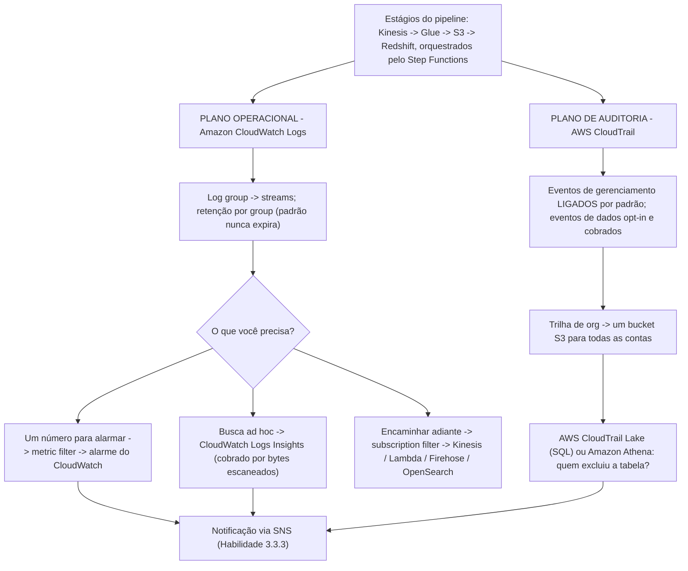
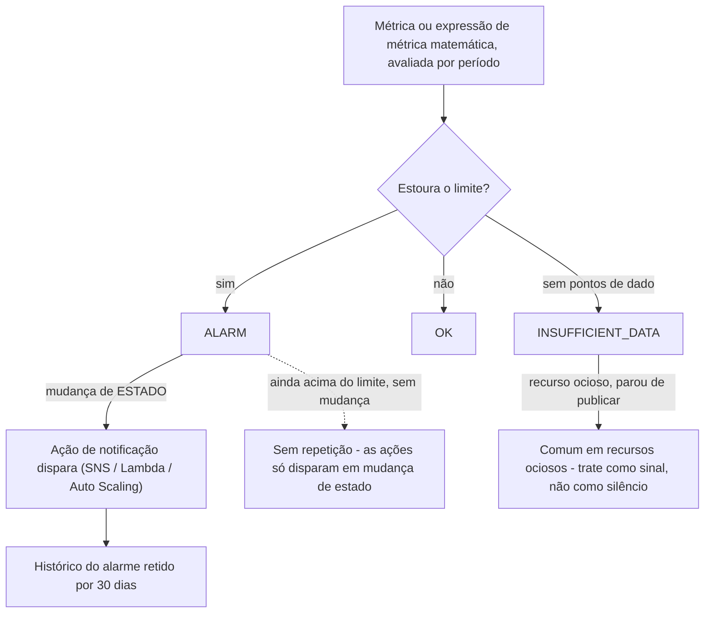
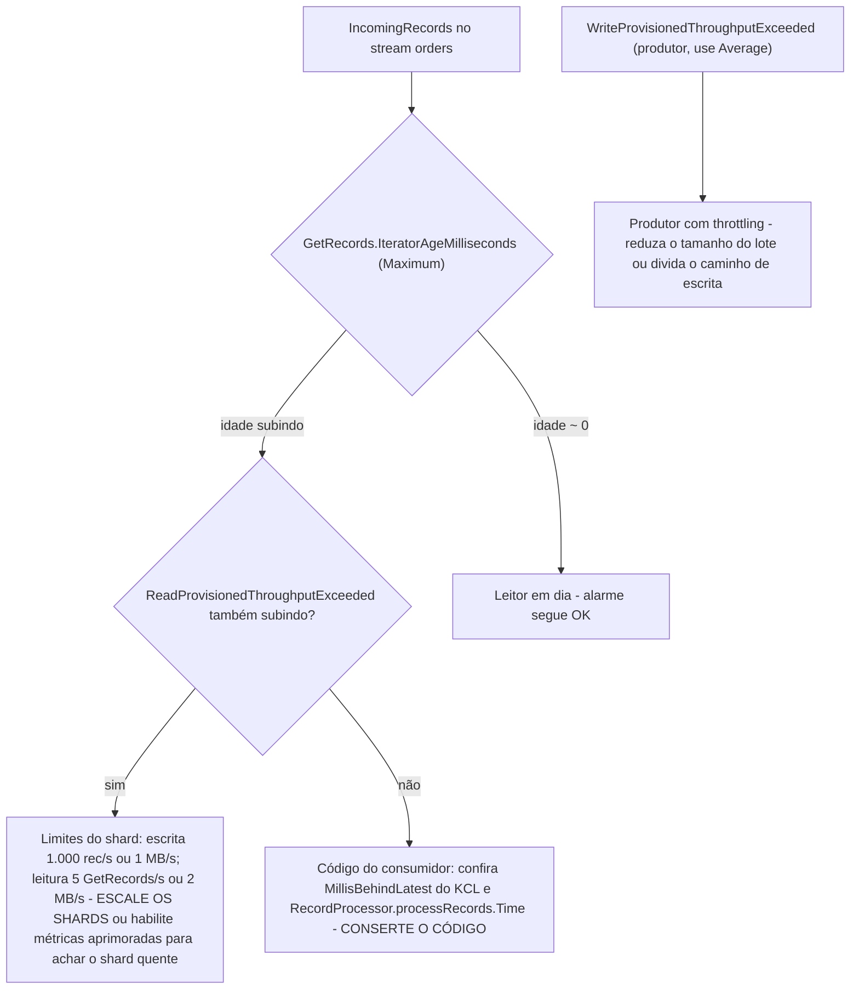
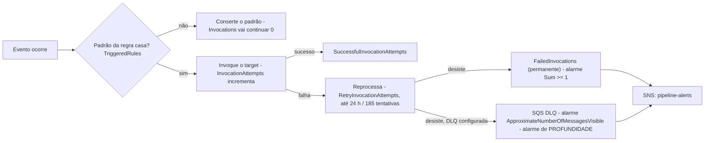
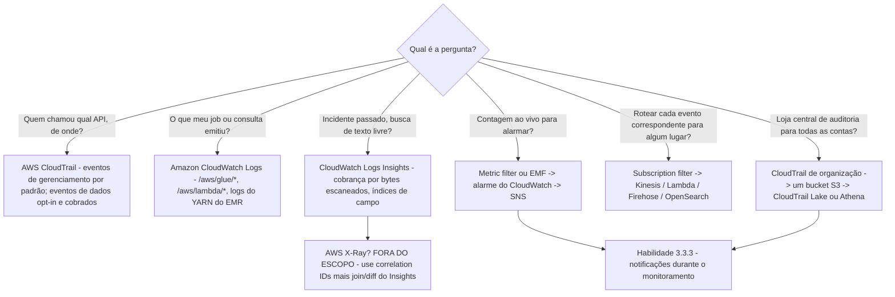

# Monitoramento e Observabilidade para Pipelines de Dados

Duas tarefas do exame se encontram nesta lição. **Tarefa 3.3, manter e monitorar pipelines de dados**, pede que você extraia logs para auditorias, implemente soluções de logging e monitoramento que permitam auditoria e rastreabilidade, envie notificações de alerta, depure problemas de desempenho, rastreie chamadas de API com o AWS CloudTrail, mantenha pipelines do Glue e do EMR, registre dados de aplicação com o Amazon CloudWatch Logs e analise logs com Athena, EMR, OpenSearch e CloudWatch Logs Insights. **Tarefa 4.4, preparar logs para auditoria**, pede o mesmo material pelo lado da conformidade: CloudWatch, armazenamento de CloudWatch Logs, CloudTrail Lake, análise de logs e integração de serviços como o EMR para grandes volumes de log. O exame trata as duas como uma disciplina com duas perguntas: **o que aconteceu** (evidência de auditoria) e **o que está acontecendo agora** (sinal operacional).

```text
====================================================================
 DEA-C01 - DOMÍNIO 3 TAREFA 3.3 + DOMÍNIO 4 TAREFA 4.4 (13 habilidades)
--------------------------------------------------------------------
 3.3.1 Extrair logs para auditorias
 3.3.2 Implantar logging e monitoramento para auditoria e rastreabilidade
 3.3.3 Usar notificações durante o monitoramento para enviar alertas
 3.3.4 Depurar problemas de desempenho
 3.3.5 Usar o AWS CloudTrail para rastrear chamadas de API
 3.3.6 Depurar e manter pipelines (AWS Glue, Amazon EMR)
 3.3.7 Usar o Amazon CloudWatch Logs (configuração e automação)
 3.3.8 Analisar logs (Athena, EMR, OpenSearch, Logs Insights)
 4.4.1 Usar o AWS CloudTrail para rastrear chamadas de API
 4.4.2 Usar o Amazon CloudWatch Logs para armazenar logs de aplicação
 4.4.3 Usar o AWS CloudTrail Lake para consultas centralizadas de log
 4.4.4 Analisar logs (Athena, Logs Insights, OpenSearch)
 4.4.5 Integrar serviços da AWS para logging (EMR para grandes volumes)
--------------------------------------------------------------------
 PLANO DE AUDITORIA . CloudTrail (gerenciamento vs dados) -> S3 /
                    CloudTrail Lake / Athena
 PLANO OPERACIONAL . CloudWatch Logs -> metric filters /
                    subscription filters / Logs Insights -> alarms -> SNS
 FORA DO ESCOPO ..... AWS X-Ray (literalmente na lista fora do escopo)
====================================================================
```

> [!NOTE]
> **A lição inteira cabe em uma frase:** o CloudTrail responde *“quem fez o quê, quando, de onde”* para **chamadas de API**, o CloudWatch Logs responde *“o que meu aplicação emitiu”* para **operações**, e o **métricas + alarmes** do CloudWatch transformam os dois em notificações (Habilidade 3.3.3). Uma questão nunca se resolve no plano errado — “quem excluiu a tabela?” nunca é Logs Insights, e “taxa de erro do job?” nunca é CloudTrail.

Nesta lição você vai:

- separar o **plano de auditoria** do **plano operacional** e posicionar corretamente **eventos de gerenciamento, eventos de dados e eventos de Insights**;
- escolher entre **métricas de serviço, métricas customizadas e Embedded Metric Format**, com as armadilhas de cardinalidade e de permissão;
- desenhar alarmes: **estados, ações de mudança de estado, dados ausentes, alarmes compostos e de log**, dashboards e métricas matemáticas;
- usar os três mecanismos do CloudWatch Logs — **metric filter, subscription filter, Logs Insights** — sem misturá-los;
- escrever consultas de **Logs Insights** (linguagem de consulta, índices de campo, cobrança por bytes escaneados);
- monitorar cada estágio do pipeline nativamente: **Glue, Kinesis, Redshift, EMR, Lambda, DMS, Step Functions, S3, EventBridge**;
- aplicar **melhores práticas de logging**: JSON estruturado, correlation IDs, políticas de proteção de dados para PII, retenção e roteamento entre contas;
- trabalhar **nove exemplos resolvidos** — seis configurações de alarme e três consultas de Logs Insights;
- ler a **caixa de atualização de outubro de 2026**, **quatro estudos de caso de clientes da AWS** e terminar com **catorze questões no estilo do exame** mais três verificações interativas.

---

## 1. Dois planos de evidência: auditoria versus operações

### 1.1 A divisão que o exame cobra

| | **Plano de auditoria — AWS CloudTrail** | **Plano operacional — Amazon CloudWatch Logs** |
|---|---|---|
| Pergunta que responde | Quem fez o quê, quando, de onde? | O que meu aplicação está emitindo? |
| Conteúdo padrão | **Eventos de gerenciamento são registrados por padrão** | O que seu código e seus serviços enviarem |
| Eventos de dados | **Não registrados por padrão**; opt-in via seletores de evento básico/avançado, e cobrados | n/a |
| Retenção | Arquivos no S3 que você controla; **histórico de eventos = 90 dias, eventos de gerenciamento, só a conta conectada** | Configuração de retenção do log group (padrão: nunca expira) |
| Análise | **AWS CloudTrail Lake**, Athena sobre o JSON no S3 | **CloudWatch Logs Insights**, metric filters, subscription filters |
| Cabeçalho típico de questão | “Quem excluiu a tabela do Glue?” / “rastrear chamadas de API” | “taxa de erro do job a partir dos logs” / “armazenar logs de aplicação” |

### 1.2 CloudTrail: gerenciamento, dados, Insights

- **Eventos de gerenciamento** (padrão): leituras `Describe*`, `Get*` e chamadas de escrita como `RunInstances`, além de eventos fora de API como `ConsoleLogin`.
- **Eventos de dados** (opt-in, cobrados): operações de alto volume no nível do recurso — `AWS::S3::Object`, `AWS::Lambda::Function` (`Invoke`), `AWS::DynamoDB::Table`, `AWS::Kinesis::Stream`, `AWS::SQS::Queue`, `AWS::StepFunctions::StateMachine`, `AWS::Glue::Table`. Uma questão sobre **`s3:GetObject`** é insolvível a menos que **os eventos de dados estejam habilitados** — eles estão desligados por padrão.
- **Eventos de Insights**: **detecção de anomalia** em eventos de gerenciamento, cobrados e desligados por padrão.
- **Integridade**: hash **SHA-256** mais assinatura digital **SHA-256 com RSA** produz um **arquivo de resumo** a cada hora, e a validação **não é retroativa**.
- **Trilhas de organização** (conta de gestão ou admin delegado): um bucket para cada conta, contas membros podem ver mas não modificar ou excluir, propagação **≤24 horas**, arquivos de log entregues aproximadamente a cada **5 minutos**.
- As ações do plano de controle do Glue são todas registradas com `eventSource: glue.amazonaws.com`; muitas respostas `Get*`/`BatchGet*` são registradas como **`null`**.



### 1.3 Exemplo trabalhado E1 — “quem excluiu as partições?” em quatro movimentos

```text
P:  Uma tabela do Athena perdeu partições às 02:14 UTC. Prove quem fez.

1. Confirme o plano ......... eventos de GERENCIAMENTO do CloudTrail
                               (histórico de chamadas de API)
                               - NÃO CloudWatch Logs, NÃO Logs Insights
2. Filtre ................... eventSource  = glue.amazonaws.com
                               eventName    = BatchDeletePartition
                                            (ou DeleteTable / DeleteDatabase)
3. Guarde/consulte ........... trilha de organização -> bucket S3 central
                               -> AWS CloudTrail Lake (habilidade 4.4.3)
                               -> ou Athena sobre o JSON do CloudTrail (4.4.4)
4. Evidência faltando? ...... a ação foi uma chamada de OBJETO do S3, então
                               habilite os EVENTOS DE DADOS (opt-in, cobrados)
                               e rode de novo - eventos de gerenciamento nunca
                               contêm s3:GetObject
```

- **📚 Você sabia?** O **histórico de eventos** do CloudTrail te dá **90 dias** de **eventos de gerenciamento** para a **conta conectada apenas** — sem configuração, sem trilha. É a resposta rápida para “quem fez isso nos últimos 90 dias?”, mas ele não consegue responder uma questão entre contas ou sobre eventos de dados; isso exige uma trilha de organização ou o CloudTrail Lake (documentação do AWS CloudTrail, acesso em outubro de 2026).

---

## 2. Métricas do CloudWatch: de serviço, customizadas e embutidas

### 2.1 Três jeitos de um número chegar ao CloudWatch

| Tipo | Quem publica | Resolução | Cobrança | Atenção |
|---|---|---|---|---|
| **Métricas de serviço** | AWS, automaticamente | Padrão de **1 minuto** | Grátis com o serviço | Algumas são de 5 minutos por padrão (EMR) ou diárias (armazenamento do S3) |
| **Customizadas (`PutMetricData`)** | Você empurra; CloudWatch **nunca puxa** | **1 minuto** ou **1 segundo** em alta resolução | Cobrança de **métricas customizadas** | ≤**30 dimensões** por métrica |
| **Embedded Metric Format (EMF)** | Você escreve um evento de log JSON contendo um bloco `_aws` | Assíncrono, a partir do evento de log | Cobrança de **métricas customizadas** | Precisa só de `logs:PutLogEvents` — **sem `cloudwatch:PutMetricData`**; a cardinalidade explode |

As estatísticas são retidas por **15 meses**. Depois que você publica uma métrica customizada nova, ela fica visível para `GetMetricStatistics` em até **2 minutos** e para `ListMetrics` em até **15 minutos** — uma armadilha de exame quando você “acabou de criá-la e não vê nada”.

### 2.2 Exemplo trabalhado E2 — a fatura da cardinalidade

Uma linha de log EMF dimensiona uma métrica por **job (50 nomes) × status (4 valores) × região (6 valores)**:

```text
métricas customizadas criadas = 50 x 4 x 6 = 1.200 conjuntos distintos
em granularidade de 1 minuto, retidas 15 meses, cobradas como customizadas

Desenho mais seguro: dimensionar só por job + status   = 50 x 4 = 200
                     colocar a região no PAYLOAD do log,
                     filtrar com o Logs Insights
```

O EMF é atraente exatamente porque não precisa de permissão extra de IAM, mas **existe uma métrica customizada por valor de dimensão único** — campos de alta cardinalidade (request IDs, user IDs, strings de SQL) precisam ficar na **mensagem de log**, não nas dimensões.

- **📚 Você sabia?** Como as métricas do EMF vêm de eventos de log, elas são entregues **at-least-once**: um `PutLogEvents` reprocessado pode produzir um ponto de dado de métrica duplicado. Desenhe alarmes sobre estatísticas que toleram isso (por exemplo `Sum` em um período em vez de um `SampleCount` exato) e nunca trate uma contagem derivada de EMF como um razão de dupla entrada (documentação do EMF da AWS, acesso em outubro de 2026).

---

## 3. Alarmes do CloudWatch: estados, ações e como combiná-los

### 3.1 A máquina de estados



Regras-chave (todas verificadas na AWS, acesso em outubro de 2026):

- Um alarme invoca ações **somente quando o alarme muda de estado** — a exceção são alarmes com **ações de Auto Scaling**. Um pipeline que continua quebrado **não** te página de novo a cada minuto.
- Os estados são **`OK` / `ALARM` / `INSUFFICIENT_DATA`**; recursos ociosos frequentemente param de publicar e ficam em `INSUFFICIENT_DATA`.
- Tipos de alarme: **alarmes de métrica** (incluindo **expressões de métrica matemática** sobre as quais você pode alarmar), **alarmes compostos** (Boolean `AND`/`OR`/`NOT` sobre outros alarmes), **alarmes de log** (uma consulta **Logs Insights** agendada com condição M-de-N — **nenhum metric filter obrigatório**) e alarmes **PromQL**. **Não existe cota no número de alarmes**.
- **Alarmes compostos**: só na mesma conta e Região, começam em `INSUFFICIENT_DATA` (a única vez que um alarme novo começa assim), **não podem executar ações de EC2 ou de Auto Scaling**, filhos não carregam ações então o composto página **uma vez**, e os limites são **100 filhos / 500 elementos / 150 compostos por filho**.
- **Janelas de avaliação**: até **7 dias** quando o período é ≥1 hora, ou **1 dia** para períodos menores.

### 3.2 O comportamento com dados ausentes é uma decisão de desenho

`TreatMissingData` tem três configurações e a certa depende da métrica: **`breaching`** (ausente = ruim; correto para idade do iterador, onde silêncio significa que não há leitor), **`notBreaching`** (ausente = ok; correto para profundidade da DLQ, onde ausência de pontos de dado significa fila vazia) e **`ignore`** (manter o estado atual). Escolher o padrão (`missing`) é como equipes ganham alarmes `INSUFFICIENT_DATA` em que ninguém confia.

### 3.3 Detecção de anomalia em vez de limite estático

A **detecção de anomalia** do CloudWatch treina uma banda de ML por métrica **e por estatística**, então você alarma quando o valor sai da banda em vez de cruzar um número ajustado à mão. Ela substitui limites fixos onde a carga é sazonal (janelas de ETL diárias) e os complementa onde existe um limite de conformidade (uma latência CDC de 300 segundos).

---

## 4. Dashboards e métricas matemáticas

- Dashboards são **ilimitados por conta** e **todos os dashboards são globais, não específicos de Região** — um dashboard de monitoramento puxa métricas qualificadas por Região por widget.
- Cotas: **≤500 widgets por dashboard** e **≤500 métricas** no array `metrics` de um widget (em outubro de 2026).
- **Widgets entre contas**: a partir de uma conta de monitoramento, cada widget nomeia sua `accountId` e sua `region`.
- Uma métrica que ficou **silenciosa por 14 dias** some do seletor de métricas do dashboard — um pipeline quieto parece um pipeline excluído.
- **Métrica matemática** permite que um widget mostre `100 * (Errors / Invocations)` como uma taxa de erro, e os alarmes podem observar a expressão, não só a métrica bruta.

> [!IMPORTANT]
> **Não construa um widget de dashboard de alta frequência sobre o Logs Insights.** As consultas do Insights são ferramentas interativas: são cobradas por **bytes não comprimidos escaneados**, limitadas a **100 consultas de linguagem de consulta simultâneas por conta**, expiram após **60 minutos** e guardam resultados por **7 dias**. Coloque *contagens* no dashboard (metric filters ou EMF) e deixe o Insights para investigações.

---

## 5. CloudWatch Logs: grupos, retenção, metric filters, subscription filters

### 5.1 O modelo de contêiner e suas cotas

Um **log group** guarda **log streams** que compartilham retenção e controle de acesso; **não há limite no número de streams** por grupo. Em outubro de 2026: **1.000.000 de log groups por Região**, **100 metric filters por grupo**, **5 subscription filters por grupo**, evento de log de **1.024 KB**, lotes de `PutLogEvents` de **1 MB / 5.000 por segundo**, `StartQuery` **10/s** e **limites de regex de ≤5 padrões de regex por grupo e ≤2 regexes por padrão**.

> [!WARNING]
> **⚠️ A retenção tem padrão “nunca expira”.** Por padrão, os dados de log ficam armazenados no CloudWatch Logs **indefinidamente**, e quando você exclui, a exclusão pode levar **até 72 horas** para concluir. Defina uma retenção em dias por grupo no dia um — um grupo `/aws/glue/orders_etl` sem limite é um problema de custo e um problema de conformidade (Habilidades 3.3.7, 4.4.2).

### 5.2 Um padrão, três trabalhos

| | **Metric filter** | **Subscription filter** | **Logs Insights** |
|---|---|---|---|
| Propósito | Transformar eventos correspondentes em uma **métrica do CloudWatch sobre a qual alarmar** | **Encaminhar** eventos correspondentes (Kinesis, Lambda, Firehose, OpenSearch) | **Busca ad hoc** sobre eventos passados |
| Retroativo? | **Não** — ele só conta eventos que chegam **depois** que o filtro foi criado | Não | Não |
| O que você ganha | Um valor numérico por minuto | O evento inteiro | Linhas, cobradas por **bytes não comprimidos escaneados** |
| Cota | 100 por log group | 5 por log group | 100 consultas de linguagem de consulta simultâneas por conta |

### 5.3 Exemplo trabalhado E3 — metric filter mais alarme sobre logs de job em JSON

```text
Log group ....... /aws/glue/orders_etl
Padrão do filtro . { $.level = "ERROR" }              (casamento JSON)
Nome da métrica .. GlueJobErrors
Namespace ....... Custom/OrdersEtl    Dimensões: JobName=orders_etl
Transform ....... 1                   Unidade        Count
Período ......... 60 segundos         Estatística   Sum

Alarme ...... GlueJobErrors > 0
              EvaluationPeriods 1, Period 60, TreatMissingData notBreaching
              Ação -> tópico SNS pipeline-alerts
```

Como os filtros **não são retroativos**, este alarme só vê erros do momento em que o filtro existe — questões retrospectivas (“deu erro na terça passada?”) são questões de **Logs Insights**.

### 5.4 Exemplo trabalhado E4 — saúde da entrega do subscription filter

```text
Subscription filter ... to-archive -> Amazon Data Firehose -> S3 central
Alarme (entrega) ...... AWS/Logs . DeliveryThrottling . Sum > 0
                        Period 60, EvaluationPeriods 1, TreatMissingData notBreaching
Significado ........... o destino está subdimensionado; eventos estão sendo
                        com throttling, reprocessados por até 24 HORAS,
                        depois DESCARTADOS
Alarme companheiro .... AWS/Logs . DeliveryErrors . Sum > 0
```

Entregáveis com throttling são reprocessados por **até 24 horas**, depois as entregas com falha são **descartadas** — então um alarme `DeliveryThrottling` é um alarme de perda de dados fantasiado de desempenho.

```matching
{
  "question": "Associe cada mecanismo do CloudWatch Logs ao seu trabalho em um pipeline de dados:",
  "pairs": [
    {"left": "Metric filter", "right": "Transforma eventos de log correspondentes em uma MÉTRICA do CloudWatch para que um alarme dispare - valor numérico por minuto, NÃO retroativo, 100 por log group"},
    {"left": "Subscription filter", "right": "ENCAMINHA eventos correspondentes para Kinesis, Lambda, Firehose ou OpenSearch - 5 por log group, entrega com throttling reprocessada por até 24 horas e depois descartada"},
    {"left": "Logs Insights", "right": "BUSCA ad hoc entre log groups - linguagem de consulta, OpenSearch PPL ou SQL, cobrado por BYTES ESCANEADOS não comprimidos, resultados guardados por 7 dias"},
    {"left": "Alarme de log (agendado)", "right": "Roda uma consulta agendada do Logs Insights com condição M-de-N - NÃO precisa de metric filter nenhum"},
    {"left": "Embedded Metric Format", "right": "Publica métricas CUSTOMIZADAS direto de um evento de log JSON - só logs:PutLogEvents é necessário, uma métrica por valor de dimensão único"}
  ],
  "explanation": "A confusão favorita do exame é tratar esses três como intercambiáveis. Alarmar uma contagem -> metric filter. Mover cada evento para um bucket central ou domínio OpenSearch -> subscription filter. Responder 'o que aconteceu na terça passada?' -> Logs Insights. Alarmar um padrão que você não consegue expressar como métrica -> alarme de log. Emitir métricas do código de aplicação sem uma segunda permissão de IAM -> EMF, no custo de métricas customizadas."
}
```

## 6. CloudWatch Logs Insights: consultando as evidências

### 6.1 Três linguagens, um modelo de cobrança

O Insights oferece a **linguagem de consulta** (`fields`, `filter`, `parse`, `stats`, `sort`, `limit`, `join`, `lookup`, `filterIndex`, `estimate`), o **OpenSearch PPL** e o **OpenSearch SQL** — SQL é a única que consegue fazer `JOIN` **entre log groups**. Você é cobrado pelos **dados de log não comprimidos escaneados**, as consultas expiram após **60 minutos**, os resultados vivem por **7 dias**, e os **índices de campo** (mais o comando `filterIndex`) cortam dramaticamente o volume escaneado. Os logs de serviços da AWS são descobertos automaticamente como campos com prefixo `@`; seus próprios campos de JSON estruturado aparecem pelo nome.

Barreiras de proteção: estreite o intervalo de tempo primeiro, **cancele as consultas antes de fechar o console** e prefira metric filters ou EMF a um widget de dashboard que reexecuta o Insights.

### 6.2 Exemplo trabalhado E5 — triagem de um job noturno com falha (janela de 30 segundos)

```text
fields @timestamp, @logStream, @message
| filter @message like /Exception|Traceback|FAILED/
| filter @message like /orders_etl/
| sort @timestamp desc
| limit 50
```

### 6.3 Exemplo trabalhado E6 — taxa de erro por job a partir de JSON estruturado

```text
fields @timestamp, level, jobName, durationMs
| filter level = "ERROR"
| stats count() as errors, avg(durationMs) as avgMs by jobName
| sort errors desc
| limit 10
```

As duas consultas são **investigações**. Para *alertar* sobre o mesmo sinal você acrescentaria um metric filter (Exemplo E3) ou publicaria via EMF — e, como metric filters não são retroativos, você também manteria a consulta do Insights para a metade retrospectiva da questão.

- **📚 Você sabia?** O Logs Insights descobre automaticamente os campos `@` dos logs de serviços da AWS (por exemplo `@message`, `@timestamp`, `@logStream`), mas são os **índices de campo** que você define que tornam o `filter` barato: sem índice, toda linha candidata é escaneada, então a fatura acompanha **bytes escaneados**, não linhas retornadas. Indexe os campos pelos quais você filtra e deixe varreduras amplas de `@message LIKE` apenas para intervalos curtos de tempo (documentação do CloudWatch Logs Insights da AWS, acesso em outubro de 2026).

---

## 7. Streaming: Amazon Kinesis Data Streams

### 7.1 A métrica que define a saúde do stream

Namespace **`AWS/Kinesis`**. **As métricas de nível de stream são gratuitas e publicadas a cada minuto**; **as métricas aprimoradas (de nível de shard) são uma feature opt-in com custo adicional** (`EnableEnhancedMonitoring`).

| Métrica | O que ela mede de verdade | Armadilha |
|---|---|---|
| **`GetRecords.IteratorAgeMilliseconds`** (dimensão `StreamName`) | **Atraso do stream**: quanto a posição do leitor mais lento está atrás da ponta do stream. **Um valor zero indica que os registros sendo lidos estão totalmente em dia com o stream.** | Esta é a métrica de atraso de stream que as questões do exame querem |
| `IteratorAgeMilliseconds` (nível de shard) | O mesmo atraso por shard — onde vive o shard com problema | Só paga/aprimorada |
| **`GetRecords.Latency`** | Quanto tempo leva uma **chamada de API** | **Duração da chamada, não atraso** — a distractor clássica |
| **`WriteProvisionedThroughputExceeded`** | Escritas de **produtores** com throttling pelos limites de escrita do shard | Use **Average**; um `Maximum` de **0** simplesmente significa que nada foi limitado |
| `ReadProvisionedThroughputExceeded` | Leituras de **consumidores** com throttling pelos limites de leitura do shard | Subindo com a idade do iterador ⇒ escale os shards |

### 7.2 Exemplo trabalhado E7 — o alarme de idade do iterador

```text
AWS/Kinesis . GetRecords.IteratorAgeMilliseconds . [StreamName=orders]
Estatística .. Maximum           (UM shard atrasado é o incidente)
Período ...... 300 segundos      EvaluationPeriods 1
Comparação ... GreaterThanThreshold
Limiar ....... 43.200.000 ms  =  50% de um período de retenção de 24 horas
               24 h x 3.600 s x 1.000 ms = 86.400.000 ms; metade = 43.200.000 ms
TreatMissingData  breaching  (sem leitor -> sem pontos de dado -> ISSO É o incidente)
Ação ......... tópico SNS pipeline-alerts

Nível de aviso (opcional, ~10% da retenção): 8.640.000 ms
```

A orientação da própria AWS: *se a idade de um iterador passa de **50% do período de retenção**, você corre o risco de os registros expirarem antes de serem lidos, e **você deve usar alarmes do CloudWatch na estatística Maximum***. A aritmética de limiar sobre uma retenção padrão de **24 horas** é exatamente o tipo de cálculo que o DEA-C01 espera que você realize, não que memorize.



---

## 8. AWS Glue: DPU, bookmarks, observabilidade e job insights

### 8.1 Como as métricas do Glue se comportam

**O AWS Glue reporta métricas ao CloudWatch a cada 30 segundos**, como **valores delta** em relação aos reportados anteriormente — então um gráfico de dashboard em granularidade de 1 minuto é uma **agregação**, e a estatística certa por minuto é **`Sum`**, não `Average`. O namespace de métrica da CLI/API é **`Glue`**.

| Preocupação | Métrica(s) | Leitura |
|---|---|---|
| Backlog de DPU / executores | `glue.driver.ExecutorAllocationManager.executors.numberAllExecutors` vs `…numberMaxNeededExecutors` | Necessários ≫ alocados ⇒ mais DPUs necessárias |
| Trabalho feito | `glue.driver.aggregate.bytesRead`, `glue.driver.aggregate.recordsRead` | Um **0** quando se esperavam 50M de linhas ⇒ o **bookmark pulou** os dados |
| Falhas dentro da execução | `glue.driver.aggregate.numFailedTasks` | Falhas no nível da task dentro de um driver “bem-sucedido” |
| Estouro de memória | `glue.ALL.jvm.heap.usage` | Alarme quando **Average > 0,9** |
| Bookmarks | `bytesRead` / `recordsRead` sob **Job Bookmark Issues**; a falha aparece como categoria de observabilidade **`GLUE_JOB_BOOKMARK_VERSION_MISMATCH_ERROR`** | Watermark errado = duplicatas ou lacunas |
| Skew | `glue.driver.skewness.job` | Fator de skewness padrão **5** |
| Totais de sucesso/falha | `glue.error.ALL`, `glue.succeed.ALL`, `glue.error.[categoria]` (**28 categorias**) | Exige a feature **Glue observability**, **Glue 4.0 ou superior**, dimensão `ObservabilityGroup` |

### 8.2 Alerta de falha geralmente é EventBridge, não CloudWatch

**Não existe métrica padrão de “job com falha”**. O alerta canônico (habilidade 3.3.3) é uma regra do EventBridge sobre o evento **`Glue Job State Change`**.

### 8.3 Exemplo trabalhado E8 — alerta quando o job noturno falha

```text
Regra do EventBridge
  source .............. ["aws.glue"]
  detail-type ........ ["Glue Job State Change"]
  detail.state ........ ["FAILED", "TIMEOUT"]
  detail.jobName ...... ["orders_etl"]
  target .............. tópico Amazon SNS pipeline-alerts

Valores de estado que você deve rotear: SUCCEEDED, FAILED, TIMEOUT, STOPPED
  (uma execução STOPPED é um humano ou um agendador, não uma queda -
   filtre separadamente)

Alternativa com métrica (exige Glue observability, 4.0+):
  Glue . glue.error.ALL . JobName=orders_etl . Sum >= 1 . Period 300

Checagem de backlog (métrica matemática):
  bytesWritten(job_i) / bytesRead(job_{i+1}) != 1  =>  linhas acumulando entre execuções
```

Os bookmarks são o modo de falha silencioso: um job pode **ter sucesso** lendo **nada** porque o watermark do bookmark diz que ele já leu. Alarme sobre `glue.driver.aggregate.recordsRead` caindo para 0 contra um volume esperado e pareie com a regra de mudança de estado para que silêncio e sucesso sejam distinguíveis.

---

## 9. Amazon Redshift: três planos de evidência

| Plano | Onde | Conteúdo |
|---|---|---|
| **1. Métricas do cluster** | CloudWatch `AWS/Redshift`, ~1 minuto, grátis | `CPUUtilization`, `DatabaseConnections`, **`HealthStatus`** (1/0 no CloudWatch), `PercentageDiskSpaceUsed` |
| **2. Métricas de consulta / WLM** | CloudWatch (5 minutos onde anotado) | `QueryDuration` (**microssegundos**), **`QueryRuntimeBreakdown`** com dimensão `stage` — incluindo **`QueryWaiting`**, que é o tempo de fila do WLM; **`WLMQueueLength`** (dimensões `service class` ou `QueueName`), `WLMQueueWaitTime` |
| **3. Detalhe de desempenho de consulta e carga** | **Somente console do Amazon Redshift / tabelas de sistema** | `STL_*`, `STV_*`, `SYS_*` — **“Query and load performance data are not published as CloudWatch metrics and can only be viewed in the Amazon Redshift console.”** |

**Spectrum e limites de uso**: `UsageLimitConsumed` carrega a dimensão `FeatureType`, incluindo **`SPECTRUM`** — os bytes escaneados por consultas externas contra o S3, que é como você alarma uma consulta Spectrum desgovernada antes que a fatura chegue.

**Exemplo trabalhado (congestionamento de WLM):** alarme `WLMQueueLength` com dimensão `QueueName=etl` **> 5 por 3 períodos**, depois confirme com `QueryRuntimeBreakdown` em `stage=QueryWaiting` — se `QueryWaiting` estiver alto, as consultas estão na fila (acrescente filas ou concorrência do WLM); se estiver baixo mas `QueryDuration` estiver alto, o SQL em si está lento. A conclusão errada a partir do plano errado é a armadilha.

---

## 10. Amazon EMR: YARN e o padrão de 5 minutos

- As métricas padrão chegam **a cada 5 minutos** e são **grátis**; no **EMR 7.0 e superior** o **agente do CloudWatch** acrescenta **34 métricas extras em granularidade de 1 minuto** (cobradas), e o **7.1** acrescenta classificações do YARN e do HBase.
- **`IsIdle`** é amostrado **a cada 5 minutos** — a orientação de alarme da própria AWS é alarmar “quando `IsIdle` for 1 por **mais de uma checagem consecutiva de 5 minutos**”.
- Capacidade e scaling: **`AppsRunning`**, **`AppsPending`**, **`ContainerPendingRatio`** (o sinal de scaling), **`HDFSUtilization`** e **`YARNMemoryAvailablePercentage`** — a métrica-chave do **managed scaling**.
- O managed scaling também emite `YarnContainersUsedMemoryGBSeconds`, que a AWS descreve como **crítica para o managed scaling**.
- Logs: o agente envia `/mnt/var/log/hadoop-yarn/...` para log groups do CloudWatch, e é isso que torna as Habilidades 3.3.6/4.4.5 (analisar logs do EMR, usar o EMR para grandes volumes de log) respondíveis com Logs Insights ou um subscription filter para o S3.

**Leitura de exame:** uma questão do EMR que exige métricas de 1 minuto está na verdade perguntando *qual componente as publica* — a resposta é o **agente do CloudWatch no EMR 7.0+**, não uma configuração de console.

---

## 11. AWS Lambda: throttles, duração e erros

As métricas chegam em granularidade de **1 minuto**.

| Métrica | Significado | Armadilha |
|---|---|---|
| `Invocations` | Requisições que rodaram — **esta é a contagem cobrada** | Requisições com throttling contam aqui? **Não** |
| `Errors` | Invocações com falha | Requisições com throttling contam aqui? **Não** |
| **`Throttles`** | Requisições rejeitadas por limites de concorrência | **Uma requisição com throttling não conta nem em `Invocations` nem em `Errors`** — alarme sobre ela separadamente |
| `Duration` | Tempo de execução | **Exclui o cold start** — um problema de cold start fica invisível aqui |
| `IteratorAge` | Para **mapeamentos de origem de eventos do DynamoDB/Kinesis/DocumentDB**: **a idade do último registro** | O próprio atraso de stream do Lambda, distinto do `GetRecords.IteratorAgeMilliseconds` do Kinesis |
| `ConcurrentExecutions` | Visualize **`Max`** | A média esconde o pico |
| `ProvisionedConcurrencyUtilization` | Uso da capacidade pré-aquecida | **Não emitida quando ocioso** — espere lacunas |

As métricas de mapeamento de origem de eventos são **opt-in**: `PolledEventCount`, `InvokedEventCount`, `FailedInvokeEventCount`, `DroppedEventCount`, `MaxOffsetLag`. A entrega do ESM é **at-least-once**, então as contagens podem dobrar — nunca leia como uma contagem de eventos de negócio exatamente-uma-vez.

**Desenho do alarme:** `Errors / (Invocations + Throttles)` como métrica matemática é enganoso porque os throttles são excluídos dos dois; alarme `Throttles > 0` e `Errors > 0` **separadamente**, depois investigue limites de concorrência versus código.

## 12. AWS DMS: a latência CDC são dois números, não um

As métricas vivem em **`AWS/DMS`**, são expressas em **segundos** e são dimensionadas por instância e tarefa.

- **`CDCLatencySource`** — o último evento **capturado na origem** versus o relógio da replication instance: o lado de **leitura da origem**.
- **`CDCLatencyTarget`** — o evento mais antigo **sem confirmação esperando para confirmar no destino** versus o relógio: o lado de **aplicação no destino**.
- **`CDCLatencyTarget` é sempre maior ou igual a `CDCLatencySource`.**

### Exemplo trabalhado E9 — leia as duas latências antes de tocar em qualquer coisa

```text
Commit na origem 10:00:00, consumido às 10:02:00
  CDCLatencySource = 120 segundos
Gravado no destino às 10:05:00
  CDCLatencyTarget = 300 segundos   (sempre >= 120)

Alarme ..... AWS/DMS . CDCLatencyTarget . Average > 300
             Period 60, EvaluationPeriods 3, TreatMissingData breaching

Triagem .... AMBOS altos ........... confira a ORIGEM primeiro
             Origem baixa, destino alto ... problema no DESTINO
                                        (chave primária ou índice
                                         faltando, ou throttling)
             Ambos altos e quase IGUAIS . problema na ORIGEM
Companheiros .. CDCIncomingChanges, CDCThroughputRowsSource, CDCThroughputRowsTarget
```

Essa ordem — **a origem primeiro quando os dois estão altos** — é o fato de monitoramento do DMS mais testável de todos, e ele decorre da desigualdade: a latência do destino inclui tudo o que a latência da origem inclui.

---

## 13. AWS Step Functions: histórico de execução e backlog

Namespace **`AWS/States`**, dimensão **`StateMachineArn`**; sem dimensão, as métricas são **no nível da conta**.

- Métricas de execução: `ExecutionsStarted`, `ExecutionsSucceeded`, `ExecutionsFailed`, `ExecutionsTimedOut`, `ExecutionThrottled`, `ExecutionTime` (**milissegundos**). Use **`Sum`** para contar execuções e **`Average`** para caracterizar durações.
- **Armadilha:** o Step Functions emite **duas métricas `ExecutionsStarted` para cada execução de state machine**, então `SampleCount` é **2** — nunca leia `SampleCount` como contagem de execuções.
- As métricas são emitidas **melhor esforço**; um **nome de state machine não-ASCII impede o logging do CloudWatch**.
- Métricas de atividade (dimensão `ActivityArn`): `ActivitiesSucceeded`, `ActivitiesFailed`, `ActivitiesTimedOut`, **`ActivitiesHeartbeatTimedOut`**.
- **Backlog**: `OpenExecutionCount` contra o limite (padrão **1.000.000**) — a AWS recomenda um alarme **Maximum** em **100.000+**; para Distributed Map, `ApproximateOpenMapRunCount` contra um limite de **1.000**, alarmado em **900+**.
- O **histórico de execução** no console (e a API `GetExecutionHistory`) é a evidência por execução — o CloudWatch te dá o agregado, o histórico de execução dá a história estado a estado.

---

## 14. Amazon S3: métricas de requisição versus métricas de armazenamento

| | **Métricas diárias de armazenamento** | **Métricas de requisição** |
|---|---|---|
| Exemplos | `BucketSizeBytes`, `NumberOfObjects` | `AllRequests`, `GetRequests`, `4xxErrors`, `5xxErrors`, `FirstByteLatency`, **`TotalRequestLatency`** |
| Frequência | **Uma vez por dia** | **1 minuto** |
| Custo | **Grátis**, ligadas por padrão | Cobradas **como métricas customizadas** |
| Escopo | **Só totais do bucket** | **Exigem uma configuração de métricas** — no nível do bucket ou filtrada por **prefixo, tag ou ponto de acesso** (dimensão `FilterId`) |
| Filtragem | **Métricas de armazenamento não suportam filtragem** | **Métricas de requisição suportam filtragem** |

Além disso: a entrega de métricas do S3 pelo CloudWatch é **melhor esforço**, então trate um ponto de dado ausente como ambiguidade, não como tráfego zero.

**Exemplo trabalhado (taxa de erro por prefixo):** para alarmar 4xx em `s3://curated/`, primeiro crie uma **configuração de métricas filtrada por aquele prefixo**, depois alarme `4xxErrors` na dimensão `FilterId=curated`. Não existe jeito de obter uma taxa de erro por prefixo a partir das métricas diárias gratuitas de armazenamento — o exame reutiliza esse padrão constantemente.

---

## 15. Amazon EventBridge: invocações, falhas e a dead-letter queue

Namespace **`AWS/Events`**.

- **`Invocations`** — **primeiras tentativas** bem-sucedidas mais as com falha; ele **exclui reprocessamentos até que se tornem falhas permanentes**, e é emitido **somente quando diferente de zero**.
- **`FailedInvocations`** — **somente falhas permanentes**, também só quando diferente de zero.
- Detalhe da entrega: `InvocationAttempts`, `SuccessfulInvocationAttempts`, `RetryInvocationAttempts`; um alarme útil de métrica matemática é `SuccessfulInvocationRate = SuccessfulInvocationAttempts / InvocationAttempts`.
- **Ordem de solução de problemas:** `TriggeredRules = 0` ⇒ seu padrão **nunca casou**; `Invocations = 0` mas a regra disparou ⇒ **configuração do target** (permissões, ARN); falhas **com** invocações ⇒ o problema está **no target**.
- Os reprocessamentos rodam por **até 24 horas / 185 tentativas**, depois o evento pode ser enviado para uma **dead-letter queue** opcional — nesse ponto **a profundidade da DLQ é uma métrica do SQS**, não do EventBridge.



### Exemplo trabalhado E10 — profundidade da DLQ mais falhas permanentes

```text
Alarme A (profundidade) ... AWS/SQS . ApproximateNumberOfMessagesVisible
                            [QueueName=events-dlq]
                            Maximum, Period 60, EvaluationPeriods 3
                            GreaterThanThreshold, Threshold 1
                            TreatMissingData notBreaching   (sem dado = fila vazia)
                            NOTA: este nome de métrica de profundidade do SQS é
                            a métrica padrão de mensagens visíveis da AWS -
                            reverifique na documentação atual do SQS antes de
                            implantar.

Alarme B (causa) ... AWS/Events . FailedInvocations . Sum >= 1 . Period 60
                     TreatMissingData notBreaching

Leitura ........... A dispara => ALGO já desistiu e precisa de replay
                    B dispara => qual target falhou, e quando
                    Nenhum, mas RetryInvocationAttempts subindo =>
                    ainda reprocessando - aja antes que a janela de 24 h expire
```

O pareamento importa: **`FailedInvocations` diz “desistiu”**, a profundidade diz **“quantos estão esperando”**, e as tentativas de reprocessamento dizem **“ainda tentando”** — três urgências diferentes a partir de três métricas diferentes.

---

## 16. Melhores práticas de logging para pipelines

### 16.1 Seis regras que valem pontos (Habilidades 3.3.2, 3.3.7, 4.4.2)

1. **Logs em JSON estruturado.** Índices de campo, `parse`, `filter` e metric filters todos assumem estrutura; linhas de texto livre forçam varreduras de `@message LIKE` cobradas por bytes.
2. **Correlation IDs em todo lugar.** Step Functions **`$$.Execution.Id`**, Glue **`JobName` + `JobRunId`**, **request ID** do Lambda, **task ID** do DMS. Um único ID permite que uma consulta do Insights faça `join` entre log groups e estágios.
3. **Nunca registre PII quando puder evitar;** se precisar, anexe uma **política de proteção de dados do Logs** — a detecção e o mascaramento acontecem **quando os dados são ingeridos**, então eventos escritos **antes** da política existir **não** são mascarados, ler dados mascarados exige `logs:Unmask`, e as detecções publicam a **métrica gratuita (vendida) `LogEventsWithFindings`**.
4. **Defina a retenção por log group** — o padrão é indefinido, a exclusão leva até **72 horas**.
5. **Centralize entre contas**: uma **conta de monitoramento** do CloudWatch, **Logs Centralization**, um CloudTrail de organização em um único bucket, ou um subscription filter para o Firehose aterrissando em um bucket S3 central.
6. **Mantenha os dois planos separados**: evidência de *auditoria* vai para o CloudTrail (depois CloudTrail Lake / Athena), logs *operacionais* vão para o CloudWatch Logs.



### 16.2 Exemplo trabalhado E11 — alarme de barreira de proteção de PII

```text
Log group ......... /aws/lambda/ingest-orders
Política de proteção de dados: detectar e mascarar padrão [PII] em @message
                        (aplica-se a eventos ingeridos DEPOIS da criação)
Alarme ............. AWS/Logs . LogEventsWithFindings . Sum >= 1
                     Period 60, EvaluationPeriods 1, TreatMissingData notBreaching
Significado ........ o pipeline está emitindo dados sensíveis - conserte o
                     emissor, não o alarme
Nota ............... LogEventsWithFindings é uma métrica VENDIDA (gratuita)
```

```fillblank
{
  "question": "Complete as frases de melhores práticas de logging com o próprio vocabulário do exame:",
  "template": "O CloudWatch Logs armazena dados {{1}} por padrão, e a exclusão de um log group pode levar até {{2}} horas para concluir. Uma política de proteção de dados do Logs mascara dados sensíveis {{3}} ingestão, então eventos escritos antes de a política existir são {{4}} mascarados, e as detecções publicam a métrica gratuita {{5}}. No CloudTrail, eventos de {{6}} são registrados por padrão, enquanto eventos de {{7}} precisam ser habilitados explicitamente e são cobrados.",
  "answers": {
    "1": "indefinitamente",
    "2": "72",
    "3": "na",
    "4": "não",
    "5": "LogEventsWithFindings",
    "6": "gerenciamento",
    "7": "dados"
  },
  "distractors": ["por 30 dias", "por 15 meses", "antes", "depois", "sempre", "retroativamente", "LogEventsWithFindingsMetric", "Insights", "leitura", "escrita", "schema", "configuração", "auditoria", "operações"],
  "explanation": "A retenção tem padrão de nunca expirar (exclusão <= 72 h), o mascaramento acontece NA ingestão e não é retroativo, LogEventsWithFindings é a métrica de PII vendida, e o CloudTrail registra eventos de gerenciamento por padrão enquanto eventos de dados são opt-in e cobrados - os quatro fatos que decidem a maioria das questões de logging no DEA-C01."
}
```

### 16.3 A cadeia de alerta, ponta a ponta

A Habilidade 3.3.3 (“usar notificações durante o monitoramento para enviar alertas”) só é satisfeita quando um **sinal se torna uma notificação**: métrica (serviço, customizada ou EMF) ou alarme de log → **mudança de estado do alarme** → tópico **Amazon SNS** (e-mail, SMS, Lambda, Chatbot) ou um target do EventBridge. Os alarmes do CloudWatch não enviam e-mail por si mesmos e, como as ações disparam **somente em mudança de estado**, as políticas de escalonamento precisam viver a jusante da primeira notificação.

```dragdrop
{
  "question": "Arraste os cinco estágios da cadeia de alertas do DEA-C01 para a ordem em que um pipeline realmente os executa:",
  "items": [
    "O tópico SNS entrega a notificação para um humano ou para uma função Lambda",
    "O alarme muda de estado de OK para ALARM",
    "Uma métrica (serviço, customizada ou EMF) ou um achado de proteção de dados do Logs é publicado",
    "O escalonamento a jusante, a auto-remediação ou o replay de uma DLQ roda",
    "O alarme avalia a estatística contra o limite para o período de avaliação configurado"
  ],
  "correctOrder": [
    "Uma métrica (serviço, customizada ou EMF) ou um achado de proteção de dados do Logs é publicado",
    "O alarme avalia a estatística contra o limite para o período de avaliação configurado",
    "O alarme muda de estado de OK para ALARM",
    "O tópico SNS entrega a notificação para um humano ou para uma função Lambda",
    "O escalonamento a jusante, a auto-remediação ou o replay de uma DLQ roda"
  ],
  "explanation": "A ordem é a habilidade inteira: um sinal precisa ser PUBLICADO antes de poder ser AVALIADO, a avaliação precisa MUDAR DE ESTADO antes de qualquer ação rodar, só então o SNS pode NOTIFICAR, e o escalonamento vive DEPOIS da primeira notificação. Duas armadilhas ficam dentro dessa sequência - os alarmes do CloudWatch não enviam e-mail por si mesmos e, como as ações disparam só em mudança de estado (exceto Auto Scaling), um pipeline que continua quebrado nunca te pagina de novo, que é exatamente por que o alarme composto da Seção 3.1 e a janela de reprocessamento de 24 horas do EventBridge precisam ambos do próprio desenho a jusante (Habilidades 3.3.3, 3.3.4)."
}
```

- **📚 Você sabia?** Os três padrões de log entre contas são ferramentas genuinamente diferentes: uma **conta de monitoramento** (observabilidade entre contas do CloudWatch) permite que uma consulta do Logs Insights abranja log groups vinculados — `/aws/glue/*` em seis contas em uma única consulta; **Logs Centralization** move a *entrega* dos log groups para uma conta central; um **CloudTrail de organização** coloca arquivos de auditoria de cada conta em **um único bucket do S3**. Escolher entre eles é uma questão de Habilidades 3.3.1/4.4.5, e a alternativa errada geralmente mistura dois dos três (documentação do CloudWatch e do CloudTrail da AWS, acesso em outubro de 2026).

### Atualizações de 2026 (em outubro de 2026)

> [!NOTE]
> **O que mudou no monitoramento entre o guia da época do lançamento e o guia que você baixa hoje** — cada linha verificada contra uma fonte primária da AWS em **outubro de 2026**:
> - **Guia do exame v1.1 (12 de dezembro de 2025)** fundiu as declarações separadas de “conhecimento de” em uma única lista de habilidades (**8 habilidades acrescentadas, nenhuma removida**) e deixou as Tarefas 3.3 e 4.4 substancialmente intactas — logging, monitoramento, alertas, extração de auditoria e análise de logs seguem como o núcleo dos Domínios 3/4 (página de revisões do guia do exame, acesso em outubro de 2026).
> - **Kinesis Data Streams agora tem três modos de capacidade, não dois**: Provisionado, On-demand Standard e **On-demand Advantage (4 de novembro de 2025)** — o ODA remove a cobrança horária por stream, corta as taxas por GB (a AWS afirma ≥60% menor), mas aplica um piso de nível de conta de **25 MB/s de ingestão + 25 MB/s de recuperação** (AWS What's New, 4 de nov de 2025). Uma página de preparação dizendo “dois modos de capacidade” está desatualizada; o desenho de alarme `GetRecords.IteratorAgeMilliseconds` da Seção 7 não mudou.
> - **Tabelas em streaming do Kinesis (28 de agosto de 2026)** materializam um stream em **Apache Iceberg no Amazon S3 Tables**, e a **entrega de propósito geral no S3 (29 de agosto de 2026)** grava registros em um bucket normal — ambos apenas nos modos on-demand. Novos caminhos de entrega significam novos lugares para colocar um alarme no estilo `DeliveryErrors`; a própria métrica de atraso continua `GetRecords.IteratorAgeMilliseconds` (AWS What's New, 28–29 de ago de 2026).
> - **AWS Glue 6.0 (21 de agosto de 2026)** — Spark **4.1.1**, Python **3.13**, **preço 30% menor** — com **Glue 5.1** como padrão para jobs novos desde 26 de novembro de 2025 e **fim de vida de 0.9/1.0/2.0 em 1 de abril de 2026** (notas de versão e política de suporte do AWS Glue, acesso em outubro de 2026). As métricas de observabilidade (`glue.error.*`, `glue.succeed.*`) exigem **Glue 4.0+**, então “em qual versão do Glue este job roda?” agora é um pré-requisito de monitoramento tanto quanto de compatibilidade.
> - **A capacidade do EMR mudou em 2026, então refaça a linha de base dos alarmes da Seção 10**: o Amazon EMR Serverless eliminou o **armazenamento local** dos jobs em **6 de janeiro de 2026** (a AWS afirma **até 20% mais barato**), acrescentou **atualizações de configuração ao vivo (24 de junho de 2026)** e **workers de até 32 vCPU / 244 GB (7 de julho de 2026)**, e o **Amazon EMR 7.14 (22 de setembro de 2026)** eleva o armazenamento de jobs Spark de **200 GiB para 1 TiB** (AWS What's New, acesso em outubro de 2026). Os nomes de métrica da Seção 10 (`IsIdle`, `AppsPending`, `ContainerPendingRatio`, `YARNMemoryAvailablePercentage`) não mudaram — mas um limiar de `ContainerPendingRatio` dimensionado para os workers antigos de 16 vCPU / 120 GB agora está ajustado para a linha de base errada.
> - **Os números de dimensionamento do Kinesis mudaram**: o **limite de shards por conta foi de 500 para 20.000** em us-east-1, us-west-2 e eu-west-1 (AWS What's New, 21 de abril de 2025), e o tamanho máximo de registro é **10 MiB** (documentação do Amazon Kinesis Data Streams, acesso em outubro de 2026). Aritmética de shard que ainda assume um teto de registro de 1 MB ou um limite de 500 shards está desatualizada — mas `GetRecords.IteratorAgeMilliseconds`, `WriteProvisionedThroughputExceeded` e o alarme de 50% da retenção da Seção 7 não estão.
> - **Os padrões de custo do Athena mudaram**: os **resultados de consulta gerenciados (3 de junho de 2025)** são gerenciados pelo serviço, criptografados e **gratuitos**, então um bucket de resultados no S3 agora é opcional; as **Capacity Reservations** começam em **4 DPU por 1 minuto** (antes 24 DPU por 60 minutos) a partir de **10–11 de fevereiro de 2026**, e conectores gerenciados cobrem **12 fontes** (23 de abril de 2026) (AWS What's New e Big Data Blog, acesso em outubro de 2026). “O Athena sempre precisa de um bucket de resultados” e “uma reserva cobra um mínimo de uma hora” são as duas distractors desatualizadas em questões de custo do Domínio 3.
> - **Amazon Data Firehose**: renomeado de Kinesis Data Firehose em **9 de fevereiro de 2024** sem **mudanças de API, endpoint, CLI, política ou métrica do CloudWatch** — e a lista no escopo do DEA-C01 ainda imprime “Amazon Kinesis Data Firehose”. Os dois nomes são válidos; nunca “corrija” uma alternativa (AWS What's New, 9 de fev de 2024; lista no escopo, acesso em outubro de 2026).
> - **Aviso de fato desatualizado**: as **UDFs de Python do Redshift deixam de ser suportadas depois de 30 de junho de 2026** (sem novas UDFs escalares depois de 30 de outubro de 2025), e o Redshift agora **escreve, faz MERGE e materializa tabelas Iceberg** (escrita 17 de nov de 2025; UPDATE/DELETE/MERGE 23 de abr de 2026; views materializadas 5 de out de 2026) — qualquer conselho de monitoramento escrito para um lakehouse somente leitura está desatualizado (mudanças de comportamento e What's New do Redshift da AWS, acesso em outubro de 2026).

---

## Casos Reais

Todos os números abaixo são **afirmações de clientes ou da AWS, não auditadas**, com a fonte nomeada para você conferir. O ponto examinavel é o **padrão** — quais sinais precisaram ser alarmados e por que a operação sobreviveu — não o marketing.

### Caso A — AGCO: uma pessoa operando um pipeline de telemetria

| Elemento | Detalhe |
|---|---|
| Cliente | **AGCO**, fabricante de máquinas agrícolas |
| Desafio | Telemetria de **centenas de milhares de máquinas** em contratos caros de terceiros |
| Serviços | **Amazon Kinesis Data Streams → Amazon Data Firehose → Amazon S3**, **Kinesis Data Analytics (Apache Flink)**, AWS Lambda, Amazon DynamoDB, Amazon OpenSearch Service, Amazon ECS |
| Resultados | No ar em **janeiro de 2020**; **1.200 pontos de dado por minuto** por máquina (testado até **10.000/min**); **1,5 bilhão** de registros retidos; **−78% de custo**; carregamento de tela de **8–30 s → 600 ms**; operado por **1 pessoa em vez de 3–5**; **1,9 milhão de registros/dia** |
| Domínio do exame | **Domínio 3, Tarefa 3.3** — nesse fan-out, o monitoramento *é* a decisão de contratação |
| Fonte | AWS Architecture Monthly (dez de 2021) e AWS Industries Blog (acesso em outubro de 2026) |

Leia como uma história de monitoramento: um pipeline que **uma pessoa** opera só pode funcionar se os alarmes forem automáticos. Os dois sinais que importam aqui são exatamente os da Seção 7 — **`GetRecords.IteratorAgeMilliseconds` em `Maximum`** para leitores ficando para trás, e **`WriteProvisionedThroughputExceeded`** para produtores com throttling — mais a saúde da entrega do Firehose a jusante. −78% é uma afirmação de cliente (acesso em outubro de 2026), não uma garantia.

### Caso B — FINRA: escala regulada e o plano de auditoria

| Elemento | Detalhe |
|---|---|
| Cliente | **FINRA**, regulador do mercado financeiro dos EUA |
| Desafio | Analítica on-premises de capacidade fixa bloqueando a vigilância de mercado |
| Serviços | **Amazon S3 + Amazon EMR** (Hive, Presto, HBase); o Consolidated Audit Trail acrescenta **Amazon Redshift, AWS KMS, Amazon GuardDuty, AWS CloudTrail** |
| Resultados | **~6 TB e 37 bilhões de registros** em um dia médio (**75 bilhões+** em dias movimentados); **mais de 300 milhões de objetos no S3**; consultas interativas sobre **trilhões de registros / mais de 600 TB**; arquitetura HBase-on-EMR relatou **economia de custo superior a 60%**; o CAT ingere **mais de 100 bilhões de eventos/dia** de 22 bolsas e 1.500 corretoras |
| Domínio do exame | **Domínio 4, Tarefa 4.4** (preparar logs para auditoria) com ganchos do Domínio 3 (operações do EMR, grandes volumes de log) |
| Fonte | AWS Public Sector Blog (2017) e release de imprensa da AWS (2019), acesso em outubro de 2026 |

*Aritmética derivada (rotule assim):* 37.000.000.000 ÷ 86.400 s ≈ **428.000 registros/segundo**; um dia movimentado de 75 bilhões ≈ **868.000 registros/segundo**. Nessa taxa a trilha de auditoria não pode ser um subproduto — eventos de gerenciamento do CloudTrail mais uma **trilha de organização para um único bucket**, e métricas do EMR/YARN na granularidade da Seção 10, são o que torna “prove o que aconteceu” respondível.

- **📚 Você sabia?** As duas histórias publicadas da FINRA se dividem pelos dois planos desta lição: a arquitetura de vigilância é uma história de **operações** (EMR, HBase, `YARNMemoryAvailablePercentage`, uso de HDFS), enquanto o Consolidated Audit Trail é uma história de **auditoria** (CloudTrail, KMS, GuardDuty, Redshift). Ambas são publicadas pela AWS e não auditadas (acesso em outubro de 2026) — o padrão examinável é qual plano uma questão nomeia, não qual cliente alcançou qual porcentagem.

### Caso C — Nasdaq: dois caminhos, dois conjuntos de alarmes

| Elemento | Detalhe |
|---|---|
| Cliente | **Nasdaq**, bolsa de valores |
| Desafio | Lote noturno em um warehouse legado on-premises: ordens, cotações e negociações precisam aterrissar **antes da abertura do mercado** |
| Serviços | Data lake do **Amazon S3** (com **Amazon S3 Glacier** e **S3 Object Lock**) + **Amazon Redshift** com **Redshift Spectrum** — um lake house com caminho de escrita e caminho de leitura separados |
| Resultados | **70 bilhões de registros por dia** (pico de **113 bilhões**, fevereiro de 2020); **90% do carregamento noturno concluído 5 horas mais cedo**; consultas **32% mais rápidas**; um lago de **15 TB** consultado **no lugar** |
| Domínio do exame | **Domínio 4, Tarefa 4.4** — retenção, imutabilidade e evidência de auditoria; ganchos do Domínio 3 para monitoramento de carga |
| Fonte | estudo de caso Nasdaq da AWS (acesso em outubro de 2026) |

Leia como uma história de monitoramento: como armazenamento e computação estão desacoplados, uma consulta lenta **não consegue** bloquear a ingestão, e os dois caminhos por isso alarmam em **namespaces diferentes**. O caminho de escrita é `AWS/S3` — `4xxErrors`, `5xxErrors`, `FirstByteLatency` em uma **configuração de métricas** (Seção 14) — enquanto o caminho de leitura é `AWS/Redshift` — `HealthStatus`, `WLMQueueLength`, `QueryRuntimeBreakdown` em `stage=QueryWaiting` (Seção 9). O Object Lock transforma a camada de arquivo em evidência **WORM**, que é a metade do Domínio 4 da mesma arquitetura. *Derivado (rotule):* 70.000.000.000 ÷ 86.400 s ≈ **810.000 registros/segundo** sustentados — uma taxa com a qual nenhuma revisão humana noturna consegue acompanhar.

- **📚 Você sabia?** O estudo de caso da Nasdaq da AWS cita Robert Hunt, VP de Engenharia de Software: *“Conseguimos suportar com facilidade o salto de **30 bilhões para 70 bilhões de registros por dia** por causa da flexibilidade e da escalabilidade do Amazon S3 e do Amazon Redshift.”* A folga de escala veio da **arquitetura**, não de uma feature de monitoramento — e é por isso que o exame te recompensa por separar **alarmes do caminho de escrita** (métricas de requisição do S3, opt-in e cobradas) de **alarmes do caminho de leitura** (métricas de cluster e WLM do Redshift, gratuitas) em vez de por conhecer qualquer limiar isolado (estudo de caso Nasdaq da AWS, acesso em outubro de 2026).

### Caso D — Oportun: descobrindo PII que ninguém indexou

| Elemento | Detalhe |
|---|---|
| Cliente | **Oportun**, fintech de crédito |
| Desafio | Descobrir e classificar a PII guardada no **Amazon S3** para as obrigações de Safeguards da FTC e de privacidade, com **poucos positivos falsos** |
| Serviços | **Amazon Macie** com descoberta automatizada de dados sensíveis, identificadores gerenciados e **customizados**, inventário de buckets e **sensitivity score**; achados roteados adiante para remediação |
| Resultados | **+95% de precisão na descoberta**; **−80% de tempo** para descobrir dados sensíveis; priorização de risco mais rápida |
| Domínio do exame | **Domínio 3, Tarefa 3.3** e **Domínio 4, Tarefa 4.4** — monitorar dados sensíveis e preparar evidências para auditoria |
| Fonte | fichas de caso do Amazon Macie e o deck re:Invent 2022 SEC215 (acesso em outubro de 2026) |

Leia como uma história de monitoramento: o Macie é **inventário + classificação + score**, então os sinais sobre os quais você alarma são o **inventário de buckets**, a **tendência do sensitivity score** e achados roteados pelo **Amazon EventBridge** para um SNS ou uma remediação em Step Functions — a mesma cadeia de mudança-de-estado-para-notificação da Seção 16.3. Mantenha o limite nítido: **o Macie descobre PII no Amazon S3**; ele não varre nativamente o Amazon RDS ou o Amazon Redshift, e PII dentro de **linhas de log** é trabalho de uma **política de proteção de dados** do CloudWatch Logs (`LogEventsWithFindings`, Seção 16.2), não do Macie. Os números +95% / −80% são afirmações de cliente publicadas pela AWS (acesso em outubro de 2026), não um benchmark que você possa generalizar.

- **📚 Você sabia?** Os próprios limites do Amazon Macie são fatos de monitoramento: o inventário de buckets de uma conta cobre até **10.000 buckets**, identificadores customizados precisam ter **1–300 caracteres (padrão 50)**, e as detecções têm severidade padrão **MEDIUM** — então “nós varremos tudo” é uma afirmação sobre um **limite de inventário**, não sobre a ausência de PII, e um sensitivity score que para de se mover merece a mesma investigação que uma métrica que para de publicar (documentação e histórico de documentos do Amazon Macie, acesso em outubro de 2026).

## Perguntas de Prática (Practice Questions)

```question
{
  "id": "dea-10-q1",
  "type": "multiple-choice",
  "question": "Um consumidor do Kinesis Data Streams está ficando para trás em um stream com período de retenção de 24 horas. Qual métrica, estatística e limiar o alarme deve usar?",
  "options": [
    "GetRecords.IteratorAgeMilliseconds, Maximum, amarrado a 50% da retenção (43.200.000 ms para 24 horas)",
    "GetRecords.Latency, Average, 1.000 ms",
    "GetRecords.IteratorAgeMilliseconds, Average, 1.000 ms",
    "ReadProvisionedThroughputExceeded, Maximum, 1"
  ],
  "correct": 0,
  "explanation": "GetRecords.IteratorAgeMilliseconds é a métrica de atraso do stream (valor zero significa totalmente em dia), a AWS recomenda alarmar no Maximum porque um shard atrasado é o incidente, e a orientação da AWS é alarmar quando a idade passa de 50% da retenção: 24 h x 3.600 x 1.000 = 86.400.000 ms, cuja metade é 43.200.000 ms. GetRecords.Latency é duração de chamada de API, não atraso."
}
```

```question
{
  "id": "dea-10-q2",
  "type": "multiple-choice",
  "question": "Um analista de conformidade pergunta: 'Quem excluiu a tabela do Glue orders_curated às 02:14 UTC ontem?' Qual fonte de evidência responde isso?",
  "options": [
    "Uma consulta do CloudWatch Logs Insights sobre /aws/glue com filtro no nome do job",
    "Eventos de gerenciamento do AWS CloudTrail com eventSource glue.amazonaws.com e eventName DeleteTable",
    "A métrica do CloudWatch glue.driver.aggregate.numFailedTasks",
    "Métricas de requisição do Amazon S3 com uma configuração de métricas filtrada por prefixo"
  ],
  "correct": 1,
  "explanation": "O histórico de API é o plano de auditoria: os eventos de gerenciamento do CloudTrail são registrados por padrão e as ações do plano de controle do Glue carregam eventSource glue.amazonaws.com. O Logs Insights responde questões operacionais sobre o que os jobs emitiram, numFailedTasks é uma métrica de runtime do Glue, e as métricas de requisição do S3 descrevem requisições de objeto, não chamadas de API do catálogo."
}
```

```question
{
  "id": "dea-10-q3",
  "type": "multiple-choice",
  "question": "Um job noturno do AWS Glue precisa alertar a equipe no momento em que falha, mas o job não publica nenhuma métrica de falha. Qual é o desenho correto?",
  "options": [
    "Alarmar sobre a métrica do CloudWatch glue.driver.aggregate.numFailedTasks > 0",
    "Criar uma regra do EventBridge em Glue Job State Change com detail.state FAILED e TIMEOUT, com target em um tópico SNS",
    "Acrescentar um metric filter em /aws/glue casando 'FAILED' com um retrocesso de 24 horas",
    "Habilitar um subscription filter para o Firehose e conferir o arquivo na manhã seguinte"
  ],
  "correct": 1,
  "explanation": "Não existe métrica padrão de 'job com falha'; o alerta padrão é uma regra do EventBridge no detail-type Glue Job State Change com estados SUCCEEDED, FAILED, TIMEOUT, STOPPED roteados para o SNS (alternativa com métrica: glue.error.ALL via Glue observability, 4.0+). Metric filters não são retroativos então um retrocesso de 24 horas não existe, e um subscription filter entrega em vez de notificar."
}
```

```question
{
  "id": "dea-10-q4",
  "type": "multiple-choice",
  "question": "Você precisa de uma taxa de erro 4xx apenas para o prefixo s3://curated/. Qual é a sequência correta?",
  "options": [
    "Criar uma configuração de métricas filtrada pelo prefixo e depois alarmar em 4xxErrors com a dimensão FilterId",
    "Habilitar métricas diárias de armazenamento e graficar NumberOfObjects para o prefixo",
    "Métricas de armazenamento suportam filtragem por prefixo, então alarme BucketSizeBytes com uma dimensão de prefixo",
    "Nada é necessário - o S3 publica métricas de requisição de 1 minuto para cada prefixo automaticamente"
  ],
  "correct": 0,
  "explanation": "As métricas de requisição são de 1 minuto, cobradas como métricas customizadas e EXIGEM uma configuração de métricas (bucket, prefixo, tag ou ponto de acesso) cujo FilterId vira a dimensão. A AWS afirma que métricas de requisição suportam filtragem mas métricas de armazenamento não, e as métricas diárias de armazenamento são apenas totais do bucket."
}
```

```question
{
  "id": "dea-10-q5",
  "type": "multiple-choice",
  "question": "Onde você encontra o texto do SQL e o detalhe de execução por consulta de consultas lentas do Amazon Redshift?",
  "options": [
    "As métricas do CloudWatch QueryDuration e QueryRuntimeBreakdown incluem o texto do SQL",
    "O console do Amazon Redshift e as tabelas de sistema (STL_*, STV_*, SYS_*) - dados de desempenho de consulta e carga não são publicados como métricas do CloudWatch",
    "CloudWatch Logs Insights sobre o log group /aws/redshift",
    "Eventos de dados do AWS CloudTrail para o endpoint do Redshift"
  ],
  "correct": 1,
  "explanation": "A AWS afirma que dados de desempenho de consulta e carga não são publicados como métricas do CloudWatch e só podem ser vistos no console do Amazon Redshift. O CloudWatch tem métricas agregadas (QueryDuration em microssegundos, QueryRuntimeBreakdown por stage, WLMQueueLength), mas o detalhe no nível do SQL vive nas tabelas de sistema."
}
```

```question
{
  "id": "dea-10-q6",
  "type": "multiple-choice",
  "question": "Uma função Lambda reporta Invocations = 10.000, Errors = 0 e Throttles = 250 no mesmo minuto. Qual afirmação está correta?",
  "options": [
    "A função estava perfeita: 10.000 invocações bem-sucedidas e nenhum erro",
    "Requisições com throttling não contam nem em Invocations nem em Errors, então as 250 rejeições são invisíveis para as duas métricas e precisam do próprio alarme",
    "Throttles são um subconjunto de Errors, então a taxa de erro é 2,5%",
    "Throttles estão incluídos em Invocations, então a função rodou 10.250 vezes"
  ],
  "correct": 1,
  "explanation": "Uma requisição com throttling conta nem em Invocations nem em Errors - a armadilha clássica de monitoramento do Lambda. Alarme Throttles separadamente de Errors, e lembre de que Duration exclui o cold start então um problema de cold start também não aparecerá ali."
}
```

```question
{
  "id": "dea-10-q7",
  "type": "multiple-choice",
  "question": "Durante uma migração com DMS, CDCLatencySource = 40 s e CDCLatencyTarget = 600 s. Onde você investiga primeiro?",
  "options": [
    "O banco de dados de origem - as duas latências não nulas significam que a origem é o problema",
    "O destino - CDCLatencyTarget é o número maior, então o destino é sempre o culpado",
    "A origem, porque CDCLatencyTarget é sempre maior ou igual a CDCLatencySource, então uma lacuna grande isola o lado de aplicação no destino ... leia a regra de triagem ao contrário",
    "O destino: chave primária ou índice faltando, ou throttling do lado do destino, porque a origem está baixa enquanto o destino está alto"
  ],
  "correct": 3,
  "explanation": "CDCLatencyTarget é sempre >= CDCLatencySource por construção, então o tamanho absoluto é sem sentido. A regra de triagem é comparativa: AMBOS altos => confira a origem primeiro; origem baixa com destino alto => problema no destino (PK/índice faltando, throttling); ambos altos e quase iguais => origem. Aqui a origem em 40 s está baixa e o destino em 600 s está alto, então o caminho de aplicação no destino é o suspeito."
}
```

```question
{
  "id": "dea-10-q8",
  "type": "multiple-choice",
  "question": "Qual afirmação sobre os metric filters do CloudWatch está correta?",
  "options": [
    "Metric filters são retroativos e contam eventos correspondentes desde que o log group foi criado",
    "Metric filters não são retroativos - eles contam apenas eventos que chegam depois que o filtro foi criado",
    "Metric filters encaminham eventos inteiros para o Kinesis Data Firehose para arquivo",
    "Metric filters e subscription filters são dois nomes para o mesmo mecanismo"
  ],
  "correct": 1,
  "explanation": "A AWS afirma que os filtros não filtram dados retroativamente - apenas eventos escritos depois que o filtro foi criado são contados. Encaminhar eventos adiante é o trabalho do subscription filter (5 por log group, reprocessado por até 24 horas e depois descartado), e a fonte numérica de alarme por minuto é o metric filter (100 por log group)."
}
```

```question
{
  "id": "dea-10-q9",
  "type": "multiple-choice",
  "question": "Uma equipe quer uma única notificação quando qualquer um dos cinco alarmes por serviço dispara, sem cinco páginas. Qual desenho cabe?",
  "options": [
    "Um alarme composto com expressão OR sobre os cinco filhos, para que o composto página uma vez",
    "Cinco alarmes separados enviando todos para o mesmo tópico SNS com a mesma severidade",
    "Um alarme composto entre contas abrangendo as contas de monitoramento e de carga",
    "Um alarme composto configurado com ações de EC2 em cada filho"
  ],
  "correct": 0,
  "explanation": "Alarmes compostos combinam alarmes filhos com AND/OR/NOT e deduplicam as páginas: filhos não carregam ações e o composto notifica uma vez. Eles precisam estar na mesma conta e Região (entre contas não é suportado), começam em INSUFFICIENT_DATA e não podem executar ações de EC2 ou Auto Scaling."
}
```

```question
{
  "id": "dea-10-q10",
  "type": "multiple-choice",
  "question": "Uma regra do EventBridge tem TriggeredRules > 0 e Invocations > 0, mas FailedInvocations fica em 0 enquanto os reprocessamentos sobem. O que isso significa?",
  "options": [
    "O padrão da regra nunca casou com nenhum evento",
    "O target está mal configurado - confira o ARN e as permissões do target",
    "As tentativas ainda estão sendo reprocessadas; FailedInvocations conta apenas falhas permanentes e é emitido apenas quando diferente de zero",
    "As métricas do EventBridge são melhor esforço e devem ser ignoradas"
  ],
  "correct": 2,
  "explanation": "A ordem de solução de problemas é: TriggeredRules = 0 => o padrão nunca casou; Invocations = 0 com a regra disparada => configuração do target; falhas com invocações => o target. FailedInvocations conta APENAS falhas permanentes e é emitido apenas quando diferente de zero, então RetryInvocationAttempts subindo sem FailedInvocations significa que a janela de reprocessamento (até 24 horas / 185 tentativas) ainda não expirou."
}
```

```question
{
  "id": "dea-10-q11",
  "type": "multiple-choice",
  "question": "Uma questão exige métricas do Amazon EMR de 1 minuto para a pressão de contêineres do YARN. O que é necessário?",
  "options": [
    "Nada - o EMR publica métricas do YARN de 1 minuto por padrão e sem custo",
    "O agente do CloudWatch no EMR 7.0 ou superior, que acrescenta as métricas mais finas com custo adicional (as métricas padrão do EMR são de 5 em 5 minutos e gratuitas)",
    "Um subscription filter do log group do EMR para o Amazon OpenSearch Service",
    "Habilitar o monitoramento aprimorado de shard no cluster do EMR"
  ],
  "correct": 1,
  "explanation": "As métricas padrão do EMR chegam a cada 5 minutos e são gratuitas; no EMR 7.0+ o agente do CloudWatch acrescenta as métricas extras em granularidade de 1 minuto com cobrança adicional, e o EMR 7.1 acrescenta classificações do YARN/HBase. Monitoramento aprimorado é um conceito do Kinesis Data Streams, e subscription filters roteiam logs em vez de publicar métricas."
}
```

```question
{
  "id": "dea-10-q12",
  "type": "multiple-choice",
  "question": "Você precisa rastrear um request id nos logs do Glue, do Lambda e do Step Functions. Qual abordagem está correta no DEA-C01?",
  "options": [
    "Distributed tracing com AWS X-Ray, porque é o serviço de tracing da AWS",
    "Identificadores de correlação (por exemplo $$.Execution.Id, JobRunId do Glue, request id do Lambda) mais joins do CloudWatch Logs Insights - X-Ray está explicitamente fora do escopo",
    "Eventos de Insights do AWS CloudTrail, que fazem join entre serviços automaticamente",
    "Canaries do Amazon CloudWatch Synthetics, que costuram log groups juntos"
  ],
  "correct": 1,
  "explanation": "O AWS X-Ray aparece literalmente na lista fora do escopo do DEA-C01, então não pode ser a resposta. O padrão no escopo é JSON estruturado com correlation IDs emitidos no CloudWatch Logs, depois Logs Insights (linguagem de consulta, ou SQL do OpenSearch que consegue JOIN entre log groups) para correlacionar - rastreabilidade da Tarefa 3.3.2 e análise de logs da habilidade 3.3.8."
}
```

```question
{
  "id": "dea-10-q13",
  "type": "multiple-choice",
  "question": "Uma equipe habilita o Kinesis Data Streams On-demand Advantage para 40 streams que juntos ingerem 12 MB/s e recuperam 4 MB/s. O que a fatura reflete?",
  "options": [
    "Um piso de nível de conta de 25 MB/s de ingestão mais 25 MB/s de recuperação é cobrado mesmo com o uso real menor, e nenhuma cobrança horária por stream se aplica",
    "Exatamente os 12 MB/s ingeridos e 4 MB/s recuperados, porque o On-demand Advantage cobra só o que é usado",
    "Uma cobrança horária por stream em cada um dos 40 streams mais taxas por GB, porque todo modo on-demand mantém a taxa horária",
    "A contagem de shards provisionados multiplicada pelo preço do shard, porque o On-demand Advantage ainda cobra por shard"
  ],
  "correct": 0,
  "explanation": "On-demand Advantage (AWS What's New, 4 de novembro de 2025) é o terceiro modo de capacidade - depois do Provisionado e do On-demand Standard. Ele remove a cobrança horária por stream e corta as taxas por GB (a AWS afirma ao menos 60% menor), mas aplica um mínimo de nível de conta de 25 MB/s de ingestão mais 25 MB/s de recuperação, então uma carga de 12 MB/s ainda paga o piso. Taxas horárias por stream pertencem ao On-demand Standard, cobrança por shard ao Provisionado, e retenção estendida é um item separado de $0,023 por GB-mês. Nada disso muda o alarme da Seção 7: GetRecords.IteratorAgeMilliseconds em Maximum, amarrado a 50% da retenção."
}
```

```question
{
  "id": "dea-10-q14",
  "type": "multiple-choice",
  "question": "A Oportun precisa descobrir e classificar a PII guardada no Amazon S3 com poucos positivos falsos e depois alertar a equipe de segurança. Qual desenho corresponde ao padrão publicado pela AWS?",
  "options": [
    "Descoberta automatizada de dados sensíveis do Amazon Macie sobre os buckets, com achados roteados pelo Amazon EventBridge para um target SNS ou Step Functions - o escopo do Macie é o Amazon S3",
    "Amazon Macie apontado também para o Amazon RDS e o Amazon Redshift, porque o Macie classifica PII em qualquer loja de dados da AWS",
    "Uma política de proteção de dados do CloudWatch Logs no log group de acesso /aws/s3, porque PII no S3 só é descoberta na ingestão de log",
    "Eventos de dados do AWS CloudTrail para s3:GetObject, porque o conteúdo do objeto é registrado no payload do evento"
  ],
  "correct": 0,
  "explanation": "O Amazon Macie realiza descoberta automatizada de dados sensíveis no Amazon S3 com identificadores gerenciados e customizados, inventário de buckets e sensitivity score; a AWS publica os resultados da Oportun como +95% de precisão na descoberta e −80% de tempo para descobrir dados sensíveis (fichas de caso do Macie e re:Invent 2022 SEC215, acesso em outubro de 2026). O Macie não varre nativamente RDS ou Redshift (armadilha: o escopo é o S3), uma política de proteção de dados do Logs mascara o CloudWatch Logs na ingestão e alarma na métrica vendida LogEventsWithFindings - um plano diferente da classificação de objetos do S3 - e eventos de dados do CloudTrail capturam metadados de chamada de API, nunca o conteúdo dos objetos."
}
```

> [!WARNING]
> ⚠️ **Armadilhas de dia de exame desta lição:**
> - **Idade do iterador ≠ duração da chamada** — `GetRecords.IteratorAgeMilliseconds` é atraso de stream (0 = em dia); `GetRecords.Latency` é quanto tempo levou uma chamada de API; o `IteratorAge` do Lambda pertence a mapeamentos de origem de eventos.
> - **Alarme no Maximum para atraso, e amarre o limiar à retenção** — 50% de uma retenção de 24 horas é **43.200.000 ms**, não 4.320.000 ms.
> - **Alarmes agem somente em mudança de estado** (exceto ações de Auto Scaling) — um pipeline preso em ALARM não notifica de novo; recursos ociosos ficam em `INSUFFICIENT_DATA`.
> - **Alarmes compostos**: mesma conta e Região, **sem ações de EC2 ou Auto Scaling**, filhos sem ações, começam em `INSUFFICIENT_DATA`.
> - **Metric filters não são retroativos**; **subscription filters não são alarmes**; **alarmes de log não precisam de metric filter**.
> - **`Throttles` do Lambda não contam nem em `Invocations` nem em `Errors`**; `Duration` exclui o cold start; `ProvisionedConcurrencyUtilization` fica em silêncio quando ocioso.
> - **O Glue reporta deltas de 30 segundos** — use `Sum` por minuto; `glue.ALL.*` ≠ `glue.driver.*`; o alerta de falha é **`Glue Job State Change` do EventBridge**, ou observabilidade do Glue (`glue.error.*`) em 4.0+.
> - **`CDCLatencyTarget ≥ CDCLatencySource` sempre** — quando os dois estão altos, **confira a origem primeiro**.
> - **Métricas de requisição do S3 precisam ser configuradas** (prefixo/tag/ponto de acesso) e custam como métricas customizadas; métricas diárias de armazenamento são gratuitas, diárias, de todo o bucket e sem filtragem.
> - **`FailedInvocations` do EventBridge = só falhas permanentes, só quando diferente de zero**; a profundidade da DLQ é uma métrica do **SQS**; reprocessamentos duram até **24 horas / 185 tentativas**.
> - **O detalhe de consulta/carga do Redshift é só console e tabelas de sistema**, nunca métrica do CloudWatch.
> - **Os padrões do EMR são de 5 minutos** — 1 minuto exige o **agente do CloudWatch em 7.0+** e é cobrado.
> - **Eventos de dados do CloudTrail são opt-in e cobrados**; eventos de gerenciamento são padrão; o histórico de eventos é de **90 dias, eventos de gerenciamento, uma conta**.
> - **X-Ray está fora do escopo** — correlation IDs mais Logs Insights.
> - **A retenção tem padrão de nunca expirar** e a exclusão leva até **72 horas**; o mascaramento de PII acontece **na ingestão**, nunca retroativamente.

> **Veredito Comparativo — como este tópico se compara no dia do exame**
> - **Verso outras nuvens:** o guia DEA-C01 testa **apenas serviços da AWS** — CloudWatch, CloudWatch Logs, CloudTrail, CloudTrail Lake e as métricas nativas do Glue, Kinesis, Redshift, EMR, Lambda, DMS, Step Functions, S3 e EventBridge. Qualquer alternativa que pivote para a pilha de observabilidade de um concorrente, ou para uma estatística de APM de terceiros, está fora de escopo por construção; responda com um serviço da AWS no escopo ou com um nome de métrica publicado pela AWS.
> - **Verso autogerenciado / on-premises (Prometheus, ELK, syslog que você roda):** você pode construir o mesmo pipeline você mesmo, mas aí você é dono dos coletores, do armazenamento de retenção, da capacidade de consulta e do roteamento entre contas. A preferência do exame é o **caminho gerenciado e integrado** — métricas de serviço → alarme → SNS, logs → CloudWatch Logs → Insights — com as ferramentas autoexecutadas aparecendo como o *conceito* que a AWS implementa. Note que **o AWS X-Ray está explicitamente fora do escopo**, então “é só acrescentar distributed tracing” é uma distractor mesmo onde seria engenharia correta.
> - **Verso outro serviço da AWS na mesma camada:** **o CloudTrail é o plano de auditoria (chamadas de API), o CloudWatch Logs é o plano operacional (saída da aplicação), métricas/alarmes do CloudWatch são a camada de alertas, o AWS Health é o sinal “nós ou a AWS?”, e CloudTrail Lake / Athena / Logs Insights são a camada de análise.** Uma questão perguntando “quem chamou a API” nunca responde “CloudWatch Logs”, e uma perguntando “taxa de erro do job” nunca responde “CloudTrail”.
> - **Verso um processo manual e humano:** o pipeline de um operador da AGCO e a escala regulada da FINRA (afirmações de clientes, acesso em outubro de 2026) são resultados de *mecanismos* — alarmes de idade do iterador, regras de mudança de estado, métricas do YARN, trilhas de organização — não de alguém olhando uma tela. No exame, prefira a alternativa que produz uma **notificação ou um registro consultável** sobre a alternativa que exige que alguém lembre de olhar.

> [!SUCCESS]
> **Pontos Principais (Key Takeaways):**
> 1. Dois planos, uma disciplina: **CloudTrail = auditoria** (eventos de gerenciamento por padrão, eventos de dados opt-in e cobrados, histórico de eventos de 90 dias, trilha de org para um bucket, resumos SHA-256 + RSA por hora) e **CloudWatch Logs = operações** (log group → streams, retenção padrão **nunca expira**, exclusão ≤ **72 horas**).
> 2. Três tipos de métrica: **métricas de serviço** (automáticas, padrão de 1 minuto, tipicamente gratuitas), **métricas customizadas** (só push, 1 min ou 1 s, cobradas, ≤**30 dimensões**, visíveis no `ListMetrics` em ≤**15 min**) e **EMF** (métricas de um evento de log JSON, só `logs:PutLogEvents`, **uma métrica por valor de dimensão único**, at-least-once).
> 3. Alarmes disparam **somente em mudança de estado** (exceto Auto Scaling), vivem em **`OK`/`ALARM`/`INSUFFICIENT_DATA`**, guardam **30 dias** de histórico, **não têm cota de contagem** e se combinam via **alarmes compostos** (mesma conta+Região, sem ações de EC2/AS, começam `INSUFFICIENT_DATA`, 100 filhos/500 elementos/150 compostos) ou **alarmes de log** (consulta Insights agendada, M-de-N, sem metric filter).
> 4. **Dashboards são globais e ilimitados por conta** (≤**500 widgets**, ≤**500 métricas** por widget), descartam métricas silenciosas por **14 dias** e suportam widgets entre contas; a **métrica matemática** permite alarmar taxas em vez de contagens brutas.
> 5. A caixa de ferramentas do CloudWatch Logs: **metric filter** (alarmar uma contagem, 100/group, **não retroativo**), **subscription filter** (rotear para Kinesis/Lambda/Firehose/OpenSearch, 5/group, reprocessado **≤24 h e depois descartado**), **Logs Insights** (QL/PPL/SQL, cobrado por **bytes escaneados**, 100 simultâneas, timeout de 60 min, resultados por 7 dias, **índices de campo** cortam varreduras).
> 6. **Kinesis**: métricas de stream gratuitas a cada minuto, métricas aprimoradas de shard pagas; **`GetRecords.IteratorAgeMilliseconds`** = atraso (0 = em dia), alarme **Maximum em 50% da retenção** (24 h → **43.200.000 ms**); `GetRecords.Latency` é duração de chamada; **`WriteProvisionedThroughputExceeded`** (produtor) / **`ReadProvisionedThroughputExceeded`** (consumidor) — `Maximum = 0` significa que nada foi limitado, então use **Average**.
> 7. **Glue**: métricas a cada **30 segundos** como **deltas** (use `Sum`), namespace `Glue`; observe o backlog de DPU (`numberAllExecutors` vs `numberMaxNeededExecutors`), bookmarks (`bytesRead`/`recordsRead`, `GLUE_JOB_BOOKMARK_VERSION_MISMATCH_ERROR`), heap (`glue.ALL.jvm.heap.usage` > 0,9); falhas alertam via **`Glue Job State Change` do EventBridge**, ou `glue.error.*` na **observabilidade de 4.0+**.
> 8. **Redshift**: métricas de cluster no CloudWatch (`CPUUtilization`, `HealthStatus`, `PercentageDiskSpaceUsed`), métricas de WLM/consulta também ali (`WLMQueueLength`, `QueryRuntimeBreakdown` stage `QueryWaiting`, `QueryDuration` em microssegundos), **detalhe de consulta/carga só no console**, e `UsageLimitConsumed` com `FeatureType=SPECTRUM` para gasto com consultas externas.
> 9. **EMR** tem padrão de métricas **grátis de 5 minutos** — 1 minuto exige o **agente do CloudWatch em 7.0+** (cobrado); métricas-chave `IsIdle`, `AppsPending`, `ContainerPendingRatio`, `HDFSUtilization`, **`YARNMemoryAvailablePercentage`** e `YarnContainersUsedMemoryGBSeconds`.
> 10. **Lambda**: `Invocations` = cobradas, `Errors`, e **`Throttles` contadas em nenhuma das duas**; `Duration` exclui o cold start; `IteratorAge` é atraso do mapeamento de origem de eventos; métricas de ESM são **opt-in** e a entrega é **at-least-once**.
> 11. **DMS**: `CDCLatencySource` (leitura na origem) e `CDCLatencyTarget` (aplicação no destino) em **segundos**, com **`Target ≥ Source` sempre** — ambos altos ⇒ origem primeiro; origem baixa + destino alto ⇒ destino (PK/índice faltando ou throttling).
> 12. **Step Functions**: `AWS/States` por `StateMachineArn`, **duas `ExecutionsStarted` por execução** (`SampleCount` = 2), entrega melhor esforço, nomes não-ASCII bloqueiam o logging, alarmes de backlog em **`OpenExecutionCount` 100.000+** e **`ApproximateOpenMapRunCount` 900+**.
> 13. **S3**: `BucketSizeBytes`/`NumberOfObjects` **diários** e gratuitos (totais do bucket, sem filtragem) versus **métricas de requisição** de 1 minuto (`4xxErrors`, `5xxErrors`, `FirstByteLatency`, `TotalRequestLatency`) que **exigem uma configuração de métricas** e custam como métricas customizadas.
> 14. **EventBridge**: `Invocations` exclui reprocessamentos até a falha permanente, `FailedInvocations` = **só permanentes, só quando diferente de zero**; triagem `TriggeredRules` → `Invocations` → target; reprocessamentos **≤24 h / 185 tentativas** → **a profundidade da DLQ é uma métrica do SQS**.
> 15. **Melhor prática de logging**: JSON estruturado, correlation IDs (`$$.Execution.Id`, `JobRunId`, request id), **PII mascarada na ingestão** (nunca retroativamente) com a métrica gratuita **`LogEventsWithFindings`**, retenção explícita, entre contas via **conta de monitoramento / Logs Centralization / trilha de org** — e **X-Ray está fora do escopo**.
> 16. **Estado em outubro de 2026**: guia do exame **v1.1 (12 de dez de 2025)** mantém as Tarefas 3.3/4.4; **Kinesis tem três modos de capacidade** desde **4 de nov de 2025** (On-demand Advantage, piso de 25 MB/s + 25 MB/s) mais **tabelas em streaming para Iceberg no S3 Tables (28 de ago de 2026)**; **Glue 6.0 (21 de ago de 2026)** com **5.1** como padrão e **EOL de 0.9/1.0/2.0 em 1 de abr de 2026**; **Firehose renomeado Amazon Data Firehose (9 de fev de 2024)** com métricas inalteradas; **UDFs de Python do Redshift não suportadas depois de 30 de jun de 2026** enquanto o Redshift agora escreve e faz MERGE em tabelas Iceberg.
