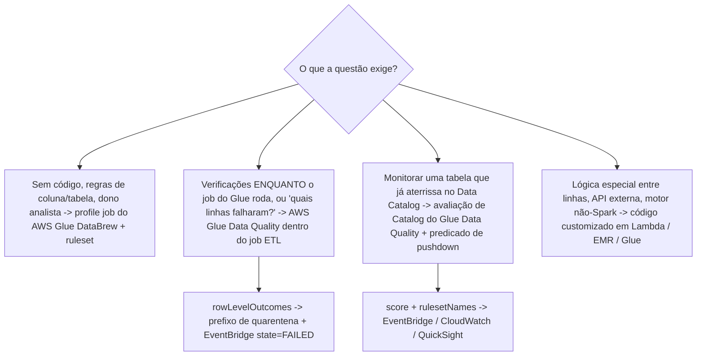
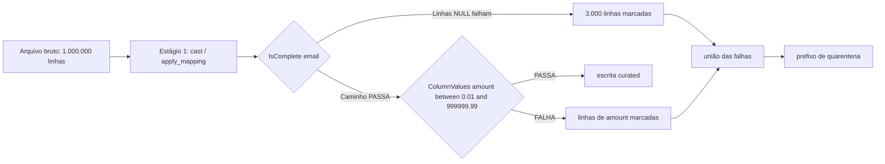
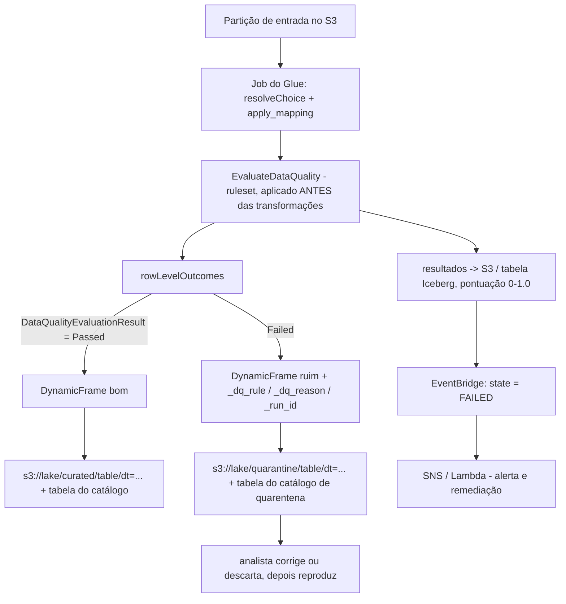
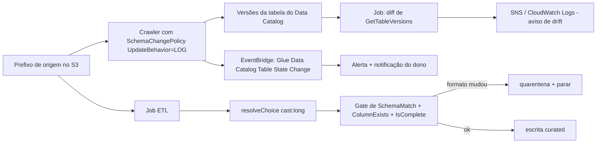
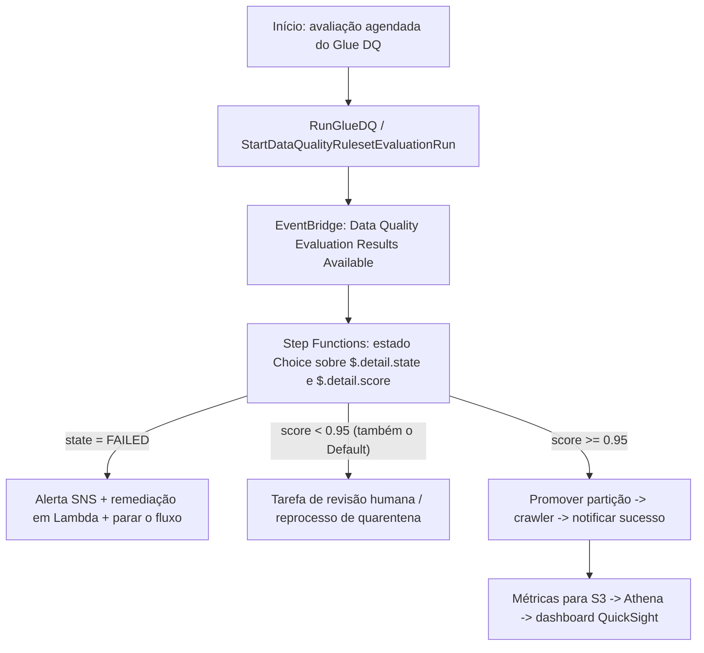
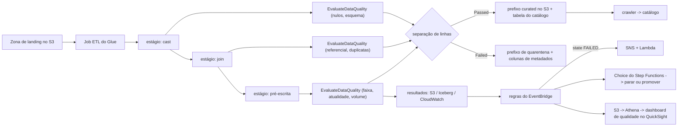

# Automatizando Qualidade de Dados em Pipelines

Qualidade de dados é o único tópico do Domínio 3 do qual os outros tópicos dependem silenciosamente: um pipeline perfeitamente orquestrado que move linhas erradas no horário é pior do que nenhum pipeline. O guia de exame DEA-C01 declara o requisito como uma única habilidade, *"Execute verificações de qualidade de dados enquanto processa os dados (por exemplo, verificando campos vazios)"* (Tarefa 3.4.1, guia do exame DEA-C01, acesso em outubro de 2026), e tudo o que é examinável depende da palavra **while**. Um perfil semanal da zona de landing é um **relatório**; uma verificação que roda **dentro** do job, separa as linhas e faz o gate do próximo passo é **engenharia**.

```text
====================================================================
 A SUPERFÍCIE DE CONTROLE DE QUALIDADE DE DADOS (DEA-C01 Domínio 3,
 Tarefa 3.4)
====================================================================
  3.4.1  verifica ENQUANTO processa (campos vazios, esquema, joins, ...)
  3.4.2  definir regras de qualidade de dados (por exemplo, DataBrew)
  3.4.3  investigar consistência de dados (por exemplo, DataBrew)
  3.4.4  descrever técnicas de amostragem de dados
  3.4.5  implementar mecanismos de skew de dados
--------------------------------------------------------------------
  DIMENSÕES ........... completude | acurácia | consistência
                        atualidade | validade | unicidade
  VERIFICAÇÕES EM VOO . nulos/vazios, esquema, integridade referencial,
                        duplicatas, faixa/enumerado, atualidade/
                        watermark, volume
  FERRAMENTAS ......... AWS Glue Data Quality (DQDL) - dentro do job ou
                            contra o Data Catalog
                        AWS Glue DataBrew - profile job + ruleset
                        código customizado - Lambda / EMR / script Glue
  AÇÕES ............... Nenhuma (padrão) | prefixo de quarentena
                            | falhar depois de carregar
                            | falhar antes de carregar
  ARTEFATOS ........... regras, analyzers, rulesets, resultados no
                        nível da linha, relatório de validação,
                        pontuação 0-1.0
  GATES ............... filtros de estado/pontuação do EventBridge ->
                            Choice do Step Functions -> SNS / crawl / parar
  DRIFT ............... SchemaChangePolicy do crawler, versões de
                        tabela, SchemaMatch, resolveChoice (NÃO bookmarks)
====================================================================
```

Nesta lição você vai:

- ler as cinco subdeclarações da Tarefa 3.4 e defender a regra do **"while processing"** contra distractors de fim de pipeline;
- mapear as **seis dimensões de qualidade** às expressões nativas da AWS e aos cenários que o exame escreve;
- montar a **lista de sete verificações em voo**, nulos/vazios, esquema, integridade referencial, duplicatas, faixa/enumerado, atualidade/watermark, volume, em DQDL, DataBrew e PySpark;
- operar o **AWS Glue Data Quality**: regras, analyzers, rulesets, os 26 tipos de regra do Studio, resultados no nível da linha, as três ações de falha e as opções de publicação;
- operar a qualidade do **AWS Glue DataBrew**: anatomia de regra, rulesets que rodam em **profile jobs**, findings, relatório de validação, eventos, agendamentos e amostragem;
- ligar os **padrões de qualidade de jobs do Glue**: asserções no script, tabelas de erro, o padrão do prefixo de quarentena e destinos de dead-letter em streaming;
- detectar **drift de esquema**: job bookmarks versus DynamicFrame `resolveChoice`, `SchemaChangePolicy` do crawler, versões de tabela do Data Catalog e alertas de drift;
- fazer o gate da orquestração com **payloads do EventBridge** e um **Choice do Step Functions** sobre `state` e `score`, e publicar um **dashboard de qualidade**;
- decidir **quarentena versus falhar o job**, e por que o guia de exame quer verificação em voo em vez de qualidade no fim;
- estudar **quatro estudos de caso de clientes da AWS**, uma **caixa de atualizações de outubro de 2026 com fontes** e **14 questões estilo exame** mais quatro verificações interativas.

---

## 1. Tarefa 3.4: o que "processar enquanto" realmente significa

### 1.1 As cinco subdeclarações

| Sub-tarefa | Foco literal (guia do exame, acesso em outubro de 2026) | O que uma alternativa precisa conter para estar certa |
|---|---|---|
| **3.4.1** | "Execute verificações de qualidade de dados **enquanto processa os dados** (por exemplo, verificando campos vazios)" | Uma verificação **dentro** da execução: avaliação dentro do job, uma fronteira de estágio, ou uma avaliação que faz o **gate** do próximo passo |
| **3.4.2** | "Defina regras de qualidade de dados (por exemplo, **DataBrew**)" | Uma regra ou ruleset declarativo: DataBrew ou o DQDL do Glue Data Quality, ambos aceitáveis |
| **3.4.3** | "Investigue a **consistência** dos dados (por exemplo, DataBrew)" | Comparação entre dois conjuntos/tabelas, ou os findings do perfil que expõem uma inconsistência |
| **3.4.4** | "Descreva técnicas de **amostragem** de dados" | Compromissos de tipo e tamanho de amostra, e o fato de que uma **pontuação** de qualidade precisa do conjunto completo |
| **3.4.5** | "Implemente mecanismos de **skew** de dados" | Métricas de detecção mais uma mitigação (salting, broadcast join, repartition) |

A armadilha está escrita na primeira linha: *"profile semanal da zona de landing"* é um **relatório sobre** os dados de ontem, não uma verificação **enquanto** os dados são processados. Alternativas construídas em "carregue tudo, depois profile às sextas-feiras" foram feitas para reprovar a 3.4.1.

### 1.2 Qualidade no fim versus em voo

| | **Qualidade no fim** | **Qualidade em voo (resposta do exame)** |
|---|---|---|
| Quando | Depois do load, dias depois | No cast, depois do join, antes da escrita |
| O que o consumidor vê | Linhas ruins já na tabela curada | Somente as linhas que passaram, ou uma quarentena documentada |
| Recuperação | Unload, corrigir, recarregar | Corrigir na fronteira, ou reproduzir uma partição |
| Identificação de registros com falha | Exige uma segunda passada pelo histórico | Resultados no nível da linha produzidos durante a execução |
| Enunciação típica de distractor | "Agende um profile job do DataBrew todo domingo à noite" | "`EvaluateDataQuality` depois de `apply_mapping`, separe pelos resultados" |

Os dois têm seu lugar: uma avaliação **at rest** contra o Data Catalog é legítima para monitorar uma tabela que já está aterrissando. Mas quando a linha de habilidade da questão é a 3.4.1, a resposta é uma verificação que roda **durante** o processamento ou que faz o **gate** do próximo passo.

### 1.3 Qual ferramenta: a matriz de três vias

A própria tabela de Prescriptive Guidance da AWS é a ajuda mais rápida de "qual ferramenta" neste exame:

| Necessidade | **AWS Glue DataBrew** | **AWS Glue Data Quality** | **Verificações customizadas** |
|---|---|---|---|
| Autoração | Condições no código/coluna sem código | Código customizado em um job do Glue **ou** sem código | O ETL de sua escolha: Lambda, Glue, EMR |
| Execução | Profile job (rulesets) | Job ETL (em voo) ou Data Catalog (at rest) | Onde você consegue rodar código |
| Identifica os registros com falha | Não, os findings são agregados | **Sim, somente em um job ETL** | Sim, se você escrever |
| Recomendações / auto scaling |, | Recomendações: **somente Catalog**; auto scaling e Flex: **somente ETL** |, |



- **📚 Você sabia?** O AWS Glue Data Quality é **construído sobre o Deequ de código aberto**, "uma biblioteca usada internamente pela Amazon para gerenciar a qualidade de lagos de dados com mais de 60 PB" (AWS Big Data Blog, 06-06-2023). É por isso que o `amazon-deequ-glue` existe como um exemplo da AWS, mas Deequ-como-produto, Great Expectations, dbt e Soda **não** estão na lista de escopo do DEA-C01, então uma alternativa construída em torno deles nunca é a melhor resposta.

---

## 2. As seis dimensões, mapeadas aos cenários do exame

### 2.1 Dimensão → expressão AWS → cenário

| Dimensão | Expressão nativa da AWS (verificada) | Para qual cenário é escrita | Armadilha clássica |
|---|---|---|---|
| **Completude** | `IsComplete "col"`, `Completeness "col" > 0.95`; DataBrew "Value is not missing ≥ 100% rows"; `FillMissingValues`; palavras-chave `NULL, BLANKS, WHITESPACES_ONLY` | Os "campos vazios" da Tarefa 3.4.1 | Uma **string CSV** em branco é `""`, não NULL: ela **não** faz falhar uma regra de Completeness; um inteiro em branco **é** NULL e falha |
| **Acurácia** | `ColumnValues "age" between 18 and 120`, `in [...]`, `matches /re/`, `Entropy`, detecção de anomalia por ML | Os valores estão presentes mas errados (idade 900, valor negativo) | Reexecutar o crawler conserta **metadados**, não dados |
| **Consistência** | `ReferentialIntegrity`, `DatasetMatch`, `SchemaMatch`, `RowCountMatch`, `AggregateMatch` | Tarefa 3.4.3: duas fontes discordam | Consistência é uma **comparação**; uma regra de tabela única não é isso |
| **Atualidade** | `DataFreshness`, `FileFreshness`, `ColumnValues "event_ts" > (now() - 1 days)`, `FileMatch/FileSize/FileUniqueness`, `RowCount > avg(last(10))` | SLA: os dados não podem ter mais de 24 h | Atualidade ≠ contagem de linhas: um load completo de arquivos **velhos** ainda falha |
| **Validade** | `ColumnDataType`, `ColumnLength`, `ColumnNamesMatchPattern`, `ColumnExists`, numérico/contém/comprimento do DataBrew | Tipo e formato mudaram (`amount` chegou como string) | Validade é sobre **formato**, acurácia sobre **valor** |
| **Unicidade** | `IsUnique`, `Uniqueness "email" = 1.0`, `DistinctValuesCount`, `IsPrimaryKey`, DataBrew "Duplicate rows" / "Unique values = 100% rows" | Transações postadas em duplicata, cadastros repetidos | A `PRIMARY KEY` / `UNIQUE` do Redshift é **informativa**: duplicatas carregam mesmo assim |

A **pontuação de qualidade de dados** é simplesmente "a porcentagem de regras de qualidade de dados que passam (resultam em true) quando você avalia um ruleset" (documentação do AWS Glue Data Quality, acesso em outubro de 2026): um número entre **0 e 1.0**, não uma nota de aprovação por si só.

### 2.2 Exemplo trabalhado E1: completude que se esconde atrás de uma string

Uma coluna CSV `email` chega com **1.000.000** de linhas. No arquivo bruto, **3.000** linhas carregam um campo vazio. Duas regras são escritas sobre os mesmos dados:

```text
Regra A (DQDL)  IsComplete "email"                 limite 100% das linhas
Regra B (coercão) ColumnDataType "email" in ["string"]
                + completude depois de ler como string

Leitura bruta:   campo CSV vazio -> "" (string vazia), NÃO NULL
Resultado A:     997.000 não vazias / 1.000.000 = 99,70%  < 100%  -> FALHA
                ...mas apenas se o tipo de origem tornar o campo NULL.
                Lido como string, "" é um valor -> 100% "completa" -> PASSA (errado)

Conserto:        use IsComplete com as palavras-chave NULL/EMPTY/WHITESPACES_ONLY,
                ou coerce o tipo da coluna primeiro, depois avalie.
```

**Leitura:** as mesmas 3.000 linhas ruins podem passar ou falhar dependendo do tipo que o leitor infere. É por isso que regras de completude são escritas **depois** da coerção de tipo, na fronteira de estágio pós-cast, e é por isso que "verificar campos vazios" na 3.4.1 é uma habilidade de **posicionamento** tanto quanto de escrita de regras.



### 2.3 Combine cada dimensão com sua assinatura de exame

```matching
{
  "question": "Combine cada dimensão de qualidade de dados com a expressão AWS com a qual o exame DEA-C01 a escreve:",
  "pairs": [
    {"left": "Completude", "right": "IsComplete \"order_id\" em 100% das linhas: a verificação literal de 'empty fields' da Tarefa 3.4.1"},
    {"left": "Acurácia", "right": "ColumnValues \"age\" between 18 and 120, ou matches /regex/ - o valor está presente mas errado"},
    {"left": "Consistência", "right": "ReferentialIntegrity, DatasetMatch ou RowCountMatch: dois datasets ou tabelas discordam (Tarefa 3.4.3)"},
    {"left": "Atualidade", "right": "DataFreshness / FileFreshness, ou ColumnValues \"event_ts\" > (now() - 1 days) contra um SLA"},
    {"left": "Validade", "right": "ColumnDataType, ColumnLength, ColumnNamesMatchPattern: o tipo ou o formato mudou"},
    {"left": "Unicidade", "right": "IsUnique, Uniqueness \"email\" = 1.0, IsPrimaryKey: e as chaves do Redshift NÃO vão impor isso para você"}
  ],
  "explanation": "O quase nunca pergunta uma definição: escreve um cenário e espera a dimensão: 'empty fields' é completude, 'dois sistemas discordam do mesmo customer id' é consistência, 'o load está 30 horas atrasado' é atualidade, 'amount chegou como string' é validade. Cada uma mapeia para uma família de regra DQDL diferente, e unicidade é a que precisa ser re-verificada num pipeline porque PRIMARY KEY, UNIQUE e FOREIGN KEY do Redshift são apenas informativas quando você popula uma tabela."
}
```

- **📚 Você sabia?** Das seis dimensões, a **unicidade** é a que mais frequentemente é "imposta" por uma restrição que não impõe nada: o Amazon Redshift afirma que *"unicidade, chave primária e chave estrangeira são apenas informativas; elas não são impostas pelo Amazon Redshift quando você popula uma tabela"*, enquanto *"o Amazon Redshift impõe sim restrições de coluna NOT NULL"* (documentação do Redshift, acesso em outubro de 2026). Então um `INSERT` de chave primária duplicada **sucede**, um `INSERT` de `NULL` numa coluna `NOT NULL` falha, e ambos os comportamentos são examináveis como "qual DDL impede loads duplicados? Nenhuma."

---

## 3. A lista em voo: sete verificações, posicionadas nas fronteiras de estágio

Cada verificação abaixo pode ser escrita em DQDL (Glue Data Quality), como regra do DataBrew, ou em PySpark puro, o **posicionamento** é o que rende a marca da 3.4.1.

### 3.1 Nulo / vazio

```text
DQDL          IsComplete "customer_id"
              Completeness "email" > 0.99
DataBrew      "Value is not missing" >= 100% das linhas
PySpark       df.filter(col("customer_id").isNull() | (col("customer_id") == ""))
Nota          Em todas as regras ColumnValues exceto != e NOT IN,
              linhas NULL falham na regra (tipos de regra DQDL, acesso em outubro de 2026)
```

### 3.2 Validação de esquema

`ColumnExists`, `ColumnDataType`, `ColumnLength`, `ColumnNamesMatchPattern`, `SchemaMatch`. Um job com destino S3 **habilita por padrão** uma regra de "pelo menos uma coluna" mais detecção de anomalia na contagem de colunas: uma falha **baixa a pontuação mas não falha o job** (tutorial do Glue, acesso em outubro de 2026). Regras de esquema respondem *validade*; drift (Seção 7) responde *o que mudou desde a última vez*.

### 3.3 Integridade referencial

```text
DQDL    ReferentialIntegrity "order.customer_id" with "customer.customer_id"
        (segundo input fornecido como dataset de referência)
Por quê chaves estrangeiras do Redshift são informativas - verifique
        dentro do job, na fronteira pós-join, antes de escrever qualquer coisa
Também  DatasetMatch / RowCountMatch para consistência entre sistemas (3.4.3)
```

### 3.4 Duplicatas

```text
DQDL        IsUnique "transaction_id"      Uniqueness "email" = 1.0
            DistinctValuesCount "session_id" > 1000
DataBrew    "Duplicate rows" | "Unique values = 100% rows"
            FlagDuplicatesInColumn (passo de recipe)
PySpark     row_number().over(Window.partitionBy("id")) == 1
```

### 3.5 Faixa / enumerado

```text
ColumnValues "amount" between 0.01 and 999999.99
ColumnValues "status" in ["NEW", "SHIPPED", "CANCELLED"]
ColumnValues "gender" in ["F", "M"] where "weightinkgs < 10"
Combinadores AND / OR / NOT;  limite de linha  "... at least 95% of rows"
clause where: suportada apenas em jobs AWS Glue 4.0+ (referência DQDL)
```

### 3.6 Atualidade / watermark

```text
DataFreshness "s3://bucket/incoming/" max-age 1 day
ColumnValues "event_ts" > (now() - 1 days)  at 0.99 of rows
Verificação cruzada:  CustomSql  SELECT MAX(event_ts) FROM ...  vs uma tabela de watermark
Escopo:        job bookmarks decidem QUAIS arquivos são processados nesta execução
```

**Bookmarks dão escopo incremental, não validação**: eles rastreiam arquivos e linhas processados e fazem **nenhuma** verificação de esquema (Seção 7). Streaming usa **checkpoints**, e a janela padrão do Glue streaming é de **100 segundos**.

### 3.7 Volume

`RowCount between X and Y`, `RowCountMatch`, `AggregateMatch`, `CustomSql`: *"quase qualquer tipo de verificação de qualidade de dados em SQL"* (tipos de regra DQDL, acesso em outubro de 2026). Regras de volume são o jeito mais barato de capturar "a origem enviou 4% das linhas de ontem" **antes** que agregações a jusante publiquem silenciosamente um número pequeno.

### 3.8 Exemplo trabalhado E2: atualidade contra um SLA

Um SLA diz que pedidos não podem ter mais de **24 horas** quando a tabela curada é publicada às 02:00 UTC.

```text
Regra            ColumnValues "event_ts" > (now() - 1 days)   limite de linha 0.99
Executar 02:00   linhas mais velhas que 02:00 de ontem = 0 -> PASSA
Executar 08:00   (re-execução atrasada) now() andou 6 h
                 linhas em [02:00-24h, 08:00-24h] = 6 h de eventos agora "velhas"
                 se < 1% das linhas: a regra ainda PASSA em 0,99
                 -> combine com uma verificação cruzada de watermark:
                    CustomSql: SELECT MAX(event_ts) FROM curated.orders
                    compare contra o watermark do SLA 2026-10-09T02:00:00Z
Leitura          uma regra de atualidade por limite de linha tolera
                 caudas atrasadas por design; a comparação com o
                 watermark captura um upstream parado.
```

**Dois sinais, uma decisão:** a regra DQDL limita as *linhas*, a comparação de watermark limita o *load*. Alternativas de exame que oferecem apenas uma delas geralmente estão testando se você sabe qual falha cada uma captura.

---

## 4. AWS Glue Data Quality: DQDL, rulesets, resultados

### 4.1 Três objetos, dois pontos de entrada

| Objeto | O que é |
|---|---|
| **Regra** | Uma expressão booleana sobre uma métrica: passa ou falha |
| **Analyzer** | Produz as estatísticas nas quais uma regra de anomalia/dinâmica treina |
| **Ruleset** | *"Um ruleset é um conjunto de regras que compara diferentes métricas de dados com valores esperados. Se qualquer critério de uma regra não for atendido, o ruleset inteiro falha na validação."*: anexado a uma **tabela do Data Catalog** (ganha um ARN) |

| | **Avaliação do Data Catalog (at rest)** | **Avaliação em job ETL (em voo)** |
|---|---|---|
| Fontes | S3, Redshift, JDBC, Iceberg/Hudi/Delta, OTF gerenciado pelo LF | Todas as fontes do Glue, dentro da execução |
| Escopo incremental | Predicados de pushdown | **Bookmarks** do job |
| Recomendações | **Sim** | Não |
| Auto scaling / workers Flex | Não | **Sim** |
| **Identifica os registros que falharam** | **Não** | **Sim** (`rowLevelOutcomes`) |
| Views do Athena catalogadas no Glue Data Catalog | **Não suportado** como fonte | Use o caminho de job |
| Em comum | EventBridge, CloudWatch, resultados em S3, CloudFormation | idem |

O Studio oferece **26 tipos de regra**; uma avaliação de resultados grava no S3 (opcionalmente em **tabelas Iceberg/Data Catalog** que você pode consultar com Athena), e a detecção de anomalia *"requer um mínimo de três pontos de dados"*.

### 4.2 O que acontece quando um ruleset falha

```text
Ação quando o ruleset falha (tutorial do AWS Glue, acesso em outubro de 2026)
  Nenhum (None)                       <- PADRÃO: o job NÃO falha e
                                         continua apesar das falhas de regra
  Falhar o job depois de carregar os dados no destino
  Falhar o job sem carregar os dados no destino

Opções de publicação (EvaluateDataQuality)
  enableDataQualityResultsPublishing   = True   (padrão)
  enableDataQualityCloudWatchMetrics   = False  (padrão - DESLIGADO)
  resultsS3Prefix                      = seu prefixo
```

> [!WARNING]
> ⚠️ **O padrão é silêncio.** Com `Nenhum (None)` como ação de falha, uma execução que falha em toda regra ainda reporta **SUCCEEDED**, e as métricas do CloudWatch ficam **desligadas** a menos que você defina `enableDataQualityCloudWatchMetrics`. "O job falhou porque uma regra falhou" é portanto *normalmente falso* como escrito, o conserto correto é uma ação de falha explícita, uma asserção no script ou um Choice do Step Functions sobre o resultado publicado (Seção 8).

### 4.3 Resultados no nível da linha, e as onze regras que não os produzem

```python
from awsgluedq.transforms import EvaluateDataQuality

dq_results = EvaluateDataQuality.apply(
    frame = good_and_bad,
    ruleset = "rules = [IsComplete \"order_id\" ...]",
    publishingOptions = {"enableDataQualityResultsPublishing": True}
)

row_level = dq_results.rowLevelOutcomes  # + DataQualityEvaluationResult
passed = row_level.filter(row_level.DataQualityEvaluationResult == "Passed")
failed = row_level.filter(row_level.DataQualityEvaluationResult == "Failed")
```

`rowLevelOutcomes` acrescenta quatro colunas e um status **Passed/Failed** por linha. Onze tipos de regra **não** podem ser atribuídos a linhas, `AggregateMatch, ColumnCount, ColumnExists, ColumnNamesMatchPattern, CustomSql, RowCount, RowCountMatch, StandardDeviation, Mean, ColumnCorrelation` (tutorial do Glue, acesso em outubro de 2026). Então "quais linhas falharam?" é respondido por regras **com escopo de linha** num **job ETL**, nunca por uma avaliação de Catalog, e nunca por uma regra agregada.

### 4.4 Exemplo trabalhado E3: pontuação, e por que você roteia por `state`, não por `score`

Um ruleset de **6 regras** roda: **4 passam, 2 falham**.

```text
score = regras que passaram / total de regras = 4 / 6 = 0,6667  (escala 0 - 1.0)

Filtro A do EventBridge  "detail": { "state": ["FAILED"] }          -> CASA
Filtro B do EventBridge  "detail": { "score": {"numeric": ["<=", 0,7]}} -> CASA (0,6667 <= 0,7)

Agora 17 de 20 regras passam, 2 falham, 1 é ignorada:
score = 17 / 20 = 0,85
Filtro A (state FAILED)          -> CASA   (o ruleset falhou)
Filtro B (score <= 0,7)          -> NÃO CASA  (0,85 > 0,7)

Leitura: state e score são sinais DIFERENTES. Um ruleset que falha em
uma regra dura ainda pode pontuar 0,85, então um alarme só de score perde.
Roteie por state para correção; use score para severidade.
```

Uma regra ignorada não conta como aprovada: a pontuação é **regras que passaram** sobre as regras avaliadas, então nunca assuma que `state` e `score` concordam.

```fillblank
{
  "question": "Complete as afirmações sobre o Glue Data Quality com os padrões e comportamentos verificados (em outubro de 2026):",
  "template": "A pontuação de qualidade de dados é a {{1}} de regras de qualidade de dados que passam, expressa de 0 a 1.0. A ação padrão quando um ruleset falha em um job do Studio é {{2}}, então o job {{3}} falhar. A publicação de resultados está {{4}} por padrão, enquanto as métricas do CloudWatch estão {{5}} por padrão. Resultados no nível da linha são produzidos somente quando a avaliação roda em um job {{6}}, e uma string CSV vazia é {{7}} (não NULL), então ela não faz falhar uma regra de completude.",
  "answers": {
    "1": "porcentagem",
    "2": "None",
    "3": "não",
    "4": "habilitada",
    "5": "desabilitada",
    "6": "ETL",
    "7": "uma string vazia"
  },
  "distractors": ["média", "contagem", "Fail job", "média ou contagem", "quarantine", "bloqueada", "desabilitada", "habilitada", "Catalog", "streaming", "nula", "ausente"],
  "explanation": "'A porcentagem de regras de qualidade de dados que passam (resultam em true) quando você avalia um ruleset' é a própria definição da AWS para a pontuação. O padrão documentado da ação de falha é 'None: se você escolher None (padrão), o job não falha e continua rodando apesar das falhas de regras'. enableDataQualityResultsPublishing é True por padrão e enableDataQualityCloudWatchMetrics é False, identificar os registros com falha é uma capacidade somente de job ETL, e um campo CSV vazio lido como string vazia: use as palavras-chave EMPTY/WHITESPACES_ONLY ou coerce os tipos primeiro."
}
```

## 5. AWS Glue DataBrew: regras, rulesets, findings

### 5.1 Anatomia de uma regra

| Parte | Escolha | Nota de exame |
|---|---|---|
| **Checks** | Número de linhas, linhas duplicadas, valores únicos, % não ausente, em faixa, começa com, comprimento | Construídos a partir da lista de checks do construtor de regras |
| **Escopo** | Por coluna, ou "Common checks for selected columns" | O escopo decide se julga uma coluna ou um grupo |
| **Critério de sucesso** | **AND** / **OR** entre checks | AND é mais estrito: um check com falha derruba a regra |
| **Limite de aprovação** | `% of rows` | Regra agregada vs regra por linha |
| **Tipos** | **Somente tipos simples** | Estruturas aninhadas ficam de fora |

Exemplos de checks do material próprio da AWS: `Number of rows = 5000000`, `Duplicate rows`, `Unique values = 100% rows`, `Value is not missing >= 100% rows`, `Value in column APY between 0 and 100`, `Number of missing values in column group_name doesn't exceed 5%`.

### 5.2 Rulesets rodam em **profile jobs**, não em recipe jobs

O `CreateRuleset` é documentado como *"cria um novo ruleset que pode ser usado em um **profile job** para validar a qualidade de dados de um dataset"*. Recipe jobs aplicam **passos de recipe**: essa família popula valores ausentes, remove dados inválidos e remove duplicatas, o que é **remediação**, não **validação**. A afirmação falsa canônica neste exame é *"anexe o ruleset ao recipe job"*.

Cotas que as questões citam literalmente (em outubro de 2026): **100 regras por ruleset**, **10 rulesets por dataset**, **100 rulesets por conta**, **100 passos por recipe**, **300 nós por conta**.

### 5.3 Findings, relatório de validação e eventos

- **Saídas do profile:** Summary, Correlations, Value distribution, Column Summary, mais uma aba **Column statistics**.
- **Resultados da validação:** na aba **Data quality rules / Data quality** da execução do job.
- **Ajuda do construtor:** uma aba **Dataset preview** e uma aba **Recommendations** enquanto você autora.
- **Relatório:** o profile job *"produz um relatório de validação além do perfil de dados … na mesma localização dos seus dados de perfil"*.
- **Eventos:** um evento do EventBridge por execução **e** por ruleset:

```json
{
  "source": ["aws.databrew"],
  "detail-type": ["DataBrew Ruleset Validation Result"],
  "detail": { "validationState": ["FAILED"] }
}
```

Uma regra com esse padrão casa **todas** as validações com falha na conta, o payload examinável é `detail-type` + `validationState`, não um ARN por dataset.

### 5.4 Amostragem (Tarefa 3.4.4)

| Fato | Valor (documentação do AWS DataBrew, acesso em outubro de 2026) |
|---|---|
| Padrão de projeto/preview | **Primeiras 500 linhas** |
| `Sample.Type` | `FIRST_N` · `LAST_N` · `RANDOM` |
| `Sample.Size` | **1 to 5.000** |
| `FIRST_N` | Rápido, **enviesado**: um artefato da ordem do cabeçalho do arquivo |
| `RANDOM` | Representativo da fonte subjacente |
| Jobs de profile/recipe | Rodam no dataset **completo**: a amostragem é só para projetos e previews |
| Pontuações de qualidade | Precisam do dataset **completo**: uma pontuação sobre 500 linhas não é a pontuação |

A redação própria da AWS: *"Um tamanho de amostra menor permite ao DataBrew realizar transformações mais rápido … Um tamanho de amostra maior reflete com mais precisão a composição dos dados de origem subjacentes."*

- **📚 Você sabia?** Os agendamentos do DataBrew são expressões cron de **seis campos** com um piso rígido: *"expressões cron que resultam em taxas mais rápidas que 5 minutos não são suportadas"*, e dia-do-mês versus dia-da-semana são **exclusivos** (use `?` para um deles). Então a alternativa "a cada 2 minutos, valide o stream" está errada por duas razões independentes, o DataBrew não é um processador de stream, e seu relógio não consegue bater tão rápido (documentação de jobs do DataBrew, acesso em outubro de 2026).

### 5.5 Exemplo trabalhado E4: um ruleset de RH que cabe nas cotas

Cinco regras sobre um extrato noturno de RH de **5.000.000** de linhas:

```text
R1  Number of rows = 5000000                       (volume)
R2  Duplicate rows                                 (unicidade)
R3  Unique values = 100% of rows in Emp ID, e-mail,
    SSN                                            (unicidade x3 colunas)
R4  Value is not missing >= 100% of rows           (completude)
R5  Value in column APY between 0 and 100          (acurácia / faixa)

Contagem de regras:  8 checks no total  <= 100 regras por ruleset    OK
Rulesets:            1 conjunto         <= 10 por dataset            OK
Anexado a:           um PROFILE job (não o recipe job)
Saída:               profile JSON + relatório de validação no S3
                    + findings da aba "Data quality rules"
Alerta:              EventBridge detail-type
                    "DataBrew Ruleset Validation Result",
                    validationState FAILED -> SNS
```

### 5.6 Skew (Tarefa 3.4.5), o gêmeo da dimensão de atualidade

Skew não corrompe linhas; ele destrói a **atualidade** da execução. Detecte-o com as métricas do driver **`glue.driver.skewness.job`** e **`glue.driver.skewness.stage`**, a UI do Spark ou estatísticas de tamanho de partição. Mitigações documentadas pela AWS: filtragem de chaves quentes, agregação incremental, **salting**, broadcast joins, `repartition`/`coalesce`, **adaptive query execution** (padrão no Glue 4.0+), particionamento de entrada e escala vertical: a conclusão da própria AWS é que *"não existe uma solução universal única"*. No exame, "uma task roda 40 minutos enquanto as outras 39 terminam em 30 segundos" ⇒ skew, e a correção nomeada na alternativa é **salting na chave quente** ou **broadcast da tabela pequena**.

---

## 6. Padrões de qualidade de jobs do Glue: asserções, tabelas de erro, quarentena

### 6.1 Asserções no script, o gate em voo mais forte

```python
from awsgluedq.transforms import EvaluateDataQuality
from awsglue.context import SparkContext, GlueContext
import sys

dq = EvaluateDataQuality.apply(
    frame = post_join_frame,
    ruleset = """
      rules = [
        IsComplete "order_id",
        ColumnValues "amount" between 0.01 and 999999.99,
        IsUnique "order_id"
      ]
    """,
    publishingOptions = {"enableDataQualityResultsPublishing": True}
)

failed = dq.filter(dq["Outcome"].contains("Failed")).count()
assert failed == 0, "Data quality rules caused the job to fail."
```

Forma em Scala do tutorial da AWS: `assert(DQ_Results.filter(_.getField("Outcome").contains("Failed")).count == 0, "…caused the job to fail.")`. Uma asserção transforma uma **pontuação** em um **job com falha**, que é como "rodar verificações enquanto processa" aparece quando a alternativa diz *pare antes que dados ruins aterrissem*.

### 6.2 Tabelas de erro, e o nome que não existe

| Mecanismo | O que faz |
|---|---|
| `ErrorsAsDynamicFrame` / `errorsFromDF` | Coleta linhas rejeitadas por um mapeamento num DynamicFrame separado |
| `Spigot` | Desvia linhas que falham num filtro ou excedem um limite para uma saída lateral |
| `FlagDuplicatesInColumn` | Marca duplicatas para que possam ser roteadas, não descartadas em silêncio |
| `FillMissingValues` | Passo de recipe/transform de remediação, o lado do conserto da qualidade |
| Ramificação condicional sobre `Outcome` | Envia frames bons/ruins para sinks diferentes |

> [!IMPORTANT]
> **Não existe na AWS um construto chamado "ErrorCDC."** O AWS Glue documenta `ErrorsAsDynamicFrame`, `errorsFromDF`, `Spigot`, `rowLevelOutcomes` e a saída de quarentena do DataBrew: uma alternativa citando "ErrorCDC" está testando se você lembra da API real. O padrão verificado é **tabela de erro**, não error-CDC.

### 6.3 O padrão do prefixo de quarentena

> "O AWS Glue Data Quality ajuda você a identificar os registros exatos que fizeram suas pontuações de qualidade cairem. Identifique-os com facilidade, **coloque-os em quarentena** e corrija-os.": página de produto do AWS Glue Data Quality, acesso em outubro de 2026

A amostra de referência **InsuranceLake** da AWS enuncia o contrato com precisão: *"A ação de quarentena remove as linhas individuais que falham na verificação de qualidade … e as armazena em uma localização de armazenamento de quarentena separada e em uma tabela do Data Catalog"*, com regras aplicadas **imediatamente depois do schema mapping … antes de qualquer transformação ser executada**, nos estágios `before_transforms` / `after_transforms` / `after_sparksql`, e a pasta S3 `<table>_quarantine_*` e a tabela do catálogo são criadas **independentemente de alguma linha ter sido colocada em quarentena**, então o monitoramento a jusante nunca precisa adivinhar se o caminho existe.



### 6.4 Streaming: o lado de dead-letter da qualidade

Para consumidores Lambda do Kinesis/Kinesis Data Firehose, o caminho de falha de qualidade é o **on-failure destination**, não um alarme de console: `DestinationConfig.OnFailure` → **SQS, SNS, S3 ou Amazon MSK**, com `BisectBatchOnFunctionError` para isolar o registro venenoso, `MaximumRetryAttempts` **0 to 10.000**, `MaximumRecordAgeInSeconds` **60 to 604.800**, e `ReportBatchItemFailures` retornando `batchItemFailures` para tratamento parcial de lote. Uma **DLQ no nível da função** é o mecanismo mais antigo; o on-failure destination é o atual, e os dois não são intercambiáveis num par de alternativas. Jobs do Glue streaming usam **checkpoint em vez de job bookmarks**.

### 6.5 Exemplo trabalhado E5: a separação de quarentena

Um milhão de linhas aterrissa; o job carrega 6 regras, 4 das quais com escopo de linha:

```text
Total de linhas                       1.000.000
Regra A  IsComplete "order_id"        1.500 linhas NULL        -> falha no limite de 99,9%
Regra B  amount between 0.01..        2.900 linhas fora da faixa
         and 999999.99                                             -> falha no limite de 99,7%
Linhas falhando AMBAS                 400 (sobreposição)
União das linhas falhando = 1.500 + 2.900 - 400            = 4.000
Parte em quarentena  = 4.000 / 1.000.000                    = 0,40%
Escrita curated      = 1.000.000 - 4.000                    = 996.000
Pontuação do ruleset = 4 que passaram / 6 no total           = 0,67
Ação tomada          = Nenhum (padrão) -> job SUCCEEDED
EventBridge          state = FAILED  -> casa;  score 0,67 <= 0,7 -> também casa
Objeto em quarentena s3://lake/quarantine/orders/dt=2026-10-10/
                    + colunas _dq_rule, _dq_reason, _run_id
```

**Leia as duas metades juntas:** o caminho de dados colocou 4.000 linhas em quarentena e publicou 996.000; o caminho de controle publicou `state = FAILED` e uma pontuação de 0,67: enquanto o **job** ainda reportou sucesso porque a ação era `Nenhum (None)`. Três sinais diferentes, três respostas diferentes para "funcionou?".

---

## 7. Detecção de drift de esquema: o que realmente enxerga um formato alterado

### 7.1 Bookmarks não são detecção de drift

| Mecanismo | Rastreia | Detecta mudança de esquema? |
|---|---|---|
| **Job bookmarks** | Quais arquivos/linhas foram processados | **Não**: apenas *escopo* incremental; renomear `transformation_ctx` invalida o estado |
| **`SchemaChangePolicy` do crawler** | Esquema descoberto | **Sim**: `UpdateBehavior = LOG \| UPDATE_IN_DATABASE`, `DeleteBehavior = LOG \| DELETE_FROM_DATABASE \| DEPRECATE_IN_DATABASE`; `LOG` = detectar sem mutar |
| **Versões de tabela do Data Catalog** | Histórico de versões | **Sim**: um job difa `GetTableVersions`, registra o diff e publica **SNS** |
| **`SchemaMatch` / `ColumnExists` / `ColumnDataType`** | Formato esperado | **Sim**: *"garante que o dataset corresponda com precisão a um esquema definido, evitando erros a jusante"* |
| **`resolveChoice` do DynamicFrame** | Tipos de escolha da inferência | **Repara**, e pode destruir dados silenciosamente (abaixo) |

Combine o crawler com o evento do EventBridge **Glue Data Catalog Table State Change** (`UpdateTable`, `CreatePartition`, `UpdatePartition`, `DeletePartition` mais variantes em lote) para **alertas** de drift; o comportamento `LOG` significa que o catálogo nunca é mutado por um crawler só de alerta.

### 7.2 `resolveChoice`, o reparo que custa dados

O crawler amostra apenas um **prefixo de 2 MB**; uma fonte em que 2 linhas de 160.000 trazem strings numa coluna numérica vira `choice<long,string>`:

```text
choice<long,string>
  cast:long     valores não conversíveis -> NULL   (dados perdidos, depois
                                                    capturados pelas regras
                                                    IsComplete / de faixa)
  project:long  mantém apenas valores long          (linhas descartadas)
  make_cols     separa em duas colunas
  make_struct   aninha a escolha
Caso estilo Medicare: 2 linhas de string -> cast:long -> 2 NULLs ->
IsComplete "member_id" falha -> quarentena, não NULLs silenciosos
```

**A ordem importa:** `resolveChoice` → `apply_mapping` → `toDF()`. Escolher `cast` sem uma regra de completude converte um problema de *esquema* num problema de *dados* que você nunca vê.

### 7.3 Exemplo trabalhado E6: a ilusão da restrição no Redshift

```sql
CREATE TABLE accounts (id INT PRIMARY KEY, email VARCHAR(256) NOT NULL);

INSERT INTO accounts VALUES (1, 'a@example.com');  -- succeeds
INSERT INTO accounts VALUES (1, 'b@example.com');  -- SUCCEEDS (PK informational)
INSERT INTO accounts VALUES (NULL, 'c@example.com'); -- FAILS (NOT NULL enforced)
SHOW CONSTRAINTS;                                  -- inspect what you declared
```

A mesma verificação escrita como regra DQDL, `IsPrimaryKey "id"` = *"não NULL e único"*, **rejeita** a duplicata. `CHECK` e restrições de exclusão são **não suportadas** no Redshift. Então "o load falhou porque uma duplicata de chave primária foi rejeitada" está errado, e "adicione uma regra de unicidade no job" está certo.



---

## 8. Orquestração: gate do pipeline pelo resultado de qualidade

### 8.1 Os payloads do EventBridge que você precisa reconhecer

```json
{
  "source": ["aws.glue-dataquality"],
  "detail-type": ["Data Quality Evaluation Results Available"],
  "detail": {
    "state": ["FAILED"],
    "context": { "contextType": ["GLUE_JOB"] },
    "score": { "numeric": ["<=", 0.7] }
  }
}
```

| Família de campo | Valores |
|---|---|
| `context.contextType` | `GLUE_DATA_CATALOG` (+ `databaseName`, `tableName`, `runId`) ou `GLUE_JOB` (+ `jobId`, `jobName`) |
| `resultID`, `rulesetNames` | Qual avaliação, quais rulesets |
| `state` | `FAILED` / `SUCCEEDED`: a **avaliação do ruleset**, não a execução do ETL |
| `score` | 0 to 1.0: use filtros no estilo `{"numeric": ["<=", 0.7]}` |
| `rulesSucceeded` / `rulesFailed` / `rulesSkipped` | Contagem por regra para remediação |

O equivalente do DataBrew é `source: aws.databrew`, `detail-type: DataBrew Ruleset Validation Result`, `detail.validationState: FAILED`. O drift do crawler do Glue chega como **Glue Data Catalog Table State Change**. Três serviços, três strings de `detail-type`, o exame testa se você consegue escolher a certa.

### 8.2 Step Functions: o estado Choice é o gate

```json
{
  "Comment": "Gate promotion on data quality",
  "StartAt": "RunDQ",
  "States": {
    "RunDQ": { "Type": "Task", "Resource": "arn:aws:states:::glue:startJobRun.sync", "Next": "QualityGate" },
    "QualityGate": {
      "Type": "Choice",
      "Choices": [
        { "Variable": "$.detail.state", "StringEquals": "FAILED", "Next": "AlarmAndHalt" },
        { "Variable": "$.detail.score", "NumericLessThanEquals": 0.95, "Next": "HumanReview" },
        { "Variable": "$.detail.score", "NumericGreaterThanEquals": 0.95, "Next": "PromoteAndCrawl" }
      ],
      "Default": "AlarmAndHalt"
    }
  }
}
```

Semântica da Amazon States Language que vale decorar: `Choices[]` são avaliados **em ordem**, e *"se nenhuma Choice for avaliada como verdadeira … e nenhum Default for fornecido, a state machine lançará um erro"*: é por isso que a AWS recomenda um `Default`.



### 8.3 Dashboards e métricas

O caminho documentado do QuickSight é **EventBridge → Lambda → S3 → crawler → Athena → QuickSight**, dando uma **série temporal de pontuação** em vez de um veredito por execução. As métricas do CloudWatch vivem sob `dataQualityEvaluationContext` (padrão **desligado**) e os logs sob `/aws-glue/data-quality/output` e `/aws-glue/data-quality/error`. Uma questão perguntando "como os analistas veem a tendência de qualidade em 90 dias?" é uma questão de dashboard, não de alerta: a resposta precisa de **resultados armazenados mais uma camada de BI**, não de um tópico SNS.

### 8.4 O pipeline inteiro, em uma imagem



Cada seta acima é uma dependência: nada a jusante pode existir até que o artefato a montante tenha sido produzido. Ordene o gate inteiro do mesmo jeito:

```dragdrop
{
  "question": "Coloque o gate de ponta a ponta de qualidade na ordem em que precisa rodar dentro do pipeline:",
  "items": [
    "Escopo: job bookmarks ou um predicado de pushdown decidem QUAIS linhas esta execução avalia; bookmarks não fazem nenhuma validação",
    "Formato, resolveChoice e depois apply_mapping, para que cada coluna tenha exatamente um tipo antes de qualquer regra ser escrita",
    "Avaliar - EvaluateDataQuality roda o ruleset em voo nas fronteiras pós-cast e pós-join",
    "Separar: rowLevelOutcomes divide o frame por DataQualityEvaluationResult em linhas Passed e Failed",
    "Rotear: linhas boas para o prefixo curated, falhas para o prefixo de quarentena com _dq_rule, _dq_reason e _run_id",
    "Publicar: resultados vão para S3 ou uma tabela Iceberg e o evento do EventBridge carrega state e score",
    "Gate: um Choice do Step Functions lê $.detail.state e $.detail.score para parar, mandar para revisão, ou promover e rodar o crawler"
  ],
  "correctOrder": [
    "Escopo: job bookmarks ou um predicado de pushdown decidem QUAIS linhas esta execução avalia; bookmarks não fazem nenhuma validação",
    "Formato, resolveChoice e depois apply_mapping, para que cada coluna tenha exatamente um tipo antes de qualquer regra ser escrita",
    "Avaliar - EvaluateDataQuality roda o ruleset em voo nas fronteiras pós-cast e pós-join",
    "Separar: rowLevelOutcomes divide o frame por DataQualityEvaluationResult em linhas Passed e Failed",
    "Rotear: linhas boas para o prefixo curated, falhas para o prefixo de quarentena com _dq_rule, _dq_reason e _run_id",
    "Publicar: resultados vão para S3 ou uma tabela Iceberg e o evento do EventBridge carrega state e score",
    "Gate: um Choice do Step Functions lê $.detail.state e $.detail.score para parar, mandar para revisão, ou promover e rodar o crawler"
  ],
  "explanation": "Escopo primeiro porque bookmarks apenas escolhem a entrada; formato segundo porque uma regra avaliada sobre um tipo de escolha ambíguo julga o leitor, não os dados; avaliar antes de separar porque a separação é feita A PARTIR de rowLevelOutcomes; rotear antes de publicar porque o state e o score publicados descrevem o que o roteamento fez; e o estado Choice por último porque ele só pode fazer gate de um resultado que já existe. As duas inversões clássicas são avaliar antes do resolveChoice (regras disparam na ambiguidade string-versus-long) e fazer gate antes da publicação (não existe $.detail para o Choice ler)."
}
```

## 9. Quarentena versus falhar o job, e o trade-off que o exame realmente pergunta

| | **Colocar as linhas ruins em quarentena** | **Falhar o job** |
|---|---|---|
| O pipeline continua rodando | **Sim**, o curated recebe as linhas boas | **Não**, nada novo aterrissa |
| Linhas ruins visíveis | Sim, num prefixo monitorado + tabela do catálogo | Não as novas; o load existente intocado |
| Impacto no consumidor | Load parcial, o a jusante precisa saber | Dados velhos, o a jusante precisa saber |
| Trabalho extra | Corrigir + **reproduzir** as linhas em quarentena; monitorar o prefixo | Causa raiz, reexecutar o job inteiro |
| Ação do Glue Data Quality | `Nenhum (None)` (padrão) **mais** uma separação de linhas, ou falhar depois do load | `Falhar o job sem carregar os dados no destino` |
| Sinal do exame | "identifique os **registros exatos**", "mantenha o pipeline fluindo", feeds tolerantes a SLA | "não pode publicar", gate regulatório, fonte única de verdade |

> [!WARNING]
> ⚠️ **Quarentena não é de graça, e falhar não é seguro.** A quarentena mantém o SLA mas cria uma **segunda fila de trabalho**: alguém precisa ler `_dq_rule` / `_dq_reason`, corrigir a origem e reproduzir, e um prefixo de quarentena sobre o qual ninguém alerta é perda silenciosa de dados com outro nome. Falhar o job protege os consumidores mas para o pipeline, e com uma **ação padrão de `Nenhum (None)`** isso nem acontece a menos que você tenha configurado. Leia a alternativa pelo *requisito*: "números regulatórios nunca podem estar parciais" ⇒ falhar antes do load; "feed analítico horário com triagem humana" ⇒ quarentena + alerta.

### 9.1 A decisão em uma linha cada

- **Em voo vence o no fim** para a 3.4.1, mas uma avaliação de Catalog at rest está certa para *monitorar uma tabela que já aterrissa*.
- **DataBrew** para regras sem código, de coluna/tabela, de posse do analista, rodando como **profile job**; **Glue Data Quality** para verificações no job, resultados no nível da linha e Flex/auto scaling; **código customizado** para qualquer coisa com lógica entre linhas que nenhum tipo de regra cobre.
- **Roteie por `state`, pontue por `score`**: são sinais diferentes (E3).
- **Bookmarks dão escopo, crawlers e `SchemaMatch` detectam drift**: nunca o contrário.
- **Amostragem é para previews; pontuações precisam da varredura completa.**

- **📚 Você sabia?** A metade de **reprodução** do loop de quarentena agora tem um mecanismo no lake: desde **23-04-2026** o Amazon Redshift consegue **UPDATE / DELETE / MERGE** em tabelas **Apache Iceberg** particionadas e não particionadas, incluindo **Amazon S3 Tables**, e desde o Patch 202 da AWS um **DELETE** de Iceberg numa tabela do Lake Formation precisa da permissão **DELETE**, **UPDATE/MERGE** precisam de **INSERT + DELETE**, e *toda* instrução DML de Iceberg também precisa de **ALTER**. Então "corrigir as linhas em quarentena e mesclá-las de volta" é uma operação comum, enquanto um lab que concedeu apenas INSERT agora falha no meio da remediação (documentação de mudanças de comportamento do AWS Redshift, acesso em outubro de 2026).

---

### Atualizações de 2026 (em outubro de 2026)

> [!NOTE]
> **O que mudou em qualidade de dados entre 2024 e outubro de 2026**: cada linha verificada contra uma fonte primária da AWS em **outubro de 2026**, e cada uma é examinável porque o exame testa comportamento atual:
> - **As gerações do Glue mudaram sob suas regras**: **Glue 5.1** é o **padrão para jobs novos desde 26-11-2025** e o **Glue 6.0 entrou em GA em 21-08-2026** com **redução de preço de 30%** (Spark 4.1.1, Python 3.13, Scala 2.13); **Glue 0.9/1.0/2.0 chegou ao fim de vida em 01-04-2026**: notas de versão e What's New do AWS Glue, acesso em outubro de 2026. Uma clause `where "<sparksql>"` do DQDL é documentada para jobs **Glue 4.0+**; re-verifique a lista de clauses contra o `GlueVersion` do seu job.
> - **O DQDL cresceu constantes em 27-07-2026**: notas de versão do AWS Glue Data Quality, acesso em outubro de 2026; e **regras em nível de arquivo (`FileFreshness`, `FileMatch`, `FileSize`, `FileUniqueness`) mais verificações padrão de Visual-ETL chegaram em 06-12-2024**, regras de anomalia/dinâmica entraram em GA em **22-11-2024**, e a publicação de resultados em Iceberg data de **12-03-2024** (recursos/notas de versão do AWS Glue Data Quality, acesso em outubro de 2026).
> - **Os resultados são um dataset de primeira classe**: resultados do DQ podem ser gravados em **tabelas Iceberg/Data Catalog** e consultados com **Athena**, e o suporte a **S3 Tables** veio em **21-11-2025**: é o que torna o padrão de série temporal de pontuação do QuickSight (Seção 8.3) examinável em vez de aspiracional (documentação do AWS Glue Data Quality, acesso em outubro de 2026).
> - **O próprio guia de exame foi revisado**: o guia DEA-C01 **v1.1 (12-12-2025)** consolidou as listas de conhecimentos/habilidades e acrescentou **8 habilidades sem remover nenhuma**, e a lista de escopo acrescentou **6 serviços (Aurora, Amazon Q, Bedrock, Kendra, AWS Data Exchange, Amazon S3 Tables)** removendo **Cloud9, CodeCommit e AWS SCT**; AWS Glue e **AWS Glue DataBrew** permanecem na categoria Analytics: páginas do guia de exame DEA-C01 e de serviços no escopo, acesso em outubro de 2026.
> - **A logística do exame está estável**: **130 minutos · 65 questões (50 pontuadas + 15 não pontuadas) · 150 USD · nota de corte 720/1.000**, inalterado desde o GA em abril de 2024: guia oficial de exame e FAQs de certificação, acesso em outubro de 2026. Páginas de terceiros ainda afirmando 170 minutos / 85 questões / 300 USD estão citando exames Specialty.
> - **Seu código de qualidade dentro do job pode não importar mais o que importava**: no **Glue 6.0** (GA **21-08-2026**) o **EMRFS foi removido, S3A é o único filesystem do S3** (`fs.s3.consistent.*` está obsoleto) e o **AWS SDK for Java v1 foi removido** (somente SDK v2 2.44.6+; boto3 não é afetado), enquanto o **binário do Scala mudou de 2.12 → 2.13**; e **jobs novos de Python Shell 3.6 não podem ser criados depois de 31-03-2026** (os existentes ainda rodam), *Migrating to AWS Glue version 6.0* e as políticas de suporte de versão do AWS Glue, acesso em outubro de 2026. Um script de asserção, um wrapper de `CustomSql` ou um "quality checker" de Python Shell escritos a partir de uma especificação de 2024 precisam ser re-testados contra o `GlueVersion` do job antes de você confiar na execução verde.
> - **A própria superfície do DataBrew mal mudou, a lista em volta dela sim**: a lista de escopo **v1.1 (12-12-2025)** mantém **AWS Glue DataBrew** (e AWS Glue) em Analytics, **acrescentou Amazon S3 Tables** e **removeu Cloud9, CodeCommit e AWS SCT**, então uma alternativa que roda a verificação "a partir do Cloud9" ou converte esquemas "com o SCT" está desatualizada, enquanto as cotas do DataBrew, o piso de cron de 5 minutos e o posicionamento de ruleset *no profile job* da Seção 5 estão inalterados, páginas de serviços no escopo e de revisões do DEA-C01, acesso em outubro de 2026.

- **📚 Você sabia?** Os nomes de serviço em volta deste tópico fossilizam rápido: **Kinesis Data Firehose** virou **Amazon Data Firehose** (09-02-2024) mas a lista de escopo do DEA ainda imprime o nome antigo, e **Amazon QuickSight** virou a família **Quick Suite / Quick Sight** (09-10-2025). Para qualidade de dados especificamente a regra é mais simples e mais durável: **Glue Data Quality está em GA desde 06-06-2023 e ainda é baseado em Deequ**: as regras de *posicionamento* (em voo vs at rest, nível de linha vs agregado) não mudaram, então estude essas em vez das notas de versão (documentação da AWS, acesso em outubro de 2026).

## Casos Reais

A AWS publica como essas abstrações ficam em produção. Todos os números abaixo são **afirmações de clientes ou da AWS, não auditadas**, com a fonte nomeada para você conferir, o ponto examinável é o **padrão** (qual dimensão de qualidade era a restrição, qual serviço fez o trabalho, qual número se moveu), não o marketing.

### Caso A, Nasdaq: atualidade como dimensão de qualidade limitante

| Elemento | Detalhe |
|---|---|
| Cliente | **Nasdaq**, bolsa de valores |
| Desafio | Lote noturno de ordens, cotações e negociações que precisa aterrissar **antes da abertura do mercado**, migrado de um warehouse legado on-premises em 2014 |
| Serviços | **Data lake do Amazon S3 + Amazon Redshift + Redshift Spectrum** (lake house), **Amazon S3 Glacier**, **S3 Object Lock** |
| Resultados | Load saltou de **30 bilhões para 70 bilhões de registros por dia** (pico de **113 bilhões**, fev de 2020); **90% do load terminou 5 horas mais cedo**; **consultas 32% mais rápidas**; um lake de **15 TB** consultado no lugar |
| Dimensão de qualidade | **Atualidade** (SLA contra o sino de abertura) + **volume** (regras de contagem de linhas num dia de 70 bilhões) |
| Fonte | `aws.amazon.com/solutions/case-studies/nasdaq-case-study/` (acesso em outubro de 2026) |

> "Conseguimos suportar com facilidade o salto de **30 bilhões de registros para 70 bilhões de registros por dia** por causa da flexibilidade e da escalabilidade do Amazon S3 e do Amazon Redshift.": Robert Hunt, VP de Engenharia de Software, Nasdaq

Leia o caso da bolsa como uma **questão de atualidade disfarçada**: o prazo é externo e não negociável, então o gate de qualidade precisa rodar **em voo**, uma regra `RowCount between X and Y` mais uma verificação de atualidade/watermark no estágio de pré-escrita, porque não há janela para profilear depois e recarregar.

### Caso B, PayU: consistência e atualidade em 40 bancos de dados

| Elemento | Detalhe |
|---|---|
| Cliente | **PayU**, fintech/pagamentos |
| Desafio | Consultas lentas e dados isolados em **~40 bancos de dados de produção** |
| Serviços | **AWS Glue ETL → Amazon S3 → Amazon Redshift**, mais **Redshift Data Sharing** entre 5 clusters (2 de ETL + 3 consumidores) |
| Resultados | Tempo de consulta **10 to 15 min → menos de 1 min**; frescor dos dados **uma vez por dia → menos de 30 min** (ML streaming com menos de 5 s); **US$ 20.000/mês** economizados; **~200 TB escaneados por dia**; **150.000 → 35.000 consultas/mês (−77%)** em um mês |
| Dimensão de qualidade | **Consistência** (uma definição entre clusters) e **atualidade** (dia → 30 min) |
| Fonte | `aws.amazon.com/solutions/cases/payu-redshift-case-study/` (acesso em outubro de 2026) |

> "**Em 1 mês, reduzimos as consultas em 77 por cento**, o que teria sido um exercício de 6 meses no ambiente anterior.": PayU (estudo de caso da AWS, acesso em outubro de 2026)

O padrão examinável: **atualidade é uma dimensão mensurável, não um adjetivo**. Passar de um lote diário para um feed sub-30-minutos muda o que "atualidade" significa operacionalmente, e cada passo nesse caminho (Glue → S3 → Redshift) precisa de uma verificação de fronteira, porque a aceleração multiplica o número de oportunidades de uma linha ruim chegar a um consumidor.

### Caso C, FINRA: volume e completude sob o relógio de um regulador

| Elemento | Detalhe |
|---|---|
| Cliente | **FINRA**, regulação de mercado financeiro |
| Desafio | Analítica on-premises de capacidade fixa bloqueando a vigilância de mercado de todo dia de pregão |
| Serviços | **Amazon S3 + Amazon EMR** (Hive / Presto / HBase); o Consolidated Audit Trail acrescenta **Amazon Redshift, AWS KMS, Amazon GuardDuty, AWS CloudTrail** |
| Resultados | ~**6 TB** e **37 bilhões de registros** num dia médio (**75 bilhões+** em dias movimentados); **300 milhões+** de objetos no S3; consultas interativas sobre **trilhões de registros / 600+ TB**; **>60%** de economia com HBase no EMR |
| Dimensão de qualidade | **Volume** (os registros do dia precisam aterrissar por completo) e **completude** (um feed de vigilância com falhas é inútil para um regulador) |
| Fonte | blog AWS Public Sector, **03-10-2017**, e blog AWS Big Data, **21-11-2016** (ambos com acesso em outubro de 2026) |

> "A FINRA processa aproximadamente **6 terabytes de dados e 37 bilhões de registros** num dia médio … Em dias movimentados, as bolsas de valores podem gerar **mais de 75 bilhões de registros**.": John Brady, VP de Cyber Security/CISO da FINRA (blog da AWS, acesso em outubro de 2026)

Leia a FINRA como um **problema de desenho de regra de volume**: um dia movimentado carrega cerca de **duas vezes** um dia médio, então `RowCount = 37.000.000.000` está errado na primeira vez que o mercado se move. A forma examinável é uma **faixa**, `RowCount between <piso de dia calmo> and <teto de dia movimentado>`, avaliada **em voo** na fronteira de pré-escrita e pareada com completude nas colunas das quais a vigilância depende, para que um feed truncado seja capturado antes que a agregação a jusante publique um número com aparência plausível.

### Caso D, Hearst: 30 TB de clickstream por dia, com gate por lote

| Elemento | Detalhe |
|---|---|
| Cliente | **Hearst**, mídia: mais de 250 sites, 15 jornais diários e 36 semanais, mais de 300 revistas, 31 estações de TV |
| Desafio | O clickstream de cada propriedade precisava chegar à analítica continuamente; construir o pipeline à mão "teria envolvido muitas semanas de engenharia" |
| Serviços | **Amazon Kinesis Data Streams + Kinesis Data Firehose** (hoje **Amazon Data Firehose**) com Spark streaming |
| Resultados | O pipeline **ingere 30 terabytes de dados por dia** |
| Dimensão de qualidade | **Atualidade** (um stream parado está velho por definição) mais **volume/completude** por lote entregue |
| Fonte | página de clientes do Amazon Kinesis Data Streams (acesso em outubro de 2026) |

> "Não sei como teríamos feito nosso pipeline de dados de clickstream funcionar sem os serviços da Amazon Kinesis. Teria envolvido muitas semanas de engenharia.": Peter Jaffe, Cientista de Dados, Hearst (AWS, acesso em outubro de 2026)

Leia a Hearst como a **metade de streaming da Tarefa 3.4.1**: com 30 TB chegando continuamente não existe janela de fim de load para profilear depois, então a qualidade vira um **gate por lote**, `ReportBatchItemFailures` mais um **on-failure destination** para isolar registros venenosos (Seção 6.4), **checkpoints** em vez de job bookmarks, e uma regra de volume/atualidade em cada micro-lote antes de ser gravado. O nome da história também carrega uma armadilha: Kinesis Data Firehose virou **Amazon Data Firehose** em 09-02-2024 *sem* mudança de API, e a lista de escopo do DEA-C01 ainda imprime o nome antigo, os dois estão corretos.

| Caso | Princípio de qualidade que demonstra | Dimensão |
|---|---|---|
| Nasdaq | Prazo externo ⇒ verificações em voo, regras de volume + atualidade num dia de 70 bilhões de linhas | Atualidade, completude |
| PayU | Consolidação + data sharing dão uma definição só e um alvo de frescor de 30 minutos | Consistência, atualidade |
| FINRA | Dias movimentados são 2× dias médios ⇒ volume precisa ser uma **faixa**, não uma igualdade, verificada antes de publicar | Volume, completude |
| Hearst | 30 TB/dia nunca param de chegar ⇒ gates por lote, checkpoints e um on-failure destination | Atualidade, completude |

- **📚 Você sabia?** Nenhum desses estudos de caso da AWS menciona uma ferramenta de qualidade: a AWS publica os *resultados* e deixa a montagem para você. Isso é desenho deliberado de exame: o DEA-C01 nunca pede que você lembre o ruleset de um cliente, ele pede que você reconheça que **um prazo de abertura de mercado implica um gate de pré-escrita**, e que **quarenta bancos de dados de origem implica verificações de consistência entre datasets** (estudos de caso da AWS, acesso em outubro de 2026).
- **📚 Você sabia?** Coloque um carimbo de data em todo número de caso que você citar: os **6 TB / 37 bilhões de registros por dia** da FINRA vêm de um blog AWS Public Sector de **03-10-2017**, enquanto a cifra **"mais de 100 bilhões de eventos por dia de 22 bolsas e 1.500 corretoras"** pertence ao Consolidated Audit Trail e a um comunicado da AWS de **04-12-2019**: dois sistemas diferentes, duas datas diferentes, e a AWS não publicou nenhum total mais novo de dia médio. Uma alternativa de exame que os mistura ("a FINRA processa 100 bilhões de registros por dia") está testando sua disciplina de fonte, não sua aritmética (AWS, acesso em outubro de 2026).

## Perguntas de Prática (Practice Questions)

```question
{
  "id": "dea-11-q1",
  "type": "multiple-choice",
  "question": "Uma equipe valida sua zona de landing com um profile job do DataBrew todo domingo às 23:00 e depois corrige as linhas antes do load de segunda-feira. Qual declaração de tarefa isso deixa de satisfazer?",
  "options": [
    "Tarefa 3.4.1: as verificações precisam rodar ENQUANTO os dados são processados, não num relatório semanal de dados que já aterrissaram",
    "Tarefa 3.4.4: técnicas de amostragem não estão sendo descritas",
    "Tarefa 3.4.5: mecanismos de skew de dados não estão sendo implementados",
    "Tarefa 3.4.2: nenhum ruleset do DataBrew foi definido"
  ],
  "correct": 0,
  "explanation": "A 3.4.1 diz 'Execute verificações de qualidade de dados enquanto processa os dados (por exemplo, verificando campos vazios)'. Um profile semanal é qualidade no fim: ele relata linhas que já aterrissaram. Rulesets podem existir (3.4.2) e amostragem/skew são sub-tarefas diferentes: a deficiência que o enunciado aponta é POSICIONAMENTO, que é a ideia mais testada desta lição."
}
```

```question
{
  "id": "dea-11-q2",
  "type": "multiple-choice",
  "question": "Qual afirmação sobre os rulesets do AWS Glue DataBrew está correta?",
  "options": [
    "Rulesets são anexados a recipe jobs, porque recipes são onde transformação e validação pertencem",
    "Rulesets são usados em profile jobs para validar a qualidade de um dataset e produzem um relatório de validação ao lado dos dados do profile",
    "Rulesets rodam tanto em profile jobs quanto em recipe jobs, com cotas idênticas",
    "Rulesets só podem ser avaliados por um job do AWS Glue ETL por meio de uma conexão JDBC"
  ],
  "correct": 1,
  "explanation": "A AWS documenta CreateRuleset como criar um ruleset 'that can be used in a profile job to validate the data quality of a dataset'. Recipe jobs aplicam passos de recipe (remediação), não validação: a afirmação falsa canônica neste exame. O profile job grava um relatório de validação na mesma localização dos dados do profile, e os resultados aparecem na aba Data quality."
}
```

```question
{
  "id": "dea-11-q3",
  "type": "multiple-choice",
  "question": "Um job do Glue Studio executa um ruleset que falha em duas regras, mas o job reporta SUCCEEDED. Qual é a explicação mais provável?",
  "options": [
    "O ruleset foi avaliado contra o Data Catalog em vez do job",
    "A ação de falha ficou no padrão Nenhum (None), então o job continua apesar das falhas de regra",
    "As métricas do CloudWatch foram habilitadas, o que suprime a falha do job",
    "Resultados no nível da linha não podem ser produzidos, então a falha nunca é levantada"
  ],
  "correct": 1,
  "explanation": "O padrão documentado é 'None: se você escolher None (padrão), o job não falha e continua rodando apesar das falhas de regras'. A avaliação de Catalog explica por que você não vê QUAIS linhas falharam, não por que o job sucedeu; métricas do CloudWatch são False por padrão e não têm relação; resultados no nível da linha são uma capacidade só de ETL que existe independentemente da ação de falha."
}
```

```question
{
  "id": "dea-11-q4",
  "type": "multiple-choice",
  "question": "Um dono de negócio pede: 'Mostre exatamente quais registros fizeram a pontuação de qualidade cair.' Qual configuração satisfaz o pedido?",
  "options": [
    "Uma avaliação do Data Catalog com um predicado de pushdown sobre a partição afetada",
    "Uma avaliação de job ETL usando rowLevelOutcomes, com regras de escopo de linha como IsComplete e ColumnValues",
    "Um ruleset agregado de regras RowCount, Mean e AggregateMatch avaliado at rest",
    "Uma execução de crawler com SchemaChangePolicy UpdateBehavior=LOG"
  ],
  "correct": 1,
  "explanation": "Identificar os registros que falharam é documentado como capacidade exclusiva de job ETL, produzida por rowLevelOutcomes mais DataQualityEvaluationResult. Avaliações de Catalog não atribuem falhas, e onze tipos de regra: incluindo RowCount, Mean, AggregateMatch e CustomSql: não conseguem produzir erros de linha de modo algum. Um crawler detecta mudança de esquema, não qualidade por registro."
}
```

```question
{
  "id": "dea-11-q5",
  "type": "multiple-choice",
  "question": "Um líder de engenharia afirma: 'Nossa PRIMARY KEY do Redshift impede ids duplicados, então a unicidade já está imposta.' O que está correto?",
  "options": [
    "Correto: restrições PRIMARY KEY e UNIQUE são impostas no load no Amazon Redshift",
    "Incorreto: unicidade, chave primária e chave estrangeira são apenas informativas; só NOT NULL é imposto, então duplicatas podem carregar e uma regra de unicidade continua necessária",
    "Correto para UNIQUE, mas PRIMARY KEY é só uma dica de planejamento",
    "Incorreto: o Redshift impõe unicidade mas não integridade referencial"
  ],
  "correct": 1,
  "explanation": "A AWS afirma que 'Uniqueness, primary key, and foreign key constraints are informational only; they are not enforced by Amazon Redshift when you populate a table' e que 'Amazon Redshift does enforce NOT NULL column constraints'. CHECK e restrições de exclusão não são suportadas. Então dois INSERTs do mesmo id ambos sucedem, um INSERT de NULL falha, e a verificação pertence ao job (IsPrimaryKey / IsUnique)."
}
```

```question
{
  "id": "dea-11-q6",
  "type": "multiple-choice",
  "question": "Um pipeline precisa continuar fluindo para um feed analítico horário enquanto linhas ruins são triadas por um steward de dados. Qual desenho se encaixa melhor?",
  "options": [
    "Definir a ação de falha do ruleset como 'Falhar o job sem carregar os dados no destino' para que nada parcial seja publicado",
    "Separar rowLevelOutcomes numa escrita curated e num prefixo de quarentena com metadados _dq_rule e _dq_reason, manter a ação em Nenhum (None) e alertar sobre EventBridge state=FAILED",
    "Deixar a ação em Nenhum (None) e confiar no profile semanal do DataBrew para achar as linhas ruins depois",
    "Descartar linhas com falha dentro do job para que o a jusante nunca as veja e nenhuma quarentena seja necessária"
  ],
  "correct": 1,
  "explanation": "A quarentena mantém o SLA cumprido (linhas boas publicam), preserva as linhas ruins para um humano corrigir e reproduzir, e o evento EventBridge state=FAILED carrega o alerta. Falhar antes do load quebra o feed horário; um profile semanal não é enquanto-processa; descartar linhas em silêncio destrói a evidência que um auditor vai pedir."
}
```

```question
{
  "id": "dea-11-q7",
  "type": "multiple-choice",
  "question": "Seis regras são avaliadas: 4 passam e 2 falham. A regra do EventBridge filtra em detail.score <= 0,7. O que acontece?",
  "options": [
    "Nada: um ruleset que falha sempre publica state=FAILED, então um filtro de score nunca dispara",
    "A regra casa, porque score = 4/6 = 0,67, que é <= 0,7",
    "A regra não casa: score é reportado como porcentagem de 0 a 100",
    "A regra casa apenas se os resultados no nível da linha tiverem sido habilitados"
  ],
  "correct": 1,
  "explanation": "A pontuação é a porcentagem de regras que passam, expressa de 0 a 1,0, então 4/6 = 0,67 e o filtro numérico casa. Rotear só por score é frágil: uma execução com 17 de 20 regras passando pontua 0,85 e PERDERIA um filtro <= 0,7 enquanto ainda publica state=FAILED. Score é severidade; state é correção. Resultados no nível da linha são irrelevantes para o payload do evento."
}
```

```question
{
  "id": "dea-11-q8",
  "type": "multiple-choice",
  "question": "Qual par de mecanismos detecta corretamente uma mudança de esquema na origem?",
  "options": [
    "Job bookmarks mais uma amostra do DataBrew das primeiras 500 linhas",
    "Um SchemaChangePolicy de crawler com UpdateBehavior=LOG mais um job que difa as versões de tabela do Data Catalog e publique no SNS",
    "Um repartition do Spark mais uma regra RowCount com limite fixo",
    "resolveChoice cast:long mais uma regra de detecção de anomalia com três pontos de dados"
  ],
  "correct": 1,
  "explanation": "Bookmarks rastreiam arquivos e linhas processados e fazem NENHUMA validação de esquema; uma amostra de 500 linhas descreve dados, não formato. UpdateBehavior LOG detecta sem mutar, as versões de tabela dão o diff, e publicar no SNS fecha o ciclo de alerta: frequentemente pareado com o evento Glue Data Catalog Table State Change. RowCount captura volume, não formato, e resolveChoice REPARA um tipo de escolha em vez de detectar drift."
}
```

```question
{
  "id": "dea-11-q9",
  "type": "multiple-choice",
  "question": "O crawler infere choice<long,string> porque 2 de 160.000 linhas trazem strings numa coluna numérica. O job aplica resolveChoice com cast:long. O que deve acontecer em seguida?",
  "options": [
    "Nada: cast:long converte tudo com segurança e o job pode prosseguir",
    "Uma regra IsComplete ou de faixa deve capturar as duas linhas que viraram NULL, e elas devem ir para a quarentena",
    "As linhas são descartadas automaticamente pela conversão do DynamicFrame",
    "O crawler deve ser reexecutado com UpdateBehavior=UPDATE_IN_DATABASE para consertar os dados"
  ],
  "correct": 0,
  "explanation": "cast:long torna os valores não conversíveis NULL: o problema de esquema silenciosamente vira um problema de dados. O padrão documentado é seguir o cast com uma regra de completude ou faixa que capture os NULLs e os roteie para a quarentena. project:long DESCARTARIA as linhas, e reexecutar um crawler conserta apenas metadados, nunca os valores subjacentes."
}
```

```question
{
  "id": "dea-11-q10",
  "type": "multiple-choice",
  "question": "Um analista precisa validar 5 milhões de linhas toda noite sem código e quer findings que possa ler num console. Qual alternativa é a mais eficiente operacionalmente?",
  "options": [
    "Um profile job do DataBrew com um ruleset, alertando pelo evento DataBrew Ruleset Validation Result com validationState FAILED",
    "Uma função Lambda customizada que lê os objetos do S3 e grava um relatório JSON",
    "Um cluster EMR rodando uma biblioteca de expectativas de terceiros que não está na lista de serviços no escopo",
    "Um crawler do Glue com UpdateBehavior=UPDATE_IN_DATABASE mais uma inspeção manual da tabela"
  ],
  "correct": 0,
  "explanation": "Condições sem código no nível de coluna/tabela é exatamente a linha do DataBrew na matriz de ferramentas da AWS; o profile job produz o relatório de validação e os findings da aba Data quality, e o EventBridge carrega o detail-type 'DataBrew Ruleset Validation Result' com validationState FAILED para o SNS. Código customizado é para lógica especial, bibliotecas de terceiros estão fora do escopo do DEA-C01, e um crawler inspeciona esquema, não dados."
}
```

```question
{
  "id": "dea-11-q11",
  "type": "multiple-choice",
  "question": "Um preview do DataBrew mostra 99,8% das linhas passando, mas os dados entregues falham verificações a jusante. Qual explicação se encaixa no comportamento documentado da AWS?",
  "options": [
    "A amostra do preview ficou no padrão das primeiras 500 linhas, que é enviesada e não representa o dataset inteiro, profile e recipe jobs, e pontuações de qualidade, precisam rodar sobre os dados completos",
    "Previews do DataBrew são limitados a 5.000 linhas e sempre usam amostragem RANDOM",
    "Rulesets são avaliados apenas na amostra, então a pontuação é sempre subestimada",
    "O DataBrew não consegue prever mais de uma coluna por vez"
  ],
  "correct": 0,
  "explanation": "Previews de projeto ficam por padrão nas primeiras 500 linhas; Sample.Size vai de 1 a 5.000 com FIRST_N, LAST_N ou RANDOM, e FIRST_N é explicitamente enviesado pela ordem do arquivo. Amostras maiores são mais representativas mas continuam amostras: é por isso que uma PONTUAÇÃO de qualidade precisa do dataset completo. Profile e recipe jobs rodam no dataset inteiro; somente projetos e previews amostram."
}
```

```question
{
  "id": "dea-11-q12",
  "type": "multiple-choice",
  "question": "Você precisa escolher onde posicionar uma verificação de integridade referencial entre pedidos e clientes num job noturno do Glue. Qual posição satisfaz a Tarefa 3.4.1?",
  "options": [
    "Depois do join e antes da escrita curated, para que os pedidos com falha possam ser separados antes de qualquer coisa aterrissar",
    "No crawler que cataloga a tabela de pedidos, para que a descoberta de esquema valide a chave estrangeira",
    "Num passo de recipe do DataBrew, que remove pedidos não correspondidos durante a preparação",
    "Como uma step function que reexecuta o job inteiro sempre que a contagem de linhas curated muda"
  ],
  "correct": 0,
  "explanation": "A 3.4.1 quer verificações ENQUANTO processa: a fronteira pós-join, pré-escrita é onde uma regra ReferentialIntegrity ainda pode separar linhas e colocá-las em quarentena. Crawlers validam apenas esquema; passos de recipe são remediação executada em recipe jobs, não validação (rulesets rodam em profile jobs); um gatilho de contagem de linhas reage depois dos fatos em vez de verificar o relacionamento durante o processamento."
}
```

```question
{
  "id": "dea-11-q13",
  "type": "multiple-choice",
  "question": "Um feed de vigilância regulado aterrissa cerca de 6 TB e 37 bilhões de registros num dia médio mas 75 bilhões+ em dias movimentados (blog AWS Public Sector, 03-10-2017, acesso em outubro de 2026). A equipe precisa provar, durante a execução, que nenhum registro foi descartado antes da publicação. Qual desenho satisfaz melhor a Tarefa 3.4.1?",
  "options": [
    "Uma regra fixa RowCount = 37.000.000.000 avaliada por um profile job do DataBrew agendado depois do load",
    "Uma faixa de RowCount (piso de dia calmo a teto de dia movimentado) mais regras de completude, avaliadas no job do Glue na fronteira de pré-escrita com resultados no nível da linha separados em prefixos curated e de quarentena",
    "Uma execução de crawler com SchemaChangePolicy UpdateBehavior=LOG, porque mudança de esquema é o único jeito de registros serem descartados",
    "Uma PRIMARY KEY e uma FOREIGN KEY do Redshift sobre o feed, que a AWS impõe durante o load para rejeitar registros ausentes ou duplicados"
  ],
  "correct": 1,
  "explanation": "A 3.4.1 exige uma verificação ENQUANTO processa, então qualquer profile pós-load reprova só pelo posicionamento. Uma igualdade fixa quebra num dia movimentado que carrega cerca de duas vezes a média, é por isso que volume é escrito como faixa (RowCount between X and Y). Somente uma avaliação de job ETL produz rowLevelOutcomes, e somente regras de escopo de linha podem nomear e pôr em quarentena as linhas que falharam: uma avaliação de Catalog e os onze tipos de regra agregada (RowCount, Mean, AggregateMatch, CustomSql...) não atribuem falhas. Um crawler inspeciona formato, não presença de linhas, e PRIMARY KEY, UNIQUE e FOREIGN KEY do Redshift são informativas: duplicatas e órfãs carregam mesmo assim, só NOT NULL é imposto."
}
```

```question
{
  "id": "dea-11-q14",
  "type": "multiple-choice",
  "question": "Em outubro de 2026, qual afirmação sobre rodar uma avaliação do AWS Glue Data Quality dentro do job está correta?",
  "options": [
    "Glue 5.1 é o padrão para jobs novos desde 26-11-2025, e como o Glue 6.0 (GA 21-08-2026) removeu o EMRFS e o AWS SDK for Java v1, código customizado de qualidade precisa ser re-testado sempre que o GlueVersion do job mudar",
    "Glue 4.0 ainda é a versão padrão para jobs novos do Glue, então uma clause where do DQDL escrita para 4.0 não precisa de re-verificação",
    "Jobs de Python Shell 3.6 ainda podem ser criados, e um Python Shell é agora o local recomendado para uma nova verificação de qualidade",
    "Glue 0.9, 1.0 e 2.0 continuam totalmente suportados com patches, então regras DQDL escritas para eles continuam rodando com segurança"
  ],
  "correct": 0,
  "explanation": "As notas de versão da AWS fazem do Glue 5.1 o padrão para jobs novos em 26-11-2025 e do Glue 6.0 GA em 21-08-2026 (Spark 4.1.1, Python 3.13, Scala 2.13, redução de 30%). O guia de migração do 6.0 remove o EMRFS - S3A é o único filesystem do S3, então fs.s3.consistent.* sumiu: e remove o AWS SDK for Java v1 (somente SDK v2 2.44.6+; boto3 não é afetado), o que quebra qualquer script de qualidade que importe com.amazonaws.*. Novos jobs de Python Shell 3.6 não podem ser criados depois de 31-03-2026, e 0.9/1.0/2.0 chegou ao fim de vida em 01-04-2026. A clause where do DQDL é documentada apenas para jobs Glue 4.0+, então a lista de clauses precisa ser checada contra o GlueVersion do job."
}
```

> [!WARNING]
> ⚠️ **Armadilhas de dia de exame desta lição:**
> - **"Enquanto processa" vence "profile depois"**: um profile semanal agendado é um relatório; a resposta é uma verificação dentro do job ou uma avaliação que faz o gate do próximo passo.
> - **Rulesets pertencem a profile jobs**, nunca a recipe jobs: passos de recipe remediam, não validam.
> - **A ação de falha padrão é `Nenhum (None)`**: "o job falha quando uma regra falha" é falso a menos que configurado; e as métricas DQ do CloudWatch são **desligadas** por padrão enquanto a publicação de resultados é **ligada**.
> - **O DQ de Catalog não nomeia as linhas com falha; o DQ de ETL pode**, e onze tipos de regra agregada (RowCount, Mean, AggregateMatch, CustomSql …) nunca podem ser atribuídos a linhas.
> - **`state` ≠ `score`**: um ruleset que falhou pode pontuar 0,85; roteie por `state`, use `score` para severidade.
> - **O Redshift impõe somente NOT NULL**: PK, UNIQUE e FOREIGN KEY são informativas; CHECK não é suportado; "o load rejeitou a duplicata" está errado.
> - **Bookmarks dão escopo, não detectam drift**: drift é `SchemaChangePolicy`, versões de tabela, `SchemaMatch` e `resolveChoice`.
> - **`cast:long` transforma valores ruins em NULL**: siga todo cast com uma regra de completude/faixa, ou você converteu um bug de esquema em perda silenciosa de dados.
> - **`ErrorCDC` não existe**: os nomes são `ErrorsAsDynamicFrame`, `errorsFromDF`, `Spigot`, `rowLevelOutcomes` e o prefixo de quarentena.
> - **Pontuações precisam de dados completos; previews amostram 500 linhas por padrão**, e FIRST_N é enviesado.
> - **As strings de `detail-type` do EventBridge mudam por serviço**: `Data Quality Evaluation Results Available` (Glue), `DataBrew Ruleset Validation Result` (DataBrew), `Glue Data Catalog Table State Change` (drift).
> - **Streaming usa checkpoints, não bookmarks**, e um **on-failure destination** não é uma DLQ no nível da função.
> - **Bibliotecas de terceiros (Great Expectations, dbt, Soda, Deequ-como-produto) nunca são a melhor resposta**, o par no escopo é Glue Data Quality e DataBrew.

> **Veredito Comparativo: como este tópico se compara no dia do exame**
> - **Verso outras nuvens:** o DEA-C01 testa **apenas serviços da AWS**: nada pergunta que você compare o Glue Data Quality com um produto de qualidade de um concorrente. Responda com um serviço da AWS, um tipo de regra documentado pela AWS ou um payload da AWS; qualquer alternativa que pivote para um benchmark de terceiros não verificado (incluindo ferramentas ausentes da lista de escopo) está fora de escopo por construção.
> - **Verso autogerenciado / on-premises:** a resposta da AWS é sempre **gerenciado e declarativo sobre feito-a-mão e manual**: um ruleset em DQDL ou uma regra do DataBrew vence um validador artesanal, porque é versionado, auditável, agendável e alertável. Uma alternativa descrevendo um framework customizado que você precisa manter é o distractor, não o bônus.
> - **Verso outro serviço da AWS:** escolha por *posicionamento*, não por prestígio, **DataBrew** para validação sem código via profile e findings, **Glue Data Quality** para dentro do job e resultados no nível da linha (e avaliações de Catalog para monitoramento at rest), **código customizado em Lambda/EMR** só para lógica que nenhum tipo de regra cobre. Crawlers detectam mudança de esquema, EventBridge entrega resultados, Step Functions faz gate da promoção, nenhum deles *avalia* qualidade de linha.
> - **Verso um processo manual e humano:** o prazo de abertura de mercado da Nasdaq e a mudança da PayU de diário para frescor sub-30-minutos (ambos afirmados por clientes, acesso em outubro de 2026) mostram por que o exame prefere um **gate automatizado**: humanos fazem triagem da quarentena, eles não descobrem a falha. Trate toda porcentagem publicada como "o cliente alcançou", nunca como "a AWS garante".

> [!SUCCESS]
> **Pontos Principais (Key Takeaways):**
> 1. A Tarefa 3.4 tem cinco sub-habilidades, **verificações enquanto processa (campos vazios)**, **regras (DataBrew)**, **investigação de consistência**, **amostragem** e **skew**, e a palavra *while* desqualifica toda alternativa "carregue agora, profile na semana que vem".
> 2. As **seis dimensões** mapeiam para famílias de regra: completude → `IsComplete`/`Completeness`, acurácia → `ColumnValues between/in/matches`, consistência → `ReferentialIntegrity`/`DatasetMatch`/`RowCountMatch`, atualidade → `DataFreshness`/`now()`, validade → `ColumnDataType`/`ColumnNamesMatchPattern`, unicidade → `IsUnique`/`IsPrimaryKey`.
> 3. As **sete verificações em voo** são nulos/vazios, esquema, integridade referencial, duplicatas, faixa/enumerado, atualidade/watermark e volume: posicionadas em fronteiras de estágio (pós-cast, pós-join, pré-escrita), não no fim.
> 4. Um **ruleset** é um conjunto de regras onde *"se qualquer critério de uma regra não for atendido, o ruleset inteiro falha na validação"*; a **pontuação** é a porcentagem de regras que passam numa escala **0 to 1,0**, e uma regra ignorada não é uma aprovação.
> 5. **Glue Data Quality tem dois pontos de entrada**: Data Catalog (at rest: recomendações, predicados de pushdown, sem identificação de linhas com falha) e jobs ETL (em voo: `rowLevelOutcomes`, bookmarks, Flex/auto scaling); views do Athena catalogadas no Glue Data Catalog **não são suportadas** como fontes de Catalog.
> 6. O **padrão da ação de falha é `Nenhum (None)`** (o job continua), a publicação de resultados é **ligada** por padrão, as métricas DQ do CloudWatch são **desligadas** por padrão; as três ações são Nenhum, falhar depois do load e falhar antes do load.
> 7. **Rulesets do DataBrew rodam em profile jobs**, não em recipe jobs; cotas são **100 regras/ruleset, 10 rulesets/dataset, 100 rulesets/conta, 100 passos/recipe, 300 nós/conta**; previews amostram as **primeiras 500 linhas** (máx. **5.000**, FIRST_N/LAST_N/RANDOM), enquanto pontuações precisam do dataset completo.
> 8. **Padrões de jobs do Glue**: `EvaluateDataQuality` no script + `assert`, tabelas de erro (`ErrorsAsDynamicFrame`, `Spigot`), o **prefixo de quarentena** com `_dq_rule/_dq_reason/_run_id` criado mesmo sem falhas, e **on-failure destinations** em streaming (SQS/SNS/S3/MSK, retries 0 to 10.000, idade do registro 60 to 604.800 s).
> 9. **Drift ≠ bookmarks**: crawlers (`UpdateBehavior LOG|UPDATE_IN_DATABASE`), **versões de tabela** difadas e publicadas no SNS, `SchemaMatch`/`ColumnExists`, e `resolveChoice`: onde `cast:long` converte valores não conversíveis em **NULL**.
> 10. **Orquestração** se ancora no EventBridge (`Data Quality Evaluation Results Available`, `state`, `score`, `contextType`) num **Choice do Step Functions** (`Choices` avaliados em ordem, `Default` recomendado) mais um dashboard do **QuickSight** via Lambda → S3 → crawler → Athena.
> 11. **Quarentena vs falha** é uma questão de requisito: quarentena mantém o SLA e cria uma fila de corrigir-e-reproduzir; falhar antes do load protege os consumidores e para o pipeline, e com o padrão `Nenhum (None)`, nenhum dos dois acontece a menos que você configure.
> 12. Leia os números dos estudos de caso como **afirmações de clientes**: Nasdaq foi de **30 → 70 bilhões de registros/dia** com **90% do load 5 horas mais cedo** (atualidade), e PayU cortou consultas de **150.000 → 35.000 por mês (−77%)** com frescor indo de **diário para menos de 30 minutos** (consistência e atualidade), ambos com acesso em outubro de 2026.