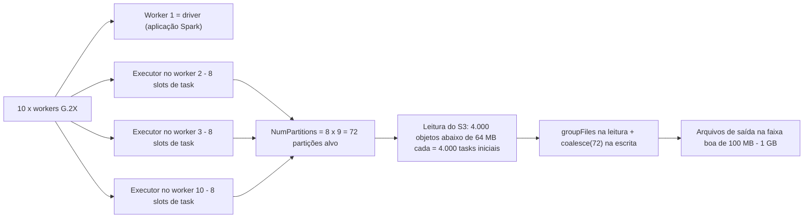
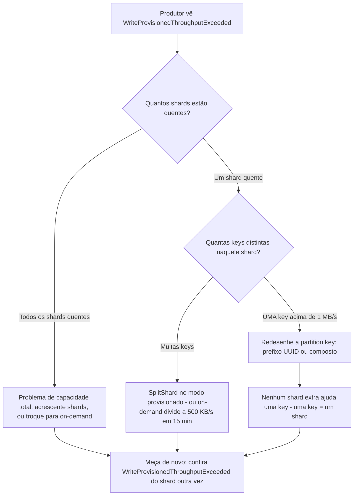
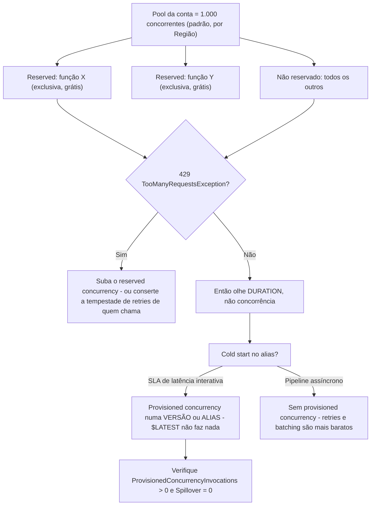
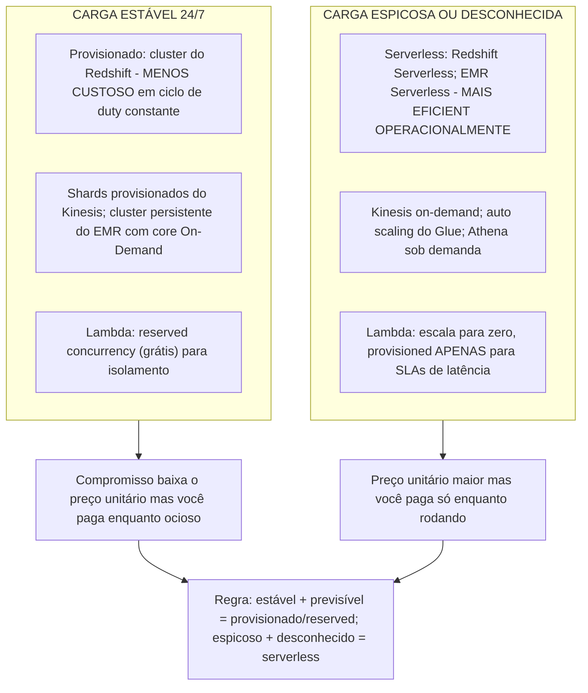

# Solução de Problemas, Desempenho e Otimização de Custo

O Domínio 3 do DEA-C01 é **Operações e Suporte de Dados, 22% do exame**, e suas declarações de tarefa dizem a mesma coisa de quatro formas diferentes: *troubleshoot performance issues* (3.3.4), *troubleshoot and maintain pipelines such as AWS Glue and Amazon EMR* (3.3.6), *analyze logs with AWS services* (3.3.8) e *implement data skew mechanisms* (3.4.5). O custo fica ao lado delas na **2.1.1** — escolha serviços de armazenamento para requisitos específicos de **custo e desempenho** — e na **3.2.5**, descreva trade-offs entre serviços **provisionados e serverless**. Esta lição é a união dessas habilidades: um loop de triagem repetível, um mapa sintoma→causa→correção por serviço, e a aritmética que transforma "torne isso mais barato" em uma resposta defensável.

```text
====================================================================
 DEA-C01 - TAREFAS DO DOMÍNIO 3 COBERTAS NESTA LIÇÃO
--------------------------------------------------------------------
 3.1.4  Use AWS services to process data (EMR, Redshift, Glue)
 3.1.6  Use AWS Glue DataBrew to profile, cleanse, transform
 3.1.8  Use AWS Lambda to automate data processing
 3.2.5  Describe tradeoffs between provisioned and serverless
 3.3.4  Troubleshoot performance issues
 3.3.6  Troubleshoot and maintain pipelines (AWS Glue, Amazon EMR)
 3.3.8  Analyze logs (Athena, EMR, OpenSearch, Logs Insights)
 3.4.5  Implement data skew mechanisms
 1.1.9  Implement throttling and overcome rate limits (Kinesis)
 1.4.2  Configure Lambda for concurrency and performance needs
 2.1.1  Storage services for specific cost and performance needs
--------------------------------------------------------------------
 LOOP ......... log -> métrica -> plano -> alavanca -> medir
 SERVIÇOS ..... Glue | Redshift | EMR | Kinesis | Lambda | S3
 PREÇOS ....... tabela de preços us-east-1, em outubro de 2026
====================================================================
```

> [!NOTE]
> **Um loop, sempre.** Leia o **log de erro** primeiro, confirme a **métrica**, encontre o **plano ou o contador** que a explica, mude exatamente **uma alavanca**, depois meça de novo. O exame recompensa o candidato que nomeia a *causa* antes do *botão* — e todo distractor deste tópico é um botão real girado pela razão errada.

Nesta lição você vai:

- rodar um **loop de triagem de quatro etapas** e uma **taxonomia de falhas** cobrindo drift de esquema, arquivos corrompidos, OOM, timeout, IAM, throttling, small files e encoding com sintoma→causa→correção por serviço;
- dimensionar o **AWS Glue**: tipos de DPU e worker, aritmética de partições, auto scaling, flexible execution, modos de falha de bookmark, `repartition` versus `coalesce` e fusão de small files;
- diagnosticar o **Amazon Redshift**: erros de distribution e sort key, triagem de skew com `SVV_TABLE_INFO`, VACUUM/ANALYZE automáticos e ATO, WLM e query monitoring rules, pruning do Spectrum e leitura de um plano **EXPLAIN**;
- dimensionar corretamente o **Amazon EMR**: papéis de nó primário/core/task, aritmética de contagem de nós, nós de tarefa Spot, HDFS versus S3 e quando o EMR Serverless é a resposta;
- consertar o **Amazon Kinesis Data Streams**: hot shard versus hot key, redesenho da partition key, alarmes de idade do iterador e os **três** modos de capacidade;
- operar o **AWS Lambda**: pools de concorrência, reserved versus provisioned concurrency, timeouts, reprocessamentos assíncronos e dead-letter queues;
- aplicar uma **tabela de alavancas de custo por serviço**, uma **tabela de trade-offs entre custo e desempenho** e as heurísticas de enunciado **MAIS eficiente operacionalmente / MENOS custoso**;
- resolver **sete exemplos trabalhados** — aritmética de partição e custo do Glue, triagem de skew do Redshift, um exercício de EXPLAIN, dimensionamento de nós do EMR, custo de shard do Kinesis, concorrência do Lambda e custo de provisioned concurrency, e custo de requisições do S3;
- ler a **caixa de atualizações de outubro de 2026**, **quatro estudos de caso de clientes da AWS** e terminar com **quatro questões estilo exame** mais três verificações interativas.

---

## 1. O loop de triagem e a taxonomia de falhas

### 1.1 Quatro etapas, em ordem

| Etapa | Pergunta | Onde você olha | O que você não deve fazer |
|---|---|---|---|
| 1. **Log** | Qual string exata o serviço emitiu? | CloudWatch Logs da execução do job: procure `ERROR`, `EXCEPTION`, `Exit code` | Não redimensione nada antes de ter lido a mensagem |
| 2. **Métrica** | Qual número está anormal? | Heap do driver/executor do Glue, views `STL`/`SVL` do Redshift, `IteratorAge` do Kinesis, `Throttles` do Lambda | Não chute entre OOM de driver e de executor — as métricas separam os dois |
| 3. **Plano / contador** | Por que esta carga tem este formato? | `EXPLAIN` do Redshift, `SVV_TABLE_INFO`, UI do Spark / aba **Executors** do Glue, `SVL_S3PARTITION` | Não acrescente capacidade a um plano que está varrendo os bytes errados |
| 4. **Alavanca** | Uma mudança: código, layout ou capacidade? | Layout (chaves, partições, tamanho de arquivo) primeiro, capacidade segundo, modelo de preço terceiro | Não compre um desconto no tamanho errado |

A própria orientação de troubleshooting da AWS é direta: comece no **Error log** da execução do job e depois vá para a aba **Executors** / UI do Spark para ver *qual* executor morreu e *quando* (orientação de troubleshooting e Builder do AWS Glue, acesso em outubro de 2026).

### 1.2 Sintoma → causa → correção, por serviço

Esta tabela é o núcleo examinável da Habilidade 3.3.4. Cada linha é um modo de falha da AWS documentado com a correção que a AWS documenta para ele (documentação de troubleshooting do AWS Glue, diagnóstico do Redshift e troubleshooting de EMR/Kinesis/Lambda, acesso em outubro de 2026).

| Sintoma | Causa provável | Correção (como a AWS documenta) |
|---|---|---|
| **Drift de esquema** — o job succeeds mas colunas foram adicionadas, removidas ou com tipo trocado; o a jusante quebra | Fonte upstream mudou; tabela do Glue foi para uma nova versão; DynamicFrame codifica inconsistências como **tipos de escolha** | Dife as **versões de tabela** do Catálogo → log + SNS → evolua o a jusante *antes* que o formato mude; `resolveChoice` para cast ou `make_cols`; defina `UpdateBehavior` do crawler como `UPDATE_IN_DATABASE` |
| **Registros corrompidos/maformados descartados em silêncio** | Linha CSV não cabe no esquema inferido; leitor de CSV vetorizado não faz `multiLine` nem multibyte | `errorsAsDynamicFrame()` → frame de rejeição com `stageThreshold` / `totalThreshold` para **falhar rápido**; ponha os rejeitados em quarentena no S3; mude para o leitor baseado em linhas |
| **`java.lang.OutOfMemoryError`, `Command failed with exit code 1`** | OOM do **driver** (índice de arquivos de milhares de small files, `collect()`) ou OOM do **executor** (partição gorda, join grande, arquivo não dividível) | Divida o diagnóstico: CloudWatch `glue.driver.jvm.heap.usage` versus `glue.executorID.heap.usage`. Driver → `groupFiles`, `useS3ListImplementation=True`, predicados de pushdown. Executor → worker maior (G.1X→G.2X→R.*), mais workers, `repartition(N)` antes do join, `fetchsize` do JDBC |
| **`Container killed by YARN for exceeding memory limits`** | Join com skew, partição gorda ou um arquivo grande não dividível | Troque o tipo de worker, acrescente executors, faça repartition para o total de cores dos executors, habilite bookmarks para reduzir o volume de arquivos |
| **Job `TIMEOUT` / longa inatividade antes da primeira task** | Timeout atingido, ou o driver ainda está listando objetos e partições do S3 | Padrões: **2.880 min** (Glue ≤4.0) / **480 min** (5.0+), máximo **10.080 min = 7 dias**; reduza a contagem de arquivos e partições para a listagem terminar |
| **`AccessDenied` em S3 ou JDBC** | Papel do job sem `s3:GetObject` / `s3:ListBucket` / `s3:GetBucketLocation`, conexão ou security group errados, caminho de script errado | Conserte a **política de menor privilégio no papel do job** — não a política do bucket, não o código-fonte |
| **Throttling: `SlowDown` no S3, `WriteProvisionedThroughputExceeded` no Kinesis, `429 TooManyRequestsException` no Lambda** | Muitos LIST/GET/HEAD num prefixo; um shard acima de **1 MB/s + 1.000 rec/s**; conta acima da cota de concorrência | S3 → fusão de objetos, reduza `spark.sql.sources.parallelPartitionDiscovery.parallelism` (padrão **10.000**). Kinesis → acrescente shards, redesenhe a partition key ou troque de modo. Lambda → reserved concurrency, mais batching |
| **Small files: CPU do driver alta, milhares de tasks, conta de requisições do S3 subindo** | A upstream grava objetos por evento ou por partição | Agrupe na **leitura** (`groupFiles: 'inPartition'`, automático acima de **50.000** arquivos no S3), fusão na **escrita** (`coalesce(N)`, `.repartition(col)`, `maxRecordsPerFile`), alvo de objetos de **100 MB–1 GB** |
| **Encoding: mojibake, `CharacterEncodingException`, linhas meio parseadas** | Charset ≠ padrão do leitor (UTF-8 versus CP1252/Latin-1), ou o leitor CSV vetorizado em dados multibyte | Defina `encoding` nas opções de formato do Glue; evite o leitor vetorizado para multibyte; acrescente uma regra de encoding do DataBrew antes do load |
| **Sucesso mas 0 linhas / "no data to process"** | Bookmark pulou arquivos antigos por hora da última modificação; prefixo errado ou vazio; o catálogo aponta para um caminho S3 morto | Confira os timestamps, desabilite o bookmark uma vez para testar, reponte a tabela |
| **`Unable to Infer Schema`** | Fonte Parquet/ORC que não é particionada no estilo Hive `key=value` | Restruuture os caminhos, ou leia o S3 diretamente com curingas e acrescente as colunas de partição você mesmo |
| **Linhas duplicadas com bookmarks habilitados** | `MaxConcurrency > 1`, `job.init()`/`job.commit()` ausentes, `transformation_ctx` ausente ou renomeado, chave JDBC não sequencial, entrada Spark **DataFrame** | Bookmarks suportam **apenas uma execução concorrente**; mantenha a string de contexto estável; alimente os bookmarks com **DynamicFrames**; use `ResetJobBookmark` / rewind para backfills |

### 1.3 A árvore de decisão das falhas

```mermaid
flowchart TD
    F["Execução do pipeline falha ou está lenta"] --> L["Etapa 1: leia o log de erro do CloudWatch"]
    L --> S{"Assinatura na mensagem"}
    S -->|OOM| M["Qual métrica de heap estoura?"}
    M -->|driver| D["Driver: índice de small files ou collect - groupFiles, pushdown, useS3ListImplementation"]
    M -->|executor| X["Executor: partição gorda ou join grande - worker maior, repartition, fetchsize"]
    S -->|AccessDenied| I["IAM: conserte a política do papel do job - GetObject, ListBucket, GetBucketLocation"]
    S -->|Timeout| T["Listagem ou shuffle grande demais - corte arquivos e partições, depois suba o timeout"]
    S -->|Throughput ou 429| H["Capacidade: shards, cota de concorrência, paralelismo de LIST no S3"]
    S -->|Schema ou parse| P["Formato dos dados: versões de tabela, resolveChoice, errorsAsDynamicFrame, encoding"]
    D --> K["Etapa 4: mude UMA alavanca, meça de novo"]
    X --> K
    I --> K
    T --> K
    H --> K
    P --> K
    K --> Q{"Métrica voltou ao normal?"}
    Q -->|Não| L
    Q -->|Sim| R["Documente a causa e a alavanca no runbook"]
```

### 1.4 Verificação interativa — combine o sintoma com a correção

```matching
{
  "question": "Combine cada sintoma com a correção que a AWS realmente documenta:",
  "pairs": [
    {"left": "Driver OOM com milhares de objetos pequenos no S3", "right": "groupFiles mais useS3ListImplementation e predicados de pushdown - o driver monta o índice inteiro de arquivos antes da primeira task rodar"},
    {"left": "Executor OOM num join", "right": "Tipo de worker maior, de G para R para memória, mais workers, repartition antes do join, fetchsize do JDBC - divida o diagnóstico com as duas métricas de heap primeiro"},
    {"left": "Bookmarks processaram os mesmos arquivos duas vezes", "right": "A concorrência máxima deve ser 1 e transformation_ctx deve estar estável - bookmarks não suportam execuções concorrentes"},
    {"left": "Kinesis limitado por UMA key", "right": "Redesenhe a partition key para UUID ou composto - acrescentar shards não espalha uma única key entre shards"},
    {"left": "Lambda com throttles 429 enquanto outras funções estão bem", "right": "Reserved concurrency dá à sua função uma fatia exclusiva do pool da conta - reserved concurrency 0 para deliberadamente uma função que se auto-dispara"},
    {"left": "Query do Redshift com skew_rows acima de 4,00", "right": "Troque o distribution style - VACUUM conserta linhas não ordenadas, não skew, e ANALYZE conserta estatísticas velhas"}
  ],
  "explanation": "Seis sintomas, seis alavancas diferentes: layout de arquivos, dimensionamento de worker, contabilidade de bookmark, design de chave, isolamento de concorrência e distribution da tabela. Os distractors do exame sempre trocam duas alavancas entre linhas - a disciplina é nomear a classe de causa (formato dos dados, código, capacidade, permissões) antes de tocar num botão."
}
```

- **📚 Você sabia?** Um job do Glue pode reportar **SUCCEEDED** sem gravar nada: um bookmark que já registrou os arquivos de origem os pulará na próxima execução, e um prefixo errado ou um caminho morto do catálogo parecem idênticos a uma partição vazia saudável. A própria lista de troubleshooting da AWS portanto coloca "sucesso sem dados" ao lado de erros reais — a correção é uma verificação de timestamp, não um stack trace (guia de troubleshooting do AWS Glue, acesso em outubro de 2026).

---

## 2. Falhas de formato dos dados: drift, arquivos corrompidos, encoding

### 2.1 Drift de esquema é um problema de versão, não de parse

Quando um time upstream adiciona, remove ou troca o tipo de uma coluna, três coisas acontecem em sequência: a **fonte** muda, a **tabela do Glue** ganha uma nova versão no Data Catalog, e todo **consumidor a jusante** (crawler, query do Athena, schema externo do Redshift, dataset do QuickSight) herda a mudança em silêncio. O padrão da AWS para isso é: difar as versões da tabela → publicar num tópico SNS → evoluir o consumidor **antes** que os dados cheguem (AWS Big Data Blog, "Identify source schema changes using AWS Glue", 14-09-2022).

Dentro do próprio job, um DynamicFrame representa "algumas linhas têm esta coluna, outras não" como um **tipo de escolha**. O reparo documentado é `resolveChoice`, que ou faz **cast** (você nomeia o tipo — valores não conversíveis viram `NULL`) ou **`make_cols`** (acrescenta uma coluna anulável). Estreitamente relacionado: o crawler reporta **"Partitions were not updated"** quando o esquema do DynamicFrame de entrada não é idêntico a, ou um subconjunto de, o esquema do catálogo e `updateBehavior` não é `UPDATE_IN_DATABASE`.

> [!IMPORTANT]
> ⚠️ **Duas armadilhas de drift.** (1) `cast` é com perdas: `cast:long` transforma todo valor não conversível em **NULL**, convertendo um bug de esquema em perda silenciosa de dados — sempre siga um cast com uma regra de completude ou faixa. (2) **Bookmarks não são detecção de drift**: eles definem o escopo de *quais arquivos* ler, eles nunca comparam *formatos*. Um job com bookmarks perfeitos pode absolutamente processar um esquema alterado sem reclamar.

### 2.2 Registros corrompidos: rejeite alto ou ponha em quarentena

Linhas CSV malformadas que "cabem" no esquema inferido são descartadas em silêncio. O remédio documentado é `errorsAsDynamicFrame()`, que divide o frame em um frame bom e um frame de rejeição, mais as contagens `stageThreshold` / `totalThreshold` que **falham o job** quando as rejeições excedem um orçamento. O padrão operacional da Lição 11 completa isso: grave as rejeições num **prefixo de quarentena** com `_dq_rule`, `_dq_reason` e `_run_id`, e alerte sobre a contagem. O leitor CSV vetorizado é uma armadilha específica — ele não lida com `multiLine` nem conteúdo multibyte, então "erros de parse que só aparecem em algumas linhas" geralmente significa "use o leitor baseado em linhas".

### 2.3 Encoding

Divergências de charset aparecem como caracteres corrompidos, campos truncados ou linhas que quebram na vírgula errada. Defina `encoding` nas opções de formato do Glue, evite o leitor vetorizado para dados multibyte e coloque uma regra de encoding do DataBrew **antes** do load em vez de limpar mojibake no warehouse. Encoding é um *contrato origem-destino* e, assim como o drift de esquema, é invisível nas contagens de linhas — que é exatamente por que os dois pertencem à taxonomia e não a um capítulo lateral de "qualidade de dados".

---

## 3. Desempenho do AWS Glue: DPU, workers, bookmarks, small files

### 3.1 O que você realmente está pagando

**Um DPU = 4 vCPUs de capacidade de computação e 16 GB de memória** (documentação de tipos de worker do AWS Glue, acesso em outubro de 2026). Jobs do Glue 2.0+ são dimensionados com `WorkerType` + `NumberOfWorkers` — não existe `MaxCapacity` em versões modernas — e **um executor do Spark roda por nó worker**, em todos os tipos G e R.

| Tipo de worker | DPU | vCPU | RAM (GB) | Disco (GB) | Notas |
|---|---|---|---|---|---|
| G.025X | 0,25 | 2 | 4 | 84 | Streaming e trabalho leve |
| G.1X | 1 | 4 | 16 | 94 | Padrão geral |
| G.2X | 2 | 8 | 32 | 138 | Padrão geral para Spark ETL |
| G.4X | 4 | 16 | 64 | 256 | Joins maiores |
| G.8X | 8 | 32 | 128 | 512 | Planos grandes de driver |
| G.12X / G.16X | 12 / 16 | 48 / 64 | 192 / 256 | 768 / 1024 | **Latência de inicialização maior** |
| R.1X – R.8X | 1 – 8 | 4 – 32 | 32 – 256 | 94 – 512 | **Otimizado para memória (M-DPU, 2× RAM)**, latência de inicialização maior |

Regra de dimensionamento do guia de tuning do Prescriptive Guidance: **escale horizontalmente** (mais workers) apenas "até observar workers ociosos — além disso, acrescentar mais workers aumenta custos sem melhorar resultados", e **escale verticalmente** (tipo maior) para transformações pesadas de memória, agregações com skew e planos grandes de driver.

### 3.2 Aritmética de partições — a conta que o exame pode pedir você refazer

Para Glue 3.0+:

```text
numExecutors = Workers - 1            (um worker é o driver)
slots/executor = 4 (G.1X) | 8 (G.2X) | 16 (G.4X) | 32 (G.8X)
NumPartitions = slots x numExecutors  -> multiplique x2 a x3 se as tasks forem irregulares

Exemplo: 10 x G.1X  ->  (10 - 1) x 4 = 36 partições alvo
         10 x G.2X  ->  (10 - 1) x 8 = 72 partições alvo
```

Partições iniciais a partir do S3: para objetos **≤ 64 MB**, conte os objetos; para **> 64 MB**, use `size / 64 MB`; **gzip não dividível conta como uma task por objeto** — um único `.csv.gz` de 10 GB é **1 task**, não importa quantos workers você compre. Partições demais explodem o driver e o agendador de tasks, então conserte-as com `groupFiles`, `coalesce(N)` (sem shuffle completo, então mais barato que `repartition`) ou o coalescing do AQE do Spark 3.



### 3.3 Auto scaling, flexible execution e AQE

- **Auto scaling** (`--enable-auto-scaling=true`, Glue 3.0+, todos os tipos G/R): o Glue adiciona e remove workers por estágio até `NumberOfWorkers` como **máximo**, e também define `spark.sql.shuffle.partitions` e `spark.default.parallelism` a partir desse máximo — sobrescreva com `--conf` se sua carga for irregular.
- **Flexible execution** (Glue 3.0+, **somente G.1X e G.2X**, jobs não urgentes): uma DPU-hora com desconto em troca de um horário de início variável. Pré-produção e backfills noturnos são o caso de uso documentado.
- **AQE** está ligado por padrão no Glue 4.0; no 3.0 defina `spark.sql.adaptive.enabled=true`. Ele coalesca partições de shuffle, converte sort-merge join em broadcast e lida com skew com `skewedPartitionFactor` / `skewedPartitionThresholdInBytes`.
- **Escalar horizontalmente não é linear.** O próprio exemplo de métricas trabalhado da AWS (10 → 55 DPU corta o tempo pela metade, 55 → 100 DPU não acrescenta nada porque os executors ficam ociosos) vem de uma página aplicável apenas ao Glue 0.9/1.0 — leve o **método** ("acrescente workers apenas até ficarem ociosos"), nunca os minutos absolutos.

### 3.4 Exemplo trabalhado E1 — aritmética de partição e custo do Glue

```text
Cenário: 400 GB de CSV chegando como 4.000 objetos no S3, job roda em 10 x G.2X.

1. Slots ................. (10 - 1) x 8 = 72 partições alvo
2. Partições iniciais S3 . 4.000 objetos, cada um <= 64 MB  =>  4.000 tasks
                           -> longe demais: o driver monta um índice de
                              4.000 entradas e o agendador se afoga em tasks miúdas
3. Conserto ............... groupFiles: 'inPartition' na leitura,
                           coalesce(72) na escrita  (mais barato que repartition)
4. Capacidade ............. 10 workers x 2 DPU = 20 DPU
5. Custo por execução ..... 20 DPU x 0,5 h x US$ 0,44/DPU-hora = US$ 4,40
6. Custo se rodasse de hora em hora . 720 h x US$ 4,40 = US$ 3.168 por mês
                           (derivado do US$ 0,44/DPU-hora publicado pela AWS,
                            us-east-1, em outubro de 2026)
7. Alavancas .............. auto scaling (o teto continua em 20 DPU), flexible
                           execution para um job não urgente, ou bookmarks para
                           que arquivos inalterados nunca sejam reprocessados
```

### 3.5 Bookmarks: o modo de falha mais errado deste exame

A AWS documenta **sete** maneiras de um job com bookmark reprocessar dados: `MaxConcurrency > 1`, `job.init()` / `job.commit()` ausentes, `transformation_ctx` ausente ou renomeado, chave primária JDBC não sequencial, hora da última modificação alterada, **entrada Spark DataFrame em vez de DynamicFrame** e caminho de origem alterado sob o mesmo contexto. Duas frases cobrem a maioria dos itens de exame:

- *"Atualmente os bookmarks do AWS Glue não suportam execuções concorrentes de job e os commits falharão."* — mantenha **Max concurrent runs = 1**.
- *"Se você não passar o parâmetro `transformation_ctx`, então os job bookmarks não são habilitados para um dynamic frame ou uma tabela usada no método."* — bookmarks rastreiam operações de **DynamicFrame**, e rastreiam **origens, não destinos**: um rewind ou reset nunca apaga o que já foi gravado, então reproduza num **novo prefixo de destino**.

### 3.6 `repartition` versus `coalesce`, e fusão de small files

| Você quer… | Use | Por quê |
|---|---|---|
| Arquivos de saída **menores em quantidade e maiores** | `coalesce(N)` ou `maxRecordsPerFile` | Sem shuffle completo, então mais barato |
| **Mais** partições, ou rebalancear **por uma coluna** (consertar skew) | `repartition(N)` ou `repartition(col)` | Um shuffle é exatamente o que o rebalanceamento precisa |
| Ler **milhares** de entradas pequenas | `groupFiles: 'inPartition'` com um `groupSize`, ou apoie-se no agrupamento automático acima de **50.000** arquivos no S3 | Agrupa na leitura em vez de criar uma task por objeto |
| Alimentar o Redshift Spectrum | Fusão para arquivos **≥ 64 MB** e partição nas colunas de predicado | O Spectrum cobra bytes varridos e sofre throttling com objetos pequenos demais |

## 4. Amazon Redshift: distribution, skew, manutenção, planos

### 4.1 Três doenças, três tratamentos

Questões de desempenho do Redshift quase sempre se resolvem em um de três problemas no nível da coluna — e cada um tem uma cura diferente (AWS Redshift *Identifying tables with data skew or unsorted rows*, acesso em outubro de 2026).

| Doença | Coluna diagnóstica | Limiar | Tratamento |
|---|---|---|---|
| **Skew** | `SVV_TABLE_INFO.skew_rows` = maior fatia ÷ menor | **≥ 4,00** → *considere* trocar o **distribution style** | Troque `DISTSTYLE`, não a sort key |
| **Não ordenada** | `pct_unsorted` | **> 20 %** → *considere* `VACUUM` — mas leia `vacuum_sort_benefit` primeiro | Uma tabela pode estar 86 % não ordenada e apenas 5 % melhorável; pule a execução que não muda nada |
| **Estatísticas velhas** | `stats_off` | Alto → `ANALYZE` | `ANALYZE t PREDICATE COLUMNS` para as colunas nas quais você filtra |

A manutenção automática está ligada por padrão: o **analyze automático** roda em janelas de carga leve com `analyze_threshold_percent = 10 %`, o auto vacuum de sort/delete pausa sob carga alta ou locks DDL exclusivos, e a **otimização automática de tabelas (ATO)** aplica sort e distribution keys em tabelas `AUTO` em poucas horas de ver suficientes queries. Audite com `SVV_ALTER_TABLE_RECOMMENDATIONS` e `SVL_AUTO_WORKER_ACTION`. Fatos-chave que o exame reutiliza: chaves **explícitas** de sort/distribution tiram a tabela da automação, e o `VACUUM` **pula a fase de sort por padrão quando mais de 95 % das linhas já estão ordenadas**.

### 4.2 Exemplo trabalhado E2 — triagem de skew em quatro queries

```sql
-- 1. Which table is sick?
SELECT "table", diststyle, distkey, skew_rows, unsorted, stats_off, vacuum_sort_benefit
FROM svv_table_info
ORDER BY skew_rows DESC NULLS LAST;

-- 2. Which QUERY is skewed? (WLM query monitoring rule template)
--    segment_execution_time > 120 AND io_skew > 1.30

-- 3. Is it memory, queueing or a LOCK?
SELECT query, service_class, total_queue_time
FROM stl_wlm_query WHERE query < 10000 ORDER BY total_queue_time DESC;
-- In STV_RECENTS but absent from STV_WLM_QUERY_STATE => waiting on a LOCK, not WLM

-- 4. Cure: skew_rows >= 4.00 + slow joins
ALTER TABLE events DISTSTYLE KEY DISTKEY(customer_id);
-- unsorted > 20 AND high vacuum_sort_benefit
VACUUM events;                 -- default skips sort above 95% sorted
-- high stats_off
ANALYZE events PREDICATE COLUMNS;
```

Depois refaça o `EXPLAIN` e procure a tag de redistribuição que você quer: `DS_DIST_NONE` / `DS_DIST_ALL_NONE`.

### 4.3 Fundamentos do EXPLAIN: leia o plano antes de redimensionar o cluster

| Operador de join | O que significa | Ação |
|---|---|---|
| **Nested Loop** | *"Esses joins geralmente ocorrem porque uma condição de join foi omitida."* | Conserte o predicado **antes** de tocar na capacidade |
| **Hash Join** | Correto mas pode transbordar para o disco | Verifique `SVL_QUERY_SUMMARY.is_diskbased = true` → precisa de mais memória ou menos slots |
| **Merge Join** | Mais rápido: os dois lados já estão distribuídos **e** ordenados pelas chaves de join | Mire nisso em joins grande-para-grande |

Tags de redistribuição: `DS_DIST_NONE` e `DS_DIST_ALL_NONE` são boas; `DS_BCAST_INNER` é **bom para uma dimensão pequena** e não é automaticamente ruim; `DS_DIST_INNER` / `DS_DIST_OUTER` são custosos; `DS_DIST_ALL_INNER` serializa a execução num único slice; `DS_DIST_BOTH` é o pior. Se o planner escolher uma direção de join que parece errada, a causa documentada é estatística velha — rode `ANALYZE`.

### 4.4 Exemplo trabalhado E3 — o plano que a própria AWS usa no treinamento

```text
BEFORE
  XN Hash Join  DS_BCAST_INNER   (cost=109.98..3871130276.17)
    -> XN Hash ... -> XN Seq Scan on event          (big fact table broadcast)

AFTER  ALTER TABLE event ... to a distribution that matches the join key
  XN Hash Join  DS_DIST_ALL_NONE (cost=... ..14142.59)

Cost delta: 3,272,334,142.59  ->  14,142.59   (about five orders of magnitude)
```

Duas lições examináveis: o *nome do operador* diz a estratégia, a *estimativa de custo* diz se importou, e nenhum dos dois exige um cluster maior (AWS Prescriptive Guidance, "Evaluating the query plan", acesso em outubro de 2026).

### 4.5 Gestão de carga de trabalho, concurrency scaling e Spectrum

- **WLM**: o padrão é **1 fila com 5 queries concorrentes**. O WLM automático cria até **8 filas** (service classes **100–107**) cada uma com uma `priority` (`NORMAL` padrão; `CRITICAL` é só para superusuário). O WLM manual permite concorrência **1–50 por fila**, **50 slots no total**, com uma porcentagem de memória por fila.
- **Query monitoring rules** rodam a cada **10 s**. Severidade da ação: `log` < `hop` (somente WLM manual, e apenas para queries CTAS/somente leitura) < `abort` (nunca para `COPY`, `ALTER`, `ANALYZE` ou `VACUUM`) < `change priority` (somente WLM automático). Templates para decorar: spill `query_temp_blocks_to_disk > 100000` blocos (**100 GB**) e I/O skew `io_skew > 1.30`.
- **Os timeouts do WLM cobrem apenas a fase em execução** — esperas de fila, lock, compilação e hop ficam fora deles.
- **Concurrency scaling** roteia queries excedentes para clusters transitórios em vez de enfileirar, por fila (`auto`/`off`), com **1 hora grátis a cada 24 horas** e `max_concurrency_scaling_clusters` de **1–10**. Ele alivia *enfileiramento*, não a pressão de memória por query.
- **Spectrum** cobra **US$ 5,00 por TB varrido** (mínimo de 10 MB por query, em outubro de 2026), então o pruning é uma alavanca de *custo* tanto quanto de velocidade: particione pelos predicados que você realmente filtra, use Parquet/ORC para eliminação de colunas, mantenha arquivos **≥ 64 MB** e defina `TABLE PROPERTIES (numRows = n)` porque **o Redshift nunca analisa tabelas externas** e caso contrário assume que a tabela externa é a maior tabela do plano. Verifique com `SVL_S3PARTITION` (`assigned_partitions` versus `qualified_partitions`), `SVL_S3QUERY_SUMMARY` (`s3_scanned_*`) e marcadores do EXPLAIN (`S3 Seq Scan`, `Partition Loop`). `DISTINCT` e `ORDER BY` **nunca** são empurrados para baixo.

- **📚 Você sabia?** Uma tabela do Redshift pode estar **86 % não ordenada e apenas 5 % melhorável** — `vacuum_sort_benefit` existe justamente para que você não pague por um `VACUUM` que não muda nada, e por padrão o VACUUM **pula a fase de sort completamente acima de 95 % de linhas ordenadas**. É por isso que "rode VACUUM após cada load" é um distractor, não uma melhor prática (documentação de vacuuming do AWS Redshift, acesso em outubro de 2026).

---

## 5. Amazon EMR: dimensionamento, nós de tarefa Spot, HDFS versus S3

### 5.1 Três papéis de nó, três decisões de compra

| Papel | Segura HDFS? | Compra típica | Orientação de dimensionamento |
|---|---|---|---|
| **Primário** | Não (só orquestração) | **On-Demand** | Pouca CPU; `m5.xlarge` sugerido até ~50 nós; ≤ 3 para HA |
| **Core** | **Sim — tasks + HDFS** | **On-Demand** | CPU + armazenamento; proteja os dados |
| **Task** | **Não — só tasks** | **Spot** | Só computação; perder um não perde dados |

A própria regra da AWS: *"Use instâncias Spot em nós de tarefa. Os nós de tarefa processam dados mas não guardam dados persistentes no Hadoop Distributed File System (HDFS). Se os nós de tarefa forem desligados… nenhum dado é perdido."* All-Spot é apenas para jobs transitórios e tolerantes a perdas. Repare no comportamento assimétrico do Spot: **instâncias de task-Spot lançam conforme a capacidade fica disponível**, enquanto **core-Spot espera todas as instâncias solicitadas** antes de lançar, e o reclaim do Spot permite cerca de **20 s** de desligamento gracioso (`spark.decommissioning.timeout.threshold`, EMR ≥ 5.11.0).

### 5.2 Exemplo trabalhado E4 — contagem de nós e capacidade de HDFS

```text
(a) Memory shortage: 912 GiB of data that must fit in memory
    912 GiB / 32 GiB per m5.2xlarge = 28.5  ->  29 TASK nodes, on Spot
    (fractional nodes do not exist; round UP, then verify with the Spark UI)

(b) HDFS capacity: (instance store + EBS per node) x nodes / replication factor 3
    10 x i2.xlarge (800 GB) = 8,000 GB  /  3  =  2,666 GB usable
    -> replication factor 3 is why HDFS looks "3x too small" on paper

(c) Output to S3 via EMRFS instead, and the core fleet only has to hold
    intermediate shuffle - smaller core fleet, cheaper cluster, cluster can
    terminate without losing the curated output.
```

**HDFS versus S3 para fins de exame**: S3/EMRFS é durável, desacoplado, sobrevive à terminação do cluster e custa menos por GB → é o **padrão do pipeline**; HDFS é mais rápido para shuffle intermediário mas consome o orçamento de replicação e morre com o cluster. No EMR, adaptive query execution está ligado por padrão (5.30+) com coalescing de partições de shuffle (tamanho advisory **64 MB**, `minPartitionNum` **25**, `initialPartitionNum` **1000**), dynamic partition pruning (5.26+) e `spark.default.parallelism = 2 × YARN cores`.

### 5.3 EMR Serverless — a opção sem dimensionamento

O EMR Serverless cobra **por vCPU-hora e GB-hora mais GB-hora de armazenamento** — **US$ 0,052624 / vCPU-hora**, **US$ 0,0057785 / GB-hora**, **US$ 0,000111 / GB-hora de armazenamento** (em outubro de 2026) — e os workers fazem auto scaling entre o mínimo e o máximo do job, então a decisão de dimensionamento desaparece. É a escolha natural para jobs **intermitentes** de Spark/Hive onde um cluster ficaria ocioso.

> [!WARNING]
> ⚠️ **Verificação de escopo antes de escolher "EMR Serverless" como resposta.** A lista de escopo do DEA-C01 da AWS imprime apenas **"Amazon EMR"** — ela não nomeia EMR Serverless como entrada separada, e a AWS não faz afirmação sobre se uma alternativa só-Serverless é pontuada. Ensine a si mesmo o pricing e a mecânica (são reais e documentados), mas no dia do exame prefira a alternativa cujo *nome de serviço* está na lista de escopo, a menos que o próprio enunciado diga Serverless.

---

## 6. Amazon Kinesis Data Streams: hot shards, idade do iterador, modos de capacidade

### 6.1 Hot shard versus hot key — a distinção mais testada de todas

Limites por shard são **1 MB/s de escrita e 1.000 records/s**, **2 MB/s e 2.000 records/s de leitura** e **5 TPS de leitura**; um único registro pode ter **10 MiB** e o `PutRecords` aceita até **500 records / 10 MiB** por chamada (limites do AWS Kinesis, acesso em outubro de 2026).

- **Hot shard** = *muitas* keys caindo desigualmente → divida o shard (no provisionado `UpdateShardCount` / `SplitShard`) ou deixe o on-demand dividir.
- **Hot key** = *uma* key excedendo o limite de um shard → **redesenhe a partition key** (sufixo UUID ou composto) **ou**, se você precisa de ordenação/localidade por key, mantenha a key e aceite o teto.
- **Acrescentar shards não conserta uma hot key**: todo registro de uma key cai no mesmo shard, para sempre. E o modo on-demand *"não detecta nem isola hash keys que estão dirigindo uma porção maior do tráfego de entrada para um shard em particular"* — documentado explicitamente, é por isso que é uma resposta errada favorita.



### 6.2 A idade do iterador é um aviso de perda de dados, não só de atraso

`GetRecords.IteratorAgeMilliseconds` (stream) / `IteratorAgeMilliseconds` (shard) mede o atraso do consumidor; **0 significa totalmente em dia**. O aviso da AWS: *"Se a idade de um iterador passar de 50% do período de retenção (por padrão, 24 horas, configurável até 7 dias), há risco de perda de dados por expiração de registros."* Então alarme em **Maximum** em **50 % da retenção** e conserte com: mais shards, `ParallelizationFactor` do Lambda (**1–10** por shard; a ordenação ainda é preservada *por partition key*), uma janela de batching de até **5 min / 6 MB**, **enhanced fan-out** (uma dedicada **2 MB/s por consumidor por shard**), ou simplesmente um consumidor mais rápido.

### 6.3 Três modos de capacidade, não dois

| Modo | Cobra | Você planeja capacidade? | Encaixe no exame |
|---|---|---|---|
| **Provisioned** | Shard-hour (**US$ 0,015**, em outubro de 2026) + unidades de payload de PUT (**US$ 0,014 / 1M** unidades de 25 KB) + EFO opcional | Sim — `UpdateShardCount` manual, splits granulares | Tráfego previsível, **controle de hot key** |
| **On-demand (Standard)** | Por GB de ingestão/recuperação + por stream-hour | Não — padrão **4 MB/s de escrita / 8 MB/s de leitura**, até **10/20 GB/s** em us-east-1/us-west-2/eu-west-1, **200/400 MB/s** em outras regiões; divide a **500 KB/s em 15 min** | Tráfego imprevisível ou desconhecido |
| **On-demand Advantage** | No nível da conta: sem cobrança horária por stream, taxas de GB menores, **piso de 25 MB/s de ingestão + 25 MB/s de recuperação** | Não | Ingestão agregada alta, muitos streams, fan-out |

As trocas de modo são limitadas a **2 por 24 horas móveis**. O EFO custa **US$ 0,015 por consumidor-shard-hora** mais por GB, e suporta **20** consumidores registrados por stream (Standard) ou **50** (Advantage); com menos de cerca de **3** consumidores, leituras compartilhadas são a escolha mais barata.

- **📚 Você sabia?** A idade do iterador é uma das poucas métricas da AWS em que "maior" pode significar **perda permanente de dados** em vez de "mais lento": uma vez que um registro passa da janela de retenção ele sumiu, e nenhum scaling traz de volta. É por isso que a recomendação da AWS é um alarme em **metade** do período de retenção, e não em 100 % (documentação de monitoramento do AWS Kinesis, acesso em outubro de 2026).

### 6.4 Exemplo trabalhado E5 — custo de shard e a conta de unidades de payload

```text
4 provisioned shards, always on, us-east-1 (as of Oct 2026):
  4 shards x 24 h x 31 days = 2,976 shard-hours x $0.015 = $44.64 / month

Ingest: 100 records/s at 35 KB each
  units per record = ceil(35 / 25) = 2
  100 rec/s x 2 units x 2,678,400 s = 535,680,000 units
  535.68 M units x $0.014 / 1M      = $7.50 / month

Add ONE enhanced fan-out consumer:
  4 consumer-shards x 730 h x $0.015 = +$43.80 / month (plus per-GB)
  -> EFO is roughly a doubling of the shard bill: skip it below ~3 consumers.

Derived arithmetic from AWS's published rates; re-verify per Region.
```

---

## 7. AWS Lambda: concorrência, timeouts, cold starts, reprocessamentos

### 7.1 O pool de concorrência

O padrão da conta é **1.000 execuções concorrentes por Região**; uma função escala até **1.000 ambientes por 10 segundos**, e o teto de invocações por segundo é cerca de **10 × a cota de concorrência**. Acima da cota, as invocações são limitadas com **429**.

| Botão | O que faz | Custo | Use quando o enunciado diz… |
|---|---|---|---|
| **Reserved concurrency** | Uma fatia **mínima e máxima** exclusiva do pool da conta; o máximo é *não reservado − 100*; **nenhuma outra função pode usá-la**; **0 para deliberadamente** a função | Grátis | "sufocada por **outras** funções", "limitada por um vizinho barulhento", "pare um loop que se auto-dispara" |
| **Provisioned concurrency** | Pré-aquece ambientes de execução; precisa apontar para uma **versão ou alias — nunca `$LATEST`**; alocação de 1–2 min, até **6.000 ambientes/min**, cobrado em incrementos de **5 minutos**, **sem free tier** | Cobrado 24/7 pela **capacidade** (`US$ 0,0000041667/GB-s`) mais a execução | "latência de cold start", "latência p99 consistente" |
| **Não reservado da conta** | Todo o resto | — | Padrão |

Reserved e provisioned concurrency contam ambas contra o pool da conta, e **provisioned ≤ reserved** para a mesma função. O Application Auto Scaling mira **70 %** de utilização (escala para fora acima de 70, para dentro abaixo de 63), e a orientação da própria AWS é que *pipelines assíncronos de processamento de dados geralmente não precisam de provisioned concurrency*.



### 7.2 Timeouts e reprocessamentos

Suba **memória e timeout juntos**: a CPU é proporcional à memória, então um "timeout" frequentemente é uma função subdimensionada. Reprocessamentos assíncronos não consertam subdimensionamento — eles só o escondem até a DLQ encher:

- **Síncrono**: quem chama vê o erro; os retries seguem a *política de quem chama*.
- **Assíncrono**: o Lambda enfileira e depois reprocessa **2 vezes** (após 1 minuto, depois 2 minutos) para erros de função; para **throttling (429) e erros de sistema (série 500)** o evento volta à fila e é reprocessado por até **6 horas**, com backoff de **1 s até 5 min**. Então a **dead-letter queue** (somente SQS **standard** ou SNS **standard** — nunca FIFO) ou o on-failure destination o recebe; um on-failure destination carrega adicionalmente o payload de resposta.
- **Stream (event source mapping)**: reprocessa até `bisect_batch_on_error`, `maximum_record_age` ou `retry_attempts` disparar, depois o **on-failure destination**. Para Kinesis, `ParallelizationFactor` **1–10** aumenta o paralelismo por shard mantendo a ordem por partition key.

### 7.3 Exemplo trabalhado E6 — concorrência, reserved versus provisioned

```text
Load: 3,000 requests/second, average duration 120 ms
  Needed concurrency = 3,000 x 0.120 s = 360 concurrent executions
  Scale rate (1,000 env / 10 s) is plenty; the RPS ceiling is 10 x quota.

If other functions in the account are hungry:
  Reserve ~400 (360 + headroom)  ->  reserved concurrency, FREE,
  and your maximum becomes (unreserved - 100) once configured.

Cold-start SLA instead (interactive API):
  Provisioned ~= peak x 1.10 = ~400 units x 1.5 GB = 600 GB warm
  600 GB x 2,678,400 s x $0.0000041667/GB-s = about $6,700 per month
  STANDING cost, billed whether invoked or not, 5-minute increments,
  no free tier (derived from AWS's published rate, as of Oct 2026).

Pipeline (async, latency-insensitive)  ->  NO provisioned concurrency.
Self-triggering function               ->  reserved concurrency 0, then repair.
```

## 8. Alavancas de custo por serviço

### 8.1 A dimensão cobrável, depois a alavanca

Nunca nomeie uma alavanca sem nomear a dimensão que ela reduz (páginas de preços do AWS Glue, Redshift, EMR, Kinesis, Lambda e S3, em outubro de 2026).

| Serviço | Dimensão cobrável | Alavancas mais baratas |
|---|---|---|
| **Glue ETL** | **DPU-hora**, por segundo, mínimo de 1 minuto — **US$ 0,44/DPU-hora** | Menos workers quando os executors ficarem ociosos; teto do auto scaling; `G.025X` para streaming; **flexible execution** (G.1X/G.2X, não urgente); **bookmarks** para que arquivos inalterados nunca sejam reprocessados |
| **Glue crawler** | DPU-hora com mínimo de **10 minutos** | Menos alvos de crawl; **partition indexes** em vez de re-crawls |
| **Glue DataBrew** | **node-hour** (US$ 0,48, padrão de **5 nodes**) + **US$ 1,00 por sessão de 30 minutos** | Menos nodes; **feche as sessões**; mova transformações pesadas para Glue/SQL |
| **Amazon Redshift** | **node-hour** ou **RPU-hour** + armazenamento gerenciado + Spectrum **US$ 5,00/TB varrido** | Compressão, sort keys, dist keys, pushdown de predicado; créditos de concurrency scaling antes de um cluster maior; pause clusters ociosos; Serverless para carga espicosa |
| **Amazon EMR** | Hora de EC2 + EBS + uma **taxa do EMR por hora** (por segundo, mínimo de 1 minuto); Serverless = vCPU/GB/hora | **Spot em nós de task**; clusters transitórios terminados após o uso; EMR Serverless para jobs intermitentes; saída para o S3 para manter a frota core pequena |
| **Kinesis Data Streams** | Provisionado: **shard-hour** + **unidades de payload de PUT** + EFO (**consumer-shard-hora** + GB); On-demand: **GB de ingestão/recuperação** + stream-hour | Dimensione certo a contagem de shards; pule o EFO abaixo de ~3 consumidores; Advantage se a ingestão agregada já for alta |
| **AWS Lambda** | **Requisições** (US$ 0,20/1M) + **GB-segundos** (US$ 0,0000166667/GB-s x86) + GB-s de provisioned concurrency | Dimensione a memória certo (a CPU segue a memória); arm64; janelas de batching maiores / maior lote; **pule o provisioned concurrency para pipelines**; use reserved concurrency quando o objetivo for isolamento |
| **Amazon S3** | **Armazenamento-mês por classe** (US$ 0,023/GB-mês Standard, primeiros 50 TB) + **requisições** (PUT/COPY/POST/LIST **US$ 0,005/1.000**; GET **US$ 0,0004/1.000**) + recuperação + egress (primeiros **100 GB/mês** grátis na conta toda, depois **US$ 0,09/GB**) | Níveis de lifecycle; **objetos menores em quantidade e maiores**; mantenha a analítica na mesma Região; formatos colunares para reduzir bytes varridos a jusante |

### 8.2 Exemplo trabalhado E7 — small files custam duas vezes

```text
Upstream writes 1,000,000 objects per day of ~4 KB each (per-event writes).

WRITE REQUESTS (as of Oct 2026)
  1,000,000 PUTs / day  =  1,000 thousand PUTs x $0.005  =  $5.00 / day
  $5.00 x 30            =  $150 / month, just to write the data

MERGE TO 500 OBJECTS OF ~8 MB
  500 PUTs / day        =  0.5 thousand x $0.005         =  $0.0025 / day
  saving                =  about $149.92 / month  (derived)

DOWNSTREAM: Spectrum/Athena bill bytes SCANNED
  10 TB scanned per query day x 30 = 300 TB x $5.00/TB = $1,500 / month
  Columnar + partition pruning to 2 TB scanned        =   $300 / month

Rule of thumb: target 100 MB - 1 GB objects for Glue (5 - 10 DPU) and
>= 64 MB for Redshift Spectrum. Small files hurt S3 request cost AND
Spark task/driver overhead - fix on READ (grouping) and on WRITE (coalesce).
```

- **📚 Você sabia?** A metade de armazenamento da conta está caindo há vinte anos enquanto a metade de requisições não: o retrospectivo de S3 da AWS (13-03-2026) coloca a redução de preço desde o lançamento em 2006 em cerca de **85 %** e afirma que os clientes economizaram mais de **US$ 6 bilhões** usando **S3 Intelligent-Tiering** em vez de S3 Standard. É por isso que esta lição continua separando as alavancas de S3 em *classe de armazenamento* e *requisições* — automatizar a classe move um número grande, fundir objetos move o outro (post "Twenty years of Amazon S3" da AWS, acesso em outubro de 2026).

---

## 9. Custo versus desempenho: a tabela de trade-offs e as heurísticas de enunciado

### 9.1 O trade-off que o exame realmente pergunta

| Escolha | Opção mais barata | Opção mais rápida / mais segura | Desempate no enunciado |
|---|---|---|---|
| Glue **workers fixos versus auto scaling** | Auto scaling | Fixo (previsível) | Volume de dados desconhecido ou variável ⇒ auto |
| Glue **provisioned versus flexible execution** | Flexible | Provisionado | Não urgente / pré-produção ⇒ flexible (somente G.1X/G.2X) |
| Kinesis **provisioned versus on-demand** | Provisionado (estável) | On-demand (sem planejamento) | Imprevisível ⇒ on-demand; hot key precisando de splits granulares ⇒ provisionado |
| Kinesis **leituras compartilhadas versus enhanced fan-out** | Compartilhadas (< ~3 consumidores) | EFO (dedicado de 2 MB/s) | Muitos consumidores ou SLA de latência ⇒ EFO |
| Redshift **cluster versus Serverless** | Cluster (estável 24/7) | Serverless (burst, sem resize) | Espicoso ou desconhecido ⇒ Serverless |
| EMR **core On-Demand + task Spot versus tudo On-Demand** | Frota de task em Spot | Core On-Demand (HDFS seguro) | Padrão para clusters persistentes |
| EMR **cluster versus EMR Serverless** | Depende do ciclo de duty | Serverless (sem dimensionamento) | Intermitente / pontual de Spark ⇒ Serverless |
| Lambda **reserved versus provisioned concurrency** | Reserved (grátis) | Provisioned (morno) | Isolamento ⇒ reserved; SLA de latência ⇒ provisioned |
| **Tamanho de arquivo versus paralelismo** | Objetos menores em quantidade e maiores (menor custo de requisição) | Tamanho médio mantém o paralelismo | 100 MB–1 GB (Glue), ≥ 64 MB (Spectrum) |

### 9.2 Onde cada serviço se encaixa



### 9.3 As duas heurísticas de enunciado (derivadas do comportamento documentado da AWS, não de um documento da AWS)

- **"MAIS eficiente operacionalmente"** ⇒ escolha a alternativa **sem planejamento de capacidade e sem cluster para dimensionar**: AWS Glue (workers gerenciados, auto scaling), **EMR Serverless**, **Redshift Serverless**, **Kinesis on-demand**, **Lambda** — depois releia o enunciado procurando uma restrição que sobrescreva isso (HDFS, controle de hot key, ciclo de duty estável 24/7).
- **"MENOS custoso" (estável 24/7)** ⇒ escolha a alternativa **provisionada ou comprometida**: shards provisionados, um cluster do Redshift em vez de Serverless, computação On-Demand/comprometida, menos DPU-horas, S3 em níveis de lifecycle. Uma opção serverless que fica ociosa 20 horas por dia raramente é a mais barata.
- **"MAIS RÁPIDO de implementar"** ⇒ uma **mudança de configuração gerenciada** (WLM, auto scaling, um alarme, uma sort key) vence um refactor de código — a menos que a causa raiz do enunciado seja código (um predicado de join ausente, um `transformation_ctx` ausente).
- Leia sempre as **restrições primeiro**: estável versus espicoso, SLA versus throughput, isolamento versus latência. A heurística é o desempate, não a premissa.

### 9.4 Verificação interativa — preencha os números que o exame reutiliza

```fillblank
{
  "question": "Complete as afirmações de desempenho e custo com os próprios números da AWS (em outubro de 2026):",
  "template": "Um DPU do Glue tem {{1}} vCPUs e {{2}} GB de memória, e o Glue ETL é cobrado a US$ {{3}} por DPU-hora. O Redshift considera uma tabela com skew quando skew_rows é {{4}} ou maior, e pula a fase de sort do VACUUM quando mais de {{5}} por cento das linhas já estão ordenadas. Um único shard do Kinesis aceita {{6}} MB/s e {{7}} registros por segundo de escrita, e uma função Lambda deve ser alarmada quando a idade do iterador passar de {{8}} por cento do período de retenção. O padrão da conta para Lambda é {{9}} execuções concorrentes, e o provisioned concurrency deve apontar para uma versão ou alias, nunca {{10}}.",
  "answers": {
    "1": "4",
    "2": "16",
    "3": "0.44",
    "4": "4.00",
    "5": "95",
    "6": "1",
    "7": "1000",
    "8": "50",
    "9": "1000",
    "10": "$LATEST"
  },
  "distractors": ["2", "8", "32", "0.29", "0.52", "2.00", "10.00", "80", "75", "100", "500", "5000", "1,000,000", "LATEST", "PROD", "alias"],
  "explanation": "DPU = 4 vCPU + 16 GB a US$ 0,44/DPU-hora; limiar de skew 4,00; o VACUUM pula o sort acima de 95 por cento; um shard = 1 MB/s + 1.000 records/s; o alarme de idade do iterador fica em 50 por cento da retenção porque depois disso os registros começam a expirar; o padrão da conta é 1.000 concorrentes; e provisioned concurrency em $LATEST não faz nada porque $LATEST não pode ser provisionado."
}
```

### 9.5 Verificação interativa — ordene a decisão de custo

```dragdrop
{
  "question": "Coloque a sequência de otimização de custo desta lição na ordem em que precisa ser aplicada:",
  "items": [
    "Nomeie primeiro a dimensão cobrável - DPU-hora, TB varrido, shard-hour, requisições, GB-segundos",
    "Reduza a quantidade cobrada - pruning, coalesce, bookmarks, right-sizing, menos objetos",
    "Troque o modelo de preço somente agora - Spot, Savings Plans ou uma reserva no TAMANHO CERTO",
    "Meça a métrica de novo e registre a causa e a alavanca no runbook"
  ],
  "correctOrder": [
    "Nomeie primeiro a dimensão cobrável - DPU-hora, TB varrido, shard-hour, requisições, GB-segundos",
    "Reduza a quantidade cobrada - pruning, coalesce, bookmarks, right-sizing, menos objetos",
    "Troque o modelo de preço somente agora - Spot, Savings Plans ou uma reserva no TAMANHO CERTO",
    "Meça a métrica de novo e registre a causa e a alavanca no runbook"
  ],
  "explanation": "A ordem é a lição inteira: layout antes de capacidade antes de modelo de preço (Seção 1, etapa 4), depois meça de novo. Comprar um desconto no tamanho errado é o distractor clássico - um compromisso baixa o preço unitário mas não faz nada contra bytes varridos, DPU-horas queimadas ou objetos gravados. Todos os estudos de caso desta lição seguiram a mesma sequência: medir, encolher a quantidade, então escolher o modelo de preço."
}
```

### Atualizações de 2026 (em outubro de 2026)

> [!NOTE]
> **O que mudou entre as notas de estudo da época do lançamento e o exame que você vai fazer** — cada linha verificada contra uma fonte primária da AWS em **outubro de 2026**:
> - **As gerações do Glue seguiram em frente**: **Glue 5.1** é o **padrão para jobs novos desde 26-11-2025**, e o **Glue 6.0 entrou em GA em 21-08-2026** com **redução de 30 % de preço** (Spark 4.1.1, Python 3.13, Scala 2.13); **Glue 0.9/1.0/2.0 chegou ao fim de vida em 01-04-2026** e Python Shell 3.6 não pode ser criado depois de **31-03-2026**. No Glue 6.0 o **filesystem EMRFS e o AWS SDK for Java v1 são removidos** (S3A é o único filesystem do S3) — uma opção `fs.s3.consistent.*` ou `com.amazonaws.*` está desatualizada à vista (notas de versão, política de suporte de versão e guia de migração do AWS Glue, acesso em outubro de 2026).
> - **Kinesis tem três modos de capacidade, não dois**: Provisionado, On-demand Standard e **On-demand Advantage (04-11-2025)** — o ODA remove a cobrança horária por stream e corta as taxas por GB (a AWS afirma ≥ 60 % menor) mas aplica um **piso no nível da conta de 25 MB/s de ingestão + 25 MB/s de recuperação**. O **limite padrão de shards subiu de 500 para 20.000 por conta** (21-04-2025, us-east-1/us-west-2/eu-west-1) e **registros de até 10 MiB** são suportados (28-10-2025). Qualquer página de preparo dizendo "dois modos de capacidade" está desatualizada (What's New e documentação de dimensionamento da AWS, acesso em outubro de 2026).
> - **EMR Serverless ficou mais barato e maior**: o armazenamento local foi **eliminado (até 20 % mais barato, 06-01-2026)**, **workers de até 32 vCPU / 244 GB (07-07-2026)**, atualizações de configuração ao vivo (24-06-2026) e Spark Connect (09-06-2026); **Amazon EMR 7.14** foi lançado em 22-09-2026 (Spark 3.5.8, armazenamento de shuffle 200 GiB → 1 TiB). Lembre-se da ressalva de escopo da Seção 5 (AWS What's New, acesso em outubro de 2026).
> - **As alavancas de custo do Redshift ganharam uma opção de compromisso**: **reservas de 3 anos do Redshift Serverless** (23-02-2026, até **45 %**) e **AURI de 3 anos** (24-07-2026, até **50 %**) agora permitem dar desconto a uma carga serverless — então "Serverless é sempre mais caro em regime estável" precisa de um carimbo de data. O Redshift também ganhou suporte completo a **escrita/UPDATE/DELETE/MERGE em Iceberg** (17-11-2025 → 23-04-2026) e **views materializadas de Iceberg (05-10-2026)** (AWS What's New, acesso em outubro de 2026).
> - **O piso de custo do Athena e seu preço de entrada caíram**: as Capacity Reservations agora começam em **4 DPU por 1 minuto** em vez de 24 DPU por 60 minutos (**11-02-2026**), os **resultados de consulta gerenciados** (**03-06-2025**) são gerenciados pelo serviço, criptografados e **não custam nada extra** (então um bucket de resultados no S3 não é mais obrigatório), e **conectores gerenciados para 12 fontes** chegaram em **23-04-2026**. Um lote noturno de janela de 12 DPU agora é cobrado como 12 DPU × 10 minutos, não como uma hora de 24 DPU (AWS What's New e AWS Big Data Blog, acesso em outubro de 2026).
> - **Kinesis pode agora aterrissar direto num lake**: **tabelas em streaming** materializam um stream do Kinesis Data Streams em **Apache Iceberg no Amazon S3 Tables** (**28-08-2026**, Parquet automático com compactação inline, sem pulo pelo Glue ETL) e a **entrega de propósito geral no S3** grava registros no formato de origem num bucket comum (**29-08-2026**); ambos funcionam apenas nos modos on-demand e são precificados por GB entregue, com a AWS afirmando custo de entrega até **50–60 % menor** e custo de consulta até **30 % menor** (AWS What's New, acesso em outubro de 2026).
> - **Avisos de fato desatualizado**: o guia de exame é **v1.1 (12-12-2025)** com 8 habilidades acrescentadas e nenhuma remoção; a logística do exame permanece **130 minutos · 65 questões (50 pontuadas + 15 não pontuadas) · 150 USD · nota de corte 720/1.000** — páginas de terceiros ainda citando **170 minutos / 85 questões / 300 USD** estão descrevendo exames Specialty, não o DEA (páginas de certificação da AWS, acesso em outubro de 2026).

- **📚 Você sabia?** Reduções de *preço* mudam respostas de exame: Glue 6.0 (−30 %), S3 Express One Zone (armazenamento −31 %, PUT −55 %, GET −85 %, 10-04-2025) e o Kinesis on-demand Advantage todos mudaram a coluna "mais barato" — mas as *dimensões* (DPU-hora, shard-hour, GB-s, bytes varridos) não mudaram. Aprenda a dimensão e reverifique a taxa (páginas de preços da AWS, acesso em outubro de 2026).

---

## Casos Reais

A AWS publica como esta lição fica em produção. Todos os números abaixo são **afirmações de clientes ou da AWS, não auditadas**, com a fonte nomeada para você conferir — o ponto examinável é o **padrão** (qual alavanca moveu, e em qual direção), não a porcentagem de marketing.

### Caso A — Amazon Customer Service: dimensionar certo um warehouse

| Elemento | Detalhe |
|---|---|
| Cliente | **Amazon Customer Service** (a própria organização da Amazon) |
| Desafio | Um parque de Redshift rodando em nós mais antigos **dc2.8xlarge** com custo e latência de dashboards subindo |
| Serviços | **Nós RA3 do Amazon Redshift** (separação computação/armazenamento) com apoio de SA da AWS e da engenharia do Redshift |
| Resultados | **~55 % de custo operacional anual menor do Redshift**; dashboards **47 % mais rápidos**; consultas **25 % mais rápidas** — comparando **3× RA3.16xlarge contra dc2.8xlarge** |
| Alavanca usada | **Right-sizing + mudança de geração de nó** — a regra da Seção 9 "meça a utilização primeiro, o modelo de preço segundo" aplicada a um warehouse |
| Fonte | AWS Big Data Blog, 20-05-2021, "How Amazon Customer Service lowered Amazon Redshift costs and improved performance using RA3 nodes" (acesso em outubro de 2026) |

Leia como **Habilidade 3.3.4 mais 2.1.1 numa história só**: desempenho e custo se moveram *juntos*, porque o RA3 separa o armazenamento gerenciado da computação, então você para de pagar por disco local que só enchia de dados frios. A versão distractor dessa história diz que o custo caiu *porque* um desconto foi comprado — nenhum desconto aparece no estudo de caso.

### Caso B — Paytm: uma alavanca de custo faseada no EMR

| Elemento | Detalhe |
|---|---|
| Cliente | **Paytm**, pagamentos e fintech (Índia) |
| Desafio | Gasto alto de EC2/EMR num lake de escala petabyte, onde **o EMR era cerca de 65 % das cargas de analítica** |
| Serviços | **Amazon EMR em AWS Graviton** (mais EC2 Graviton para RDS, Aurora, OpenSearch, ElastiCache) |
| Resultados | **30–35 % de economia no EMR**; **80 % do EMR em Graviton até o fim de 2023**; migração iniciada em **2022**; migração de EC2 em **60 % (jan de 2024)** mirando **70 % no meio de 2024**; preço de lista do Graviton cerca de **50 % menor** em ap-south-1 |
| Alavanca usada | **Silício diferente, em fases** — repare que um delta de ~50 % no preço de lista produziu uma economia **realizada de 30–35 %** |
| Fonte | Estudo de caso da AWS, `solutions/case-studies/paytm-graviton-case-study/` (acesso em outubro de 2026) |

> "Migrar para instâncias baseadas em AWS Graviton é um investimento de longo prazo e será benéfico em termos de custo total de propriedade." — Parakh Aggarwal, Diretor de Cloud Excellence e FinOps (estudo de caso da AWS, acesso em outubro de 2026)

O padrão examinável é a **lacuna entre o preço de lista e a economia realizada**: uma alavanca só vale seus pontos depois que você mediu a carga, e a linha do tempo (2022 → 2024) mostra por que "troque tudo esta noite" nunca é a resposta neste exame.

### Caso C — GE Aerospace: um ODS legado reconstruído no Redshift

| Elemento | Detalhe |
|---|---|
| Cliente | **GE Aerospace** (aeroespacial e cadeia de suprimentos) |
| Desafio | Um grande operational data store (ODS) com restrições de conformidade e desempenho: consultas que rodavam **90 minutos**, **mais de 150 relatórios** em produção (alguns com **mais de 10.000 linhas de código**) e um warehouse que não conseguia mais servi-los |
| Serviços | **Amazon Redshift**, com apoio de Solutions Architect da AWS e da engenharia do Redshift |
| Resultados | Consultas de **90 minutos → 7 minutos**; cerca de **70 % de desempenho de consulta melhor**; economia estimada de **mais de US$ 500.000 por ano**; prova de conceito em nov–dez de 2022, depois uma **migração de 9 meses (jan–set de 2023)** |
| Alavanca usada | **Right-sizing + separação computação/armazenamento gerenciada no estilo RA3 num ODS legado** — a mesma família de alavanca do Caso A, provada numa carga muito mais antiga |
| Fonte | Estudo de caso da AWS, `solutions/case-studies/ge-aerospace-case-study/` (acesso em outubro de 2026) |

> "Estávamos vendo consultas que costumavam rodar uma hora e meia rodando em 7 minutos usando o Amazon Redshift." — Bejoy John, Diretor Sênior de Data Analytics (estudo de caso da AWS, acesso em outubro de 2026)

Leia como **Habilidade 3.3.4 (troubleshoot de desempenho) mais 2.1.1 (dimensionamento de custo/desempenho)**: a vitória veio de layout, plano e geração de nó, não de um desconto comprado. Dois hábitos de exame para treinar aqui: o **mais de US$ 500.000 é a estimativa da própria GE**, então nunca generalize para a sua carga; e uma **migração de 9 meses com PoC antes** é o oposto do distractor "conserte esta noite".

### Caso D — Edmunds.com: três alavancas, uma conta

| Elemento | Detalhe |
|---|---|
| Cliente | **Edmunds.com** (mídia automotiva) |
| Desafio | Um time enxuto ajustando custo após sua mudança de on-premises em 2016, com aplicações voltadas ao cliente superdimensionadas para o pico |
| Serviços | **EC2 Spot + Fargate Spot + Amazon ECS + Compute Savings Plans** (compromisso assumido a partir de janeiro de 2020) |
| Resultados | **Fargate Spot 25–30 % mais barato** que On-Demand; **US$ 100.000 economizados entre outubro de 2019 e agosto de 2020**; **−30 % de computação**; **80 %** das aplicações voltadas ao cliente no Fargate Spot; disponibilidade de **99,999 %** |
| Alavanca usada | **Três alavancas diferentes empilhadas deliberadamente**: capacidade Spot (interrompível), um compromisso de Compute Savings Plans (desconto para uso estável) — e, repare, *nenhum* resize |
| Fonte | Estudo de caso da AWS, `solutions/case-studies/edmunds-fargate-spot/` (acesso em outubro de 2026) |

> "A motivação principal é que eu não estou mais preso a um tipo de instância ou Região em particular." — Emil Ndreu, Diretor Executivo de Cloud and Security Operations (estudo de caso da AWS, acesso em outubro de 2026)

Faça a aritmética que a AWS não publica: **US$ 100.000 em 11 meses ≈ US$ 9.091 por mês**, mas a AWS nunca divide esse número entre Spot, Savings Plans e Fargate Spot — então qualquer alternativa que afirme "os Savings Plans sozinhos economizaram X %" não tem apoio na fonte. A distinção examinável é o **tipo de alavanca**: um Savings Plans é um **desconto por compromisso** (Compute SPs não ficam presos a um tipo de instância ou Região), Spot é **capacidade interrompível para trabalho tolerante a falhas** (a AWS lista até **90 % de desconto** sobre On-Demand), e nenhum dos dois é a troca de **silício** Graviton do Caso B.

| Caso | Alavanca que demonstra | Direção |
|---|---|---|
| Amazon Customer Service | Dimensione certo a geração de nó, separe computação de armazenamento gerenciado | Desempenho **e** custo melhoram juntos |
| Paytm | Troque o silício sob um parque estável de EMR, em fases | Preço de lista −50 % ⇒ realizado −30–35 % (meça, não assuma) |
| GE Aerospace | Modernize um ODS legado no Redshift: plano, layout, depois geração de nó | Consultas de 90 min → 7 min, ~70 % mais rápido, estimativa do cliente de >US$ 500.000/ano |
| Edmunds.com | Empilhe capacidade Spot com um compromisso de Compute Savings Plans numa frota estável | −30 % de computação e US$ 100.000 em 11 meses, com disponibilidade de 99,999 % |

- **📚 Você sabia?** As quatro histórias evitam a armadilha que esta lição repete: nenhum desses clientes "tornou isso mais barato" comprando um compromisso sobre um sistema superdimensionado. Um **redimensionou**, um **re-platformou**, um **reconstruiu o plano e o layout primeiro**, um **empilhou duas alavancas de capacidade** — e todos mediram antes. A porcentagem publicada da AWS é sempre *a carga deles*, nunca uma garantia para a sua (estudos de caso da AWS e Big Data Blog, acesso em outubro de 2026).
- **📚 Você sabia?** Três alavancas parecem iguais numa conta e são respostas diferentes no exame: **Savings Plans = desconto por compromisso** (Compute SPs não estão ligados a um tipo de instância ou Região), **Spot = capacidade interrompível** que você precisa poder perder (a AWS cita até 90 % de desconto sobre On-Demand), e **Graviton = silício diferente** com preço de lista menor. Distractors no DEA-C01 rotineiramente trocam dois dos três — nomeie a *dimensão* que cada um muda antes de escolher (AWS Pricing e estudos de caso, acesso em outubro de 2026).

## Perguntas de Prática (Practice Questions)

```question
{
  "id": "dea-12-q1",
  "type": "multiple-choice",
  "question": "Um job do Glue falha com `Command failed with exit code 1` e `java.lang.OutOfMemoryError`. Qual par de métricas do CloudWatch diz se a correção é groupFiles ou um tipo de worker maior?",
  "options": [
    "glue.driver.jvm.heap.usage versus glue.executorID.heap.usage - driver significa trabalho de índice de arquivos, executor significa partições gordas ou um join grande",
    "glue.busyExecutors versus glue.stage.failedExecutors - mais executors ocupados sempre significa que o driver está bem",
    "glue.driverExecutionTime versus glue.s3FileListCount - qualquer que seja o maior nomeia o serviço culpado",
    "glue.activeExecutors versus glue.numExecutorsfailed - executors com falha provam problema de memória, os ocupados provam problema de IAM"
  ],
  "correct": 0,
  "explanation": "A AWS documenta dividir o diagnóstico de OOM com a métrica de heap do driver e a métrica de heap do executor. O OOM de driver é o caso clássico de small files/índice de arquivos ou collect() (groupFiles, useS3ListImplementation, pushdown); OOM de executor é partição gorda ou join (worker maior de G para R, mais workers, repartition antes do join, fetchsize do JDBC). Os outros nomes de métrica não carregam esse significado."
}
```

```question
{
  "id": "dea-12-q2",
  "type": "multiple-choice",
  "question": "Um job do Glue com bookmarks habilitados processou os mesmos arquivos duas vezes depois de um refactor. Qual mudança é a causa documentada?",
  "options": [
    "O desenvolvedor renomeou a string transformation_ctx, o que reseta o rastreamento do bookmark daquele DynamicFrame",
    "O desenvolvedor aumentou a retenção da regra de lifecycle do bucket S3 de 30 para 90 dias",
    "O desenvolvedor habilitou um crawler do Glue na mesma tabela, porque crawlers resetam job bookmarks",
    "O desenvolvedor moveu a saída para um novo prefixo, porque bookmarks rastreiam o local de destino"
  ],
  "correct": 0,
  "explanation": "A AWS lista sete causas documentadas de reprocessamento, incluindo transformation_ctx ausente ou renomeado e MaxConcurrency > 1. Bookmarks rastreiam operações de DynamicFrame na ORIGEM (job.init/job.commit, transformation_ctx estável, uma execução concorrente), nunca o destino - é por isso que mover prefixos de saída é inofensivo e renomear uma string de contexto não é."
}
```

```question
{
  "id": "dea-12-q3",
  "type": "multiple-choice",
  "question": "SVV_TABLE_INFO mostra skew_rows = 6.4, unsorted = 42, stats_off = 0.05 e vacuum_sort_benefit = 0.04. Qual ação corresponde aos limiares documentados da AWS?",
  "options": [
    "Troque o distribution style e pule o VACUUM porque o benefício de sort é desprezível",
    "Rode VACUUM imediatamente, porque unsorted está acima de 20 por cento",
    "Rode apenas ANALYZE, porque skew é um problema de estatísticas",
    "Rode REINDEX, porque a tabela está com mais de 40 por cento não ordenada"
  ],
  "correct": 0,
  "explanation": "skew_rows >= 4.00 significa trocar o distribution style; pct_unsorted > 20 significa CONSIDER VACUUM mas leia vacuum_sort_benefit primeiro - aqui apenas 4 por cento é melhorável, então um VACUUM manual é quase um no-op (e o VACUUM pula o sort acima de 95 % ordenado de qualquer modo). REINDEX é para sort keys interlaced (interleaved_skew > 1.4), e ANALYZE resolve stats_off, não skew."
}
```

```question
{
  "id": "dea-12-q4",
  "type": "multiple-choice",
  "question": "Um plano EXPLAIN mostra `XN Nested Loop` num join entre duas tabelas grandes. O que a AWS diz para fazer primeiro?",
  "options": [
    "Verifique a condição de join - um nested loop geralmente significa que o predicado de join foi omitido ou é uma desigualdade",
    "Acrescente nós ao cluster, porque nested loops escalam linearmente com computação",
    "Acrescente uma sort key à tabela externa, porque nested loops exigem entrada ordenada",
    "Converta a query para CTAS para que o planner escolha um operador melhor"
  ],
  "correct": 0,
  "explanation": "A orientação de plano de consulta da AWS: 'Nested Loop: tais joins geralmente ocorrem porque uma condição de join foi omitida.' Conserte o predicado antes de tocar na capacidade; depois olhe o Hash Join (pode transbordar - verifique is_diskbased) ou, idealmente, o Merge Join quando os dois lados estão distribuídos e ordenados pelas chaves de join."
}
```

```question
{
  "id": "dea-12-q5",
  "type": "multiple-choice",
  "question": "Um produtor do Kinesis é limitado por exatamente uma partition key que carrega um burst de 1,5 MB/s, enquanto todos os outros shards estão ociosos. O modo de capacidade on-demand já está habilitado. Qual é a correção correta?",
  "options": [
    "Redesenhe a partition key para um valor UUID ou composto para que a carga se espalhe entre os shards",
    "Acrescente mais shards, porque a contagem de shards determina o teto de throughput por key",
    "Espere o on-demand dividir o shard, porque ele isola hash keys automaticamente",
    "Habilite o enhanced fan-out, que aumenta o limite de escrita da hot key"
  ],
  "correct": 0,
  "explanation": "Uma key mapeia para um shard (1 MB/s + 1.000 records/s), então shards extras não ajudam; a AWS documenta explicitamente que o modo on-demand não detecta nem isola hash keys que movem tráfego quente; e o enhanced fan-out é um recurso do lado da LEITURA (dedicado de 2 MB/s por consumidor por shard). A correção é design de key - a menos que você precise de ordenação por key, nesse caso modo provisionado + SplitShard é a alternativa."
}
```

```question
{
  "id": "dea-12-q6",
  "type": "multiple-choice",
  "question": "Um alarme de consumidor do Kinesis em GetRecords.IteratorAgeMilliseconds está em 60% do período de retenção. O que a AWS diz que isso significa?",
  "options": [
    "Os registros estão em risco de expirar antes de serem lidos, então alarme em 50% da retenção e acrescente capacidade",
    "O shard está sem capacidade de leitura, então a correção é sempre enhanced fan-out",
    "Atraso normal - a métrica só importa quando chega a 100% da retenção",
    "O produtor está limitado, então a correção é aumentar a capacidade de escrita"
  ],
  "correct": 0,
  "explanation": "A redação da AWS: se a idade do iterador passar de 50% do período de retenção (padrão 24 horas, configurável até 7 dias), há risco de perda de dados por expiração de registros. Correções: mais shards, ParallelizationFactor do Lambda de 1-10 por shard, janela de batching maior (<=5 min / 6 MB), enhanced fan-out para leituras, ou um consumidor mais rápido - não mais capacidade de escrita."
}
```

```question
{
  "id": "dea-12-q7",
  "type": "multiple-choice",
  "question": "Uma função Lambda é intermitentemente limitada com 429s porque outras funções da conta consomem a maior parte do pool de 1.000 execuções. Qual configuração é correta?",
  "options": [
    "Reserved concurrency para aquela função - uma fatia exclusiva do pool da conta, sem cobrança",
    "Provisioned concurrency em $LATEST - ele pré-aquece ambientes e remove o throttling",
    "Aumente a cota de concorrência da conta no console, que é uma configuração por função",
    "Reserved concurrency de 0, para que a função não possa mais ser invocada por outros serviços"
  ],
  "correct": 0,
  "explanation": "O reserved concurrency define mínimo e máximo para a função exclusivamente, nenhuma outra função pode usar aquela fatia, e não custa nada; o máximo que você pode reservar é não reservado menos 100. O provisioned concurrency resolve COLD STARTS, precisa apontar para uma versão ou alias (nunca $LATEST) e é cobrado 24/7. Reserved concurrency 0 é uma parada deliberada - a correção para uma função que se auto-dispara, não para uma que sofre throttling."
}
```

```question
{
  "id": "dea-12-q8",
  "type": "multiple-choice",
  "question": "Você está projetando um cluster persistente do EMR que grava saída curated no S3 e precisa sobreviver a interrupções de Spot. Qual posicionamento corresponde à orientação da AWS?",
  "options": [
    "Nós primário e core On-Demand, nós de task em Spot, saída gravada no S3 via EMRFS",
    "Os três tipos de nó em Spot, porque o EMR reinicia automaticamente qualquer bloco HDFS perdido",
    "Nós core em Spot (são os mais baratos) com nós primário e task On-Demand",
    "Primário em Spot, core e task On-Demand, com saída gravada apenas no HDFS"
  ],
  "correct": 0,
  "explanation": "AWS: use Spot em nós de TASK porque eles não guardam dados HDFS, então perder um não perde nada; primário e core ficam On-Demand para proteger orquestração e HDFS (fator de replicação 3). Gravar a saída curated no S3 via EMRFS desacopla a durabilidade do cluster e deixa a frota core pequena. All-Spot é apenas para jobs transitórios e tolerantes a perdas."
}
```

```question
{
  "id": "dea-12-q9",
  "type": "multiple-choice",
  "question": "Um job noturno do Glue usa 10 workers fixos G.2X mas o volume de entrada varia 4x entre 200 GB e 800 GB. Qual mudança é MAIS barata e correta ao mesmo tempo?",
  "options": [
    "Habilite auto scaling com NumberOfWorkers = 10 como teto, para que o Glue acrescente workers só nos grandes estágios",
    "Compre um Savings Plan para DPU-horas do Glue, que garante a menor taxa independente da utilização",
    "Defina MaxCapacity = 10, porque o Glue 2.0+ dimensiona jobs com MaxCapacity",
    "Troque o job para flexible execution, que está disponível em todo tipo de worker G e R"
  ],
  "correct": 0,
  "explanation": "Auto scaling (Glue 3.0+, todos os tipos G/R) adiciona e remove workers por estágio até o máximo que você definir - então o teto continua em 10 enquanto estágios quietos rodam pequenos. MaxCapacity não existe no Glue 2.0+ (use WorkerType + NumberOfWorkers), e o flexible execution é limitado a G.1X e G.2X para jobs não urgentes."
}
```

```question
{
  "id": "dea-12-q10",
  "type": "multiple-choice",
  "question": "Queries do Redshift Spectrum contra uma tabela externa estão lentas e caras, e o prefixo S3 tem 30.000 arquivos com média de 900 KB. O que a AWS recomenda primeiro?",
  "options": [
    "Funda small files para 64 MB ou mais, particione pelas colunas que você filtra e defina TABLE PROPERTIES numRows",
    "Acrescente nós ao Redshift, porque varreduras do Spectrum são limitadas pela computação do warehouse",
    "Rode VACUUM na tabela externa para que o planner tenha estatísticas precisas",
    "Converta cada arquivo para CSV para que a varredura possa ser empurrada para o S3"
  ],
  "correct": 0,
  "explanation": "A AWS recomenda explicitamente fundir small files para 64 MB ou mais quando requisições do Spectrum sofrem throttling, mais pruning de partições e Parquet/ORC para eliminação de colunas. O Redshift nunca faz ANALYZE em tabelas externas - daí TABLE PROPERTIES numRows - e o VACUUM só se aplica a tabelas locais. Nós extras não reduzem bytes varridos, que é a dimensão cobrável (US$ 5,00/TB, em outubro de 2026)."
}
```

```question
{
  "id": "dea-12-q11",
  "type": "multiple-choice",
  "question": "Um job Spark em lote roda duas vezes por semana, não tem SLA dentro de uma janela de 6 horas, e o time quer a resposta MAIS eficiente operacionalmente. Qual alternativa se encaixa melhor nas restrições do enunciado?",
  "options": [
    "Amazon EMR Serverless - os workers fazem auto scaling entre o mínimo e o máximo do job, então ninguém dimensiona um cluster",
    "Um cluster persistente do EMR com nós core On-Demand, deixado rodando entre as execuções",
    "Um cluster do Redshift dimensionado manualmente, porque SQL é mais rápido que Spark para trabalho em lote",
    "Provisioned concurrency na Lambda de orquestração, para que o gatilho nunca sofra cold start"
  ],
  "correct": 0,
  "explanation": "'Mais eficiente operacionalmente' com um job intermitente e tolerante a SLA significa: nenhum cluster para dimensionar, nenhum nó para aplicar patch, pagar por vCPU-hora e GB-hora apenas enquanto roda (US$ 0,052624/vCPU-hora, em outubro de 2026). Um cluster que fica ocioso entre duas execuções por semana é a armadilha de custo; provisioned concurrency é uma alavanca de latência para APIs interativas, não para jobs em lote (e repare na ressalva de escopo: a lista de escopo nomeia Amazon EMR)."
}
```

```question
{
  "id": "dea-12-q12",
  "type": "multiple-choice",
  "question": "Em outubro de 2026, qual afirmação sobre os modos de capacidade do Kinesis Data Streams está correta?",
  "options": [
    "São três modos; o On-demand Advantage remove a cobrança horária por stream mas aplica um piso no nível da conta de 25 MB/s de ingestão e 25 MB/s de recuperação",
    "São dois modos, e o on-demand isola automaticamente hot hash keys dividindo-as em 15 minutos",
    "O modo provisionado cobra apenas unidades de payload de PUT, sem cobrança de shard-hour",
    "As trocas de modo são ilimitadas, porque a AWS taxa a própria mudança"
  ],
  "correct": 0,
  "explanation": "A AWS adicionou o On-demand Advantage em 04-11-2025: sem taxa horária por stream, taxas de GB menores, mas um piso na conta de 25 MB/s + 25 MB/s (AWS What's New, acesso em outubro de 2026). Duas coisas continuam verdadeiras dos guias antigos: o provisionado cobra shard-hours (US$ 0,015) MAIS unidades de PUT (US$ 0,014/M), as trocas de modo são limitadas a 2 por 24 horas móveis, e a AWS documenta que o on-demand NÃO isola hot hash keys - isso ainda exige redesenho de key ou SplitShard provisionado."
}
```

```question
{
  "id": "dea-12-q13",
  "type": "multiple-choice",
  "question": "Um job do Glue que definiu a opção `fs.s3.consistent.*` do EMRFS e importou `com.amazonaws.services.*` (AWS SDK for Java v1) rodou limpo no Glue 5.1. Depois que o time o moveu para o Glue 6.0 (GA 21-08-2026) o job falha no startup. Qual é o diagnóstico e a correção corretos?",
  "options": [
    "O Glue 6.0 removeu o EMRFS e o AWS SDK for Java v1 - migre para o filesystem S3A (`fs.s3a.*`) e AWS SDK for Java v2, e espere a versão binária do Scala migrar de 2.12 para 2.13",
    "O Glue 6.0 regrideu para Spark 3.5, então o job precisa ser fixado de volta no Glue 4.0 para restaurar EMRFS e o SDK v1",
    "O papel do job perdeu `s3:GetObject`, então anexe AmazonS3FullAccess ao papel do job do Glue e rode de novo",
    "O Glue 6.0 exige Python 3.11, então a falha é um mismatch do interpretador Python e não uma mudança de filesystem"
  ],
  "correct": 0,
  "explanation": "O guia de migração do Glue 6.0 da AWS lista as mudanças incompatíveis explicitamente: EMRFS é removido e S3A é o único filesystem do S3 (então `EmrFileSystem` e `fs.s3.consistent.*` sumiram), o AWS SDK for Java v1 é removido (somente SDK v2 2.44.6+, boto3 não afetado), e a compatibilidade binária do Scala vai de 2.12 para 2.13. O Glue 6.0 traz Spark 4.1.1 e Python 3.13 - não 3.5 nem 3.11 - e um job negado por IAM falharia na primeira leitura do S3 com AccessDenied, não no startup. Leia o log primeiro: um ClassNotFoundException/NoSuchMethodError é problema de versão de runtime, um AccessDenied é problema de política."
}
```

```question
{
  "id": "dea-12-q14",
  "type": "multiple-choice",
  "question": "Um time roda uma carga de analítica estável 24/7 no Redshift Serverless e um revisor objeta que 'serverless é sempre mais caro que um cluster provisionado em regime estável'. Qual afirmação está correta em outubro de 2026?",
  "options": [
    "O Redshift Serverless agora vende reservas de 3 anos (23-02-2026, até 45 %) e AURI de 3 anos (24-07-2026, até 50 %), então uma carga serverless estável pode ser comprometida - a regra antiga precisa de um carimbo de data",
    "Os Database Savings Plans (até 35 %, 02-12-2025) já cobrem RPU-horas do Redshift Serverless, então não existe compromisso específico do Redshift",
    "O Serverless cobra apenas por TB varrido, então um desconto por compromisso não pode se aplicar a RPU-horas de modo algum",
    "O Serverless oferece apenas compromissos de 1 ano; a AWS não vende nenhuma reserva serverless de 3 anos"
  ],
  "correct": 0,
  "explanation": "A AWS anunciou reservas de três anos do Redshift Serverless em 23-02-2026 (até 45 %) e AURI de três anos em 24-07-2026 (até 50 %), então a heurística da Seção 9 'estável 24/7 = provisionado' agora precisa do carimbo de data que a lição põe em toda taxa. Os Database Savings Plans cobrem Aurora, RDS, DynamoDB, ElastiCache, DocumentDB, Neptune, Keyspaces, Timestream e DMS - não o Redshift. O Redshift Serverless cobra RPU-horas mais armazenamento gerenciado (e o Spectrum cobra bytes varridos separadamente), e prazos de 3 anos existem. Verifique contra a tabela de custos da lição antes de se comprometer: um desconto no tamanho errado continua sendo a resposta errada."
}
```

> [!WARNING]
> ⚠️ **Armadilhas de dia de exame desta lição:**
> - **Leia o log antes de girar um botão** — `Exit code 1` sozinho nunca diz se é OOM de driver ou de executor, IAM ou código, ou capacidade ou formato dos dados.
> - **Bookmarks têm sete causas documentadas de reprocessamento**, e a alternativa mais comum numa questão nomeia apenas uma delas — `MaxConcurrency = 1` e um `transformation_ctx` estável são inegociáveis.
> - **Bookmarks rastreiam origens, não destinos** — um rewind/reset nunca apaga a saída; reproduza num novo prefixo.
> - **`coalesce` para menos arquivos (sem shuffle), `repartition` para rebalancear por uma coluna** — "arquivos de saída menores em quantidade e maiores" nunca é `repartition` sozinho.
> - **Mais DPU não é linear** — acrescente workers apenas até os executors ficarem ociosos; workers R consertam memória, workers G consertam CPU, e os tipos grandes iniciam mais devagar.
> - **Glue 2.0+ não tem `MaxCapacity`** — `WorkerType` + `NumberOfWorkers`, e um executor por worker.
> - **Três doenças do Redshift**: skew ⇒ distribution style; não ordenada ⇒ VACUUM (confira `vacuum_sort_benefit`); `stats_off` ⇒ ANALYZE. "VACUUM após cada load" está errado.
> - **`DS_BCAST_INNER` numa dimensão pequena está correto**; `DS_DIST_BOTH` e `DS_DIST_ALL_INNER` são os ruins; **Nested Loop ⇒ predicado de join ausente**, não cluster pequeno.
> - **Timeouts do WLM excluem esperas de fila e lock**; `abort` do QMR nunca para `COPY`/`ALTER`/`ANALYZE`/`VACUUM`; `hop` é só do WLM manual.
> - **Hot shard ≠ hot key** — divida para a primeira, redesenhe a key para a segunda; **on-demand não conserta hot key**, e enhanced fan-out é um recurso do lado da leitura.
> - **Idade do iterador acima de 50 % da retenção significa possível perda de dados**, não "só atraso".
> - **Reserved ≠ provisioned concurrency**: isolamento (grátis) versus calor (cobrado 24/7); **provisioned em `$LATEST` não faz nada**.
> - **Retry assíncrono ≠ retry de stream**: assíncrono = 2 retries depois DLQ (somente SQS/SNS standard); uma fonte de eventos de stream usa retries limitados e depois um on-failure destination.
> - **Padrão de Spot no EMR**: task = Spot, primário/core = On-Demand; a replicação do HDFS é 3, então a capacidade de HDFS é cerca de um terço do disco bruto.
> - **Small files custam duas vezes** — cobranças de requisição do S3 *e* overhead de driver/task do Spark; o Spectrum cobra **bytes varridos**, então pruning e formatos colunares são alavancas de custo.
> - **Heurísticas são desempates**: "MAIS eficiente operacionalmente" ⇒ sem planejamento de capacidade; "MENOS custoso em estável 24/7" ⇒ provisionado/comprometido. Leia sempre as restrições do enunciado primeiro.
> - **Nunca escolha um serviço fora do escopo** como a melhor correção, e nunca cite um preço sem "em" — as taxas desta lição são preços de lista de outubro de 2026 de us-east-1.

> **Veredito Comparativo — como este tópico se compara no dia do exame**
> - **Verso outras nuvens:** o DEA-C01 testa **apenas serviços da AWS** — nada pergunta que você compare DPU-horas do Glue com precificação de cluster de um concorrente. Responda com um serviço da AWS, um limiar publicado pela AWS (skew 4,00, 95 % de pulo do VACUUM, 1 MB/s por shard, 1.000 concorrentes do Lambda) ou uma taxa publicada pela AWS em outubro de 2026; qualquer alternativa que pivote para um benchmark de terceiros não verificado está fora de escopo por construção.
> - **Verso autogerenciado / on-premises:** a resposta da AWS é sempre **gerenciado e medido sobre feito-a-mão e manual** — VACUUM/ANALYZE automáticos e ATO vencem um VACUUM em cron-job, o auto scaling do Glue vence um cluster ajustado à mão, cotas de concorrência do Lambda vencem um worker de fila auto-hospedado. Uma alternativa descrevendo você mantendo a maquinaria é o distractor, não o bônus.
> - **Verso outro serviço da AWS:** escolha pela **dimensão cobrável**, não por prestígio — Glue para Spark ETL gerenciado (DPU-hora), Redshift para SQL em escala (node/RPU-hora + bytes varridos), EMR quando você precisa de controle no nível do cluster (EC2 + taxa do EMR), EMR Serverless/Glue quando o dimensionamento é o risco, Kinesis para streaming (shard-hour ou GB), Lambda para cola de eventos (requisições + GB-s). "Serverless" vence o enunciado *operacional*; "provisionado" vence o enunciado de *custo em regime estável*.
> - **Verso um processo manual e humano:** os ~55 % de redução de custo do Amazon Customer Service com dashboards 47 % mais rápidos e a economia faseada de 30–35 % no EMR da Paytm (ambos afirmados por clientes, acesso em outubro de 2026) mostram por que o exame prefere uma **alavanca automatizada e medida**: humanos não encontram o skew, o plano ou o worker ocioso — um limiar, uma métrica ou um alarme encontra. Trate toda porcentagem publicada como "o cliente alcançou", nunca como "a AWS garante".

> [!SUCCESS]
> **Pontos Principais (Key Takeaways):**
> 1. Rode o **loop de quatro etapas** — leia o log de erro do CloudWatch, confirme a métrica, leia o plano ou o contador, mude **uma** alavanca, meça de novo; a taxonomia de falhas cobre **drift de esquema, arquivos corrompidos, OOM, timeout, IAM, throttling, small files e encoding** com uma correção documentada para cada.
> 2. Separe **OOM do driver** (índice de small files, `collect()` → `groupFiles`, `useS3ListImplementation`, pushdown) de **OOM do executor** (partição gorda/join → worker maior, mais workers, `repartition`) usando `glue.driver.jvm.heap.usage` versus `glue.executorID.heap.usage`.
> 3. **Dimensionamento do Glue**: DPU = **4 vCPU + 16 GB**, **um executor por worker**, `numExecutors = workers − 1`, `NumPartitions = slots × numExecutors` (10 × G.2X → 72), partições iniciais do S3 = objetos ≤ 64 MB / `size/64 MB` / uma task por gzip não dividível; escale horizontalmente só até os workers ficarem ociosos.
> 4. **Bookmarks** precisam de `job.init()`/`job.commit()`, um `transformation_ctx` estável, entrada DynamicFrame e **concorrência = 1**; eles rastreiam **origens, não destinos**, e sete causas documentadas produzem processamento duplicado.
> 5. **Formato dos arquivos**: agrupe na leitura (`groupFiles`, automático acima de **50.000** arquivos), funda na escrita (`coalesce(N)`, `maxRecordsPerFile`), alvo de **100 MB–1 GB** para Glue e **≥ 64 MB** para Spectrum; `coalesce` reduz arquivos sem shuffle, `repartition` rebalanceia.
> 6. **Redshift**: skew_rows **≥ 4,00** ⇒ troque o dist style; `pct_unsorted > 20` ⇒ *considere* VACUUM depois de ler `vacuum_sort_benefit` (sort pulado acima de **95 %**); `stats_off` ⇒ ANALYZE (`analyze_threshold_percent = 10 %`); auto analyze/ATO cuidam do resto a menos que as chaves sejam explícitas.
> 7. **Planos do Redshift**: **Nested Loop ⇒ predicado de join ausente**; Hash Join pode transbordar (`is_diskbased`); Merge Join é o alvo; `DS_BCAST_INNER` é bom para dimensões pequenas, `DS_DIST_BOTH`/`DS_DIST_ALL_INNER` não — o exemplo canônico moveu o custo de **3.272.334.142,59 para 14.142,59**.
> 8. **WLM**: padrão **1 fila / 5 concorrentes**, auto WLM **≤ 8 filas**, **50 slots** no manual; QMR a cada **10 s** com `abort` nunca parando `COPY`/`ALTER`/`ANALYZE`/`VACUUM`; concurrency scaling dá **1 hora grátis a cada 24** e alivia enfileiramento, não memória.
> 9. **Spectrum** cobra **US$ 5,00/TB varrido** (out de 2026): partição + pruning colunar + arquivos **≥ 64 MB** + `TABLE PROPERTIES numRows` (o Redshift nunca analisa tabelas externas), verificado via `SVL_S3PARTITION` e `SVL_S3QUERY_SUMMARY`.
> 10. **EMR**: primário/core **On-Demand**, task **Spot** (sem HDFS em nós de task), replicação **3**, saída para o S3 via EMRFS; exemplo de dimensionamento 912 GiB ÷ 32 GiB = 28,5 → **29 nós de task**; EMR Serverless cobra vCPU/GB/horas de armazenamento e remove o dimensionamento (ressalva de escopo: a lista de escopo nomeia apenas "Amazon EMR").
> 11. **Kinesis**: um shard = **1 MB/s + 1.000 rec/s**; uma **hot key não pode ser consertada acrescentando shards**, e o on-demand **não isola hash keys** — redesenhe a key (ou `SplitShard` provisionado); alarme a idade do iterador em **50 % da retenção**; três modos de capacidade, troca de modo **≤ 2 por 24 h**.
> 12. **Lambda**: padrão da conta **1.000** concorrentes, escala de **1.000 ambientes/10 s**, RPS ≈ **10 ×** a cota; **reserved** = fatia exclusiva e grátis (0 = parada deliberada), **provisioned** = calor, cobrado 24/7, precisa apontar para **versão/alias, nunca `$LATEST`**; assíncrono = **2 retries** depois DLQ (somente SQS/SNS **standard**), 429/5xx reprocessados por até **6 h**.
> 13. **Alavancas de custo seguem a dimensão cobrável**: Glue **DPU-hora** (US$ 0,44), Redshift **node/RPU-hora + TB varrido**, EMR **EC2 + taxa do EMR por segundo**, Kinesis **shard-hour + unidades de PUT**, Lambda **requisições + GB-s**, S3 **classe de armazenamento + requisições** — e a tabela de trade-offs decide *qual* alavanca o enunciado quer.
> 14. **Heurísticas de enunciado**: "MAIS eficiente operacionalmente" ⇒ a alternativa **sem planejamento de capacidade** (Glue, EMR/Redshift Serverless, Kinesis on-demand, Lambda); "MENOS custoso em estável 24/7" ⇒ **provisionado/comprometido**; leia sempre as restrições (estável vs espicoso, SLA vs throughput) antes de aplicar a heurística.
> 15. Em **outubro de 2026**: Glue **5.1 padrão / 6.0 GA com −30 %** (0.9/1.0/2.0 fim de vida), Kinesis tem **três** modos de capacidade com um piso Advantage de **25 MB/s + 25 MB/s** e limite de conta de **20.000 shards**, EMR Serverless roda workers de até **32 vCPU**, e o Redshift Serverless agora oferece **reservas de 3 anos** — enquanto o próprio DEA-C01 segue **130 minutos · 65 questões · 150 USD · nota de corte 720**.