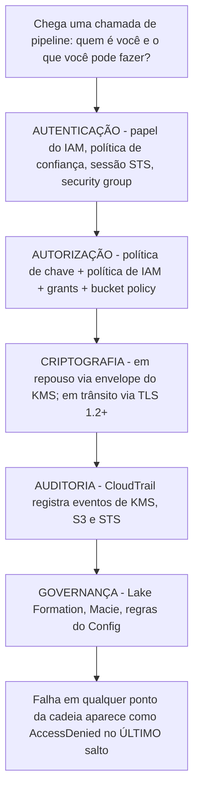
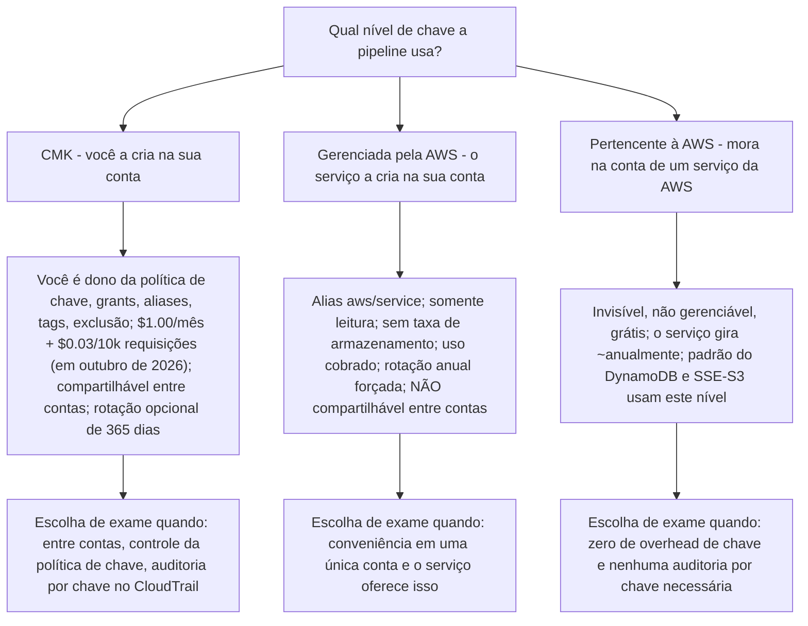
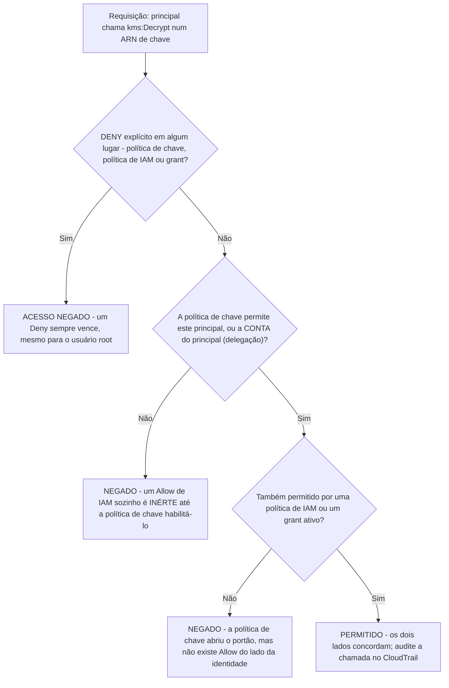
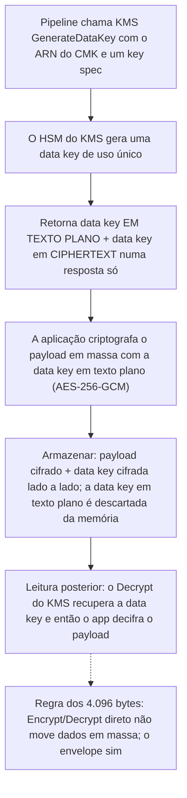
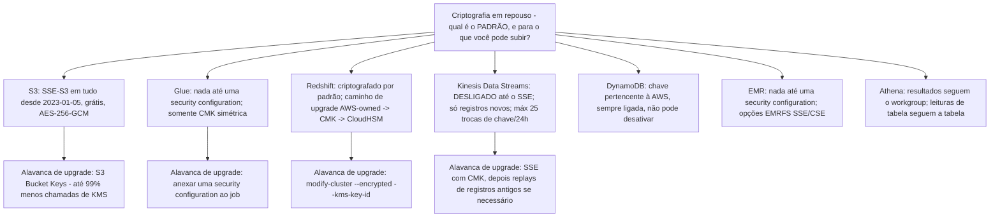
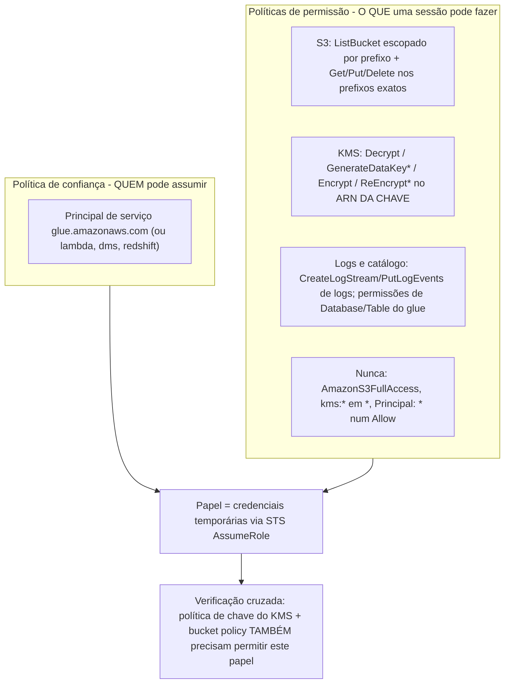
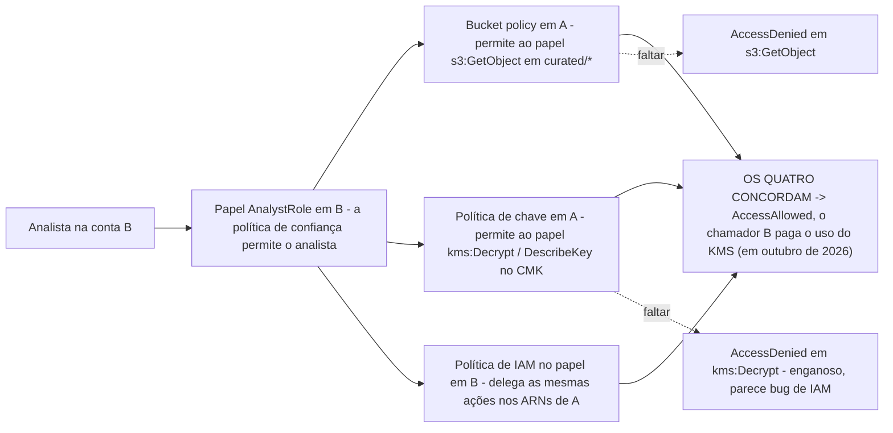

# Segurança, Criptografia e IAM para Pipelines de Dados

Toda pipeline é uma cadeia de chamadas autorizadas: um job do Glue assume um papel, decifra uma data key envelopada por um CMK, lê `s3://raw/`, grava em `s3://curated/` e entrega ao Redshift um manifesto. Quebre qualquer elo: uma política de chave que nunca habilitou o IAM, um grant que ninguém revogou, uma bucket policy que nega `aws:SecureTransport`, e a pipeline falha com uma mensagem de erro que nomeia *o último* salto, não a causa real. O Domínio 4 do guia de exame do DEA-C01 (18% do conteúdo pontuado) testa exatamente essa cadeia: **autenticação (4.1), autorização (4.2), criptografia e mascaramento (4.3), logs de auditoria (4.4) e privacidade/governança (4.5)** (guia de exame DEA-C01, acesso em outubro de 2026). Esta lição ensina a cadeia do jeito que o exame a pergunta: como decisões, padrões e números, cada um com fonte.

```text
====================================================================
 DOMÍNIO 4 — SEGURANÇA E GOVERNANÇA DE DADOS (DEA-C01, 18%)
====================================================================
  4.1 AUTENTICAÇÃO .... security groups de VPC; grupos/papéis do IAM;
                          endpoints/serviços; rotação de credenciais
                          (Secrets Manager); papéis do IAM para Lambda,
                          API Gateway, CLI, CloudFormation; policies do
                          IAM em papéis/endpoints/serviços
                          (S3 Access Points, PrivateLink)
  4.2 AUTORIZAÇÃO ..... policies de IAM personalizadas; credenciais de
                          app/banco (Secrets Manager, Parameter Store);
                          usuários/grupos/papéis de banco do Redshift;
                          permissões do Lake Formation; RBAC / por tag /
                          ABAC; policies personalizadas com mínimo
                          privilégio
  4.3 CRIPTOGRAFIA .... mascaramento/anonimização; chaves (AWS KMS);
                          criptografia entre fronteiras de conta;
                          criptografia em trânsito / antes do trânsito
  4.4 AUDITORIA ....... CloudTrail, CloudWatch Logs, CloudTrail
                          Lake, Athena/OpenSearch/Logs Insights
  4.5 PRIVACIDADE ..... permissões de compartilhamento de dados do
                          Redshift, Macie + Lake Formation PII,
                          soberania de dados, AWS Config, SageMaker
                          Catalog
--------------------------------------------------------------------
  A ESPINHA DESTA LIÇÃO
  Níveis do KMS -> política de chave vs IAM vs grants -> criptografia
  envelope -> rotação & grants -> custo por uso do KMS -> matriz em
  repouso -> TLS em trânsito -> IAM da pipeline -> entre contas ->
  acesso ao S3 -> segredos -> security groups & PrivateLink
====================================================================
```

Nesta lição você vai:

- separar as chaves KMS **gerenciadas pelo cliente, gerenciadas pela AWS e pertencentes à AWS**: quem é dono, quem paga, quem pode compartilhar;
- avaliar acesso do jeito que o KMS avalia: **política de chave primeiro, depois IAM e grants, com Deny explícito sempre vencendo**;
- aplicar a **criptografia envelope**, o limite de 4.096 bytes da API direta e o que a rotação *não* recriptografa;
- precificar o KMS **por uso**, taxa de chave, taxa de requisição, free tier, Bucket Keys, com números de outubro de 2026;
- construir a **matriz em repouso** para S3, Glue, Redshift, Kinesis, DynamoDB, EMR e Athena;
- aplicar **TLS em trânsito**, incluindo a armadilha de redação do `aws:SecureTransport` que quebra a replicação;
- escrever **papéis de pipeline com privilégio mínimo**: S3 escopado por prefixo, ações de KMS nos ARNs da chave, sem `AmazonS3FullAccess`;
- conectar o acesso **entre contas** através dos quatro documentos que precisam concordar;
- controlar acesso ao S3 com **bucket policies, ACLs aposentadas, Block Public Access, VPC endpoints e URLs presignadas**;
- escolher entre **Secrets Manager e Parameter Store SecureString** por recursos *e* preço;
- posicionar **security groups e PrivateLink** para o tráfego da pipeline nunca fazer hairpin pela internet pública;
- praticar com **14 questões no estilo do exame** mais três verificações interativas.

---

## 1. O mapa de tarefas do Domínio 4: onde esta lição se encaixa

O Domínio 4 do guia de exame traz cinco tarefas; esta lição é o núcleo técnico de 4.1 to 4.3, e fornece a maquinaria de identidade que 4.4 (auditoria) e 4.5 (governança) consomem.

| Tarefa | O que o guia pede | Onde nesta lição |
|---|---|---|
| **4.1 Aplicar autenticação** | Security groups de VPC; grupos/papéis/endpoints do IAM; rotação de credenciais; papéis do IAM para Lambda, API Gateway, CLI, CloudFormation; policies em papéis/endpoints/serviços (S3 Access Points, PrivateLink) | Seções 9, 11, 12, 13 |
| **4.2 Aplicar autorização** | Policies de IAM personalizadas; credenciais de app/banco (Secrets Manager, Parameter Store); usuários de banco do Redshift; permissões do Lake Formation; RBAC/tag/ABAC; **policies personalizadas com privilégio mínimo** | Seções 3, 9, 10, 12 |
| **4.3 Garantir criptografia e mascaramento de dados** | Mascaramento/anonimização; **chaves (AWS KMS)**; **criptografia entre fronteiras de conta**; **criptografia em trânsito / antes do trânsito** | Seções 2 to 8, 10 |
| **4.4 Preparar logs para auditoria** | CloudTrail, CloudWatch Logs, CloudTrail Lake, Athena/OpenSearch/Logs Insights | Fora do escopo aqui (Lição 10) |
| **4.5 Privacidade e governança de dados** | Permissões de compartilhamento de dados do Redshift, Macie + Lake Formation PII, soberania de dados/pinagem de Região, AWS Config | Antecipado nas Seções 10 e 14 (a Lição 14 é dona do Lake Formation) |



> [!NOTE]
> O exame raramente pergunta "qual serviço criptografa?". Ele pergunta **qual padrão já vem ligado, qual tipo de chave você pode controlar e qual documento também precisa permitir a chamada**. Aprenda os padrões na Seção 7 e o conjunto de documentos nas Seções 3 e 10; o resto é aplicação.

---

## 2. Propriedade de chaves no AWS KMS: gerenciada pelo cliente, gerenciada pela AWS, pertencente à AWS

O AWS KMS oferece três níveis de chave, e o DEA-C01 os distingue em cinco eixos: **onde a chave mora, o que você pode configurar, quanto você paga, se ela pode girar num cronograma que você controla e se ela pode ser compartilhada entre contas**.

| Eixo | **Chave gerenciada pelo cliente (CMK)** | **Chave gerenciada pela AWS** | **Chave pertencente à AWS** |
|---|---|---|---|
| Onde mora | **Na sua conta**, criada por você | **Na sua conta**, criada por um serviço integrado em seu nome | **Na conta de um serviço da AWS**, não a sua |
| Visibilidade | Completa: metadados, política, grants, aliases, tags | Ver metadados, política e uso no CloudTrail apenas | **Invisível** |
| Controle da política de chave | **Você é dono dela** | Somente leitura; você não pode editar | Nenhuma |
| Rotação | **Opcional**; você habilita; personalizada de 90 to 2.560 dias | **Automática ~365 dias**, não pode ser desativada | Controlada pelo serviço, anual para a maioria dos serviços |
| Compartilhar entre contas | **Sim**, pela política de chave | **Não** | Sim de forma transparente (gerenciada pelo serviço) |
| Custo (em outubro de 2026) | **$1.00/chave/mês** proporcional à hora + **$0.03 por 10.000 requisições** | **Sem taxa de armazenamento**; uso é cobrado (alguns serviços absorvem) | **Grátis** |
| Verificação de identidade | `DescribeKey` → `KeyManager=CUSTOMER` | alias `aws/<service>` | não consultável |
| Cotas | Conta na sua cota de **100.000 CMKs por Região** | Fora da cota de CMK | Fora da cota |
| Exemplos de exame | Chave da security configuration do Glue, CMK do Redshift, CMK SSE-KMS do S3, CMK do Kinesis | `aws/s3` no S3, `aws/kinesis` no Kinesis, chave de cluster pertencente à AWS no Redshift | **Padrão do DynamoDB**, chaves SSE-S3 |

A regra prática que a própria documentação do KMS da AWS sustenta: **controle → CMK, conveniência → pertencente à AWS**. Quando uma questão pede para "usar uma chave que você controla para outra conta poder decifrar", a resposta é sempre uma CMK: chaves gerenciadas pela AWS **não podem ser compartilhadas entre contas** e chaves pertencentes à AWS não são nem endereçáveis (conceitos do KMS, acesso em outubro de 2026).



- **📚 Você sabia?** O nível gerenciado pela AWS é um **padrão legado**: a documentação do KMS da AWS observa que chaves gerenciadas pela AWS **não são criadas para novas integrações de serviço desde 2021**: novas integrações usam por padrão chaves pertencentes à AWS (grátis) ou pedem que você traga uma CMK. É por isso que o padrão do DynamoDB é **pertencente à AWS** (girada ~a cada 365 dias, AES-256, não pode ser desativada), enquanto a opção gerenciada do S3 continua sendo a chave gerenciada `aws/s3` (conceitos do KMS; documentação de criptografia do DynamoDB, acesso em outubro de 2026).

---

## 3. Políticas de chave versus políticas de IAM versus grants

Este é o mecânico mais examinado do Domínio 4. Três mecanismos podem permitir uma ação do KMS, e eles **não** se empilham do jeito que iniciantes assumem.

### 3.1 As três regras, na íntegra da documentação do KMS

1. *"Uma política de chave é uma política de recurso para uma chave do AWS KMS. Políticas de chave são a **forma primária** de controlar o acesso a chaves do KMS. **Cada chave do KMS deve ter exatamente uma política de chave.**"*
2. *"**Nenhum principal do AWS, incluindo o usuário root da conta ou o criador da chave, tem permissões em uma chave do KMS a menos que elas sejam explicitamente permitidas, e nunca negadas, em uma política de chave, uma política de IAM ou um grant.**"*
3. *"**A menos que a política de chave permita explicitamente, você não pode usar políticas de IAM para *permitir* acesso a uma chave do KMS.** … (Você pode usar uma política de IAM para *negar* permissão a uma chave do KMS sem permissão da política de chave.)"* (documentação de políticas de chave e de controle de acesso do KMS, acesso em outubro de 2026)

Dois fatos estruturais adicionais: **políticas de chave são Regionais, políticas de IAM são globais**; e um grant pode **permitir mas nunca negar**, cobre **exatamente uma chave**, **não tem expiração automática** e é limitado a **50.000 grants por chave** (documentação de grants do KMS, acesso em outubro de 2026).

### 3.2 Ordem de avaliação



### 3.3 Anatomia da instrução padrão da política de chave

A instrução padrão que todo CMK novo carrega nomeia a **conta**, não o usuário root:

```json
{
  "Sid": "Enable IAM User Permissions",
  "Effect": "Allow",
  "Principal": {"AWS": "arn:aws:iam::111122223333:root"},
  "Action": "kms:*",
  "Resource": "*"
}
```

Leia `arn:aws:iam:<account-id>:root` como "**esta conta, através das suas políticas de IAM**": ela delega ao IAM para que as políticas de identidade da conta possam conceder ações de chave. Ela **não** concede ao usuário root uma posição especial além do que o IAM já permite, e trocá-la por `"Principal": "*"` numa instrução Allow é o buraco canônico (visão geral de políticas de chave do KMS, acesso em outubro de 2026).

### 3.4 Exemplo trabalhado E1: uma política de identidade que parece certa e não faz nada

A política de IAM de um analista na conta B:

```json
{
  "Effect": "Allow",
  "Action": ["kms:Decrypt", "kms:DescribeKey"],
  "Resource": "arn:aws:kms:us-east-1:111122223333:key/1234abcd-12ab-..."
}
```

Se a política de chave do CMK da conta A nunca nomeou a conta B nem `arn:aws:iam:B:role/AnalystRole`, esta política é **inerte**. O analista recebe `AccessDenied` com a dica enganosa "not authorized to perform kms:Decrypt", a correção nunca está na política de IAM; ela está na **política de chave** (e, para os dados em si, na **bucket policy**). Formulação de exame: "Qual alteração concede acesso ao analista de outra conta?", responda **política de chave** primeiro.

- **📚 Você sabia?** Os três mecanismos têm verbos diferentes de propósito: **políticas** são JSON declarativo avaliado em cada chamada; **papéis** são identidades assumíveis cuja *política de confiança* decide quem pode criar uma sessão; **grants** são tickets específicos do KMS, só de permitir, feitos para máquina, que serviços integrados criam em seu nome: `RetireGrant` e `RevokeGrant` são as APIs de limpeza, e um grant duplicado esquecido é uma escalada de privilégio em pé (documentação de boas práticas de grants do KMS, acesso em outubro de 2026).

```dragdrop
{
  "question": "Arraste as verificações de acesso do KMS para a ordem em que o KMS realmente as avalia quando um papel de pipeline chama kms:Decrypt:",
  "items": [
    "Verificação do lado da identidade: uma política de IAM ou um grant ativo também permite a ação?",
    "PERMITIDO: a chamada é autorizada e aparece no CloudTrail",
    "Verificação de Deny explícito: alguma política de chave, política de IAM ou grant contém um Deny explícito?",
    "Verificação da política de chave: a política de chave permite o próprio principal, ou a sua CONTA por delegação?"
  ],
  "correctOrder": [
    "Verificação de Deny explícito: alguma política de chave, política de IAM ou grant contém um Deny explícito?",
    "Verificação da política de chave: a política de chave permite o próprio principal, ou a sua CONTA por delegação?",
    "Verificação do lado da identidade: uma política de IAM ou um grant ativo também permite a ação?",
    "PERMITIDO: a chamada é autorizada e aparece no CloudTrail"
  ],
  "explanation": "A ordem é o mecânico inteiro do exame: um Deny explícito em qualquer lugar curtocircuita tudo (mesmo para o usuário root da conta); só então a política de chave tem o seu voto, porque um Allow de IAM é inerte até a política de chave permitir o principal ou delegar à sua conta; só com o portão aberto é que o lado da identidade (política de IAM ou grant) precisa do seu próprio Allow. Pule a ordem e você cai nas duas clássicas erradas de diagnóstico - 'adicionei uma política de IAM e ainda falha' (política de chave fechada) e 'a política de chave me permite mas ainda sou negado' (sem Allow do lado da identidade). Tudo que é permitido aqui fica registrado por chave no CloudTrail, e é por isso que a tarefa de auditoria 4.4 depende dessa avaliação dar certo."
}
```

---

## 4. Criptografia envelope: como os dados em massa realmente são criptografados

Chaves do KMS nunca saem dos HSMs FIPS 140-3 **Nível 3** sem criptografia, então criptografar terabytes pela própria chave seria ao mesmo tempo lento e impossível: as APIs diretas `Encrypt`/`Decrypt` aceitam no máximo **4.096 bytes** de texto puro. Toda integração de repouso da AWS usa portanto **criptografia envelope**: gere uma *data key* barata por objeto, criptografe o payload localmente e guarde apenas o ciphertext da data key sob a chave do KMS.



O que isso significa para os cenários de exame:

- **O CMK envelopa a data key, não os seus dados.** `kms:Decrypt` na chave é necessário mas não suficiente, o chamador também precisa da data key cifrada armazenada com o objeto (o S3 faz isso por você sob SSE-KMS).
- **`ReEncrypt*` são duas permissões, não uma.** Re-envelopar uma data key sob uma nova chave exige **tanto** `kms:ReEncryptFrom` **quanto** `kms:ReEncryptTo` (referência de permissões da API do KMS, acesso em outubro de 2026).
- **A rotação nunca reescreve ciphertext.** Material de chave novo criptografa **futuras** data keys; ciphertext antigo é decifrado com a chave de suporte antiga retida para sempre. Nada em "habilitar rotação" migra os seus objetos.
- **Criptografia do lado do cliente (CSE-KMS)** é a mesma matemática rodando inteiramente do seu lado, a AWS nunca vê texto puro, e é por isso que o CSE-KMS é o "mais forte" tier de resultado do Athena e uma opção do EMRFS.

---

## 5. Rotação e grants: o que é automático, o que é opcional, o que é perigoso

### 5.1 Regras de rotação

| Tipo de chave | Rotação | Controle |
|---|---|---|
| **CMK (simétrica, origem `AWS_KMS`)** | **Desligada por padrão**; quando habilitada, material novo a cada **365 dias** (personalizada de **90 to 2.560**); primeira rotação um ano após habilitar | Você chama `EnableKeyRotation` |
| **CMK (assimétrica, HMAC, importada, key store personalizada)** | **Não elegível** para rotação automática | Rotação manual ou `RotateKeyOnDemand` |
| **Chave gerenciada pela AWS** | **Sempre ~365 dias**, não pode ser desativada (era ~1.095 dias antes de maio de 2022) | Nenhuma |
| **Chave pertencente à AWS** | Controlada pelo serviço, ~anual | Nenhuma |
| **Padrão do DynamoDB (pertencente à AWS)** | ~365 dias, AES-256, não pode ser desativada | Nenhuma; um CMK pode ser anexado por tabela e trocado a qualquer momento |

A rotação é **transparente**: o ciphertext existente nunca é recriptografado e as chaves de suporte antigas do HSM são mantidas, para que dados antigos continuem decifráveis. Eventos que você pode auditar: `KMS CMK Rotation` no EventBridge, `RotateKey` no CloudTrail (documentação de rotação de chaves do KMS, acesso em outubro de 2026).

### 5.2 Mecânica dos grants

- Um grant pode **permitir** acesso, mas **não negar**; **cada grant permite acesso a exatamente uma chave do KMS**; **grants não expiram automaticamente** (documentação de grants do KMS, acesso em outubro de 2026).
- Um concedente por grant: uma identidade de IAM **ou** um principal de serviço (é assim que Glue, DMS e Redshift obtêm acesso com privilégio mínimo e tempo limitado).
- Limites: **50.000 grants por chave**; `CreateGrant` é aproximadamente tão poderoso quanto `PutKeyPolicy`, então limite-o com `kms:GranteePrincipal`, `kms:GrantOperations`, `kms:GrantConstraintType` e `kms:GrantIsForAWSResource`.
- Um `GrantToken` devolvido por `CreateGrant` contorna a consistência eventual pós-criação no mesmo fluxo de trabalho.

### 5.3 Exemplo trabalhado E2, o que "habilitar rotação" custa e o que não faz

Uma equipe habilita rotação automática em um CMK simétrico em 2026-01-15, gira-a cinco vezes ao longo de três anos e armazena 40 TB de objetos do S3 sob SSE-KMS com aquela chave.

```text
Taxa da chave (em outubro de 2026) ............  $1.00 / mês
Rotações automáticas ........................  5
Rotações faturáveis .........................  apenas a 1ª e a 2ª = 2 x $1.00
                                              (3ª, 4ª e 5ª são GRÁTIS)
Custo da chave em estado estável .............  $1.00 + $1.00 + $1.00 = $3.00/mês
                                              no estado final, daí $3.00 fixo
Objetos recriptografados pela rotação ........  0  (o ciphertext antigo continua
                                              sendo decifrado com as chaves retidas)
Dados ainda legíveis com a versão antiga ....  sim - a rotação é transparente
```

A armadilha do exame: "habilitar rotação recriptografa os objetos existentes com o material novo da chave" é **falso**. Recriptografar é um trabalho separado e deliberado (Batch Operations do S3, chamadas `ReEncrypt*` ou reescrever os dados).

---

## 6. Precificação do KMS: pague pelas chaves e pelo uso

Todo número desta seção vem da página de preços do AWS KMS, **em outubro de 2026**; verifique de novo antes de datar uma decisão de design posteriormente.

| Cobrança | Valor (em outubro de 2026) |
|---|---|
| Armazenamento de chave gerenciada pelo cliente | **$1.00 por chave por mês**, proporcional à hora: aplica-se a primária **e** réplicas multi-Região, material importado e key stores externos |
| Taxa extra de rotação | A **primeira e a segunda** rotações automáticas/sob demanda somam **$1.00/mês cada**, **limitadas à segunda**; rotações seguintes são grátis |
| Uso simétrico | **$0.03 por 10.000 requisições** |
| Uso de assinatura assimétrica | **$0.15 por 10.000 requisições** |
| Free tier | **20.000 requisições de KMS por mês, todas as Regiões somadas** (exclui `Sign`/`Verify` e `GenerateDataKeyPair*` assimétricos) |
| Gerenciada pela AWS / pertencente à AWS | **Sem taxa de armazenamento**; o uso da gerenciada pela AWS ainda é cobrado, a menos que um serviço absorva |
| Entre contas | "**A conta do AWS que faz a requisição de API é cobrada**", o chamador paga |

### 6.1 Exemplo trabalhado E3: a conta mensal do KMS para um lago SSE-KMS

Um CMK e um mês movimentado com **2.010.000** chamadas de KMS (GETs e PUTs cada um disparando operações de data key):

```text
Requisições faturadas = 2.010.000 - 20.000 grátis = 1.990.000
Custo das requisições  = (1.990.000 / 10.000) x $0.03 = 199 x $0.03 = $5.97
Taxa da chave           = $1.00
Total mensal            = $1.00 + $5.97 = $6.97   (em outubro de 2026)
```

### 6.2 Exemplo trabalhado E4, o mesmo lago com um S3 Bucket Key

Os S3 Bucket Keys reduzem o número de requisições de KMS que chegam à sua chave em **até 99%**, porque o S3 repassa uma data key em vez de uma por operação de objeto. Sem suporte para DSSE-KMS; com suporte para SSE-KMS.

```text
Custo das requisições com Bucket Key ~= 1% de 1.990.000 = ~19.900 chamadas
  -> arredonda para ~2 x $0.03 = $0.06 (ilustrativo; a AWS publica "até 99%")
Total mensal ~= $1.00 + ~$0.10 = ~$1.00-$1.10   (em outubro de 2026)
Mesmo lago no SSE-S3 padrão (chaves pertencentes à AWS) = custo de chave $0
Economia vs E3 = $6.97 - ~$1.05 ~= $5.92 por mês, ~85% da conta da chave
```

Enquadramento de exame (e a correção no Caso A abaixo): "Qual alteração única mais reduz o custo de KMS de um bucket SSE-KMS sem enfraquecer a postura de criptografia?": **habilitar os S3 Bucket Keys**.

> [!IMPORTANT]
> **⚠️ Armadilhas de custo:** girar um CMK **duas vezes** soma $2/mês e depois trava; **chamadores entre contas pagam** na própria conta; o free tier é **por conta, todas as Regiões somadas**, não por chave; e chaves gerenciadas pela AWS ainda cobram **uso**, a menos que o serviço integrado pague por você (preços do AWS KMS, acesso em outubro de 2026).

---

## 7. Criptografia em repouso: a matriz por serviço

Criptografia em repouso neste exame é um jogo de **padrões**. Repare no padrão: serviços gerenciados criptografam **cada vez mais sempre**, e o seu controle se limita a *qual nível de chave* você sobe para.

| Serviço | Padrão em repouso | As suas opções | Regras especiais que o exame adora |
|---|---|---|---|
| **Amazon S3** | **SSE-S3 em todo bucket desde 2023-01-05**, AES-256-GCM, **sem taxa** | SSE-KMS (`aws/s3` ou o seu CMK), DSSE-KMS (camada dupla), SSE-C (você fornece a chave por requisição) | **Bucket Keys cortam chamadas de KMS em até 99%**; mudar o padrão do bucket **não recriptografa objetos existentes**; DSSE-KMS não pode usar Bucket Keys |
| **AWS Glue** | **Nada até você configurar** | Security configuration: dados no S3 como SSE-S3/SSE-KMS, CloudWatch Logs com KMS, **job bookmarks com CSE-KMS**, Data Quality com KMS; Catálogo `DISABLED \| SSE-KMS \| SSE-KMS-WITH-SERVICE-ROLE`; senhas de conexão via CMK | **Somente CMKs simétricas**; a security configuration **sobrepõe** qualquer parâmetro SSE-S3 do job; o **papel do job** precisa das permissões de KMS |
| **Amazon Redshift** | **Criptografado por padrão** (AES-256) em clusters novos | Chave pertencente à AWS, **o seu CMK**, ou CloudHSM | Hierarquia de quatro níveis raiz → CEK → DEK → data keys; só o CEK cifrado sai do KMS; **desative a cópia de snapshot entre Regiões antes** de trocar de chave; rotação do CEK **reinicia o cluster** |
| **Kinesis Data Streams** | **Desligado até você habilitar o SSE** | `aws/kinesis` (chave grátis, uso cobrado) ou um **CMK** | Criptografa **apenas registros novos**: registros pré-existentes ficam sem criptografia; **≤25 trocas de chave por 24 horas móveis**; compartilhamento por resource policy exige **CMK** |
| **Amazon DynamoDB** | **Chave pertencente à AWS, sempre ligada, não pode ser desativada** (AES-256) | `aws/dynamodb` ou um CMK por tabela | CMK cobre índices, streams e backups; **DAX não pode usar CMK**; a chave pode ser trocada a qualquer momento |
| **Amazon EMR** | **Nada até uma security configuration** (EMR ≥ 4.8.0) | EMRFS SSE-S3 / SSE-KMS / CSE-KMS / CSE-C; EBS em repouso; WAL `SSE-EMR-WAL` (padrão) ou `SSE-KMS` | **Somente chaves simétricas**, mesma Região do cluster **e** dos buckets; criptografia transparente do HDFS (≥ 4.1.0) usa **Hadoop KMS, não o AWS KMS** |
| **Amazon Athena** | Resultados seguem a configuração da consulta/workgroup | SSE-S3, **SSE-KMS (recomendado)**, CSE-KMS; resultados de consulta gerenciados são gerenciados pelo serviço e criptografados | A sobrescrita do workgroup vence; níveis Basic = SSE_S3, Intermediate = SSE_KMS, Advanced = CSE_KMS; **leituras de tabela seguem a criptografia da própria tabela**, não a configuração de resultado; muitos objetos de resultado pequenos no KMS podem fazer throttling das consultas |



### 7.1 Exemplo trabalhado E5: a migração que não recriptografou

Uma equipe de conformidade troca a criptografia padrão de um bucket S3 existente de SSE-S3 para SSE-KMS com um CMK em 2026-10-01 e declara o lago em conformidade.

```text
Objetos gravados ANTES da troca  ->  ainda SSE-S3 (as próprias chaves do S3)
Objetos gravados DEPOIS da troca ->  SSE-KMS sob o CMK
Motivo (docs do KMS/S3, acesso em outubro de 2026):
  "When you change the default encryption configuration of your bucket
   to SSE-KMS, the encryption type of the existing Amazon S3 objects
   in the bucket is not changed."
Remediação: trabalho de recriptografia no Batch Operations do S3, ou
ciclo de vida + reescrita.
Mesma família de armadilha: o SSE do Kinesis criptografa SÓ registros
NOVOS (data de habilitação 2026-10-01 num stream ativo desde
2026-09-01 -> os registros de setembro continuam sem criptografia).
Contra-exemplo: o DynamoDB PODE trocar o material da chave ao vivo,
índices e streams incluídos - essa assimetria é examinável.
```

```matching
{
  "question": "Casual cada serviço de dados com o seu estado PADRÃO de criptografia em repouso no DEA-C01 (em outubro de 2026):",
  "pairs": [
    {"left": "Amazon S3", "right": "SSE-S3 em todo bucket desde 2023-01-05: AES-256-GCM, sem taxa, chaves do próprio S3"},
    {"left": "Amazon DynamoDB", "right": "Chave pertencente à AWS, sempre ligada, não pode ser desativada: CMK é um upgrade opcional por tabela"},
    {"left": "Amazon Redshift", "right": "Criptografado por padrão com chave pertencente à AWS: hierarquia de quatro níveis, SSL porém NÃO é exigido por padrão"},
    {"left": "Amazon Kinesis Data Streams", "right": "Criptografia do lado do servidor DESLIGADA até ser habilitada: e ela criptografa apenas registros NOVOS"},
    {"left": "AWS Glue", "right": "Nada criptografado até anexar uma security configuration: somente CMKs simétricas"},
    {"left": "Amazon EMR", "right": "Nada criptografado até existir uma security configuration: a criptografia transparente do HDFS usa Hadoop KMS, não AWS KMS"},
    {"left": "Amazon Athena", "right": "Resultados de consulta seguem a configuração do workgroup: mas leituras de TABELA seguem a criptografia da própria tabela"}
  ],
  "explanation": "O exame testa PADRÕES mais a direção do upgrade. S3 e DynamoDB criptografam sem configuração (níveis de chave diferentes: SSE-S3 usa chaves pertencentes à AWS; o padrão do DynamoDB também é pertencente à AWS). Redshift criptografa mas deixa SSL opcional (require_SSL=true é trabalho seu). Kinesis e Glue/EMR não fazem nada até serem configurados, e o Kinesis nunca preenche registros antigos. O Athena separa a criptografia de resultado da criptografia da tabela de origem: um distrator favorito."
}
```

---

## 8. Criptografia em trânsito: TLS em todo lugar e os dois padrões de aplicação

A linha de base da AWS: **o S3 aceita TLS 1.2 e 1.3** nos seus endpoints, e **todos os endpoints de API de serviços da AWS exigem no mínimo TLS 1.2 desde 2024-02-27**. O Kinesis **exige TLS 1.2 e recomenda o 1.3**. O Redshift, porém, **aceita conexões não SSL por padrão**: você precisa definir `require_SSL=true` no parameter group do cluster. O exame adora essa assimetria.

### 8.1 Lado do servidor versus lado do cliente, em uma linha cada

- **Lado do servidor (SSE-\*)**: o serviço criptografa no recebimento e decifra na entrega; você nunca segura texto puro.
- **Lado do cliente (CSE-KMS, cliente de criptografia do S3, `COPY` do Redshift de arquivos criptografados pelo cliente, CSE do EMRFS)**: você criptografa antes do upload; **a AWS não consegue ler o texto puro**, e é por isso que o CSE é simultaneamente a postura mais forte e a mais difícil de operar.

### 8.2 Exemplo trabalhado E6, um Deny de `aws:SecureTransport` que quebrou a replicação

Política da equipe: negar qualquer requisição que não seja HTTPS.

```json
{
  "Sid": "DenyInsecureTransport",
  "Effect": "Deny",
  "Principal": "*",
  "Action": "s3:*",
  "Resource": ["arn:aws:s3:::lake-raw", "arn:aws:s3:::lake-raw/*"],
  "Condition": {"Bool": {"aws:SecureTransport": "false"}}
}
```

A polaridade da condição está certa, `aws:SecureTransport` é **true** para HTTPS, mas a **replicação** do S3 depois falha ao gravar a sua configuração. Motivo, segundo a documentação do S3: *"Quando os serviços da AWS fazem chamadas a outros serviços da AWS em seu nome (chamadas de serviço para serviço), certo contexto de autorização específico de rede é redigido, incluindo `s3:TlsVersion`, `aws:SecureTransport`, `aws:SourceIp` e `aws:VpcSourceIp`."* O principal do serviço de replicação **não apresenta** valor de `aws:SecureTransport`, então o Deny casa. Correção:

```json
"Condition": {
  "Bool": {"aws:SecureTransport": "false"},
  "StringNotEquals": {"aws:PrincipalIsAWSService": "true"}
}
```

…ou, de forma equivalente, acrescente `"aws:PrincipalIsAWSService": "false"` à condição do Deny para que apenas chamadores **humanos/papel** sejam policiados. A mesma armadilha se aplica aos mínimos de `s3:TlsVersion` e às condições de `aws:SourceIp` usadas por jobs de backup ou replicação.

### 8.3 SSL no Redshift e as outras regras de trânsito por serviço

| Serviço | Padrão de trânsito | Alavanca de aplicação |
|---|---|---|
| **Redshift** | *"Por padrão, os bancos de dados do cluster aceitam a conexão, quer ela use SSL quer não."* | Defina **`require_SSL=true`** no parameter group; o `sslmode` do cliente roda `disable → allow → prefer → require → verify-ca → verify-full`; VPCs com enforced-encryption forçam `require_SSL`; SSL acelerado por hardware cobre `COPY`/`UNLOAD`/backup |
| **Kinesis Data Streams** | **TLS 1.2 exigido, TLS 1.3 recomendado** para todas as chamadas do plano de dados | Nada para habilitar; teste com um cliente não TLS (ele falha) |
| **Conexões do AWS Glue** | Opcional | Marque **"Require SSL connection"** em conexões JDBC com bancos |
| **S3** | TLS 1.2/1.3 nos endpoints | Deny na bucket policy sobre `aws:SecureTransport=false` (cuidado com a armadilha de redação acima) ou `s3:TlsVersion >= 1.2` |
| **DMS** | A instância de replicação usa TLS onde o engine suporta | Security groups ainda decidem a alcançabilidade (Seção 13) |

Existe automação de configuração para as duas alavancas mais testadas: as managed rules do AWS Config **`s3-bucket-ssl-requests-only`** e **`redshift-require-tls-ssl`** (mais `kinesis-stream-encrypted`) afirmam continuamente a postura que você configurou uma vez.

---

## 9. IAM para serviços de dados: papéis, privilégio mínimo e o antipadrão

### 9.1 Os blocos de construção

| Conceito | O que é neste exame |
|---|---|
| **Policy** | Documento JSON de permissões: baseada em identidade (anexada a um principal) ou baseada em recurso (anexada a um bucket, chave, fila…) |
| **Role (papel)** | Identidade assumível = **política de confiança** (quem pode assumir) + políticas de permissão (o que uma sessão pode fazer) + **credenciais temporárias** via STS |
| **Service role** | Um papel **que o serviço assume para agir por você**: job do Glue, instância de replicação do DMS, `COPY IAM_ROLE=…` do Redshift, papel de execução da Lambda |
| **Service-linked role** | Variante gerenciada pela AWS; o serviço define a confiança e as permissões; você não pode editá-las |
| **Regra de identidade de carga de trabalho** | Cargas de trabalho usam **papéis, nunca chaves de acesso embutidas de longo prazo**; humanos se federam pelo IAM Identity Center |

### 9.2 O padrão `AWSGlueServiceRole` e o antipadrão `AmazonS3FullAccess`

O console da AWS historicamente anexava `AmazonS3FullAccess` a jobs de demonstração do Glue. A própria documentação do Glue ameniza isso: *"Você pode querer fornecer a sua própria política para acesso a recursos específicos do Amazon S3."* O **`AWSGlueServiceRole`** gerenciado concede Glue mais S3 limitado (os próprios buckets de script e scratch `aws-glue-*`), CloudWatch e plumbing de ENI: **não é uma concessão de acesso a dados**. Padrão de produção:

```json
{
  "Version": "2012-10-17",
  "Statement": [
    {
      "Sid": "ReadLandingPrefix",
      "Effect": "Allow",
      "Action": ["s3:GetObject", "s3:ListBucket"],
      "Resource": [
        "arn:aws:s3:::lake-raw",
        "arn:aws:s3:::lake-raw/raw/*"
      ],
      "Condition": {"StringLike": {"s3:prefix": "raw/*"}}
    },
    {
      "Sid": "WriteCuratedPrefix",
      "Effect": "Allow",
      "Action": ["s3:PutObject", "s3:DeleteObject", "s3:ListBucket"],
      "Resource": [
        "arn:aws:s3:::lake-curated",
        "arn:aws:s3:::lake-curated/curated/*"
      ]
    },
    {
      "Sid": "UseThePipelineKey",
      "Effect": "Allow",
      "Action": [
        "kms:Decrypt", "kms:GenerateDataKey*",
        "kms:Encrypt", "kms:ReEncrypt*", "kms:DescribeKey"
      ],
      "Resource": "arn:aws:kms:us-east-1:111122223333:key/1234abcd-..."
    }
  ]
}
```

Três coisas que este trecho acerta e que o `AmazonS3FullAccess` erra: **ARNs de `Resource` escopados por prefixo**, **`s3:ListBucket` no ARN do bucket pareado com `s3:GetObject`/`PutObject` no ARN do objeto** (o modelo de permissão de dois níveis do S3) e **ações de KMS amarradas ao ARN específico da chave**: que a política de chave também deve permitir (Seção 3).

Os mínimos próprios da AWS para um job do Glue batem com a divisão: *"Fontes de dados exigem as permissões `s3:ListBucket` e `s3:GetObject`. Alvos de dados exigem `s3:ListBucket`, `s3:PutObject` e `s3:DeleteObject`."* E se você passa um papel pelo console, o nome dele precisa ter **o prefixo `AWSGlueServiceRole`** (documentação de IAM do Glue, acesso em outubro de 2026).



### 9.3 Permissões de KMS dentro das políticas de pipeline

O conjunto mínimo de ações por forma de carga de trabalho (referência de permissões da API do KMS, acesso em outubro de 2026):

| Carga de trabalho | Ações mínimas de KMS no ARN da chave |
|---|---|
| **Ler** objetos SSE-KMS | `kms:Decrypt`, `kms:DescribeKey` |
| **Gravar** objetos SSE-KMS | `kms:GenerateDataKey*`, `kms:Encrypt`, mais `kms:DescribeKey`; `kms:ReEncrypt*` ao re-envelopar |
| **Chave gerenciada de resultados do Athena** | `kms:Decrypt`, `kms:GenerateDataKey`, `kms:DescribeKey` |
| **Security configuration do Glue** | Tudo acima para **cada** chave nomeada na configuração: anexada ao **papel do job**, não ao usuário do console que clicou em Run |

- **📚 Você sabia?** O modelo de permissão de dois níveis do S3 é uma falha silenciosa frequente: `s3:ListBucket` é autorizado contra o **ARN do bucket** (`arn:aws:s3:::lake-raw`), enquanto `s3:GetObject`/`s3:PutObject` são autorizados contra **ARNs de objeto** (`arn:aws:s3:::lake-raw/raw/*`). Conceder só os ARNs de objeto deixa `ListBucket` falhando; a divisão de origem/destino da documentação do AWS Glue existe justamente porque crawlers e partition projection chamam `ListBucket` o tempo todo (documentação de privilégio mínimo do Glue, acesso em outubro de 2026).

```fillblank
{
  "question": "Complete as instruções de IAM de pipeline com o vocabulário desta lição:",
  "template": "Uma {{1}} é uma identidade assumível cuja {{2}} policy decide quem pode criar uma sessão e cujas políticas de permissão decidem o que essa sessão pode fazer; ela emite {{3}} credentials emitidas pelo STS, então as cargas de trabalho nunca devem embutir chaves de acesso de longo prazo. Data sources do Glue precisam de {{4}} mais s3:GetObject, enquanto data targets precisam de ListBucket, PutObject e {{5}}. Os papéis do Glue criados no console devem ter o prefixo {{6}}, e as ações do KMS pertencem ao {{7}} ARN: concedidos pela política de identidade E habilitados pela política de chave.",
  "answers": {
    "1": "role",
    "2": "trust",
    "3": "temporary",
    "4": "s3:ListBucket",
    "5": "s3:DeleteObject",
    "6": "AWSGlueServiceRole",
    "7": "key"
  },
  "distractors": ["policy", "grant", "resource", "permanent", "session", "s3:GetObject", "s3:PutObject", "AmazonS3FullAccess", "bucket", "principal"],
  "explanation": "Papéis = política de confiança + políticas de permissão + credenciais temporárias do STS, e é por isso que a AWS proíbe chaves de longo prazo em cargas de trabalho. Os mínimos documentados do Glue são exatamente ListBucket+GetObject para fontes e ListBucket+PutObject+DeleteObject para targets, e papéis do Glue passados pelo console devem começar com AWSGlueServiceRole. Os direitos de KMS precisam estar amarrados ao ARN DA CHAVE na política de identidade e simultaneamente permitidos pela política de chave: qualquer um dos documentos sozinho deixa a pipeline com AccessDenied."
}
```

---

## 10. Acesso entre contas: os quatro documentos que precisam concordar

Entre contas é o "criptografia entre fronteiras de conta" da tarefa 4.3.3, e ele falha com um erro que nomeia um mecanismo enquanto a lacuna real é outra. A conta **A** é dona de um bucket curado e de um CMK; os analistas da conta **B** precisam de `s3:GetObject`.

| # | Documento | O que ele deve dizer |
|---|---|---|
| 1 | **Política de chave** no CMK de A | Permitir a `arn:aws:iam::B:role/AnalystRole` (ou root da conta B + delegação) `kms:Decrypt`, `kms:DescribeKey` |
| 2 | **Bucket policy** no bucket de A | Permitir aquele principal `s3:GetObject` em `curated/*` |
| 3 | **Política de IAM** no papel de B | Permitir `kms:Decrypt`/`kms:DescribeKey` no ARN da chave de A e `s3:GetObject` nos ARNs do bucket de A: *"O acesso entre contas requer permissão na política de chave do KMS e numa política de IAM na conta do usuário externo"* |
| 4 | **Política de confiança** no papel de B | Permitir que os usuários/grupos de analistas façam `sts:AssumeRole` |



Duas restrições estruturais que valem decorar: **chaves gerenciadas pela AWS não podem ser compartilhadas entre contas** (então o design força uma CMK) e, para compartilhamento por resource policy do Kinesis, a chave também precisa ser uma CMK. No lado da cobrança, *"a conta do AWS que faz a requisição de API é cobrada"* pelo uso do KMS (preços do AWS KMS, acesso em outubro de 2026).

---

## 11. Acesso ao S3: bucket policies, ACLs, endpoints e URLs presignadas

### 11.1 Bucket policies e a aposentadoria das ACLs

Uma bucket policy é uma **política de recurso**: principal, ação, recurso, **condição**. É também o único lugar onde você consegue expressar restrições de `aws:SecureTransport`, `aws:SourceVpce` ou `aws:PrincipalIsAWSService`.

ACLs são legado. Desde que a AWS habilitou **Object Ownership = Bucket owner enforced** por padrão, **todas as ACLs estão desativadas**, o dono do bucket é dono de todo objeto e escritas de ACL falham com `AccessControlListNotSupported`. A orientação da AWS: *"recomendamos que você mantenha as ACLs desativadas"* e migrar quaisquer concessões de ACL remanescentes para bucket policies (documentação de Object Ownership do S3, acesso em outubro de 2026). O **Block Public Access** vem com os quatro interruptores LIGADOS por padrão em buckets novos (conta, bucket, access point, organização), vencendo o mais restritivo.

### 11.2 VPC endpoints: gateway versus interface

| | **Endpoint gateway** | **Endpoint de interface (PrivateLink)** |
|---|---|---|
| Serviços | **Somente S3 e DynamoDB** | Quase todo serviço da AWS, S3 incluído |
| Custo (em outubro de 2026) | **Sem cobrança** | ENI cobrada por AZ + processamento de dados |
| Anexação | Tabela de rotas | ENI por sub-rede; DNS privado opcional |
| Tráfego continua privado sem IGW/NAT | Sim | Sim |
| On-premises sobre Direct Connect/VPN | **Não** | **Sim** |
| Entre Regiões | Não | Via peering/Transit Gateway |
| Camada extra de autenticação | Endpoint policy | Endpoint policy |
| Condition keys | `aws:sourceVpce` funciona; **`aws:SourceIp` não funciona**: use **`aws:VpcSourceIp`** | Mesma cautela no caminho do gateway |

### 11.3 Exemplo trabalhado E7: validade de URLs presignadas

Uma URL presignada delega as permissões de **quem assina** para uma operação; ela nunca as alarga, e a validade é rechecada em cada requisição (Denies de bucket policy e Block Public Access continuam valendo).

```text
Caso 1 - URL pedida por um USUÁRIO DO IAM com credenciais SigV4 de longo
         prazo: pedida 7 dias -> real = 7 dias (teto do CLI/SDK = 7 dias;
         botões do console: 1 minuto - 12 horas)

Caso 2 - URL pedida por um PAPEL DE EXECUÇÃO de Lambda cuja sessão dura
         1 hora, pedida 7 dias -> real = 1 HORA.
         Regra: URLs com credenciais temporárias morrem com a sessão,
         independentemente do expiro pedido (sessões de papel, perfis de
         instância EC2 tipicamente ~6 horas).

Caso 3 - O presigner tem só s3:GetObject em curated/* -> a URL nunca
         pode virar um PutObject; as permissões vêm do CHAMADOR, então
         privilégio mínimo no papel É a política da URL.
```

O enquadramento do Prescriptive Guidance: você não consegue fazer rate limit da *geração* de URLs; as suas alavancas são **privilégio mínimo + expiro curto + monitoramento** (documentação de URLs presignadas do S3; Prescriptive Guidance, acesso em outubro de 2026).

---

## 12. Secrets Manager versus Parameter Store SecureString

Os dois armazenam texto criptografado sob KMS; divergem em **rotação, entre contas, tamanho e preço**. A orientação de seleção da própria AWS: **Secrets Manager para segredos, Parameter Store para pares chave-valor simples** (AWS Security Blog, 2025-10-22, acesso em outubro de 2026).

| | **SSM Parameter Store** | **Secrets Manager** |
|---|---|---|
| Tipos | String, StringList, **SecureString** | Segredo (texto simples ou JSON chave/valor) |
| Criptografia | SecureString via KMS, só simétrica; padrão `aws/ssm` ou o seu CMK; tier standard criptografado sob a chave, tier advanced soma envelope + AWS Encryption SDK | Sempre KMS (gerenciada pela AWS ou o seu CMK) |
| **Rotação** | **Nenhuma**, o cron é seu | **Rotação com Lambda** + integrações nativas de RDS/OpenSearch |
| Entre contas / replicação | **Somente tier advanced** | Sim |
| Tamanho | Standard **4 KB**, advanced **8 KB** | Não é o fator decisivo; este exame escolhe o armazenamento por rotação e entre contas, não por tamanho de payload |
| Custo (em outubro de 2026) | Standard **grátis**: 10.000 parâmetros/conta/Região; advanced **$0.05/parâmetro/mês**, 100.000 parâmetros, parameter policies | **$0.40/segredo/mês** (proporcional à hora) + **$0.05 por 10.000 chamadas de API**; **teste de 30 dias**; **versões de rotação não são cobradas** |
| Escolha para | Valores de configuração, feature flags, texto que não é segredo | Credenciais de banco, chaves de API, tokens OAuth/JWT, qualquer coisa que precise de rotação ou auditoria por segredo |

### 12.1 Exemplo trabalhado E8: 50 credenciais de banco, doze meses

Um job noturno do Glue e três steps do EMR giram 50 credenciais de armazém/serviço.

```text
Secrets Manager (em outubro de 2026):
  Segredos:       50 x $0.40 x 12 meses               = $240.00
  Chamadas de API: 365.000 GetSecretValue no ano
                   = 36,5 x $0.05                     =   $1.83
  Lambdas de rotação: as VERSÕES de rotação são grátis
  Total                                   ~= $241.83/ano, rotação incluída

Parameter Store tier STANDARD:
  $0.00 - mas SEM rotação e SEM entre contas:
  um job cron + um papel de escrita + um papel de leitura
  precisam fazer o que a Lambda de rotação teria feito

Parameter Store tier ADVANCED:
  50 x $0.05 x 12 meses                  = $30.00/ano
  rotação ainda por conta própria; entre contas e parameter policies
  liberados

Escolha de exame: rotação, entre contas ou auditoria fina por segredo ->
           Secrets Manager. Configuração estática -> Parameter Store.
```

- **📚 Você sabia?** O **teste de 30 dias do Secrets Manager** vale por segredo: a AWS cobra a partir do dia 31, e as versões de rotação criadas durante a rotação nunca são cobradas, então o custo de "testar e reverter" é literalmente zero por um mês. O tier standard do Parameter Store, em contraste, é grátis para sempre, mas limitado a **10.000 parâmetros de 4 KB por conta por Região**, e é por isso que grandes ambientes ultrapassam discretamente esse limite e migram para o tier advanced (páginas de preços da AWS, acesso em outubro de 2026).

---

## 13. Security groups e PrivateLink: mantendo o tráfego da pipeline fora da internet

Controles de rede são a primeira habilidade da tarefa 4.1.1 ("atualizar security groups de VPC") e a 4.1.5 ("policies em papéis/endpoints/serviços (S3 Access Points, **PrivateLink**)"). O padrão para uma pipeline privada: coloque Glue/EMR/Redshift/DMS em **sub-redes privadas**, alcance S3 e KMS por **VPC endpoints** e deixe os security groups expressarem alcançabilidade *de serviço para serviço* em vez de CIDRs brutos.

| Componente | Regra de entrada realmente necessária | Armadilha |
|---|---|---|
| **Redshift** | Porta do cliente **5439** (faixas RA3 **5431 to 5455 / 8191 to 8215**) a partir do SG do cliente ou do CIDR da VPN | SG padrão = só dentro do grupo; nunca abra 5439 para `0.0.0.0/0` |
| **DMS** | SG da instância de replicação referenciada pelos **SGs de origem/destino do banco** na porta do banco; egresso da instância de replicação na porta do banco | O egresso do SG de replicação padrão é `0.0.0.0/0` em todas as portas: aperte-o |
| **EMR** | SGs gerenciados `ElasticMapReduce-primary` / `-core` (+ `-Private`), autorreferenciados; acesso de serviço **TCP 9443** para releases ≥ 5.30.0 | Remova a porta 22 legada de qualquer lugar; o **EMR block public access** impede entrada pública em sub-redes públicas |
| **S3/KMS via endpoint** | Nada de entrada: endpoints roteiam por tabelas de rotas | Por um endpoint gateway use `aws:VpcSourceIp`, não `aws:SourceIp` |

O **PrivateLink** (endpoints de interface) mantém o tráfego na rede da AWS, sobrepõe uma **endpoint policy** às suas bucket policies/chaves e, com **DNS privado habilitado**, faz as chamadas de SDK resolverem de forma privada, sem nunca tocar na internet. Ele é a resposta certa sempre que clientes on-premises sobre Direct Connect/VPN precisam alcançar serviços da pipeline; o **endpoint gateway** grátis é a resposta certa para saída pura de S3/DynamoDB de uma VPC sem necessidade on-premises.

---

### Atualizações de 2026 (em outubro de 2026)

> [!NOTE]
> **O que mudou na segurança do Domínio 4 entre 2024 e outubro de 2026**: cada linha verificada contra uma fonte primária da AWS em **outubro de 2026**, e cada uma é examinável porque o exame testa comportamento atual:
> - **O próprio guia de exame foi revisado**: o guia DEA-C01 **v1.1 (2025-12-12)** consolidou conhecimentos/habilidades numa lista única de skills e acrescentou **8 habilidades sem remover nenhuma**; o Domínio 4 ganhou **4.1.7 (domínios do SageMaker Unified Studio)**, **4.5.6 (projetos do SageMaker Catalog)** e **4.5.7 (framework de governança de dados e padrões de compartilhamento de dados)**: página de revisões do guia de exame DEA-C01, acesso em outubro de 2026.
> - **Delta na lista de serviços no escopo**: acrescentados **Aurora, Amazon Q, Bedrock, Kendra, AWS Data Exchange, Amazon S3 Tables**; removidos **Cloud9, CodeCommit, AWS SCT**, então respostas de migração baseadas em SCT estão velhas, enquanto IAM, KMS, Secrets Manager, Macie, Shield e WAF continuam no núcleo do Domínio 4 (páginas de serviços no/fora do escopo do guia de exame, acesso em outubro de 2026).
> - **Compartilhamento entre contas do Lake Formation v5 (2026-02-11)**: um share do AWS RAM agora pode carregar tabelas ilimitadas via padrões curinga, e o acesso entre Regiões (resource links, sem cópia) compõe com o compartilhamento entre contas: a resposta moderna para "compartilhar a tabela curada e seus arquivos envelopados por KMS com outra conta" (AWS What's New, acesso em outubro de 2026).
> - **Permissões DML de Iceberg no Redshift apertadas (Patch 202)**: `DELETE` em tabelas do Lake Formation exige permissão **DELETE**, `UPDATE`/`MERGE` exigem **INSERT + DELETE**, e todo DML de Iceberg exige **ALTER**: labs que concedem só INSERT agora falham, o que é autorização (4.2) encontrando tabelas de lago governadas por criptografia (documentação de mudanças de comportamento do Redshift, acesso em outubro de 2026).
> - **Resultados de consulta gerenciados do Athena (2025-06-03)**: os resultados podem ser gerenciados pelo serviço e criptografados **sem custo extra e sem bucket de resultado no S3**, mas a configuração de criptografia mínima do seu workgroup ainda governa quando você traz o seu próprio bucket (AWS What's New; documentação do Athena, acesso em outubro de 2026).
> - **Privilégio mínimo virou uma *skill*, não um item de conhecimento**: o guia de exame **v1.1 (2025-12-12)** incorporou *"Conhecimento de: princípio do menor privilégio…"* à **Skill 4.2.6, "Construa políticas personalizadas que atendam ao princípio do menor privilégio"**, então o Domínio 4.2 agora espera que você *escreva* a política escopada por prefixo e amarrada ao ARN da chave da Seção 9.2 (e saiba que **`DELETE` de Iceberg em tabelas do Lake Formation precisa de DELETE**, `UPDATE`/`MERGE` precisam de **INSERT + DELETE**, e todo DML de Iceberg precisa de **ALTER**), em vez de apenas nomear o princípio, página de revisões do guia de exame DEA-C01 (2025-12-12) e documentação de mudanças de comportamento do Redshift (Patch 202), acesso em outubro de 2026.
> - **S3: preços e Regiões mudaram; o padrão de criptografia não**: os cortes do S3 Express One Zone (**2025-04-10**) levaram o armazenamento a **−31%**, PUT a **−55%**, GET a **−85%** e upload/recuperação a **−60%**, com as Regiões do Express One Zone indo de **8 → 15 até 2026-09-17**: enquanto a criptografia em repouso continua exatamente como ensinado acima (SSE-S3 em todo bucket desde **2023-01-05**, grátis; **Bucket Keys continuam sendo a alavanca de custo do SSE-KMS** e o DSSE-KMS ainda não pode usá-los; mudar o padrão de um bucket ainda **não** recriptografa objetos antigos) (AWS What's New; docs do S3 e do KMS, acesso em outubro de 2026).
> - **Macie, enuncie como *comportamento atual*, não como "mudança de 2026"**: a descoberta inventaria até **10.000 buckets por conta**, identificadores de dados personalizados aceitam **1 to 300 caracteres (padrão 50)** e os findings vêm por padrão com severidade **MEDIUM**, mas a entrada mais recente do histórico de documentação do Macie é de **2025-07-02**, então uma alternativa formulada como "os identificadores personalizados do Macie mudaram em 2026" é isca velha; trate os números como o jeito como o Macie se comporta hoje (documentação do Amazon Macie: cobertura de buckets, opções de identificador personalizado, histórico de docs; acesso em outubro de 2026).
> - **As âncoras de preço usadas acima estão atualizadas em outubro de 2026**: KMS **$1.00/chave/mês + $0.03/10.000 requisições simétricas** com **free tier de 20.000 requisições por mês**; Secrets Manager **$0.40/segredo/mês + $0.05/10.000 chamadas de API**; Parameter Store advanced **$0.05/parâmetro/mês**. A AWS reprecificou serviços de análise vizinhos repetidamente em 2025 to 2026 (Glue 6.0 −30%, S3 Express até −85%), então verifique de novo as páginas de KMS e Secrets antes de citar um design posterior a esta data (páginas de preços da AWS, acesso em outubro de 2026).

---

## Casos Reais

A AWS publica como essas abstrações aparecem na produção. Todo número abaixo é **afirmação do cliente ou da AWS, sem auditoria**, com a fonte nomeada para você conferir, o ponto examinável é o **padrão** (qual controle era a restrição vinculante, qual serviço fez o trabalho, qual número se moveu), não o marketing.

### Caso A, Integral Ad Science: de centenas de regras de permissão a duas

| Elemento | Detalhe |
|---|---|
| Cliente | **Integral Ad Science (IAS)**, empresa de medição em adtech |
| Desafio | Um data lake de autoatendimento que abrangia contas de produtor e consumidor sob **GDPR e CCPA**, onde o acesso tinha que seguir a **classificação e o papel de trabalho** dos dados: não ACLs de bucket ad hoc |
| Serviços | **AWS Lake Formation + controles de acesso por tag (LF-TBAC)**, Amazon Athena, Amazon EMR, AWS Glue Data Catalog, federação com Okta; S3 acessado só por meio de um **papel de acesso a dados do Lake Formation** |
| Resultados | **"Com os controles de acesso por tag do Lake Formation, a IAS reduziu centenas de regras de permissão a precisamente duas regras"**; **controle em nível de coluna**; tags em nível de banco **herdadas** por tabelas e colunas; workgroups do Athena por unidade de negócio servindo também como tags de cobrança e limites de consulta |
| Domínio do exame | **Domínio 4**, Tarefas 4.2 (autorização: RBAC/por tag/ABAC) e 4.5 (governança, PII) |
| Fonte | AWS Big Data Blog, `blogs/big-data/integral-ad-science-secures-self-service-data-lake-using-aws-lake-formation` (2021-09-23, acesso em outubro de 2026) |

Leia a IAS como a história da **remoção de antipadrões**: cada "centenas de regras" que um ambiente acumula é candidata a uma tag (`classification=PII`) mais um papel (analista), que é exatamente o padrão ABAC nomeado pela Tarefa 4.2.5. O lado da criptografia está implícito: objetos do S3 sob SSE-KMS só são decifrados por papéis governados pelo Lake Formation que também detêm `kms:Decrypt` na chave do bucket, o conjunto de quatro documentos da Seção 10, automatizado.

### Caso B, FINRA: uma stack de vigilância regulada sobre KMS, GuardDuty e CloudTrail

| Elemento | Detalhe |
|---|---|
| Cliente | **FINRA**, o regulador de valores mobiliários dos EUA (autofinanciado, sem fins lucrativos) |
| Desafio | Análise em premises de capacidade fixa não acompanhava o volume de vigilância de mercado, dentro de um regime de conformidade que exige auditabilidade de cada acesso |
| Serviços | **Amazon S3 + Amazon EMR** (Hive, Presto, HBase); o programa Consolidated Audit Trail (CAT) acrescenta **Amazon Redshift, AWS KMS, Amazon GuardDuty e AWS CloudTrail** |
| Resultados | **~6 TB e 37 bilhões de registros** num dia comum, **75 bilhões+** em dias movimentados; consultas interativas sobre **trilhões de registros / 600+ TB**; HBase sobre EMR entregou **mais de 60% de economia de custo**; o CAT ingere **100+ bilhões de eventos/dia** de 22 bolsas e 1.500 corretoras |
| Domínio do exame | **Domínio 4**, Tarefas 4.3 (criptografia: KMS) e 4.4 (auditoria: CloudTrail) numa história de escala do Domínio 1/3 |
| Fonte | AWS Public Sector Blog parte 1 (2017-10-03); comunicado da AWS sobre o CAT (2019-12-04); blog do HBase (2016-11-21): todos acessados em outubro de 2026 |

> "A FINRA processa aproximadamente **6 terabytes de dados e 37 bilhões de registros** num dia comum … Em dias movimentados, as bolsas de valores podem gerar **75 bilhões+ de registros**.": John Brady, VP Cyber Security/CISO da FINRA (blog da AWS, acesso em outubro de 2026)

O padrão examinável é **qual controle faz qual serviço**: o KMS criptografa os objetos do armazém e do lago (4.3), o CloudTrail registra quem decifrou o quê (4.4), o GuardDuty observa comportamento de API anômalo dentro da conta (4.1/4.4) e os security groups mantêm o cluster EMR/HBase fora da internet pública (4.1). Nenhum serviço sozinho "faz segurança": a cadeia faz.

### Caso C, Oportun: encontrando o PII antes do regulador

| Elemento | Detalhe |
|---|---|
| Cliente | **Oportun**, uma instituição de crédito ao consumidor nos EUA |
| Desafio | Descobrir e classificar PII mantido no S3 com baixa taxa de falsos positivos para a **FTC Safeguards Rule** e obrigações de privacidade, e depois priorizar o risco rápido o bastante para agir |
| Serviços | **Amazon Macie**: descoberta automatizada de dados sensíveis, **identificadores gerenciados e personalizados**, inventário de buckets e um **sensitivity score** por bucket; findings entregues a remediação dirigida pelo EventBridge |
| Resultados | Material de caso publicado pela AWS afirma **+95% de precisão na descoberta** e **−80% no tempo** para descobrir dados sensíveis, com priorização de risco mais rápida |
| Domínio do exame | **Domínio 4**, Tarefas 4.5 (privacidade/governança: descoberta de PII com Macie) e 4.3 (decisões de mascaramento dirigidas por esses findings) |
| Fonte | Cartão de caso da página do produto Amazon Macie (`macie/`) e deck do re:Invent 2022 `SEC215_NEW-LAUNCH!-Automate-data-discovery-with-Amazon-Macie` (d1.awsstatic.com/events/aws-reinvent-2022/), ambos acessados em outubro de 2026 |

Leia a Oportun como a história da **descoberta antes da autorização**: o Macie diz *o que* é classificado como sensível (Domínio 4.5), e só então as escolhas de criptografia da Seção 7 e as políticas de privilégio mínimo da Seção 9 podem nomear os prefixos, tags e chaves certos. Repare na disciplina de escopo que o exame recompensa: **o Macie descobre dentro do Amazon S3**, ele não varre RDS ou Redshift nativamente, e alimenta o ciclo de governança em vez de substituí-lo (documentação e material de caso do AWS Macie, acesso em outubro de 2026).

- **📚 Você sabia?** A aceleração da Oportun é um resultado de *ferramenta*, não de política: os **−80%** relatados vêm de substituir amostragem manual por **descoberta automatizada com inventário de buckets**, que pontua cada bucket por sensibilidade, enquanto os **+95%** são *precisão de descoberta no S3*: **não** uma afirmação sobre prevenção de perda de dados de propósito geral em qualquer armazenamento da AWS. O link dedicado do caso Oportun agora redireciona para o índice geral de estudos de caso, então o cartão de produto do Macie da AWS e o deck do re:Invent 2022 continuam sendo as fontes de registro dos dois números (material de caso do Amazon Macie, acesso em outubro de 2026).

### Caso D, GoDaddy: governança central sobre um data mesh de vários petabytes

| Elemento | Detalhe |
|---|---|
| Cliente | **GoDaddy**, provedora de domínios e hospedagem na internet |
| Desafio | Um ambiente Hadoop em premises compartilhado com cópias de HDFS proliferando e permissões que ninguém conseguia desfazer; a propriedade precisava se descentralizar sem descentralizar a *autorização* |
| Serviços | **AWS Lake Formation + AWS Glue Data Catalog + Amazon S3**, shares entre contas do **AWS RAM**, **resource links** criados do lado do consumidor através de **Service Catalog + Lambda**, consumidores Athena/EMR, uma **conta central de governança** |
| Resultados | **2.000+ produtos de dados** construídos sobre o mesh; **vários petabytes em centenas de contas**; centenas de produtores e milhares de consumidores atendidos pela conta de governança |
| Domínio do exame | **Domínio 4**, Tarefas 4.2 (autorização entre contas, resource links, RBAC) e 4.5 (governança e padrões de compartilhamento de dados) |
| Fonte | AWS Big Data Blog, `blogs/big-data/how-godaddy-built-a-data-mesh-to-decentralize-data-ownership-using-aws-lake-formation` (2022-11-21, acesso em outubro de 2026) |

A GoDaddy é a **resposta de escala ao Caso A**: onde a IAS colapsou centenas de regras em duas *tags*, a GoDaddy colapsa a dispersão de permissões em *uma conta de governança* cujos grants do Lake Formation e shares do RAM são a única estrada para o lago. Consumidores nunca tocam na bucket policy do dado bruto: eles recebem um **resource link**, então os "quatro documentos que precisam concordar" da Seção 10 são mantidos uma vez, centralmente, em vez de uma vez por conta consumidora.

- **📚 Você sabia?** As contagens de manchete do mesh, **2.000+ produtos de dados**, **vários petabytes**, **centenas de contas**, são exatamente por que ACLs escritas à mão por recurso falham: nessa largura, a autorização deixa de ser uma lista de principais e vira um **catálogo de grants sobre shares** (share do AWS RAM → resource link → permissão do Lake Formation), que é a mesma forma da questão de KMS entre contas do exame, mas aplicada a *tabelas* em vez de *chaves*. A resposta de 2026 da AWS para essa forma é o compartilhamento do Lake Formation **v5**, onde um share do RAM carrega tabelas ilimitadas (AWS Big Data Blog, acesso em outubro de 2026; AWS What's New, 2026-02-11, acesso em outubro de 2026).

| Caso | Princípio que demonstra | Tarefa |
|---|---|---|
| Integral Ad Science | ABAC por tag substituindo centenas de regras; grants em nível de coluna; medição por workgroup e unidade | 4.2 Autorização, 4.5 Governança |
| FINRA | KMS + GuardDuty + CloudTrail como cadeia de auditoria sobre dados em escala de lago | 4.3 Criptografia, 4.4 Auditoria |
| Oportun | Descoberta de PII dirigida por Macie com inventário de buckets e pontuação de sensibilidade alimentando a remediação | 4.5 Privacidade, 4.3 Mascaramento |
| GoDaddy | Uma conta central de governança, shares do RAM e resource links em vez de dados copiados e ACLs ad hoc | 4.2 Autorização, 4.5 Governança |

- **📚 Você sabia?** Nenhuma dessas quatro histórias de cliente cita uma política de chave do KMS ou uma política de IAM: a AWS publica os **resultados** e deixa a ligação para você. Isso é design deliberado de exame: o DEA-C01 nunca pede que você reproduza o JSON da política do FINRA, ele pede que você reconheça que **um requisito de auditoria de regulador implica CloudTrail em toda ação do KMS**, que **"centenas de regras" implica controle de acesso por tag**, e que **"2.000+ produtos de dados em centenas de contas" implica uma conta de governança mais shares do RAM** (material de caso publicado pela AWS, acesso em outubro de 2026).

---

## Perguntas de Prática (Practice Questions)

```question
{
  "id": "dea-13-q1",
  "type": "multiple-choice",
  "question": "Uma nova tabela do Amazon DynamoDB armazena PII e a equipe de conformidade pergunta qual chave a criptografa e se a criptografia pode ser desativada. Qual afirmação está correta em outubro de 2026?",
  "options": [
    "Uma chave gerenciada pela AWS a criptografa; a criptografia pode ser desativada com uma chamada de API de uma linha",
    "Uma chave pertencente à AWS a criptografa por padrão, AES-256, girada a cada ~365 dias, e a criptografia não pode ser desativada; em vez disso, um CMK pode ser anexado por tabela",
    "Uma chave gerenciada pelo cliente a criptografa por padrão; a rotação é obrigatória e não pode ser desligada",
    "Nada a criptografa até que os DynamoDB Streams sejam habilitados"
  ],
  "correct": 1,
  "explanation": "DynamoDB: 'Server-side encryption at rest is enabled on all DynamoDB table data and cannot be disabled', e 'AWS owned key: Default encryption type', girada ~365 dias. A distinção examinável: o padrão do DynamoDB é PERTENCENTE À AWS (grátis, invisível, não gerenciável), não gerenciada pela AWS: um distrator clássico. Um CMK (aws/dynamodb ou o seu) é um upgrade opcional que também cobre índices, streams e backups, mas o DAX não pode usar CMK."
}
```

```question
{
  "id": "dea-13-q2",
  "type": "multiple-choice",
  "question": "Os analistas da conta B continuam recebendo 'not authorized to perform kms:Decrypt' em objetos do bucket SSE-KMS da conta A, mesmo que a política de IAM deles permita kms:Decrypt no ARN da chave. Qual é a peça que falta?",
  "options": [
    "Uma bucket policy do S3 é suficiente; políticas de chave só importam para o usuário root",
    "A política de chave do CMK também deve permitir a conta B ou o papel de analista, e a bucket policy deve permitir s3:GetObject: o Allow de IAM é inerte até a política de chave habilitá-lo",
    "Grants precisam ser criados para cada analista porque políticas de IAM nunca se aplicam ao KMS",
    "A chave precisa ser girada ao menos uma vez antes que o uso entre contas seja possível"
  ],
  "correct": 1,
  "explanation": "Docs do KMS: 'Unless the key policy explicitly allows it, you cannot use IAM policies to allow access to a KMS key', e o acesso entre contas requer permissão na política de chave E numa política de IAM na conta externa (mais a política de recurso do bucket para os objetos do S3 em si). Grants são conveniências opcionais, não um requisito, e rotação é irrelevante para autorização."
}
```

```question
{
  "id": "dea-13-q3",
  "type": "multiple-choice",
  "question": "Qual conjunto de afirmações sobre grants do KMS está correto?",
  "options": [
    "Um grant pode permitir ou negar acesso, cobre toda chave da conta e expira após 24 horas por padrão",
    "Um grant só pode permitir (nunca negar) acesso a exatamente uma chave para um concedente, não expira automaticamente e é limitado a 50.000 grants por chave",
    "Grants são aliases Regionais de políticas de chave e portanto obedecem à avaliação global do IAM em vez das políticas de chave",
    "Grants só podem ser emitidos a usuários do IAM, nunca a principais de serviço"
  ],
  "correct": 1,
  "explanation": "Documentação de grants do KMS: 'A grant can allow access to a KMS key, but not deny access', 'Each grant allows access to exactly one KMS key' e 'Grants do not automatically expire'. O limite por chave é 50.000. Concedentes podem ser identidades de IAM OU principais de serviço: é assim que Glue, DMS e Redshift obtêm acesso escopado: e grants duplicados esquecidos são um risco de escalada de privilégio, então a higiene de RetireGrant/RevokeGrant importa."
}
```

```question
{
  "id": "dea-13-q4",
  "type": "multiple-choice",
  "question": "Uma equipe troca a criptografia padrão de um bucket S3 existente de SSE-S3 para SSE-KMS com uma chave gerenciada pelo cliente e logo afirma que todos os dados agora estão criptografados pelo KMS. O que é verdade em outubro de 2026?",
  "options": [
    "Correto, trocar o padrão recriptografa cada objeto existente com a nova chave",
    "Incorreto: só objetos gravados depois da troca usam SSE-KMS; objetos existentes mantêm a criptografia antiga, então é necessário um recriptografar no Batch Operations (ou reescrita)",
    "Correto: o S3 recriptografa de forma preguiçosa, dentro de 24 horas da mudança de configuração",
    "Incorreto - SSE-KMS não pode ser o padrão do bucket; ele precisa ser especificado em cada PUT"
  ],
  "correct": 1,
  "explanation": "Docs do S3: 'When you change the default encryption configuration of your bucket to SSE-KMS, the encryption type of the existing Amazon S3 objects in the bucket is not changed.' SSE-KMS PODE ser o padrão do bucket (e desde 2023-01-05 todo objeto novo é no mínimo SSE-S3), mas a migração de objetos antigos é um trabalho separado. A mesma não-retroatividade vale para o SSE do Kinesis, que criptografa só registros novos."
}
```

```question
{
  "id": "dea-13-q5",
  "type": "multiple-choice",
  "question": "Um data lake SSE-KMS gera 2.010.000 chamadas de KMS num mês sob uma única chave gerenciada pelo cliente. Usando os preços de outubro de 2026 ($1.00/chave/mês, $0.03 por 10.000 requisições, free tier de 20.000 requisições por mês), qual é a conta mensal de KMS e qual alteração única mais a reduz sem enfraquecer a criptografia?",
  "options": [
    "$6.97; habilitar os S3 Bucket Keys (até 99% menos chamadas de KMS), levando-a a cerca de $1.00-$1.10",
    "$60.30; migrar a chave para uma chave gerenciada pela AWS para remover a taxa de armazenamento",
    "$5.97; girar a chave, porque a rotação reduz a taxa por requisição",
    "$1.00; mudar para SSE-S3 custaria o mesmo porque o SSE-S3 também cobra requisições de KMS"
  ],
  "correct": 0,
  "explanation": "Requisições faturáveis = 2.010.000 - 20.000 grátis = 1.990.000 -> 199 x $0.03 = $5.97, mais $1.00 de taxa de chave = $6.97 (em outubro de 2026). Os S3 Bucket Keys reduzem as chamadas de KMS do SSE-KMS em até 99%, então a conta cai para cerca de $1.00-$1.10. Uma chave gerenciada aws/s3 remove a sua taxa de chave, mas não o padrão de uso; rotação não muda taxas; SSE-S3 é grátis porque usa chaves pertencentes à AWS, sem cobrança de KMS por chamada para você."
}
```

```question
{
  "id": "dea-13-q6",
  "type": "multiple-choice",
  "question": "Uma bucket policy nega toda requisição em que aws:SecureTransport é false. A replicação do S3 depois falha ao salvar a configuração. Qual é a causa e a correção documentada?",
  "options": [
    "A polaridade da condição está invertida: deveria negar aws:SecureTransport = true; nenhuma outra alteração é necessária",
    "Chamadas de serviço para serviço têm contexto de rede específico, como aws:SecureTransport, redigido, então o Deny casa; limite o Deny com aws:PrincipalIsAWSService = false (ou StringNotEquals true)",
    "A replicação exige ACLs reativadas; Object Ownership precisa ser definido como Bucket owner preferred",
    "A replicação não pode cruzar Regiões quando bucket keys estão habilitadas; desative os Bucket Keys primeiro"
  ],
  "correct": 1,
  "explanation": "Docs do S3: chamadas de serviço para serviço redigem 's3:TlsVersion, aws:SecureTransport, aws:SourceIp, and aws:VpcSourceIp'. O principal do serviço de replicação não apresenta valor de SecureTransport, então o Deny casa e as gravações de configuração falham. A correção é acrescentar aws:PrincipalIsAWSService = false à condição (deixando os serviços da AWS passarem), não inverter a intenção do TLS. As ACLs continuam desativadas e os Bucket Keys são alheios a isso."
}
```

```question
{
  "id": "dea-13-q7",
  "type": "multiple-choice",
  "question": "Uma revisão de segurança sinaliza que o tráfego do Amazon Redshift está sem criptografia. O engenheiro responde: 'O cluster já está criptografado.' Qual par de afirmações está correto?",
  "options": [
    "Ambas são verdadeiras: a criptografia em repouso do cluster também força SSL para todas as conexões de cliente",
    "A criptografia em repouso do cluster está ligada por padrão (AES-256, hierarquia de chaves pertencente à AWS), mas 'By default, cluster databases accept a connection whether it uses SSL or not': defina require_SSL = true no parameter group",
    "A criptografia do cluster está desligada por padrão; SSL é obrigatório desde a primeira conexão",
    "Definir require_SSL = true também recriptografa o cluster sob um CMK automaticamente"
  ],
  "correct": 1,
  "explanation": "O Redshift separa os dois controles: clusters novos são criptografados em repouso por padrão (hierarquia de quatro níveis raiz -> CEK -> DEK -> data keys, com só o CEK cifrado saindo do KMS), enquanto SSL é opcional até você definir require_SSL = true. Criptografia em repouso não tem relação com o transporte, e require_SSL não muda o material da chave: subir para um CMK é uma operação separada de modify-cluster (e desativando primeiro a cópia de snapshot entre Regiões)."
}
```

```question
{
  "id": "dea-13-q8",
  "type": "multiple-choice",
  "question": "Um job do Glue passa --job-bookmark-option e um parâmetro de job SSE-S3, mas a equipe quer gravações criptografadas sob o seu CMK e job bookmarks criptografados também. O que ela precisa fazer?",
  "options": [
    "Anexar uma security configuration ao job: ela usa somente CMKs simétricas e sobrepõe qualquer parâmetro de job SSE-S3, cobrindo dados no S3, bookmarks (CSE-KMS), CloudWatch Logs e opcionalmente o Data Catalog",
    "Passar um parâmetro de job diferente, --encryption-mode=KMS, porque security configurations não conseguem criptografar bookmarks",
    "Habilitar uma chave gerenciada pela AWS no bucket; o Glue a descobre automaticamente sem uma security configuration",
    "Trocar o job para EMR: jobs do Glue nunca conseguem criptografar job bookmarks"
  ],
  "correct": 0,
  "explanation": "Docs do Glue: uma security configuration cobre dados no S3 (SSE-S3/SSE-KMS), CloudWatch Logs com KMS, job bookmarks com CSE-KMS e Data Quality com KMS; 'AWS Glue supports only symmetric customer managed keys'; e 'a security configuration overrides any server-side encryption (SSE-S3) setting that is passed as an ETL job parameter'. As permissões de KMS precisam ficar no PAPEL DO JOB. Não existe parâmetro de job --encryption-mode, e a criptografia de bookmarks é nativa do Glue."
}
```

```question
{
  "id": "dea-13-q9",
  "type": "multiple-choice",
  "question": "Uma pipeline lê 50 credenciais de banco toda noite e precisa girar cada credencial automaticamente num cronograma, com o job de escrita inalterado na hora da rotação. Qual armazenamento usar e por quê (em outubro de 2026)?",
  "options": [
    "Parameter Store tier standard: é grátis, e a rotação pode ser acrescentada depois com uma Lambda",
    "Secrets Manager: rotação com Lambda mais integrações nativas de RDS; cerca de $241.83/ano para 50 segredos a $0.40/segredo/mês mais $0.05 por 10.000 chamadas de API, com teste de 30 dias e versões de rotação grátis",
    "Parameter Store tier advanced: a rotação está incluída por $0.05/parâmetro/mês",
    "S3 com SSE-KMS e uma regra de ciclo de vida, porque segredos são objetos uma vez criptografados"
  ],
  "correct": 1,
  "explanation": "Só o Secrets Manager fornece rotação gerenciada (funções Lambda mais integrações nativas de RDS/OpenSearch); as versões de rotação não são cobradas. Conta: 50 x $0.40 x 12 = $240 mais ~$1.83 de chamadas de API ~= $241.83/ano, com teste de 30 dias. O Parameter Store NÃO tem rotação em nenhum tier (o standard é grátis mas limitado a 10.000 x 4 KB; o advanced acrescenta entre contas e parameter policies por $0.05/param/mês), e o S3 não é um armazenamento de segredos."
}
```

```question
{
  "id": "dea-13-q10",
  "type": "multiple-choice",
  "question": "Um papel de execução de Lambda com sessão de uma hora pede uma URL presignada do S3 válida por sete dias. Qual é a validade real da URL e por quê?",
  "options": [
    "Sete dias: o expiro pedido sempre vence em URLs presignadas",
    "Uma hora: URLs assinadas com credenciais temporárias são limitadas pela vida da credencial, independentemente do expiro pedido; é o SigV4 de longo prazo do usuário do IAM que chega ao teto de sete dias",
    "Seis horas: o comprimento padrão de sessão do EC2/ECS sobrepõe tanto a sessão do papel quanto o pedido",
    "Doze horas: o teto do console vale para qualquer URL presignada, independentemente de quem assina"
  ],
  "correct": 1,
  "explanation": "URLs presignadas carregam as permissões e as restrições de validade de QUEM ASSINA. Com credenciais de longo prazo de usuário do IAM (CLI/SDK SigV4) o teto é 7 dias (console: 1 minuto-12 horas). Com credenciais temporárias: uma sessão de papel de uma hora, ou um perfil de instância EC2 tipicamente ~6 horas: a URL morre com a sessão, não importa qual expiro foi pedido. A URL também nunca alarga as permissões de quem assina."
}
```

```question
{
  "id": "dea-13-q11",
  "type": "multiple-choice",
  "question": "Um job do Glue numa sub-rede privada precisa ler do S3 sem internet gateway nem NAT, e a equipe quer uma camada de endpoint policy mais uma condition key que rejeite chamadores que não estejam na VPC. Qual endpoint criar e qual condition key funciona?",
  "options": [
    "Um endpoint gateway: grátis, anexado à tabela de rotas, só S3 e DynamoDB; use aws:sourceVpce, porque aws:SourceIp não funciona pelo caminho do gateway (use aws:VpcSourceIp para escopo por IP)",
    "Um endpoint de interface (PrivateLink) - porque só endpoints de interface suportam condition keys",
    "Um endpoint gateway: mas só depois de reativar as ACLs do S3 para que a endpoint policy possa ser anexada",
    "Nenhum endpoint é necessário; sub-redes privadas alcançam o S3 pela rota padrão automaticamente"
  ],
  "correct": 0,
  "explanation": "Para saída pura de S3/DynamoDB de uma VPC sem necessidade on-premises, o endpoint gateway é a resposta: sem cobrança, anexado à tabela de rotas, o tráfego nunca toca na internet. Cuidado: pelo endpoint gateway aws:SourceIp não funciona: use aws:VpcSourceIp (ou aws:sourceVpce). Endpoints de interface (PrivateLink) são a escolha quando é preciso on-premises via Direct Connect/VPN ou entre Regiões, e são cobrados por AZ. As ACLs continuam desativadas de qualquer forma."
}
```

```question
{
  "id": "dea-13-q12",
  "type": "multiple-choice",
  "question": "Qual combinação descreve corretamente o uso entre contas de uma chave do KMS para uma pipeline de compartilhamento de dados?",
  "options": [
    "Uma chave gerenciada pela AWS na conta A pode ser compartilhada adicionando a conta B à sua política; a conta A paga todo o uso do KMS",
    "Uma chave gerenciada pelo cliente em A deve permitir B na POLÍTICA DE CHAVE, a política de IAM do papel de B deve permitir o ARN da chave, e a bucket policy do S3 deve permitir as leituras de objeto; a conta do AWS que FAZ a requisição de API (B) é cobrada pelo uso do KMS em outubro de 2026",
    "Qualquer chave pode ser compartilhada assim que a bucket policy nomear a conta B; grants são obrigatórios e expiram após sete dias",
    "A decifração entre contas exige exportar o CMK para a própria conta de KMS da conta B"
  ],
  "correct": 1,
  "explanation": "KMS entre contas precisa do allow na política de chave do CMK (chaves gerenciadas pela AWS não podem ser compartilhadas entre contas, então precisa ser uma CMK) mais o allow de IAM da conta externa, mais a política de recurso do bucket para os objetos. Preços do KMS: 'the AWS account that makes the API request is charged': o CHAMADOR paga. Grants são opcionais, não expiram sozinhos e chaves nunca são exportadas; chaves do KMS ficam nos seus HSMs."
}
```

```question
{
  "id": "dea-13-q13",
  "type": "multiple-choice",
  "question": "Uma instituição de crédito ao consumidor nos EUA precisa encontrar e classificar PII em um data lake S3 existente antes de uma revisão de regulador, com o mínimo de falsos positivos possível. Qual serviço e qual afirmação de apoio estão corretos em outubro de 2026?",
  "options": [
    "Amazon GuardDuty: ele classifica PII no S3 e também varre Amazon RDS e Amazon Redshift em busca de colunas sensíveis",
    "AWS Config: ele descobre PII automaticamente, enquanto o Macie só relata se um bucket está criptografado",
    "Amazon Macie: descoberta de dados sensíveis escopada ao S3 com identificadores gerenciados e personalizados, inventário de buckets e sensitivity score; material de caso da Oportun publicado pela AWS afirma +95% de precisão na descoberta e −80% no tempo para descobrir dados sensíveis",
    "Amazon Inspector: ele inventaria PII no S3 como parte das suas varreduras de vulnerabilidade de EC2 e contêineres e grava o resultado no Lake Formation"
  ],
  "correct": 2,
  "explanation": "O Macie é o serviço de descoberta de dados sensíveis e o seu escopo é o Amazon S3 (inventário de buckets, identificadores gerenciados/personalizados, sensitivity score) - ele não varre RDS ou Redshift nativamente, então respostas de DLP em qualquer armazenamento estão erradas. Os números publicados da Oportun são +95% de precisão e −80% de tempo, e são números de descoberta no S3, não DLP geral. O GuardDuty detecta ameaças e atividade de API anômala, o Config registra estado de conformidade de recursos (ele pode afirmar que um bucket ESTÁ criptografado, não o que há dentro dele) e o Inspector é gestão de vulnerabilidade para EC2/contêineres/imagens."
}
```

```question
{
  "id": "dea-13-q14",
  "type": "multiple-choice",
  "question": "Uma equipe de governança precisa compartilhar uma única tabela curada, criptografada com SSE-KMS, da conta A para dezenas de contas consumidoras e esbarra repetidamente em limites de grant por recurso. Qual é a resposta correta em outubro de 2026?",
  "options": [
    "Fazer upgrade para o compartilhamento entre contas do Lake Formation v5 (2026-02-11): um share do AWS RAM pode carregar tabelas ilimitadas via padrões curinga, shares e APIs existentes continuam funcionando, resource links entre Regiões compõem com isso: e a política de chave do CMK de A ainda precisa permitir cada consumidor para os objetos criptografados",
    "Criar um share do RAM por tabela e um grant do Lake Formation por consumidor, porque o v5 limita cada share a dez tabelas e cada grant expira sozinho após 30 dias",
    "Exportar a tabela como Parquet para o bucket próprio de cada consumidor e dar a cada conta uma chave gerenciada pela AWS, porque chaves gerenciadas pela AWS são as únicas que podem ser compartilhadas entre contas",
    "Copiar os dados com o AWS DataSync e desligar as permissões do Lake Formation, porque permissões do Lake Formation não podem ser combinadas com resource links entre Regiões"
  ],
  "correct": 0,
  "explanation": "O compartilhamento entre contas do Lake Formation v5 (2026-02-11) substituiu associações por recurso por padrões curinga, então um único share do AWS RAM pode carregar centenas de milhares de tabelas, shares/APIs existentes continuam funcionando e o upgrade é opcional; o acesso entre Regiões por resource links (sem cópia de dados) compõe com isso. O meio da criptografia continua igual à Seção 10: os objetos SSE-KMS subjacentes ainda precisam que a política de chave do CMK de A permita cada consumidor, e chaves gerenciadas pela AWS NUNCA podem ser compartilhadas entre contas: precisa ser uma CMK. Grants do Lake Formation não são grants do KMS (sem limite de 50.000, sem expiração automática de 30 dias), e o DataSync move bytes em vez de conceder acesso."
}
```

> [!WARNING]
> ⚠️ **Armadilhas de dia de exame desta lição:**
> - **Pertencente à AWS ≠ gerenciada pela AWS**, o padrão do DynamoDB é **pertencente à AWS** (grátis, invisível, não pode desativar); `aws/s3` e `aws/kinesis` são **gerenciadas pela AWS** (na sua conta, só leitura, uso cobrado, não compartilháveis entre contas).
> - **A política de chave é o portão**: um Allow de IAM no ARN da chave é **inerte** até a política de chave permitir o principal ou a sua conta; um Deny explícito vence em todo lugar; políticas de chave são **Regionais**, o IAM é global.
> - **`arn:aws:iam:ACCOUNT:root` numa política de chave significa a conta, não o usuário root**: ela habilita a delegação ao IAM; `"Principal": "*"` num Allow é um buraco.
> - **Grants: só permitir, uma chave, um concedente, sem expiração automática**, e `kms:CreateGrant` é quase tão poderoso quanto `PutKeyPolicy`.
> - **Rotação ≠ recriptografia**: material novo cobre só dados futuros; mudanças de padrão do S3 não tocam objetos antigos; o SSE do Kinesis pula registros pré-existentes; o DynamoDB *pode* trocar chaves ao vivo.
> - **O S3 é SSE-S3 por padrão desde 2023-01-05, grátis**; o Redshift é **criptografado por padrão mas SSL não é exigido por padrão** (`require_SSL=true`); o SSE do Kinesis vem **desligado**; Glue/EMR **não criptografam nada** até existir uma security configuration.
> - **Glue: somente CMKs simétricas; a security configuration sobrepõe o parâmetro SSE-S3 do job; o nome do papel deve começar com `AWSGlueServiceRole`; o papel DO JOB precisa das permissões de KMS.**
> - **`aws:SecureTransport = true` significa HTTPS**: negue sobre `false` e lembre que os principais de serviço têm esse contexto **redigido** (acrescente `aws:PrincipalIsAWSService`).
> - **ACLs vêm desativadas por padrão**: gravações de ACL falham com `AccessControlListNotSupported`; migre as concessões para bucket policies.
> - **Endpoints gateway são grátis e cobrem só S3/DynamoDB; eles não são PrivateLink**, e `aws:SourceIp` falha sobre eles, então use `aws:VpcSourceIp`.
> - **URLs presignadas: 7 dias só com credenciais de longo prazo**: URLs baseadas em papel morrem com a sessão; a URL nunca excede as permissões de quem assina.
> - **O Parameter Store não tem rotação em nenhum tier**: rotação, entre contas e auditoria por segredo são as marcas do Secrets Manager (em outubro de 2026).

> **Veredito Comparativo: como este tópico se compara no dia do exame**
> - **Versus outra nuvem:** o DEA-C01 testa **somente serviços da AWS**: nada pede que você compare o KMS com o KMS de um concorrente ou o IAM com o IAM de outro provedor. Responda com um serviço da AWS, um padrão documentado pela AWS ou um preço da AWS em outubro de 2026; qualquer alternativa que pivote para um benchmark de terceiro não verificado ou para um sistema de chaves que não seja da AWS está fora de escopo por construção.
> - **Versus gerenciamento de chaves próprio / em premises:** a resposta da AWS é **gerenciado, auditável, por uso** em vez de operações de HSM sob medida: um CMK com eventos por chave no CloudTrail vence um servidor de chaves feito à mão, porque rotação, grants e compartilhamento entre contas têm forma de API e são revisáveis. Uma alternativa descrevendo chaves que você mesmo aplica patches é o distrator, não o bônus.
> - **Versus outro serviço da AWS:** escolha pela *superfície de controle*, não por prestígio: **CMK** quando você precisa de controle da política de chave, auditoria por chave ou compartilhamento entre contas; **pertencente à AWS** (SSE-S3, padrão do DynamoDB) quando zero de overhead de chave é aceitável; **Secrets Manager** quando rotação ou entre contas é exigido, **Parameter Store** para configuração estática barata; **endpoint gateway** para saída de S3/DynamoDB só na VPC, **PrivateLink** quando clientes on-premises ou de outra Região precisam conectar. Criptografia em repouso nunca implica criptografia em trânsito (o Redshift prova isso), e criptografia de resultado nunca implica criptografia de tabela (o Athena prova isso).
> - **Versus um processo manual e humano:** o "centenas de regras → duas" da IAS e a cadeia de auditoria KMS+CloudTrail da FINRA (ambos afirmados pelo cliente, acesso em outubro de 2026) mostram por que o exame prefere **controle de acesso por tag e criptografia automatizada** à revisão humana: humanos triagem findings, não decifram nem autorizam em velocidade de pipeline. Trate cada número publicado como "o cliente alcançou", nunca como "a AWS garante".

> [!SUCCESS]
> **Pontos Principais (Key Takeaways):**
> 1. O Domínio 4 é **18% do DEA-C01** em cinco tarefas (autenticação, autorização, criptografia/mascaramento, auditoria, privacidade); esta lição é dona do núcleo técnico de 4.1 to 4.3: níveis de chave, avaliação de política, matrizes em repouso/em trânsito, IAM de pipeline e segredos.
> 2. **Três níveis do KMS, cinco eixos**: CMK (na sua conta, você é dono da política, $1.00/chave/mês + $0.03/10k requisições em outubro de 2026, compartilhável, rotação opcional); gerenciada pela AWS (na sua conta, só leitura, armazenamento grátis, uso cobrado, rotação anual, **não compartilhável**); pertencente à AWS (conta de serviço da AWS, invisível, grátis, compartilhável), o padrão do DynamoDB é **pertencente à AWS**.
> 3. **Política de chave primeiro**: cada chave tem exatamente uma política de chave (Regional); o Allow de IAM é inerte sem ela; um Deny explícito sempre vence; `:root` numa política significa a conta; grants só permitem, uma chave, sem expiração automática, ≤50.000/chave.
> 4. **Criptografia envelope** é obrigatória acima de **4.096 bytes**: `GenerateDataKey` devolve data keys em texto plano + ciphertext, os dados em massa são criptografados localmente, só a data key cifrada é armazenada; `ReEncrypt*` precisa **tanto** de From **quanto** de To; chaves nunca saem dos HSMs FIPS 140-3 Nível 3 sem criptografia.
> 5. **A rotação é transparente**: a rotação de CMK vem desligada por padrão (365 dias quando habilitada, personalizada de 90 to 2.560, só origem simétrica `AWS_KMS`); chaves gerenciadas pela AWS giram ~anualmente e não param; **nada recriptografa ciphertext existente**: a 1ª e a 2ª rotações custam +$1.00 cada, depois grátis.
> 6. **Padrões em repouso**: S3 SSE-S3 em tudo desde **2023-01-05** (grátis, AES-256-GCM, Bucket Keys até **99%** mais baratos); Redshift criptografado por padrão (upgrade para CMK = `modify-cluster --encrypted`, desative antes a cópia de snapshot entre Regiões, a rotação do CEK reinicia o cluster); SSE do Kinesis desligado, só registros novos, **≤25 trocas de chave/24 h**; Glue/EMR precisam de uma **security configuration** (CMKs simétricas, a configuração do Glue sobrepõe os parâmetros do job); resultados do Athena seguem o workgroup, **leituras de tabela seguem a tabela**.
> 7. **Em trânsito**: TLS 1.2 mínimo em todos os endpoints de API de serviços da AWS desde **2024-02-27**; S3/TLS 1.2 to 1.3; Kinesis exige 1.2 (recomenda 1.3); **Redshift aceita não SSL até `require_SSL=true`**; negue inseguro com `aws:SecureTransport=false` mais `aws:PrincipalIsAWSService` para sobreviver à redação de serviço para serviço.
> 8. **IAM de pipeline com privilégio mínimo**: cargas de trabalho assumem **papéis** (política de confiança + credenciais temporárias); escopo de prefixo no S3 (`ListBucket` em ARNs de bucket, Get/Put/Delete em ARNs de objeto, condições `s3:prefix`); amarre as ações de KMS ao ARN da chave; **`AWSGlueServiceRole` é plumbing, não acesso a dados**; `AmazonS3FullAccess` é o antipadrão; nomes de papel do Glue devem começar com `AWSGlueServiceRole`.
> 9. **Entre contas = quatro documentos**: allow na política de chave + allow na bucket policy + allow de IAM do chamador + política de confiança do papel; chaves gerenciadas pela AWS não podem ser compartilhadas (use uma CMK); **a conta que solicita paga** o uso do KMS.
> 10. **Acesso ao S3**: ACLs são legado e vêm desativadas (`AccessControlListNotSupported`); Block Public Access com os quatro LIGADOS; endpoints gateway grátis (só S3/DynamoDB, `aws:VpcSourceIp` e não `aws:SourceIp`); interface/PrivateLink cobrados e prontos para on-premises; URLs presignadas limitadas a **7 dias** com credenciais de longo prazo e morrem com a sessão de um papel.
> 11. **Segredos**: o standard do Parameter Store é grátis (10.000 × 4 KB) mas **não tem rotação**; o advanced é $0.05/param/mês com entre contas; o Secrets Manager é **$0.40/segredo/mês + $0.05/10.000 chamadas de API** com rotação por Lambda, **teste de 30 dias** e versões de rotação grátis: 50 segredos por um ano ≈ **$241.83**.
> 12. **Moeda de 2026**: o guia **v1.1 (2025-12-12)** acrescentou habilidades de governança do SageMaker Unified Studio/Catalog e **Aurora, Amazon Q, Bedrock, Kendra, Data Exchange, S3 Tables** ao escopo, enquanto tirava Cloud9/CodeCommit/SCT; o compartilhamento do Lake Formation **v5 (2026-02-11)** moderniza grants entre contas; o DML de Iceberg no Redshift agora exige DELETE/INSERT+DELETE/ALTER; resultados gerenciados do Athena são grátis e criptografados pelo serviço: tudo acessado em outubro de 2026.
