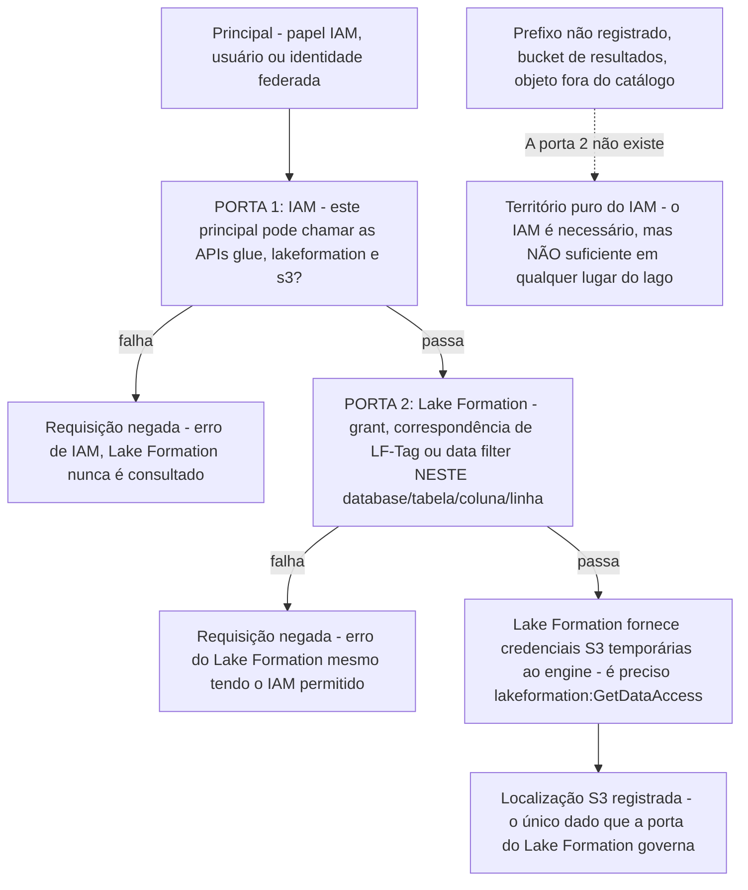
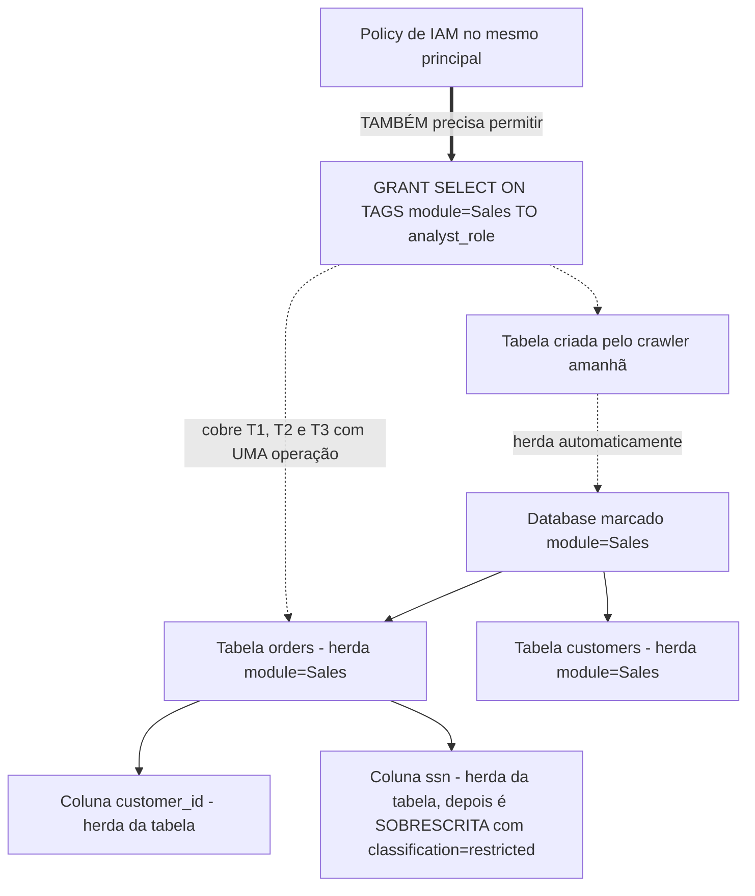
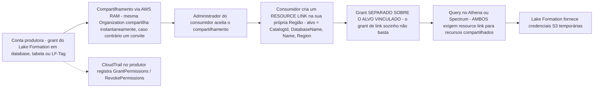
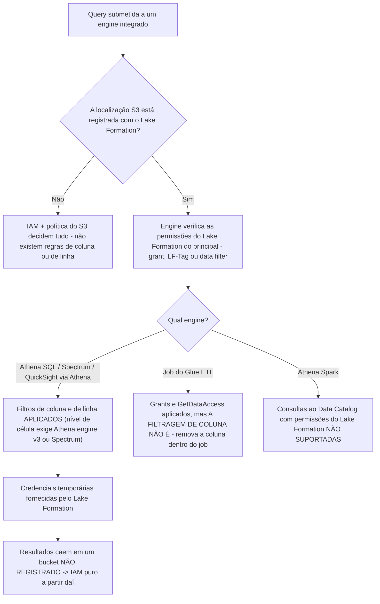
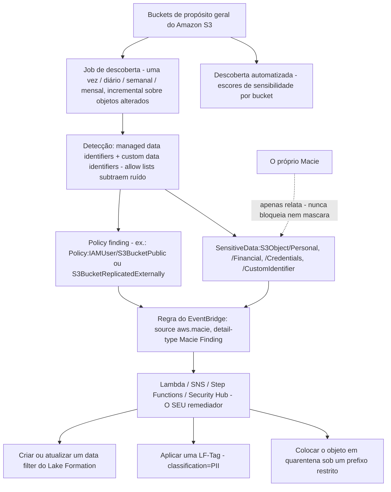
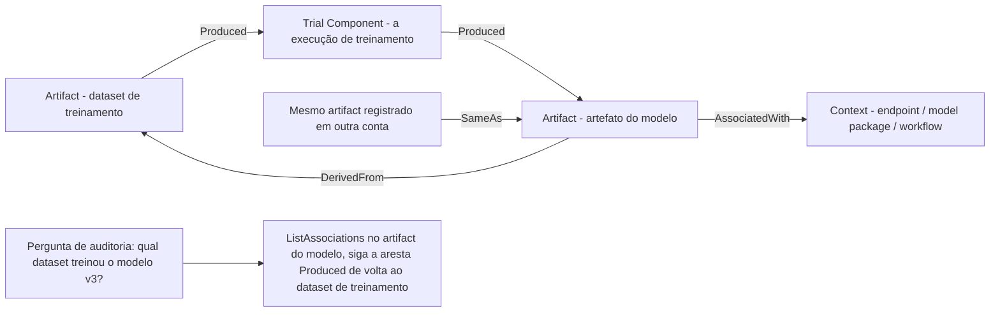
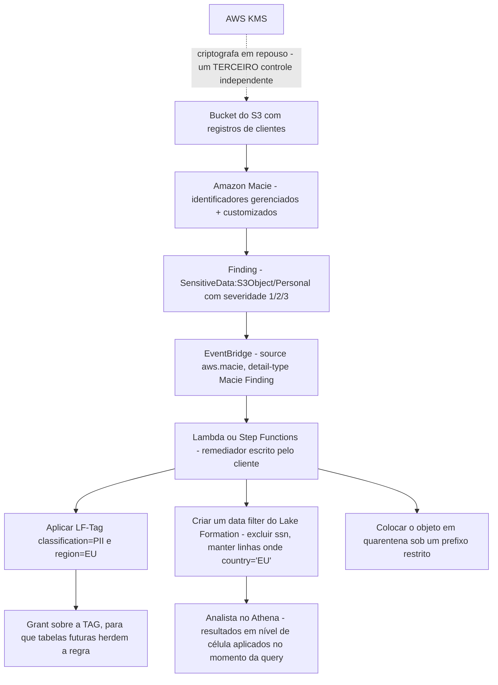

# Governança, Lake Formation e Proteção de PII

O Domínio 4 vale **18% do conteúdo pontuado**, e sua última tarefa, *Entender privacidade e governança de dados*, é onde o exame DEA-C01 para de perguntar "você consegue mover os dados?" e passa a perguntar "quem pode ver qual linha, em qual Região, e como você provaria isso um ano depois?". Dois serviços carregam quase todo esse peso: o **AWS Lake Formation**, que decide *o que* um principal pode ver dentro do lago, e o **Amazon Macie**, que *encontra* os dados sensíveis que você deveria estar protegendo. Ambos são rotulados de forma errada nos simulados, Lake Formation como substituto do IAM, Macie como ferramenta de bloqueio, e os dois rótulos custam pontos.

```text
====================================================================
 DOMÍNIO 4 - SUPERFÍCIE DE GOVERNANÇA (DEA-C01, 18% do conteúdo pontuado)
====================================================================
  4.2.4  gerenciar permissões através do AWS Lake Formation
         (Redshift, EMR, Athena, S3)
  4.2.5  métodos de autorização: por papel, por tag, por atributo
  4.3.1  mascaramento / anonimização de dados por lei de conformidade
  4.4.1  AWS CloudTrail para rastrear chamadas de API
  4.5.1  conceder permissões para compartilhamento de dados (ex.: Redshift)
  4.5.2  identificação de PII (ex.: Amazon Macie com Lake Formation)
  4.5.3  impedir backups / réplicas em Regiões não permitidas
  4.5.4  visualizar mudanças de configuração (ex.: AWS Config)
  4.5.5  manter a soberania dos dados
  4.5.7  estrutura de governança de dados e padrões de compartilhamento
--------------------------------------------------------------------
  DUAS PORTAS ... IAM (você pode chamar a API?)
                  Lake Formation (você pode ver ESTE objeto?)
  GRAO FINO ..... database | tabela | coluna | linha | célula
  ABAC .......... LF-Tags: cascata database -> tabela -> coluna
  COMPARTILHAR .. AWS RAM + resource links, entre contas / Regiões
  DESCOBRIR ..... Amazon Macie: identificadores gerenciados + customizados
  LINHAGEM ...... SageMaker ML Lineage Tracking + versões do Glue
  AUDITORIA ..... CloudTrail GrantPermissions / RevokePermissions
====================================================================
```

Nesta lição você vai:

- separar **IAM de Lake Formation** e defender a regra "duas portas, as duas precisam abrir", que decide a maioria das questões de acesso ao lago;
- ler a **anatomia das permissões** em nível de catálogo, database, tabela, localização S3, LF-Tag e resource link;
- construir controles **em nível de coluna, de linha e de célula** com **data filters** do Lake Formation, incluindo seus limites de PartiQL;
- aplicar **LF-Tags** (controle de acesso baseado em atributos): pré-definir, atribuir, herdar, cascatear e a semântica de grant AND/OR;
- compartilhar dados **entre contas e entre Regiões** com AWS RAM, resource links e grants separados no destino;
- raciocinar sobre **governed tables**, seu **fim de suporte em 31 de dezembro de 2024** e o **padrão de release de catálogo azul/verde**;
- posicionar **Glue, Athena, Spectrum, QuickSight, EMR e Redshift** frente à aplicação do Lake Formation, engine por engine;
- operar o **Amazon Macie**: descoberta automatizada, jobs de descoberta, identificadores gerenciados versus customizados, findings, severidade e automação com EventBridge, e nunca chamá-lo de prevenção;
- conceder **compartilhamento de dados no Redshift** através de datashares e reconstruir a **linhagem de dados** com SageMaker ML Lineage Tracking e versionamento do catálogo do Glue;
- executar a **privacidade na profundidade do exame**: tags de PII, residência de dados, esquecimento, auditoria com CloudTrail e responsabilidade compartilhada;
- estudar **quatro estudos de caso de clientes da AWS**, um **quadro de atualizações de outubro de 2026** com fonte citada e **14 questões no estilo do exame**, além de três verificações interativas.

---

## 1. O mapa de governança do Domínio 4: as oito habilidades que esta lição responde

### 1.1 Os enunciados das tarefas, na íntegra

| Habilidade | Enunciado (guia de exame DEA-C01 v1.1, acesso em outubro de 2026) | Seção desta lição |
|---|---|---|
| **4.2.4** | "Gerencie permissões através do AWS Lake Formation (para Amazon Redshift, Amazon EMR, Amazon Athena e Amazon S3)" | 2, 3, 4, 6 |
| **4.2.5** | "Aplique métodos de autorização que atendam às necessidades de negócio (baseados em papel, em tag e em atributo)" | 4 |
| **4.3.1** | "Aplique mascaramento e anonimização de dados de acordo com leis de conformidade ou políticas da empresa" | 3, 10 |
| **4.4.1** | "Use o AWS CloudTrail para rastrear chamadas de API" | 9, 10 |
| **4.5.1** | "Conceda permissões para compartilhamento de dados (por exemplo, compartilhamento de dados para o Amazon Redshift)" | 5, 8 |
| **4.5.2** | "Implemente identificação de PII (por exemplo, Amazon Macie com Lake Formation)" | 7, 10 |
| **4.5.3** | "Implemente estratégias de privacidade de dados para impedir backups ou réplicas de dados em Regiões da AWS não permitidas" | 10 |
| **4.5.5** | "Mantenha a soberania dos dados" | 10 |
| **4.5.7** | "Descreva a estrutura de governança de dados e os padrões de compartilhamento de dados": **nova no guia v1.1 (2025-12-12)** | 5, 10 |

Duas habilidades vizinhas são deliberadamente roteadas para outras lições: **4.5.4** (AWS Config para mudanças de configuração) aparece aqui apenas onde é contrastada com o CloudTrail, e **4.5.6** (projetos do Amazon SageMaker Catalog) é nomeada pelo guia, mas não é um construto do Lake Formation.

### 1.2 As personas: quem pode conceder o quê

| Persona | Poderes | Restrição verificada (acesso em outubro de 2026) |
|---|---|---|
| **Administrador do data lake** | Conceder e revogar permissões do Lake Formation, registrar localizações do S3, gerenciar LF-Tags | **Limitado a 30 por conta por padrão** |
| **Administrador de IAM** | Criar policies de IAM, papéis, usuários e grupos | **Não pode conceder permissões do Lake Formation** a menos que também detenha o papel de administrador do data lake |
| **Criador de LF-Tag** (administrador de tags sem privilégios de admin) | `CREATE_LF_TAG`, `ALTER`, `DROP` sobre tags; `ASSOCIATE`, `DESCRIBE` sobre recursos marcados | `ASSOCIATE` implica `DESCRIBE` |
| **Papel de registro (registration role)** | Fornece as permissões `s3:*` usadas para registrar uma localização S3 com o Lake Formation | O chamador precisa **também** deter **`lakeformation:GetDataAccess`** para as credenciais fornecidas (vended) |
| **Grantor com `WITH GRANT OPTION`** | Reconcede o que detém | `CREATE_TABLE` em um database carrega implicitamente toda permissão do Lake Formation sobre tabelas criadas ali, e é em si concedível |

A linha do administrador de IAM é o fato de persona mais examinado desta seção: **expertise em identidade não confere autoridade sobre o data lake**. Um engenheiro que consegue editar qualquer policy de IAM na conta ainda não pode conceder `SELECT` em uma tabela do Lake Formation enquanto não for administrador do data lake.

- **📚 Você sabia?** As **verificações de permissão do próprio Lake Formation são gratuitas**; você é cobrado pelos *serviços integrados* que executa (Athena, Spectrum, Glue) e pela **Lake Formation Storage API**, que cobra **bytes escaneados arredondados para cima até o próximo megabyte, com mínimo de 10 MB por requisição** (página de preços do Lake Formation, acesso em outubro de 2026). Assim, a camada de governança é barata para ser superconcedida *financeiramente* e cara para ser superconcedida *politicamente*, e é exatamente por isso que o exame a testa por correção, não por custo.

### 1.3 A divisão de trabalho em uma tabela

| Pergunta que a requisição levanta | Respondida por | Mecanismo |
|---|---|---|
| Este principal pode chamar `glue:*`, `lakeformation:*`, `s3:*`? | **IAM** | Política de identidade, política de recurso, política de sessão |
| Ele pode ver **este database / tabela / coluna / linha**? | **Lake Formation** | Grants, LF-Tags, data filters |
| De onde vêm as credenciais do S3? | **Lake Formation** fornece credenciais temporárias aos engines integrados (após `GetDataAccess`) |
| O que a bucket policy do S3 sozinha decide? | Apenas se o objeto é alcançável por um principal cujas *próprias* credenciais permitem: **nunca** a visibilidade fina do lago |
| Quem concedeu `SELECT` às 14:02 da terça passada? | **CloudTrail**: `GrantPermissions` / `RevokePermissions` |
| A bucket policy ou a configuração de criptografia do S3 mudou? | **AWS Config**: estado de configuração ao longo do tempo |

---

## 2. A DISTINÇÃO DO EXAME: Lake Formation versus IAM no acesso ao lago S3

### 2.1 Duas portas, as duas precisam abrir

A AWS enuncia a regra em uma frase, e toda questão de acesso ao lago é uma variação dela:

> "Quando um principal faz uma requisição para acessar recursos do Data Catalog ou os dados subjacentes, para que a requisição tenha sucesso, ela deve passar nas verificações de permissão de **tanto IAM quanto Lake Formation**.": visão geral de permissões do Lake Formation (acesso em outubro de 2026)



Três corolários caem direto dessa figura, e cada um deles é uma questão:

1. **Um grant do Lake Formation sem IAM falha.** O principal ainda precisa de `glue:*` nas APIs do catálogo, de `lakeformation:GetDataAccess` para as credenciais fornecidas e das permissões do próprio engine.
2. **O IAM sozinho não consegue expressar grao fino.** Nenhuma policy de identidade consegue dizer *"somente as linhas onde `region = 'EU'`"* ou *"todas as colunas exceto `ssn`"*; isso vive exclusivamente nos data filters do Lake Formation.
3. **Não registrado significa não governado.** Buckets de resultados do Athena, prefixos não registrados e tudo o que estiver fora do catálogo são decididos apenas pelo IAM e pelo S3, e o Lake Formation **não se aplica na gravação de objetos** (documentação de segurança do Athena, acesso em outubro de 2026).

### 2.2 IAM versus Lake Formation, lado a lado

| Dimensão | **IAM** | **Lake Formation** |
|---|---|---|
| Unidade de controle | Principal + ação + ARN do recurso | Objeto do catálogo: database, tabela, coluna, linha |
| Grao fino | Nível de API (`s3:GetObject` sobre um ARN) | **Exclusão de coluna, predicados de linha, nível de célula** |
| Escopo de Região | A política se aplica onde o recurso mora | **"As permissões do Lake Formation se aplicam somente na Região em que foram concedidas"**: acesso entre Regiões exige um **resource link** na Região do consumidor |
| Padrão em uma conta nova | O que for o estado de IAM da conta | **`Super` em todo database e tabela é pré-concedido a um grupo chamado `IAMAllowedPrincipals`** |
| Caminho das credenciais S3 | As credenciais próprias do chamador | **Credenciais temporárias fornecidas** aos engines integrados |
| Ponto de aplicação | Toda chamada de API da AWS | Engines integrados (SQL do Athena, Spectrum, QuickSight, EMR, Redshift) |
| Melhor em | "Você pode chamar esta API?" | "Você pode *ver* estes dados?" |

### 2.3 O padrão que faz os grants parecerem inúteis

> "Por padrão, o Lake Formation define **permissão Super em todos os databases e tabelas do Data Catalog para um grupo chamado `IAMAllowedPrincipals`** … **todos os principals da sua conta terão acesso … através das políticas de identidade do AWS Glue**.": referência de permissões do Lake Formation (acesso em outubro de 2026)

Até você **revogar esse grupo** (ou ligar o **modo de acesso híbrido**), o catálogo se comporta como se o Lake Formation não estivesse ali: todo principal de IAM da conta lê toda tabela, e seus grants cuidadosamente escritos parecem não mudar nada. O modo de acesso híbrido divide a conta em dois: **principals que aderiram precisam passar tanto pelo Lake Formation quanto pelo IAM**, enquanto os principals que não aderiram continuam governados apenas pelo IAM.

### 2.4 Exemplo trabalhado E1: "meus grants não fazem nada" em quatro verificações

Um analista relata que uma revogação não teve efeito. Percorra a lista nesta ordem:

```text
VERIFICAÇÃO 1  IAMAllowedPrincipals ainda detém Super?
               -> o grant padrão significa que o analista lê via IAM, não
                  via sua permissão do Lake Formation. Revogue o grupo, ou
                  habilite o modo de acesso híbrido para os principals que
                  você governa.
VERIFICAÇÃO 2  A localização S3 está registrada com o Lake Formation?
               -> prefixos não registrados são território puro de IAM/S3.
                  Registre a localização (DATA_LOCATION_ACCESS) e confirme
                  que o papel de registro detém s3:*.
VERIFICAÇÃO 3  As permissões foram concedidas NESTA Região?
               -> "as permissões do Lake Formation se aplicam somente na
                  Região em que foram concedidas" - consumidores entre
                  Regiões precisam de um resource link.
VERIFICAÇÃO 4  O IAM ainda permite a chamada de API?
               -> o principal precisa de glue:* / lakeformation:* e de
                  lakeformation:GetDataAccess mesmo quando o grant do
                  Lake Formation está correto.
```

> [!WARNING]
> ⚠️ **A armadilha das duas portas aparece em três disfarces.** (a) *"Acrescente uma bucket policy do S3"*: necessária, nunca suficiente: policies do S3 não expressam regras de linha ou de coluna. (b) *"O grant do Lake Formation está errado"*: quando a causa real é o padrão `IAMAllowedPrincipals` ou uma localização não registrada. (c) *"Copie o grant para a outra Região"*: grants do Lake Formation são locais à Região; a resposta correta é um **resource link** na Região do consumidor, não um grant duplicado. Leia o enunciado para ver qual porta ele está de fato testando.

---

## 3. O modelo de permissões: database, tabela, coluna, linha

### 3.1 Conjuntos de permissão por camada de recurso

| Camada de recurso | Permissões que o Lake Formation reconhece |
|---|---|
| **Catálogo** | `CREATE_CATALOG` (exige a permissão de "criador do catálogo") |
| **Database** | `ALL` (Super), `ALTER`, `CREATE_TABLE`, `DESCRIBE`, `DROP` |
| **Tabela** | `ALL` (Super), `ALTER`, `DESCRIBE`, `DELETE`, `DROP`, `INSERT`, `SELECT` |
| **Tabela + coluna / data filter** | `SELECT` (mais `DESCRIBE`, `DROP` sobre o próprio objeto do filtro) |
| **Localização S3 (registro)** | `DATA_LOCATION_ACCESS` |
| **LF-Tag ou valor de tag** | `CREATE_LF_TAG`, `ALTER`, `DROP`; `ASSOCIATE`, `DESCRIBE` |
| **Resource link** (distinto do seu alvo) | `DESCRIBE`, `DROP`: **um grant de link não é um grant de alvo** |

Duas regras estruturais importam mais que a própria lista:

- **`ALL-tables` implica `DESCRIBE` do database**: conceder sobre "todas as tabelas" revela necessariamente que o database existe, e essa implicação **não** vale em grants baseados em atributos (LF-Tag).
- **Revogar `Super` não revoga tudo.** Um principal pode ficar com um `SELECT` e um `INSERT` comuns depois que o Super é removido: "revogar o Super" não é sinônimo de "revogar o acesso".

### 3.2 Data filters: a combinatória de coluna/linha/célula

Um **data filter** por tabela combina uma especificação de colunas (lista de inclusão, lista de exclusão ou o curinga de todas as colunas) com um predicado de linha opcional em um **subconjunto de PartiQL**, ou com `AllRowsWildcard`. A AWS enuncia a regra de combinação diretamente:

> "'curinga de todas as colunas' + filtro de linha = **segurança somente em nível de linha**. Incluir/excluir colunas específicas + 'todas as linhas' = **segurança somente em nível de coluna**. Colunas específicas **e** um filtro de linha = **segurança em nível de célula**.": filtragem de dados (acesso em outubro de 2026)

| Colunas escolhidas | Linhas escolhidas | Controle resultante | Nome no exame |
|---|---|---|---|
| Curinga de todas as colunas | Predicado | Todas as colunas, linhas filtradas | **Nível de linha** |
| Lista de inclusão/exclusão | `AllRowsWildcard` | Colunas selecionadas, todas as linhas | **Nível de coluna** |
| Lista de inclusão/exclusão | Predicado | Colunas selecionadas, linhas filtradas | **Nível de célula** |
| Curinga de todas as colunas | `AllRowsWildcard` | Tudo | Nenhuma restrição |

Restrições que você precisa conseguir citar:

| Restrição | Valor (acesso em outubro de 2026) |
|---|---|
| Filtros concedíveis | **Somente `SELECT`**: um filtro nunca amplia acesso para `INSERT`/`DELETE` |
| Tamanho da expressão | **< 2.048 caracteres** |
| Operadores | `= > < >= <= <> != BETWEEN IN LIKE NOT IS [NOT] NULL` |
| Comparação coluna com coluna | **Não suportada** |
| Semântica de string / `LIKE` | **Sensível a maiúsculas/minúsculas** |
| Filtros por principal por tabela | **≤ 100** |
| Profundidade de struct aninhado nos filtros de linha | **5 níveis**; structs OK, **array e map não suportados** |
| Colunas de partição | **Não podem ser filtradas** |
| Nível de célula em qualquer lugar | **Athena engine v3 ou Redshift Spectrum** |
| Grao fino do Glue 5.0+ em jobs | **Somente fontes Hive e Iceberg** |

### 3.3 Álgebra de predicados: quando duas regras se encontram

- **Um principal e o seu próprio grupo de IAM:** os filtros de linha são **unidos**, o usuário vê o mais amplo dos dois.
- **Um grant para uma conta externa intersectado com um grant direto:** **interseção**, o resultado mais estreito vence.
- **Dois curingas `all-rows` concorrentes:** o **`all-rows` prevalece**.
- **Entre engines:** a aplicação acontece no momento da query, então um filtro que o Athena honra ainda precisa ser reimplementado em qualquer lugar onde os dados sejam lidos *sem* a aplicação do Lake Formation (Seção 6).

### 3.4 Exemplo trabalhado E2: projetando a proteção em nível de célula para `ssn`

Requisito: analistas britânicos veem apenas linhas de clientes do Reino Unido, e **ninguém** no papel de analista vê nunca a coluna `ssn`.

```text
TABELA           customers
DATA FILTER       customers_pii_uk
  colunas         ExcludedColumnNames = [ ssn ]        <- metade da coluna
  linhas          RowFilter = "country = 'UK'"         <- metade da linha
                  (AllRowsWildcard NÃO usado -> nível de célula, pela regra Q4)
GRANT             GRANT SELECT ON TABLE customers_pii_uk
                      TO ROLE uk_analyst_role
TAMBÉM OBRIGATÓRIO IAM glue:* + GetDataAccess; s3://lake/customers/ registrada
                  com o Lake Formation
ENGINE            Athena engine v3 (ou Spectrum) para aplicar em nível de célula
CUSTO DO ERRO     Job do Glue ETL lendo a mesma tabela NÃO é filtrado por coluna -
                  deixe cair ssn dentro do job como defesa em profundidade
```

Leia a aritmética da regra: coluna excluída **mais** predicado de linha = **nível de célula**; se tivéssemos usado o curinga de todas as colunas com o mesmo predicado, teríamos entregue proteção apenas **em nível de linha** e vazado `ssn` em toda linha do Reino Unido.

### 3.5 Exemplo trabalhado E3: a escada de quatro grants sobre uma tabela

```text
Grant A  SELECT na tabela, sem filtro            -> vê toda coluna, toda linha
Grant B  SELECT + data filter (todas as linhas)  -> ainda toda linha; o objeto
                                                   do filtro não carrega lógica
                                                   de linha
Grant C  SELECT + data filter (exclui ssn)       -> nível de coluna: ssn invisível
Grant D  SELECT + data filter (exclui ssn
         + country='UK')                        -> nível de célula: ssn invisível E
                                                   apenas linhas do RU retornadas
Grant E  apenas INSERT                          -> pode escrever, não pode ler;
                                                   data filters são só de SELECT
```

**Leitura:** a proteção é propriedade do *filtro anexado ao grant*, não da tabela. Dois analistas consultando a mesma tabela `customers` podem legitimamente ver conjuntos de colunas e de linhas diferentes: que é exatamente o que "segurança em nível de célula" significa neste exame.

---

## 4. LF-Tags: controle de acesso baseado em atributos e a cascata

### 4.1 As seis regras dos grants por tag (LF-TBAC)

1. **Pré-defina primeiro.** Um par chave/valor não pode ser inventado no momento da atribuição: ele já precisa existir como LF-Tag.
2. **Um valor por chave por recurso.** Uma tabela não pode ser `classification=public` e `classification=restricted` ao mesmo tempo na mesma chave.
3. **Os valores são armazenados em minúsculas.**
4. **A herança é direcional:** *"Tabelas herdam LF-Tags de databases e colunas herdam LF-Tags de tabelas. Os valores herdados podem ser sobrescritos."*
5. **Conceda sobre a tag, não sobre o objeto:** `GRANT SELECT ON TAGS module=Sales TO analyst_role`: toda tabela que carrega essa tag está coberta, **incluindo tabelas que o crawler criar amanhã**.
6. **LF-Tags não são tags de IAM.** A formulação da AWS é absoluta: *"Tags IAM não são as mesmas que LF-Tags. Essas tags não são intercambiáveis."* Elas **compõem**: os dois testes precisam autorizar a requisição.

### 4.2 A cascata, desenhada



### 4.3 Semântica de grant: AND entre chaves, OR dentro de uma chave

| Expressão | Significado |
|---|---|
| `ON TAGS module=Sales AND classification=Restricted` | As duas chaves precisam corresponder, **AND** |
| `ON TAGS (module=Sales OR module=Marketing)` | Qualquer valor da mesma chave, **OR** |
| Expressões `AND`/`OR` aninhadas | Permitidas e **reutilizáveis entre grants desde 2024-11-07** |
| `ASSOCIATE` em uma tag | Implica `DESCRIBE` nela |
| Alvo de LF-TBAC entre contas | Outra conta, uma **AWS Organization** ou uma **OU** |

```fillblank
{
  "question": "Complete as afirmações de controle de acesso baseado em tags do Lake Formation:",
  "template": "Tabelas herdam LF-Tags de {{1}} e colunas herdam LF-Tags de {{2}}; toda chave precisa ser pré-definida antes de poder ser atribuída e os valores são gravados em caixa {{3}}. Um grant que nomeia várias chaves diferentes é uma condição {{4}}, enquanto um grant que nomeia vários valores DA MESMA chave é uma condição {{5}}. As LF-Tags são explicitamente {{6}} em relação às tags IAM, então ambos os testes precisam autorizar a requisição.",
  "answers": {
    "1": "databases",
    "2": "tables",
    "3": "minúscula",
    "4": "AND",
    "5": "OR",
    "6": "não intercambiáveis"
  },
  "distractors": ["schema", "catálogos", "colunas", "maiúscula", "misturada", "título", "OR", "AND", "intercambiáveis", "equivalentes", "independentes"],
  "explanation": "A cascata documentada é database -> tabela -> coluna com valores herdados sobrescrevíveis, as chaves são pré-definidas e os valores ficam em caixa minúscula. Chaves DIFERENTES se combinam com AND; vários valores de UMA mesma chave se combinam com OR. A AWS declara diretamente que tags de IAM e LF-Tags não são intercambiáveis: elas compõem, então o teste de IAM E o teste de tag do Lake Formation precisam autorizar a requisição. Uma tag de database alcança sim as colunas, mas através da tabela."
}
```


### 4.4 Exemplo trabalhado E4: grants nomeados versus grants por tag

Configuração: **3 principals analistas**, cada um precisando do mesmo acesso a **3 databases e 7 tabelas**, mais um plano para adicionar **mais 50 tabelas** no próximo trimestre. (Aritmética derivada; este não é um número publicado pela AWS; a estrutura segue a documentação de TBAC do Lake Formation, acesso em outubro de 2026.)

```text
ROTA NOMEADA (um GrantPermissions por principal por objeto)
  3 principals x (3 databases + 7 tabelas) = 3 x 10 = 30 chamadas de grant
  Adicionar 50 tabelas                     = +3 x 50 = +150 chamadas de grant
                                             total 180

ROTA POR TAG (LF-TBAC)
  Pré-definir LF-Tag module = Sales            1 operação
  ASSOCIATE a tag em 3 databases               3 operações
     (tabelas HERDAM do database -             0 associações de tabela)
      colunas HERDAM da tabela -               0 associações de coluna)
  GRANT SELECT ON TAGS module=Sales            1 grant
     para cada um dos 3 principals             -> 3 grants
                                             total 7
  Adicionar 50 tabelas (criadas pelo crawler)  +0 operações
                                             continua 7
```

**Leitura:** a rota por tag colapsa 180 operações em 7 porque o grant se liga a um *atributo* que os novos objetos herdam automaticamente. É por isso que a habilidade 4.2.5 nomeia **autorização por tag e por atributo** como resposta para necessidades de negócio: em escala, a diferença não é conveniência, é se as permissões continuam corretas enquanto o catálogo cresce.

- **📚 Você sabia?** A AWS publica um resultado de cliente exatamente para esta aritmética: a **Integral Ad Science "reduziu centenas de regras de permissão a precisamente duas regras"** usando o controle de acesso baseado em tags do Lake Formation (AWS Big Data Blog, 2021-09-23, acesso em outubro de 2026). Duas regras não é erro de digitação: é o que acontece quando o *número de objetos* deixa de ser o *número de grants*.

### 4.5 Exemplo trabalhado E5: um grant multi-tenant baseado em tags

```text
TAGS PRÉ-DEFINIDAS  tenant = acme | globex | initech      (um valor por recurso)
                    classification = public | internal | restricted
ATRIBUIR            database tenant_acme      -> tenant=acme
                    database tenant_globex    -> tenant=globex
                    database tenant_initech   -> tenant=initech
GRANT 1             GRANT SELECT ON TAGS tenant=acme
                        TO ROLE acme_analyst            (cobre tabelas + colunas)
GRANT 2             GRANT SELECT ON TAGS classification=restricted
                        TO ROLE privacy_office          (faz AND com qualquer
                                                         outra chave nomeada no
                                                         mesmo grant)
RESULTADO DO CRAWLER  a tabela de amanhã tenant_acme.invoices_v3 é legível por
                    acme_analyst SEM grant adicional, e por privacy_office
                    porque classification=restricted foi aplicada no database
```

---

## 5. Compartilhamento de dados: entre contas, entre Regiões, governed tables, azul/verde

### 5.1 A sequência produtor/consumidor



Fatos codificados nessa figura:

- **As pilhas de compartilhamento são ou Lake Formation (RAM + resource links) ou o compartilhamento legado de catálogo só com IAM**; o **modo de acesso híbrido** permite que as duas coexistam enquanto uma conta migra.
- **Entre Regiões**, o compartilhamento funciona através de **resource links criados na Região do consumidor**: as permissões do Lake Formation em si nunca viajam.
- **Um grant direto para um principal** (em vez de um compartilhamento) é unido com qualquer grant cascateado por conta, e **apenas o destinatário o vê: ele não pode recompartilhá-lo**.
- **Crawler entre contas** tem sua própria ordem de quatro passos: registrar a localização na conta *produtora* → conceder `DATA_LOCATION_ACCESS` ao *papel do crawler do consumidor* (mais `GetDataAccess`) → aceitar o compartilhamento do RAM → criar o link e marcar **"Usar credenciais do Lake Formation"**.

```dragdrop
{
  "question": "Ordene os passos do compartilhamento do Lake Formation entre contas que terminam com uma query no Athena na conta do consumidor:",
  "items": [
    "O produtor concede permissões do Lake Formation no database, na tabela ou na LF-Tag",
    "O produtor compartilha esses recursos através do AWS RAM",
    "O administrador do consumidor aceita o compartilhamento do RAM",
    "O consumidor cria um RESOURCE LINK na sua própria Região apontando para o objeto de catálogo do produtor",
    "O consumidor concede permissões SOBRE O ALVO VINCULADO: o grant de link sozinho não basta",
    "O consumidor executa a query no Athena e o Lake Formation fornece credenciais S3 temporárias"
  ],
  "correctOrder": [
    "O produtor concede permissões do Lake Formation no database, na tabela ou na LF-Tag",
    "O produtor compartilha esses recursos através do AWS RAM",
    "O administrador do consumidor aceita o compartilhamento do RAM",
    "O consumidor cria um RESOURCE LINK na sua própria Região apontando para o objeto de catálogo do produtor",
    "O consumidor concede permissões SOBRE O ALVO VINCULADO: o grant de link sozinho não basta",
    "O consumidor executa a query no Athena e o Lake Formation fornece credenciais S3 temporárias"
  ],
  "explanation": "A ordem documentada é grant do produtor -> compartilhamento via AWS RAM -> consumidor aceita -> resource link na Região do consumidor -> grant separado sobre o alvo vinculado -> query, momento em que o Lake Formation fornece credenciais S3 temporárias. Duas armadilhas ficam dentro da sequência: um grant de link NÃO é um grant de alvo (DESCRIBE/DROP no link não deixa você ler dados), e as permissões do Lake Formation nunca viajam para outra Região, é o resource link que faz esse trabalho, sem cópia de dados."
}
```

### 5.2 Governed tables, e a data que você precisa citar

A AWS construiu as **governed tables** como um tipo de tabela do Amazon S3 com **garantias ACID entre tabelas** e compactação automática, para que a análise pudesse compartilhar instantâneos consistentes. Em seguida, a AWS anunciou:

> "**fim do suporte às Governed Tables, com efeito em 31 de dezembro de 2024**, para se concentrar em formatos de tabela transacionais de código aberto como **Apache Iceberg, Apache Hudi e Linux Foundation Delta Lake**.": AWS Big Data Blog, 2024-10-02

Como tratar no exame: cite a **descontinuação com a sua data** e responda questões sobre formatos de tabela abertos com **Iceberg, Hudi ou Delta Lake**. Grants do Lake Formation, incluindo filtros de linha e de célula, se aplicam a tabelas Iceberg/Hudi/Delta catalogadas, e o Lake Formation gerencia **compactação, retenção de snapshot e remoção de arquivos órfãos para o Iceberg**, enquanto o engine mantém a propriedade da escrita de DDL (`VACUUM`, `MERGE`, `OPTIMIZE`).

### 5.3 Releases de catálogo azul/verde: um padrão, não um serviço

"Deploy de catálogo azul/verde" **não é** um nome de recurso da AWS: nada na documentação do Lake Formation ou do Glue descreve um serviço com esse nome (verificado em outubro de 2026). O que o exame está realmente testando é se você consegue *montar* o padrão a partir de blocos verificados:

| Bloco de construção | Capacidade verificada | Papel no padrão |
|---|---|---|
| **Histórico de versões de tabela do Data Catalog** | Diffs de `GetTableVersions` mais eventos **Table State Change** | Provar a nova forma antes de alguém consultar |
| **Views de catálogo** | **≤ 10 tabelas base por view** | O nome estável que os consumidores continuam consultando |
| **Resource links** | Nome de link estável, alvo substituível | Apontar o link de azul para verde sem tocar nos consumidores |
| **Sequenciamento** | **Aditivo antes, deletivo depois** | Criar o verde, validar, reapontar e só então remover o azul |

```text
RELEASE DE CATÁLOGO AZUL/VERDE (padrão montado)
  1. rode o crawler em sales_green ao lado do sales_blue vivo
  2. diff de GetTableVersions - confirme schema, partições e estatísticas de coluna
  3. valide com uma query canário contra sales_green
  4. reaponte a VIEW ou o RESOURCE LINK estável de sales_blue -> sales_green
  5. mantenha sales_blue por uma janela de rollback
  6. remova sales_blue (o passo deletivo SEMPRE é o último)
```

### 5.4 Exemplo trabalhado E6: compartilhar versus copiar um dataset de 20 TB

```text
O PRODUTOR tem 20 TB; o consumidor está em outra Região da AWS.

ROTA DE CÓPIA (UNLOAD / COPY ou replicação)
  saída da Região do produtor          20 TB
  entrada na Região do consumidor       20 TB   (o consumidor paga a transferência)
  armazenamento cobrado DUAS VEZES     20 TB + 20 TB
  frescor                              atrasado em relação ao produtor pelo
                                       ciclo de sincronização

ROTA DE DATASHARE (Redshift) / SHARE DO LAKE FORMATION (lago S3)
  bytes copiados                       0
  armazenamento cobrado                uma vez, no produtor
  consumidor paga                      COMPUTE de query, mais transferência
                                       de dados entre Regiões nos bytes
                                       efetivamente consultados
  frescor                              ao vivo - "sem mover ou copiar
                                       manualmente os dados"
```

**Leitura:** a frase do exame *"compartilhar acesso a dados vivos … sem mover ou copiar manualmente os dados"* é a pista. Quando o primeiro passo de uma alternativa é `COPY`, `UNLOAD`, `rsync` ou "replicar o bucket", ela está descrevendo uma **cópia**, não um **compartilhamento**.

---

## 6. Integração com engines: Glue, Athena, Spectrum, QuickSight, EMR, Redshift

### 6.1 A matriz de aplicação

| Engine | Como o Lake Formation se aplica | Ressalva que será examinada |
|---|---|---|
| **Amazon Athena (SQL)** | Verifica o principal e depois fornece credenciais S3 temporárias | **O Athena Spark não suporta consultar tabelas do Data Catalog com permissões do Lake Formation**; o bucket de resultados é não registrado, então permanece território puro do IAM |
| **Amazon Redshift Spectrum** | Verificação por query mais credenciais fornecidas através do papel IAM no cluster ou de uma identidade federada | **Sem encadeamento de papéis (role chaining)** |
| **Amazon QuickSight** | O controle de acesso fino mapeia grants para **usuários e grupos do QuickSight no Enterprise** e para **papéis de IAM (por exemplo `aws-quicksight-service-role-v0`) no Standard**; dashboards exploram o lago **através do Athena** | A segurança de linha do próprio QuickSight é um controle de camada de BI e **não substitui** um filtro de linha do Lake Formation |
| **Crawlers do AWS Glue** | **"Usar credenciais do Lake Formation"** opcional, inclusive para crawler entre contas | O papel do crawler ainda precisa de `DATA_LOCATION_ACCESS` e `GetDataAccess` |
| **Jobs do AWS Glue ETL** | O papel do job precisa de grants do Lake Formation **mais** `lakeformation:GetDataAccess` | **A filtragem de coluna NÃO é aplicada dentro do Glue ETL**: remova ou mascare a coluna no job |
| **Amazon EMR / Spark** | Os plugins do Lake Formation rodam no cluster | Proteger o próprio cluster continua sendo trabalho do cliente |
| **Amazon Redshift (nativo)** | **Datashares gerenciadas pelo Lake Formation** publicam no catálogo do Glue, então o Lake Formation governa database, tabela, coluna **e linha** | Um datashare comum (não gerenciado pelo Lake Formation) é governado pelos grants próprios do Redshift |
| **Amazon SageMaker AI** | Grants do Lake Formation controlam o acesso a features durante o treinamento | A linhagem é um registro *separado* (Seção 9) |

```matching
{
  "question": "Associe cada engine à forma como ele aplica as permissões do Lake Formation:",
  "pairs": [
    {"left": "Amazon Athena (SQL)", "right": "Verifica o principal e depois o Lake Formation fornece credenciais S3 temporárias; o bucket de resultados é não registrado e permanece território puro do IAM"},
    {"left": "Amazon Athena Spark", "right": "NÃO suporta consultar tabelas do Data Catalog que carregam permissões do Lake Formation"},
    {"left": "Amazon Redshift Spectrum", "right": "Verifica por query e fornece credenciais através do papel IAM no cluster ou de uma identidade federada: sem encadeamento de papéis"},
    {"left": "Amazon QuickSight", "right": "Enterprise mapeia grants para usuários e grupos do QuickSight; Standard os mapeia para papéis de IAM como aws-quicksight-service-role-v0; dashboards exploram através do Athena"},
    {"left": "AWS Glue crawlers", "right": "Opcionalmente usam credenciais do Lake Formation, inclusive para crawler entre contas, quando o papel detém DATA_LOCATION_ACCESS e GetDataAccess"},
    {"left": "AWS Glue ETL jobs", "right": "Grants e GetDataAccess são verificados, mas A FILTRAGEM DE COLUNA NÃO É APLICADA: o job deve remover ou mascarar a coluna ele mesmo"}
  ],
  "explanation": "A aplicação é deliberadamente desigual. Athena SQL e Spectrum aplicam regras de coluna, linha e célula (nível de célula exige Athena engine v3 ou Spectrum); Glue ETL nunca aplica filtragem de coluna; Athena Spark não é suportado; QuickSight é uma camada de BI que explora através do Athena; crawlers podem usar credenciais fornecidas. Todo pareamento errado no exame é uma dessas ressalvas movida para o engine errado."
}
```



### 6.2 Exemplo trabalhado E7, o que uma query governada pelo Lake Formation realmente lê

Uma tabela Parquet de 1 TB está particionada em **12 partições mensais**; o predicado do analista poda para um único mês:

```text
Scan completo           1.000 GB
Poda de partição        1.000 / 12                    ~= 83 GB de leitura planejada
Economia               (1.000 - 83) / 1.000          ~= 91,7%   (derivado)
Cobrança da Lake Formation Storage API:
  bytes escaneados, arredondados PARA CIMA até 1 MB
  carga mínima por requisição = 10 MB
  -> a mesma verificação de governança é barata a 83 GB e barata a 10 MB;
     é o ENGINE (Athena/Spectrum) que cobra pelo volume de dados
```

**Leitura:** o Lake Formation decide *se* a query pode rodar e *quais linhas/colunas* voltam; a partição e o formato de arquivo decidem *quantos bytes* o engine lê; a regra de arredondamento da Storage API decide o item da fatura do Lake Formation. Três faturas diferentes, uma query: um clássico distrator de múltiplas alternativas.

### 6.3 Exemplo trabalhado E8: a mesma tabela através de dois engines

```text
TABELA     sales.orders  (localização registrada, filtro de nível de célula: exclui card_last4)
ANALISTA   Athena engine v3     -> vê toda coluna EXCETO card_last4, linhas filtradas
                                   (nível de célula APLICADO)
ANALISTA   QuickSight Enterprise-> mesma visão, porque os dados explorados vêm
                                   ATRAVÉS do Athena
GLUE ETL   job sales_transform  -> lê card_last4 mesmo assim! Grants do Lake
                                   Formation e GetDataAccess são verificados,
                                   a filtragem de coluna NÃO é aplicada ->
                                   o job deve removê-lo/mascará-lo
CORREÇÃO   sc = DropFields(fields=['card_last4'])   (ou uma transformação KMS/masking)
           + conceda apenas o que o job precisa, nada mais
```

---

## 7. Amazon Macie: descoberta, não prevenção

### 7.1 O que ele é, e a fronteira que ele não cruza

> O Amazon Macie é "um **serviço de segurança de dados que descobre dados sensíveis usando machine learning e pattern matching**.", O que é o Amazon Macie (acesso em outubro de 2026)

| | No escopo do Macie | Fora do escopo do Macie |
|---|---|---|
| Armazenamento | **Buckets de propósito geral do Amazon S3** | RDS, DynamoDB, EBS, Redshift, on-premises |
| Saída | Findings, escores de sensibilidade, inventário | Bloquear, mascarar, colocar em quarentena, revogar |
| Modos | **Descoberta automatizada** (contínua) e **jobs de descoberta** (com escopo, agendados) | Aplicação em tempo real dentro de uma query |

### 7.2 Os dois engines de detecção e a allow list

| Engine | O que é | Propriedades relevantes para o exame |
|---|---|---|
| **Managed data identifiers** | **ML + pattern matching** mantidos pela AWS para credenciais, dados financeiros, **PII/PHI**, incluindo números de identidade por país | Nenhuma regra para escrever; a cobertura evolui com a AWS |
| **Custom data identifiers** | O seu **regex + palavras-chave + palavras de ignorar + proximidade** | **Imutáveis após a criação** ("histórico imutável … para auditorias de privacidade e proteção de dados"); **severidade padrão Média**; proximidade **1 to 300 caracteres, padrão 50** |
| **Allow lists** | Buckets ou objetos que **não** devem gerar findings de dados sensíveis | O terceiro componente de toda configuração de job do Macie |

### 7.3 Jobs, agendamentos e findings

| Conceito | Comportamento verificado (acesso em outubro de 2026) |
|---|---|
| **Descoberta automatizada** | Contínua, dirigida pelo inventário de buckets, produz **escores de sensibilidade de bucket de −1 a 100** |
| **Jobs de descoberta** | Escopo + agendamento explícitos: **uma vez, diário, semanal, mensal**; execuções periódicas analisam objetos **criados ou alterados desde a última execução** |
| **Prévia de custo** | Uma **previsão é exibida antes de você enviar** o job |
| **Policy findings** | `Policy:IAMUser/S3BucketPublic`, `…/S3BlockPublicAccessDisabled`, `…/S3BucketEncryptionDisabled`, **`…/S3BucketReplicatedExternally`** (o detetive de residência) |
| **Sensitive-data findings** | `SensitiveData:S3Object/Personal`, `/Financial`, `/Credentials`, `/CustomIdentifier` |
| **Retenção de findings** | **90 dias**; uma detecção repetida **atualiza a contagem** no finding existente |
| **Escala de severidade** | **1 = Low, 2 = Medium, 3 = High**: **não existe Critical**, e **não é** a escala 1.0 to 10.0 do GuardDuty |
| **Dois números diferentes de 0 to 100** | O **escore de sensibilidade** do bucket (−1…100) é uma métrica de *bucket*, nunca uma severidade de finding |

### 7.4 O fluxo dos findings, e onde o seu código assume



> [!WARNING]
> ⚠️ **O Macie encontra, ele não previne.** Toda alternativa redigida como *"o Macie bloqueia o upload"*, *"o Macie mascara a coluna"* ou *"o Macie revoga o grant"* está errada por construção: mascaramento e revogação são **data filters do Lake Formation** e **grants de IAM/Lake Formation**, e a ligação entre um finding do Macie e esses controles é **a sua** regra do EventBridge mais **o seu** Lambda ou state machine do Step Functions. Note também os **dois identificadores de serviço**: os eventos de findings chegam como `source = aws.macie` com `detail-type = "Macie Finding"`, enquanto as chamadas de API do próprio Macie aparecem no CloudTrail sob **`aws.macie2`**.

### 7.5 Exemplo trabalhado E9: uma especificação de job do Macie

```text
JOB              pii-nightly-customer-3p
ESCOPO           Buckets de propósito geral do S3:
                   s3://raw-customers/*          (zona de ingestão)
                   s3://curated/customers/*      (zona curada)
AGENDAMENTO      diário  (alternativas: uma vez, semanal, mensal)
                   -> execuções periódicas apenas reinspecionam objetos
                      criados ou alterados desde a última execução
CLASSIFICAÇÃO    managed data identifiers: credenciais, financeiro, PII/PHI
IDENTIF. CUSTOM  nome  tenant-id
                 regex TENANT-\d{8}
                 palavras-chave ["tenant_id", "customer_ref"]
                 palavras de ignorar ["TENANT-00000000"]
                 proximidade 1-300 caracteres (padrão 50)
                 severidade padrão MEDIUM  <- e IMUTÁVEL depois de criada
ALLOW LIST       s3://raw-customers/public-marketing/ (sem PII por design)
ANTES DE ENVIAR  revise a PREVISÃO de custo do serviço e então envie
SAÍDA           findings retidos por 90 dias; o EventBridge roteia severidade 3
                 para o tópico SNS de plantão
FORA DO ESCOPO   este job NÃO bloqueia, mascara nem apaga nada
```

### 7.6 Exemplo trabalhado E10: custo mensal do Macie (taxas de exemplo em us-east-1)

Os preços unitários são os **exemplos publicados da AWS para us-east-1** (página de preços do Macie, acesso em outubro de 2026: **confirme os preços atuais antes de usar**): **US$ 0,10 por bucket por mês**, **US$ 0,01 por 100.000 objetos por mês**, mais cobranças em faixas pelo volume de dados inspecionados.

```text
40 buckets                40 x US$ 0,10                   =   US$   4,00
30.000.000 objetos        30.000.000 / 100.000 = 300
                          300 x US$ 0,01                   =   US$   3,00
500 GB inspecionados      500 GB x US$ 1,00/GB (taxa de
                          exemplo da primeira faixa)      =   US$ 500,00
                                                        ------------
Total mensal (derivado)                                   =   US$ 507,00

Teste gratuito: 30 dias, até 150 GB, e OS JOBS DE DESCOBERTA FICAM DE FORA
            -> a linha de US$ 500 do job nunca é coberta pelo teste gratuito
```

**Leitura:** a contagem de objetos é arredondamento, a contagem de buckets é pequena, e **o volume de dados inspecionados domina**. É por isso que o exame ama a alternativa "escaneie tudo, a cada hora": ela é tecnicamente correta e economicamente indefensável.

### 7.7 Exemplo trabalhado E11: roteando findings com o EventBridge

```text
Regra 1  apenas HIGH           detail.severity.score = [3]
Regra 2  toda postura de policy detail.type-level-prefix "Policy:"  + score = [1,2,3]
Regra 3  detecções repetidas   detail.count >= 2                    (mesmo objeto, de novo)
Filtro   findings arquivados/suprimidos NÃO são entregues ao alvo da regra
Nome do serviço no CloudTrail para chamadas de API do Macie: aws.macie2
detail-type do EventBridge para findings:                 "Macie Finding"
```

- **📚 Você sabia?** Os **custom data identifiers do Macie são imutáveis após a criação**: a AWS enquadra isso como *"histórico imutável … para auditorias de privacidade e proteção de dados"* (opções de custom data identifier do Macie, acesso em outubro de 2026). Você não pode editar discretamente um regex que gerou os findings do trimestre passado; você cria um novo identificador e aposenta o antigo, que é exatamente a propriedade de auditoria que uma questão de conformidade está sondando.

---

## 8. Compartilhamento de dados no Amazon Redshift

### 8.1 O modelo de datashare

> O Redshift permite que você "compartilhe acesso a **dados vivos** entre clusters do Amazon Redshift, workgroups, contas da AWS e Regiões da AWS **sem mover ou copiar manualmente os dados**", e que "**os objetos de datashare são somente leitura para os consumidores de dados**" no modelo básico.: visão geral de compartilhamento de dados do Redshift (acesso em outubro de 2026)

| Propriedade | Comportamento verificado (acesso em outubro de 2026) |
|---|---|
| Unidade de compartilhamento | O **datashare**, pertencente a um **database produtor** |
| Objetos compartilháveis | Tabelas, views, UDFs |
| Acesso do consumidor | **Somente leitura**, a menos que o compartilhamento de escrita seja usado explicitamente (na mesma conta ou entre contas) |
| Ciclo de vida | `Pending authorization` → `Authorized` → `Active`; o lado do consumidor mostra **Available (Action required)** |
| Passos do consumidor | **Associate** o compartilhamento, depois `CREATE DATABASE … FROM DATASHARE`, depois conceder permissões de objeto |
| Tipos | **Standard** · **AWS Data Exchange** · **Lake Formation-managed** (publicado no catálogo do Glue, então o Lake Formation governa db/tabela/coluna/**linha**) |
| Entre Regiões | Uma Região por associação; **o consumidor paga a transferência de dados entre Regiões** |
| Resiliência | Sobrevive a **resize e pause** do cluster; **sem teto** de datashares por cluster; databases criados a partir de datashares ficam **fora das cotas de database** |
| Custo | O consumidor paga **compute de query** (+ transferência se for entre Regiões); o armazenamento do produtor não muda |

### 8.2 Exemplo trabalhado E12, o ciclo de vida do compartilhamento, ponta a ponta

```text
PRODUTOR (conta 1111, us-east-1)
  CREATE DATASHARE salesshare OF SCHEMA public TO ACCOUNT '2222...'
        -> status: Pending authorization
  AUTHORIZE DATASHARE salesshare TO ACCOUNT '2222...'
        -> status: Authorized

CONSUMIDOR (conta 2222)
  associe o compartilhamento (console/CLI) -> status: Active (consumidor vê: Available - Action required)
  CREATE DATABASE sales_db FROM DATASHARE salesshare
  GRANT SELECT ON SCHEMA public TO ROLE bi_analyst     <- permissões de objeto são SEPARADAS

VARIANTE GERENCIADA PELO LAKE FORMATION
  publique o datashare no Glue Data Catalog ->
  grants do Lake Formation / LF-Tags / data filters agora o governam,
  incluindo regras de nível de linha e de coluna

RATEIO
  produtor: armazenamento inalterado
  consumidor: compute de query + transferência entre Regiões se o
              compartilhamento cruzar Regiões
```

**Leitura:** três autorizações estão envolvidas e os candidatos rotuladamente as colapsam em uma só: a **autorização do compartilhamento**, o **`CREATE DATABASE`** e o **`GRANT` de nível de objeto**. Pule qualquer uma delas e o analista recebe, respectivamente, um schema vazio, um database vazio ou um erro de permissão.

---

## 9. Linhagem: SageMaker ML Lineage Tracking e versionamento do catálogo

### 9.1 O que o guia de exame quer dizer com linhagem

O conjunto de respostas de linhagem do guia é estreito e vale memorizar: **SageMaker ML Lineage Tracking**, **versionamento do Glue Data Catalog** e **CloudTrail**. Frameworks de linhagem de terceiros e o Amazon DataZone **não estão na lista de escopo do DEA-C01** (em outubro de 2026), então uma alternativa construída sobre eles não pode ser a melhor resposta.

O SageMaker ML Lineage Tracking registra um workflow de ML "**da preparação de dados até o deploy do modelo**" para que você possa **reproduzir execuções** e sustentar **governança e auditoria de modelos**. A hierarquia corre **Experiment → Trial → Trial Component**, e os jobs criam entidades de trial automaticamente.

### 9.2 As quatro entidades e suas associações

| Entidade | Significado | Cota de criação manual (acesso em outubro de 2026) |
|---|---|---|
| **Artifact** | Dado endereçável: um dataset, um arquivo de modelo | **6.000** |
| **Action** | Um passo: um job de processamento, um deploy | **3.000** |
| **Context** | Um endpoint, um model package ou um workflow em que o trabalho acontece *dentro* | **500** |
| **Association** | A aresta tipada entre duas entidades | **6.000** |

Tipos de associação: `ContributedTo`, `Produced`, `SameAs`, `AssociatedWith`, `DerivedFrom`: onde **`SameAs` é o vínculo entre contas**. Entidades automáticas não têm cota; as manuais têm, e **uma Association não pode ligar duas entidades de experimento**.



### 9.3 Exemplo trabalhado E13, o orçamento manual de linhagem e a query de auditoria

```text
ARITMÉTICA DAS COTAS MANUAIS (derivada das cotas publicadas)
  Actions        3.000
  Artifacts      6.000
  Associations   6.000
  Contexts         500
                -------
  Total         15.500 entidades de linhagem criadas manualmente por conta
                 (entidades criadas automaticamente por jobs são ilimitadas)

QUERY DE AUDITORIA
  "Qual dataset treinou a versão 3 do modelo?"
   1. localize o Artifact do modelo para v3
   2. ListAssociations -> tipo de aresta 'Produced' -> Trial Component
   3. ListAssociations no Trial Component -> 'Produced' -> Artifact de treinamento
   4. o endereço do Artifact É o dataset
```

### 9.4 O versionamento do catálogo do Glue como sinal de linhagem de metadados

Linhagem de nível de linha está fora do alcance do catálogo, mas linhagem de nível de **schema** não:

| Sinal | O que ele prova |
|---|---|
| **`GetTableVersions`** | Qual versão de schema estava vigente quando um job rodou: diferencie duas versões para ver uma coluna aparecer, mudar de tipo ou desaparecer |
| **Eventos Table State Change** | Uma notificação push de que o objeto de catálogo mudou (útil em pipelines Step Functions/EventBridge) |
| **`GrantPermissions` / `RevokePermissions` do CloudTrail** | Quem mudou *o acesso* àquele schema, e quando |
| **Entidades de linhagem do SageMaker** | Quais *dados* produziram qual *modelo* |

- **📚 Você sabia?** A distinção que o exame explora: **o CloudTrail responde "quem concedeu SELECT às 14:02", o AWS Config responde "a bucket policy ou a configuração de criptografia mudou"**. Ambos são evidência de governança, mas são perguntas diferentes: uma é uma *ação de API*, a outra é *estado de configuração ao longo do tempo*. Um enunciado que cita um carimbo de tempo de uma mudança de permissão está apontando para o CloudTrail; um enunciado que cita uma regra de conformidade avaliando a configuração de recursos está apontando para o Config.

---

## 10. Privacidade na profundidade do exame: PII, residência, esquecimento, auditoria, conformidade

### 10.1 A pipeline de PII: descoberta, classificação, aplicação



A divisão entre os três serviços é a habilidade inteira: **o Macie descobre, o Lake Formation aplica, o KMS criptografa.** Qualquer alternativa que mova um verbo entre eles está testando se você percebeu.

- **📚 Você sabia?** *Mascaramento* não é habilidade exclusiva do Lake Formation. A **EOS Group** mascarou PII com **mascaramento de dados dinâmico do Amazon Redshift** depois de mover seu data warehouse por **AWS DMS → Amazon S3 → Amazon Redshift**, e a AWS relata uma **redução de 50% nos custos de infraestrutura** com **zero perda de dados** (estudo de caso da AWS, acesso em outubro de 2026). O verbo continua o mesmo, *mascarar o valor sensível para este papel*, mas o serviço segue o engine: **data filters do Lake Formation** para o lago, **mascaramento de dados dinâmico do Redshift** para o data warehouse, e **nenhum dos dois** é algo que o Amazon Macie venha a fazer.

### 10.2 Residência e soberania dos dados (habilidades 4.5.3 e 4.5.5)

| Controle | O que faz | Formulação no exame |
|---|---|---|
| **SCPs Region-deny do Control Tower** | "detectar e inibir a criação, compartilhamento ou cópia de dados intencionais ou acidentais, fora da Região da AWS escolhida por você" | A resposta **preventiva** para "impedir que backups caiam em uma Região não permitida" |
| Controle de destino da **Cross-Region Replication do S3** | Restringe onde as réplicas podem ser gravadas | Preventivo, mas limitado ao S3 |
| **Cópia entre Regiões do AWS Backup / RDS desabilitada** | Impede que cópias de snapshot saiam das Regiões aprovadas | Preventivo, limitado ao serviço |
| **Seleção de Região da tabela global do DynamoDB** | Limita onde existem réplicas | Preventivo, limitado à tabela |
| **`Policy:S3BucketReplicatedExternally` do Macie** | **Relata** buckets replicando fora do perímetro esperado | Salvaguarda **detetiva**: nunca o controle preventivo |

> [!IMPORTANT]
> **Preventivo versus detetivo é a questão inteira.** Um enunciado que diz *prevenir* ou *bloquear* quer um **SCP Region-deny do Control Tower** (ou uma restrição de replicação em nível de serviço). Um enunciado que diz *identificar*, *detectar* ou *sinalizar* quer o **Macie**. O Lake Formation é a resposta errada nos dois sentidos: ele governa *quem pode consultar o catálogo*, não *em qual Região um backup pode cair*.

### 10.3 Padrões de esquecimento (direito ao esquecimento)

```text
DADOS DO OBJETO     Regra de ciclo de vida do S3 -> Expiration (e expire versões
                    NÃO ATUAIS; só marcadores de exclusão mantêm os dados vivos)
DYNAMODB            atributo TTL -> as linhas são apagadas "sem consumir
                    write throughput" ao expirar
PONTEIRO DO CATÁLOGO novo crawl (ou batchDeleteTable) para o Glue Data Catalog
                    parar de anunciar uma tabela cujos objetos se foram
IMPEDIMENTO         S3 Object Lock impede a exclusão durante o período de
                    retenção - um legal hold sobrepõe um pedido de esquecimento
                    até ser liberado
CACHE DO CONSUMIDOR Extratos SPICE do QuickSight, cópias e snapshots do Redshift
                    são cópias separadas: o esquecimento não está completo
                    até que eles também se vão
```

- **📚 Você sabia?** Imutabilidade e esquecimento puxam em direções opostas. O data lake da **Nasdaq** apoiado em S3 combina Amazon Redshift e Spectrum com **Amazon S3 Object Lock** e o arquivo **Glacier** para que registros de mercado regulados não possam ser reescritos ou apagados enquanto a retenção estiver em vigor (estudo de caso AWS Nasdaq, acesso em outubro de 2026). Um pedido de esquecimento contra um objeto bloqueado é recusado até que o período de retenção expire ou o legal hold seja liberado, e é exatamente por isso que o Object Lock aparece como a linha **IMPEDIMENTO** no padrão de esquecimento acima, e por que uma resposta de conformidade que promete tanto *"direito ao esquecimento instantâneo"* quanto *"retenção WORM sobre os mesmos objetos"* é contraditória em si mesma.

### 10.4 Auditoria e conformidade sob responsabilidade compartilhada

| Pergunta | Serviço |
|---|---|
| "Quem concedeu `SELECT` nesta tabela às 14:02?" | **CloudTrail**, o Lake Formation registra `PutDataLakeSettings`, `GrantPermissions`, `RevokePermissions` |
| "A bucket policy ou a configuração de criptografia mudou?" | **AWS Config** |
| "Mostre o trilho de API das chamadas de configuração do Macie" | **CloudTrail**, nome do serviço **`aws.macie2`** |
| "A AWS é certificada para X?" | **Programas de conformidade da AWS**: certificações publicadas |
| "*Nós* estamos em conformidade com X?" | **Sim, vocês estão.** Os clientes "permanecem responsáveis por cumprir as leis de aplicáveis de conformidade"; a AWS é o habilitador, o cliente classifica, restringe, retém e localiza os dados |

Essa última linha é o modelo de responsabilidade aplicado à privacidade: **a AWS fornece certificações e controles; o cliente fornece classificação, decisões de acesso, regras de retenção e escolhas de residência.** Uma alternativa que afirma que uma certificação da AWS torna um cliente conforme inverteu o modelo.

### 10.5 Exemplo trabalhado E14: um guardrail de residência para uma OU de analytics

```text
REQUISITO    cargas de trabalho de analytics só podem rodar e replicar
             em eu-central-1 e eu-west-1

PREVENTIVO   SCP Region-deny do Control Tower anexado à OU de analytics
             -> nega chamadas de criação fora das duas Regiões
S3             desabilite a Cross-Region Replication nos buckets de analytics
               (ou restrinja os destinos permitidos às duas Regiões aprovadas)
BACKUP        desligue a cópia entre Regiões para os planos do AWS Backup naquela OU
DYNAMODB      não adicione réplicas de tabela global fora das duas Regiões
DETETIVE      Macie S3BucketReplicatedExternally -> EventBridge -> ticket + Lambda
EVIDÊNCIA     CloudTrail (histórico de API) + AWS Config (estado de configuração)
              + findings do Macie (postura de localização de dados)
NÃO É A FERRAMENTA grants do Lake Formation - eles não restringem Regiões
```

### Atualizações de 2026 (em outubro de 2026)

> [!NOTE]
> **O que mudou neste tópico entre 2024 e outubro de 2026**: cada linha verificada contra uma fonte primária da AWS em **outubro de 2026**:
> - **O guia v1.1 (2025-12-12) reescreveu o Domínio 4**: as listas de conhecimentos e habilidades foram consolidadas em uma única lista de habilidades por tarefa, **oito habilidades foram adicionadas e nenhuma removida**, incluindo **4.5.7 "Descreva a estrutura de governança de dados e os padrões de compartilhamento de dados"** e **4.5.6 "Gerencie o acesso a dados através de projetos do Amazon SageMaker Catalog"** (página de revisões da AWS Certification, 2025-12-17). As revisões são publicadas **com pelo menos um mês de antecedência** do momento em que afetam um exame ativo.
> - **Compartilhamento entre contas do Lake Formation v5 (2026-02-11)**: um único compartilhamento do AWS RAM agora pode carregar **tabelas essencialmente ilimitadas** ("centenas de milhares"), e os grants novos usam **padrões de curinga** em vez de associações por recurso; compartilhamentos e APIs existentes continuam funcionando, e a atualização é **por adesão** (AWS What's New, 2026-02-11). O acesso **entre Regiões** continua rodando sobre **resource links**, sem cópia de dados.
> - **Permissões Redshift × Iceberg ficaram mais estritas**: desde que o Redshift ganhou escrita em Iceberg (2025-11-17), UPDATE/DELETE/MERGE (2026-04-23) e views materializadas do Iceberg (2026-10-05), a página de mudanças de comportamento afirma que, em tabelas do Lake Formation, **o DELETE do Iceberg precisa de `DELETE`**, **UPDATE/MERGE precisam de `INSERT` + `DELETE`** e **todo DML do Iceberg precisa de `ALTER`** (mudanças de comportamento do Redshift, acesso em outubro de 2026): grants contendo apenas `INSERT` agora são insuficientes.
> - **Limites do Macie e opções de identificador**: até **10.000 buckets por conta** (histórico de documentação do Macie, 2025-07-02); **proximidade do identificador customizado de 1 to 300 caracteres, padrão 50**, identificadores customizados com **severidade padrão MEDIUM** (docs do Macie, acesso em outubro de 2026). A severidade continua **1/2/3: sem Critical**.
> - **O Athena cada vez mais otimiza *ao redor* das suas regras do Lake Formation**: **otimização baseada em custo do Iceberg com melhor poda e predicados quando filtros de linha e mascaramento de coluna do LF estão em vigor** (AWS What's New, 2025-11-21), **views materializadas do Glue Data Catalog** (2025-11-30), **resultados de query gerenciados que não precisam de bucket de resultados e não custam nada extra** (2025-06-03) e Capacity Reservations que agora começam em **4 DPU por 1 minuto** em vez de **24 DPU por 60 minutos** (AWS What's New, 2026-02-11): tudo acessado em outubro de 2026.
> - **O guia v1.1 também mudou o que está no escopo**: **seis serviços adicionados: Aurora, Amazon Q, Bedrock, Amazon Kendra, AWS Data Exchange, Amazon S3 Tables**, e **três removidos: Cloud9, CodeCommit, AWS SCT**, sem nada adicionado à lista fora do escopo, mais a nova habilidade **2.1.7 "Gerencie formatos de tabela abertos (por exemplo, Apache Iceberg)"** (páginas de escopo, fora de escopo e revisões da AWS Certification, acesso em outubro de 2026). O S3 Tables importa aqui porque o `UPDATE`/`DELETE`/`MERGE` do Iceberg no Redshift (2026-04-23) cobre explicitamente tabelas Iceberg **no S3 Tables, com permissões do Lake Formation**.
> - **O changelog do próprio Macie está quieto**: a entrada mais recente do histórico de documentação do Macie é **2025-07-02** e não registra nenhuma mudança em identificador customizado, então ensine proximidade, imutabilidade e severidade como *comportamento atual*, nunca como "a atualização do Macie de 2026" (histórico de docs do Macie, acesso em outubro de 2026).
> - **Aviso de fato desatualizado #1: governed tables**: a AWS anunciou **fim de suporte com efeito em 2024-12-31** (AWS Big Data Blog, 2024-10-02) enquanto as páginas de documentação e de preços ainda as descrevem (acesso em outubro de 2026). Cite a **data**; responda questões de formato de tabela com **Iceberg, Hudi ou Delta Lake**; nunca afirme que o recurso está indisponível em algumas Regiões.
> - **Aviso de fato desatualizado #2, nomenclatura**: **"deploy de catálogo azul/verde" não é um recurso da AWS** (Seção 5.3), **o Amazon QuickSight virou a família Quick Suite / Quick Sight (2025-10-09)** enquanto a lista de escopo do guia imprime literalmente **"Amazon Quick"**, e **a Amazon Kinesis Data Firehose é Amazon Data Firehose desde 2024-02-09**, aceite nomes antigos e novos nas alternativas.

---

## Casos Reais

Toda cifra abaixo é **afirmação de cliente ou da AWS, não auditada**, copiada de uma propriedade da AWS e datada para que você possa conferir. O ponto examinável é o **padrão**, qual controle foi aplicado, qual serviço fez o trabalho, nunca o número de marketing.

### Caso A, Integral Ad Science (IAS): centenas de regras colapsadas em duas

| Elemento | Detalhe |
|---|---|
| Cliente | **Integral Ad Science (IAS)**, tecnologia publicitária, lidando com obrigações de GDPR/CCPA |
| Desafio | Um data lake de autoatendimento abrangendo contas produtoras e consumidoras, no qual o acesso tinha que ser concedido **por classificação de dados e por papel de trabalho**, não por nome de tabela |
| Serviços | **AWS Lake Formation** com **controle de acesso baseado em tags**, Athena, EMR, Glue Data Catalog, identidade federada da Okta e acesso ao S3 **apenas através de um papel de acesso a dados do Lake Formation** |
| Padrão | **Controle em nível de coluna**; tags em nível de database **herdadas por tabelas e colunas**; workgroups do Athena por unidade de negócio para que tags de cobrança e limites de query viajem junto com o acesso; federação de IdP alimentando o principal |
| Resultado (publicado pela AWS) | *"Com o controle de acesso baseado em tags do Lake Formation, a IAS reduziu centenas de regras de permissão a precisamente duas regras."* |
| Domínio do exame | **Domínio 4**: habilidades 4.2.4 (gerenciar permissões do Lake Formation), 4.2.5 (autorização por tag e por atributo), 4.5.7 (estrutura de governança e padrões de compartilhamento) |
| Fonte | AWS Big Data Blog, 2021-09-23 (acesso em outubro de 2026) |

Leia a IAS como a aritmética da Seção 4 materializada: as "duas regras" são grants baseados em tags, e a herança database → tabela → coluna foi o que impediu a contagem de regras de acompanhar a contagem de objetos.

### Caso B, Oportun: descoberta de PII que a liderança conseguiu usar

| Elemento | Detalhe |
|---|---|
| Cliente | **Oportun**, fintech emprestadora operando sob obrigações do FTC Safeguards e de privacidade |
| Desafio | Localizar e priorizar dados sensíveis em um conjunto de Amazon S3 sem afogar as equipes em falsos positivos |
| Serviços | **Amazon Macie**: descoberta automatizada de dados sensíveis, **managed e custom data identifiers**, inventário de buckets e **escores de sensibilidade de bucket** |
| Resultados (publicados pela AWS) | **+95% de acurácia de descoberta**; **−80% de tempo** para descobrir dados sensíveis; priorização de riscos mais rápida (sessão re:Invent 2022 SEC215 e customer cards do Macie, acesso em outubro de 2026) |
| Domínio do exame | **Domínio 4**: habilidade 4.5.2 "Implemente identificação de PII (por exemplo, Amazon Macie com Lake Formation)" |
| Fonte | customer cards em `aws.amazon.com/macie/`; slides da re:Invent 2022 SEC215 (acesso em outubro de 2026) |

O ponto examinável é o **formato** da resposta: a acurácia de descoberta melhorou porque os *identificadores* foram calibrados (custom identifiers + allow lists), e a saída ainda precisava ser roteada pelo **EventBridge até uma remedição construída pelo cliente**, o Macie relatou, ele nunca preveniu.

### Caso C, GoDaddy: uma conta central de governança alimentando um data mesh

| Elemento | Detalhe |
|---|---|
| Cliente | **GoDaddy**, provedora de infraestrutura e tecnologia de internet |
| Desafio | Um conjunto Hadoop on-premises compartilhado com cópias de HDFS se multiplicando e permissões que ninguém conseguia administrar centralmente |
| Serviços | **AWS Lake Formation** + **Glue Data Catalog** no **Amazon S3**, publicação entre contas através do **AWS RAM**, consumidores **Athena / EMR**, além de **Service Catalog** e **Lambda** que criam automaticamente os resource links dos consumidores |
| Padrão | **Data mesh** hub-and-spoke: uma **conta central de governança** publica os compartilhamentos, **centenas de contas produtoras** e **milhares de contas consumidoras** detêm **resource links** e nunca tocam nas permissões brutas do produtor |
| Resultados (publicados pela AWS) | *"Existem **mais de 2.000 produtos de dados** construídos no data mesh da GoDaddy na AWS … Nosso data mesh gerencia **vários petabytes de dados em centenas de contas**."* |
| Domínio do exame | **Domínio 4**: habilidades 4.2.4 (gerenciar permissões do Lake Formation), 4.5.1 (conceder permissões para compartilhamento de dados), 4.5.7 (estrutura de governança e padrões de compartilhamento de dados) |
| Fonte | AWS Big Data Blog, 2022-11-21 (acesso em outubro de 2026) |

Leia a GoDaddy como a sequência produtor/consumidor da Seção 5 rodando em escala de mesh: grant do produtor → **compartilhamento via RAM** → aceitar → **resource link** → **grant separado sobre o alvo vinculado**, repetido milhares de vezes e automatizado com Service Catalog e Lambda para que a criação de links nunca vire um passo digitado à mão. A lição de governança é que a propriedade se descentralizou enquanto a **semântica das permissões permaneceu central**, o mesh publica, o Lake Formation decide.

### Caso D, EOS Group: mascaramento de PII após uma migração DMS → S3 → Redshift

| Elemento | Detalhe |
|---|---|
| Cliente | **EOS Group**, serviços financeiros |
| Desafio | Um data warehouse on-premises em crescimento com **crescimento de dados de 15% ao ano**, no qual a capacidade tinha que ser adivinhada anos à frente |
| Serviços | Planejamento **AWS MAP** mais **AWS DMS** para aterrissar os bancos no **Amazon S3**, **Amazon Redshift** carregando a partir do S3 e **mascaramento de dados dinâmico do Redshift** |
| Padrão | **Mascaramento de dados dinâmico de PII dirigido por permissões de usuário**: analistas consultam as tabelas reais enquanto os valores sensíveis são mascarados para o seu papel: o equivalente do lado do data warehouse de um data filter do Lake Formation (habilidade 4.3.1) |
| Resultados (publicados pela AWS) | *"Ao remover a necessidade de infraestrutura on-premises, a EOS Group alcançou uma **redução de 50% nos custos de infraestrutura**"*, com **zero perda de dados** e **tempo de inatividade mínimo** |
| Domínio do exame | **Domínio 4**: habilidade 4.3.1 "Aplique mascaramento e anonimização de dados de acordo com leis de conformidade ou políticas da empresa"; habilidade 4.5.1 para o vocabulário de compartilhar versus copiar |
| Fonte | Estudo de caso da AWS, `aws.amazon.com/solutions/case-studies/eos-group-case-study/` (acesso em outubro de 2026) |

Leia a EOS como **o verbo mascarar vivendo em um serviço diferente**: os data filters do Lake Formation mascaram *no lago*, o mascaramento de dados dinâmico do Redshift mascaram *no data warehouse*, e **o Macie não faz nenhuma das duas**: ele apenas encontra a PII que os dois controles de mascaramento existem para proteger. No dia do exame, o engine nomeado no enunciado escolhe o mecanismo de mascaramento.

| Caso | Padrão que demonstra | Habilidades |
|---|---|---|
| Integral Ad Science | LF-Tags, herança, controle em nível de coluna, identidade federada | 4.2.4 · 4.2.5 · 4.5.7 |
| Oportun | Identificadores do Macie, escores de sensibilidade, triagem guiada por findings | 4.5.2 |
| GoDaddy | Conta central de governança, compartilhamentos do AWS RAM, resource links, data mesh em escala | 4.2.4 · 4.5.1 · 4.5.7 |
| EOS Group | Mascaramento dinâmico de PII por permissões de usuário após migração DMS → S3 → Redshift | 4.3.1 · 4.5.1 |

- **📚 Você sabia?** O estudo de caso de governança vizinho da AWS, a **GoDaddy**, relata um data mesh do Lake Formation com **mais de 2.000 produtos de dados** espalhados por **"vários petabytes de dados em centenas de contas"** (AWS Big Data Blog, 2022-11-21, acesso em outubro de 2026). A cifra importa menos que a topologia: uma **conta central de governança** publicando compartilhamentos através do **AWS RAM**, com consumidores detendo **resource links**: exatamente a sequência da Seção 5 em escala de mesh.

---

## Perguntas de Prática (Practice Questions)

```question
{
  "id": "dea-14-q1",
  "type": "multiple-choice",
  "question": "O grant do Lake Formation de um analista em uma tabela está correto, mas a query ainda falha com um erro de acesso negado nos objetos do S3. Qual afirmação melhor explica a regra de projeto envolvida?",
  "options": [
    "Grants do Lake Formation substituem totalmente o IAM para localizações registradas, então o erro do S3 deve significar que o grant foi escrito incorretamente",
    "Para que a requisição tenha sucesso, ela deve passar nas verificações de permissão de TANTO IAM quanto Lake Formation: o IAM é necessário, mas não suficiente, e o grao fino do Lake Formation não pode ser expresso no IAM sozinho",
    "Bucket policies do S3 são avaliadas antes do Lake Formation, então as bucket policies são o único controle que importa para acesso a objetos",
    "O Lake Formation só governa escritas, então o acesso de leitura ao S3 é sempre decidido pelas próprias credenciais do chamador"
  ],
  "correct": 1,
  "explanation": "A AWS afirma que uma requisição para acessar recursos do Data Catalog ou os dados subjacentes deve passar nas verificações de permissão de IAM e Lake Formation. Além disso, o Lake Formation fornece credenciais S3 temporárias, então o principal também precisa de permissão de IAM para as APIs (incluindo lakeformation:GetDataAccess). Bucket policies são necessárias, mas não expressam regras de linha ou de coluna, e o Lake Formation não se aplica na gravação de objetos."
}
```

```question
{
  "id": "dea-14-q2",
  "type": "multiple-choice",
  "question": "Grants novos do Lake Formation parecem não ter efeito: todo principal de IAM da conta ainda consegue ler toda tabela. Qual é a causa mais provável?",
  "options": [
    "A bucket policy do S3 é permissiva demais e precisa ser reescrita antes de o Lake Formation avaliar qualquer coisa",
    "A policy de IAM do principal ainda contém s3:GetObject, que sobrescreve o Lake Formation",
    "Por padrão o Lake Formation define a permissão Super em todos os databases e tabelas para o grupo IAMAllowedPrincipals, então o acesso continua fluindo pelo IAM: revogue esse grupo ou habilite o modo de acesso híbrido",
    "Grants do Lake Formation não são avaliados para tabelas criadas antes do serviço ser habilitado"
  ],
  "correct": 2,
  "explanation": "Em uma configuração padrão, o Super é pré-concedido ao IAMAllowedPrincipals, o que significa que todos os principals da conta leem através das suas policies de IAM do AWS Glue: seus grants novos parecem ignorados. Revogar esse grupo (ou ligar o modo de acesso híbrido, no qual os principals que aderiram passam nos dois testes) é a correção documentada. Uma policy do S3 pode fazer parte do quadro, mas não explica a legibilidade de todo o catálogo, e o s3:GetObject do IAM não sobrescreve o Lake Formation."
}
```

```question
{
  "id": "dea-14-q3",
  "type": "multiple-choice",
  "question": "Uma equipe concede permissões do Lake Formation em us-east-1 e depois descobre que analistas consultando os mesmos dados de eu-west-1 não conseguem vê-los. Qual afirmação está correta?",
  "options": [
    "Grants são globais por padrão, então a falha em eu-west-1 deve ser um problema de IAM na conta consumidora",
    "As permissões do Lake Formation se aplicam somente na Região em que foram concedidas: o acesso entre Regiões usa um resource link criado na Região do consumidor mais um grant sobre o alvo",
    "As permissões precisam ser reconcedidas com o mesmo ARN do principal, mas com um prefixo de Região no ARN do recurso",
    "O acesso ao lago entre Regiões exige copiar primeiro os objetos S3 subjacentes para eu-west-1"
  ],
  "correct": 1,
  "explanation": "A AWS é explícita de que as permissões do Lake Formation têm escopo de Região. O padrão suportado é um resource link na Região do consumidor apontando para o CatalogId/database/tabela do produtor, mais um grant separado sobre o alvo vinculado: nenhuma cópia de dados está envolvida. Duplicar o grant não faz ele viajar, o IAM não substitui um grant de catálogo, e copiar objetos descreve replicação, não compartilhamento."
}
```

```question
{
  "id": "dea-14-q4",
  "type": "multiple-choice",
  "question": "Qual afirmação sobre as LF-Tags do Lake Formation está correta?",
  "options": [
    "Tabelas herdam LF-Tags de databases e colunas herdam LF-Tags de tabelas, os valores herdados podem ser sobrescritos e as chaves de tag precisam ser pré-definidas antes de poderem ser atribuídas",
    "Colunas herdam LF-Tags de databases diretamente, pulando as tabelas, então uma tag de database nunca alcança o nível de coluna",
    "LF-Tags e tags de IAM são intercambiáveis: qualquer uma pode ser usada em uma expressão de grant do Lake Formation",
    "Uma chave de tag pode ser criada no momento da atribuição, então as equipes podem inventar valores de classification durante um grant"
  ],
  "correct": 0,
  "explanation": "A cascata documentada é database -> tabela -> coluna com valores herdados sobrescrevíveis, e chaves/valores precisam existir antes da atribuição (os valores são armazenados em caixa minúscula, um valor por chave por recurso). A AWS declara diretamente que tags de IAM e LF-Tags não são intercambiáveis: elas compõem, então ambas precisam autorizar a requisição. Uma tag de database alcança sim as colunas, mas através da tabela."
}
```

```question
{
  "id": "dea-14-q5",
  "type": "multiple-choice",
  "question": "Um único grant nomeia duas chaves de LF-Tag diferentes (module=Sales AND classification=Restricted), enquanto outro nomeia dois valores da mesma chave (module=Sales OR module=Marketing). Como elas são avaliadas?",
  "options": [
    "Ambas são condições AND: toda tag nomeada precisa corresponder",
    "Ambas são condições OR: qualquer tag nomeada pode corresponder",
    "Chaves diferentes em um único grant são AND; vários valores da mesma chave em um único grant são OR",
    "Chaves diferentes são OR; vários valores da mesma chave são AND"
  ],
  "correct": 2,
  "explanation": "O Lake Formation combina chaves de tag SEPARADAS com AND e valores da MESMA chave com OR; as expressões também podem aninhar AND/OR e são reutilizáveis entre grants desde 2024-11-07. Confundir as duas transforma um grant de escopo estreito em um amplo, que é exatamente a falha que o exame procura."
}
```

```question
{
  "id": "dea-14-q6",
  "type": "multiple-choice",
  "question": "Analistas nunca podem ver a coluna ssn e só podem ver linhas onde country = 'UK'. Qual combinação entrega segurança em nível de célula?",
  "options": [
    "Um curinga de todas as colunas mais um filtro de linha: isso resulta apenas em segurança em nível de linha",
    "Um data filter que exclui a coluna ssn E carrega o filtro de linha country = 'UK', concedido com SELECT na tabela",
    "Uma lista de inclusão de colunas com AllRowsWildcard: isso resulta apenas em segurança em nível de coluna",
    "Uma policy de IAM com s3:GetObject limitada ao prefixo do UK, mais um grant de SELECT em nível de tabela"
  ],
  "correct": 1,
  "explanation": "A combinatória da AWS é explícita: curinga de todas as colunas + predicado = nível de linha; colunas específicas + todas as linhas = nível de coluna; colunas específicas E um predicado = nível de célula. Data filters são concedíveis apenas com SELECT, e o IAM não consegue expressar nenhuma das duas metades do requisito."
}
```

```question
{
  "id": "dea-14-q7",
  "type": "multiple-choice",
  "question": "Uma pipeline lê uma tabela governada pelo Lake Formation a partir de três engines. Qual afirmação está correta?",
  "options": [
    "Athena Spark suporta totalmente tabelas do Data Catalog com permissões do Lake Formation, incluindo filtros de linha",
    "Jobs do Glue ETL aplicam filtragem de coluna automaticamente sempre que o papel do job detém grants do Lake Formation",
    "O Athena SQL aplica regras em nível de célula (engine v3 ou Spectrum), enquanto o Glue ETL NÃO aplica filtragem de coluna, então o job deve remover ou mascarar a coluna ele mesmo, e o Athena Spark não suporta consultas ao Data Catalog com permissões do Lake Formation",
    "O QuickSight faz a sua própria segurança de linha, então os filtros de linha do Lake Formation são redundantes para dashboards"
  ],
  "correct": 2,
  "explanation": "A matriz de aplicação é deliberadamente desigual: Athena SQL e Spectrum aplicam regras de coluna, linha e célula (nível de célula exige Athena engine v3 ou Spectrum), o Glue ETL verifica grants e GetDataAccess mas não filtros de coluna, e o Athena Spark não é suportado para tabelas de catálogo com permissões do Lake Formation. O QuickSight explora através do Athena e a sua própria RLS é um controle separado de camada de BI, não um substituto."
}
```

```question
{
  "id": "dea-14-q8",
  "type": "multiple-choice",
  "question": "Um finding do Macie mostra severity score 3, e um dashboard mostra um escore de sensibilidade de bucket de 85. Como esses números devem ser lidos?",
  "options": [
    "Severity 3 significa Critical, e 85 significa que o finding tem 85% de confiança",
    "Severity 3 equivale a High em uma escala 1-3 sem nível Critical, enquanto o número de 0-100 é o escore de sensibilidade separado do bucket (que também pode ser -1 quando não pode ser determinado)",
    "Severity 3 significa Medium porque as pontuações vão de 0-100 e 3 é baixo",
    "Os dois números são a mesma métrica reportada em unidades diferentes"
  ],
  "correct": 1,
  "explanation": "Os escores de severidade de finding do Macie vão de 1 a 3 e mapeiam diretamente para Low, Medium e High: não existe Critical, e não é a escala 1.0-10.0 do GuardDuty. O escore de sensibilidade do bucket é uma métrica distinta de descoberta automatizada em uma escala de -1 a 100. Conflitar os dois é um distrator favorito."
}
```

```question
{
  "id": "dea-14-q9",
  "type": "multiple-choice",
  "question": "Um líder de segurança pede um controle que impeça funcionários de enviar PII sem mascaramento para um bucket S3 público. Qual alternativa é arquiteturalmente correta?",
  "options": [
    "Amazon Macie, porque ele detecta dados sensíveis e bloqueia uploads em não conformidade na ingestão",
    "Amazon Macie para descobrir e relatar a exposição (policy findings como Policy:IAMUser/S3BucketPublic), mais uma remedição dirigida pelo EventBridge: o Macie relata, ele não previne; controles preventivos como o S3 Block Public Access ou um SCP fazem o bloqueio",
    "Lake Formation, porque ele governa bucket policies do S3 para acesso público",
    "AWS Config, porque ele coloca em quarentena objetos que contêm PII"
  ],
  "correct": 1,
  "explanation": "O Macie é um serviço de descoberta: ele produz policy findings e sensitive-data findings que você roteia pelo EventBridge até a sua própria remedição. Ele nunca bloqueia, mascara nem coloca em quarentena, mascaramento e restrições de acesso são data filters e grants do Lake Formation, prevenção é S3 Block Public Access, SCPs ou similar. O Lake Formation não gerencia bucket policies, e o Config registra mudanças de configuração em vez de colocar dados em quarentena."
}
```

```question
{
  "id": "dea-14-q10",
  "type": "multiple-choice",
  "question": "Qual sequência compartilha corretamente um dataset do Redshift com uma segunda conta da AWS?",
  "options": [
    "O consumidor cria o datashare, o produtor o associa e então o produtor executa CREATE DATABASE: compartilhamentos do consumidor são sempre iniciados pelo autor",
    "O produtor cria e autoriza o datashare, o consumidor o associa, o consumidor executa CREATE DATABASE... FROM DATASHARE e então as permissões de objeto são concedidas: os objetos de datashare são somente leitura para os consumidores no modelo básico",
    "O produtor copia as tabelas para o cluster do consumidor com UNLOAD/COPY: datashares só são suportados dentro de uma única conta",
    "O datashare fica Active automaticamente assim que é criado, e o acesso de leitura/escrita é concedido por padrão"
  ],
  "correct": 1,
  "explanation": "O ciclo de vida documentado é produtor cria -> Pending authorization -> Authorized -> consumidor associa -> Active, seguido de CREATE DATABASE ... FROM DATASHARE e grants de objeto separados. Consumidores são somente leitura no modelo básico, o compartilhamento é explicitamente entre contas e entre Regiões sem copiar dados, e o consumidor paga o compute de query (mais transferência entre Regiões quando o compartilhamento cruza Regiões)."
}
```

```question
{
  "id": "dea-14-q11",
  "type": "multiple-choice",
  "question": "Um auditor pergunta: 'Mostre quem concedeu SELECT na tabela customers às 14:02 da terça passada.' Qual fonte de evidência responde isso?",
  "options": [
    "AWS Config, que registra o estado de configuração da tabela customers ao longo do tempo",
    "AWS CloudTrail, que registra chamadas de API do Lake Formation como GrantPermissions e RevokePermissions",
    "Findings do Amazon Macie, que retêm detecções de dados sensíveis por 90 dias",
    "SageMaker ML Lineage Tracking, que registra as entidades dos workflows de ML"
  ],
  "correct": 1,
  "explanation": "O CloudTrail é o trilho de auditoria da atividade de API, e o Lake Formation registra PutDataLakeSettings, GrantPermissions e RevokePermissions por meio dele: isso é um quem-fez-o-quê com carimbo de tempo. O Config responde 'a configuração mudou?', o Macie responde 'onde estão os dados sensíveis?' e a linhagem do SageMaker responde 'quais dados produziram qual modelo?'"
}
```

```question
{
  "id": "dea-14-q12",
  "type": "multiple-choice",
  "question": "Uma carga de trabalho regulada precisa impedir que backups e réplicas dos seus dados sejam criados fora de eu-central-1 e eu-west-1. Qual design corresponde às habilidades 4.5.3 e 4.5.5?",
  "options": [
    "Anexar um SCP Region-deny do Control Tower à unidade organizacional, desabilitar replicação entre Regiões e cópias de backup entre Regiões para essas cargas de trabalho, e usar um finding S3BucketReplicatedExternally do Macie como salvaguarda detetiva",
    "Conceder filtros de linha do Lake Formation restritos a eu-central-1 para que queries em outras Regiões não retornem nenhuma linha",
    "Habilitar jobs de descoberta do Macie, porque o Macie aplica restrições de Região quando encontra uma réplica",
    "Adicionar uma condition key de IAM na policy de cada analista para que eles não possam ler dados armazenados em outra Região"
  ],
  "correct": 0,
  "explanation": "Prevenir criação, compartilhamento ou cópia entre Regiões é um problema de SCP Region-deny do Control Tower (com interruptores de replicação/backup em nível de serviço), enquanto o policy finding S3BucketReplicatedExternally do Macie é o sinal detetivo documentado. O Lake Formation governa a visibilidade do catálogo, não onde os backups caem; o Macie nunca aplica; e uma policy de leitura de analista não restringe replicação."
}
```

```question
{
  "id": "dea-14-q13",
  "type": "multiple-choice",
  "question": "Uma equipe de governança precisa compartilhar um database do Lake Formation com cerca de 120.000 tabelas com uma conta parceira, e é informada de que associações de recurso por tabela não vão escalar. O que a atualização v5 de compartilhamento entre contas do Lake Formation (2026-02-11) realmente mudou?",
  "options": [
    "Tornou as permissões do Lake Formation globais, então compartilhamentos do AWS RAM e resource links não são mais necessários para acesso entre contas ou entre Regiões",
    "Descontinuou o AWS RAM em favor de grants diretos de IAM para os papéis da conta parceira, e substituiu LF-Tags por tags comuns de IAM para autorização entre contas",
    "Um único compartilhamento do AWS RAM agora pode carregar essencialmente tabelas ilimitadas (\"centenas de milhares\"), grants novos usam padrões de curinga em vez de associações por recurso, compartilhamentos e APIs existentes continuam funcionando, a atualização é por adesão, e o acesso entre Regiões continua rodando sobre resource links sem cópia de dados",
    "Removeu o grant separado sobre o alvo vinculado, então aceitar o compartilhamento e criar o resource link agora basta para o parceiro consultar toda tabela compartilhada"
  ],
  "correct": 2,
  "explanation": "A AWS anunciou o compartilhamento entre contas v5 em 2026-02-11: um único compartilhamento do AWS RAM agora pode carregar centenas de milhares de tabelas, grants novos são expressos como padrões de curinga em vez de associações por recurso, compartilhamentos e APIs existentes continuam funcionando, e a adoção é por adesão. Nada na regra das duas portas nem no escopo de Região mudou: o acesso entre Regiões ainda precisa de um resource link na Região do consumidor, e o consumidor ainda precisa de um grant separado sobre o alvo vinculado, porque um grant de link (DESCRIBE/DROP) nunca é um grant de alvo."
}
```

```question
{
  "id": "dea-14-q14",
  "type": "multiple-choice",
  "question": "Um job do Redshift executa um DELETE em Iceberg contra uma tabela governada pelo Lake Formation e é negado, mesmo que o papel do job detenha INSERT na tabela. Qual conjunto de grants está correto em outubro de 2026?",
  "options": [
    "INSERT sozinho cobre toda instrução de DML do Iceberg em uma tabela do Lake Formation, então a negação deve vir do IAM, não do Lake Formation",
    "DELETE precisa da permissão DELETE, UPDATE e MERGE precisam de INSERT mais DELETE, e todo DML do Iceberg adicionalmente precisa de ALTER: as permissões do Lake Formation não são avaliadas para escritas em Iceberg",
    "As permissões do Lake Formation não se aplicam a DML do Iceberg; apenas a policy de IAM no papel do cluster do Redshift e o Super no database são avaliados",
    "Conceda Super no database para o papel do job: Super é a única permissão que o Redshift verifica quando ele grava em uma tabela Iceberg catalogada"
  ],
  "correct": 1,
  "explanation": "As mudanças de comportamento do Redshift (Patch 202, acesso em outubro de 2026) apertam as verificações de permissão do Lake Formation para DML do Iceberg: DELETE exige DELETE, UPDATE e MERGE exigem INSERT + DELETE, e toda instrução de DML do Iceberg também exige ALTER. O Redshift ganhou escrita em Iceberg (2025-11-17) e UPDATE/DELETE/MERGE (2026-04-23), incluindo tabelas no S3 Tables, então um lab que concede apenas INSERT agora é insuficiente: e as permissões do Lake Formation SÃO avaliadas para essas tabelas catalogadas, razão pela qual o grant apenas com INSERT falhou."
}
```

> [!WARNING]
> ⚠️ **Armadilhas do dia do exame para esta lição:**
> - **Duas portas, sempre**: IAM *e* Lake Formation precisam passar; um grant do Lake Formation sem IAM `glue:*` / `GetDataAccess` falha, e o IAM sozinho nunca consegue expressar regras de linha ou de coluna.
> - **`IAMAllowedPrincipals` detém `Super` por padrão**: "meus grants não fazem nada" normalmente é isso, uma **localização não registrada** ou a **Região errada**.
> - **As permissões do Lake Formation têm escopo de Região**: acesso entre Regiões = **resource link na Região do consumidor** + grant sobre o alvo, nunca uma cópia de dados.
> - **Grant de link ≠ grant de alvo**: Athena e Spectrum **exigem** um resource link para recursos compartilhados, e o próprio link só carrega `DESCRIBE`/`DROP`.
> - **A cascata é database → tabela → coluna**, as tags precisam **pré-existir**, os valores são em **caixa minúscula**, **um valor por chave por recurso**; conceda sobre a **tag** para cobrir tabelas criadas pelo crawler.
> - **Várias chaves = AND, vários valores de uma mesma chave = OR**; **LF-Tags ≠ tags de IAM**: elas compõem, as duas precisam permitir.
> - **Combinatória de filtros:** curinga + predicado = nível de linha; colunas + todas as linhas = nível de coluna; colunas + predicado = **nível de célula**; filtros concedem **apenas `SELECT`**, expressão **< 2.048 caracteres**, **≤ 100 filtros por principal por tabela**, sem comparação coluna-com-coluna, **sensível a maiúsculas/minúsculas**, **sem filtragem por coluna de partição**.
> - **O Glue ETL não aplica filtragem de coluna**; **o Athena Spark não suporta** consultas de catálogo com permissões do Lake Formation; **nível de célula exige Athena engine v3 ou Spectrum**.
> - **Macie = descoberta, nunca prevenção**, e apenas para **buckets de propósito geral do S3**: não RDS, DynamoDB ou EBS. Severidade é **1/2/3 = Low/Medium/High, sem Critical**; **0 to 100 é o escore de sensibilidade do bucket**; findings retidos por **90 dias**.
> - **`aws.macie` (eventos de findings) versus `aws.macie2` (serviço de API no CloudTrail)**: dois identificadores diferentes, um serviço.
> - **Compartilhar no Redshift não é copiar**: datashares são **somente leitura** para consumidores, os status vão de Pending authorization → Authorized → Active, e **o consumidor paga compute mais transferência entre Regiões**.
> - **Governed tables: fim de suporte em 2024-12-31**: cite a data, responda com **Iceberg / Hudi / Delta**; **"deploy de catálogo azul/verde" não é um recurso da AWS**, é um padrão montado.
> - **Residência:** preventivo = **SCP Region-deny do Control Tower**; detetive = **Macie `S3BucketReplicatedExternally`**; **o Lake Formation nunca é a resposta de Região**.
> - **Auditoria:** quem concedeu o quê, quando = **CloudTrail**; o que mudou na configuração = **Config**; onde estão os dados sensíveis = **Macie**.
> - **DataZone e OpenLineage não estão na lista de escopo do DEA-C01**: não podem ser a melhor resposta.

> **Veredito Comparativo: como este tópico aparece no dia do exame**
> - **Versus outras nuvens:** o DEA-C01 testa **apenas serviços da AWS**. Amazon Macie contra o produto DLP de um concorrente, ou Lake Formation contra um catálogo externo, nunca aparece como comparação justa: ferramentas de DLP/catálogo de terceiros, Azure Purview, Google Data Catalog e OpenLineage estão fora de escopo por construção. Responda com um serviço da AWS em escopo (Lake Formation, Macie, CloudTrail, Config, Control Tower, KMS, IAM/RAM) ou com um comportamento documentado pela AWS.
> - **Versus auto gerenciado / on-premises:** a preferência do exame é **gerenciado, declarativo e auditável sobre artesanal e manual**: grants por LF-Tag vencem ACLs por tabela mantidas à mão (as "centenas de regras → duas" da IAS), jobs do Macie vencem um script de varredura feito à mão, CloudTrail vence um log de auditoria caseiro. Uma alternativa que descreve código de permissão artesanal é o distrator, não o bônus; a resposta caseira também precisa reimplementar o que o Lake Formation dá de graça (escopo de Região, herança, fornecimento de credenciais temporárias).
> - **Versus outro serviço da AWS:** escolha pelo *verbo*, não pela proximidade: **descobrir** (Macie) · **permitir/negar visibilidade** (Lake Formation, com o IAM como Porta 1) · **criptografar** (KMS) · **provar que uma chamada de API aconteceu** (CloudTrail) · **provar estado de configuração** (AWS Config) · **impedir uma Região** (SCP do Control Tower) · **compartilhar dados do data warehouse ao vivo** (datashare do Redshift) · **rastrear a proveniência de modelos** (SageMaker ML Lineage Tracking). As respostas erradas quase sempre trocam dois verbos vizinhos.
> - **Versus um processo manual e humano:** a governança de duas regras da IAS e os resultados de descoberta +95% / −80% da Oportun (ambos afirmações de cliente publicadas pela AWS, acesso em outubro de 2026) mostram o *formato* da arquitetura alvo, grants baseados em tags mais descoberta calibrada por identificadores, mas toda porcentagem publicada é "o cliente alcançou", nunca "a AWS garante". No dia do exame, prefira a alternativa que é **automática, herdada e produz evidência** à que depende de um humano lembrar de conceder de novo.

> [!SUCCESS]
> **Pontos Principais (Key Takeaways):**
> 1. Toda requisição governada passa por **duas portas: IAM e Lake Formation**; o IAM responde "você pode chamar esta API?", o Lake Formation responde "você pode ver este database/tabela/coluna/linha?", e o Lake Formation **fornece credenciais S3 temporárias** após o `lakeformation:GetDataAccess`.
> 2. O padrão que quebra tudo: **`Super` em todos os databases e tabelas é pré-concedido ao `IAMAllowedPrincipals`**: revogue-o ou habilite o **modo de acesso híbrido**; **localizações não registradas** e **grants na Região errada** são as outras duas causas de "grants não fazem nada", porque **as permissões se aplicam somente na Região onde foram concedidas**.
> 3. Camadas de permissão: catálogo (`CREATE_CATALOG`), database (`ALL/ALTER/CREATE_TABLE/DESCRIBE/DROP`), tabela (`+ DELETE/INSERT/SELECT`), localização S3 (`DATA_LOCATION_ACCESS`), LF-Tag (`CREATE_LF_TAG/ALTER/DROP`, `ASSOCIATE/DESCRIBE`), resource link (`DESCRIBE/DROP`); **administradores de data lake têm teto de 30**, e um **administrador de IAM não pode conceder permissões do Lake Formation** sem esse papel.
> 4. Os **data filters** produzem os três controles nomeados, curinga+predicado = **nível de linha**, colunas+todas as linhas = **nível de coluna**, colunas+predicado = **nível de célula**, são concedíveis **apenas com `SELECT`** e têm limite de **< 2.048 caracteres**, **≤100 por principal por tabela**, **structs de 5 níveis**, **sem array/map**, **sem filtragem por coluna de partição**, **sem comparação coluna-com-coluna**, strings **sensíveis a maiúsculas/minúsculas**.
> 5. As **LF-Tags** precisam ser pré-definidas, são armazenadas em **caixa minúscula**, permitem **um valor por chave por recurso** e cascateiam **database → tabela → coluna** (sobrescrevíveis); conceda sobre a **tag** para cobrir tabelas futuras e as criadas pelo crawler; **várias chaves = AND, vários valores de uma chave = OR**; **LF-Tags e tags de IAM não são intercambiáveis**: elas compõem.
> 6. **Compartilhamento entre contas** = grant do produtor → **AWS RAM** (mesma Organization é instantânea, caso contrário um convite) → **resource link** do consumidor + **grant separado sobre o alvo** → Athena/Spectrum (ambos exigem links); **entre Regiões** usa links na Região do consumidor; grants diretos a principals **não podem ser recompartilhados**.
> 7. As **governed tables** foram um tipo de tabela S3 com ACID e têm **fim de suporte em 2024-12-31**: responda questões de formato de tabela com **Iceberg, Hudi ou Delta Lake**, nos quais grants e filtros do Lake Formation ainda se aplicam; **o release de catálogo azul/verde é um padrão montado** (diffs de versão, views ≤10 tabelas base, resource links substituíveis, aditivo-antes-de-deletivo), não um nome de recurso da AWS.
> 8. **A aplicação por engine é desigual:** Athena SQL e Spectrum aplicam coluna/linha/célula (nível de célula exige **Athena engine v3 ou Spectrum**), **o Glue ETL não aplica filtragem de coluna**, **o Athena Spark não é suportado**, QuickSight Enterprise mapeia grants para **usuários/grupos** (Standard para **papéis de IAM**) e explora **através do Athena**.
> 9. **O Amazon Macie descobre, nunca previne**, e apenas para **buckets de propósito geral do S3**: descoberta automatizada mais **jobs de descoberta agendados (uma vez/diário/semanal/mensal, incremental)**, **managed + custom identifiers (imutáveis, proximidade 1 to 300 caracteres, severidade padrão Média)**, policy e sensitive-data findings retidos por **90 dias**, severidade **1/2/3 = Low/Medium/High (sem Critical)** versus o **escore de sensibilidade do bucket −1…100**, roteados pelo **EventBridge `source=aws.macie`, `detail-type="Macie Finding"`** (serviço no CloudTrail **`aws.macie2`**), com **preços de exemplo de us-east-1** de US$ 0,10/bucket + US$ 0,01/100k objetos + GB inspecionados em faixas.
> 10. Os **datashares do Redshift** compartilham **dados vivos sem copiar**, são **somente leitura para consumidores**, seguem **Pending authorization → Authorized → Active**, são criados com `CREATE DATABASE … FROM DATASHARE` mais grants de objeto separados, vêm nas versões **standard / AWS Data Exchange / Lake Formation-managed** e cobram do **consumidor o compute e a transferência entre Regiões**: **sem teto de datashares por cluster**.
> 11. **Linhagem** = **SageMaker ML Lineage Tracking** (Experiment → Trial → Trial Component; Artifact/Action/Context/Association com `Produced`, `DerivedFrom`, `SameAs` entre contas; cotas manuais **3.000/6.000/6.000/500 = 15.500**) mais **`GetTableVersions` / Table State Change do Glue** para linhagem de schema e **CloudTrail** para linhagem de acesso: OpenLineage e DataZone não estão no escopo.
> 12. **Privacidade são três serviços e uma divisão de responsabilidade:** **o Macie descobre**, **o Lake Formation aplica**, **o KMS criptografa**; prevenção de residência = **SCP Region-deny do Control Tower** (+ interruptores de replicação/backup) com **`S3BucketReplicatedExternally`** do Macie como detetivo; esquecimento = ciclo de vida do S3 **incluindo versões não atuais** + **TTL do DynamoDB** + novo crawl (o Object Lock impede); auditoria = **CloudTrail** (`GrantPermissions`, `RevokePermissions`, `PutDataLakeSettings`) versus **Config**; e **certificações de conformidade da AWS nunca transferem a própria obrigação de conformidade do cliente**.
