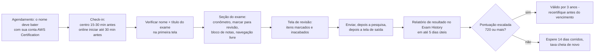
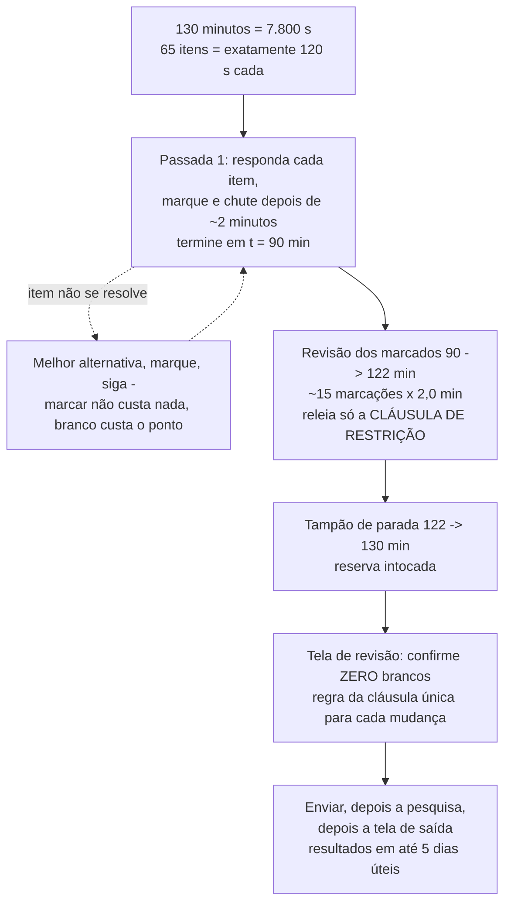
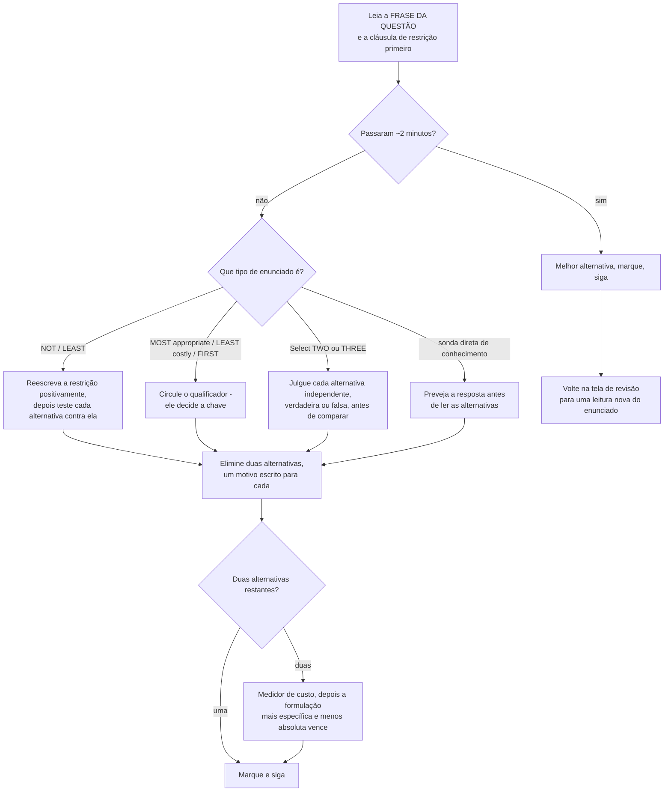
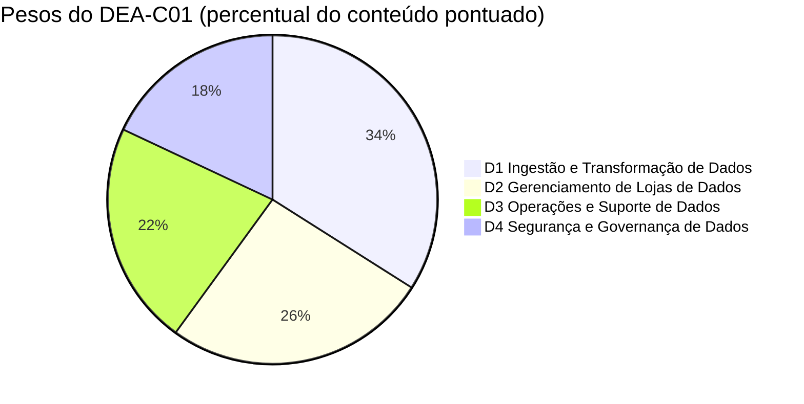
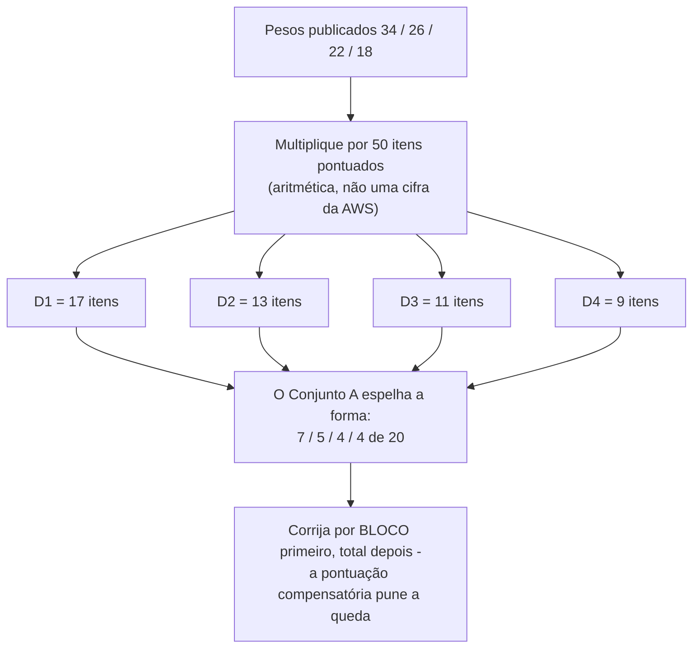

# Simulado A: Conjunto de Prática e Estratégia

Catorze lições te deram o conteúdo. Esta te dá o **contêiner**: como um item do DEA-C01 é realmente construído, como se comporta o relógio de 130 minutos, como a AWS escreve um distrator, e então o **Conjunto A**: vinte itens no estilo do exame que você faz contra o tempo e corrige com honestidade. Tudo antes desta lição era conhecimento de domínio; tudo aqui é *ofício de teste*, e em uma escala compensatória de 100 to 1.000 com **720** para passar, o ofício de teste vale tanto quanto mais uma hora de revisão.

```text
====================================================================
 DEA-C01 EXAME DE RELANCE        (todas as cifras em outubro de 2026)
====================================================================
 FORMATO ...... 65 questões = 50 pontuadas + 15 não pontuadas (sem identificação)
 TIPOS ........ múltipla escolha (1 correta + 3 distratores)
                múltipla resposta (2+ corretas de 5+ alternativas)
 TEMPO ........ 130 minutos = 7.800 s  ->  exatamente 120 s por item
 ESCALA ....... 100 - 1.000, aprovação em 720, COMPENSATÓRIA, sem corte por seção
 ADIVINHAÇÃO .. sem penalidade para chute errado; EM BRANCO = errado
 PESOS ........ D1 Ingestão e Transformação de Dados 34%
                D2 Gerenciamento de Lojas de Dados   26%
                D3 Operações e Suporte de Dados      22%
                D4 Segurança e Governança de Dados   18%
 CUSTO ........ 150 USD por tentativa (impostos podem incidir)
 VALIDADE ..... 3 anos; após REPROVA espere 14 dias corridos,
                tentativas ilimitadas, taxa cheia sempre
 ENTREGA ...... Centro de testes Pearson VUE ou online com proctor
 RESULTADOS ... em até 5 dias úteis, conta AWS Certification
 GUIA ......... v1.1 publicado em 2025-12-12 (+8 habilidades, -0)
 IDIOMAS ...... Inglês, japonês, coreano, chinês simplificado
--------------------------------------------------------------------
 CONJUNTO A (esta lição) ...... 20 itens na ordem de peso: 7 / 5 / 4 / 4
====================================================================
```

> [!NOTE]
> **Como usar esta lição.** Leia as seções 1 a 7 uma vez, essa é a metade da estratégia. Depois faça o **Conjunto A (Perguntas de Prática) com cronômetro de 40 minutos, sem notas, sem busca e sem espiar as análises**. Corrija-se com a rubrica dos blocos finais, converta a pontuação bruta por domínio em vez de por total e deixe os sinais de roteamento te mandarem de volta à lição de que você realmente precisa. Tudo o que esta lição não conseguiu verificar em uma página primária da AWS está listado na seção 7, trate esses itens como *não afirme*, não como fatos para decorar.

Ao final desta lição você será capaz de:

- restate todo número publicado de logística (65 / 50 / 15, 130 minutos, 720/1.000, 150 USD, 3 anos, 14 dias) sem notas;
- execute a aritmética de ritmo de 120 segundos e defenda um plano de duas passadas que nunca deixa um item em branco;
- aplique a técnica de marcação e varredura dentro de um orçamento de dois minutos por item;
- leia um enunciado superlativo, *MOST appropriate*, *LEAST costly*, *FIRST step*, *NOT*, e saiba qual alternativa o qualificador está comprando;
- execute o procedimento de cinco movimentos para múltipla resposta que sobrevive à pontuação tudo-ou-nada;
- decodifique as fábricas de distratores que a AWS reutiliza nos quatro domínios;
- faça o Conjunto A, corrija-o **por domínio em vez de por total** e roteie cada erro para a lição certa;
- defenda o **veredito comparativo** sobre preparação oficial gratuita versus treinamento pago versus experiência multi-nuvem e on-premises.

---

## 1. O contêiner: o que os 130 minutos realmente são

### 1.1 A logística que você não pode rederivar no dia do exame

Todo número abaixo é publicado pela AWS e foi obtido em outubro de 2026. Você pode esquecer curiosidades de serviço; você não pode rederivá-los com o relógio correndo.

| Fato | O valor publicado | Por que isso muda sua estratégia |
|---|---|---|
| **Questões apresentadas** | **65** | Você precisa *ver* todas as 65: cobertura vence profundidade |
| **Pontuadas / não pontuadas** | **50 pontuadas + 15 não pontuadas**, e as 15 **não são identificadas** | Trate todo item como pontuado |
| **Tipos de questão** | **Múltipla escolha** (1 correta + 3 distratores) e **múltipla resposta** (2+ corretas de 5+ alternativas) | Dois procedimentos de eliminação diferentes, um relógio |
| **Tempo** | **130 minutos** | 7.800 s ÷ 65 = **exatamente 120 s por item** |
| **Escala** | **100 to 1.000**, pontuação mínima de aprovação **720** | 720 é um corte *escalado*, não 72 % |
| **Modelo de pontuação** | **Compensatório**: sem nota de aprovação por domínio | Um domínio fraco ainda te derruba |
| **Adivinhação** | **Sem penalidade**; questões sem resposta são avaliadas como incorretas | Em branco é o único zero garantido |
| **Custo** | **150 USD** por tentativa (nível Associate; impostos podem incidir) | Cada refaz é 150 USD novos |
| **Validade** | **3 anos** | Anote o vencimento no dia em que você passar |
| **Após reprovar** | Espere **14 dias corridos**, sem limite de tentativas, taxa cheia cada uma | Orçamente a tentativa dois *antes* da tentativa um |
| **Ao passar** | O mesmo exame não pode ser refeito por **2 anos** | Você não pode "atualizar" uma aprovação antes da hora |
| **Entrega** | Centro de testes **Pearson VUE** ou online com proctor | Mesmo exame, mesmo preço, as duas rotas |
| **Resultados** | Em até **5 dias úteis** na sua conta AWS Certification | Programe uma semana tranquila, não um refresh por hora |
| **Acomodação** | A acomodação ESL acrescenta **+30 minutos**, solicitada uma vez antes do registro | Solicite com bastante antecedência |
| **Desconto para o próximo exame** | **50 % de desconto** no seu próximo exame depois que você conquistar um | 150 USD → 75 USD após a primeira aprovação |

- **📚 Você sabia?** Os **15 itens não pontuados parecem exatamente com os 50 pontuados**: a AWS afirma que eles "não são identificados no exame". A resposta racional é simetria: um item de pré-teste mal respondido não te custa nada, um item pontuado deixado em branco custa a nota inteira, então o incentivo nunca aponta para "deixe em branco e volte depois". Marque, chute, siga.

**A interface que você receberá.** Conhecer os controles *antes* do dia do exame é nota de graça, porque o exame não dá nenhum tour de orientação:

| Controle | Onde fica | O que faz |
|---|---|---|
| **Cronômetro regressivo** | Na tela | Corre durante toda a seção do exame; as pausas programadas **não** estão configuradas, então o relógio nunca para para você |
| **Marcar para revisão** | Na tela | Marca um item para que ele apareça na tela de revisão: custa um clique |
| **Bloco de notas virtual** | Na tela | Espaço de anotações em texto livre; use para palavras qualificadoras, não para copiar enunciados |
| **Navegação livre** | Na tela | Mova-se entre itens em qualquer ordem; verifique primeiro seu nome e o título do exame |
| **Tela de revisão** | No final | Sua última chance de revisit itens marcados ou inacabados antes de enviar |
| **AWS Exam Demo** | Grátis, antes do dia do exame | Ensaiar marcação, revisão e troca de idioma para nada disso ser uma descoberta no dia |



**Duas falhas administrativas custam mais que qualquer lacuna de conhecimento.** Em um centro de testes, os administradores têm instruções para não permitir a realização quando o nome na sua documento de identificação oficial não bate com a sua conta AWS Certification; online, chegar **mais de 15 minutos atrasado** ou pular o teste de sistema obrigatório **resulta na perda da taxa**. Nada disso é recuperável com estudo.

### 1.2 O plano de ritmo: 65 itens, 130 minutos

A AWS publica **nenhum orçamento por questão**. As únicas entradas oficiais de ritmo são a duração de 130 minutos, o cronômetro regressivo na tela e os controles de marcação e revisão do Exam Demo. Tudo abaixo é aritmética sobre números publicados, rotulada como tal.

**Exemplo trabalhado 1, o teto.**

$$
\frac{130 \times 60}{65} = \frac{7{,}800}{65} = 120\ \text{s por item} \quad (\text{exatamente } 2.00\ \text{minutos})
$$

**Exemplo trabalhado 2: a ilusão dos só pontuados.** Contando apenas itens pontuados, o orçamento parece $7{,}800 \div 50 = 156$ s $= 2.60$ minutos. Você não consegue dizer quais 50 são pontuados, então **120 s é o número com o qual você planeja** e 156 s é uma armadilha contra a qual nunca se deve orçar.

**Exemplo trabalhado 3, o que a média lenta realmente custa.** Navegando a 2,5 minutos por item, você tem $65 \times 2.5 = 162.5$ minutos, **32,5 minutos além do limite**, o que equivale aproximadamente aos últimos 16 itens apressados ou em branco, e um item em branco é avaliado como incorreto. O relógio, não o seu conhecimento, produz essa pontuação.

**A divisão em duas passadas.** Roda a passada um para que ela termine em **t = 90 minutos** (cerca de 1,4 minuto por item, mais rápido que o teto de 120 segundos e portanto deixando folga para os itens longos). Em t = 45 você deve estar perto do item 33; em t = 65, perto do item 50. Tudo o que você não consegue resolver em uma leitura limpa ganha uma marcação e um chute.

| Fase | Relógio | Minutos | A regra que você não pode quebrar |
|---|---|---|---|
| **Passada 1**: todos os 65 | 0:00 → 1:30 | 90 | Responda *cada* item; marque os instáveis (12 to 18) |
| **Revisão dos marcados** | 1:30 → 2:02 | 32 | Relia a **cláusula de restrição**, não as quatro alternativas |
| **Tampão de parada** | 2:02 → 2:10 | 8 | Reserva intocada para os dois ou três itens que precisam dela |
| **Varredura sem brancos** | na tela de revisão |: | Confirme **zero em branco**, então envie |



**Exemplo trabalhado 4, a acomodação ESL.** Com a extensão de +30 minutos, o orçamento vira $160 \div 65 = 2.46$ minutos por item. Isso é *mais* tempo por item, não permissão para gastar 4 minutos em um enunciado difícil, a estrutura de duas passadas sobrevive à extensão inalterada.

**Exemplo trabalhado 5, o relógio do próprio Conjunto A.** O Conjunto A tem 20 itens, então o orçamento ao vivo escala para $20 \times 120 = 2{,}400$ s $= \mathbf{40}$ **minutos**. Faça-o em 40 minutos para reproduzir o ritmo real. Se você estiver curto de tempo, rode a forma comprimida: passada 1 a 75 s por item ($20 \times 75 = 1{,}500$ s $= 25$ minutos) mais uma varredura de 5 minutos = **30 minutos**, e refaça nos 40 completos antes do dia do exame. Os 90 minutos desta lição são orçados como cerca de 35 para ler, 40 para fazer e 15 para corrigir.

### 1.3 Marcação e varredura: a técnica, item por item

A própria orientação do exame se reduz a uma sequência que você pode rodar em uma passada. Treine até ficar automático:

| Passo | O que você faz | Por que existe |
|---|---|---|
| 1 | Leia a **frase da questão primeiro**, depois a cláusula de restrição, depois as alternativas | As alternativas te ancoram; a restrição do enunciado é o que a chave precisa satisfazer |
| 2 | Circule o qualificador: `MOST`, `LEAST`, `FIRST`, `NOT`, `Select TWO/THREE` | O qualificador, não o nome do serviço, decide a chave |
| 3 | Elimine as duas alternativas que quebram uma **restrição dura** (formato, limite, latência, medidor de custo) | Um motivo escrito para cada uma; um candidato meio preparado mantém essas vivas |
| 4 | Desempate as duas últimas com o **medidor de custo** e *gerenciado sobre auto gerenciado* | Mesma SQL, fatura diferente: Athena = bytes escaneados, Redshift = tempo de cluster |
| 5 | Passados cerca de **dois minutos**: melhor alternativa, marque, siga | O orçamento do item é 120 s; marcar custa um clique, branco custa o ponto |



A **varredura** é a outra metade do nome. Na tela de revisão você não está rerespondendo; você está verificando três coisas e nada mais:

1. **Em branco.** Zero. Um item sem resposta é avaliado como incorreto e não há penalidade para um chute errado, então em branco é estritamente dominado por qualquer chute.
2. **A pergunta feita.** Relia a cláusula de restrição e confirme que você respondeu *a ela*: a perda clássica é responder a pergunta vizinha, a mais familiar.
3. **Ordem das operações.** Mude uma alternativa apenas se você conseguir enunciar o motivo em uma cláusula. "Sentiu estranho" não é uma cláusula.

```dragdrop
{
  "question": "Ordene os seis movimentos da rotina de marcação e varredura para um único item travado no DEA-C01:",
  "items": [
    "Na tela de releitura, releia a CLÁUSULA DE RESTRIÇÃO: nunca as alternativas primeiro",
    "Confirme que você respondeu a pergunta que realmente foi feita",
    "Marque o item e siga imediatamente",
    "Escolha seu melhor chute para que nenhum branco permaneça",
    "Dois minutos atingidos: pare de reler as alternativas",
    "Rode a varredura final sem brancos antes de enviar"
  ],
  "correctOrder": [
    "Dois minutos atingidos: pare de reler as alternativas",
    "Escolha seu melhor chute para que nenhum branco permaneça",
    "Marque o item e siga imediatamente",
    "Na tela de releitura, releia a CLÁUSULA DE RESTRIÇÃO: nunca as alternativas primeiro",
    "Confirme que você respondeu a pergunta que realmente foi feita",
    "Rode a varredura final sem brancos antes de enviar"
  ],
  "explanation": "A ordem é fixada pelo risco: o relógio é a restrição vinculante, então o orçamento de 120 segundos dispara primeiro e força um chute antes da marcação, o que garante nenhum branco. A marcação só compra uma releitura, e essa releitura precisa começar pela cláusula de restrição porque a perda clássica é responder à pergunta vizinha. A varredura sem brancos vem por último porque é a verificação final de que nada ficou sem resposta: questões sem resposta são avaliadas como incorretas e não há penalidade para chutar."
}
```

### 1.4 Lendo o enunciado: MOST appropriate, LEAST costly, FIRST

A maioria das perdas no DEA-C01 são perdas de leitura. O **qualificador** do enunciado, não o nome do serviço, decide a chave, então o primeiro movimento é sempre o mesmo: encontre o qualificador, anote o que ele exige, *depois* leia as alternativas.

| O enunciado diz… | Ele está realmente pedindo | Seu primeiro movimento | Onde é testado no Conjunto A |
|---|---|---|---|
| **"MOST appropriate" / "MOST cost-effective"** | A alternativa mais barata que atende a **toda** restrição declarada | Liste as restrições primeiro; uma alternativa que viola uma delas está morta a qualquer preço | Q5 (Glue vs Lambda vs EMR Serverless), Q9 (aritmética de ciclo de vida), Q12 (view materializada) |
| **"LEAST operational overhead" / "LEAST costly"** | A alternativa sem cluster, ambiente ou cobrança ociosa para gerenciar | Elimine a resposta *correta mas pesada*: MWAA onde o Step Functions basta, EMR onde o Glue basta | Q4 (orquestração), Q13 (conserte a causa, não o sintoma) |
| **"MUST … FIRST" / "FIRST step"** | **Diagnóstico ou escopo, não remediação** | Ordene as alternativas por dependência; a resposta é o passo mais precoce que o risco declarado exige | Q13 (force concorrência para 1), Q17 (feche o portão aberto) |
| **"Qual solução atenderá a este requisito?"** | Normalmente as quatro funcionam; uma é melhor prática / mais barata / mais simples | Desempate pelo medidor de custo, depois por gerenciado versus auto gerenciado | Q2, Q7, Q10 |
| **"NOT" / "LEAST"** | A alternativa única que *viola* a restrição | Circule-a antes de ler as alternativas, reescreva positivamente, cuidado com duplas negações | Reservado para o exame ao vivo: mantenha o reflexo |
| **"(Select TWO / THREE)"** | Toda resposta correta é exigida, tudo-ou-nada | Leia *todas* as alternativas, julgue cada uma antes de comparar | Q3, Q8, Q11, Q14, Q18 |

**Exemplo trabalhado 6: lendo um superlativo do início ao fim.** Pegue um enunciado que nunca aparece no Conjunto A: *"Um job Spark noturno sobre um dataset de 40 GB termina consistentemente em cerca de 25 minutos com 12 GB de memória de executor. Qual serviço e runtime é a alternativa MAIS apropriada e totalmente gerenciada?"*

1. **Sublinhe os qualificadores antes de olhar qualquer alternativa:** noturno · 40 GB · **25 minutos** · 12 GB · *totalmente gerenciado*.
2. **Deixe o qualificador mais duro eliminar.** 25 minutos são **1.500 segundos**, além do teto rígido de **900 segundos** do AWS Lambda, então o Lambda morre na aritmética, mesmo sendo a alternativa com cara mais serverless e 10.240 MB estando dentro da faixa de memória dele. Esse distrator é construído para testar *qual limite vincula*.
3. **Combine o runtime com a carga de trabalho.** Um job de Spark DataFrame não é um script de processo único, então o Python shell do Glue (0,0625 ou 1 DPU, sem Spark) morre em seguida.
4. **Aplique "menor overhead operacional" aos sobreviventes.** Um job Glue ETL (`glueetl`) roda Spark totalmente gerenciado em unidades de DPU (1 DPU = 4 vCPU + 16 GB); o EMR Serverless também funciona, mas traz mais superfície operacional do que a restrição do enunciado pede.
5. **Diga a armadilha em voz alta:** a alternativa mais *serverless* falhou por um **limite**, não por preferência. Verifique cada limite na página de cotas de serviço atual antes de depender dele.

- **📚 Você sabia?** A frase de estilo mais importante do guia de exame é *"A habilidade de comparar serviços da AWS para entender as diferenças de custo, desempenho e funcionalidade entre serviços."* Todo desempate da seção 1.4 é um exemplo dela: quando duas alternativas *funcionam*, o diferenciador é medidor de custo, envoltório de desempenho ou limite funcional: nunca "qual eu já usei".

```matching
{
  "question": "Associe cada gatilho de enunciado do exame ao movimento que realmente conquista a marca: os cinco reflexos de qualificador da seção 1.4:",
  "pairs": [
    {"left": "MOST appropriate / MOST cost-effective", "right": "Liste toda restrição primeiro e depois pegue a alternativa mais barata que satisfaz todas"},
    {"left": "LEAST operational overhead / LEAST costly", "right": "Elimine a alternativa correta mas pesada: sem cluster, sem ambiente, sem cobrança ociosa"},
    {"left": "MUST be done FIRST", "right": "Passo de diagnóstico ou de escopo, não a remediação com a qual o enunciado te tenta"},
    {"left": "NOT / LEAST / except", "right": "Circule antes de ler as alternativas, reescreva a restrição positivamente, então procure a violação"},
    {"left": "Select TWO or THREE", "right": "Julgue cada alternativa independentemente como verdadeira ou falsa, descarte as falsas, então confira a contagem"},
    {"left": "Qual solução atenderá a este requisito?", "right": "As quatro funcionam: desempate pelo medidor de custo, depois por gerenciado sobre auto gerenciado"}
  ],
  "explanation": "Cada par é decidido por uma palavra no enunciado: um superlativo compra a alternativa mais barata que ainda satisfaz toda restrição; menos overhead compra a alternativa mais gerenciada; FIRST compra o diagnóstico; um enunciado negativo compra a violação; Select TWO compra o julgamento independente por alternativa; e um enunciado neutro de requisito compra o desempate de melhor prática da AWS. Ler o qualificador antes das alternativas é a técnica inteira: os nomes de serviço são escolhidos para serem plausíveis nas quatro posições."
}
```

### 1.5 A técnica de múltipla resposta

O guia de exame define o tipo com precisão: **múltipla resposta "tem duas ou mais respostas corretas entre cinco ou mais alternativas de resposta."** Duas consequências decidem o seu método:

- **Tudo-ou-nada.** Um conjunto parcialmente correto zera. O próprio material de preparação da AWS imprime *"sem pontos negativos nem crédito parcial"*, então o custo de uma seleção abaixo do necessário é idêntico ao custo de uma seleção errada, e não há motivo para enviar menos do que o enunciado exige.
- **Ritmo diferente.** Itens de múltipla resposta levam cerca de metade a mais que os de múltipla escolha, o que os torna os itens com maior chance de te empurrar além dos dois minutos, e os que você menos quer marcar, porque reler cinco ou seis alternativas parece produtivo. Marque-os mesmo assim.

**O procedimento de cinco movimentos:**

| Movimento | O que você faz | A falha que ele previne |
|---|---|---|
| 1 | Julgue **cada** alternativa independentemente: definitivamente verdadeira / definitivamente falsa / talvez | Comprometer-se com uma alternativa porque ela "soa certa" ao lado das vizinhas |
| 2 | Descarte toda alternativa definitivamente falsa | Manter um distrator plausível vivo por associação |
| 3 | Se os sobreviventes batem com a contagem pedida, envie | Releitura infinita de um item concluído |
| 4 | Se sobrevivem **mais** do que a contagem, releia procurando um **qualificador de escopo**: por Região vs global, em repouso vs em trânsito, plano de controle vs plano de dados, responsabilidade do cliente vs da AWS | Selecionar uma afirmação verdadeira que responde a uma pergunta mais ampla do que a pedida |
| 5 | Se sobrevivem **menos**, uma verdade "óbvia" está fora do escopo: confira-a contra a lista de serviços em escopo e a habilidade da qual o enunciado foi tirado | Perder uma alternativa correta porque ela parece fácil demais |

```fillblank
{
  "question": "Complete a rotina de múltipla resposta da seção 1.5:",
  "template": "1) Julgue cada alternativa {{1}} como verdadeira, falsa ou talvez. 2) Descarte as alternativas definitivamente {{2}}. 3) Se os sobreviventes batem com a contagem, {{3}}. 4) Se sobrevivem muitos, releia procurando um qualificador de {{4}} como por Região versus global. 5) Se sobrevivem poucos, a verdade que parece fácil provavelmente está {{5}}.",
  "answers": {
    "1": "independentemente",
    "2": "falsas",
    "3": "envie",
    "4": "escopo",
    "5": "fora do escopo"
  },
  "distractors": ["identicamente", "verdadeiras", "marque", "custo", "no escopo", "opcional", "invertidas", "superficial"],
  "explanation": "A rotina é deliberadamente mecânica porque crédito parcial não existe: o julgamento independente impede erros induzidos pelos vizinhos, descartar as falsas faz o trabalho de verdade, uma contagem exata significa pare, um conjunto de sobreviventes grande demais significa que um qualificador de escopo está escondido em algum lugar (por Região vs global, em repouso vs em trânsito, cliente vs AWS), e um conjunto pequeno normalmente significa que uma resposta que parece óbvia está fora do escopo da habilidade da qual o enunciado veio."
}
```

- **📚 Você sabia?** O guia de exame garante os dois **tipos** e as contagens de itens pontuados e não pontuados, mas a AWS nunca publicou quantos itens de múltipla resposta aparecem em uma determinada forma, nem a proporção de múltipla escolha para múltipla resposta entre os 50 itens pontuados. A divisão de cinco em vinte do Conjunto A é uma **escolha didática** que espelha as próprias definições do guia: nunca a cite como uma cifra da AWS.

### 1.6 Pesos dos domínios e o blueprint do Conjunto A

Apenas porcentagens de **domínio** são publicadas. As contagens de itens abaixo são aritmética sobre 50 itens pontuados: um auxílio de planejamento, nunca uma cifra da AWS.

| Domínio | Peso publicado | Itens pontuados no exame ao vivo (derivado: 50 × w) | Itens do Conjunto A aqui | Sinais de prioridade |
|---|---|---|---|---|
| **D1** Ingestão e Transformação de Dados | **34 %** | ≈ 17 | **7** (Q1: Q7) | Streams vs Firehose, bookmarks do Glue, orquestração, engines de transformação, medidores de custo |
| **D2** Gerenciamento de Lojas de Dados | **26 %** | ≈ 13 | **5** (Q8: Q12) | Escolha de store, aritmética de ciclo de vida, design de distribuição, formatos de tabela abertos |
| **D3** Operações e Suporte de Dados | **22 %** | ≈ 11 | **4** (Q13: Q16) | Diagnosticar, monitorar, custar uma execução, ajustar um plano |
| **D4** Segurança e Governança de Dados | **18 %** | ≈ 9 | **4** (Q17: Q20) | Lake Formation, duas portas, criptografia, logs de auditoria |
| **Total** | **100 %** | **≈ 50** | **20** | A coluna "itens pontuados" é aritmética, não da AWS |

**Exemplo trabalhado 7: de pesos para itens.** $50 \times 0.34 = 17$, $50 \times 0.26 = 13$, $50 \times 0.22 = 11$, $50 \times 0.18 = 9$; $17 + 13 + 11 + 9 = 50$. Os domínios 1 e 2 juntos são **60 %** do conteúdo pontuado: é por isso que o Conjunto A dá a eles 12 de seus 20 itens, mas os 9 itens do Domínio 4 são mais do que suficientes para te reprovar sozinhos, porque a pontuação é compensatória e não existe corte de seção atrás do qual se esconder.





### 1.7 Famílias de distratores, e o que esta lição não vai afirmar

A AWS afirma que os distratores são "respostas geralmente plausíveis que correspondem à área de conteúdo". Eles não são aleatórios; as mesmas formas se repetem, e cada uma pune uma confusão específica. Eles são rotulados **T1, T7** aqui para nunca serem confundidos com os rótulos de domínio **D1, D4**.

| # | Família de distrator | Como ele te isca | Seu contragolpe |
|---|---|---|---|
| **T1** | **Serviço irmão** | Firehose oferecido onde se pede Streams, MWAA onde o Step Functions basta | Mapeie o **substantivo** do enunciado para o mecanismo primeiro: stream vs pipeline de entrega |
| **T2** | **Camada errada / estágio errado** | Resposta de crawler para uma questão de orquestração, resposta de catálogo para uma questão de dados | Serviço certo, *lugar* errado na pipeline |
| **T3** | **Escopo / nomenclatura** | Um serviço fora do escopo que soa mais avançado que a chave real | A resposta está sempre na lista de **escopo** |
| **T4** | **Afirmação demais** | Infraestrutura em escala Enterprise oferecida para uma questão de *menor overhead* | Responda ao superlativo, não ao tópico |
| **T5** | **Inversão de responsabilidade** | "É um serviço gerenciado da AWS, então a AWS faz" | Pergunte: isso é **da** nuvem ou **na** nuvem? |
| **T6** | **Isca numérica** | Um DPU, preço, limite ou data errados anexados a uma afirmação verdadeira | Escreva a unidade e a cifra antes de comparar |
| **T7** | **Verdadeiro mas irrelevante** | Um fato correto que responde a uma pergunta vizinha | Teste cada alternativa contra a restrição **do enunciado** |

**Pontos que esta lição deliberadamente não afirma.** Eles são sinalizados em vez de ensinados, porque uma afirmação não verificada nunca é um fato:

1. **Quantos itens de múltipla resposta** uma forma ao vivo traz, e se todo enunciado declara a contagem: não publicado.
2. **A proporção de múltipla escolha para múltipla resposta por forma** entre os 50 itens pontuados: não publicado.
3. **O texto dos 20 itens do Official Practice Question Set.** Eles ficam atrás do login do Skill Builder; nenhuma afirmação de estilo deste curso é atribuída à leitura deles.
4. **A data exata em que o conteúdo do guia v1.1 apareceu pela primeira vez em uma forma ao vivo.** O guia promete revisões com pelo menos um mês de antecedência e a entrega ocorre gradualmente por idioma. Diga "no guia de exame atual", não uma data.
5. **Se o DEA-C01 adotará os tipos de ordenação, associação e estudo de caso** anunciados pela AWS em julho de 2024. A AWS nomeou AI Practitioner e Machine Learning Engineer: Associate como os primeiros exames com esses tipos, e o guia atual do DEA-C01 lista apenas múltipla escolha e múltipla resposta.
6. **Uma conversão de bruta para escalada.** 720 é um corte escalado produzido por padronização e equating; "N de 50 = aprovação" é aritmética que ninguém fora da AWS consegue fazer.
7. **Notas de aprovação por domínio.** Não existem, o modelo é compensatório.
8. **Aprovação/reprovação no mesmo dia ou na tela.** O texto oficial da política é "dentro de cinco dias úteis".

---

### Atualizações de 2026 (em outubro de 2026)

Seis mudanças de 2025 to 2026 decidem se as suas notas estão certas ou erradas no dia do exame. Todo item tem fonte em uma página de primeira parte da AWS obtida em outubro de 2026; onde uma afirmação não pôde ser verificada, ela é rotulada como tal e **nunca** deve ser memorizada como fato.

> [!NOTE]
> **O que mudou entre 2025 e outubro de 2026:**
> - **O guia de exame foi para a v1.1 em 2025-12-12.** Os itens de conhecimento foram consolidados nas listas de habilidades, **oito habilidades foram adicionadas e nenhuma removida**: 1.2.10 integrar LLMs para processamento de dados, 2.1.7 gerenciar formatos de tabela abertos (Apache Iceberg), 2.1.8 tipos de índice vetorial, 2.2.6 catálogos de dados de negócios, 2.4.6 conceitos de vetorização, 4.1.7 domínios do SageMaker Unified Studio, 4.5.6 acesso a projetos do SageMaker Catalog, 4.5.7 framework de governança e padrões de compartilhamento de dados. Revisões são publicadas **com pelo menos um mês** de antecedência antes de poderem afetar uma forma ao vivo.
> - **As listas de serviços também mudaram.** No escopo ganharam **Aurora, Amazon Q, Amazon Bedrock, Amazon Kendra, AWS Data Exchange e Amazon S3 Tables** e perderam **Cloud9, CodeCommit e AWS SCT**; porém a tarefa 2.4.3 ainda nomeia "AWS SCT and AWS DMS Schema Conversion", então ensine DMS Schema Conversion como atual e SCT como legado. Um serviço removido ainda pode aparecer como *distrator*.
> - **Três fósseis de serviço te reprovam.** Amazon Data Firehose é o nome do produto desde **2024-02-09**, enquanto a lista em escopo ainda imprime "Amazon Kinesis Data Firehose" (ambos válidos; o prefixo da API continua `firehose`). Kinesis Data Streams agora tem **três** modos de capacidade, não dois: On-demand Advantage (anunciado em 2025-11-04) remove a cobrança horária por stream, mas impõe um piso de conta de **25 MB/s de ingestão + 25 MB/s de recuperação**, e trocas de modo de capacidade são limitadas a **duas a cada 24 horas**. E o Redshift já não apenas *lê* Iceberg: escrita GA em 2025-11-17, UPDATE/DELETE/MERGE em 2026-04-23, views materializadas Iceberg em 2026-10-05.
> - **Glue mudou de geração.** **5.1 é o padrão para novos jobs** (2025-11-26); **6.0 é o mais recente** (2026-08-21, Spark 4.1.1, Python 3.13, Scala 2.13, redução de 30 % no preço, Iceberg v3 completo) e **remove EMRFS e AWS SDK for Java v1**. Glue 0.9/1.0/2.0 chegou ao fim de vida em **2026-04-01**, e jobs de Python Shell 3.6 não podem mais ser criados após **2026-03-31**. Uma nota de 2024 que diz "use Glue 3.0/4.0" agora está obsoleta.
> - **Mínimos menores e pontos de entrada mais baratos.** Athena Capacity Reservations caiu para **4 DPU / 1 minuto** (2026-02-11) e os resultados de consulta gerenciados do Athena (2025-06-03) não precisam de bucket de resultados no S3 e não custam nada a mais; compartilhamento entre contas do Lake Formation v5 (2026-02-11) carrega tabelas ilimitadas em um único compartilhamento do AWS RAM; Redshift Serverless agora vende reservas de 1 ano e 3 anos. Contas criadas **em ou após 2025-07-15** recebem um **Free Plan de 6 meses** com até **200 USD** de créditos em vez da antiga faixa de 12 meses.
> - **A logística não mudou:** 130 minutos, 65 questões (50 pontuadas + 15 não pontuadas), 150 USD, 720 para aprovar, validade de 3 anos, espera de 14 dias para refazer, centro Pearson VUE ou proctor online, quatro idiomas. O DEA-C01 teve um único beta (2023-11-27 a 2024-01-12 por 75 USD) e **nenhum beta em 2026**; as cifras de "170 minutos / 85 questões / 300 USD" que ainda circulam em páginas de terceiros não descrevem este exame nem nenhuma configuração atual de certificação da AWS.

- **📚 Você sabia?** A AWS moveu os guias de exame de PDFs estáticos para a Documentação da AWS justamente para que revisões pudessem ser publicadas sem um novo código de exame: uma mudança **significativa** ganha um novo código de série (por exemplo DVA-C01 → DVA-C02), enquanto uma mudança **menos significativa**, adicionar ou remover habilidades e serviços em escopo, vira uma *revisão* no mesmo código. É por isso que o DEA-C01 continuou DEA-C01 até a v1.1, e é por isso que a página de Revisões, não uma marca d'água de PDF, é o artefato a verificar antes de você se sentar.

> [!TIP]
> **Três itens adicionais com fonte: escopo do exame e mudanças de vocabulário (digest 17, tudo lido em 2026-10-10):**
> - **Tipos de questão e notícias de beta continuam fora do DEA-C01.** O post de certificação da AWS de 2024-07-22 anunciou três novos tipos de item, **ordenação, associação e estudo de caso**, e nomeou *AI Practitioner* e *Machine Learning Engineer, Associate* como os primeiros exames a carregá-los; o guia atual do DEA-C01 (v1.1) ainda lista **apenas múltipla escolha e múltipla resposta**. O único beta do DEA-C01 ocorreu de **2023-11-27 → 2024-01-12 por 75 USD**, e **nenhum beta do DEA-C01 ocorreu em 2026**, o anúncio de beta de 2026 pertence ao MLA-C02, então nunca importe a contagem de questões, a duração ou o preço de outro exame para este.
> - **A lista fora de escopo perdeu quatro nomes.** A v1.1 removeu **Honeycode, WorkDocs, Amazon Timestream e CodeWhisperer** da lista fora de escopo e não adicionou nada a ela, enquanto a lista em escopo somou **+3** (seis adicionados, três removidos). Remoção não é proibição: Cloud9, CodeCommit e AWS SCT continuam sendo distratores perfeitamente legais, e a tarefa 2.4.3 ainda lê "AWS SCT and AWS DMS Schema Conversion": ensine DMS Schema Conversion como atual, SCT como legado.
> - **Dois fósseis de vocabulário.** **Kinesis Data Analytics for SQL foi descontinuado em 2026-01-27**, diga *Amazon Managed Service for Apache Flink* (renomeado em 2023-08-30). E a lista em escopo agora imprime literalmente **"Amazon Quick"**, enquanto a linha de produto lê **Amazon Quick Suite / Quick Sight** (evoluído do QuickSight em 2025-10-09): trate a família como em escopo, mas **não** afirme que o guia diz "Amazon QuickSight", ele não diz.

---

## Casos Reais

A AWS nunca imprime o nome de um cliente em um item de exame, mas os *formatos* de falhas reais de pipeline vazam para os enunciados o tempo todo: uma frase de histórico de incidente vira a condição do enunciado, e as quatro alternativas viram as quatro maneiras de candidatos relerem isso. Os dois exercícios abaixo vêm do material de casos por trás do banco de questões deste curso e devem ser rodados **antes** do Conjunto A: cada um termina com *qual domínio isso testa* e *o que o exame perguntaria*.

Duas regras governam tudo nesta seção:

1. **Um número em um enunciado é uma restrição, não decoração.** "25 minutos", "1.500 registros por segundo", "3 TB sem compressão" é sempre o qualificador que seleciona a chave.
2. **O domínio é escolhido pela restrição, não pela história.** A mesma narrativa de streaming semeia um item do Domínio 1 (desenho de ingestão), um item do Domínio 3 (atraso de monitoramento) ou um item do Domínio 4 (quem pode ler o stream), dependendo de qual cláusula o exame sublinha: exatamente o reflexo da seção 1.4.

### Estudo de caso 1, a chave de partição quente: por que adicionar shards não resolve

**A história.** 800 registros de telemetria por segundo de 4 KB cada chegam de 12.000 dispositivos, e duas aplicações consumidoras cada uma precisa de todo registro. O dimensionamento dá **4 shards** (Q1 do Conjunto A). Duas semanas depois, uma build defeituosa de firmware fixa **1.500 registros por segundo em uma única chave de partição `device_id`**, e aquele shard faz throttling a **1.000 registros por segundo**, não importa quantos shards estejam ao lado.

**Qual domínio isso testa?** Primariamente **D1 Ingestão e Transformação de Dados (34 %)**: habilidade 1.1.9 limitação de taxa e limites de taxa, habilidade 1.1.10 fan-in e fan-out. Ganchos secundários: **D3 (22 %)** se o enunciado perguntar em qual métrica *alarmar* (`GetRecords.IteratorAgeMilliseconds`), **D4 (18 %)** se perguntar quem pode escrever no stream.

**O que o exame perguntaria?** Três formatos de enunciado:

1. *"Qual mudança resolve o throttling de forma mais direta?"* → **redesenhar a chave de partição** (uma chave de dois níveis ou com sal como `device#<bucket>`), porque uma chave de partição mapeia para exatamente um shard. Aumentar a contagem de shards é a alternativa errada mais selecionada: o gargalo é por chave, não por stream.
2. *"Qual métrica confirma o atraso do consumidor?"* → `GetRecords.IteratorAgeMilliseconds`, cuja documentação da AWS afirma que um valor zero indica que o consumidor alcançou o stream. Alarme em **Max** contra cerca de metade da janela de retenção.
3. *"Quais dois limites uma única chave de partição excede primeiro?"* → **1 MB/s e 1.000 registros por segundo por shard**, e note que o modo on-demand explicitamente não detecta nem isola chaves hash quentes, então o auto-scaling também não te salvará.

**A armadilha a dizer em voz alta:** respostas de capacidade parecem respostas. Quando o enunciado nomeia uma *chave*, a correção está na chave.

### Estudo de caso 2, a conta do Athena: três números que precisam ser lidos juntos

**A história.** Um dataset de texto de **3 TB** sem compressão está no Amazon S3 com **três colunas de mesmo tamanho**. Dashboards consultam **uma** das três colunas. Toda consulta varre 3 TB e custa 3 × 5,00 USD = **15,00 USD**. A equipe converte para Apache Parquet com compressão **3:1**, re-registra a tabela no AWS Glue Data Catalog, e a mesma consulta agora varre cerca de 0,33 TB por cerca de **1,65 USD**.

**Qual domínio isso testa?** **D3 Operações e Suporte de Dados (22 %)** primeiro, habilidade 3.2.3 SQL no Athena, habilidade 3.1.7 consultar dados, com ganchos em **D2 (26 %)** na 2.4.5 (particionamento, compressão e outras técnicas de otimização) e **D1 (34 %)** na 1.2.6 (transformar dados entre formatos, por exemplo.csv para Apache Parquet).

**O que o exame perguntaria?** Três formatos de enunciado:

1. *"Qual é o custo aproximado por consulta antes e depois?"* → **15,00 USD → 1,65 USD** (Q6 do Conjunto A). Os distratores são os erros mais prováveis: aplicar a compressão mas esquecer o column pruning, usar o custo anterior errado, ou multiplicar em vez de dividir.
2. *"Qual mudança produziu a maior parcela da economia?"* → **column pruning**, porque texto não consegue pular colunas: compressão 3:1 sozinha leva 3 TB a 1 TB (5,00 USD), e ler uma de três colunas leva isso a cerca de 0,33 TB.
3. *"Qual medidor de custo esta conta usa?"* → **bytes escaneados**, a 5,00 USD por TB com mínimo de 10 MB por consulta, arredondado para cima até o MB mais próximo: **sem cobrança para DDL, gerenciamento de partições ou consultas com falha**. A alternativa competitiva é sempre o Redshift, que cobra **tempo de computação do cluster**.

**A armadilha a dizer em voz alta:** duas alavancas, uma conta. Compressão e seleção de colunas são multiplicadores diferentes, e um enunciado que cita apenas uma delas está testando se você consegue fazer a aritmética na ordem em que ela aconteceu.

```matching
{
  "question": "Associe cada par de armadilhas à sua moldura correta de uma linha: as comparações com maior chance de te custar marcas no Conjunto A:",
  "pairs": [
    {"left": "Kinesis Data Streams vs Amazon Data Firehose", "right": "Streams = API de consumidor, retenção de 24h a 365d, reproduzível; Firehose = entrega em buffer, sem API de consumidor, sem reprodução no lado do consumidor"},
    {"left": "Step Functions vs Amazon MWAA vs EventBridge", "right": "Step Functions = fluxo de trabalho multipasso durável; EventBridge = roteia eventos e agendas; MWAA = Airflow gerenciado pelo qual você paga ocioso"},
    {"left": "AWS Glue job bookmarks vs streaming watermarks", "right": "Bookmarks = estado de lote incremental; checkpointLocation + watermarks = streaming: 'bookmarks no job de streaming' está sempre errado"},
    {"left": "Amazon Redshift DISTKEY vs SORTKEY", "right": "DISTKEY decide em qual fatia uma linha cai (redistribuição de join); SORTKEY decide a ordem das linhas dentro dos arquivos (pulamento de varredura)"},
    {"left": "Lake Formation permissions vs IAM permissions", "right": "Duas portas, ambas precisam abrir: IAM controla chamadas de API, Lake Formation controla catálogo e dados no S3, e grants do Lake Formation são locais à Região"},
    {"left": "Amazon Macie vs AWS Config", "right": "Macie descobre e relata conteúdo sensível e nunca corrige; Config registra e avalia o estado de configuração"},
    {"left": "Athena vs Redshift cost meters", "right": "Athena cobra bytes escaneados; Redshift cobra tempo de computação: mesma SQL, conta diferente, alavanca de otimização diferente"}
  ],
  "explanation": "Todo par é decidido por um substantivo ou um qualificador, exatamente como na seção 1.4: stream versus pipeline, fluxo de trabalho versus rota versus cluster, lote versus streaming, distribuição versus ordenação, porta de API versus porta de dados, conteúdo versus configuração, e bytes versus tempo de computação. O guia de exame prevê isso diretamente: ele nomeia a habilidade de comparar serviços da AWS por diferenças de custo, desempenho e funcionalidade como uma habilidade de destaque, então estas sete comparações são os desempates favoritos do exame."
}
```

---

## Exercícios com estudos de caso do mundo real

Os dois estudos acima vieram do banco de questões deste curso; os dois exercícios abaixo vêm de **estudos de caso de clientes publicados pela AWS**: toda cifra lida em uma página pertencente à AWS em outubro de 2026 (digest 16). Rode cada um exatamente como rodaria um enunciado ao vivo: sublinhe os números, nomeie o **domínio**, então escreva a **questão** que o exame construiria a partir dele. A história nunca é a resposta; só a restrição enterrada nela é.

Duas regras governam tudo nesta seção:

1. **Um resultado de cliente nunca é uma garantia da AWS.** Os **−78 %** da AGCO e o *"centenas de regras de permissão reduzidas a exatamente duas regras"* da IAS são resultados de clientes impressos em páginas da AWS; a AWS não se compromete nem com uma porcentagem nem com uma contagem de regras. Qualquer alternativa redigida como "a AWS garante…" morre antes de você conferir o número.
2. **Construa o enunciado da cláusula, não do título.** A cláusula que o exame sublinha decide tudo: *throughput* faz da mesma história da AGCO um item do Domínio 1, *carregamento de tela de 600 ms* faz dela Domínio 3, *quem pode ler o prefixo bruto* faz dela Domínio 4: exatamente o reflexo da seção 1.4, aplicado a um caso em vez de um serviço.

### Exercício de caso 1, AGCO: uma história de streaming, três domínios

**A história como a AWS publica** (AWS Architecture Monthly, dezembro de 2021, p. 10, e o blog AWS Industries de 2021-03-03; acesso em outubro de 2026):

| Elemento | O que a AWS publicou |
|---|---|
| **Escala** | Telemetria de **centenas de milhares** de máquinas; **1.200 pontos de dados por minuto** em produção, testados em carga a **10.000 por minuto**; **1,9 milhão de registros/dia**; **1,5 bilhão** de registros retidos |
| **Pipeline** | **Amazon Kinesis Data Streams → Amazon Data Firehose → Amazon S3**, com **Kinesis Data Analytics for Apache Flink**, além de enriquecimento com **AWS Lambda** em **Amazon DynamoDB** e **OpenSearch Service** |
| **Resultado (específico do cliente)** | Custo **−78 %**; carregamento de tela **8 to 30 s → 600 ms**; operado por **1 pessoa** em vez de **3 to 5**; no ar desde **janeiro de 2020** |

**Qual domínio isso testa?** Primariamente **D1 Ingestão e Transformação de Dados (34 %)**: ingestão em streaming, fan-out e conversão de formato, o formato KDS → Firehose → S3. Ganchos secundários: **D3 Operações e Suporte de Dados (22 %)** se o enunciado perguntar qual métrica comprova o número de 600 ms, e **D4 Segurança e Governança de Dados (18 %)** se perguntar quem pode escrever no, ou ler, o prefixo bruto.

**O que o exame perguntaria?** Três formatos de enunciado, todos construídos a partir da tabela acima:

1. *"Qual serviço nesta arquitetura entrega registros ao Amazon S3 sem que a equipe jamais rode código de consumidor?"* → **Amazon Data Firehose**: entrega em buffer que descarrega por **tamanho *ou* intervalo, o que vier primeiro**, expondo **nenhuma API de consumidor e nenhuma reprodução no lado do consumidor**. A alternativa isca é sempre *"reproduzir as últimas 24 horas da entrega do Firehose"* (par de armadilhas F1; Q2 do Conjunto A).
2. *"Qual métrica confirmaria que o atraso do consumidor, e não o buffer do Firehose, está por trás de um dashboard atrasado?"* → **`GetRecords.IteratorAgeMilliseconds`** no stream, com alarme em **Max**, em cerca de metade da janela de retenção; a AWS documenta que um valor zero significa que o consumidor alcançou o stream (Q14 do Conjunto A).
3. *"Qual caminho analítico oferece MENOR overhead operacional para esta carga de trabalho?"* → o processador de stream gerenciado, **Amazon Managed Service for Apache Flink**, renomeado de Kinesis Data Analytics em **2023-08-30**, sobre Kafka ou Flink autogerenciados. E nunca "adicionar shards" quando o substantivo do enunciado é uma *chave*.

**A armadilha a dizer em voz alta:** **−78 % é o número da AGCO na carga de trabalho da AGCO**, datado de um go-live em janeiro de 2020. Um enunciado que o oferece como propriedade de streaming gerenciado está testando a primeira armadilha do digest 16: *a AWS diz X % ≠ universal*. Dataste a história e recuse qualquer alternativa que a generalize.

- **📚 Você sabia?** A tabela acima usa três nomes para o que os candidatos ainda chamam de "Kinesis": **Amazon Kinesis Data Streams**, **Amazon Data Firehose** (renomeado de Kinesis Data Firehose em **2024-02-09**, com endpoints, APIs, CLI, prefixos de IAM e métricas do CloudWatch todos inalterados) e **Amazon Managed Service for Apache Flink** (renomeado de Kinesis Data Analytics em **2023-08-30**). A lista em escopo do DEA-C01 ainda imprime "Amazon Kinesis Data Firehose", então **ambos** os nomes do Firehose são válidos: nunca "corrija" uma alternativa que usa o mais antigo.

### Exercício de caso 2, Integral Ad Science: centenas de regras de permissão viram duas

**A história como a AWS publica** (AWS Big Data Blog, 2021-09-23; acesso em outubro de 2026):

| Elemento | O que a AWS publicou |
|---|---|
| **Problema** | Um lake de autoserviço entre contas de produtor e consumidor, obrigações GDPR/CCPA, acesso decidido por classificação de dados e papel do trabalho |
| **Construção** | **AWS Lake Formation + AWS Glue Data Catalog + Amazon S3 + Amazon Athena e EMR**, identidade federada a partir do **Okta**, acesso governado por **tags do Lake Formation (LF-TBAC)** |
| **Resultado (específico do cliente)** | *"Com os controles de acesso baseados em tags do Lake Formation, a IAS reduziu centenas de regras de permissão a exatamente duas regras."* |
| **Mecânica que torna o número possível** | Controle em **nível de coluna**; Amazon S3 alcançado **somente por meio de um papel de acesso a dados do Lake Formation**; **tags em nível de banco de dados herdadas por tabelas e colunas**; workgroups do Athena por unidade de negócio servindo também como **tags de faturamento e limites de consulta** |

**Qual domínio isso testa?** **D4 Segurança e Governança de Dados (18 %)** primeiro: controle de acesso baseado em tags, grants refinados e identidade federada. Ganchos: **D2 Gerenciamento de Lojas de Dados (26 %)** para o catálogo central do qual as tags penduram, e **D3 Operações e Suporte de Dados (22 %)** se o enunciado perguntar o que um workgroup realmente limita.

**O que o exame perguntaria?** Três formatos de enunciado:

1. *"Qual mecanismo colapsa centenas de grants em dois?"* → **controle de acesso baseado em tags**: conceder uma vez **em uma tag**, tague os recursos, deixe a **herança** levar o grant para cada tabela e coluna sob o banco de dados (o mecanismo um passo além das Q17 e Q18 do Conjunto A).
2. *"(Selecione DUAS.) Quais duas portas precisam abrir antes de uma consulta governada retornar linhas?"* → **IAM**, chamadas de API, incluindo `lakeformation:GetDataAccess` para o Amazon Athena, **e Lake Formation**, que controla o catálogo e os dados no S3. Ambas, sempre; e grants do Lake Formation são **locais à Região**.
3. *"O que impede um analista de ler o prefixo bruto do S3 com uma política de IAM perfeitamente válida?"* → o **papel de acesso a dados do Lake Formation**: para uma tabela governada, o S3 é alcançado *por meio* do Lake Formation, não por uma política do S3 sozinha.

**A armadilha a dizer em voz alta:** o número impressionante (**duas regras**) é do cliente; a parte examinável é o **mecanismo**: tags, herança, duas portas. A contracapada é escopo: um grant de tag feito em uma Região não faz nada em outra, então qualquer alternativa que ofereça "aplica-se a toda a conta" morre no contato.

- **📚 Você sabia?** O mesmo padrão de governança em escala muito maior é o data mesh da GoDaddy: a AWS publicou **mais de 2.000 produtos de dados** mantendo **vários petabytes em centenas de contas**, com uma conta central de governança possuindo o Lake Formation e o Glue Data Catalog e compartilhando para fora por meio do **AWS RAM**. Se algum enunciado disser *"uma conta governa, centenas consomem"*, essa é a imagem, e continua sendo um resultado de cliente, não uma garantia de arquitetura da AWS.

```matching
{
  "question": "Associe cada armadilha de estudo de caso à sua moldura correta de uma linha: as releituras que transformam uma história de cliente publicada em uma alternativa errada:",
  "pairs": [
    {"left": "Uma porcentagem relatada pelo cliente", "right": "Específica da carga de trabalho e da linha de base daquele cliente: a AWS não se compromete com nenhuma porcentagem, então 'a AWS garante 78%' está errada à primeira vista"},
    {"left": "A tríade de nomes do Kinesis", "right": "Data Streams = shards e retenção reproduzível; Data Firehose (renomeado em 2024-02-09) = entrega em buffer, sem API de consumidor; Managed Service for Apache Flink (ex-Kinesis Data Analytics) = processamento de stream"},
    {"left": "Data lake versus data warehouse", "right": "Warehouse = schema definido de antemão; lake = schema não definido na captura, e um lake não é inerentemente governado até que o Lake Formation seja adicionado"},
    {"left": "Shard quente versus chave quente", "right": "Um shard quente escala com SplitShard ou capacidade; uma chave quente nunca: uma chave permanece em um shard, então redesenhe a chave de partição"},
    {"left": "Savings Plans versus Spot versus Graviton", "right": "Desconto por compromisso versus capacidade interrompível versus silício diferente: três alavancas, três medidores, uma família de distratores"},
    {"left": "Amazon Macie versus AWS Config", "right": "Macie descobre e relata conteúdo sensível no Amazon S3 e nunca corrige; Config registra e avalia o estado de configuração"},
    {"left": "AWS DMS versus DataSync versus Snowball", "right": "DMS migra bancos de dados com carga total e CDC; DataSync move arquivos pela rede; Snowball envia dados offline"}
  ],
  "explanation": "Todo par é uma versão em formato de estudo de caso da habilidade de destaque do guia de exame: comparar serviços da AWS por diferenças de custo, desempenho e funcionalidade. O número publicado do cliente é sempre a isca (é específico, datado e atribuível), enquanto o mecanismo por baixo dele é a marca: entrega versus stream, schema-on-write versus schema-on-read, capacidade versus desenho de chave, compromisso versus interrompibilidade versus silício, conteúdo versus configuração, e migração de banco de dados versus transferência de arquivos versus envio físico. Pergunte qual substantivo o enunciado sublinha antes de escolher, e trate qualquer porcentagem generalizada como um distrator por construção."
}
```

---

## Perguntas de Prática (Practice Questions)

**Conjunto A, 20 itens na ordem de peso publicada: D1 sete, D2 cinco, D3 quatro, D4 quatro.** O formato dominante do exame ao vivo é uma resposta correta e três distratores, e o Conjunto A também é assim; cinco itens são no estilo múltipla resposta, redigidos como "Selecione DUAS" ou "Selecione TRÊS" com as afirmações corretas pré-combinadas em uma única alternativa para que cada item mantenha exatamente uma chave. Isso é um recurso didático, no exame ao vivo você marcaria caixas de seleção separadas, tudo-ou-nada.

### Como fazer o Conjunto A

| Ajuste | A regra | Por que isso importa |
|---|---|---|
| **Cronômetro** | **40 minutos** (120 s por item, o orçamento exato do exame ao vivo), ou a forma comprimida de 25 + 5 da seção 1.2 | Treina o ritmo que você usará para 65 itens |
| **Materiais** | Sem notas, sem busca, sem análise visível | Pontuar com material aberto mede suas notas, não você |
| **Ritmo** | Responda todo item; marque o que passar de dois minutos e siga | Em branco é um zero garantido: a regra nunca muda com o tamanho do conjunto |
| **Múltipla resposta** | Julgue cada alternativa independentemente; neste conjunto as afirmações corretas são pré-combinadas em uma alternativa | Treina o pensamento tudo-ou-nada sem quebrar o formato de chave única |
| **Segunda passada** | Somente depois que o cronômetro parar, revise os itens marcados | Simula a janela de revisão marcada |
| **Correção** | Por **bloco de domínio** primeiro, total depois | A pontuação compensatória pune a queda, não a média |
| **Refazer** | 72 horas depois, de memória | Intervalos mais curtos medem reconhecimento, não retenção |

**Checagem pré-voo: rode nos 60 segundos antes de iniciar o cronômetro:**

1. Cronômetro em **40 minutos**, notificações desligadas, celular em outro cômodo.
2. Uma folha em branco para as palavras qualificadoras (`MOST`, `LEAST`, `FIRST`, `NOT`, `Selecione DUAS`): escrever o qualificador é a técnica inteira.
3. Folha de respostas ou contagem pronta, para que a correção leve 30 segundos depois.
4. Acordo consigo mesmo: **nenhum em branco**, e nenhuma mudança de alternativa sem um motivo de uma cláusula.
5. Acordo consigo mesmo: aos **dois minutos** o item ganha marcação e um chute, independentemente do que seus instintos digam.
6. Análises ocultas. Se você consegue vê-las, está medindo sua compreensão de leitura, não sua evocação.

### Domínio 1: Ingestão e Transformação de Dados (34 %) · itens 1 to 7

```question
{
  "id": "dea-15-q1",
  "type": "multiple-choice",
  "question": "Um engenheiro de dados provisiona um stream do Amazon Kinesis Data Streams para telemetria de dispositivos. Os produtores gravam em média 800 registros por segundo, cada registro com média de 4 KB. Duas aplicações consumidoras precisam, cada uma, ler independentemente o stream completo usando a API compartilhada GetRecords. Usando a fórmula de dimensionamento da AWS, quantos shards o stream deve ter no modo provisionado?",
  "options": [
    "2",
    "3",
    "4",
    "8"
  ],
  "correct": 2,
  "explanation": "Largura de gravação = 800 x 4 KB = 3.200 KiB/s. Largura de leitura = 3.200 x 2 consumidores = 6.400 KiB/s. number_of_shards = ceiling(max(3200/1024, 6400/2048)) = ceiling(max(3.125, 3.125)) = 4."
}
```

**Análise, Q1 · a fórmula de shards.** **Por que está correta:** os dois lados da fórmula caem em 3,125, e a fórmula manda pegar o **máximo** das duas razões e depois **arredondar para cima**, $3{,}200 \div 1{,}024 = 3.125$ e $6{,}400 \div 2{,}048 = 3.125$, então $\lceil 3.125 \rceil = 4$. **Por que as armadilhas perdem:** **A (2)** ignora completamente o lado da leitura *e* arredonda 3,125 para baixo; **B (3)** trunca em vez de aplicar `ceiling`, o erro de aritmética mais comum deste item; **D (8)** aplica o fator de leitura 2× *e* o fator de dois consumidores, contando um deles em dobro. **Armadilha:** o divisor de leitura da fórmula é 2.048, não 1.024, então um candidato que "lembra do 2×" mas esquece onde ele vive chegará a 8. **Fonte:** digest 15 Q01 e C1/C2 · Kinesis Data Streams `how-do-i-size-a-stream.html` (fórmula literal), acesso em outubro de 2026.

```question
{
  "id": "dea-15-q2",
  "type": "multiple-choice",
  "question": "Uma pipeline de fintech precisa reagir a eventos individuais de pagamento em menos de um segundo e também precisa poder reproduzir as últimas 48 horas de eventos depois que um bug de lógica for corrigido. Qual serviço atende melhor a AMBOS os requisitos?",
  "options": [
    "Amazon Data Firehose entregando no Amazon S3",
    "Amazon Kinesis Data Streams consumido por AWS Lambda",
    "Amazon SQS fila padrão alimentada por Amazon EventBridge",
    "Amazon Data Firehose com transformação por Lambda"
  ],
  "correct": 1,
  "explanation": "Kinesis Data Streams é um stream com latência por registro, uma API de consumidor e retenção configurável de 24 horas a 365 dias, então reproduzir dentro de 48 horas é um novo shard iterator dentro da janela de retenção."
}
```

**Análise: Q2 · stream versus pipeline de entrega.** **Por que está correta:** dois qualificadores: *menos de um segundo* (por registro, orientado ao consumidor) e *reproduzir 48 horas* (retenção mais uma API de consumidor), e só o Streams satisfaz os dois. **Por que as armadilhas perdem:** **A** e **D** são o mesmo serviço duas vezes: o Firehose bufferiza e descarrega por **tamanho *ou* intervalo, o que vier primeiro**, expõe **nenhuma API de consumidor** e, portanto, oferece **nenhuma reprodução no lado do consumidor**: apenas prefixos de backup e de erro do S3, que não te ajudam a rodar a lógica corrigida sobre as últimas 48 horas; uma *transformação* por Lambda dentro do Firehose não muda isso. **C** é um padrão de fila e rota sem nenhum recurso de reprodução no nível do stream. **Armadilha:** Firehose soa como "o da Kinesis que entrega", e um Lambda na alternativa o faz parecer orientado ao consumidor: os qualificadores, não a marca, decidem. **Fonte:** digest 15 Q02 e par de armadilhas F1 · `aws.amazon.com/compare/data-firehose-and-kinesis-data-streams` · FAQs do Firehose, acesso em outubro de 2026.

```question
{
  "id": "dea-15-q3",
  "type": "multiple-choice",
  "question": "(Selecione DUAS.) Um job noturno do AWS Glue ETL que anteriormente processava apenas arquivos novos passou a gravar linhas duplicadas no prefixo curado do S3. O engenheiro confirmou que o job usa DynamicFrames e chama job.commit(). Quais DUAS configurações poderiam, cada uma, causar independentemente o processamento duplicado? No formato de chave única deste conjunto, as duas causas estão pré-combinadas dentro de uma alternativa: escolha a alternativa em que AMBAS são causas genuínas.",
  "options": [
    "MaxConcurrentRuns está definido como 4 no job; o transformation_ctx do job foi renomeado de datasource0 para orders_src",
    "O job usa DynamicFrames em vez de Spark DataFrames; o auto scaling está habilitado com NumberOfWorkers = 20",
    "O sink grava Snappy Parquet com partitionKeys; o papel de IAM do job tem s3:ListBucket sobre o prefixo bruto",
    "O auto scaling está habilitado com NumberOfWorkers = 20; o sink grava Snappy Parquet com partitionKeys"
  ],
  "correct": 0,
  "explanation": "Os bookmarks do AWS Glue não suportam execuções de job concorrentes, e transformation_ctx é a chave sob a qual o estado do bookmark é armazenado: renomeá-la faz o job tratar fontes já processadas como completamente novas."
}
```

**Análise: Q3 · Selecione DUAS, pré-combinado.** **Por que está correta:** as duas metades quebram o estado do bookmark de forma independente: a concorrência viola a regra documentada de que "os bookmarks não suportam execuções de job concorrentes e os commits falharão", e um `transformation_ctx` renomeado orfa o bookmark armazenado, fazendo toda fonte parecer nova. **Por que as armadilhas perdem:** **B** oferece a escolha *correta* de DynamicFrame mais uma configuração de vazão irrelevante; **C** e **D** oferecem fatos de layout de saída e de permissão, nenhum dos quais o estado do bookmark lê. **Armadilha:** o enunciado diz que o job já usa DynamicFrames e já chama `job.commit()`, então os candidatos caçam o que está *faltando*: a resposta é o que foi *alterado*. **Forma no exame ao vivo:** duas caixas de seleção, tudo-ou-nada, sem crédito parcial. **Fonte:** digest 15 Q03 · Glue `glue-troubleshooting-errors.html` e `programming-etl-connect-bookmarks.html`, acesso em outubro de 2026.

```question
{
  "id": "dea-15-q4",
  "type": "multiple-choice",
  "question": "Uma equipe precisa orquestrar uma pipeline noturna de três jobs do AWS Glue com retentativas ordenadas por dependência, um portão de aprovação humana antes da carga final e um histórico de execução visível para auditores. A equipe não quer nenhum cluster ou ambiente para gerenciar e nenhuma cobrança quando nada estiver rodando. Qual serviço elas devem usar?",
  "options": [
    "Amazon MWAA com um DAG do Airflow",
    "AWS Step Functions (fluxo de trabalho Standard)",
    "Amazon EventBridge Scheduler com três regras cron",
    "AWS Glue Workflows com gatilhos condicionais"
  ],
  "correct": 1,
  "explanation": "Step Functions Standard é serverless: nenhum ambiente para provisionar nem pagar ocioso: é exactly-once, roda por até um ano, suporta aprovação humana no loop via task tokens e mantém um histórico de execução auditável por estado."
}
```

**Análise, Q4 · MENOR overhead operacional.** **Por que está correta:** as restrições duras do enunciado são *nenhum ambiente para gerenciar*, *nenhuma cobrança quando ocioso*, *retentativas ordenadas por dependência*, *portão humano*, *histórico auditável*, o Step Functions Standard satisfaz todas as cinco, e a própria orientação da AWS sobre MWAA versus Step Functions atribui a operação serverless e as integrações AWS prontas ao Step Functions. **Por que as armadilhas perdem:** **A** entrega o portão humano e a semântica de DAG, mas exige um **ambiente** gerenciado do Airflow que é cobrado quer rode ou não, exatamente a frase que o enunciado proíbe; **C** não dá grafo de dependência, nem retentativas por etapa com backoff, nem um único histórico de execução; **D** orquestra apenas jobs e crawlers do Glue e não tem nenhum construto nativo de aprovação humana. **Armadilha:** MWAA é a alternativa que os candidatos conhecem melhor, e "Airflow" lê como "padrão", mas o superlativo é *MENOR overhead*, que o mata no contato. **Fonte:** digest 15 Q04 e par de armadilhas F2 · Step Functions `choosing-workflow-type.html` · re:Invent API307 *Comparing Amazon MWAA and AWS Step Functions*.

```question
{
  "id": "dea-15-q5",
  "type": "multiple-choice",
  "question": "Um job noturno precisa rodar uma transformação de Spark DataFrame sobre um dataset de 40 GB e termina consistentemente em cerca de 25 minutos com 12 GB de memória de executor. A equipe quer a alternativa MAIS apropriada e totalmente gerenciada que caiba nesses limites. Qual serviço e runtime elas devem escolher?",
  "options": [
    "AWS Lambda com runtime Python 3.12 em 10.240 MB",
    "AWS Glue job de Python shell (0,0625 DPU)",
    "AWS Glue ETL (glueetl) no Glue 4.0",
    "Amazon EMR Serverless com aplicação PySpark personalizada"
  ],
  "correct": 2,
  "explanation": "O job excede o teto rígido de 900 segundos (15 minutos) do Lambda e precisa de memória e paralelismo de nível Spark; um job do Glue ETL roda Spark totalmente gerenciado em unidades de DPU de 4 vCPU e 16 GB."
}
```

**Análise: Q5 · qual limite vincula.** **Por que está correta:** 25 minutos são 1.500 segundos, além do teto de **900 segundos** do Lambda, e a carga de trabalho é Spark, então o Glue ETL é o ajuste gerenciado e construído para isso. **Por que as armadilhas perdem:** **A** é o distrator desenhado: 10.240 MB *está* dentro da faixa de memória do Lambda, então a alternativa parece em conformidade, mas a duração é o limite que vincula; **B** é um runtime de processo único sem Spark, incapaz de rodar um job distribuído de DataFrame de 40 GB; **D** também funciona tecnicamente, mas carrega mais superfície operacional do que "MAIS apropriada … totalmente gerenciada" exige. **Armadilha:** candidatos comparam números de *memória* e nunca convertem 25 minutos em segundos: escreva a unidade antes de comparar (família de distratores **T6**). **Fonte:** digest 15 Q05 · Lambda `gettingstarted-limits.html` e `configuration-timeout.html` · Glue `aws-glue-api-jobs-job.html`, acesso em outubro de 2026.

```question
{
  "id": "dea-15-q6",
  "type": "multiple-choice",
  "question": "Uma equipe de análise armazena um dataset de texto de 3 TB sem compressão no Amazon S3 com 3 colunas de mesmo tamanho. Dashboards consultam uma das três colunas. A equipe converte a tabela para Apache Parquet com compressão 3:1 e a re-registra no AWS Glue Data Catalog. Usando a precificação documentada do Amazon Athena de 5,00 USD por TB escaneado (arredondado para cima até o MB mais próximo, mínimo de 10 MB por consulta), qual é o custo aproximado por consulta antes e depois da conversão?",
  "options": [
    "15,00 USD antes, 1,65 USD depois",
    "15,00 USD antes, 5,00 USD depois",
    "5,00 USD antes, 1,65 USD depois",
    "15,00 USD antes, 16,50 USD depois"
  ],
  "correct": 0,
  "explanation": "Texto não consegue pular colunas, então a consulta original varre os 3 TB inteiros (3 x 5,00 = 15,00 USD). Depois da compressão 3:1 o arquivo tem 1 TB, e o Parquet lê apenas a coluna referenciada, então cerca de 0,33 TB x 5,00 USD dá aproximadamente 1,65 USD."
}
```

**Análise: Q6 · duas alavancas, uma conta.** **Por que está correta:** o custo anterior é uma varredura de tabela inteira ($3 \times 5.00 = 15.00$ USD) e o custo posterior é compressão **e** column pruning juntos ($3 \text{ TB} \div 3 = 1$ TB, depois $1 \div 3 \approx 0.33$ TB escaneados, $0.33 \times 5.00 \approx 1.65$ USD); este é o exemplo trabalhado na própria página de preços do Athena da AWS. **Por que as armadilhas perdem:** **B** aplica a compressão mas esquece o column pruning (só o ganho de 3:1); **C** usa o custo anterior errado, como se a fonte já tivesse 1 TB; **D** multiplica em vez de dividir, o clássico erro de "a compressão deixou maior". **Armadilha:** o enunciado te dá *três* números (3 TB, 3 colunas, 3:1) e só dois deles multiplicam; decida a qual alavanca cada número pertence antes de calcular. **Fonte:** digest 15 Q07, C12 e caso D8 · `aws.amazon.com/athena/pricing/` (exemplo trabalhado literal), acesso em outubro de 2026.

```question
{
  "id": "dea-15-q7",
  "type": "multiple-choice",
  "question": "Um job de streaming ETL do AWS Glue lê do Amazon Kinesis e nunca deve reprocessar registros depois de uma execução com falha. Um colega sugere habilitar os job bookmarks do Glue. Qual afirmação está correta?",
  "options": [
    "Habilitar job bookmarks é o mecanismo correto e suportado para jobs de streaming do Kinesis",
    "Jobs de streaming do Glue usam um checkpointLocation (e watermarks para dados atrasados) - job bookmarks são o mecanismo de lote",
    "Job bookmarks devem ser definidos como bookmark-PAUSE para persistirem entre iteradores de stream",
    "Watermarks só são necessários ao gravar em sinks do Apache Iceberg"
  ],
  "correct": 1,
  "explanation": "O streaming ETL do Glue faz checkpoint para um checkpointLocation no S3 e usa colunas de watermark para dados que chegam atrasado; job bookmarks são o estado orientado a lote com chave em job_name e transformation_ctx."
}
```

**Análise, Q7 · mecanismo errado.** **Por que está correta:** o estado de streaming é `checkpointLocation` mais watermarks; o estado de bookmark é estado de lote com chave em `job_name` + `transformation_ctx`, dois mecanismos diferentes para dois modos de falha diferentes. **Por que as armadilhas perdem:** **A** é o detector de resposta errada mais confiável do Domínio 1, "habilite job bookmarks no job do Kinesis" está sempre errado; **C** inventa um modo (`bookmark-PAUSE` é um modo de bookmark de *lote* que segura o estado sem avançá-lo) que não se aplica a streams; **D** é irrelevante, já que watermarking não é específico de sink. **Armadilha:** ambos os mecanismos resolvem "não reprocessar", então o substantivo *streaming* do enunciado é o único discriminador, mapeie substantivo para mecanismo primeiro (família de armadilhas **T1**). **Fonte:** digest 15 Q12 e par de armadilhas F12 · Glue `programming-etl-connect-streaming.html` e `monitor-continuations.html`.

### Domínio 2: Gerenciamento de Lojas de Dados (26 %) · itens 8 to 12

```question
{
  "id": "dea-15-q8",
  "type": "multiple-choice",
  "question": "(Selecione TRÊS.) Associe cada padrão de acesso à loja de dados da AWS mais apropriada. Quais TRÊS pareamentos estão corretos? No formato de chave única deste conjunto, os três pareamentos corretos estão pré-combinados dentro de uma alternativa: escolha a alternativa em que OS TRÊS pareamentos estão corretos.",
  "options": [
    "Leituras chave/valor com latência de milissegundos unitária em qualquer escala, com latência previsível -> Amazon DynamoDB; analítica SQL em escala de petabytes sobre tabelas estruturadas com compressão colunar -> Amazon Redshift; SQL interativo serverless sobre um data lake no S3 cobrado por consulta -> Amazon Athena",
    "Carga de trabalho chave/valor sustentada de 100 milhões de gravações/segundo -> Amazon Aurora PostgreSQL; histórico de data warehouse consultável de longo prazo -> Amazon Kinesis Data Streams; armazenamento de metadados schema-on-demand para o Athena -> Amazon S3 como catálogo",
    "Leituras chave/valor com latência de milissegundos unitária -> Amazon RDS; analítica SQL em escala de petabytes -> Amazon EMR; SQL interativo serverless sobre um data lake no S3 -> AWS Glue crawlers",
    "Leituras chave/valor com latência de milissegundos unitária -> Amazon MemoryDB; SQL interativo serverless sobre um data lake no S3 -> Amazon QuickSight; analítica SQL em escala de petabytes -> Amazon Neptune"
  ],
  "correct": 0,
  "explanation": "Estes três pareamentos são os próprios eixos de seleção de loja do guia de exame para as habilidades 2.1.1 a 2.1.3: requisitos de custo e desempenho, padrões de acesso e casos de uso apropriados."
}
```

**Análise: Q8 · Selecione TRÊS, pré-combinado.** **Por que está correta:** chave/valor com latência de unidade de milissegundo é o ponto de projeto do DynamoDB, analítica colunar em petabytes é do Redshift, e SQL serverless cobrado por consulta sobre o lake é do Athena, o guia nomeia exatamente estes serviços nas habilidades 2.1.1 to 2.1.3. **Por que as armadilhas perdem:** **B** superestima brutalmente a vazão de gravação OLTP do Aurora para um padrão chave/valor, confunde um *stream* (retenção de 24 a 365 dias, ordenado, reproduzível) com um warehouse, e inverte a arquitetura, o S3 guarda os *dados*, o Glue Data Catalog guarda os *metadados*; **C** troca de família três vezes (RDS é relacional, EMR é um cluster, um crawler descobre schema em vez de servir consultas); **D** oferece uma loja em memória para uma questão de economia de escala, uma ferramenta de BI para um mecanismo de consulta e um banco de dados gráfico para analítica colunar. **Armadilha:** toda alternativa que falha é *parcialmente* plausível: essa é a família de armadilhas **T7**, verdadeiro mas irrelevante, então julgue cada pareamento independentemente em vez de avaliar a alternativa como um todo. **Fonte:** digest 15 Q15 · habilidades 2.1.1 to 2.1.3 do guia de exame · páginas de produto do DynamoDB, Redshift e Athena, acesso em outubro de 2026.

```question
{
  "id": "dea-15-q9",
  "type": "multiple-choice",
  "question": "Uma equipe de análise de logs armazena 5 TB (binário, 5.120 GB) de logs de auditoria write-once no Amazon S3 Standard. Após 30 dias os dados são consultados muito raramente, mas precisam ser retidos por 12 meses. Elas adicionam uma regra de ciclo de vida migrando os objetos para S3 Standard-Infrequent Access no dia 30. Usando as taxas de us-east-1 em outubro de 2026 (Standard 0,023 USD/GB-mês, Standard-IA 0,0125 USD/GB-mês), aproximadamente quanto a equipe economiza por mês em cada mês que os dados ficam em Standard-IA?",
  "options": [
    "53,76 USD",
    "28,16 USD",
    "117,76 USD",
    "5,12 USD"
  ],
  "correct": 0,
  "explanation": "5.120 GB x (0,023 - 0,0125) = 5.120 x 0,0105 = 53,76 USD por mês. Ao longo de cerca de 11 meses em Standard-IA, isso são cerca de 591 USD de armazenamento Standard evitado."
}
```

**Análise, Q9 · o delta do ciclo de vida.** **Por que está correta:** a economia é o **delta de preço vezes os mesmos bytes**, $5{,}120 \times (0.023 - 0.0125) = 5{,}120 \times 0.0105 = \mathbf{53.76}$ USD por mês. **Por que as armadilhas perdem:** **B** subtrai um delta de 0,0055, que é a taxa do One Zone-IA vazando para a subtração; **C** é o custo *total* do Standard ($5{,}120 \times 0.023 = 117.76$ USD), não a economia; **D** usa 5.000 GB decimais *e* um delta de 0,001, dois erros independentes, que é como distratos de isca numérica normalmente são construídos. **Armadilha:** o portão de idade de migração para o Standard-IA foi removido em **2026-07-16**, então uma regra pode migrar no dia 0, mas a **duração mínima de armazenamento de 30 dias** (faturamento de exclusão antecipada) é uma *regra diferente* e ainda se aplica. **Fonte:** digest 15 Q16, C13, C14 e par de armadilhas F17 · `aws.amazon.com/s3/pricing/` (GB-meses binários), acesso em outubro de 2026.

```question
{
  "id": "dea-15-q10",
  "type": "multiple-choice",
  "question": "Um star schema do Amazon Redshift tem fact_sales (2 bilhões de linhas) fazendo join com dim_customer (50 milhões de linhas) em customer_id na maioria das consultas de dashboard. dim_product tem 100 linhas. Qual desenho físico colocaliza melhor o join dominante com a menor sobrecarga de armazenamento?",
  "options": [
    "DISTSTYLE EVEN em fact_sales, sem distribuição em dim_customer",
    "DISTSTYLE KEY DISTKEY (customer_id) em ambas as tabelas fact_sales e dim_customer",
    "DISTSTYLE ALL em fact_sales",
    "SORTKEY (order_date) apenas em fact_sales, com distribuição AUTO padrão"
  ],
  "correct": 1,
  "explanation": "A orientação da própria AWS é que, se você distribuir um par de tabelas pelas chaves de join, o leader node colocaliza as linhas nas fatias de acordo com os valores das colunas de junção; chaves iguais nos dois lados evitam redistribuição."
}
```

**Análise: Q10 · distribuição, não ordenação.** **Por que está correta:** colocalizar os dois lados na coluna de join remove o shuffle inteiro, que é a regra documentada de star schema: coloque o distkey na dimensão maior do join mais comum e espelhe-o no fato. **Por que as armadilhas perdem:** **A** deixa `dim_customer` precisando de broadcast ou redistribuição em todo join; **C** copia uma dimensão de 50 milhões de linhas para cada nó, então o armazenamento multiplica pelo número de nós: `DISTSTYLE ALL` é reservado para dimensões genuinamente pequenas, o que aqui é `dim_product`, não a tabela fato; **D** ataca a ordem de varredura e o pulamento de filtros, não a colocalização do join. **Armadilha:** duas alavancas, dois sintomas: DISTKEY corrige **movimentação de dados**, SORTKEY corrige **pulamento de varredura**, e `VACUUM`/`ANALYZE` (as opções pelas quais você talvez esteja torcendo) corrigem linhas desordenadas e estatísticas obsoletas, nenhum dos quais o plano reclama. **Fonte:** digest 15 Q17 e par de armadilhas F11 · Redshift `c_choosing_dist_sort.html` e `t_designating_distribution_styles.html`, acesso em outubro de 2026.

```question
{
  "id": "dea-15-q11",
  "type": "multiple-choice",
  "question": "(Selecione DUAS.) Uma equipe de engenharia de dados está adotando o formato de tabela aberto Apache Iceberg na AWS (habilidade 2.1.7 do guia de exame). Quais DUAS afirmações estão corretas? No formato de chave única deste conjunto, as duas afirmações corretas estão pré-combinadas dentro de uma alternativa: escolha a alternativa em que AS DUAS afirmações estão corretas.",
  "options": [
    "Iceberg só pode ser consultado pelo Amazon EMR; tabelas Iceberg não podem ser registradas no AWS Glue Data Catalog",
    "Iceberg elimina automaticamente a necessidade de qualquer compactação de dados; Iceberg exige que os dados sejam armazenados apenas em Apache ORC",
    "Iceberg suporta time travel para um snapshot anterior da tabela; Iceberg v2 suporta deletes em nível de linha usando arquivos de delete por posição ou igualdade, e v3 adiciona deletion vectors além de colunas de linhagem de linha",
    "Iceberg exige dados apenas em Apache ORC; Iceberg suporta time travel para um snapshot anterior da tabela"
  ],
  "correct": 2,
  "explanation": "Time travel baseado em snapshots e suporte a deletes em nível de linha na v2/v3: com deletion vectors e colunas de linhagem de linha na v3: são as capacidades de destaque do Iceberg citadas pela AWS para fluxos de trabalho de data lake e CDC."
}
```

**Análise, Q11 · Selecione DUAS, pré-combinado.** **Por que está correta:** as duas metades são capacidades publicadas do Iceberg, **time travel** baseado em snapshots, e arquivos de delete por posição/igualdade na v2 com deletion vectors e linhagem de linha na v3 que simplificam atualizações no estilo CDC. **Por que as armadilhas perdem:** **A** é falsa duas vezes, Athena, Spark, Trino e Redshift leem Iceberg, e o Glue Data Catalog é o catálogo padrão do Iceberg na AWS; **B** superestima (a compactação de arquivos pequenos e de arquivos de delete ainda é necessária) e acrescenta a afirmação falsa de só ORC; **D** contrabandeia a metade falsa de só ORC dentro de um par de outra forma verdadeiro, a estrutura clássica de uma armadilha de múltipla resposta. **Armadilha:** formatos de tabela abertos viraram uma *habilidade nomeada* na guia v1.1 (2.1.7), então mecânicas do Iceberg como snapshots, evolução de schema e compactação são diretamente testáveis agora; Parquet é a escolha comum, ORC é *suportado*, e nenhum é obrigatório. **Fonte:** digest 15 Q20 · Athena `iceberg.html` · habilidade 2.1.7 do guia de exame, acesso em outubro de 2026.

```question
{
  "id": "dea-15-q12",
  "type": "multiple-choice",
  "question": "Um dashboard de BI roda a mesma agregação cara sobre uma tabela do Amazon Redshift a cada 60 segundos. O negócio aceita resultados com até 15 minutos de atraso, e a consulta precisa retornar em segundos. Qual construto atende melhor ao requisito?",
  "options": [
    "Uma consulta federada para o banco de dados Aurora PostgreSQL de origem",
    "Uma view materializada sobre a tabela do Redshift com AUTO REFRESH YES",
    "Uma tabela externa do Redshift Spectrum sobre os mesmos dados no Amazon S3",
    "Uma view SQL padrão (não materializada)"
  ],
  "correct": 1,
  "explanation": "Uma view materializada armazena o resultado pré-computado e pode fazer refresh incremental; o Redshift também pode reescrever automaticamente a consulta do dashboard para usá-la. AUTO REFRESH tem padrão NO, então defini-lo como YES faz parte da resposta correta."
}
```

**Análise: Q12 · atraso é aceito, segundos são exigidos.** **Por que está correta:** *até 15 minutos de atraso* licencia um resultado **pré-computado**, e *precisa retornar em segundos* descarta a recomputação: uma view materializada com `AUTO REFRESH YES` é exatamente isso, e o Redshift pode reescrever transparentemente a consulta do dashboard para usá-la. **Por que as armadilhas perdem:** **A** empurra a carga para o banco operacional a cada refresh, o oposto da intenção; **C** ainda varre o Amazon S3 por consulta e é cobrada por bytes escaneados, então não muda nem a latência nem o perfil de custo; **D** é um alias lógico que recomputa toda vez. **Armadilha:** `AUTO REFRESH` **tem padrão NO**, então a alternativa que diz "uma view materializada" sem a configuração de refresh é só meia resposta, e note o que uma view materializada *não* é: uma consulta federada alcança o RDS/Aurora ao vivo com pushdown de predicado e sem cópia, que é uma ferramenta diferente para um enunciado diferente. **Fonte:** digest 15 Q18 e par de armadilhas F10 · Redshift `materialized-view-overview.html` e `materialized-view-refresh.html`, acesso em outubro de 2026.

### Domínio 3: Operações e Suporte de Dados (22 %) · itens 13 to 16

```question
{
  "id": "dea-15-q13",
  "type": "multiple-choice",
  "question": "Um job de ETL do AWS Glue falha intermitentemente no commit com um erro de incompatibilidade de versão de bookmark. Os logs mostram uma segunda cópia do mesmo job rodando concorrentemente durante um backfill. Qual mudança resolve a causa raiz?",
  "options": [
    "Aumentar NumberOfWorkers para que o job termine antes que a segunda execução comece",
    "Definir MaxConcurrentRuns como 1 e serializar o backfill atrás da execução agendada",
    "Redefinir o bookmark do job antes de cada execução agendada",
    "Trocar o job para a classe de execução FLEX"
  ],
  "correct": 1,
  "explanation": "Os bookmarks do AWS Glue não suportam execuções de job concorrentes e os commits falharão; a concorrência é a causa, então forçar a serialização é a correção documentada."
}
```

**Análise: Q13 · FIRST significa corrigir a causa.** **Por que está correta:** o enunciado te entrega o diagnóstico nos logs (*uma segunda cópia rodando concorrentemente*), e a AWS documenta que os bookmarks não suportam execuções concorrentes, então o primeiro passo é forçar a serialização com `MaxConcurrentRuns = 1`. **Por que as armadilhas perdem:** **A** muda o vazão, não a garantia de concorrência; **C** mascara o sintoma *e* destrói o estado incremental, então a próxima execução reprocessaria tudo, o oposto do comportamento desejado; **D** é uma otimização de custo para jobs não urgentes sem efeito no estado do bookmark. **Armadilha:** "redefinir o bookmark" é a resposta com cara de remediação para a qual os candidatos correm, mas o qualificador *FIRST* do enunciado pergunta pela causa raiz, e um reset reprocessaria a fonte inteira. **Fonte:** digest 15 Q25 · Glue `glue-troubleshooting-errors.html` ("Atualmente os bookmarks do AWS Glue não suportam execuções de job concorrentes e os commits falharão"), acesso em outubro de 2026.

```question
{
  "id": "dea-15-q14",
  "type": "multiple-choice",
  "question": "(Selecione TRÊS.) Uma equipe de engenharia de dados está construindo alarmes do Amazon CloudWatch para uma pipeline de streaming. Quais TRÊS pareamentos de métrica e namespace são os sinais de saúde corretos por estágio? No formato de chave única deste conjunto, os três pareamentos corretos estão pré-combinados dentro de uma alternativa: escolha a alternativa em que OS TRÊS pareamentos estão corretos.",
  "options": [
    "Amazon Kinesis Data Streams -> GetRecords.IteratorAgeMilliseconds; AWS DMS -> CDCLatencyTarget; AWS Lambda -> Throttles",
    "Amazon S3 -> BucketSizeBytes; AWS Glue -> NumberOfMessagesReceived; Amazon Redshift -> apenas CPUUtilization",
    "AWS Glue -> NumberOfMessagesReceived; Amazon Redshift -> apenas CPUUtilization; AWS Lambda -> Throttles",
    "Amazon S3 -> BucketSizeBytes; Amazon Kinesis Data Streams -> GetRecords.IteratorAgeMilliseconds; AWS Glue -> NumberOfMessagesReceived"
  ],
  "correct": 0,
  "explanation": "A idade do iterator mede o atraso do consumidor em um stream, CDCLatencyTarget mede o atraso de replicação do DMS contra o destino, e Throttles do Lambda captura a fome por limite de concorrência: cada um é o sinal canônico de saúde da pipeline para o seu estágio."
}
```

**Análise: Q14 · um sinal por estágio.** **Por que está correta:** cada estágio desta pipeline tem exatamente uma métrica que nomeia a própria falha: **atraso de stream** = `GetRecords.IteratorAgeMilliseconds` (a AWS documenta que um valor zero significa que o consumidor alcançou o stream), **atraso de replicação** = DMS `CDCLatencyTarget`, **fome por concorrência** = Lambda `Throttles`. **Por que as armadilhas perdem:** **B** oferece três respostas erradas: `BucketSizeBytes` é uma métrica de armazenamento de uma vez por dia, `NumberOfMessagesReceived` não é métrica do Glue, e `CPUUtilization` do Redshift sozinha perde os sinais de tamanho de fila que realmente importam para um warehouse; **C** e **D** cada um contrabandeia um pareamento certo junto com dois errados, que é como armadilhas de múltipla resposta são fabricadas. **Armadilha:** alarme no *atraso*, não no *tamanho*, e note que uma métrica que existe não é automaticamente uma métrica de *saúde de pipeline*. **Forma no exame ao vivo:** três caixas de seleção, tudo-ou-nada. **Fonte:** digest 15 Q30 · documentação de métricas do CloudWatch para Kinesis Data Streams, DMS e Lambda, acesso em outubro de 2026.

```question
{
  "id": "dea-15-q15",
  "type": "multiple-choice",
  "question": "Um job de ETL do AWS Glue está configurado com 4 x G.2X workers (8 DPU no total) e roda por 30 minutos, duas vezes por dia, todos os dias de um mês de 31 dias. Usando a taxa do Glue de 0,44 USD por DPU-hora (us-east-1, em outubro de 2026), aproximadamente qual é o custo de computação do job no mês?",
  "options": [
    "109,12 USD",
    "54,56 USD",
    "218,24 USD",
    "2.618,88 USD"
  ],
  "correct": 0,
  "explanation": "Por execução: 8 DPU x 0,5 h x 0,44 USD = 1,76 USD. Execuções por mês: 2 x 31 = 62. 62 x 1,76 USD = 109,12 USD."
}
```

**Análise: Q15 · DPU-horas, não workers.** **Por que está correta:** o Glue cobra **DPU-horas**, então converta tudo para horas primeiro: $8 \times 0.5 = 4$ DPU-horas por execução, $4 \times 0.44 = 1.76$ USD por execução, $2 \times 31 = 62$ execuções, $62 \times 1.76 = \mathbf{109.12}$ USD. **Por que as armadilhas perdem:** **B** é uma execução por dia ($31 \times 1.76 = 54.56$ USD); **C** dobra o cronograma para quatro execuções por dia; **D** modela o job rodando *todas as horas* do mês ($8 \times 0.44 \times 24 \times 31 = 2{,}618.88$ USD), um deslize de ordem de grandeza na outra direção. **Armadilha:** "4 × G.2X" *já é* 8 DPU (cada G.2X é 2 DPU), então um candidato que multiplica por dois de novo paga o dobro. Dataste a taxa: **$0,44 por DPU-hora** foi lido da linha ETL do Glue 3.0/4.0 em us-east-1 em outubro de 2026, e o Glue 6.0 introduziu uma redução de preço de destaque de 30 %: verifique a tabela de preços atual antes de depender de qualquer cifra. **Fonte:** digest 15 Q28 e C7/C8 · `aws.amazon.com/glue/pricing/` · Glue `aws-glue-api-jobs-job.html`, acesso em outubro de 2026.

```question
{
  "id": "dea-15-q16",
  "type": "multiple-choice",
  "question": "Uma consulta de dashboard com join de uma tabela fato grande com uma dimensão moderada no Amazon Redshift leva 40 minutos. O EXPLAIN mostra que o passo caro é uma redistribuição da dimensão e que o custo do join é dominado por movimentação de dados, não por linhas desordenadas. Qual mudança atende de forma mais direta ao plano?",
  "options": [
    "Rodar VACUUM na tabela fato",
    "Rodar ANALYZE em ambas as tabelas",
    "Redesenhar a distribuição para que as chaves de join fiquem colocalizadas: DISTKEY igual nas duas tabelas, ou DISTSTYLE ALL na dimensão pequena",
    "Adicionar uma SORTKEY (event_ts) à tabela fato"
  ],
  "correct": 2,
  "explanation": "O custo de redistribuição em um plano do Redshift é um problema de distribuição; colocalizar as chaves de join, ou replicar uma dimensão genuinamente pequena com DISTSTYLE ALL, remove o shuffle."
}
```

**Análise, Q16 · nomeie o sintoma, depois a alavanca.** **Por que está correta:** o `EXPLAIN` já te disse que o sintoma é **movimentação de dados**, e a alavanca que remove movimentação de dados é **distribuição**, iguale o distkey nos dois lados do join, ou replique uma dimensão genuinamente pequena com `DISTSTYLE ALL`. **Por que as armadilhas perdem:** **A** ataca linhas desordenadas e reivindicação de espaço; **B** atualiza estatísticas, vale a pena fazer, e pode mudar a escolha do plano, mas não muda a distribuição física; **D** acelera varreduras e filtros em `event_ts`, não o join. **Armadilha:** as quatro alternativas são comandos de manutenção legítimos do Redshift, então este item é decidido inteiramente por qual *sintoma* o enunciado nomeia, DISTKEY corrige movimentação, SORTKEY corrige pulamento, `VACUUM` corrige linhas desordenadas, `ANALYZE` corrige estatísticas obsoletas. **Fonte:** digest 15 Q31 e par de armadilhas F11 · Redshift `c-analyzing-the-query-plan.html` e `c_choosing_dist_sort.html`, acesso em outubro de 2026.

### Domínio 4: Segurança e Governança de Dados (18 %) · itens 17 to 20

```question
{
  "id": "dea-15-q17",
  "type": "multiple-choice",
  "question": "Uma empresa registra a localização do Amazon S3 do seu data lake no AWS Lake Formation e começa a conceder permissões refinadas do Lake Formation. Contudo, todo principal de IAM da conta ainda consegue ler toda tabela catalogada pelo Amazon Athena, sem nenhum grant do Lake Formation. Qual mudança única faz do Lake Formation o guardião efetivo?",
  "options": [
    "Revogar a permissão Super padrão do IAMAllowedPrincipals (e desabilitar 'Usar somente controle de acesso do IAM') para que o modelo refinado recomendado se aplique",
    "Adicionar mais administradores de data lake",
    "Habilitar o modo de acesso híbrido do Lake Formation",
    "Anexar a política gerenciada AWSLakeFormationDataAdmin a cada analista"
  ],
  "correct": 0,
  "explanation": "O Lake Formation é entregue com um padrão retrocompatível no qual o grupo IAMAllowedPrincipals detém Super nos databases, o que faz com que o acesso seja controlado somente por políticas de IAM; a AWS recomenda desabilitar essa configuração assim que você transitar para as permissões do Lake Formation."
}
```

**Análise, Q17 · FIRST significa fechar a porta aberta.** **Por que está correta:** o grupo `IAMAllowedPrincipals` padrão detém **Super** nos databases, então o catálogo é efetivamente governado só por IAM, não importa quantos grants refinados você emita, remover esse padrão (e desabilitar "Usar somente controle de acesso do IAM") é a transição recomendada do Método 2. **Por que as armadilhas perdem:** **B** muda quem pode *conceder*, não quem pode *ler*; **C** é o estado de migração incremental, não o estado final, e não remove o acesso aberto; **D** concede administração, e notavelmente não permite que o detentor adicione mais administradores, sem fechar o catálogo. **Armadilha:** candidatos que acabaram de aprender os grants do Lake Formation assumem que os grants estão quebrados; os grants estão bons, a *porta* está escorada aberta. Note também que um usuário com `AdministratorAccess` de IAM **não** é automaticamente administrador de data lake, e as permissões do Lake Formation se aplicam **apenas na Região em que foram concedidas**. **Fonte:** digest 15 Q35 e par de armadilhas F7 · Lake Formation `access-control-fine-grained.html` e `lf-permissions-reference.html`, acesso em outubro de 2026.

```question
{
  "id": "dea-15-q18",
  "type": "multiple-choice",
  "question": "(Selecione DUAS.) O papel de IAM de um analista tem uma política inline permitindo athena:*, glue:* e s3:GetObject sobre o prefixo do lake, e um administrador de data lake do Lake Formation concedeu SELECT ao papel na tabela alvo. O analista ainda recebe AccessDenied ao rodar uma consulta no Amazon Athena. Quais DUAS mudanças são necessárias para que a consulta tenha sucesso? No formato de chave única deste conjunto, as duas mudanças necessárias estão pré-combinadas dentro de uma alternativa: escolha a alternativa em que AMBAS as mudanças são necessárias.",
  "options": [
    "Adicionar lakeformation:GetDataAccess à política de IAM do analista; confirmar que o grant de SELECT do Lake Formation está na tabela (ou em um banco de dados ou tag pai) que a consulta realmente lê, feito por um administrador de data lake",
    "Adicionar s3:ListAllMyBuckets à política de IAM do analista; criar um endpoint VPC de gateway do S3 na VPC do analista",
    "Anexar AdministratorAccess ao papel do analista; habilitar o modo de acesso híbrido do Lake Formation",
    "Adicionar s3:ListBucket e s3:PutObject sobre o prefixo do lake; pedir ao analista que consulte a tabela com o Amazon EMR"
  ],
  "correct": 0,
  "explanation": "Uma requisição precisa passar por duas portas, IAM e Lake Formation. O Amazon Athena exige explicitamente lakeformation:GetDataAccess na política de IAM do chamador, e o grant do Lake Formation precisa existir sobre o recurso realmente consultado, emitido por um principal que pode conceder."
}
```

**Análise: Q18 · duas portas, ambas precisam abrir.** **Por que está correta:** permissões do Lake Formation e permissões de IAM são **duas portas**, e a documentação do Amazon Athena afirma literalmente que qualquer pessoa que consulte dados registrados no Lake Formation precisa de uma política de IAM permitindo `lakeformation:GetDataAccess`: além de o grant do LF estar sobre o recurso que a consulta realmente lê. **Por que as armadilhas perdem:** **B** oferece uma permissão de listagem do S3 em nível de conta e um controle de rede, nenhum dos quais é autorização para uma tabela catalogada; **C** destrói o menor privilégio e ainda não substituiria a semântica de grant, já que um administrador de IAM *não* é automaticamente administrador de data lake; **D** adiciona mais ações de plano de dados do S3 e troca de mecanismo, o que não abre nenhuma das duas portas. **Armadilha:** o enunciado diz que o analista já tem `athena:*` e já tem um `SELECT` do LF, então os candidatos concluem "as permissões estão boas": a ação que falta é uma *terceira porta* que só questões do Athena testam. **Fonte:** digest 15 Q34 e C19/C22 · Athena `lf-athena-user-permissions.html` · Lake Formation `lf-permissions-overview.html`, acesso em outubro de 2026.

```question
{
  "id": "dea-15-q19",
  "type": "multiple-choice",
  "question": "Um data lake regulado exige que todo objeto no bucket curado seja criptografado em repouso com uma chave controlada pela empresa, que o uso da chave seja auditável por principal via AWS CloudTrail, e que uma conta parceira consiga ler os objetos. Qual configuração atende aos três requisitos?",
  "options": [
    "SSE-S3 (o padrão do Amazon S3) no bucket",
    "SSE-KMS com uma CMK simétrica gerenciada pelo cliente, um S3 Bucket Key habilitado e uma política de chave que permite a conta parceira",
    "SSE-C com chaves fornecidas pela conta parceira em cada requisição",
    "Criptografia no lado do cliente dentro da aplicação produtora apenas"
  ],
  "correct": 1,
  "explanation": "Apenas uma chave KMS gerenciada pelo cliente te dá controle da política de chave, registros de uso do CloudTrail por chamador e compartilhamento entre contas via política de chave; o S3 Bucket Key corta em até 99 por cento o custo do KMS por requisição sem mudar a postura de segurança."
}
```

**Análise: Q19 · três restrições, uma resposta.** **Por que está correta:** *uma chave que a empresa controla* exige uma chave KMS **gerenciada pelo cliente**; *auditável por principal* exige os registros do CloudTrail por chamador do KMS, que o SSE-S3 não pode produzir; *uma conta parceira precisa ler* exige um grant de **política de chave**, e o S3 Bucket Key reduz a cobrança do KMS por requisição (em até **99 %**) sem enfraquecer nenhuma das três. **Por que as armadilhas perdem:** **A** é grátis e é o padrão desde 2023-01-05 (SSE-S3, AES-256-GCM, sem taxa), mas não oferece controle de chave, nem trilha de auditoria de uso da chave, nem política de chave entre contas; **C** faz o cliente guardar a chave: uma chave perdida significa perda permanente de dados, e não há auditoria de quem a usou; **D** é não gerenciado e não auditável na camada do serviço. **Armadilha:** candidatos param em "criptografado em repouso" e escolhem o padrão; a *segunda* e a *terceira* restrição do enunciado são o que forçam o SSE-KMS com uma CMK. **Fonte:** digest 15 Q37 e C24 · S3 `UsingKMSEncryption.html` e `bucket-key.html` · KMS `control-access.html`, acesso em outubro de 2026.

```question
{
  "id": "dea-15-q20",
  "type": "multiple-choice",
  "question": "Um auditor pergunta: qual principal chamou DeleteTable na tabela sales.curated_orders do AWS Glue Data Catalog, e quando? Qual fonte única responde a essa pergunta?",
  "options": [
    "Eventos de gerenciamento do AWS CloudTrail para o serviço glue, consultados com Amazon Athena ou CloudTrail Lake",
    "Métricas de requisição do Amazon S3 sobre o prefixo de dados subjacente",
    "Descobertas do Amazon Macie para a conta",
    "VPC Flow Logs analisados no Amazon CloudWatch Logs Insights"
  ],
  "correct": 0,
  "explanation": "O CloudTrail registra a chamada de API com userIdentity, sourceIPAddress e um timestamp, e pode ser consultado com Athena ou CloudTrail Lake; a primeira cópia dos eventos de gerenciamento por Região é gratuita, enquanto eventos de dados são cobrados desde a primeira cópia."
}
```

**Análise, Q20 · quem chamou.** **Por que está correta:** a pergunta é sobre uma **identidade de API**, e o CloudTrail é o serviço que registra *quem chamou qual API em qual recurso*, o Glue adicionalmente expõe histórico de versões de tabela, que responde *o que mudou*, mas o auditor perguntou pelo principal. **Por que as armadilhas perdem:** **B** cobre operações de objeto do S3, não DDL de catálogo; **C** descobre *conteúdo* sensível e relata descobertas, ele nunca registra chamadas de API de catálogo, e o Macie nunca corrige; **D** registra fluxos de rede, não identidades de API. **Armadilha:** três das quatro alternativas são fontes de evidência reais que respondem a uma pergunta *diferente*, essa é a família de armadilhas **T7**, verdadeiro mas irrelevante. Se o auditor tivesse perguntado *como a tabela era antes*, a resposta mudaria para o versionamento de tabelas do Glue. **Fonte:** digest 15 Q40 e par de armadilhas F8 · Glue `cloudwatch-cloudtrail-integration.html` · Guia do Usuário do CloudTrail, acesso em outubro de 2026.

### Itens de extensão 21 to 22: construídos a partir dos exercícios com estudos de caso

**Estes dois não contam para o relógio de 20 itens do Conjunto A.** Faça-os *depois* que você tiver corrigido o Conjunto A, dois minutos cada, mesmas regras: sem notas, sem análise, motivo de uma cláusula para qualquer mudança. Eles existem para provar que uma história de cliente publicada pode ser convertida em um enunciado corrigível.

```question
{
  "id": "dea-15-q21",
  "type": "multiple-choice",
  "question": "Uma pipeline de telemetria agrícola segue um padrão publicado de cliente da AWS: Amazon Kinesis Data Streams alimenta o Amazon Data Firehose no Amazon S3, e uma segunda equipe roda enriquecimento em tempo real a partir do mesmo stream. Depois de um conserto de bug, a equipe de enriquecimento quer reproduzir as últimas 24 horas de registros. Um colega propõe reproduzir a partir da entrega do Firehose, 'porque essa é a parte que já guarda os dados'. Qual afirmação está correta?",
  "options": [
    "Amazon Data Firehose expõe uma API de consumidor de shard iterator, então a reprodução está disponível para qualquer retenção configurada na delivery stream",
    "Amazon Data Firehose bufferiza e descarrega por tamanho ou intervalo sem API de consumidor, então a reprodução precisa vir do stream Kinesis Data Streams que o alimenta (retenção de 24 a 365 dias) ou dos objetos entregues no Amazon S3",
    "A reprodução a partir do Firehose fica disponível assim que o intervalo de buffer for estendido ao seu máximo",
    "Firehose mantém um log de reprodução de 24 horas exposto pela ação GetRecords uma vez que a criptografia do lado do servidor esteja habilitada"
  ],
  "correct": 1,
  "explanation": "Firehose é uma pipeline de entrega, não um stream: sem API de consumidor, sem reprodução no lado do consumidor. O stream Kinesis Data Streams por trás dele retém registros de 24 horas a 365 dias e suporta reprodução por meio de um novo shard iterator dentro dessa janela."
}
```

**Análise, Q21 · a reprodução vive no stream, não na entrega.** **Por que está correta:** dois qualificadores, *reproduzir 24 horas* (retenção mais uma API de consumidor) e *a entrega* (Firehose), e só o stream que o alimenta os satisfaz: o Kinesis Data Streams mantém registros por **24 horas a 365 dias** e reproduz via um novo shard iterator. **Por que as armadilhas perdem:** **A** inventa uma API de consumidor que o Firehose não tem; **C** confunde o intervalo de buffer, que decide *quando os dados caem no S3*, com retenção, dois medidores sem relação (família de armadilhas **T6**, unidade errada anexada a um fato verdadeiro); **D** veste a mesma API falsa com roupagem de criptografia. **Armadilha:** o Firehose "já guarda os dados no S3" é *verdadeiro* e irrelevante, a cópia no S3 é um backup que você pode reprocessar com um job novo, não um recurso de reprodução que re-roda a lógica do consumidor (família de armadilhas **T7**). **Fonte:** material de caso do digest 16 (AGCO, A7/A8) e armadilha F2 · digest 18 armadilha 1 · digest 15 Q02 · FAQs do Firehose, acesso em outubro de 2026.

```question
{
  "id": "dea-15-q22",
  "type": "multiple-choice",
  "question": "(Selecione DUAS.) Um data lake espelha uma construção publicada de cliente da AWS: as tags do Lake Formation são aplicadas no nível do banco de dados, e os analistas alcançam o Amazon S3 somente por meio de um papel de acesso a dados do Lake Formation. Quais DUAS afirmações estão corretas? No formato de chave única deste conjunto, as duas afirmações corretas estão pré-combinadas dentro de uma alternativa: escolha a alternativa em que AS DUAS afirmações estão corretas.",
  "options": [
    "Tags aplicadas no nível do banco de dados são herdadas pelas tabelas e colunas sob elas; e para uma tabela governada o acesso do analista ao Amazon S3 é intermediado por um papel de acesso a dados do Lake Formation, e não apenas por uma política de IAM do S3",
    "As tags do Lake Formation são globais na conta, então um grant feito em uma Região se aplica em todo lugar; e uma vez que uma tag foi concedida, qualquer política de IAM com s3:GetObject basta para ler os objetos",
    "As tags precisam ser re-concedidas em cada tabela individualmente, e é por isso que a contagem de regras do cliente permaneceu alta; e o Amazon Macie aplica a tag no momento da leitura",
    "A herança flui de baixo para cima, das colunas para os databases; e os grants do Lake Formation substituem totalmente o IAM, então lakeformation:GetDataAccess nunca é necessário para o Amazon Athena"
  ],
  "correct": 0,
  "explanation": "Tags em nível de banco de dados são herdadas por tabelas e colunas, exatamente o que permite que um grant de tag substitua centenas de regras, e o acesso ao S3 governado flui pelo papel de acesso a dados do Lake Formation; as permissões do Lake Formation também são locais à Região."
}
```

**Análise: Q22 · o mecanismo vence o título.** **Por que está correta:** as duas metades são mecânicas publicadas da construção do cliente: **tags em nível de banco de dados herdadas por tabelas e colunas** (essa herança é *por que* a contagem de regras caiu para duas) e **S3 alcançado somente por meio de um papel de acesso a dados do Lake Formation** (a segunda porta). **Por que as armadilhas perdem:** **B** erra duas vezes: as permissões do Lake Formation são **locais à Região** (um grant que "se aplica a toda a conta" é ficção), e IAM sozinho nunca abre a porta de catálogo e dados; **C** inverte a história (grants por tabela são a *dor antiga* que as tags removeram) e entrega a aplicação ao Macie, que descobre e relata conteúdo e nunca corrige; **D** inverte a herança e apaga a porta do IAM, incluindo `lakeformation:GetDataAccess`, que o Amazon Athena exige explicitamente. **Armadilha:** o enunciado te entrega o resultado impressionante do cliente, então você caça o *resultado*: a marca está no *mecanismo*. **Forma no exame ao vivo:** duas caixas de seleção, tudo-ou-nada, sem crédito parcial. **Fonte:** digest 16 estudo de caso 9 (IAS, A13) e armadilhas F3/F4/F8 · digest 18 armadilha 7 · Athena `lf-athena-user-permissions.html`, acesso em outubro de 2026.

- **📚 Você sabia?** O **Official Practice Question Set** que a AWS oferece para o DEA-C01 tem exatamente **20 questões**, a mesma contagem do Conjunto A aqui, é gratuito, alinha com o guia de exame atual e fica no Skill Builder. É a primeira coisa que o plano de preparação oficial de quatro passos da AWS te pede para fazer, junto com o **Exam Demo** gratuito para a interface. Se o Conjunto A pareceu longo, isso é informação útil sobre o seu ritmo; se pareceu curto, faça os 20 oficiais em seguida.

---

> [!WARNING]
> ⚠️ **Armadilhas do dia do exame para esta lição: os erros que custam marcas exatamente neste material:**
> - **Acreditar na logística de terceiros.** "170 minutos", "85 questões" e "300 USD" estão errados para o DEA-C01; as cifras oficiais são **130 minutos, 65 questões, 150 USD** (nível Associate). Exames Specialty são os de 170 minutos e 300 USD.
> - **Deixar um item em branco.** Questões sem resposta são avaliadas como incorretas e **não há penalidade para chute**: em branco é o único zero garantido no exame.
> - **Tratar os 15 itens não pontuados como grátis.** Eles **não são identificados**; você não pode pulá-los, então todo item merece sua atenção total.
> - **Calcular a aprovação.** A conversão de bruta para escalada **não é publicada**; 720/1.000 é um corte escalado, não 72 % das questões. Planeje ≥ 80 % em prática mista com zero em branco.
> - **Sacrificar um domínio.** A pontuação é **compensatória**: um Domínio 1 forte nunca resgata um Domínio 4 fraco. Corrija a queda, não a média.
> - **Responder a mais num superlativo.** `MOST`, `LEAST`, `FIRST` e `NOT` compram exatamente uma alternativa cada; a infraestrutura que "definitivamente tem o recurso" costuma ser um nível pesada demais.
> - **Reler mal a múltipla resposta.** Tudo-ou-nada, **sem crédito parcial**, mas a proporção por forma de múltipla escolha para múltipla resposta não é publicada, então nunca planeje em torno de um número.
> - **Memorizar um fato de serviço obsoleto.** Amazon Data Firehose e Amazon Kinesis Data Firehose são nomes válidos; Kinesis tem **três** modos de capacidade, não dois; Redshift agora pode **escrever e dar MERGE** em tabelas Iceberg; Glue **5.1 é o padrão** e **1.0/2.0 já passou do fim de vida** (2026-04-01). Dataste cada número que você levar para a sala.
> - **Estourar o orçamento administrativo.** O nome precisa bater com sua identificação oficial; online, mais de **15 minutos de atraso** ou um teste de sistema com falha **resulta na perda da taxa**; pausas programadas não estão configuradas, então o cronômetro nunca para para você.
> - **Usar "questões reais" compartilhadas.** A AWS afirma que compartilhar ou acessar questões ou respostas de exame viola o AWS Certification Program Agreement: brain dumps podem invalidar ou revogar uma certificação.
> - **Afirmar o não verificado.** Se uma afirmação está na lista da seção 1.7, não a declare como material de memorização no dia do exame.

> [!IMPORTANT]
> **Veredito Comparativo: preparação para o DEA-C01: caminho oficial gratuito × treinamento pago × experiência multi-nuvem ou on-premises**
> - **Caminho oficial gratuito (suficiente, e a AWS diz isso).** A AWS não exige o próprio treinamento para se sentar em uma certificação. A rota gratuita completa é: guia de exame e as quatro páginas de domínio → o **Official Practice Question Set gratuito (20 questões)** → o **Exam Prep Plan** no Skill Builder → o **Exam Demo** gratuito para a interface → whitepapers e os FAQs de S3, Glue, Redshift e Kinesis, cujos resumos de uma linha são o banco de evocação mais barato que você vai encontrar. A orientação da própria AWS para um exame Associate é de **3 to 5 semanas** em sessões de 45 to 90 minutos no seu horário de pico, com o exame agendado como prazo. O modo de falha conhecido é o estudo só de conteúdo que nunca treina o relógio: que é exatamente a lacuna que as seções 1.2 to 1.5 e o Conjunto A existem para fechar.
> - **× Assinatura paga do Skill Builder ou preparação em sala (compre o ofício do teste, não o conteúdo).** A assinatura Individual do Skill Builder começa em **29 USD por mês** (em outubro de 2026) e desbloqueia o Official Practice Exam pago, labs, SimuLearn e AWS Jam. O próprio contorno de preparação para exame em sala da AWS vende exatamente o que esta lição vende: "como abordar diferentes tipos de questão" e como "identificar mal-entendidos comuns que aparecem no teste", com um passo a passo de questões no estilo do exame sob **cada** domínio. Assine pelo mês em que pretende terminar, nunca por um ano, e somente se você não conseguir se forçar a uma sessão cronometrada ou já tiver reprovado uma vez.
> - **× Credenciais multi-nuvem (conceitos transferem, vocabulário não).** Julgamento de lote versus streaming, compensações de warehousing e ideias de governança atravessam nuvens; **os nomes de serviço da AWS não**, e os distratores do DEA-C01 são fabricados a partir de serviços irmãos da AWS: Firehose onde se exige Streams, MWAA onde o Step Functions basta, EMR onde o Glue basta. O estudo multi-nuvem deixa a armadilha T1 de serviço irmão completamente sem treino, que é a fábrica de respostas erradas mais confiável deste exame.
> - **× Experiência on-premises ou autogerenciada (a outra metade do exame está faltando).** Anos de Hadoop, warehouses e agendadores rodados à mão ensinam schemas, pipelines e modos de falha: não ensinam a **linha de responsabilidade compartilhada**, o **modelo de duas portas do Lake Formation**, os **medidores de custo Athena versus Redshift**, nem o **vocabulário de governança do D4 (18 %)** que post-mortems nomeiam repetidamente como o domínio menos preparado. Pareie essa experiência com as lições 13 e 14, não em vez delas.
> - **Regra prática.** Orcamente **3 to 5 semanas**, uma execução completa cronometrada, e **150 USD por tentativa** (em outubro de 2026), lembrando que uma primeira aprovação deixa seu *próximo* exame da AWS com **50 % de desconto**. O caminho mais barato para a aprovação é material oficial gratuito mais disciplina de relógio; o mais caro é refazer sem jamais ter feito uma execução cronometrada: 14 dias de espera e outros 150 USD cada vez. **Nunca** use "questões de exame reais" compartilhadas, a AWS afirma que compartilhá-las ou acessá-las viola o AWS Certification Program Agreement.

> [!SUCCESS]
> **Pontos Principais (Key Takeaways):**
> 1. **O contêiner:** 65 questões (50 pontuadas + 15 não identificadas), **130 minutos = exatamente 120 s por item**, escala **100 to 1.000 com 720 para aprovar**, pontuação **compensatória**, **sem penalidade de chute**, **150 USD** por tentativa, válido por **3 anos**, **14 dias corridos** após reprovação, resultados em até **5 dias úteis** (todos em outubro de 2026).
> 2. **O plano do relógio:** a passada 1 termina em **t = 90 min**, a revisão dos marcados roda de **90 → 122 min** (cerca de 15 marcações × 2,0 min), um tampão de **8 minutos** fica intocado, e a varredura confirma **zero em branco** antes de você enviar. Cruzar a 2,5 minutos por item estoura em 32,5 minutos: os últimos 16 itens viram em branco.
> 3. **Marcação e varredura:** leia a **frase da questão e a cláusula de restrição primeiro**, circule o qualificador, elimine dois com um motivo cada, desempate com *medidor de custo, depois o mais específico e menos absoluto*, e passados cerca de dois minutos, **melhor alternativa, marque, siga**.
> 4. **O qualificador é a chave:** *MAIS apropriado* = alternativa mais barata que satisfaz toda restrição; *MENOR overhead operacional* = sem cluster, sem ambiente, sem cobrança ociosa; *FIRST* = diagnóstico ou escopo, não remediação; *NOT/LEAST* = encontre a alternativa que viola a restrição.
> 5. **Múltipla resposta é tudo-ou-nada:** julgue cada alternativa **independentemente**, descarte as falsas, confira a contagem, e se sobreviverem muitas caçe um **qualificador de escopo**; se sobreviverem poucas, a verdade que parece fácil está fora do escopo. Não existe crédito parcial.
> 6. **Distratores são engenheados, não aleatórios:** serviço irmão, camada ou estágio errados, nomenclatura fora do escopo, afirmação demais, inversão de responsabilidade, isca numérica, verdadeiro mas irrelevante: teste cada alternativa contra a restrição **do enunciado**, nunca contra bondade geral.
> 7. **Os pesos decidem seu tempo:** D1 34 % · D2 26 % · D3 22 % · D4 18 % (≈ 17/13/11/9 de 50 pontuados: aritmética, não da AWS), então os Domínios 1 e 2 são **60 %** do exame e os 20 itens do Conjunto A se dividem em 7 / 5 / 4 / 4.
> 8. **Referência do Conjunto A:** **16/20 ou melhor com zero em branco**, corrigido **por bloco de domínio** primeiro; lacunas de conhecimento voltam para a lição correspondente (D1 → 02 to 06, D2 → 07 to 09, D3 → 10 to 12, D4 → 13 to 14), erros de leitura voltam para a seção 1.4; refaça em **72 horas** com cronômetro de 40 minutos.
> 9. **Evidência vence afirmação, e o não verificado continua não afirmado:** a proporção MC:MR, a data do exame ao vivo na v1.1, qualquer conversão de bruta para escalada e o texto dos itens do conjunto oficial de prática estão todos na lista da seção 1.7: ensine o processo, nunca o folclore.
