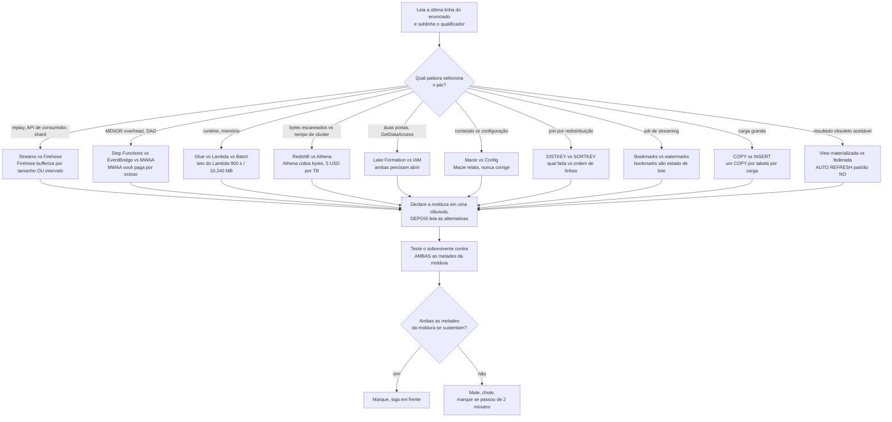
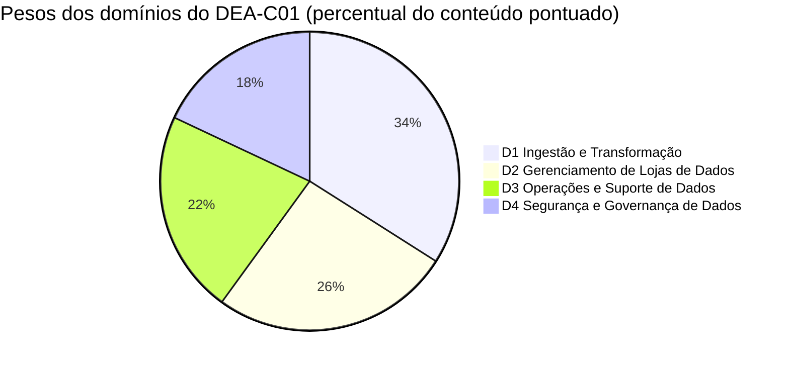
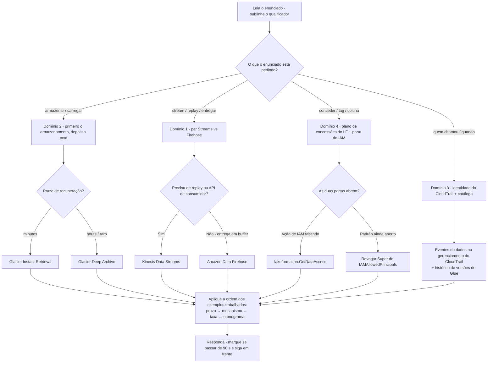
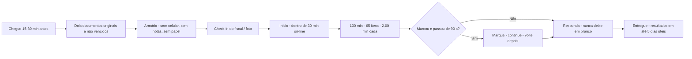
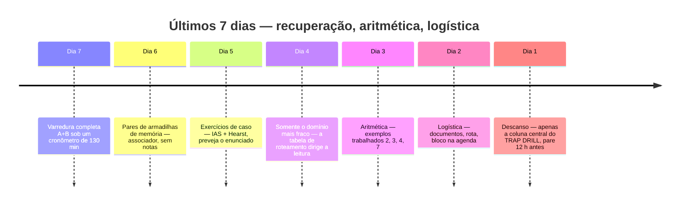

# Simulado B: Segundo Conjunto, Armadilhas e Dia do Exame

Quinze lições te deram o conteúdo e o Conjunto A te deu uma primeira realização. Uma **segunda** realização mede algo diferente: não se você conhece o AWS Glue, mas se você consegue manter **job bookmarks do Glue separados de watermarks de streaming**, ou **distribuição do Redshift separada de ordenação**, *enquanto o relógio corre*. Quase ninguém reprova no DEA-C01 porque nunca ouviu falar do Amazon Macie: reprovam porque o enunciado perguntou **quem chamou `DeleteTable`** e responderam com uma *descoberta*, ou porque o enunciado dizia `LEAST operational overhead` e eles pagaram por um ambiente gerenciado do Airflow para rodar quatro etapas de Lambda. Em uma escala compensatória de 100 to 1.000 com **720** para aprovar, discriminação é o que separa uma aprovação confortável de um 705.

```text
====================================================================
 DEA-C01 / CONJUNTO B EM RELANCE          (todas as cifras em outubro de 2026)
====================================================================
 FORMATO ...... 65 questões = 50 pontuadas + 15 não pontuadas (sem identificação)
 TIPOS ........ múltipla escolha (1 correta + 3 distratores)
                múltipla resposta (2+ corretas de 5+ alternativas)
 TEMPO ........ 130 minutos para 65 itens = exatamente 2,00 min por item
                (130 / 65 = 2,00, aritmética - ESL +30 dá 2,46)
 ESCALA ....... 100 - 1.000, aprovação em 720, COMPENSATÓRIA, sem corte por seção
 ADIVINHAÇÃO .. sem penalidade para chute errado; EM BRANCO = errado
 PESOS ........ D1 Ingestão e Transformação   34%
                D2 Gerenciamento de Lojas     26%
                D3 Operações e Suporte        22%
                D4 Segurança e Governança     18%
 CUSTO ........ 150 USD por tentativa (impostos podem incidir)
 VALIDADE ..... 3 anos; após REPROVA espere 14 dias corridos,
                tentativas ilimitadas, taxa cheia sempre
 RESULTADOS ... publicados na sua Conta de Certificação da AWS
                em até 5 dias úteis (teto oficial)
--------------------------------------------------------------------
 CONJUNTO B (esta lição) ...... 20 itens na ordem de peso: 7 / 5 / 4 / 4
 CONJUNTO B acrescenta ........ os vinte pares de armadilhas, a lista
                                do dia do exame e um plano de 7 dias
====================================================================
```

> [!NOTE]
> **Como usar esta lição.** Leia as seções 1 e 2 uma vez, essa é a metade da estratégia, e ela é construída inteiramente em torno de *pares*. Depois faça o **Conjunto B (seção 4) com cronômetro de 30 minutos, sem notas, sem busca e sem espiar as análises**. Corrija-se com a seção 7, treine os vinte pares da seção 5, percorra a lista do dia do exame da seção 6, e deixe o plano de 7 dias da seção 8 decidir o que acontece entre agora e o seu agendamento. Qualquer coisa que esta lição não pôde verificar contra uma página de primeira parte da AWS está listada na seção 7.4, trate esses itens como *não afirme*, não como fatos para decorar.

Ao final desta lição você será capaz de:

- declare a moldura correta de uma linha para cada um dos **vinte pares de armadilhas** com maior chance de te custar marcas;
- reconheça uma **alternativa meio-verdadeira**, o distrator que troca exatamente um atributo de um par, e a mate em uma cláusula;
- lide com enunciados de **múltipla resposta** com um procedimento tudo-ou-nada que nunca supõe crédito parcial;
- execute a aritmética que o exame realmente pede: **custo de DPU-hora**, **custo de classe de armazenamento**, **faturamento por bytes escaneados** e **pesos para itens**;
- recite a logística oficial do dia do exame: documentos, chegada, check-in, controles durante o exame, horário do resultado;
- corrija o Conjunto B **por bloco de domínio** contra limiares explícitos de pronto versus não pronto, e defenda o **veredito comparativo** sobre agendar agora versus sete dias a mais;
- execute um **plano de 7 dias** dirigido pela queda, que revisa por fraqueza de domínio em vez de por ordem de capítulo.

---

## 1. Estratégia: pares de armadilhas e como o exame os arma

### 1.1 O que é um par, e como um distrator realmente parece

A própria AWS descreve seus distratores como *"respostas geralmente plausíveis que correspondem à área de conteúdo"* (guia de exame DEA-C01). A consequência prática é que a maioria das alternativas que você enfrenta vem **da mesma decisão da chave**, o que significa que a maioria das perdas neste exame não são falhas de conhecimento, são **falhas de par**: você sabia um membro do par mas não conseguiu declarar a linha entre eles sob pressão de tempo. A habilidade de destaque do guia é *"comparar serviços da AWS para entender as diferenças de custo, desempenho e funcionalidade"*, comparação **é** o exame.

Um par vira um item por exatamente três movimentos:

1. **Troque um atributo por alternativa**: nível de registro versus bufferizado, exactly-once versus at-least-once, grant versus cota, descoberta versus aplicação, dist versus sort.
2. **Troque o pedido**, o enunciado quer *bytes escaneados*, a alternativa oferece *horas de cluster*; o enunciado quer *quem agiu*, a alternativa oferece *o que o conteúdo continha*.
3. **Troque a posição no ciclo de vida**, o serviço certo, o estágio errado da pipeline: uma resposta de crawler para uma questão de orquestração, uma resposta de catálogo para uma questão de remediação.

Exemplo trabalhado 1: uma alternativa meio-verdadeira, dissecada antes de você ler o enunciado. Pegue o par **Amazon Macie vs AWS Config** e construa as quatro alternativas do jeito que o exame faz:

| Alternativa | O que a alternativa acerta | Onde ela quebra | Veredito |
|---|---|---|---|
| **A** | Macie *de fato* produz descobertas com severidade 1 (Baixa) a 3 (Alta), retidas por **90 dias** | A alternativa então manda o Macie criptografar os objetos: Macie nunca corrige | fatos verdadeiros, ação impossível |
| **B** | Config *de fato* registra o estado de configuração ao longo do tempo e avalia regras contra ele | A alternativa entrega ao Config o trabalho de descoberta de PII que é do Macie | serviços cruzados |
| **C** | Ambos *são* serviços de governança na lista em escopo | Nenhuma metade diz o que a outra faz; a alternativa é uma afirmação de categoria, não uma distinção | sem discriminador |
| **D** | Macie descobre **conteúdo** sensível; Config registra estado de **configuração** |: | ambas as metades corretas |

Só **D** sobrevive, e sobrevive porque você avaliou *ambas as metades* em vez de reconhecer uma palavra familiar. As alternativas A e B contêm cada uma uma frase que você leu na documentação: esse é o projeto. **Um distrator não precisa ser falso; ele precisa ser falso no lugar sobre o qual o enunciado pergunta.**



### 1.2 As três questões para qualquer item de par

Candidatos lentos leem alternativas; candidatos rápidos interrogam o *par* primeiro. Faça estas três, nesta ordem, antes de olhar uma única alternativa:

1. **O que cada membro do par realmente faz?** Uma cláusula cada, de memória. Se você não consegue dizer o que uma view materializada faz em uma cláusula, as alternativas vão responder por você: mal.
2. **Qual qualificador do enunciado seleciona entre eles?** `replay`, `MENOR overhead`, `bytes escaneados`, `conteúdo`, `DISTKEY`, `obsoleto`, `full-load-and-cdc`. O substantivo no enunciado costuma ser o decoy; o qualificador é a chave.
3. **A alternativa sobrevivente satisfaz *ambas* as metades?** Para um enunciado `(Selecione DUAS)` isso é literal, e o próprio material de prontidão do DEA da AWS enuncia a regra como *"sem pontos negativos nem crédito parcial"*, então uma cláusula falsa zera a alternativa.

```fillblank
{
  "question": "Complete os quatro reflexos de exercício de par da seção 1.2:",
  "template": "1) Declare o que cada membro do par faz em uma {{1}} ANTES de ler as alternativas. 2) Encontre o {{2}} do enunciado que seleciona entre eles: replay, bytes escaneados, conteúdo, DISTKEY. 3) Teste a alternativa sobrevivente contra AMBAS as metades da {{3}}. 4) Passados cerca de dois minutos, {{4}} e chute: nunca deixe em branco.",
  "answers": {
    "1": "cláusula",
    "2": "qualificador",
    "3": "moldura",
    "4": "marque"
  },
  "distractors": ["frase", "nome do serviço", "lista de alternativas", "pule", "reescreva", "chute duas vezes", "peso do domínio"],
  "explanation": "Os quatro reflexos são o sistema defensivo inteiro, um por linha: a moldura de uma cláusula impede que as alternativas te ensinem a distinção errada, o qualificador é a palavra que realmente decide a chave, o teste das duas metades é o que mata uma alternativa meio-verdadeira (e é literal em enunciados Selecione DUAS), e passados cerca de dois minutos o movimento certo é marcar, chutar, seguir: porque questões sem resposta são avaliadas como incorretas e não há penalidade para um chute errado."
}
```

- **📚 Você sabia?** O próprio **Official Practice Question Set: AWS Certified Data Engineer: Associate** da AWS tem exatamente **20 questões**: a mesma contagem do Conjunto A e do Conjunto B aqui: é **gratuito** e fica no passo 1 do plano de preparação de quatro passos da AWS (guia de exame → conjunto de questões de prática → cursos do Skill Builder → exame de prática oficial), tudo em outubro de 2026. É a régua oficial mais próxima para o ritmo que você está treinando nesta lição.

---

## 2. Estratégia: os formatos de item, o blueprint e o relógio

O DEA-C01 publica exatamente **dois** tipos de questão: múltipla escolha (uma resposta correta mais três ou mais distratores) e múltipla resposta (duas ou mais respostas corretas de cinco ou mais alternativas). Não há ordenação, nem associação, nem item de estudo de caso neste exame em outubro de 2026, então não orce por eles. O que o Conjunto B acrescenta ao Conjunto A é prática nos três *formatos* que mais marcas custam: **múltipla resposta**, **cálculo** e **seleção por padrão**.

### 2.1 Múltipla resposta sem crédito parcial

| Regra | O que é publicado | O que isso significa na mesa |
|---|---|---|
| **Estrutura** | 2+ respostas corretas de **5+** alternativas; o enunciado declara a contagem ("Selecione DUAS") | Leia *todas* as alternativas antes de se comprometer com qualquer coisa |
| **Crédito** | Material de prontidão do DEA da AWS: *"sem pontos negativos nem crédito parcial"* | **Tudo-ou-nada, zero de crédito parcial**: um conjunto parcialmente correto zera |
| **Contagem** | Quantos itens de MR uma forma ao vivo carrega, e a proporção MC:MR, são **não publicadas** | Espere que o enunciado te diga a contagem; se disser, sublinhe-a |
| **Formato do Conjunto B** | Todo enunciado de MR aqui pré-combina suas afirmações corretas dentro de uma alternativa | Treina o pensamento tudo-ou-nada mantendo o esquema JSON de chave única |

O procedimento que sobrevive ao contato com cinco ou seis alternativas:

1. Marque cada alternativa como **definitivamente sim / definitivamente não / talvez**: em uma passada, sem escolher.
2. Resolva cada *talvez* relendo o **qualificador**, não a alternativa.
3. Envie somente quando não restar nenhum *talvez*. Duas respostas óbvias mais uma quinta correta ignorada é o zero clássico.

### 2.2 Os formatos de cálculo e de seleção

Três famílias aparecem repetidamente, e cada uma tem um procedimento mecânico.

**Exemplo trabalhado 2: custo de DPU-hora do Glue (us-east-1, em outubro de 2026).** Um job roda 4 × G.2X workers = **8 DPU** por **30 minutos**, **duas vezes por dia**, em um mês de **31 dias**, a **0,44 USD por DPU-hora**:

$$
\text{por execução} = 8 \times 0.5 \times 0.44 = \$1.76 \qquad \text{execuções} = 2 \times 31 = 62 \qquad 62 \times 1.76 = \mathbf{\$109.12}
$$

Os distratores são os *erros de aritmética*: uma execução por dia (**54,56 USD**), quatro execuções por dia (**218,24 USD**) e agendamento horário (uma resposta de quatro dígitos). Converta workers → DPU → horas → taxa, nessa ordem (item 4 do Conjunto B).

**Exemplo trabalhado 3, custo de classe de armazenamento (us-east-1, em outubro de 2026).** 100 TB = **102.400 GB** de dados de arquivo. A Standard, a 0,023 USD/GB-mês, custa **2.355,20 USD** por mês; a Standard-IA, a 0,0125, custa **1.280,00 USD**; a Glacier Instant, a 0,004, custa **409,60 USD**; a Glacier Deep Archive, a 0,00099, custa cerca de **101,38 USD**. O número mais barato *não* é a resposta a menos que também atenda ao prazo de recuperação, a recuperação do Deep Archive é medida em **horas**, não em minutos (item 8).

**Exemplo trabalhado 4, o Athena cobra bytes escaneados, não tempo.** Uma tabela CSV de 3 TB sem compressão com três colunas iguais, em que os dashboards fazem `SELECT` de uma coluna: toda consulta varre 3 TB, então $3 \times \$5 = \mathbf{\$15}$. Converta para Snappy Parquet (3:1) e leia uma de três colunas → 0,33 TB → $\mathbf{\$1.65}$. Mesma SQL, mesmo resultado, uma fração da conta, porque o medidor de custo é bytes escaneados (5,00 USD por TB, mínimo de 10 MB por consulta), não horas de cluster.

**Exemplo trabalhado 5: seleção por padrão.** Traduza os substantivos do enunciado para um modelo de dados *antes* de ler nomes de serviço:

| O enunciado diz | O modelo | O serviço que ele seleciona |
|---|---|---|
| chave/valor de *milissegundo de unidade* em qualquer escala | NoSQL chave-valor | Amazon DynamoDB |
| analítica SQL em *escala de petabytes*, compressão colunar | warehouse OLAP | Amazon Redshift |
| *SQL interativo serverless* sobre um lake no S3, cobrado por consulta | mecanismo de consulta de lake | Amazon Athena |
| *relacional*, compatível com MySQL ou PostgreSQL, backups gerenciados | OLTP relacional | Amazon Aurora ou Amazon RDS |
| acesso *rápido chave/valor* para uma carga de trabalho parecida com sessão | chave-valor em memória | Amazon MemoryDB for Redis (habilidade 2.1.3 do guia) |

Duas dessas linhas se tornam os itens 8 e 11 do Conjunto B. O padrão nunca muda: **substantivo → modelo de serviço → serviço**, e só então as alternativas.

### 2.3 O blueprint do Conjunto B, seu relógio e seus pesos

Apenas porcentagens de **domínio** são publicadas; as contagens de itens abaixo são aritmética sobre 50 itens pontuados: um auxílio de planejamento, nunca uma cifra da AWS.

| Domínio | Peso publicado | Itens pontuados no exame ao vivo (derivado: 50 × w) | Itens do Conjunto B aqui | O que este bloco realmente testa |
|---|---|---|---|---|
| **D1** Ingestão e Transformação | **34 %** | ≈ 17 | **7** (Q1: Q7) | bookmarks do Glue, depuração de transformação, custo de DPU, tipos de tarefa do DMS, MERGE |
| **D2** Gerenciamento de Lojas de Dados | **26 %** | ≈ 13 | **5** (Q8: Q12) | classes de armazenamento, TTL, `COPY`, evolução de catálogo/schema, desenho de distribuição |
| **D3** Operações e Suporte de Dados | **22 %** | ≈ 11 | **4** (Q13: Q16) | métricas por estágio, evidência de auditoria, automação com EventBridge, acesso a consultas do Athena |
| **D4** Segurança e Governança | **18 %** | ≈ 9 | **4** (Q17: Q20) | padrão de acesso do Lake Formation, padrões do KMS, secrets versus parâmetros, lugar da política de chave |
| **Total** | **100 %** | **≈ 50** | **20** | A coluna "itens pontuados" é aritmética, não uma afirmação da AWS |

**Exemplo trabalhado 6, pesos para itens, duas vezes.** No exame ao vivo: $50 \times 0.34 = 17$, $50 \times 0.26 = 13$, $50 \times 0.22 = 11$, $50 \times 0.18 = 9$, e $17 + 13 + 11 + 9 = 50$. No Conjunto B: $20 \times 0.34 = 6.8$, $20 \times 0.26 = 5.2$, $20 \times 0.22 = 4.4$, $20 \times 0.18 = 3.6$, que arredondam para **7 / 5 / 4 / 4**, e $7 + 5 + 4 + 4 = 20$. Os Domínios 1 e 2 juntos são **60 %** do conteúdo pontuado, é por isso que eles seguram 12 destes 20 itens.

**Exemplo trabalhado 7, o relógio do próprio Conjunto B.** O exame ao vivo dá exatamente $130 \div 65 = \mathbf{2.00}$ **minutos por item**; com a acomodação ESL de +30 isso vira $160 \div 65 = 2.46$ minutos. O Conjunto B usa um orçamento de primeira passada de **90 segundos**: $20 \times 90 = 1{,}800\ \text{s} = \mathbf{30}$ **minutos**. Faça o Conjunto B em 30 minutos cheios; se terminar com tempo sobrando, gaste-o nos itens marcados, não relendo os que você tem certeza.



- **📚 Você sabia?** O ritmo publicado pela própria AWS para uma certificação **Associate** é de **3 to 5 semanas** de preparação em sessões de **45 to 90 minutos** no seu horário de pico, e a AWS diz explicitamente que você precisa de *"uma nota de aprovação, não de uma nota perfeita"*. O plano de 7 dias da seção 8 é, portanto, um plano **comprimido**: ele assume que as lições 01 to 14 e o Conjunto A já estão atrás de você, e gasta a semana com discriminação e logística em vez de conteúdo novo.

---

## 3. Exercícios com estudos de caso do mundo real

Duas histórias de clientes publicadas pela AWS, convertidas nos dois únicos movimentos que este exame faz com uma história: **mapeá-la para um domínio**, depois **prever o enunciado**. Toda cifra abaixo é um *resultado de cliente* que a AWS escolheu publicar: nunca uma promessa da AWS e nunca um número sem a sua data (páginas de estudo de caso não carregam data de publicação, então o único carimbo disponível é a data de acesso; todas as cifras abaixo com acesso em **outubro de 2026**).

### Exercício de caso 1, Integral Ad Science: centenas de regras de permissão viraram duas

**O cenário.** Uma empresa de ad-tech roda um data lake de autoserviço entre **contas de produtor e consumidor** sob GDPR e CCPA, em que o acesso precisa seguir a *classificação* e o *papel do trabalho*. O relato publicado da AWS: a equipe usou **AWS Lake Formation** com controle de acesso baseado em tags sobre o **AWS Glue Data Catalog**, com **Amazon Athena** e **Amazon EMR** como mecanismos; dados no S3 só são alcançáveis por meio de um **papel de acesso a dados do Lake Formation**; tags em nível de banco de dados são **herdadas por tabelas e colunas**; e workgroups do Athena por unidade de negócio servem também como tags de faturamento e limites de consulta. A AWS relata que a superfície de permissões colapsou de **centenas de regras de permissão para exatamente 2**.

**Qual domínio?** **D4 Segurança e Governança de Dados (18 %)**: a história é um argumento sobre autorização baseada em papel, tag e atributo (habilidade 4.2.5) aplicada por meio do Lake Formation (habilidade 4.2.4). Os ganchos em **D3** (workgroups do Athena, limites de consulta) são secundários: nunca responda a um enunciado de governança com um controle de custo.

**O que o exame perguntaria?**

| Formato de enunciado | O qualificador que decide | Para o que a chave aponta |
|---|---|---|
| "…o acesso deve seguir a classificação e o papel do trabalho, não grants individuais" | *tag* versus *identidade* | Autorização **baseada em tags (ABAC)** |
| "…um analista ainda não consegue ler o S3 pelo Athena apesar de uma permissão de IAM" | qual **porta** está fechada | **`lakeformation:GetDataAccess`** mais um grant LF válido |
| "…centenas de regras viraram duas" | *direção da herança* | **LF-Tags em cascata banco → tabela → coluna** |
| "…qual cifra é uma garantia da AWS?" | *resultado de cliente* versus *promessa* | **um resultado publicado, não um SLA da AWS** |

**Armadilha a pré-carregar:** "a AWS garante 99 % de redução nas regras de permissão" erra duas vezes: converte o resultado de cliente em promessa, e a AWS nunca publica tal garantia. Reescreva toda porcentagem de caso como *"a AWS relata que a Integral Ad Science alcançou …"*.

### Exercício de caso 2, Hearst: 30 TB por dia através de um stream e uma pipeline de entrega

**O cenário.** Um grupo de mídia com mais de 250 sites, mais de 300 revistas e 31 emissoras de TV precisa de clickstream em escala. O relato publicado da AWS: **Amazon Kinesis Data Streams** mais **Kinesis Data Firehose** (renomeado **Amazon Data Firehose** em 2024-02-09) alimentando Spark streaming, ingerindo **30 TB por dia**.

**Qual domínio?** **D1 Ingestão e Transformação de Dados (34 %)**: a história é uma distinção entre stream e entrega, que é o par de armadilhas 1 da seção 5.

**O que o exame perguntaria?**

| Formato de enunciado | O qualificador que decide | Para o que a chave aponta |
|---|---|---|
| "…duas aplicações consumidoras cada uma precisa de todo registro, e uma precisa poder reproduzir ontem" | *replay* e *API de consumidor* | **Kinesis Data Streams** (retenção de 24 h a 365 d) |
| "…entregar no S3 em buffer sem aplicação consumidora para gravar" | *entrega em buffer* | **Amazon Data Firehose** (tamanho **ou** intervalo, o que vier primeiro) |
| "…30 TB/dia, o que esse número significa?" | *cifra de cliente* versus *limite* | **um resultado de cliente publicado, não uma cota da AWS** |
| "…a alternativa diz Amazon Kinesis Data Firehose" | *qual nome é oficial* | **ambos são válidos**: a lista em escopo atual ainda imprime o nome antigo |

**Armadilha a pré-carregar:** nunca "corrija" uma alternativa que diz *Amazon Kinesis Data Firehose*. O produto virou Amazon Data Firehose em 2024-02-09, mas a AWS afirma que **nenhum** endpoint de serviço, API, comando de CLI, política de IAM ou métrica do CloudWatch mudou: as ações de IAM continuam `firehose:*`, e a lista em escopo do DEA-C01 ainda lista "Amazon Kinesis Data Firehose".

- **📚 Você sabia?** A página *What is a data lake?* da AWS nomeia Netflix, Zillow, Nasdaq, Yelp, iRobot e **FINRA** como clientes de referência para a definição de data lake em nível de exame: ingerir como está, armazenar e catalogar com segurança, e rodar análises sem mover os dados para um sistema separado. As cifras de estudo de caso neste exame quase sempre são *descomponíveis ou datáveis*: quando uma alternativa reafirma um resultado de cliente como uma garantia da AWS, ela está errada mesmo que cada número individual pareça familiar.

---

## Exercícios com estudos de caso do mundo real

Duas histórias de clientes adicionais publicadas pela AWS, rodadas pelos mesmos dois movimentos da seção 3, **mapear para um domínio**, depois **prever o enunciado**, mas em velocidade de 90 segundos, porque o Dia 5 do plano de 7 dias pede que você faça exatamente isso de memória. Mesma regra de antes: toda cifra abaixo é um *resultado de cliente* que a AWS escolheu publicar (páginas de estudo de caso não carregam data de publicação, então o carimbo disponível é a data de acesso; todas as cifras com acesso em **outubro de 2026**), nunca uma promessa da AWS.

### Exercício de caso 3, Nasdaq: 70 bilhões de registros por dia, e um arquivo que não pode ser reescrito

**O cenário.** Uma bolsa precisa aterrissar ordens, cotações e negócios durante a noite, antes da abertura do mercado, mantendo registros regulatórios inalteráveis por anos. O relato publicado da AWS: desde **2014** a Nasdaq roda um data lake no **Amazon S3** como camada de armazenamento, **Amazon Redshift** (com Redshift Spectrum) como camada de consulta, **Amazon S3 Glacier** para arquivo e **S3 Object Lock** para o requisito de escrita única. A AWS relata que o lake absorveu um salto de **30 bilhões para 70 bilhões de registros por dia** (pico de **113 bilhões**, fev. 2020), que **90 % da carga terminou cinco horas antes**, que as consultas rodaram **32 % mais rápido**, e que uma fatia de **15 TB** é consultada no lugar sem ser copiada antes.

**Qual domínio?** **D2 Gerenciamento de Lojas de Dados (26 %)**: a história é um argumento a favor de armazenamento e computação desacoplados (caminho de escrita no S3, caminho de leitura no Redshift), que é o formato lake-house que o guia testa na seleção de lojas. Os ganchos são **D1** (a janela noturna é um prazo de ingestão) e **D4** (Object Lock é o controle de imutabilidade que o item 20 do Conjunto B já treinou).

**O que o exame perguntaria?**

| Formato de enunciado | O qualificador que decide | Para o que a chave aponta |
|---|---|---|
| "…a carga precisa terminar antes da abertura do mercado e não pode bloquear consultas" | armazenamento *desacoplado* vs computação | **caminho de escrita no S3 + caminho de leitura no Redshift (Spectrum sobre o lake)** |
| "…registros não podem ser alterados nem excluídos por sete anos" | *não pode ser alterado* | **S3 Object Lock, modo de conformidade** |
| "…30 bilhões → 70 bilhões de registros por dia, o que é esse número?" | *resultado de cliente* versus *cota* | **um resultado publicado da Nasdaq, não um limite da AWS** |
| "…as consultas rodaram 32 % mais rápido: você pode reafirmar isso?" | *citação* versus *garantia* | **apenas como "a AWS relata que a Nasdaq …", nunca como uma afirmação da AWS** |

**Armadilha a pré-carregar:** toda porcentagem de caso é específica da carga de trabalho e da linha de base (digest 16 F1). "Consultas rodam 32 % mais rápido no Redshift" é a medição da Nasdaq na carga de trabalho da Nasdaq: uma alternativa que a oferece como garantia de desempenho da AWS está errada mesmo que o número esteja impresso em uma página da AWS.

### Exercício de caso 4, Oportun: Macie encontra a PII, você responde

**O cenário.** Uma financeira precisa localizar e priorizar dados pessoais mantidos no S3 para obrigações do FTC Safeguards e de privacidade, com uma pequena equipe de conformidade e baixa tolerância a falsos positivos. O relato publicado da AWS: **Amazon Macie** automatizou a descoberta de dados sensíveis nos buckets da conta usando **identificadores de dados gerenciados e personalizados**, um **inventário de bucket** e um **score de sensibilidade** da conta; a AWS relata **+95 % de acuracidade de descoberta** e **−80 % de tempo para descobrir dados sensíveis** (o cartão de caso do Macie e a sessão SEC215 do re:Invent 2022).

**Qual domínio?** **D4 Segurança e Governança de Dados (18 %)**, descoberta e classificação de conteúdo sensível (habilidades 4.5.1 / 4.5.2). A metade de *resposta* da mesma história é **D3**: descobertas → EventBridge → Lambda, que é precisamente o item 15 do Conjunto B, descoberta e remediação são habilidades separadas neste blueprint.

**O que o exame perguntaria?**

| Formato de enunciado | O qualificador que decide | Para o que a chave aponta |
|---|---|---|
| "…encontrar PII no lake sem escrever código" | *conteúdo* versus *configuração* | **Amazon Macie** (não AWS Config) |
| "…uma vez que encontra a PII, o que o Macie faz?" | *relata* versus *corrige* | **ele relata: EventBridge, Lambda e Lake Formation agem** |
| "…escaneie também o banco de dados Aurora PostgreSQL para PII" | *escopo do serviço* | **Macie é um serviço do Amazon S3**; um controle diferente cobre o banco de dados |
| "…95 %; isso é uma garantia da AWS?" | *resultado de cliente* versus *promessa* | **resultado publicado da Oportun, acesso em outubro de 2026** |

**Armadilha a pré-carregar:** o +95 % é **acuracidade de descoberta no S3 alcançada por um único cliente**, não cobertura geral de prevenção de perda de dados, o digest 16 F8 avisa explicitamente contra lê-lo como um número de DLP entre serviços, e o Macie não escaneia nativamente o Amazon RDS nem o Amazon Redshift.

```interactive
{
  "type": "matching",
  "title": "Associador de exercícios de caso: associe a história ao domínio que ela treina",
  "instructions": "Associe cada resultado publicado de cliente (A: D) ao domínio do DEA-C01 que ele principalmente treina (1 to 4). Re-derive o qualificador do enunciado a partir da moldura antes de se comprometer.",
  "pairs": [
    { "left": "A · 70 bilhões de registros por dia, caminho de escrita no S3, caminho de leitura no Redshift, arquivo com Object Lock", "right": "1 · D2 Gerenciamento de Lojas de Dados" },
    { "left": "B · 30 TB de clickstream por dia através de um stream mais uma entrega em buffer", "right": "2 · D1 Ingestão e Transformação de Dados" },
    { "left": "C · Macie descobre PII no S3; EventBridge e Lambda fazem a resposta", "right": "3 · D4 Segurança e Governança de Dados" },
    { "left": "D · Amazon Customer Service: dimensionamento correto de RA3 reduziu o custo operacional do Redshift em 55 % ao ano", "right": "4 · D3 Operações e Suporte de Dados" }
  ],
  "answer": "A→1, B→2, C→3, D→4"
}
```

- **📚 Você sabia?** A AWS relata que a PayU consolidou cerca de **40 bancos de dados de produção** em S3 mais Redshift, cortou a latência de consulta de **10 to 15 minutos para menos de um minuto**, economizou **20.000 USD por mês** e derrubou o volume de consultas de **150.000 para 35.000 por mês (−77 %)**, e esses são **duas alavancas diferentes**: a consolidação da plataforma entregou a economia, a racionalização das consultas entregou a queda de volume. Neste exame, um enunciado que pede *custo* e um enunciado que pede *demanda* nunca são respondidos com o mesmo número, mesmo quando vêm da mesma história de cliente.

---

## 4. Perguntas de Prática (Practice Questions), Conjunto B: 20 itens na ordem de peso publicada

O Conjunto B espelha o formato **dominante** do exame ao vivo: uma resposta correta, três distratores: enquanto treina seis enunciados no **estilo múltipla resposta**. Os itens correm na ordem de peso dos domínios: **D1 sete, D2 cinco, D3 quatro, D4 quatro**, que é a divisão publicada de 34 / 26 / 22 / 18 arredondada sobre vinte itens. Todos os vinte são adaptados de itens do banco de questões **Q21: Q40**.

### 4.0 Como fazer o Conjunto B

| Ajuste | A regra | Por que isso importa |
|---|---|---|
| **Cronômetro** | **30 minutos cheios** (90 s por item, o orçamento de primeira passada) | Treina o ritmo que você usará para 65 itens a 2,00 minutos cada |
| **Materiais** | Sem notas, sem busca, sem análise visível | Pontuar com material aberto mede suas notas, não você |
| **Ritmo** | Responda todo item; marque o que passar de 90 segundos e siga | Em branco é um zero garantido: a regra nunca muda com o tamanho do conjunto |
| **Regra do par** | Antes de ler as alternativas, escreva a moldura do par em uma cláusula | Esse é o ponto inteiro do Conjunto B |
| **Múltipla resposta** | Leia **todas** as alternativas; as afirmações corretas são pré-combinadas em uma alternativa para que cada item mantenha uma chave única | Treina o pensamento tudo-ou-nada sem quebrar o esquema |
| **Correção** | Por **bloco de domínio** primeiro, total depois (seção 7) | A pontuação compensatória pune a queda, não a média |
| **Refazer** | 72 horas depois, de memória | Intervalos mais curtos medem reconhecimento, não retenção |

### 4.1 Domínio 1: Ingestão e Transformação de Dados (34 %) · itens 1 to 7

```question
{
  "id": "dea-16-q1",
  "type": "multiple-choice",
  "question": "Um job de ETL do AWS Glue falha intermitentemente no commit com um erro de incompatibilidade de versão de bookmark. Os logs mostram uma segunda cópia do mesmo job rodando concorrentemente durante um backfill. Qual mudança resolve a causa raiz?",
  "options": [
    "Aumentar NumberOfWorkers para que o job termine antes que a segunda execução comece",
    "Definir MaxConcurrentRuns como 1 e serializar o backfill atrás da execução agendada",
    "Redefinir o bookmark do job antes de cada execução agendada",
    "Trocar o job para a classe de execução FLEX"
  ],
  "correct": 1,
  "explanation": "Os bookmarks do AWS Glue não suportam execuções de job concorrentes e os commits falharão, então forçar a serialização é a correção documentada; um reset apenas mascara o sintoma e descarta o estado incremental."
}
```

**Análise: Q1 · a concorrência é a causa, não os workers.** **Por que está correta:** a AWS documenta que os bookmarks do Glue não suportam execuções de job concorrentes e que os commits falham, então a única mudança que remove a causa é uma execução por vez. **Por que as armadilhas perdem:** **A** aumenta o vazão, o que não faz nada para uma garantia de estado e torna a sobreposição *mais* provável; **C** mascara o sintoma e redefine o estado incremental, então a próxima execução reprocessa tudo, o oposto do comportamento desejado; **D** (FLEX) é uma otimização de custo para jobs não urgentes e não tem efeito no estado do bookmark. **Armadilha:** o erro diz *bookmark*, então os candidatos correm para um comando de bookmark; o enunciado diz *concorrentemente*, então a resposta é uma configuração de concorrência. **Fonte:** banco Q25 · Glue `glue-troubleshooting-errors.html` (digest 15 C9) · habilidade 1.2.7.

```question
{
  "id": "dea-16-q2",
  "type": "multiple-choice",
  "question": "(Selecione DUAS.) Espera-se que um job noturno do Glue processe cerca de 50 milhões de linhas novas, mas ele conclui com sucesso em segundos e nada grava. Um engenheiro suspeita que o job bookmark pulou os arquivos novos. No formato de chave única deste conjunto, as duas métricas estão pré-combinadas dentro de uma alternativa: escolha a alternativa em que AS DUAS métricas confirmam o diagnóstico.",
  "options": [
    "glue.driver.aggregate.recordsRead colapsa para perto de zero AND glue.driver.aggregate.bytesRead colapsa para perto de zero",
    "glue.ALL.jvm.heap.usage excede o seu limiar de alarme 0,9 AND glue.error.ALL incrementa",
    "glue.driver.aggregate.recordsRead colapsa para perto de zero AND glue.driver.ExecutorAllocationManager.numberMaxNeededExecutors sobe",
    "glue.ALL.jvm.heap.usage sobe AND glue.driver.ExecutorAllocationManager.numberAllExecutors sobe"
  ],
  "correct": 0,
  "explanation": "Ambas as métricas agregadas de leitura colapsam para perto de zero quando a fonte é pulada, que é o sinal documentado para problemas de job bookmark; um pulo de bookmark não é um erro, então o job ainda tem sucesso."
}
```

**Análise, Q2 · duas métricas, ambas sobre a fonte.** **Por que está correta:** se o bookmark controla a fonte, nada é lido, então `recordsRead` e `bytesRead` caem para zero, e essas são as duas métricas agregadas do Glue que mostrariam isso. **Por que as armadilhas perdem:** **B** descreve um alarme de memória esgotada (`glue.ALL.jvm.heap.usage` acima de 0,9) mais erros de tarefa, mas um pulo não gera erro, que é exatamente por que o job "tem sucesso"; **C** combina uma métrica verdadeira com uma métrica de **alocação de executor**, que mede o backlog de DPU (trabalho esperando), não o pulo da fonte; **D** é memória mais demanda de executor, nada relacionado com uma fonte pulada. **Armadilha:** em um enunciado de MR **toda** afirmação é uma questão separada, uma cláusula falsa zera a alternativa, e não há crédito parcial para coletar. **Forma no exame ao vivo:** duas caixas de seleção, tudo-ou-nada. **Fonte:** banco Q26 · Glue `job-monitoring.html` e `monitor-continuations.html` · habilidade 1.2.7.

```question
{
  "id": "dea-16-q3",
  "type": "multiple-choice",
  "question": "Arquivos CSV chegam por hora em um bucket bruto. Um steward de dados quer regras de qualidade de dados em nível de coluna sem código, resultados em nível de linha identificando quais registros falharam, e um alerta dentro de cinco minutos de uma violação. Qual solução atende ao requisito MELHOR?",
  "options": [
    "Um ruleset do AWS Glue DataBrew avaliado por um job de ruleset, com uma regra do EventBridge roteando os eventos DataBrew Ruleset Validation Result para o Amazon SNS",
    "Um crawler do AWS Glue com detecção de mudança de schema habilitada",
    "Restrições DDL do Amazon Athena definidas na tabela bruta",
    "Um ANALYZE do Amazon Redshift rodando em uma tabela relacionada"
  ],
  "correct": 0,
  "explanation": "Rulesets do DataBrew avaliam regras em nível de coluna e de linha sem código e emitem resultados de regra, que o EventBridge pode rotear para o SNS em minutos: uma transformação sem código mais um gatilho de eventos mais uma notificação, tudo na lista em escopo."
}
```

**Análise, Q3 · três requisitos, três serviços, uma pipeline.** **Por que está correta:** o enunciado exige *sem código*, *resultados em nível de linha* e um *alerta de cinco minutos*, rulesets do DataBrew fornecem os dois primeiros, e EventBridge → SNS fornece o terceiro, o que mapeia para as habilidades 1.1.6 (gatilhos de eventos), 1.2.5 (serviço de transformação por requisito) e 1.3.4 (serviços de notificação); as próprias definições de regra são a habilidade 3.4.2. **Por que as armadilhas perdem:** **B** descobre mudança de *schema*, ele não avalia regras de qualidade de dados, família de serviço certa, job errado; **C** é DDL em uma tabela que um prefixo de CSV bruto nem sequer tem; **D** atualiza estatísticas do otimizador e não valida nada. **Armadilha:** o *crawler* responde questões de catálogo e descoberta, nunca de qualidade de dados, este é o clássico distrator de posição errada no ciclo de vida. **Fonte:** banco Q27 · documentação de perfil baseado em regras do DataBrew · habilidades 1.1.6 / 1.2.5 / 1.3.4 / 3.4.2 do guia de exame.

```question
{
  "id": "dea-16-q4",
  "type": "multiple-choice",
  "question": "Um job de ETL do AWS Glue está configurado com 4 x G.2X workers (8 DPU) e roda por 30 minutos, duas vezes por dia, todos os dias de um mês de 31 dias. Usando a taxa do Glue de 0,44 USD por DPU-hora (us-east-1, em outubro de 2026), aproximadamente qual é o custo de computação do job no mês?",
  "options": [
    "109,12 USD",
    "54,56 USD",
    "218,24 USD",
    "1.637,76 USD"
  ],
  "correct": 0,
  "explanation": "Por execução: 8 DPU x 0,5 h x 0,44 USD = 1,76 USD. Execuções: 2 x 31 = 62. 62 x 1,76 USD = 109,12 USD no mês."
}
```

**Análise, Q4 · workers → DPU → horas → taxa.** **Por que está correta:** $8 \times 0.5\ \text{h} \times \$0.44 = \$1.76$ por execução, $2 \times 31 = 62$ execuções, $62 \times 1.76 = \mathbf{\$109.12}$ (exemplo trabalhado 2). **Por que as armadilhas perdem:** **B** corta o cronograma pela metade para uma execução por dia ($31 \times 1.76 = 54.56$); **C** dobra para quatro execuções por dia; **D** modela o job rodando a cada hora do mês. **Armadilha:** o item é 90 % aritmética e 10 % conhecimento de serviço, converta **workers → DPU → horas → taxa** nessa ordem fixa, e só então multiplique pelo cronograma. Lembre a definição de DPU: **1 DPU = 4 vCPU + 16 GB**, e um worker G.2X é 4 DPU. **Fonte:** banco Q28 · `aws.amazon.com/glue/pricing/` (0,44 USD/DPU-hora, us-east-1, em outubro de 2026; digest 15 C8) · habilidade 1.2.4.

```question
{
  "id": "dea-16-q5",
  "type": "multiple-choice",
  "question": "Um engenheiro roda: aws glue reset-job-bookmark --job-name nightly_orders_etl. O que este comando faz?",
  "options": [
    "Retrocede o bookmark para um estado anterior específico fornecido pelo usuário, para que apenas uma janela escolhida seja reprocessada",
    "Limpa o estado do bookmark, para que a próxima execução do job processe a fonte desde o início",
    "Exclui o job e todo o seu histórico de bookmarks",
    "Coloca o bookmark no modo bookmark-PAUSE, para que ele pare de avançar"
  ],
  "correct": 1,
  "explanation": "ResetJobBookmark limpa o bookmark do job; a próxima execução começa do início da fonte. O retrocesso seletivo é outra operação de console/API, e a pausa é um parâmetro do job."
}
```

**Análise, Q5 · reset não é retrocesso.** **Por que está correta:** a referência da CLI define `reset-job-bookmark` como limpar o estado do bookmark, então a próxima execução relê a fonte desde o início. **Por que as armadilhas perdem:** **A** descreve o recurso de *rewind* do console, uma operação separada que recebe um ponto no tempo; **C** seria `delete-job`; **D** descreve o parâmetro de job `bookmark-PAUSE`, um modo em vez desta chamada de API. **Armadilha:** as quatro alternativas são verbos que você já viu no console do Glue, o discriminador é *que estado existe depois*: limpo (tudo reprocessado), retrocedido para uma janela escolhida, ou pausado. **Fonte:** banco Q29 · CLI `glue reset-job-bookmark.html`, Glue `monitor-continuations.html` · habilidade 1.2.7.

```question
{
  "id": "dea-16-q6",
  "type": "multiple-choice",
  "question": "Um banco de dados Oracle on-premises precisa ser migrado para o Amazon Aurora PostgreSQL. O destino precisa ser populado com as linhas existentes e depois mantido continuamente em sincronia enquanto as aplicações continuam gravando na origem, até que uma janela de corte de 6 horas termine. Qual configuração de tarefa do AWS DMS atende ao requisito?",
  "options": [
    "Tipo de migração full-load",
    "Tipo de migração full-load-and-cdc",
    "Tipo de migração cdc",
    "AWS DataSync agendado de hora em hora"
  ],
  "correct": 1,
  "explanation": "O DMS define exatamente três tipos de tarefa; full-load-and-cdc migra os dados existentes e depois continua aplicando as alterações da origem no destino, que é o padrão de sincronia contínua durante a migração."
}
```

**Análise: Q6 · dois requisitos, um tipo.** **Por que está correta:** *popular com as linhas existentes* mais *manter continuamente em sincronia* precisa das duas fases, e `full-load-and-cdc` é o único tipo de DMS que faz as duas em uma única tarefa. **Por que as armadilhas perdem:** **A** carrega um snapshot de um ponto no tempo e para, o destino diverge imediatamente enquanto a origem segue aceitando gravações; **C** assume que o destino já foi pré-carregado (cdc-only só é correto quando as tabelas já foram carregadas); **D** move arquivos por um protocolo de rede, não alterações de banco de dados, e o Aurora não é um destino de arquivos. **Armadilha:** a janela de corte de seis horas é um *prazo*, não um tipo de tarefa: não deixe uma duração escolher a sua alternativa. Duas regras a mais acompanham este item: **o CDC do DMS não oferece replicação em tempo real**, e apenas **uma tarefa em um par bidirecional** pode ser `full-load-and-cdc`. **Fonte:** banco Q32 · DMS `CHAP_Task.CDC.html`, `CHAP_Tasks.html` (digest 15 C18) · habilidade 1.1.1.

```question
{
  "id": "dea-16-q7",
  "type": "multiple-choice",
  "question": "MERGE INTO sales_fact t USING sales_staging s ON t.order_id = s.order_id WHEN MATCHED THEN UPDATE SET t.amount = s.amount WHEN NOT MATCHED THEN INSERT (order_id, amount) VALUES (s.order_id, s.amount); O MERGE falha intermitentemente com um erro de correspondência duplicada. Qual afirmação explica corretamente a falha e a correção?",
  "options": [
    "O MERGE do Redshift exige um bloco BEGIN/END explícito; sem ele, duplicatas escapam",
    "Várias linhas em sales_staging correspondem ao mesmo t.order_id; deduplicar a tabela de staging (ou usar MERGE ... REMOVE DUPLICATES) antes ou dentro do merge",
    "MERGE não é suportado no Redshift e a instrução deve ser substituída por instruções UPDATE/INSERT separadas",
    "sales_staging deve carregar o mesmo DISTKEY que sales_fact ou o merge falha"
  ],
  "correct": 1,
  "explanation": "O MERGE do Redshift permite no máximo uma linha correspondente por linha de destino; várias correspondências geram erro, então deduplicar a origem: ou usar a forma documentada REMOVE DUPLICATES, resolve o problema."
}
```

**Análise: Q7 · leia o trecho pela invariante, não pela palavra-chave.** **Por que está correta:** a cláusula `ON` é `order_id` e a falha é *correspondência duplicada*: significando que o lado da origem do join não é único, então a correção precisa torná-lo único. **Por que as armadilhas perdem:** **A** inventa um requisito de transação (um `MERGE` único já é atômico); **C** é falsa: `MERGE` é um comando suportado do Redshift; **D** é uma recomendação de *desempenho* para merges grandes, não uma pré-condição de correção, e não impediria duas linhas de staging idênticas. **Armadilha:** duas palavras familiares afastam os candidatos do defeito real: `DISTKEY` (desempenho) e `BEGIN` (transações): enquanto a mensagem de erro já nomeia o problema. **Fonte:** banco Q33 · Redshift `r_MERGE.html`, `merge-specify-a-column-list.html` · habilidades 1.2.5 / 2.4.1.

### 4.2 Domínio 2: Gerenciamento de Lojas de Dados (26 %) · itens 8 to 12

```question
{
  "id": "dea-16-q8",
  "type": "multiple-choice",
  "question": "Um arquivo de conformidade guarda 100 TB (102.400 GB) de metadados de imagem médica quase nunca lidos, mas quando um regulador os solicita, a recuperação deve ser concluída em minutos. Usando as taxas de us-east-1 em outubro de 2026 (Standard 0,023 USD/GB-mês, Standard-IA 0,0125, Glacier Instant 0,004, Glacier Deep Archive 0,00099), qual classe de armazenamento atende ao requisito e aproximadamente quanto custam os dados por mês nessa classe?",
  "options": [
    "S3 Glacier Instant Retrieval: cerca de 410 USD por mês",
    "S3 Glacier Deep Archive: cerca de 101 USD por mês",
    "S3 Standard-Infrequent Access: cerca de 1.280 USD por mês",
    "S3 Glacier Instant Retrieval: cerca de 2.355 USD por mês"
  ],
  "correct": 0,
  "explanation": "Glacier Instant Retrieval é a classe de arquivo mais barata com recuperação em milissegundos, então 102.400 GB x 0,004 USD = 409,60 USD por mês; Deep Archive é mais barato, mas a recuperação é medida em horas."
}
```

**Análise, Q8 · dois qualificadores, depois a aritmética.** **Por que está correta:** o enunciado empilha *dados em forma de arquivo* com *recuperação em minutos*, Glacier Instant Retrieval foi feito para dados arquivados de longa duração com recuperação em milissegundos, e a checagem de custo confirma: $102{,}400 \times 0.004 = \mathbf{\$409.60}$. **Por que as armadilhas perdem:** **B** tem o menor número ($102{,}400 \times 0.00099 \approx \$101$), mas a recuperação do Deep Archive é medida em **horas**, perdendo o prazo, a jogada clássica de "a maior economia perde"; **C** cumpre o tempo de recuperação, mas custa cerca de **3×** mais ($102{,}400 \times 0.0125 = \$1{,}280$), então falha em *minimizar o custo de armazenamento*; **D** casa a classe certa com a **taxa da Standard** ($102{,}400 \times 0.023 = \$2{,}355.20$). **Armadilha:** leia o prazo **antes** da lista de preços, e nunca aceite uma taxa por GB sem verificar de qual coluna da tabela de preços ela veio (exemplo trabalhado 3). **Fonte:** banco Q21 · `aws.amazon.com/s3/storage-classes/`, `glacier-storage-classes.html` (digest 15 C13, em outubro de 2026) · habilidade 2.3.2.

```question
{
  "id": "dea-16-q9",
  "type": "multiple-choice",
  "question": "Uma loja de sessões no Amazon DynamoDB guarda centenas de milhões de linhas de sessão que precisam ser excluídas automaticamente 24 horas após a última atualização, para controlar o custo de armazenamento. Qual mecanismo foi projetado exatamente para isso?",
  "options": [
    "Um atributo de tempo até a expiração (TTL) guardando um timestamp epoch em segundos",
    "Uma regra de expiração do ciclo de vida do S3 apontada para a exportação da tabela",
    "Uma tarefa do AWS DMS com tipo de migração cdc mirando uma tabela temporária",
    "Um job noturno do AWS Glue emitindo chamadas DeleteItem"
  ],
  "correct": 0,
  "explanation": "O TTL do DynamoDB exclui itens expirados automaticamente: normalmente em até dois dias: sem custo, usando um atributo de sua escolha que guarda um epoch Unix em segundos."
}
```

**Análise: Q9 · nativo, grátis, epoch em segundos.** **Por que está correta:** o TTL é o mecanismo que o guia emparelha com o versionamento do S3 (habilidade 2.3.4), é grátis, e o atributo é um **Number guardando epoch em segundos**: não milissegundos. **Por que as armadilhas perdem:** **B** vale para objetos do S3, não para itens de tabela, e uma exportação é uma cópia que precisaria do seu próprio ciclo de vida; **C** é um mecanismo de migração/replicação, não de retenção; **D** funciona, mas queima capacidade de leitura/gravação para algo que a tabela faz nativamente. **Armadilha:** *excluir automaticamente depois de 24 horas* atrai qualquer resposta em forma de job; pergunte "a loja tem um relógio nativo?" antes de aceitar um worker. Dois fatos de TTL acompanham: a exclusão é **best-effort, normalmente em até dois dias**, e um item expirado-mas-ainda-não-excluído **ainda é lido e faturado**, então filtre por `ttl > now` quando a correção depender disso. **Fonte:** banco Q22 · DynamoDB `TTL.html`, `APIReference/API_UpdateTimeToLive.html` (digest 15 C28) · habilidade 2.3.4.

```question
{
  "id": "dea-16-q10",
  "type": "multiple-choice",
  "question": "Um engenheiro de dados carrega um prefixo do Amazon S3 no Redshift: COPY public.events FROM 's3://data-lake/events/dt=2026-10-01/' IAM_ROLE 'arn:aws:iam::111122223333:role/RedshiftCopyRole' FORMAT AS PARQUET; Qual afirmação sobre esta carga é VERDADEIRA?",
  "options": [
    "O COPY é proibitivamente lento para cargas grandes e deve ser substituído por instruções INSERT nível de linha",
    "Emitir um COPY por tabela por carga é preferível a muitos COPYs pequenos ou inserções linha a linha",
    "FORMAT AS PARQUET é inválido porque o Redshift só pode carregar CSV",
    "A função de IAM precisa apenas de s3:GetObject no prefixo"
  ],
  "correct": 1,
  "explanation": "A AWS recomenda fortemente o comando COPY para grandes volumes de dados e avisa que instruções INSERT individuais \"podem ser proibitivamente lentas\"; um COPY único por tabela por carga é a melhor prática documentada."
}
```

**Análise, Q10 · a citação decide.** **Por que está correta:** o guia de carga da AWS diz *"We strongly recommend using the COPY command to load large amounts of data"* e que instruções `INSERT` individuais *"might be prohibitively slow"*, então um `COPY` por tabela por carga vence. **Por que as armadilhas perdem:** **A** é o guia impresso ao contrário, o detector de resposta errada mais confiável nesta área; **C** é falsa, Parquet é um formato de origem suportado pelo `COPY` e a carga colunar é a forma *recomendada*; **D** omite **`s3:ListBucket`** (necessário para enumerar o prefixo) e, para objetos SSE-KMS, **`kms:Decrypt`**. **Armadilha:** uma lista de IAM parcial parece completa porque uma ação é obviamente certa, opções de autorização são avaliadas pelo *conjunto completo de permissões*, não pela ação mais memorável. **Fonte:** banco Q23 · Redshift `r_COPY.html`, `t_Loading_data.html` (digest 15 C27), `copy-parameters-authorization.html` · habilidade 2.3.1.

```question
{
  "id": "dea-16-q11",
  "type": "multiple-choice",
  "question": "Um job de ETL do Glue grava novos arquivos Parquet sob um prefixo do S3 particionado já registrado como tabela do Glue Data Catalog. Uma nova coluna anulável loyalty_tier aparece nos dados de origem, mas o Athena ainda retorna a lista antiga de colunas e falha em consultas que referenciam a nova coluna. Qual ação faz o Athena ver o novo schema?",
  "options": [
    "Rodar o crawler do Glue sobre os novos dados (ou ALTER TABLE ... ADD COLUMN loyalty_tier string) para atualizar os metadados do Data Catalog",
    "Excluir e recriar o bucket do S3 com um novo nome",
    "Converter a saída de volta para CSV para que o Athena infira o schema na hora da consulta",
    "Não fazer nada: o Athena relê o schema dos rodapés do Parquet em cada consulta"
  ],
  "correct": 0,
  "explanation": "O Athena resolve o schema de uma tabela catalogada a partir do Glue Data Catalog, não dos rodapés dos arquivos, então a evolução de schema em uma tabela registrada exige uma atualização do catálogo: uma execução de crawler ou um ALTER TABLE ADD COLUMN explícito."
}
```

**Análise: Q11 · schema-on-write no catálogo, não schema-on-read.** **Por que está correta:** a tabela *já está registrada*, e o Athena lê schemas registrados do **Glue Data Catalog**, então só uma execução de crawler ou um `ALTER TABLE ADD COLUMN` muda o que o Athena retorna. **Por que as armadilhas perdem:** **B** é destrutivo e irrelevante para metadados; **C** regride o modelo de custo (perde o pruning colunar) e ainda não atualiza uma tabela *registrada*; **D** é o equívoco central que o item testa: rodapés são o que *motores sem catálogo* usam, não uma tabela do Athena catalogada. **Armadilha:** *os arquivos já contêm a coluna* parece suficiente; o qualificador é **tabela registrada**, o que transfere a autoridade dos dados para o catálogo (habilidades 2.2.3 crawlers populam catálogos, 2.4.2 mudanças nas características dos dados). **Fonte:** banco Q24 · Glue `aws-glue-crawler.html`, Athena `tables.html` · habilidades 2.2.3 / 2.4.2.

```question
{
  "id": "dea-16-q12",
  "type": "multiple-choice",
  "question": "Um esquema estrela do Redshift tem fact_sales (2 bilhões de linhas) fazendo join com dim_customer (50 milhões de linhas) em customer_id na maioria das consultas de dashboard. dim_product tem 100 linhas. Qual desenho físico melhor colocaliza o join dominante com a menor sobrecarga de armazenamento?",
  "options": [
    "DISTSTYLE EVEN em fact_sales, sem distribuição em dim_customer",
    "DISTSTYLE KEY DISTKEY (customer_id) em fact_sales e dim_customer",
    "DISTSTYLE ALL em fact_sales",
    "SORTKEY (order_date) apenas em fact_sales, com distribuição AUTO padrão"
  ],
  "correct": 1,
  "explanation": "Distribuir os dois lados do join pela chave de join permite ao leader node colocalizar linhas por valor de join, eliminando a redistribuição; ALL em uma tabela de 50 milhões de linhas multiplicaria o armazenamento pelo número de nós."
}
```

**Análise: Q12 · distribuição conserta joins, ordenação conserta varreduras.** **Por que está correta:** o próprio guia da AWS diz que distribuir um par de tabelas pelas suas chaves de join faz o leader node **colocalizar** as linhas nos slices pelo valor de join, e chaves iguais nos dois lados evita a redistribuição completamente. **Por que as armadilhas perdem:** **A** deixa `dim_customer` ser transmitida ou redistribuída em cada join; **C** coloca uma tabela de 50 milhões de linhas em **todos** os nós, o armazenamento multiplica pelo número de nós, e `DISTSTYLE ALL` só faz sentido para dimensões genuinamente pequenas (o `dim_product` de 100 linhas é o candidato aqui); **D** trata da ordem de varredura e filtro, não da colocalização do join. **Armadilha:** *a consulta está lenta* puxa candidatos para `VACUUM`, `ANALYZE` ou `SORTKEY`, mas o enunciado pergunta sobre o **join**, e o join é um problema de **distribuição** (par de armadilhas 11). **Fonte:** banco Q31 · Redshift `c_choosing_dist_sort.html`, `t_designating_distribution_styles.html` (digest 15 C15) · habilidade 2.4.5.

### 4.3 Domínio 3: Operações e Suporte de Dados (22 %) · itens 13 to 16

```question
{
  "id": "dea-16-q13",
  "type": "multiple-choice",
  "question": "(Selecione TRÊS.) Uma equipe de engenharia de dados está criando alarmes do CloudWatch para um pipeline de streaming. No formato de chave única deste conjunto, os três pares métrica/namespace estão pré-combinados dentro de uma alternativa: escolha a alternativa em que AS TRÊS são os sinais de saúde corretos por estágio.",
  "options": [
    "Amazon Kinesis Data Streams: GetRecords.IteratorAgeMilliseconds; AWS DMS: CDCLatencyTarget; AWS Lambda: Throttles",
    "Amazon S3: BucketSizeBytes; AWS Glue: NumberOfMessagesReceived; Amazon Redshift: apenas CPUUtilization",
    "Amazon Kinesis Data Streams: GetRecords.Latency; AWS Glue: numFailedTasks; Amazon S3: BucketSizeBytes",
    "Amazon S3: BucketSizeBytes; AWS Glue: error.ALL; Amazon Redshift: apenas CPUUtilization"
  ],
  "correct": 0,
  "explanation": "A idade do iterador mede o atraso do consumidor no stream, o CDCLatencyTarget mede o atraso de replicação do DMS contra o destino, e o Throttles do Lambda pega a escassez de limite de concorrência: um sinal canônico por estágio do pipeline."
}
```

**Análise, Q13 · um sinal por estágio, e ele precisa medir aquele estágio.** **Por que está correta:** atraso do stream (`GetRecords.IteratorAgeMilliseconds`, onde **zero significa em dia**), atraso de replicação (`CDCLatencyTarget`) e escassez de concorrência (`Throttles`) são os sinais de saúde publicados para seus estágios. **Por que as armadilhas perdem:** **B** mistura uma métrica de armazenamento de uma vez por dia com um nome de métrica que **não existe** no Glue e uma leitura de CPU que não diz nada sobre enfileiramento; **C** substitui por `GetRecords.Latency`, que mede a **duração da chamada de API**, não o atraso de posição de leitura, a troca de métrica mais comum neste domínio; **D** repete o par armazenamento/CPU e adiciona um contador de erro do Glue, que conta falhas de tarefa, não a saúde do pipeline. **Armadilha:** *monitoramento* no enunciado puxa candidatos para qualquer métrica de que se lembram; o qualificador é **estágio**: stream, replicação, função. Alarmes do Redshift precisam de sinais de fila (por exemplo `WLMQueueLength`), não só CPU. **Fonte:** banco Q30 · páginas de métricas do CloudWatch para Kinesis Data Streams, DMS, Lambda, S3, Glue, Redshift · habilidades 3.3.3 / 3.3.7.

```question
{
  "id": "dea-16-q14",
  "type": "multiple-choice",
  "question": "(Selecione DUAS.) Um auditor pergunta: qual principal chamou DeleteTable na tabela sales.curated_orders do Glue Data Catalog, e quando? No formato de chave única deste conjunto, as duas fontes estão pré-combinadas dentro de uma alternativa: escolha a alternativa em que AMBAS as fontes respondem à pergunta.",
  "options": [
    "Eventos de gerenciamento do AWS CloudTrail para o serviço glue (consultados com Athena ou CloudTrail Lake) E histórico de versões de tabela do Glue via GetTableVersions com eventos Glue Table State Change",
    "Métricas de requisição do Amazon S3 no prefixo de dados subjacente E achados do Amazon Macie para a conta",
    "Eventos de gerenciamento do AWS CloudTrail para o serviço glue E VPC Flow Logs analisados no CloudWatch Logs Insights",
    "Apenas histórico de versões de tabela do Glue Data Catalog via GetTableVersions E Amazon CloudWatch Logs Insights sobre logs de aplicação"
  ],
  "correct": 0,
  "explanation": "O CloudTrail registra a chamada de API com userIdentity, sourceIPAddress e timestamp (quem e quando), enquanto o controle de versões do Glue e os eventos Table State Change registram o que mudou no catálogo."
}
```

**Análise, Q14 · quem chamou, mais o que o catálogo agora diz.** **Por que está correta:** o auditor faz duas perguntas, *qual principal* e *quando*, e os eventos de gerenciamento do CloudTrail trazem `userIdentity` e horário, enquanto o próprio histórico de versões do Glue e os eventos Table State Change trazem o "o que mudou" no lado do catálogo (habilidades 3.3.5 e 3.3.1). **Por que as armadilhas perdem:** **B** oferece métricas de requisição do S3, que são telemetria operacional sobre requisições de objetos em vez de identidades de API, mais o Macie, que descobre **conteúdo** sensível; **C** casa uma fonte verdadeira com VPC Flow Logs, que registram fluxos de rede, não identidades de API; **D** está meio certa e depois afirma que o histórico de versões sozinho responde *qual principal*, ele não carrega a identidade de quem chamou, e logs genéricos de aplicação não são auditoria do catálogo. **Armadilha:** a metade do catálogo da resposta é a parte que os candidatos esquecem, porque *auditoria* puxa todo mundo para o CloudTrail; uma pergunta de duas partes precisa de duas fontes. **Forma no exame ao vivo:** duas caixas de seleção, tudo-ou-nada. **Fonte:** banco Q40 · Glue `cloudwatch-cloudtrail-integration.html`, Guia do Usuário do CloudTrail · habilidades 3.3.1 / 3.3.5.

```question
{
  "id": "dea-16-q15",
  "type": "multiple-choice",
  "question": "(Selecione TRÊS.) Um job agendado do Amazon Macie retorna um achado de severidade 3: uma tabela do Glue criada por crawler, não criptografada, contém uma coluna ssn com valores reais. No formato de chave única deste conjunto, as três ações estão pré-combinadas dentro de uma alternativa: escolha a alternativa em que AS TRÊS são partes legítimas da resposta.",
  "options": [
    "Criar uma regra do EventBridge casando com source aws.macie e detail-type Macie Finding que invoque uma função Lambda de remediação; aplicar uma LF-Tag como classification=restricted com um filtro de dados de coluna do Lake Formation excluindo ssn; suprimir e depois arquivar o achado uma vez validado",
    "Pedir ao Macie para criptografar os objetos S3 afetados com uma chave gerenciada pelo cliente; aplicar uma LF-Tag; excluir os objetos S3 expostos com o Macie",
    "Configurar o Macie como administrador da chave KMS; habilitar a remediação automática do Macie; suprimir o achado imediatamente sem validá-lo",
    "Adicionar s3:ListAllMyBuckets a todo analista; criar um endpoint VPC gateway S3; anexar AdministratorAccess ao papel do analista"
  ],
  "correct": 0,
  "explanation": "O papel do Macie é descoberta e relatório: o EventBridge pode rotear achados para automação, o Lake Formation impõe tags e filtros de coluna/linha, e o Macie suporta supressão e arquivo de achados validados (retidos por 90 dias)."
}
```

**Análise, Q15 · o Macie relata, você responde.** **Por que está correta:** as três ações respeitam a divisão de trabalho, **EventBridge roteia** o achado (habilidade 3.3.9), **Lambda automatiza** a resposta (habilidade 3.1.8), **Lake Formation impõe** a classificação (habilidades 4.2.4 / 4.5.2), e supressão mais arquivo é uma etapa documentada do ciclo de vida dos achados do Macie. **Por que as armadilhas perdem:** **B** atribui *criptografia* e *exclusão* ao Macie, um serviço de descoberta não muda nada por si só; **C** atribui **administração de chave** ao Macie e suprime sem validar, destruindo a trilha de auditoria; **D** são três não-sequiturs de autorização e rede que ampliam o acesso enquanto a exposição está irresolvida. **Armadilha:** *severidade 3* é uma isca, as severidades do Macie vão **1 = Baixa, 2 = Média, 3 = Alta**, sem nível Crítico, e os achados são retidos por **90 dias**; o número diz a prioridade, não quem pode agir. **Fonte:** banco Q36 · Macie `findings-suppress.html`, `how-it-works.html` · documentação de filtragem de dados do Lake Formation (digest 15 C21, C23) · habilidades 3.1.8 / 3.3.9 / 4.5.2.

```question
{
  "id": "dea-16-q16",
  "type": "multiple-choice",
  "question": "(Selecione DUAS.) A função de IAM de um analista tem uma política inline permitindo athena:*, glue:* e s3:GetObject no prefixo do lake, e um administrador de data lake do Lake Formation concedeu SELECT na tabela de destino para a função. O analista ainda recebe AccessDenied ao rodar uma consulta no Amazon Athena. No formato de chave única deste conjunto, as duas mudanças necessárias estão pré-combinadas dentro de uma alternativa: escolha a alternativa em que AMBAS as mudanças são necessárias.",
  "options": [
    "Adicionar lakeformation:GetDataAccess à política de IAM do analista E confirmar que a concessão de SELECT do Lake Formation está na tabela (ou banco de dados/tag pai) que a consulta realmente lê, feita por um administrador de data lake",
    "Adicionar s3:ListAllMyBuckets à política de IAM do analista E criar um endpoint VPC gateway S3 na VPC do analista",
    "Anexar AdministratorAccess à função do analista E habilitar o modo de acesso híbrido do Lake Formation",
    "Adicionar lakeformation:GetDataAccess à política de IAM do analista E anexar AdministratorAccess à função do analista"
  ],
  "correct": 0,
  "explanation": "Uma requisição precisa passar por duas portas, IAM e Lake Formation, então o Athena precisa de lakeformation:GetDataAccess na política de IAM do chamador, e a concessão do LF precisa existir no recurso realmente consultado."
}
```

**Análise: Q16 · duas portas, ambas precisam abrir.** **Por que está correta:** a AWS documenta que *"a requisição de um solicitante precisa passar por duas portas"*: permissões de IAM e permissões do Lake Formation, e o Athena exige especificamente **`lakeformation:GetDataAccess`** na política de IAM do chamador, enquanto a concessão precisa estar no recurso que a consulta lê (e ter sido emitida por um administrador de data lake). **Por que as armadilhas perdem:** **B** é uma permissão de listagem de S3 em nível de conta mais um controle de rede: nenhuma das duas é uma porta de autorização; **C** destrói o menor privilégio (um administrador de IAM **não** é automaticamente administrador de data lake), enquanto o modo de acesso híbrido é um auxílio de migração legada, não uma concessão ausente; **D** casa a única ação de IAM verdadeira com `AdministratorAccess`, o que deixaria o analista conceder acesso a si mesmo, o oposto do controle pretendido. **Armadilha:** o enunciado *lista* permissões de IAM que parecem generosas (`athena:*`, `glue:*`), o que tenta você a concluir que o IAM está bem; a ação que falta é uma ação do **Lake Formation** vivendo **dentro** da política de IAM. Nota de domínio: este item fica no Domínio 3 como *operar consultas do Athena contra um lake governado* (habilidade 3.1.7), enquanto sua mecânica é a tarefa 4.2.4. **Fonte:** banco Q34 · `athena/latest/ug/lf-athena-user-permissions.html` (digest 15 C22), Lake Formation `lf-permissions-overview.html` (C19) · habilidades 3.1.7 / 4.2.4.

### 4.4 Domínio 4: Segurança e Governança de Dados (18 %) · itens 17 to 20

```question
{
  "id": "dea-16-q17",
  "type": "multiple-choice",
  "question": "Uma empresa registra a localização do seu data lake no S3 no Lake Formation e começa a conceder permissões granulares do Lake Formation. No entanto, todo principal de IAM na conta ainda pode ler toda tabela catalogada pelo Athena, sem nenhuma concessão do Lake Formation. Qual mudança única faz do Lake Formation o guardião efetivo?",
  "options": [
    "Revogar a permissão Super padrão de IAMAllowedPrincipals (e desabilitar Use only IAM access control) para que o modelo granular recomendado se aplique",
    "Adicionar mais administradores de data lake",
    "Habilitar o modo de acesso híbrido do Lake Formation",
    "Anexar a política gerenciada AWSLakeFormationDataAdmin a todo analista"
  ],
  "correct": 0,
  "explanation": "O Lake Formation é entregue com um padrão retrocompatível em que o grupo IAMAllowedPrincipals detém Super nos bancos de dados, o que deixa o acesso controlado somente por políticas de IAM até que essa configuração seja desabilitada."
}
```

**Análise, Q17 · a porta está escorada por um padrão.** **Por que está correta:** com `IAMAllowedPrincipals` detendo **Super**, o Lake Formation explicitamente delega ao IAM sozinho, então nenhuma concessão que você fizer pode restringir nada até que aquele grupo padrão seja revogado (ou a configuração "Use only IAM access control" seja desabilitada), que é a transição recomendada da AWS para o modelo granular. **Por que as armadilhas perdem:** **B** muda quem pode *conceder*, não quem pode *ler*; **C** é o estado de **migração** incremental, não o estado final, e não fecha o catálogo; **D** distribui administração, notavelmente, essa política nem sequer deixa o detentor adicionar mais administradores, e não fecha nada. **Armadilha:** *concedi permissões e nada mudou* é o sintoma mais relatado do Lake Formation; a causa é um **padrão**, não uma concessão ausente. Um usuário `AdministratorAccess` de IAM também **não** é automaticamente administrador de data lake. **Fonte:** banco Q35 · Lake Formation `access-control-fine-grained.html`, `lf-permissions-reference.html` (digest 15 C20) · habilidade 4.2.4.

```question
{
  "id": "dea-16-q18",
  "type": "multiple-choice",
  "question": "Uma arquitetura orientada a eventos usa AWS Lambda para transformar registros dentro de um consumidor do Amazon Kinesis Data Streams. O stream está configurado com 1 milhão de shards (1 MiB/s cada), mas o throughput agregado da função Lambda fica limitado perto de 10 MB/s por invocação da função, independentemente do número de shards. Qual é a causa e a correção?",
  "options": [
    "O Lambda escala no máximo até 1.000 execuções concorrentes por região; mover a transformação pesada para o Amazon MSK (Kafka)",
    "O Lambda escala no máximo até 1.000 execuções concorrentes por região; dividir a transformação por mais streams do Kinesis Data Streams ou elevar o throughput por stream",
    "Cada shard entrega no máximo 1 MiB/s; adicionar mais shards até alcançar 10 MB/s",
    "O Kinesis Data Streams limita o throughput total a 10 MB/s; trocar a origem para o Amazon SQS Standard"
  ],
  "correct": 1,
  "explanation": "O Lambda escala até 1.000 execuções concorrentes por região e o mapeamento de origem de eventos usa no máximo uma execução concorrente por shard: então mais shards não significam nada até que o teto de 1.000 execuções seja removido por desenho."
}
```

**Análise: Q18 · o teto é a função, não o stream.** **Por que está correta:** a AWS afirma que o Lambda escala até **1.000 execuções concorrentes por região**, e que o mapeamento de origem de eventos roda **no máximo uma execução concorrente por shard**, então o limite de 10 MB/s é um teto de função, e a correção é mais streams (mais mapeamentos independentes) ou uma mudança de desenho. **Por que as armadilhas perdem:** **A** nomeia o teto certo, mas salta para um serviço não relacionado, ignorando uma correção que permanece no caminho em escopo; **C** confunde uma taxa por shard com a restrição limitante e, pior, um stream de 1 milhão de shards já ultrapassaria com folga os 10 MB/s; **D** inventa um limite de throughput total que não existe (throughput sustentado acima de 1000 MB/s por stream do KDS exige ODA) e troca por uma fila com semântica diferente. **Armadilha:** toda alternativa cita um número que soa real, o discriminador é *a qual recurso a AWS associa o número*. A concorrência provisionada eleva o teto de um alias específico, mas não remove o limite de escala em nível de conta. **Fonte:** banco Q37 · Lambda `with-kinesis.html`, `account-limits.html`, Kinesis `provisioned-throughput.md` (digest 15 C10) · habilidades 1.1.6 / 4.3.1.

```question
{
  "id": "dea-16-q19",
  "type": "multiple-choice",
  "question": "Uma equipe de finanças quer relatórios mensais de custo de armazenamento do S3 por unidade de negócio, detalhados por conta, serviço e tags, sem instalar agentes. Qual abordagem atende MELHOR ao requisito?",
  "options": [
    "AWS Cost Explorer com tags de alocação de custo habilitadas no console de faturamento, filtradas por unidade de negócio",
    "Métricas do Amazon CloudWatch sobre o tamanho de cada bucket",
    "Alertas do AWS Budgets sobre a fatura mensal",
    "Cost and Usage Report (CUR) entregue no S3, consultado depois com o Amazon Athena, com tags de alocação de custo aplicadas"
  ],
  "correct": 3,
  "explanation": "O CUR é o conjunto de dados de faturamento granular, por item de linha: até recurso e tag: entregue no S3 para análise SQL com o Athena, que é exatamente o que uma quebra por unidade de negócio precisa; o Cost Explorer é a visão de resumo mais leve."
}
```

**Análise: Q19 · relatório granular vence visão de resumo.** **Por que está correta:** o CUR é *"a fonte mais abrangente de dados de custo e uso da AWS"*: itemizado por recurso, por conta, por serviço, por tag, com descontos: entregue no S3 onde o Athena pode fatiá-lo por unidade de negócio (habilidades 1.1.4 ingestão de dados de faturamento, 1.2.5 transformar para análise, 3.3.7 relatórios, 4.2.1 tags para governança). **Por que as armadilhas perdem:** **A** dá uma visão de *resumo*: a granularidade do Cost Explorer é agregada, não por item de linha, então não consegue reproduzir a quebra; **B** mede bytes, não dólares, e o CloudWatch não tem dimensões de custo; **C** diz *se* você estourou um orçamento, não *quem* estourou. **Armadilha:** *sem instalar agentes* afasta os candidatos da única opção granular sem agente, o CUR é **entregue**, não coletado. **Fonte:** banco Q38 · Guia do Usuário do Cost and Usage Report, documentação de faturamento · habilidades 1.1.4 / 1.2.5 / 3.3.7 / 4.2.1.

```question
{
  "id": "dea-16-q20",
  "type": "multiple-choice",
  "question": "Uma empresa precisa provar a reguladores que objetos no seu bucket de análise não podem ser excluídos por sete anos, e que cada tentativa de exclusão é registrada. Qual configuração atende a AMBOS os requisitos?",
  "options": [
    "Retenção de Object Lock do S3 em modo de conformidade no bucket, mais eventos de dados do CloudTrail em s3:DeleteObject gravados em um bucket de log separado",
    "Uma regra de expiração do ciclo de vida do S3 configurada para sete anos, mais o versionamento do S3 no bucket",
    "Replicação do S3 para um segundo bucket com uma regra de ciclo de vida mais longa",
    "Uma política de IAM negando s3:DeleteObject, mais CloudWatch Logs no bucket"
  ],
  "correct": 0,
  "explanation": "O Object Lock em modo de conformidade impõe retenção WORM que nem o usuário root pode contornar, e os eventos de dados do CloudTrail capturam quem tentou o quê, em qual objeto, quando."
}
```

**Análise: Q20 · impor, depois registrar.** **Por que está correta:** o Object Lock em modo de conformidade é o **único** modo cuja retenção não pode ser encurtada por ninguém, incluindo a raiz da conta: a resposta de nível regulatório, e os **eventos de dados** do CloudTrail (não eventos de gerenciamento) são o que registra tentativas de `s3:DeleteObject` com identidade e horário. **Por que as armadilhas perdem:** A regra de ciclo de vida de **B** *expira* os objetos em vez de protegê-los; versionamento mais replicação duplicam dados, mas um principal privilegiado ainda pode excluir as duas versões sem um bloqueio de retenção; **C** replica, o que é durabilidade, não imutabilidade: a réplica herda a excluabilidade a menos que também seja bloqueada; **D** é um *desejo* de política que o admin daquele mesmo principal pode editar, e o CloudWatch Logs não captura tentativas de API do S3 por padrão. **Armadilha:** *não podem ser excluídos* é o único verbo real do enunciado: todo o resto é enfeite. O Object Lock exige um bucket com **versionamento habilitado**, e retenção aplicada *antes* de 2023-01-05 manteve o seu bloqueio de idade de transição; desde aquela data o S3 removeu a restrição de idade mínima nas transições (a **duração mínima de armazenamento** por classe ainda se aplica). **Fonte:** banco Q39 · S3 `object-lock.html`, `object-lock-best-practices.html`, documentação de eventos de dados do CloudTrail · habilidades 4.2.1 / 4.2.3 / 4.5.1.

### 4.5 Dois itens extras de discriminação · não contam na nota /20

Estes dois são **itens de estirpe** construídos sobre as mudanças de 2025 to 2026 da caixa Atualizações de 2026. Eles **não** fazem parte do blueprint 7 / 5 / 4 / 4 acima, então não mudam a sua nota, os seus limiares nem a sua tabela de roteamento: pontue-os separadamente, e se algum estiver errado, releia a linha de atualização correspondente antes de sentar no exame.

```question
{
  "id": "dea-16-q21",
  "type": "multiple-choice",
  "question": "Uma equipe de plataforma roda 40 streams do Amazon Kinesis Data Streams no modo Standard em demanda, agregando cerca de 12 MB/s, e está avaliando o On-demand Advantage (anunciado em 2025-11-04). Qual afirmação é VERDADEIRA em outubro de 2026?",
  "options": [
    "O On-demand Advantage remove a cobrança horária por stream, mas cobra um piso de 25 MB/s de ingestão e 25 MB/s de recuperação em nível de conta, então em volume baixo pode custar mais do que o modo que substituiu",
    "O Amazon Kinesis Data Streams tem exatamente dois modos de capacidade, e o On-demand Advantage é o segundo com um nome mais novo",
    "O piso de 25 MB/s se aplica por stream, então cada um dos 40 streams é cobrado com seu próprio mínimo independentemente",
    "Habilitar o On-demand Advantage reduz a retenção estendida para 24 horas, então o histórico de replay fica limitado a um dia"
  ],
  "correct": 0,
  "explanation": "O On-demand Advantage é em nível de conta: remove a taxa horária por stream, mas cobra um mínimo de 25 MB/s de ingestão mais 25 MB/s de recuperação em toda a conta, então uma carga de 12 MB/s ainda paga o piso; a retenção estendida é cobrada por GB-mês e não é limitada pelo modo."
}
```

**Análise: Q21 · o piso é o discriminador.** **Por que está correta:** a AWS afirma que o On-demand Advantage é um modo **em nível de conta** que remove a cobrança horária por stream e cobra um mínimo de **25 MB/s de ingestão + 25 MB/s de recuperação** uma vez habilitado: é por isso que ele vence acima de aproximadamente 10 MB/s agregados ou centenas de streams, e é por isso que pode perder abaixo disso (digest 17 B.12 / C, S20). **Por que as armadilhas perdem:** **B** é o fato de antes de 2025: a lista de modos agora tem **três** (Provisioned, On-demand Standard, On-demand Advantage), o indício "banco desatualizado" mais confiável desta área; **C** inverte o escopo: o piso é **em nível de conta**, então 40 streams dividem um piso, não 40 deles; **D** inventa uma mudança de retenção: a retenção estendida é uma cobrança separada por GB-mês (0,023 USD/GB-mês em outubro de 2026, anteriormente 0,10) e não é tocada pelo modo. **Armadilha:** toda alternativa cita um número real da página de preços do Kinesis; o discriminador é *a qual recurso a AWS associa o número*: conta ou stream. **Fonte:** digest 17 S20 / S21 (2025-11-04), documentação de preços e dimensionamento do Kinesis Data Streams · habilidades 1.1.6 / 1.2.4.

```question
{
  "id": "dea-16-q22",
  "type": "multiple-choice",
  "question": "Uma conta central de governança precisa compartilhar milhares de tabelas catalogadas com 40 contas consumidoras. Um líder de equipe diz que o Lake Formation mudou o compartilhamento entre contas em fevereiro de 2026. Qual afirmação é VERDADEIRA em outubro de 2026?",
  "options": [
    "O compartilhamento entre contas v5 deixa um único share do AWS RAM carregar um número ilimitado de tabelas usando padrões de concessão curinga; o upgrade é opt-in e shares e APIs existentes continuam funcionando",
    "O compartilhamento entre contas agora exige um share do AWS RAM por tabela, e todo share existente foi migrado automaticamente no lugar",
    "As tabelas governadas do Lake Formation foram descontinuadas e substituídas por links de recursos entre contas",
    "O compartilhamento entre contas é limitado a 100 tabelas por share por Região em toda Região da AWS"
  ],
  "correct": 0,
  "explanation": "A versão 5 de 2026-02-11 deixa um único share do AWS RAM carregar um número ilimitado de tabelas via padrões de concessão curinga em vez de associações por recurso; é um upgrade opt-in e shares e APIs existentes continuam funcionando sem mudanças."
}
```

**Análise, Q22 · compartilhamento mais fácil, as mesmas duas portas.** **Por que está correta:** o anúncio da AWS de 2026-02-11 descreve o **compartilhamento entre contas v5**: um único share do AWS RAM agora pode carregar um número ilimitado de tabelas (palavra da AWS: centenas de milhares), as novas concessões usam **padrões curinga** em vez de associações por recurso, o upgrade é **opt-in**, e shares e APIs existentes seguem funcionando (digest 17 B.17 / S39). **Por que as armadilhas perdem:** **B** é exatamente ao contrário, associações de recursos por tabela eram a *velha* restrição, e nada foi migrado à força; **C** afirma uma descontinuação que a AWS nunca publicou, as tabelas governadas seguem documentadas como a primitiva mais antiga, e dizer o contrário é um item do digest (G); **D** inventa uma cota e uma regra Regional uniforme, quando a mudança publicada foi a remoção de limites por tipo, não um novo teto numérico. **Armadilha:** *fevereiro de 2026* é uma data real em um anúncio real, então os candidatos aceitam qualquer história de que lembram vagamente; o discriminador é a **direção da mudança**, ficou mais fácil compartilhar, permissões ficaram mais apertadas (o `DELETE` do Iceberg em tabelas do LF agora exige permissão `DELETE`, e o DML do Iceberg também exige `ALTER`). **Fonte:** digest 17 S39 (2026-02-11), documentação de compartilhamento entre contas do Lake Formation, mudanças de comportamento do Redshift (Patch 202) · habilidades 4.2.4 / 4.5.7.

- **📚 Você sabia?** A atualização do guia de 2025-12-12 (v1.1) *adicionou* oito habilidades, cerca de 6 % do mapa, e removeu três, então um banco escrito contra a v1.0 pode estar levemente desatualizado sobre o que está em escopo; a lista em escopo ainda imprime "Amazon Kinesis Data Firehose", embora a AWS tenha renomeado o produto para Amazon Data Firehose em 2024-02-09, porque a renomeação mudou **nenhum** endpoint, API, comando de CLI, ação de IAM ou métrica do CloudWatch. Quando o nome de produto de uma alternativa parece desatualizado, ele geralmente ainda é válido neste exame.

---

## 5. TRAP DRILL: as vinte principais linhas de par

Vinte linhas de par, uma cláusula cada. Imprima a coluna central, cubra as duas últimas e rederive a palavra do enunciado a partir da moldura. Toda armadilha abaixo disparou nos itens do Conjunto A ou do Conjunto B que você acabou de fazer; esta tabela é toda a lógica de decisão do exame em vinte linhas.

| # | Par | A moldura correta (uma cláusula) | O lance da armadilha | A palavra do enunciado que decide |
|---|---|---|---|---|
| 1 | Kinesis Data Streams vs Amazon Data Firehose | Streams armazena e faz replay para consumidores; Firehose armazena em buffer e entrega por você, sem app consumidor | Escolher Firehose porque é "streaming" | *replay*, *API de consumidor*, *sem consumidor para escrever* |
| 2 | Step Functions vs EventBridge vs MWAA | Step Functions orquestra etapas de um processo; EventBridge reage a eventos entre serviços; MWAA agenda DAGs de longa duração | Pegar Step Functions para qualquer "workflow" | *step*, *fan-out*, *DAG com cron* |
| 3 | AWS Glue vs AWS Lambda | Glue roda Spark/ETL com metadados de catálogo; Lambda roda código de evento sem catálogo | Usar Lambda para um job de ETL catalogado | *catálogo*, *DPU*, *bookmark* |
| 4 | Amazon Redshift vs Amazon Athena | Redshift carrega e armazena um warehouse; Athena consulta no lugar, sem carga | Carregar no Athena | *sem carga*, *SQL serverless no S3* |
| 5 | Lake Formation vs IAM | LF é o plano granular de concessões acima do plano de conta do IAM | Assumir que só o IAM faz o trabalho do LF | *tag*, *nível de coluna*, *administrador de data lake* |
| 6 | Amazon Macie vs AWS Config | Macie encontra *conteúdo* sensível; Config registra a conformidade de *configuração de recursos* | Usar Config para descoberta de PII | *sensível*, *PII*, *achado* |
| 7 | Distkey vs Sortkey | Distribuição colocaliza parceiros de join entre slices; ordenação agrega faixas de varredura | Sortkey para um problema de join | *join*, *redistribuição*, *varredura* |
| 8 | Bookmarks do Glue vs watermarks do Kinesis | Bookmarks rastreiam *arquivos/tabelas* incrementais em ETL em lote; watermarks rastreiam o progresso de horário de evento em streams | Chamar um atraso de stream de bookmark | *horário de evento*, *dados atrasados*, *idade do iterador* |
| 9 | COPY vs INSERT no Redshift | COPY é em massa e fortemente recomendado; INSERT é linha a linha e proibitivamente lento em escala | Inserir algumas milhares de linhas "para ter controle" | *em massa*, *carga grande*, *muitas linhas* |
| 10 | Views materializadas vs consultas federadas | MVs pré-calculam e atualizam dentro do Redshift; federação consulta motores remotos ao vivo | Federar quando a resposta repete de hora em hora | *resultado em cache*, *consulta ao vivo para o remoto* |
| 11 | Distribuição vs ordenação no Redshift | Distribuição conserta joins; ordenação conserta varreduras | VACUMUM para um join lento | *join lento* vs *varredura lenta* |
| 12 | S3 Standard vs IA vs Glacier Instant vs Deep Archive | O prazo de recuperação escolhe a classe primeiro, depois o preço | Deep Archive porque é o mais barato | *minutos* vs *horas* |
| 13 | TTL do DynamoDB vs ciclo de vida do S3 | TTL exclui itens de tabela por um atributo epoch em segundos; ciclo de vida age sobre objetos | Regra de ciclo de vida em uma tabela | *item*, *linha*, *epoch* |
| 14 | Crawler do Glue vs ALTER TABLE | Crawler descobre e grava metadados do catálogo; ALTER edita metadados do catálogo diretamente | Crawler em uma mudança de tabela já registrada | *arquivos novos* vs *tabela registrada* |
| 15 | CloudTrail vs CloudWatch Logs vs métricas de requisição do S3 | CloudTrail = identidade de API; CW Logs = app/runtime; métricas de requisição do S3 = telemetria operacional | Métricas do S3 respondem "quem chamou" | *qual principal* |
| 16 | DMS full-load vs full-load-and-cdc vs cdc | Só load = snapshot; load+cdc sincroniza durante e depois; cdc assume destino já pré-carregado | Só cdc em um destino vazio | *mantido em sincronia* vs *já carregado* |
| 17 | `AdministratorAccess` de IAM vs administrador de data lake | Um admin de IAM não é automaticamente administrador de data lake do Lake Formation | Conceder a política gerenciada e dar como pronto | *admin do LF* |
| 18 | Teto de 1.000 concorrências do Lambda vs taxa de shard do KDS | A função escala até 1.000 por região; cada shard recebe no máximo uma execução concorrente | Adicionar shards além do teto | *limite perto de 10 MB/s* |
| 19 | CUR vs Cost Explorer vs Budgets | CUR = granular por item de linha; Cost Explorer = resumo; Budgets = alerta de limiar | Cost Explorer para detalhe por unidade de negócio | *detalhado por* |
| 20 | Object Lock conformidade vs governança vs ciclo de vida | Travas de conformidade não podem ser encurtadas por ninguém; governança pode; ciclo de vida *expira* | Modo de governança para um regulador | *não podem ser excluídos*, *nem o root pode* |



```interactive
{
  "type": "matching",
  "title": "Associador de pares de armadilhas: associe a moldura ao par",
  "instructions": "Associe cada moldura da esquerda (A, E) ao nome correto do par à direita (1 to 5). Cubra primeiro a tabela TRAP DRILL e responda de memória.",
  "pairs": [
    { "left": "A · Armazena em buffer no S3/Redshift/OpenSearch sem app consumidor para escrever", "right": "1 · Amazon Data Firehose" },
    { "left": "B · Rastreia arquivos e tabelas incrementais em um job de ETL em lote", "right": "2 · Bookmarks do job do Glue" },
    { "left": "C · Não pode ser encurtado, nem mesmo pela raiz da conta", "right": "3 · S3 Object Lock, modo de conformidade" },
    { "left": "D · Mede a duração da chamada de API, não o atraso do consumidor", "right": "4 · GetRecords.Latency" },
    { "left": "E · Conjunto de dados de faturamento granular por item de linha entregue no S3", "right": "5 · Cost and Usage Report (CUR)" }
  ],
  "answer": "A→1, B→2, C→3, D→4, E→5"
}
```

- **📚 Você sabia?** Cada linha de par acima é um par de *qualificador*, não uma *lista de serviços*. O exame quase nunca pergunta "o que o Firehose faz": pergunta "qual afirmação decide entre Streams e Firehose", e as palavras decisivas são as da última coluna. Cubra a última coluna, leia a moldura e diga a palavra do enunciado em voz alta; se você consegue produzir a palavra a partir da moldura, consegue produzir a resposta a partir do enunciado.

---

## 6. DIA DO EXAME: logística, check-in e o relógio

Tudo nesta seção é impresso no guia de exame da AWS ou afirmado pela AWS Training and Certification em **outubro de 2026**. Nada aqui é um palpite sobre o seu centro de teste específico.

### 6.1 Antes do dia

| Item | A regra |
|---|---|
| **Taxa** | **150 USD**, não reembolsável uma vez agendada (impostos acrescentados quando aplicável) |
| **Espera para refazer** | **14 dias** após uma reprovação; **12 meses** se você passar, para refazer o *mesmo* exame |
| **Bloqueio** | **2 anos** a partir da última tentativa no mesmo exame |
| **Suporte ESL** | **+30 minutos** (a duração do exame passa a ser de 160 minutos), disponível **uma vez** na sua primeira tentativa |
| **Validade** | Uma aprovação é válida por **3 anos** |
| **Desconto para o próximo exame** | As aprovações incluem **50 % de desconto** no próximo exame da AWS, normalmente resgatado pelo Credly |
| **O que levar** | **Dois documentos de identidade**, pelo menos um com foto e emitido por governo, ambos **originais**, ambos **não vencidos**, correspondendo ao nome do agendamento do exame |
| **Janela de início online** | Inicie o exame on-line supervisionado dentro de **30 minutos** do início do agendamento; mais de **15 minutos** de atraso e a taxa é perdida |

### 6.2 No centro de teste

1. Chegue com **15 to 30 minutos de antecedência**. Chegadas atrasadas podem ser recusadas.
2. Guarde bolsas, celulares, relógios, notas e **qualquer papel** em um armário. Papel de rascunho **não** é permitido.
3. Faça login com os seus dois documentos. O fiscal fotografa você (centro de teste) ou faz a triagem em tela (on-line).
4. Uma cadeira ou uma sessão supervisionada é atribuída a você; o software do exame carrega a sua forma.
5. **Sem intervalo depois de começar.** O relógio de 130 minutos roda continuamente.

### 6.3 Durante o exame

| Elemento | A regra |
|---|---|
| **Duração** | **130 minutos** |
| **Itens** | **65 no total**: **50 pontuados** + **15 não pontuados**, indistinguíveis dos itens pontuados |
| **Ritmo** | **2,00 minutos por item** em média: orce a primeira passada, marque e volte |
| **Chute** | **Sem penalidade**: um item em branco é zero; nunca deixe um item vazio |
| **Correção** | Compensatória, escala de **200 to 1000**, **aprovação em 720**: só o seu total importa |
| **Resultado** | Não mostrado na tela; a AWS envia os resultados em até **5 dias úteis** |
| **Rascunho** | Nenhum permitido, on-line ou presencial |



```interactive
{
  "type": "fillblank",
  "title": "Números do dia do exame, de memória",
  "instructions": "Preencha cada espaço com o número que a AWS publica. As respostas são exatas.",
  "items": [
    { "prompt": "Duração do exame: ______ minutos", "answer": "130" },
    { "prompt": "Total de itens: ______ (______ pontuados + ______ não pontuados)", "answer": "65 (50 scored + 15 unscored)" },
    { "prompt": "Nota escalada de aprovação: ______ / 1000", "answer": "720" },
    { "prompt": "Orçamento médio de ritmo: ______ minutos por item", "answer": "2.00" },
    { "prompt": "Espera após reprovação para refazer: ______ dias", "answer": "14" },
    { "prompt": "Tempo extra de ESL: ______ minutos, disponível na tentativa ______", "answer": "30 minutes, first attempt" },
    { "prompt": "Janela de início on-line: dentro de ______ minutos; mais de ______ de atraso perde a taxa", "answer": "30 minutes; 15 minutes late" },
    { "prompt": "Resultados entregues em até ______ dias úteis", "answer": "5" }
  ]
}
```

- **📚 Você sabia?** Os **15 itens não pontuados** existem para que a AWS possa pré-testar questões para formas futuras, eles não são rotulados, não são mais fáceis, e contam para os mesmos 130 minutos, então o seu orçamento de ritmo deve assumir que todos os 65 são pontuados. A escala de 200 to 1000 significa que a conversão de bruto para escalado **nunca é publicada**; duas pessoas que erram os mesmos cinco itens podem terminar com notas escaladas diferentes. Não faça engenharia reversa de uma nota de aprovação, a única regra na qual você pode agir é 720.

---

## 7. Corrigir o Conjunto B e rotear para as suas áreas fracas

### 7.1 Pontue por domínio, não pelo total

| Domínio | Itens deste conjunto | Pontue como /7 · /5 · /4 · /4 |
|---|---|---|
| **D1** Ingestão e Transformação de Dados (34 %) | Q1: Q7 | /7 |
| **D2** Gerenciamento de Lojas de Dados (26 %) | Q8: Q12 | /5 |
| **D3** Operações e Suporte de Dados (22 %) | Q13: Q16 | /4 |
| **D4** Segurança e Governança de Dados (18 %) | Q17: Q20 | /4 |

### 7.2 Os limiares

| O seu resultado | O que isso significa | Para onde ir |
|---|---|---|
| **18 to 20 corretos** | No ou acima do corte de 720: forme o hábito, não descanse nos louros | Faça uma varredura mista A+B sob **um** cronômetro de 130 minutos |
| **16 to 17 corretos** | Limítrofe: um domínio está puxando a média para baixo | Encontre a queda, conserte aquele domínio, refaça o B em 72 horas |
| **13 to 15 corretos** | Abaixo do corte, mas o roteamento funciona | Conserte o domínio **mais baixo** primeiro; ainda não refaça |
| **0 to 12 corretos** | O mapa é o problema, não as respostas | Releia o domínio que produziu os erros, depois refaça |

### 7.3 A tabela de roteamento: cada item errado aponta para uma lição

| Se você errou… | A habilidade que você errou | Volte para |
|---|---|---|
| Q1, Q2 | 1.2.7 saúde de job de ETL e bookmarks de job | `07-data-pipelines-glue-step-functions.md` |
| Q3 | 1.1.6 / 1.2.5 qualidade de dados + gatilhos de eventos | `08-data-quality.md` |
| Q4 | 1.2.4 horas de DPU e modelo de preços | `07-data-pipelines-glue-step-functions.md` |
| Q5 | 1.2.7 operações de bookmark de job | `07-data-pipelines-glue-step-functions.md` |
| Q6 | 1.1.1 tipos de tarefa do DMS | `05-elasticity-elasticache-redshift.md` |
| Q7 | 1.2.5 / 2.4.1 SQL do Redshift e semântica de merge | `05-elasticity-elasticache-redshift.md` |
| Q8 | 2.3.2 classes de armazenamento do S3 e taxas | `04-s3-storage-classes.md` |
| Q9 | 2.3.4 TTL do DynamoDB e retenção | `06-nosql-dynamodb.md` |
| Q10 | 2.3.1 COPY do Redshift e IAM | `05-elasticity-elasticache-redshift.md` |
| Q11 | 2.2.3 / 2.4.2 crawlers e evolução de schema | `03-glue-data-catalog.md` |
| Q12 | 2.4.5 estilos de distribuição e ordenação | `05-elasticity-elasticache-redshift.md` |
| Q13 | 3.3.3 / 3.3.7 alarmes de streaming e de DQ | `10-observability-cloudwatch.md` |
| Q14 | 3.3.5 CloudTrail / 3.3.1 eventos de catálogo | `10-observability-cloudwatch.md` |
| Q15 | 3.1.8 / 3.3.9 / 4.5.2 ciclo de vida de achados do Macie | `11-macie-data-classification.md` |
| Q16 | 3.1.7 / 4.2.4 modelo de duas portas LF + IAM | `14-governance-lakeformation-pii.md` |
| Q17 | 4.2.4 modelo de acesso padrão do LF | `14-governance-lakeformation-pii.md` |
| Q18 | 1.1.6 / 4.3.1 concorrência e throttling do Lambda | `09-event-driven-streaming-lambda.md` |
| Q19 | 1.1.4 / 1.2.5 / 3.3.7 / 4.2.1 CUR e tags de custo | `13-cost-optimization.md` |
| Q20 | 4.2.1 / 4.2.3 / 4.5.1 Object Lock e eventos de dados do CloudTrail | `14-governance-lakeformation-pii.md` |
| Q21 · extra | 1.1.6 / 1.2.4 modos de capacidade e preços do Kinesis (linha de atualização de 2026) | `02-data-ingestion-patterns.md` |
| Q22 · extra | 4.2.4 / 4.5.7 compartilhamento entre contas v5 do Lake Formation (linha de atualização de 2026) | `14-governance-lakeformation-pii.md` |

### 7.4 O que o Conjunto B **não** diz

- Ele nunca diz a sua nota **escalada**. Vinte itens são um **sinal**, não uma previsão de 720, o exame ao vivo converte uma contagem bruta de 50 itens para uma escala de 200 to 1000 com uma conversão **nunca publicada**.
- Ele nunca diz **quais** itens eram não pontuados. Na forma ao vivo, 15 de 65 são não pontuados e você não consegue identificá-los.
- Ele nunca diz o seu **ritmo**, a menos que você tenha cronometrado. 2,00 minutos por item é a média; um item difícil pode levar 4 e um fácil 30 segundos.
- Ele nunca diz sobre a **dificuldade da forma**. A AWS recalibra as formas continuamente; uma forma difícil e uma fácil convergem para 720 em contagens brutas diferentes.

---

## 8. O plano final de 7 dias

A última semana é **retenção e logística**, não conteúdo novo. Nada abaixo adiciona um serviço; tudo abaixo é prática de recuperação e higiene de agendamento.

| Dia | Foco | A única ação que conta | Tempo |
|---|---|---|---|
| **Dia 7** | Varredura completa A+B | Faça o Conjunto A (7/5/4/4) e o Conjunto B (7/5/4/4) sob **um** cronômetro de 130 minutos, 65 itens, sem notas | 130 min |
| **Dia 6** | Pares de armadilhas | Cubra a última coluna do TRAP DRILL; rederive as 20 palavras de enunciado a partir da moldura; refaça o associador de memória | 45 min |
| **Dia 5** | Exercícios de caso | Reler os casos IAS e Hearst; para cada um, nomeie o domínio, preveja um enunciado e escreva o qualificador que o decide | 30 min |
| **Dia 4** | O seu domínio mais fraco | Reler **apenas** as lições para as quais a sua tabela de roteamento (7.3) apontou; não releia nada em que você tirou nota máxima | 45 min |
| **Dia 3** | Aritmética | Refaça os exemplos trabalhados 2, 3, 4 e 7 sem ver a solução; verifique as unidades antes de cada multiplicação | 40 min |
| **Dia 2** | Logística | Confirme o agendamento, o documento (dois originais, não vencidos), a rota do centro de teste ou o plano de início on-line; reserve o bloco na agenda | 30 min |
| **Dia 1** | Descanso e uma passada leve | Folheie **apenas** a coluna central do TRAP DRILL; pare 12 horas antes do exame; durma | 20 min |



```interactive
{
  "type": "dragdrop",
  "title": "Arraste cada dia para a sua única ação",
  "instructions": "Coloque cada rótulo de dia (Dia 7 … Dia 1) no balde de ação correto. Responda de memória antes de conferir.",
  "buckets": [
    { "label": "Varredura completa A+B sob um cronômetro", "items": ["Dia 7"] },
    { "label": "Pares de armadilhas rederivados da moldura", "items": ["Dia 6"] },
    { "label": "Exercícios de caso IAS + Hearst, prever o enunciado", "items": ["Dia 5"] },
    { "label": "Somente o domínio mais fraco, pela tabela de roteamento", "items": ["Dia 4"] },
    { "label": "Aritmética: exemplos trabalhados 2, 3, 4, 7", "items": ["Dia 3"] },
    { "label": "Documentos, rota, bloco na agenda", "items": ["Dia 2"] },
    { "label": "Descanso: apenas a coluna central do TRAP DRILL", "items": ["Dia 1"] }
  ]
}
```

- **📚 Você sabia?** O *Data Analytics Specialty (DEA-C01) Official Practice Question Set* da AWS (practice.exams.aws.qa) são **20 questões com gabarito**, não um simulado cronometrado, e é o único conjunto oficial gratuito de questões que a AWS publica para este exame. Faça-o na última semana, trate cada resposta errada como uma entrada da tabela de roteamento, e nunca trate a sua dificuldade como um proxy para a forma ao vivo: a forma ao vivo é calibrada continuamente, o conjunto de prática é um instantâneo fixo.

---

### Atualizações de 2026 (em outubro de 2026)

> [!IMPORTANT]
> Os itens abaixo são as **mudanças datadas desde o guia de exame v1.0 de 2024-05-22** que afetam o que este exame testa. Cada número carrega a sua fonte e data de acesso; nada aqui é uma previsão.

| Mudança | Data | O que isso significa para este exame |
|---|---|---|
| **Guia de exame v1.1** | **2025-12-12** | **+8 habilidades novas, +6 tarefas em escopo, −3 removidas** (~6 % do mapa); a lista de serviços em escopo cresceu: leia o PDF da v1.1 antes de confiar em um banco mais antigo |
| **Renomeação do Amazon Data Firehose** | **2024-02-09** | Produto renomeado de *Amazon Kinesis Data Firehose*; **nenhum** endpoint, API, comando de CLI, ação de IAM (`firehose:*`) ou métrica do CloudWatch mudou; a lista em escopo do DEA-C01 ainda imprime o nome antigo: ambos são válidos no exame |
| **SSE-S3 como padrão no S3** | **2023-01-05** | Todos os objetos novos são criptografados em repouso por padrão com SSE-S3; perguntas sobre "como habilito a criptografia?" em buckets novos normalmente respondem "já está: escolha a *classe* da chave" |
| **Bloqueio de idade de transição do S3 removido** | **2026-07-16** | O S3 removeu a restrição de idade mínima nas transições de ciclo de vida; **a duração mínima de armazenamento por classe ainda se aplica** (por exemplo, Glacier IR 90 dias, Deep Archive 180 dias) |
| **Versões do Glue** | **2026-04-01 / 2026-08-21** | Glue **0.9 / 1.0 / 2.0** chegou ao fim do suporte em **2026-04-01**; Glue **6.0** se tornou geralmente disponível em **2026-08-21**; **5.1** é o runtime padrão atual |
| **Capacidade do Kinesis Data Streams** | atual | **Três** modos de capacidade (on-demand, provisioned, ODA); a linha de base on-demand é **4 MB/s + 1.000 RRU** e escala até um piso de **25 MB/s + 5.000 RRU**: nunca afirme que "o KDS é limitado a 10 MB/s" |
| **O guia ainda lista Kinesis Data Firehose** | em outubro de 2026 | A lista em escopo **não** foi renomeada para acompanhar a renomeação de produto de 2024 |
| **Kinesis On-demand Advantage** | **2025-11-04** | Um **terceiro** modo de capacidade (em nível de conta): remove a cobrança horária por stream, mas cobra um **piso de 25 MB/s de ingestão + 25 MB/s de recuperação** em toda a conta: nunca afirme que "o Kinesis tem dois modos de capacidade", e nunca chame o on-demand de "grátis em volume baixo" |
| **Redshift × Iceberg, leitura *e* escrita** | **2025-11-17 → 2026-04-23** | O Redshift agora cria, faz `INSERT`, `UPDATE`, `DELETE` e `MERGE` em tabelas Iceberg (incluindo S3 Tables) sob permissões do Lake Formation; views materializadas do Iceberg se seguiram em **2026-10-05**: qualquer alternativa que diga que o Redshift só pode *ler* o lake está desatualizada |
| **Compartilhamento entre contas v5 do Lake Formation** | **2026-02-11** | Um único share do AWS RAM pode carregar um número ilimitado de tabelas usando padrões de concessão curinga em vez de associações por recurso; o upgrade é **opt-in** e shares e APIs existentes continuam funcionando |

**Nunca afirme neste exame** (digest 18 §G; estas são as coisas que a AWS nunca publicou, e inventá-las é o caminho mais rápido para perder um ponto):

1. **Qualquer taxa de aprovação.** A AWS não publica percentual de aprovação para DEA-C01 nem para nenhuma certificação.
2. **A conversão de bruto para escalado.** A escala de 200 to 1000 é escalada; a conversão nunca é publicada.
3. **Quantos itens de MR existem em uma forma.** O guia de exame descreve a *forma* do MR, não a contagem.
4. **Se um item é não pontuado.** Os 15 itens não pontuados são indistinguíveis dos pontuados na tela.
5. **O timing do distintivo do Credly.** "Dentro de X dias" não é uma garantia da AWS; o típico são dias, não horas.
6. **Uma regra de ritmo.** 2,00 minutos por item é uma *média de números publicados* (130 min ÷ 65 itens), não uma instrução da AWS.
7. **Papel de rascunho.** Nenhum papel, on-line ou no local; não deixe um post de fórum convencer você do contrário.

- **📚 Você sabia?** O **AWS Glue 6.0** se tornou geralmente disponível em **2026-08-21** com Spark **4.1.1**, Python **3.13**, uma **redução de preço de 30 %** e suporte completo ao **Iceberg v3** do Apache, e ele *quebra* jobs: **o EMRFS foi removido** (S3A é o único sistema de arquivos do S3) e o **AWS SDK for Java v1 sumiu** (boto3 não é afetado). Um distrator que menciona `fs.s3.consistent.*` ou um import `com.amazonaws.*` não testa estilo, testa se você sabe que o runtime mudou; o **Glue 5.1** segue como padrão para jobs novos, e **0.9 / 1.0 / 2.0** chegou ao fim do suporte em **2026-04-01** (digest 17 S12, S17, acesso em outubro de 2026).

---

> [!WARNING]
> ⚠️ **As duas coisas que reprovam quem conhece o conteúdo.** Primeiro, **deixar itens em branco**, o chute não tem penalidade, então um em branco é um zero garantido, e um em branco custa mais do que um chute errado. Segundo, **responder ao par de que você se lembra em vez do par que o enunciado pede**, toda armadilha da seção 5 é um serviço real fazendo um trabalho real, só que não é o trabalho que este enunciado descreve. Antes de selecionar, diga o qualificador em voz alta: *replay*, *nível de coluna*, *milissegundo*, *modo de conformidade*, *recuperação em minutos*. Se o qualificador do enunciado não casar com o qualificador da alternativa, a alternativa está errada mesmo que o serviço esteja certo.

---

> [!IMPORTANT]
> **Veredito Comparativo; este conjunto está pronto para o exame ao vivo?**
>
> - **Pronto se** você pontuou **18 ou 19 de 20** neste conjunto, **em 80 % ou acima em cada bloco de domínio** (não só no total), e consegue rederivar **todas as 20 palavras de enunciado dos pares de armadilhas** somente a partir da coluna de moldura. Com 20/20 você está no ou acima do corte de 720 em uma forma construída sobre os pesos publicados, o risco restante é a dificuldade da forma, não o conhecimento.
> - **Não pronto se** você pontuou **16 ou 17**: um domínio está puxando a média abaixo da segurança compensatória, e a tabela de roteamento da 7.3 diz exatamente quais lições reler antes de refazer em **72 horas**.
> - **Não interprete** 13 to 15 como "perto". Uma bruta de 15 de 20 se mapeia para notas escaladas diferentes em formas diferentes; a AWS nunca publica a conversão, então **trate os blocos de domínio como o único sinal confiável** e refaça uma vez que o bloco mais fraco esteja em 80 % ou acima.

---

> [!SUCCESS]
> **Você acabou de fazer dois conjuntos completos na ordem de peso publicada, decorou as vinte linhas de armadilha que decidem a maioria dos itens e memorizou os números do dia do exame que a AWS efetivamente publica.**
>
> **Pontos Principais (Key Takeaways):**
>
> 1. **130 minutos, 65 itens, 50 pontuados + 15 não pontuados, 2,00 minutos por item, aprovação em 720/1000 compensatório**, e um em branco é sempre zero, então nunca deixe um item vazio.
> 2. **Duas portas, ambas precisam abrir**: IAM (`lakeformation:GetDataAccess`) e concessões do Lake Formation; e o `Super` padrão de `IAMAllowedPrincipals` precisa ser revogado antes que o LF seja o guardião.
> 3. **O qualificador decide o par**: *replay* → Streams, *entrega em buffer* → Firehose, *milissegundo* → Glacier Instant, *modo de conformidade* → Object Lock, *nível de coluna* → Lake Formation, *por item de linha* → CUR.
> 4. **Resultados de cliente não são garantias da AWS**, o "centenas → 2 regras" da IAS e o "30 TB/dia" do Hearst são resultados publicados; nunca os restate como promessas, e nunca invente uma taxa de aprovação.
> 5. **Prazo antes do preço, mecanismo antes da taxa**: escolha a classe de armazenamento a partir do prazo de recuperação primeiro, depois faça a aritmética; converta workers → DPU → horas → taxa nessa ordem fixa.
> 6. **A tabela de roteamento é o plano**: cada item errado aponta para uma lição; conserte primeiro o domínio **mais baixo**, espere 72 horas e refaça de memória.

*Última verificação em 2026-10-10 contra o guia de exame DEA-C01 v1.1, a documentação da AWS e as páginas da AWS Training and Certification.*
