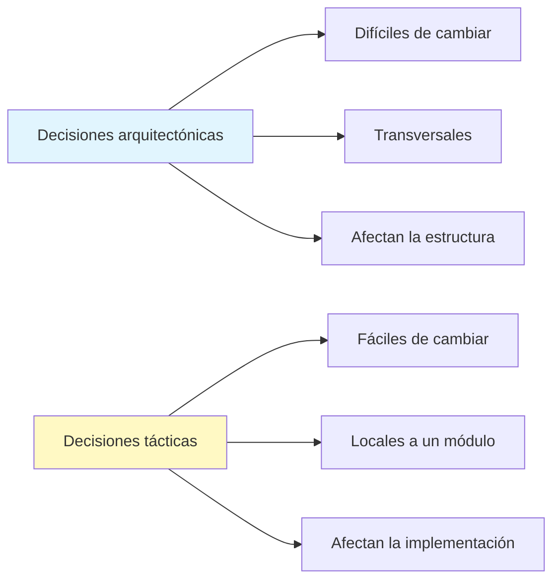
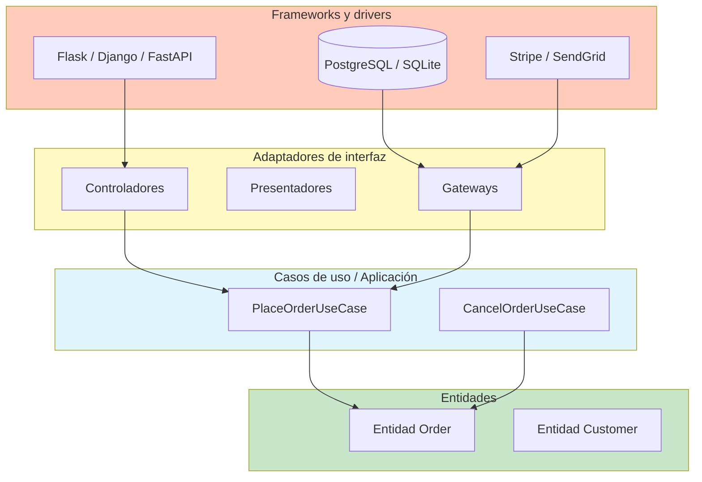
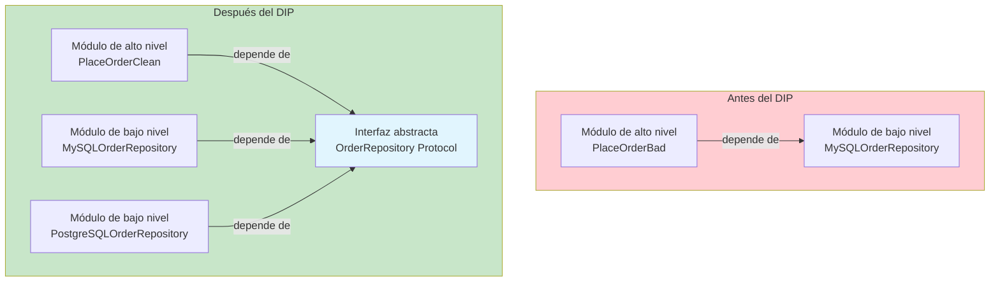
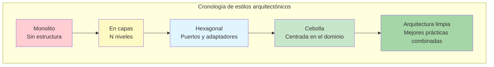

# ¿Qué es la arquitectura de software?

La arquitectura de software es el conjunto de decisiones de diseño que dan forma a la estructura, el comportamiento y la evolución de un sistema. Define los componentes de alto nivel, sus interacciones y las restricciones que guían la implementación.

> [!NOTE]
> La arquitectura no se trata de frameworks, bibliotecas ni bases de datos. Se trata de las **decisiones que son difíciles de cambiar** una vez que el sistema está construido. Una buena arquitectura retrasa esas decisiones hasta el último momento responsable.

## Por qué importa la arquitectura

Una arquitectura deficiente produce sistemas rígidos, frágiles e imposibles de probar. Una buena arquitectura permite:

| Propiedad | Arquitectura deficiente | Arquitectura buena |
|----------|-----------------|-------------------|
| Mantenibilidad | Cada cambio rompe algo | Los cambios quedan localizados |
| Testabilidad | Requiere configurar todo el sistema | Se puede probar por unidad de forma aislada |
| Desplegabilidad | Despliegues largos y riesgosos | Lanzamientos seguros y frecuentes |
| Escalabilidad | Acoplada a una sola máquina | Escala horizontalmente |
| Productividad de los desarrolladores | Declina con el tiempo | Velocidad sostenida |

```python
# Bad: no architecture — everything coupled
import flask, sqlite3, smtplib, stripe

app = flask.Flask(__name__)

@app.route("/checkout")
def checkout():
    data = flask.request.json
    db = sqlite3.connect("shop.db")
    db.execute("INSERT INTO orders VALUES (?, ?)", (data["user_id"], data["total"]))
    stripe.Charge.create(amount=int(data["total"] * 100), currency="usd", source=data["token"])
    smtplib.SMTP("smtp.example.com").sendmail("from@shop.com", data["email"], "Order placed!")
    return {"ok": True}

# Good: layered architecture
# routes.py — only handles HTTP
# use_cases.py — business logic
# repositories.py — data access
# external.py — third-party integrations
```

## Decisiones arquitectónicas vs tácticas



Las decisiones arquitectónicas incluyen la elección del lenguaje de programación, el estilo arquitectónico (en capas, hexagonal, cebolla), los protocolos de comunicación y la estrategia de almacenamiento de datos. Las decisiones tácticas incluyen la elección de algoritmos, el nombrado de variables y las optimizaciones en línea.

> [!WARNING]
> El error arquitectónico más común es tratar las elecciones de framework como decisiones arquitectónicas. Cambiar de framework no debería cambiar la arquitectura. Tu lógica de negocio debería ser independiente del framework.

## La arquitectura limpia

La arquitectura limpia (Clean Architecture), introducida por Robert C. Martin, organiza el código en capas concéntricas:

```python
from abc import ABC, abstractmethod
from dataclasses import dataclass
from typing import Protocol


@dataclass
class Order:
    customer_email: str
    product_id: str
    quantity: int
    total: float


class OrderRepository(ABC):
    @abstractmethod
    def save(self, order: Order) -> None:
        ...

    @abstractmethod
    def find_by_id(self, order_id: str) -> Order | None:
        ...


class PaymentGateway(ABC):
    @abstractmethod
    def charge(self, customer_email: str, amount: float) -> str:
        ...


class PlaceOrderUseCase:
    def __init__(
        self,
        repo: OrderRepository,
        gateway: PaymentGateway,
    ):
        self._repo = repo
        self._gateway = gateway

    def execute(
        self, customer_email: str, product_id: str, quantity: int, total: float
    ) -> Order:
        order = Order(customer_email, product_id, quantity, total)
        transaction_id = self._gateway.charge(customer_email, total)
        self._repo.save(order)
        return order
```

Observa cómo `PlaceOrderUseCase` depende solo de **interfaces abstractas** (`OrderRepository` y `PaymentGateway`). Las implementaciones concretas llegan después: esta es la inversión de dependencias en acción.

## Las cuatro capas

| Capa | Nombre | Contiene | Dependencias |
|-------|------|----------|-------------|
| Exterior | Frameworks y drivers | BD, framework web, UI | Nada (en el exterior) |
| Media | Adaptadores de interfaz | Controladores, presentadores, gateways | Hacia adentro |
| Interior | Aplicación / casos de uso | Reglas de negocio para un caso de uso específico | Entidades |
| Núcleo | Entidades | Reglas de negocio de toda la empresa | Nada |



> [!TIP]
> Piensa en las capas como en una cebolla. El núcleo no sabe nada del exterior. Las capas exteriores conocen las capas que tienen dentro. Las dependencias siempre apuntan **hacia adentro**.

## El principio de inversión de dependencias

La inversión de dependencias es la piedra angular de la arquitectura limpia. Establece:

1. Los módulos de alto nivel no deben depender de los módulos de bajo nivel. Ambos deben depender de abstracciones.
2. Las abstracciones no deben depender de los detalles. Los detalles deben depender de las abstracciones.

```python
# Violation: high-level depends on low-level
class MySQLOrderRepository:
    def save(self, order: Order) -> None:
        print(f"Saving {order} to MySQL...")

class PlaceOrderBad:
    def __init__(self):
        self._repo = MySQLOrderRepository()  # Hard dependency!

    def execute(self, order: Order) -> None:
        self._repo.save(order)


# Clean: depends on abstraction
from typing import Protocol

class OrderRepository(Protocol):
    def save(self, order: Order) -> None:
        ...

class PlaceOrderClean:
    def __init__(self, repo: OrderRepository):
        self._repo = repo  # Depends on abstraction

    def execute(self, order: Order) -> None:
        self._repo.save(order)


# Now we can inject any implementation
class PostgreSQLOrderRepository:
    def save(self, order: Order) -> None:
        print(f"Saving {order} to PostgreSQL...")

class InMemoryOrderRepository:
    def __init__(self):
        self._orders: dict[str, Order] = {}

    def save(self, order: Order) -> None:
        self._orders[order.product_id] = order

# Usage
repo = InMemoryOrderRepository()
use_case = PlaceOrderClean(repo)
use_case.execute(Order("a@b.com", "PROD-1", 2, 49.99))
```



## Separación de responsabilidades

Cada capa tiene una responsabilidad. La capa de entidades no sabe nada de bases de datos. La capa de casos de uso no sabe nada de HTTP. La capa de controladores no sabe nada de reglas de negocio.

```python
# Entity — pure business logic
@dataclass
class Product:
    product_id: str
    name: str
    price: float
    stock: int

    def can_be_purchased(self, quantity: int) -> bool:
        return self.stock >= quantity > 0

    def reduce_stock(self, quantity: int) -> None:
        if not self.can_be_purchased(quantity):
            raise ValueError("Insufficient stock")
        self.stock -= quantity

# Use Case — orchestrates the operation
class PurchaseProductUseCase:
    def __init__(self, product_repo, payment_gateway, notification_service):
        self._product_repo = product_repo
        self._payment_gateway = payment_gateway
        self._notification_service = notification_service

    def execute(self, product_id: str, quantity: int, customer_email: str) -> None:
        product = self._product_repo.find_by_id(product_id)
        product.reduce_stock(quantity)
        total = product.price * quantity
        self._payment_gateway.charge(customer_email, total)
        self._product_repo.save(product)
        self._notification_service.send_confirmation(customer_email, product, quantity)

# Controller — handles HTTP concerns
class PurchaseProductController:
    def __init__(self, use_case: PurchaseProductUseCase):
        self._use_case = use_case

    def handle(self, http_request: dict) -> dict:
        body = http_request.get("body", {})
        try:
            self._use_case.execute(
                product_id=body["product_id"],
                quantity=body["quantity"],
                customer_email=body["customer_email"],
            )
            return {"status": 200, "body": {"message": "Purchase successful"}}
        except ValueError as e:
            return {"status": 400, "body": {"error": str(e)}}
```

## Pruebas sin infraestructura

Como las capas dependen de abstracciones, podemos probar cada capa de forma aislada:

```python
# Test the use case without any real infrastructure
def test_purchase_product():
    # Arrange
    product = Product("P1", "Widget", 10.0, 5)
    repo = InMemoryProductRepository([product])
    gateway = FakePaymentGateway()
    notifications = FakeNotificationService()
    use_case = PurchaseProductUseCase(repo, gateway, notifications)

    # Act
    use_case.execute("P1", 2, "test@example.com")

    # Assert
    assert product.stock == 3
    assert gateway.total_charged == 20.0
    assert notifications.last_email == "test@example.com"


class InMemoryProductRepository:
    def __init__(self, products: list | None = None):
        self._products = {p.product_id: p for p in (products or [])}

    def find_by_id(self, product_id: str) -> Product:
        if product_id not in self._products:
            raise ValueError("Product not found")
        return self._products[product_id]

    def save(self, product: Product) -> None:
        self._products[product.product_id] = product


class FakePaymentGateway:
    def __init__(self):
        self.total_charged = 0.0

    def charge(self, email: str, amount: float) -> str:
        self.total_charged += amount
        return "txn_fake_123"


class FakeNotificationService:
    def __init__(self):
        self.last_email = ""

    def send_confirmation(self, email: str, product: Product, qty: int) -> None:
        self.last_email = email
```

> [!SUCCESS]
> La arquitectura limpia te permite probar toda la lógica de negocio **sin base de datos, sin HTTP y sin ningún servicio externo**. Esta es la marca distintiva del software bien arquitecturado.

## La arquitectura que grita

> [!NOTE]
> Un sistema bien arquitecturado **grita** su propósito. Si ves un proyecto Django, sabes que es una aplicación web. Pero un proyecto de arquitectura limpia grita **lo que hace**: comercio electrónico, banca, logística, sin importar el framework.

```
# A Clean Architecture project structure screams "this is an ecommerce system"
src/
  entities/          # Enterprise business rules
    product.py
    order.py
    customer.py
  use_cases/         # Application business rules
    place_order.py
    cancel_order.py
    process_refund.py
  interface_adapters/
    controllers/
    presenters/
    repositories/
  frameworks/
    flask_app.py
    postgres_repo.py
    stripe_gateway.py
```

La estructura de nivel superior te dice qué hace el sistema, no qué tecnología usa.

## Límites arquitectónicos

Los límites separan las capas. Se dibujan en los puntos donde una responsabilidad termina y otra comienza. El límite más simple es el de un módulo de Python. Los límites más explícitos usan clases base abstractas o tipos `Protocol`.

```python
# Boundary: between use cases and data access
from typing import Protocol


class OrderRepository(Protocol):
    """This Protocol defines the boundary.
    
    The use case layer depends on this Protocol.
    The data access layer implements this Protocol.
    They can be developed and tested independently.
    """
    def save(self, order: "Order") -> None:
        ...

    def find_by_id(self, order_id: str) -> "Order | None":
        ...
```

> [!TIP]
> Los límites deben ser **puntos de conexión**. Deberías poder "conectar" una base de datos nueva, una UI nueva o un proveedor de pagos nuevo sin cambiar la lógica de negocio.

## Comparación de estilos arquitectónicos

| Estilo | Dirección | Acople | Mejor para |
|-------|-----------|----------|----------|
| En capas | De arriba hacia abajo | Estrecho | Aplicaciones CRUD simples |
| Arquitectura limpia | Hacia adentro | Flojo (mediante DIP) | Lógica de negocio compleja |
| Hexagonal (puertos y adaptadores) | Hacia adentro | Flojo | Diseño dirigido por el dominio |
| Cebolla | Hacia adentro | Flojo | Aplicaciones empresariales |
| Microservicios | Descentralizado | Flojo (mediante APIs) | Equipos distribuidos grandes |



## Concepciones erróneas comunes

> [!WARNING]
> **"La arquitectura limpia significa más código."** Sí, hay más archivos e interfaces. Pero la complejidad total es menor porque cada pieza es más simple, se puede probar y se entiende de forma independiente.

| Concepción errónea | Realidad |
|---------------|---------|
| "Es solo para proyectos grandes" | Incluso los proyectos pequeños se benefician de la separación de responsabilidades |
| "Ralentiza el desarrollo" | La velocidad inicial es algo menor; a largo plazo es mucho mayor |
| "Necesitas un framework de DI" | Los Protocol de Python y la inyección manual funcionan perfectamente |
| "Se trata de capas" | Se trata de **límites** y de la **dirección de las dependencias** |
| "Significa no usar frameworks" | Los frameworks están bien en la capa exterior |

## Ejercicios de práctica

1. **Identifica decisiones arquitectónicas**: Lista 3 decisiones arquitectónicas y 3 decisiones tácticas en un proyecto que conozcas. Explica por qué cada una se clasifica así.

2. **Detecta la violación**: El siguiente código tiene una violación de la inversión de dependencias. Identifícala y corrígela:
   ```python
   class EmailService:
       def send(self, to: str, message: str):
           import smtplib
           server = smtplib.SMTP("smtp.example.com")
           server.sendmail("noreply@shop.com", to, message)

   class OrderProcessor:
       def __init__(self):
           self.email = EmailService()

       def process(self, order):
           self.email.send(order.email, "Order processed")
   ```

3. **Dibuja las capas**: Elige una aplicación pequeña que hayas construido. Dibuja sus capas como un diagrama de cebolla de arquitectura limpia. Identifica qué dependencias apuntan hacia adentro y cuáles violan la dirección.

4. **Implementa un límite**: Crea un Protocol `UserRepository` y una implementación `InMemoryUserRepository`. Escribe un caso de uso llamado `RegisterUserUseCase` que dependa del Protocol.

5. **Prueba sin infraestructura**: Usando el `PlaceOrderUseCase` de esta lección, escribe una prueba que verifique el comportamiento correcto cuando `can_be_purchased` devuelve `False`. No uses bases de datos reales ni servicios externos.

6. **Auditoría de dependencias del framework**: Examina un proyecto Django o Flask. Cuenta cuántas sentencias de importación en `views.py` referencian clases específicas del framework. ¿Cómo podrías refactorizar para reducir el acoplamiento al framework?

7. **Prueba del grito**: Mira el directorio de nivel superior de tu proyecto. ¿Grita qué hace el sistema o qué tecnología usa? Boceta una estructura de directorios más limpia.

8. **Refactorización de límites**: Toma una función que mezcle el análisis de HTTP, la lógica de negocio y el acceso a la base de datos. Divídela en tres capas: controlador, caso de uso y repositorio. Muestra cada capa.

> [!SUCCESS]
> Has completado la Lección 1. Recuerda: la arquitectura se trata de las decisiones que importan — y de hacerlas reversibles.
