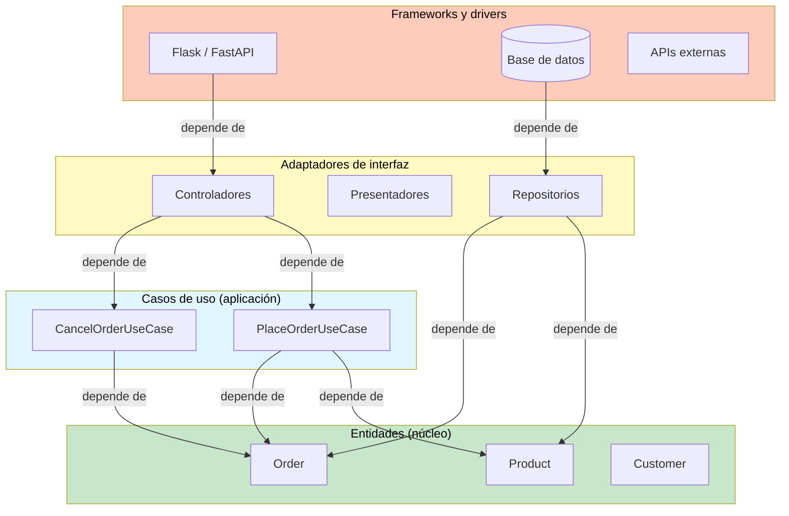
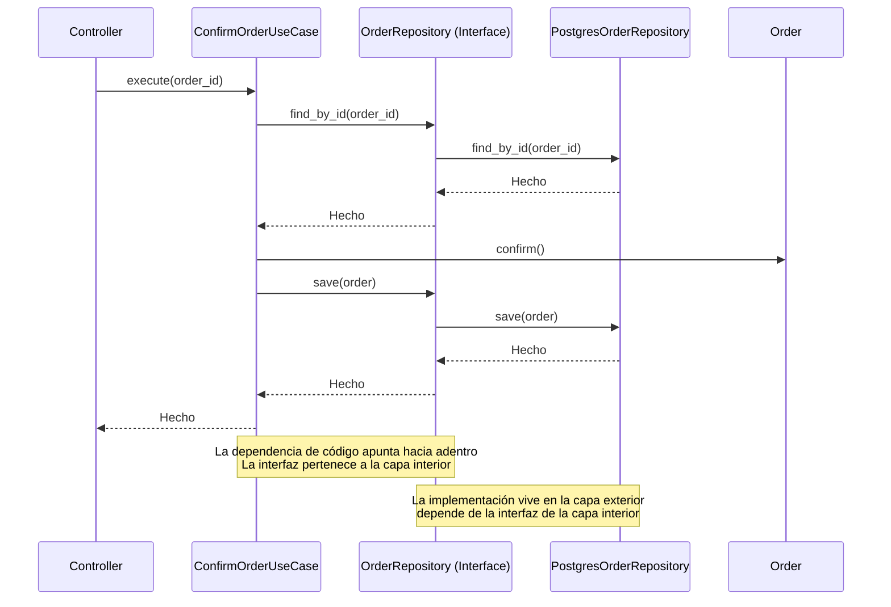
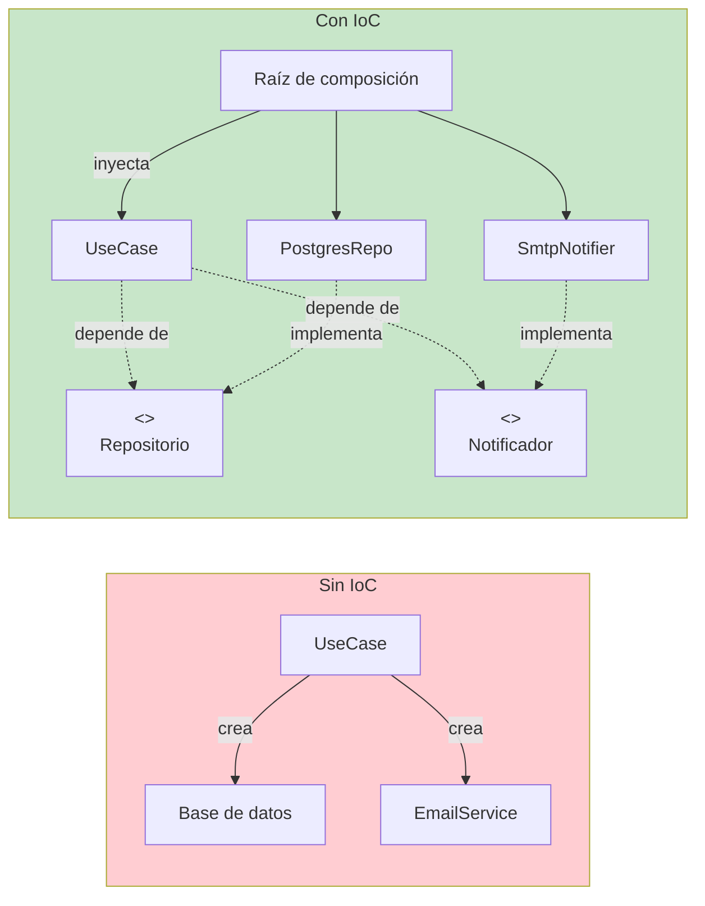
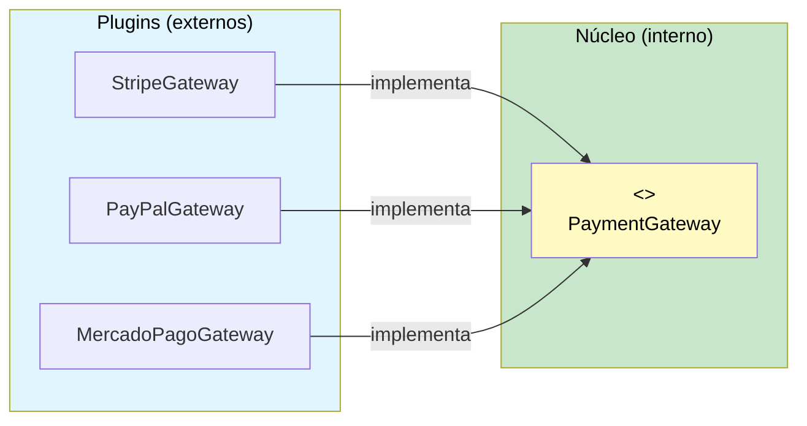

# La regla de dependencia

La regla de dependencia es el principio más importante de la arquitectura limpia. Establece:

> **Las dependencias del código fuente deben apuntar solo hacia adentro, hacia el centro de la cebolla.**

Nada en un círculo interior puede saber nada sobre un círculo exterior. Esto incluye nombres de funciones, nombres de clases, nombres de variables: cualquier cosa declarada en un círculo exterior.

> [!NOTE]
> La regla de dependencia se aplica a las dependencias de **tiempo de compilación** o de **código fuente**, no a la ejecución en tiempo de ejecución. Tu código interior puede llamar al código exterior mediante la inversión de dependencias: la interfaz se define en la capa interior y se implementa en la capa exterior.

## Visualizando la regla



**Las flechas apuntan de lo exterior hacia lo interior** porque un módulo depende de aquello a lo que apunta. La capa exterior conoce la siguiente capa interior, pero la capa interior no sabe nada de las capas exteriores.

## ¿Qué viola la regla de dependencia?

```python
# VIOLATION: Entity imports a framework
import django.db.models  # Entity should NOT know about Django!

class Product:
    def __init__(self, name: str, price: float):
        self.name = name
        self.price = price
        self.django_model = django.db.models.Model()  # Wrong!


# VIOLATION: Use case imports a database driver
import psycopg2  # Use case should NOT know about PostgreSQL!

class PlaceOrderUseCase:
    def execute(self, order: Order) -> None:
        conn = psycopg2.connect("dbname=shop")
        cursor = conn.cursor()
        cursor.execute("INSERT INTO orders VALUES (%s)", (order,))  # Wrong!
```

> [!WARNING]
> Cada vez que una capa interior importa algo de una capa exterior, se rompe la regla de dependencia. Esto incluye importar modelos de ORM, objetos de petición HTTP, bibliotecas JSON o archivos de configuración desde tus entidades o casos de uso.

## Cruzando los límites

Cuando el código interior necesita comunicarse con el código exterior (por ejemplo, guardar en una base de datos), lo hace a través de una **interfaz** definida en la capa interior pero implementada en la capa exterior.

```python
from abc import ABC, abstractmethod
from dataclasses import dataclass


# --- Inner layer: Entities ---

@dataclass
class Order:
    order_id: str
    customer_email: str
    total: float
    status: str = "pending"

    def confirm(self) -> None:
        self.status = "confirmed"

    def cancel(self) -> None:
        self.status = "cancelled"


# --- Inner layer: Use Cases ---

class OrderRepository(ABC):
    """Interface defined in the inner layer."""
    
    @abstractmethod
    def save(self, order: Order) -> None:
        ...

    @abstractmethod
    def find_by_id(self, order_id: str) -> Order | None:
        ...


class NotificationService(ABC):
    """Another inner-layer interface."""
    
    @abstractmethod
    def send(self, recipient: str, subject: str, body: str) -> None:
        ...


class ConfirmOrderUseCase:
    def __init__(
        self,
        repo: OrderRepository,
        notifier: NotificationService,
    ):
        self._repo = repo
        self._notifier = notifier

    def execute(self, order_id: str) -> None:
        order = self._repo.find_by_id(order_id)
        if order is None:
            raise ValueError("Order not found")
        order.confirm()
        self._repo.save(order)
        self._notifier.send(
            order.customer_email,
            "Order Confirmed",
            f"Your order {order.order_id} has been confirmed.",
        )


# --- Outer layer: Interface Adapters ---

class PostgresOrderRepository(OrderRepository):
    """Implementation lives in the outer layer."""
    
    def __init__(self, connection_string: str):
        self._conn_string = connection_string

    def save(self, order: Order) -> None:
        print(f"[PostgreSQL] Saving order {order.order_id}...")
        # Real implementation: INSERT INTO orders ...

    def find_by_id(self, order_id: str) -> Order | None:
        print(f"[PostgreSQL] Finding order {order_id}...")
        # Real implementation: SELECT * FROM orders WHERE id = ...
        return Order(order_id=order_id, customer_email="test@test.com", total=99.99)


class EmailNotificationService(NotificationService):
    def send(self, recipient: str, subject: str, body: str) -> None:
        print(f"[Email] To: {recipient}, Subject: {subject}")


# --- Wiring (Composition Root) ---

def create_order_confirmation_handler() -> ConfirmOrderUseCase:
    repo = PostgresOrderRepository("postgresql://localhost/shop")
    notifier = EmailNotificationService()
    return ConfirmOrderUseCase(repo, notifier)
```

## El flujo de control frente al flujo de dependencias



El flujo de **control** va de lo exterior a lo interior (el controlador llama al caso de uso). El flujo de **dependencia** también va hacia adentro (el controlador depende del caso de uso). Pero el **flujo de datos** va en ambos sentidos a través del límite.

> [!TIP]
> Cuando el control cruza un límite de lo exterior a lo interior, la dependencia del código fuente sigue apuntando hacia adentro. Esto se logra haciendo que la capa exterior llame a una interfaz que está **definida** en la capa interior e **implementada** en la capa exterior.

## Inversión de control (IoC)

La IoC es el mecanismo que hace que la regla de dependencia funcione. En lugar de que las capas interiores llamen directamente a las exteriores, las capas exteriores llaman a las interiores a través de interfaces.

```python
# Without IoC — violating the rule
class UseCase:
    def execute(self):
        db = Database()  # Use case creates its own database — WRONG
        db.save(...)

# With IoC — following the rule
class UseCase:
    def __init__(self, repo: Repository):
        self._repo = repo  # Injected — follows Dependency Rule

    def execute(self):
        self._repo.save(...)

# Without IoC — direct instantiation
class ReportController:
    def generate(self):
        use_case = GenerateReportUseCase()  # Controller creates use case
        return use_case.run()

# With IoC — dependency injection
class ReportController:
    def __init__(self, use_case: GenerateReportUseCase):
        self._use_case = use_case

    def generate(self):
        return self._use_case.run()
```



## Modelos de datos entre límites

Los datos que cruzan un límite deben estar en una forma conveniente para la capa interior. No pases modelos de ORM ni objetos de petición HTTP a través de los límites.

```python
# BAD: Passing ORM model across boundary
from django.db import models

class OrderModel(models.Model):  # Outer layer
    user_email = models.EmailField()
    total = models.DecimalField(max_digits=10, decimal_places=2)

# Use case receives an ORM model — VIOLATION!
class ConfirmOrderBad:
    def execute(self, order_model: OrderModel) -> None:
        order_model.status = "confirmed"
        order_model.save()


# GOOD: Simple data structure for cross-boundary communication
from dataclasses import dataclass

@dataclass
class OrderRequest:
    """Simple DTO for crossing boundaries."""
    order_id: str
    customer_email: str
    total: float


class ConfirmOrderGood:
    def __init__(self, repo: OrderRepository):
        self._repo = repo

    def execute(self, request: OrderRequest) -> None:
        order = self._repo.find_by_id(request.order_id)
        order.confirm()
        self._repo.save(order)
```

```python
# An adapter transforms data at the boundary
from dataclasses import dataclass


# --- Inner layer types ---

@dataclass
class ProductData:
    product_id: str
    name: str
    price: float


# --- Adapter translates between layers ---

class DjangoProductAdapter:
    def to_inner(self, django_model) -> ProductData:
        return ProductData(
            product_id=str(django_model.id),
            name=django_model.name,
            price=float(django_model.price),
        )

    def from_inner(self, product: ProductData):
        from myapp.models import Product as DjangoProduct
        return DjangoProduct(
            id=product.product_id,
            name=product.name,
            price=product.price,
        )
```

## La raíz de composición

La raíz de composición (Composition Root) es el **único lugar** de la aplicación donde se conectan todas las dependencias. Debe estar lo más cerca posible del punto de entrada.

```python
# --- composition_root.py ---
# This is the ONLY place where concrete classes are instantiated

def create_app():
    # Repositories (outer layer)
    order_repo = PostgresOrderRepository(
        connection_string="postgresql://localhost/shop"
    )
    product_repo = PostgresProductRepository(
        connection_string="postgresql://localhost/shop"
    )
    
    # Gateways (outer layer)
    payment_gateway = StripePaymentGateway(api_key="sk_test_...")
    notification_service = EmailNotificationService(
        smtp_host="smtp.example.com"
    )
    
    # Use cases (inner layer — injected with dependencies)
    place_order = PlaceOrderUseCase(
        repo=order_repo,
        payment=payment_gateway,
        notification=notification_service,
    )
    cancel_order = CancelOrderUseCase(repo=order_repo)
    
    # Controllers (outer layer)
    order_controller = OrderController(
        place_order=place_order,
        cancel_order=cancel_order,
    )
    
    # Framework
    return FlaskApp(order_controller=order_controller)
```

> [!SUCCESS]
> Con la raíz de composición, ninguna clase de la aplicación instancia sus propias dependencias. Todo se conecta desde el exterior, lo que hace que cada clase sea testeable de forma aislada.

## Arquitectura de plugins

La regla de dependencia permite una **arquitectura de plugins**. Las capas exteriores se comportan como plugins de la capa interior:

| Componente | Tipo | Se puede intercambiar |
|-----------|------|----------------|
| Base de datos | Plugin | PostgreSQL → SQLite → MongoDB |
| Framework web | Plugin | Flask → FastAPI → Django |
| Pasarela de pago | Plugin | Stripe → PayPal → Mercado Pago |
| Notificaciones | Plugin | Email → SMS → Notificación push |
| UI | Plugin | Web → CLI → Escritorio → API móvil |

```python
# Each plugin implements an inner-layer interface

# plugins/stripe_payment.py
from use_cases.payment_gateway import PaymentGateway

class StripePaymentGateway(PaymentGateway):
    def charge(self, customer_email: str, amount: float) -> str:
        import stripe
        charge = stripe.Charge.create(
            amount=int(amount * 100),
            currency="usd",
            receipt_email=customer_email,
        )
        return charge.id

# plugins/paypal_payment.py
from use_cases.payment_gateway import PaymentGateway

class PayPalPaymentGateway(PaymentGateway):
    def charge(self, customer_email: str, amount: float) -> str:
        import paypalrestsdk
        payment = paypalrestsdk.Payment({
            "intent": "sale",
            "payer": {"payment_method": "paypal"},
            "transactions": [{"amount": {"total": str(amount), "currency": "USD"}}],
        })
        if payment.create():
            return payment.id
        raise RuntimeError("PayPal payment failed")
```



## Límites parciales vs completos

No todo límite necesita ser una interfaz completa. Usa el nivel de límite adecuado para tus necesidades:

| Tipo | Mecanismo | Costo | Cuándo usarlo |
|------|-----------|------|-------------|
| Sin límite | Importación directa | El más bajo | Prototipos, código desechable |
| Límite parcial | Clase abstracta o Protocol | Bajo | Una sola implementación pero se quiere testabilidad |
| Límite completo | Interfaz + DI + paquete separado | Más alto | Múltiples implementaciones, equipos independientes |
| Proceso separado | Microservicio | El más alto | Necesidades de despliegue distintas |

```python
# Partial boundary: Protocol is enough
from typing import Protocol

class Logger(Protocol):
    def log(self, message: str) -> None:
        ...


class UseCase:
    def __init__(self, logger: Logger):
        self._logger = logger

    def execute(self) -> None:
        self._logger.log("Executing use case")


# Two implementations, no separate package needed
class ConsoleLogger:
    def log(self, message: str) -> None:
        print(f"[LOG] {message}")

class FileLogger:
    def __init__(self, path: str):
        self._path = path

    def log(self, message: str) -> None:
        with open(self._path, "a") as f:
            f.write(f"{message}\n")
```

> [!TIP]
> Empieza con límites parciales (Protocols) y evoluciona a límites completos solo cuando necesites múltiples implementaciones o despliegue independiente. La abstracción de límites prematura añade complejidad innecesaria.

## Pruebas y la regla de dependencia

La regla de dependencia hace que las pruebas sean triviales. Cada caso de uso puede probarse con implementaciones falsas de sus dependencias:

```python
def test_confirm_order_sends_notification():
    # Arrange
    order = Order(order_id="ORD-001", customer_email="alice@test.com", total=100.0)
    repo = FakeOrderRepository([order])
    notifier = FakeNotificationService()
    use_case = ConfirmOrderUseCase(repo, notifier)

    # Act
    use_case.execute("ORD-001")

    # Assert
    assert order.status == "confirmed"
    assert notifier.sent_to == "alice@test.com"
    assert "confirmed" in notifier.last_subject.lower()


class FakeOrderRepository:
    def __init__(self, orders: list[Order] | None = None):
        self._orders = {o.order_id: o for o in (orders or [])}

    def save(self, order: Order) -> None:
        self._orders[order.order_id] = order

    def find_by_id(self, order_id: str) -> Order | None:
        return self._orders.get(order_id)


class FakeNotificationService:
    def __init__(self):
        self.sent_to = ""
        self.last_subject = ""
        self.last_body = ""

    def send(self, recipient: str, subject: str, body: str) -> None:
        self.sent_to = recipient
        self.last_subject = subject
        self.last_body = body
```

## Violaciones comunes de la regla de dependencia

| Violación | Ejemplo | Corrección |
|-----------|---------|-----|
| Importar ORM en una entidad | `from django.db import models` | Crea entidades Python simples |
| Usar decoradores del framework en casos de uso | `@app.route` en un caso de uso | Mueve el enrutamiento a la capa de controladores |
| Pasar objetos de petición a los servicios | `def process(request: HttpRequest)` | Extrae los datos en un DTO |
| Crear instancias concretas | `db = MySQLDatabase()` | Inyecta mediante el constructor |
| Importar la biblioteca JSON en el núcleo | `import json` en una entidad | Serializa en el límite |
| Usar variables de entorno en entidades | `os.getenv("DATABASE_URL")` | Inyecta la configuración |

```python
# VIOLATION: Use case handles HTTP concerns
from flask import request, jsonify

class CheckoutUseCase:
    def execute(self):
        data = request.json  # Flask import in use case!
        return jsonify({"status": "ok"})  # Framework response in use case!


# CLEAN: Controller handles HTTP, use case handles logic
class CheckoutController:
    def __init__(self, use_case: "CheckoutUseCase"):
        self._use_case = use_case

    def handle(self, http_request) -> dict:
        data = http_request.json
        result = self._use_case.execute(
            customer_email=data["email"],
            total=data["total"],
        )
        return {"status": 200, "body": result}


class CheckoutUseCase:
    def __init__(self, repo: OrderRepository):
        self._repo = repo

    def execute(self, customer_email: str, total: float) -> dict:
        order = Order(customer_email=customer_email, total=total)
        self._repo.save(order)
        return {"order_id": order.order_id, "status": "created"}
```

## La regla de dependencia en distintos lenguajes

| Lenguaje | Mecanismo | Ejemplo |
|----------|-----------|---------|
| Python | `Protocol`, `ABC`, `typing` | `class Repository(Protocol):` |
| Java | palabra clave `interface` | `interface Repository<T>` |
| C# | palabra clave `interface` | `interface IRepository<T>` |
| TypeScript | `interface` o `type` | `type Repository = {...}` |
| Go | tipo `interface` | `type Repository interface` |
| Rust | `trait` | `trait Repository<T>` |

El mecanismo varía, pero el principio es el mismo: **depender de abstracciones, no de implementaciones concretas**.

## Ejercicios de práctica

1. **Encuentra violaciones**: Mira cualquier proyecto Python existente. Encuentra 3 lugares donde se viola la regla de dependencia. Documenta el archivo, la línea y la corrección.

2. **Define una interfaz**: Crea un Protocol `NotificationService` en la capa interior con un método `send(user_id: str, message: str) -> None`. Implementa `SMSNotificationService` y `EmailNotificationService` en la capa exterior.

3. **Implementa un límite**: Escribe un Protocol `ShoppingCartRepository` en la capa interior. Implementa `RedisCartRepository` e `InMemoryCartRepository` en la capa exterior. Escribe un `CheckoutUseCase` que lo use.

4. **Construye una raíz de composición**: Toma 3 casos de uso con dependencias distintas. Crea una función `create_application()` que los conecte todos. Ninguna clase debe instanciar sus propias dependencias.

5. **Prueba con falsos**: Para el `ConfirmOrderUseCase` de esta lección, escribe una prueba que verifique que se lanza la excepción correcta cuando `order_id` no existe.

6. **DTO entre límites**: Crea una dataclass `UserRegistrationRequest` en la capa interior. Escribe un adaptador que convierta entre un cuerpo de petición HTTP y este DTO.

7. **Intercambio de plugins**: Escribe dos implementaciones de `PaymentGateway`: `StripeGateway` y `PayPalGateway`. Muestra cómo el código del caso de uso no cambia al intercambiarlas.

8. **Ejercicio de límites**: Sin mirar la lección, dibuja las flechas de dependencia de una arquitectura limpia de 4 capas. Explica por qué las capas interiores nunca pueden importar de las exteriores.

> [!SUCCESS]
> La regla de dependencia es la base de la arquitectura limpia. Domina esta regla y dominarás el diseño arquitectónico.
