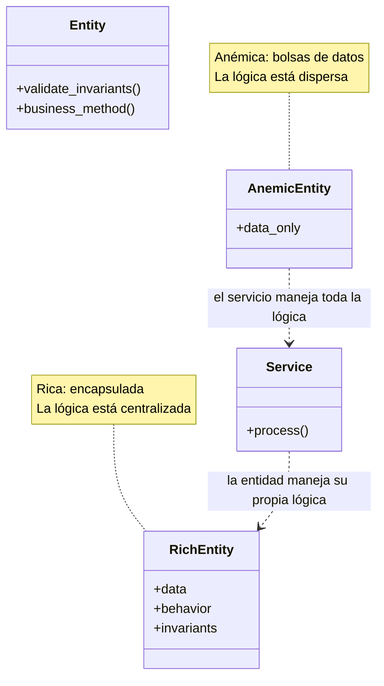
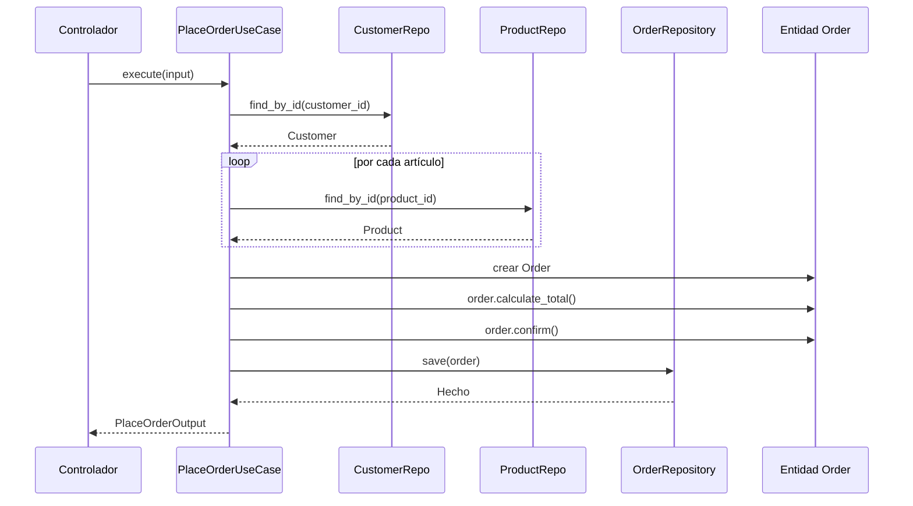
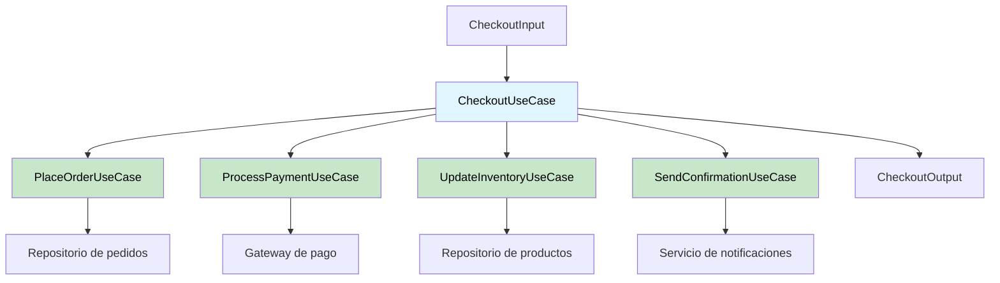

# Entidades y casos de uso

Las entidades y los casos de uso forman las dos capas más interiores de la arquitectura limpia. Juntos contienen **toda** la lógica de negocio. Nada en estas capas depende de frameworks, bases de datos ni sistemas externos.

> [!NOTE]
> **Las entidades** representan reglas de negocio de toda la empresa. **Los casos de uso** representan reglas de negocio específicas de la aplicación. La distinción es de alcance, no de tecnología.

## Entidades: reglas de negocio empresariales

Las entidades encapsulan las reglas de negocio más generales y de más alto nivel. Son las que menos probabilidades tienen de cambiar cuando algo externo cambia (como una migración de base de datos o un rediseño de la UI).

```python
from dataclasses import dataclass, field
from decimal import Decimal
from enum import Enum, auto
from typing import List


class OrderStatus(Enum):
    PENDING = auto()
    CONFIRMED = auto()
    SHIPPED = auto()
    DELIVERED = auto()
    CANCELLED = auto()


@dataclass
class Address:
    street: str
    city: str
    state: str
    zip_code: str
    country: str

    def is_valid(self) -> bool:
        return all([self.street, self.city, self.country])


@dataclass
class Customer:
    customer_id: str
    name: str
    email: str
    shipping_address: Address | None = None

    def update_email(self, new_email: str) -> None:
        if "@" not in new_email:
            raise ValueError("Invalid email address")
        self.email = new_email

    def update_address(self, new_address: Address) -> None:
        if not new_address.is_valid():
            raise ValueError("Invalid address")
        self.shipping_address = new_address


@dataclass
class OrderItem:
    product_id: str
    product_name: str
    quantity: int
    unit_price: Decimal

    def total_price(self) -> Decimal:
        return Decimal(str(self.quantity)) * self.unit_price


@dataclass
class Order:
    order_id: str
    customer: Customer
    items: List[OrderItem] = field(default_factory=list)
    status: OrderStatus = OrderStatus.PENDING
    _total: Decimal | None = None

    def add_item(self, item: OrderItem) -> None:
        if self.status != OrderStatus.PENDING:
            raise ValueError("Cannot add items to a non-pending order")
        self.items.append(item)
        self._total = None  # Invalidate cached total

    def remove_item(self, product_id: str) -> None:
        if self.status != OrderStatus.PENDING:
            raise ValueError("Cannot remove items from a non-pending order")
        self.items = [i for i in self.items if i.product_id != product_id]
        self._total = None

    def calculate_total(self) -> Decimal:
        if self._total is None:
            self._total = sum(
                (item.total_price() for item in self.items),
                Decimal("0"),
            )
        return self._total

    def confirm(self) -> None:
        if self.status != OrderStatus.PENDING:
            raise ValueError("Only pending orders can be confirmed")
        if not self.items:
            raise ValueError("Cannot confirm an empty order")
        self.status = OrderStatus.CONFIRMED

    def ship(self) -> None:
        if self.status != OrderStatus.CONFIRMED:
            raise ValueError("Only confirmed orders can be shipped")
        self.status = OrderStatus.SHIPPED

    def cancel(self) -> None:
        if self.status in (OrderStatus.SHIPPED, OrderStatus.DELIVERED):
            raise ValueError("Cannot cancel shipped or delivered orders")
        self.status = OrderStatus.CANCELLED
```

> [!TIP]
> Las entidades deben ser **puras**: sin imports de frameworks, sin mapeos de ORM, ni lógica de serialización. Son clases Python simples con métodos de negocio.

## Principios de diseño de entidades

| Principio | Descripción | Ejemplo |
|-----------|-------------|---------|
| Encapsulamiento | Proteger el estado interno | Propiedades, atributos privados |
| Autovalidación | Protegerse de estados inválidos | Comprobar en setters y métodos |
| Ricas en comportamiento | Métodos, no getters/setters | `order.confirm()`, no `order.status = "confirmed"` |
| Ignorantes de persistencia | Sin conocimiento de BD/ORM | Sin `save()`, sin atributo `objects` |
| Libres de frameworks | Sin imports de frameworks | Sin modelos de Django, sin imports de Flask |

```python
# BAD: Anemic entity (just data, no behavior)
@dataclass
class BadOrder:
    id: str
    status: str
    items: list
    customer_id: str

# Every service needs to know the rules
def confirm_order(order: BadOrder) -> None:
    if order.status != "pending":
        raise ValueError("...")
    if not order.items:
        raise ValueError("...")
    order.status = "confirmed"

# GOOD: Rich entity (encapsulated behavior)
@dataclass
class GoodOrder:
    id: str
    status: str = "pending"
    items: list = field(default_factory=list)

    def confirm(self) -> None:
        if self.status != "pending":
            raise ValueError("Only pending orders can be confirmed")
        if not self.items:
            raise ValueError("Cannot confirm an empty order")
        self.status = "confirmed"
```



## Los casos de uso: reglas de negocio de la aplicación

Un caso de uso orquesta el flujo de datos hacia y desde las entidades, y dirige a esas entidades para que usen sus reglas de negocio empresariales y logren un objetivo específico de la aplicación.

```python
from abc import ABC, abstractmethod
from dataclasses import dataclass
from decimal import Decimal


# --- Input/Output DTOs ---

@dataclass
class PlaceOrderInput:
    customer_id: str
    items: list[dict]  # [{"product_id": str, "quantity": int}]


@dataclass
class PlaceOrderOutput:
    order_id: str
    total: Decimal
    status: str


# --- Repository Interfaces ---

class CustomerRepository(ABC):
    @abstractmethod
    def find_by_id(self, customer_id: str) -> Customer | None:
        ...

    @abstractmethod
    def save(self, customer: Customer) -> None:
        ...


class ProductRepository(ABC):
    @abstractmethod
    def find_by_id(self, product_id: str) -> "Product | None":
        ...


class OrderRepository(ABC):
    @abstractmethod
    def save(self, order: Order) -> None:
        ...

    @abstractmethod
    def find_by_id(self, order_id: str) -> Order | None:
        ...


# --- The Use Case ---

class PlaceOrderUseCase:
    """Application-specific business rule: placing an order."""
    
    def __init__(
        self,
        customer_repo: CustomerRepository,
        product_repo: ProductRepository,
        order_repo: OrderRepository,
    ):
        self._customer_repo = customer_repo
        self._product_repo = product_repo
        self._order_repo = order_repo

    def execute(self, input_data: PlaceOrderInput) -> PlaceOrderOutput:
        customer = self._customer_repo.find_by_id(input_data.customer_id)
        if customer is None:
            raise ValueError(f"Customer {input_data.customer_id} not found")

        items: list[OrderItem] = []
        for item_data in input_data.items:
            product = self._product_repo.find_by_id(item_data["product_id"])
            if product is None:
                raise ValueError(f"Product {item_data['product_id']} not found")
            items.append(
                OrderItem(
                    product_id=product.product_id,
                    product_name=product.name,
                    quantity=item_data["quantity"],
                    unit_price=product.price,
                )
            )

        order = Order(
            order_id=self._generate_id(),
            customer=customer,
            items=items,
        )
        total = order.calculate_total()
        order.confirm()
        self._order_repo.save(order)
        return PlaceOrderOutput(
            order_id=order.order_id,
            total=total,
            status=order.status.name,
        )

    def _generate_id(self) -> str:
        import uuid
        return str(uuid.uuid4())
```



## Flujo de un caso de uso

Todo caso de uso sigue un patrón estándar:

1. **Recibir la entrada** del controlador (o del presentador)
2. **Validar** la entrada (reglas de negocio)
3. **Obtener** las entidades necesarias de los repositorios
4. **Orquestar** los métodos de las entidades para realizar la operación
5. **Persistir** los cambios a través de los repositorios
6. **Devolver la salida** al presentador

```python
class CancelOrderUseCase:
    def __init__(
        self,
        order_repo: OrderRepository,
        notification_service: NotificationService,
    ):
        self._order_repo = order_repo
        self._notification = notification_service

    def execute(self, order_id: str, reason: str) -> None:
        # 1. Fetch
        order = self._order_repo.find_by_id(order_id)
        if order is None:
            raise ValueError("Order not found")

        # 2. Orchestrate
        order.cancel()

        # 3. Persist
        self._order_repo.save(order)

        # 4. Notify (cross-boundary call via interface)
        self._notification.send(
            recipient=order.customer.email,
            subject="Order Cancelled",
            body=f"Your order {order_id} has been cancelled. Reason: {reason}",
        )


class ProcessRefundUseCase:
    def __init__(
        self,
        order_repo: OrderRepository,
        payment_gateway: PaymentGateway,
    ):
        self._order_repo = order_repo
        self._payment = payment_gateway

    def execute(self, order_id: str) -> Decimal:
        order = self._order_repo.find_by_id(order_id)
        if order is None:
            raise ValueError("Order not found")
        if order.status != OrderStatus.CANCELLED:
            raise ValueError("Only cancelled orders can be refunded")

        refund_amount = order.calculate_total()
        self._payment.refund(order.customer.email, refund_amount)
        return refund_amount
```

## Un caso de uso = una clase

> [!TIP]
> Un patrón común es **un caso de uso por clase**. Esto le da a cada caso de uso una única responsabilidad, los hace testeables de forma independiente y evita que se acople lógica de negocio no relacionada.

```python
# DO THIS: Separate classes for separate use cases
class RegisterUserUseCase:
    """Single responsibility: register a user."""
    def execute(self, input_data: RegisterUserInput) -> User:
        ...

class UpdateUserProfileUseCase:
    """Single responsibility: update user profile."""
    def execute(self, user_id: str, profile_data: dict) -> User:
        ...

class DeactivateUserUseCase:
    """Single responsibility: deactivate a user."""
    def execute(self, user_id: str) -> None:
        ...

# NOT THIS: God class with everything
class UserManager:
    """One class doing everything — violates Single Responsibility."""
    def register(self, ...): ...
    def update_profile(self, ...): ...
    def deactivate(self, ...): ...
    def send_welcome_email(self, ...): ...
    def generate_report(self, ...): ...
```

## Los casos de uso y los DTOs

Los datos de entrada y salida deben ser objetos de transferencia de datos (DTOs) simples: dataclasses sin comportamiento:

```python
from dataclasses import dataclass
from decimal import Decimal
from datetime import datetime
from typing import List


@dataclass
class CreateProductInput:
    name: str
    description: str
    price: Decimal
    category_id: str
    tags: List[str]


@dataclass
class ProductOutput:
    product_id: str
    name: str
    price: Decimal
    created_at: datetime


@dataclass
class SearchProductsInput:
    query: str
    category_id: str | None = None
    min_price: Decimal | None = None
    max_price: Decimal | None = None
    page: int = 1
    page_size: int = 20


@dataclass
class SearchProductsOutput:
    results: List[ProductOutput]
    total_count: int
    page: int
    total_pages: int
```

> [!NOTE]
> Los DTOs deben ser **serializables** (tipos simples, sin objetos complejos). Cruzan límites y pueden necesitar serializarse a JSON para las APIs o almacenarse en colas de mensajes.

## Pruebas de casos de uso

Los casos de uso son lo más importante que probar: contienen la lógica de negocio de tu aplicación:

```python
import pytest
from decimal import Decimal


def test_place_order_successfully():
    # Arrange
    customer = Customer(customer_id="C1", name="Alice", email="alice@test.com")
    product = Product(product_id="P1", name="Widget", price=Decimal("10.00"))
    
    customer_repo = InMemoryCustomerRepository([customer])
    product_repo = InMemoryProductRepository([product])
    order_repo = InMemoryOrderRepository()
    
    use_case = PlaceOrderUseCase(customer_repo, product_repo, order_repo)
    
    input_data = PlaceOrderInput(
        customer_id="C1",
        items=[{"product_id": "P1", "quantity": 3}],
    )

    # Act
    output = use_case.execute(input_data)

    # Assert
    assert output.status == "CONFIRMED"
    assert output.total == Decimal("30.00")
    
    saved_order = order_repo.find_by_id(output.order_id)
    assert saved_order is not None
    assert len(saved_order.items) == 1
    assert saved_order.status == OrderStatus.CONFIRMED


def test_place_order_fails_for_nonexistent_customer():
    empty_repo = InMemoryCustomerRepository([])
    use_case = PlaceOrderUseCase(empty_repo, InMemoryProductRepository(), InMemoryOrderRepository())
    
    with pytest.raises(ValueError, match="not found"):
        use_case.execute(PlaceOrderInput(customer_id="FAKE", items=[]))


def test_place_order_fails_for_nonexistent_product():
    customer = Customer(customer_id="C1", name="Alice", email="a@b.com")
    customer_repo = InMemoryCustomerRepository([customer])
    
    use_case = PlaceOrderUseCase(
        customer_repo, InMemoryProductRepository(), InMemoryOrderRepository()
    )
    
    with pytest.raises(ValueError, match="not found"):
        use_case.execute(
            PlaceOrderInput(customer_id="C1", items=[{"product_id": "FAKE", "quantity": 1}])
        )


# --- In-Memory Repositories for Testing ---

class InMemoryCustomerRepository:
    def __init__(self, customers: list[Customer] | None = None):
        self._customers = {c.customer_id: c for c in (customers or [])}

    def find_by_id(self, customer_id: str) -> Customer | None:
        return self._customers.get(customer_id)

    def save(self, customer: Customer) -> None:
        self._customers[customer.customer_id] = customer


class InMemoryProductRepository:
    def __init__(self, products: list | None = None):
        self._products = {p.product_id: p for p in (products or [])}

    def find_by_id(self, product_id: str):
        return self._products.get(product_id)


class InMemoryOrderRepository:
    def __init__(self):
        self._orders: dict[str, Order] = {}

    def save(self, order: Order) -> None:
        self._orders[order.order_id] = order

    def find_by_id(self, order_id: str) -> Order | None:
        return self._orders.get(order_id)
```

## Entidad vs caso de uso: dónde poner cada lógica

| Pregunta | Poner en la entidad | Poner en el caso de uso |
|----------|---------------|-----------------|
| ¿Puede esta regla cambiar según la aplicación? | No | Sí |
| ¿Es una regla de negocio universal? | Sí | No |
| ¿Depende de datos externos? | No | Sí |
| ¿Orquesta múltiples entidades? | No | Sí |
| ¿Implica E/S (BD, API, archivo)? | No | Sí |

```python
# ENTITY: Enterprise-wide rule — applies everywhere
class Money:
    def __init__(self, amount: Decimal, currency: str = "USD"):
        if amount < 0:
            raise ValueError("Amount cannot be negative")
        self.amount = amount
        self.currency = currency

    def __add__(self, other: "Money") -> "Money":
        if self.currency != other.currency:
            raise ValueError("Cannot add different currencies")
        return Money(self.amount + other.amount, self.currency)

# USE CASE: Application-specific rule — varies per app
class CalculateShippingCostUseCase:
    def __init__(self, shipping_provider: ShippingProvider):
        self._provider = shipping_provider

    def execute(self, order: Order, zip_code: str) -> Money:
        # This rule depends on an external provider
        # and varies by application — it belongs in a use case
        weight = sum(item.quantity * 0.5 for item in order.items)
        return self._provider.calculate(weight, zip_code)
```

## Composición de casos de uso

Los casos de uso pueden componer otros casos de uso para flujos de trabajo complejos:

```python
class CheckoutUseCase:
    """Composite use case that orchestrates multiple sub-use cases."""
    
    def __init__(
        self,
        place_order: PlaceOrderUseCase,
        process_payment: ProcessPaymentUseCase,
        send_confirmation: SendConfirmationUseCase,
        update_inventory: UpdateInventoryUseCase,
    ):
        self._place_order = place_order
        self._process_payment = process_payment
        self._send_confirmation = send_confirmation
        self._update_inventory = update_inventory

    def execute(self, input_data: CheckoutInput) -> CheckoutOutput:
        # Step 1: Place the order
        order_output = self._place_order.execute(
            PlaceOrderInput(
                customer_id=input_data.customer_id,
                items=input_data.items,
            )
        )

        # Step 2: Process payment
        payment_output = self._process_payment.execute(
            ProcessPaymentInput(
                customer_id=input_data.customer_id,
                amount=order_output.total,
                payment_token=input_data.payment_token,
            )
        )

        # Step 3: Update inventory
        for item in input_data.items:
            self._update_inventory.execute(
                UpdateInventoryInput(
                    product_id=item["product_id"],
                    quantity_reduced=item["quantity"],
                )
            )

        # Step 4: Send confirmation
        self._send_confirmation.execute(
            SendConfirmationInput(
                customer_id=input_data.customer_id,
                order_id=order_output.order_id,
                total=order_output.total,
            )
        )

        return CheckoutOutput(
            order_id=order_output.order_id,
            transaction_id=payment_output.transaction_id,
            total=order_output.total,
        )
```



## Antipatrones comunes

| Antipatrón | Descripción | Corrección |
|--------------|-------------|-----|
| Entidad anémica | La entidad es una bolsa de datos sin métodos | Mueve la lógica relacionada a la entidad |
| Caso de uso gordo | El caso de uso hace demasiadas cosas | Divídelo en casos de uso enfocados |
| Omitir entidades | Toda la lógica en los casos de uso | Extrae las reglas compartidas a las entidades |
| Repositorio en la entidad | La entidad llama a la base de datos | Mueve la persistencia al caso de uso mediante el repo |
| Validación de entrada en la entidad | La entidad valida datos HTTP | Valida en la capa de adaptadores |

```python
# Anti-pattern: Entity knows about persistence
class Product:
    def save_to_database(self) -> None:
        import sqlite3
        conn = sqlite3.connect("shop.db")  # Entity should NOT do this!
        conn.execute("INSERT INTO ...")

# Anti-pattern: Use case has entity logic duplicated
class ShipOrderUseCase:
    def execute(self, order_id: str) -> None:
        order = self._repo.find_by_id(order_id)
        # Duplicate of Order.ship() logic!
        if order.status != "confirmed":
            raise ValueError("...")
        if not order.items:
            raise ValueError("...")
        order.status = "shipped"
        self._repo.save(order)
```

## Ejercicios de práctica

1. **Construye una entidad**: Crea una entidad `BankAccount` con los métodos `deposit(amount)`, `withdraw(amount)` y `transfer_to(target, amount)`. Incluye reglas de validación (sin importes negativos, sin sobregiro más allá del límite).

2. **Crea un caso de uso**: Escribe un `TransferMoneyUseCase` que dependa de `AccountRepository` (interfaz) y use la entidad `BankAccount` del ejercicio 1. Incluye DTOs de entrada/salida.

3. **Entidad vs caso de uso**: Dada la regla "Los pedidos de más de $100 tienen envío gratis", ¿debería estar en una entidad o en un caso de uso? Justifica tu respuesta con código.

4. **Prueba un caso de uso**: Escribe pruebas con pytest para `CancelOrderUseCase`. Incluye pruebas para: cancelación exitosa, cancelar un pedido confirmado, cancelar un pedido enviado (debe fallar) y cancelar un pedido inexistente.

5. **De anémica a rica**: Refactoriza esta entidad anémica:
   ```python
   @dataclass
   class Booking:
       id: str
       room_id: str
       guest_name: str
       check_in: str
       check_out: str
       status: str
       total: float
   ```
   Añade validación: check_out debe ser posterior a check_in; transiciones de estado (pending → confirmed → checked_in → checked_out → completed).

6. **Caso de uso compuesto**: Escribe un `BookRoomUseCase` que componga: `ValidateRoomAvailabilityUseCase`, `CreateBookingUseCase`, `ChargeDepositUseCase` y `SendBookingConfirmationUseCase`.

7. **Patrón de repositorio en memoria**: Implementa `InMemoryBookingRepository` con los métodos `save`, `find_by_id` y `find_by_room_and_date`. Úsalo para probar `BookRoomUseCase`.

8. **Diseño de DTOs**: Diseña DTOs de entrada y salida para un `SearchFlightsUseCase`. Incluye ciudad de salida, destino, rango de fechas, número de pasajeros y opciones de ordenamiento.

> [!SUCCESS]
> Las entidades guardan el **qué** y los casos de uso guardan el **cómo**. Mantén las entidades libres de frameworks y los casos de uso centrados en orquestar.
