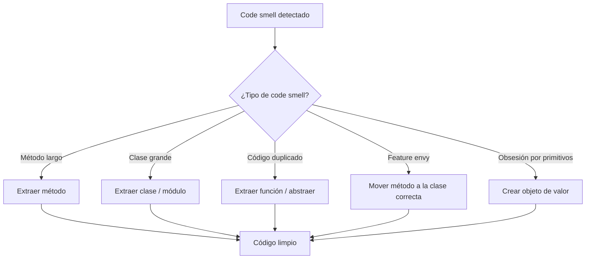
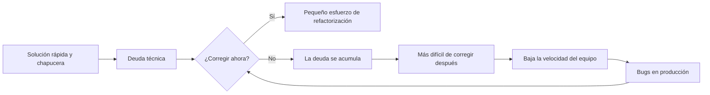
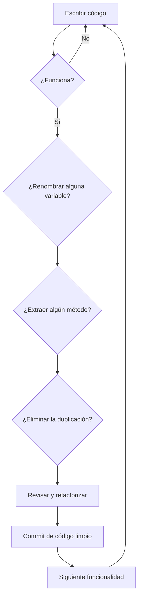

# ¿Qué es el código limpio?

El código limpio es el código que es fácil de leer, entender y mantener. No se trata de escribir one-liners ingeniosos ni de exhibir trucos del lenguaje: se trata de comunicar la intención con claridad a otros desarrolladores (incluido tu yo del futuro).

> [!NOTE]
> Robert C. Martin (Uncle Bob) popularizó el término en su libro *Clean Code*, pero la filosofía existía desde los albores de la ingeniería de software. La idea central: **el código se lee con mucha más frecuencia de lo que se escribe.**

## Por qué importa el código limpio

El software pasa la mayor parte de su vida en modo de mantenimiento. Los estudios muestran que los desarrolladores pasan **entre el 70 y el 80 % de su tiempo leyendo código**, no escribiéndolo. Cada hora que inviertes en escribir código limpio ahorra diez horas de comprensión futura.

| Aspecto | Código desordenado | Código limpio |
|--------|-------------------|--------------|
| Tiempo para entenderlo | Horas o días | Minutos |
| Tasa de introducción de bugs | Alta | Baja |
| Incorporación de nuevos devs | Dolorosa | Fluida |
| Confianza para refactorizar | Ninguna | Alta |
| Velocidad del equipo | Disminuye con el tiempo | Sostenida |

## La regla del Boy Scout

> [!TIP]
> **"Deja el camping más limpio de lo que lo encontraste."**: Boy Scouts of America

Aplicada al código: cada vez que toques un módulo, déjalo un poco mejor que antes. Corrige un problema de formato, renombra una variable poco clara, extrae una función pequeña. Las mejoras pequeñas se acumulan en ganancias enormes.

```python
# Before: messy and unclear
def calc(a, b, c):
    x = a + b
    y = x * c
    return y

# After: clean and intention-revealing
def calculate_total_price(base_price: float, tax_rate: float) -> float:
    price_with_tax = base_price + (base_price * tax_rate)
    return price_with_tax
```

## Principios fundamentales del código limpio

### 1. Legibilidad

El código debe ser legible como un buen texto corrido. Cada línea debe revelar su propósito sin exigir un análisis mental previo.

```python
# Hard to read
if not x.is_valid() or x.status != "active" or len(x.tags) == 0:
    return

# Easy to read
is_inactive_user = not x.is_valid() or x.status != "active"
has_no_tags = len(x.tags) == 0
if is_inactive_user or has_no_tags:
    return
```

### 2. Simplicidad

Sigue el principio KISS (Keep It Simple, Stupid). La solución más simple casi siempre es la mejor.

```python
# Overly complex
def get_user_display_name(user):
    if user is None:
        return "Anonymous"
    else:
        if user.name is None or user.name.strip() == "":
            return "Anonymous"
        else:
            return user.name.strip()

# Simple and clean
def get_user_display_name(user) -> str:
    if user and user.name and user.name.strip():
        return user.name.strip()
    return "Anonymous"
```

### 3. Evitar la duplicación (DRY)

Don't Repeat Yourself. Cada conocimiento debe tener una representación única e inequívoca en el sistema.

```python
# Duplicated logic
def validate_email(email):
    if "@" not in email or "." not in email:
        raise ValueError("Invalid email")

def save_user(email, name):
    if "@" not in email or "." not in email:
        raise ValueError("Invalid email")
    # save logic...

# DRY version
def validate_email(email):
    if "@" not in email or "." not in email:
        raise ValueError("Invalid email")

def save_user(email, name):
    validate_email(email)
    # save logic...
```

## Code smells

Los code smells son indicadores de problemas más profundos. No impiden que el código funcione, pero señalan que se necesita refactorización.



### Code smells comunes

| Smell | Síntoma | Solución |
|-------|---------|----------|
| Método largo | Método > 20 líneas | Extraer métodos más pequeños |
| Clase grande | Clase que hace demasiado | Dividir en clases enfocadas |
| Obsesión por primitivos | Usar primitivos para representar conceptos | Crear objetos de dominio |
| Feature envy | Un método usa demasiado otra clase | Mover el método |
| Conglomerados de datos | Mismos grupos de datos que aparecen juntos | Crear una clase |
| Comentarios | Comentarios que explican código malo | Refactorizar el código |

```python
# Code smell: Magic numbers
def calculate_discount(price):
    return price * 0.1  # What is 0.1?

# Clean: Named constants
DISCOUNT_RATE = 0.1

def calculate_discount(price: float) -> float:
    return price * DISCOUNT_RATE
```

## El costo de la deuda técnica

La deuda técnica es el costo implícito de retrabajo causado por elegir ahora una solución fácil en lugar de un enfoque mejor que llevaría más tiempo. Como la deuda financiera, genera intereses.



> [!WARNING]
> La deuda técnica a veces es necesaria para cumplir las fechas límite, pero nunca dejes que crezca sin control. Programa "sprints de limpieza" periódicos para ir pagando los intereses.

## Código autodocumentado

El código limpio debe documentarse a sí mismo. Unos buenos nombres y una buena estructura eliminan la necesidad de la mayoría de los comentarios.

```python
# Bad: needs comments to explain
def process(d, t):
    # Calculate total with tax
    r = d * t
    # Apply discount if over 100
    if d > 100:
        r = r * 0.9
    return r

# Good: self-documenting
def calculate_invoice_total(
    subtotal: float, tax_rate: float, discount_rate: float = 0.9
) -> float:
    total_with_tax = subtotal * (1 + tax_rate)
    if subtotal > 100:
        total_with_tax *= discount_rate
    return total_with_tax
```

## El código limpio en la práctica

Ejemplo real del procesamiento de un pedido:

```python
from dataclasses import dataclass
from decimal import Decimal, ROUND_HALF_UP
from typing import List, Optional


@dataclass
class OrderItem:
    name: str
    quantity: int
    unit_price: Decimal


class Order:
    TAX_RATE = Decimal("0.08")
    FREE_SHIPPING_THRESHOLD = Decimal("50.00")
    SHIPPING_COST = Decimal("5.99")

    def __init__(self, items: List[OrderItem]) -> None:
        self.items = items

    def calculate_subtotal(self) -> Decimal:
        return sum(
            item.quantity * item.unit_price for item in self.items
        )

    def calculate_tax(self) -> Decimal:
        return (self.calculate_subtotal() * self.TAX_RATE).quantize(
            Decimal("0.01"), rounding=ROUND_HALF_UP
        )

    def calculate_shipping(self) -> Decimal:
        if self.calculate_subtotal() >= self.FREE_SHIPPING_THRESHOLD:
            return Decimal("0.00")
        return self.SHIPPING_COST

    def calculate_total(self) -> Decimal:
        subtotal = self.calculate_subtotal()
        tax = self.calculate_tax()
        shipping = self.calculate_shipping()
        return subtotal + tax + shipping


def build_order_from_cart(cart_data: dict) -> Order:
    items = [
        OrderItem(
            name=item["name"],
            quantity=item["quantity"],
            unit_price=Decimal(str(item["price"])),
        )
        for item in cart_data["items"]
    ]
    return Order(items)
```

## Medir el código limpio

¿Cómo sabes si el código es limpio? Aunque no existe una métrica perfecta, varias heurísticas ayudan:

| Métrica | Qué mide | Objetivo |
|--------|----------|----------|
| Complejidad ciclomática | Número de caminos independientes | < 10 por función |
| Líneas por función | Tamaño de las funciones | < 20 líneas |
| Densidad de comentarios | Comentarios vs. código | Baja (el código debe autodocumentarse) |
| Porcentaje de duplicación | Bloques de código repetidos | < 5 % |
| Cobertura de pruebas | Líneas ejercitadas por pruebas | > 80 % |
| Tasa de fallos en cambios | Despliegues que causan problemas | < 15 % |

### Lista de verificación práctica del código limpio

- [ ] Cada nombre de variable revela la intención
- [ ] Cada función hace exactamente una cosa
- [ ] No existe lógica duplicada
- [ ] No hay números ni cadenas mágicas
- [ ] Las pruebas cubren los casos extremos
- [ ] El formato es consistente
- [ ] No hay código comentado
- [ ] El manejo de errores es explícito

## Casos Reales

Considera una plataforma de comercio electrónico que procesa 10.000 pedidos diarios. El código original tenía una única función de 500 líneas que lo gestionaba todo. Después de aplicar los principios del código limpio:

```python
# Before: monolithic order processing
def process_order(order_data):
    # 500 lines of validation, calculation, persistence, notification, logging...
    if order_data["payment"]["method"] == "credit_card":
        # 50 lines
        pass
    elif order_data["payment"]["method"] == "paypal":
        # 50 lines
        pass
    # ... more branches
    with open("audit.log", "a") as f:
        f.write(str(order_data))
    send_email(order_data["customer"]["email"], "Order Confirmed", "...")
    return {"success": True, "order_id": 123}

# After: clean, maintainable architecture
class OrderService:
    def __init__(self, payment_gateway, notification_service, audit_logger):
        self.payment_gateway = payment_gateway
        self.notification_service = notification_service
        self.audit_logger = audit_logger

    def process_order(self, order: Order) -> OrderResult:
        self._validate_order(order)
        payment_result = self.payment_gateway.charge(
            order.customer, order.total
        )
        order.mark_as_processed(payment_result.transaction_id)
        self.audit_logger.log_order_processed(order)
        self.notification_service.send_confirmation(order)
        return OrderResult.success(order.id)
```

La versión refactorizada redujo la tasa de bugs en un 60 % y recortó el tiempo de incorporación de nuevos desarrolladores de 2 semanas a 3 días.

## Mentalidad de código limpio

El código limpio no es un destino, sino una práctica continua. Estos son los hábitos que conviene cultivar:

1. **Lee antes de escribir**: Dedica 10 minutos a leer el código existente antes de añadir código nuevo
2. **Nombra antes de escribir**: Piensa en el nombre correcto antes de escribir la variable
3. **Refactoriza sobre la marcha**: Deja los módulos más limpios de lo que los encontraste
4. **Revisa tu propio diff**: Antes de hacer commit, revisa críticamente tus cambios
5. **Di no a los atajos**: Resiste la tentación de "solo hacer que funcione ahora"
6. **Aprende de otros**: Lee código de proyectos que admires
7. **Enseña código limpio**: Explicar conceptos consolida tu comprensión

## Cómo empezar a escribir código limpio



> [!SUCCESS]
> El código limpio no se trata de perfección, sino de mejora continua. Cada commit debe dejar el código un poco mejor de lo que lo encontraste.

## Ejercicios prácticos

1. **Refactoriza un desastre**: Toma una función de 50 líneas que hayas escrito y extráela en 3-4 funciones más pequeñas con nombres claros.

2. **Nombra esa variable**: Encuentra una variable con un mal nombre en tu código y renómbrala para que revele la intención. Ejemplo: `d` → `delivery_date`, `x` → `tax_rate`.

3. **Aplica la regla del Boy Scout**: Elige un archivo que no hayas escrito y hazle una mejora pequeña (corrige el formato, renombra una variable, añade un type hint).

4. **Caza de smells**: Identifica al menos 3 code smells en un proyecto en el que trabajes. Documenta el smell, el archivo y la solución propuesta.

5. **Refactorización DRY**: Encuentra código duplicado en tu proyecto y elimínalo. Mide el número de líneas antes y después.

6. **Auditoría de números mágicos**: Busca números mágicos en tu código. Reemplaza cada uno por una constante con nombre.

7. **Eliminación de comentarios**: Encuentra un comentario que explique el "qué" en lugar del "por qué". Refactoriza el código para que el comentario sea innecesario y luego elimínalo.

8. **Revisión de legibilidad**: Intercambia código con un colega. Pídele que señale cualquier cosa que le resulte confusa. Refactoriza en función de sus comentarios.

> [!SUCCESS]
> Has completado la Lección 1. Recuerda: el código limpio es un hábito, no un destino. Practica estos principios todos los días.
