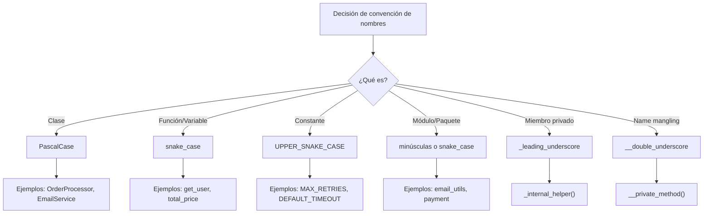
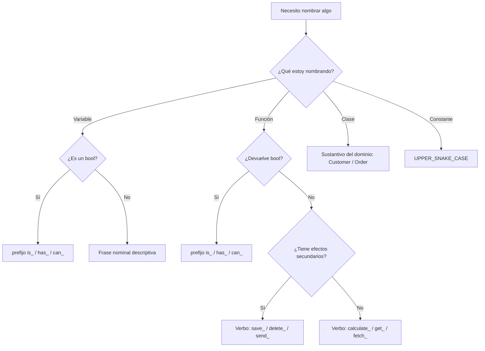

# Convenciones de nombres

Nombrar es uno de los dos problemas más difíciles de la informática (junto con la invalidación de caché y los errores off-by-one). Los buenos nombres reducen la necesidad de comentarios, hacen el código autodocumentado y previenen malentendidos.

> [!NOTE]
> Phil Karlton dijo célebremente: "Solo hay dos cosas difíciles en la informática: invalidar la caché y poner nombres a las cosas." Una buena nomenclatura requiere empatía con quien lee el código.

## Por qué importan los nombres

El código se escribe una vez, pero se lee decenas de veces. Un nombre bien elegido comunica la intención al instante. Un mal nombre obliga a quien lee a rastrear mentalmente cada uso para entender qué representa la variable.

```python
# Bad naming
def proc(lst):
    for i in lst:
        if i[3] > 0:
            print(i[0], i[1])

# Good naming
def print_active_users(users: list) -> None:
    for user in users:
        if user["is_active"]:
            print(user["name"], user["email"])
```

## Principios de una buena nomenclatura

### 1. Nombres que revelan la intención

Un nombre debe responder tres preguntas: ¿Por qué existe? ¿Qué hace? ¿Cómo se usa?

```python
# Bad
d = 5  # elapsed time in days

# Good
days_since_last_login = 5
```

```python
# Bad
def get_them(the_list):
    result = []
    for x in the_list:
        if x[0] == 4:
            result.append(x)
    return result

# Good
def get_active_orders(order_rows: list) -> list:
    active_orders = []
    for row in order_rows:
        if row["status"] == OrderStatus.ACTIVE:
            active_orders.append(row)
    return active_orders
```

### 2. Evita la desinformación

No uses nombres que dejen pistas falsas. Evita variaciones que se parezcan visualmente.

```python
# Disinformation: Hungarian notation without purpose
str_name = "Alice"        # It's a string, clearly
int_count = 5             # The type is obvious

# Better: no misleading prefix
user_name = "Alice"
item_count = 5
```

```python
# Confusing: visually similar names
l = 1  # lowercase L
O = 2  # uppercase O
result = l + O  # Is this 1+2 or something else?

# Clean
left_operand = 1
right_operand = 2
result = left_operand + right_operand
```

### 3. Haz distinciones con significado

Si los nombres deben diferir, deben significar cosas diferentes.

```python
# Meaningless distinction
def process_data(a1, a2):
    pass

def process_data_v2(a1, a2):
    pass

# Meaningful distinction
def process_monthly_report(raw_data: dict) -> dict:
    pass

def process_monthly_report_with_totals(raw_data: dict) -> dict:
    pass
```

```python
# Noise words
product_info = {}      # What is "info" vs just product?
product_data = {}      # Same as above?
product_object = {}    # Of course it's an object

# Clean
product = {}
product_summary = {}
product_details = {}
```

## Nomenclatura según el tipo de elemento

### Variables

Las variables deben ser sustantivos o frases nominales que describan los datos que contienen.

```python
# Bad
t = "2024-01-15"
n = 42
x = ["Alice", "Bob"]

# Good
current_date = "2024-01-15"
max_retry_count = 42
team_members = ["Alice", "Bob"]
```

### Variables booleanas

Las variables booleanas deben leerse como predicados: `is_`, `has_`, `can_`, `should_`.

```python
# Unclear
flag = True
status = False

# Clear
is_verified = True
has_permission = False
can_edit = has_permission and is_verified
should_retry = error_count < max_retries
```

### Funciones

Las funciones deben ser verbos o frases verbales que describen la acción que realizan.

```python
# Bad
def data():
    pass

def stuff(x, y):
    pass

# Good
def fetch_user_preferences(user_id: int) -> dict:
    pass

def calculate_distance(point_a: tuple, point_b: tuple) -> float:
    pass

def validate_email_address(email: str) -> bool:
    pass
```

### Clases

Las clases son sustantivos o frases nominales que representan un concepto o una entidad.

```python
# Bad
class Manager:
    pass

class Thing:
    pass

class Data:
    pass

# Good
class OrderProcessor:
    pass

class CustomerRepository:
    pass

class EmailService:
    pass
```

### Módulos y paquetes

Los módulos deben ser cortos, en minúsculas y con significado. Evita nombres genéricos.

```python
# Bad module names
utils.py
helpers.py
common.py
misc.py

# Good module names
email_validator.py
order_calculator.py
user_auth.py
payment_gateway.py
```

## Convenciones específicas del lenguaje (Python)



| Elemento | Convención | Ejemplo |
|---------|-----------|---------|
| Variable | `snake_case` | `user_name`, `total_price` |
| Constante | `UPPER_SNAKE_CASE` | `MAX_CONNECTIONS`, `API_KEY` |
| Función | `snake_case` | `get_user_by_id()` |
| Clase | `PascalCase` | `OrderProcessor`, `EmailService` |
| Módulo | `snake_case` | `email_validator.py` |
| Privado | `_leading_underscore` | `_internal_helper()` |
| Mágico | `__dunder__` | `__init__`, `__str__` |

> [!TIP]
> El PEP 8 es la guía de estilo oficial de Python. Usa `snake_case` para funciones y variables, `PascalCase` para clases y `UPPER_SNAKE_CASE` para constantes.

## Antipatrones de nombres

### 1. Nombres codificados

```python
# Anti-pattern: encoding type in name
strFirstName = "Alice"      # Hungarian notation in Python
intAge = 30                 # We already have type hints
arrItems = [1, 2, 3]        # Unnecessary prefix

# Clean
first_name = "Alice"
age = 30
items = [1, 2, 3]
```

### 2. Abreviaturas

```python
# Anti-pattern: unclear abbreviations
def calc_avg_rt(u_ids, p_ids):
    pass

# Clean
def calculate_average_rating(user_ids: list, product_ids: list) -> float:
    pass
```

### 3. Nombres de una sola letra (excepto los índices de bucle)

```python
# Anti-pattern: single letters
def validate(c, u, p):
    return c > 0 and u and len(p) >= 8

# Clean
def is_input_valid(count: int, username: str, password: str) -> bool:
    return count > 0 and bool(username) and len(password) >= 8
```

## Ejemplo del mundo real: refactorizar nombres

Antes de refactorizar:

```python
class emp:
    def __init__(self, n, a, s):
        self.n = n
        self.a = a
        self.s = s

    def calc(self):
        if self.a >= 5:
            return self.s * 1.10
        return self.s

    def disp(self):
        print(f"Name: {self.n}, Salary: {self.calc()}")
```

Después de refactorizar:

```python
class Employee:
    BONUS_THRESHOLD_YEARS = 5
    BONUS_MULTIPLIER = 1.10

    def __init__(self, full_name: str, years_of_service: int, base_salary: float):
        self.full_name = full_name
        self.years_of_service = years_of_service
        self.base_salary = base_salary

    def calculate_total_compensation(self) -> float:
        if self.years_of_service >= self.BONUS_THRESHOLD_YEARS:
            return self.base_salary * self.BONUS_MULTIPLIER
        return self.base_salary

    def display_employee_info(self) -> None:
        total_salary = self.calculate_total_compensation()
        print(f"Name: {self.full_name}, Salary: {total_salary}")
```

## El contexto importa

Los nombres existen dentro de un contexto. Una variable llamada `name` tiene todo el sentido dentro de una clase `Customer`, pero confunde en el ámbito global.

```python
# Without context
name = "Alice"
address = "123 Main St"
email = "alice@example.com"
# Are these related? Is this a customer, an employee, a vendor?

# With context (class)
class Customer:
    def __init__(self, name: str, address: str, email: str):
        self.name = name
        self.address = address
        self.email = email
```

```python
# Without context
def print_report():
    name = "Monthly Sales"
    data = [100, 200, 300]
    # name of what? data of what?

# With context
def print_sales_report():
    report_title = "Monthly Sales"
    sales_data = [100, 200, 300]
```

## Flujo de decisión para nombrar



> [!SUCCESS]
> Una buena nomenclatura es la práctica más impactante para el mantenimiento del código. Dedicar tiempo a elegir el nombre correcto: tu yo del futuro te lo agradecerá.

## Ejercicios prácticos

1. **Renombra el desastre**: Refactoriza estos nombres: `d` (días de retraso), `lst` (catálogo de productos), `tmp` (almacenamiento temporal), `x` (porcentaje de impuestos).

2. **Nomenclatura de booleanos**: Una variable indica si un usuario ha completado la incorporación. Nómbrala. Una función comprueba si un correo electrónico es entregable. Nómbrala.

3. **Nomenclatura de clases**: Estás modelando un sistema con: procesamiento de pagos, autenticación de usuarios, generación de informes. Nombra cada clase.

4. **Auditoría de módulos**: Mira los nombres de los módulos de tu proyecto. Reemplaza `utils.py` y `helpers.py` por nombres específicos del dominio.

5. **Caza de desinformación**: Encuentra 3 nombres engañosos en código de código abierto y sugiere mejores alternativas.

6. **Ejercicio de contexto**: Tienes las variables `email`, `phone`, `address`. Sin una clase, ¿a qué concepto de dominio pertenecen? Envuélvelas en una clase apropiada.

7. **Expansión de abreviaturas**: Escribe una función que expanda las abreviaturas del código: `calc_avg_rt` → `calculate_average_rating`, `get_usrs` → `get_users`.

8. **Revisión entre pares**: Pide a un colega que revise 100 líneas de tu código y que señale cualquier nombre que no le quede claro. Refactoriza en consecuencia.
