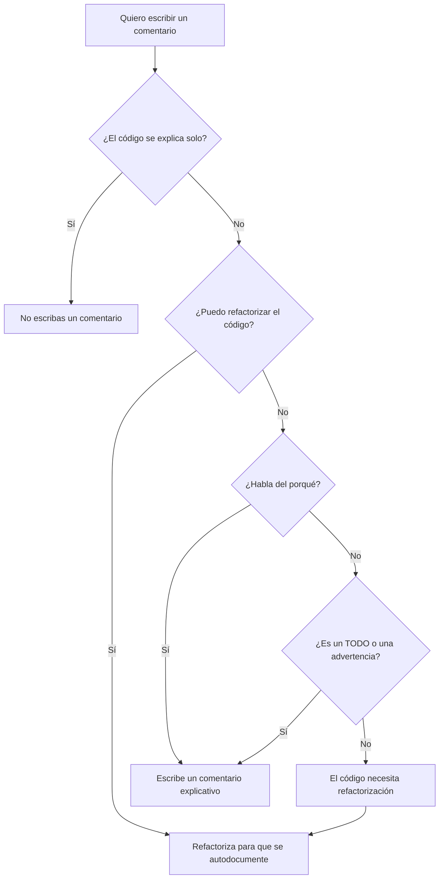
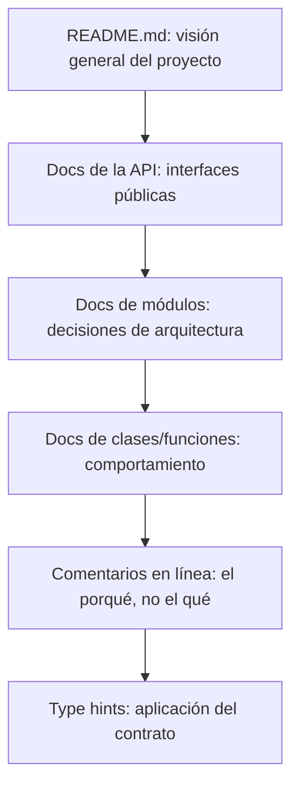

# Comentarios y documentación

Los comentarios son una espada de doble filo. Los buenos comentarios explican el "por qué" (el razonamiento detrás de una decisión). Los malos comentarios explican el "qué" (algo que el código ya debería comunicar). El mejor comentario es el que no necesitas escribir porque el código es claro.

> [!NOTE]
> "No comentes código malo; reescríbelo.": Brian W. Kernighan

## Código autodocumentado

El objetivo es escribir un código tan claro que los comentarios se vuelvan innecesarios para entender "qué" hace el código. Los comentarios solo deberían explicar el "por qué" de algo hecho de una manera determinada.

```python
# Bad comment: explains what (obvious from code)
# Calculate the total by adding subtotal and tax
total = subtotal + tax

# Good comment: explains why (non-obvious)
# Use Decimal to avoid floating-point rounding in financial calculations
from decimal import Decimal
total = subtotal + tax
```

```python
# Bad: commenting bad code
# Check if user is active and has permission
# then apply discount if total > 100
if u.active and u.role == "admin" or u.role == "manager":
    if t > 100:
        t = t * 0.9

# Good: self-documenting code
def is_eligible_for_discount(user: User, total: float) -> bool:
    return user.is_active and user.has_admin_permission() and total > 100

def apply_discount(total: float) -> float:
    return total * DISCOUNT_RATE
```

## Cuándo comentar

### 1. Comentarios legales

```python
# Copyright (c) 2024 Nuniversity. All rights reserved.
# Licensed under the MIT License.
```

### 2. Comentarios explicativos para lógica compleja

```python
def calculate_levenshtein_distance(s1: str, s2: str) -> int:
    """
    Calculate the Levenshtein distance between two strings.

    The Levenshtein distance is the minimum number of single-character
    edits (insertions, deletions, substitutions) required to change
    one word into another.
    """
    if len(s1) < len(s2):
        return calculate_levenshtein_distance(s2, s1)

    if len(s2) == 0:
        return len(s1)

    previous_row = range(len(s2) + 1)
    for i, c1 in enumerate(s1):
        current_row = [i + 1]
        for j, c2 in enumerate(s2):
            insertions = previous_row[j + 1] + 1
            deletions = current_row[j] + 1
            substitutions = previous_row[j] + (c1 != c2)
            current_row.append(min(insertions, deletions, substitutions))
        previous_row = current_row

    return previous_row[-1]
```

### 3. TODOs y FIXMEs

```python
# TODO: Implement pagination for large result sets
# FIXME: This query is slow for datasets over 10M rows
# HACK: Workaround for API rate limiting — remove when we get enterprise plan
```

### 4. Advertencias sobre consecuencias

```python
# WARNING: This function modifies the list in-place. Call with a copy if
# you need to preserve the original ordering.
def sort_by_priority(items: list) -> None:
    items.sort(key=lambda x: x.priority, reverse=True)
```

## Cuándo NO comentar

### 1. Comentarios redundantes

```python
# Bad: states the obvious
x = 42  # Set x to 42

# Bad: comment repeats code
# Increment counter by 1
counter += 1
```

### 2. Comentarios engañosos

```python
# Bad: comment says one thing, code does another
# Returns True if user is active
def is_user_banned(user):
    return user.status == "banned"  # Bug: wrong variable name
```

### 3. Comentarios de diario

```python
# Bad: version history belongs in git
# 2024-01-10: Added discount calculation - Alice
# 2024-01-15: Fixed tax rounding bug - Bob
def calculate_total():
    pass
```

### 4. Código comentado

```python
# Bad: dead code that nobody will clean up
# def old_process():
#     x = 10
#     y = 20
#     return x + y
```

> [!WARNING]
> El código comentado es el peor tipo de deuda técnica. Elimínalo. Si lo necesitas de nuevo, usa el control de versiones.

## Docstrings

Los docstrings son documentación incrustada en el código. A diferencia de los comentarios, los docstrings son accesibles en tiempo de ejecución y los procesan los generadores de documentación.

```python
def calculate_bmi(weight_kg: float, height_m: float) -> float:
    """Calculate Body Mass Index from weight and height.

    BMI is a measure of body fat based on height and weight.
    It is calculated as weight / (height ^ 2).

    Args:
        weight_kg: Weight in kilograms (must be positive).
        height_m: Height in meters (must be positive).

    Returns:
        The BMI value, rounded to one decimal place.

    Raises:
        ValueError: If either weight or height is not positive.

    Examples:
        >>> calculate_bmi(70, 1.75)
        22.9
    """
    if weight_kg <= 0 or height_m <= 0:
        raise ValueError("Weight and height must be positive values")
    bmi = weight_kg / (height_m ** 2)
    return round(bmi, 1)
```

### Estilos de docstring

| Estilo | Formato | Mejor para |
|-------|--------|----------|
| Google | Secciones con encabezados | La mayoría de los proyectos Python |
| NumPy/SciPy | Encabezados de sección enriquecidos | Computación científica |
| Sphinx/reST | reStructuredText | Documentación grande |
| Epytext | Similar a JavaDoc | Código heredado |

### Docstrings al estilo Google

```python
def fetch_user_data(user_id: int, include_inactive: bool = False) -> dict:
    """Retrieve user data from the database.

    Queries the user database and returns user profile information.
    By default, only active users are returned.

    Args:
        user_id: The unique identifier of the user.
        include_inactive: Whether to include deactivated users.

    Returns:
        A dictionary containing user profile data with keys:
        - id: int
        - name: str
        - email: str
        - created_at: datetime
        - is_active: bool

    Raises:
        UserNotFoundError: If no user exists with the given ID.
        DatabaseConnectionError: If the database is unreachable.
    """
```

### Docstrings al estilo NumPy

```python
def calculate_statistics(numbers: list) -> dict:
    """Compute descriptive statistics for a numeric dataset.

    Parameters
    ----------
    numbers : list
        A list of numeric values. Must contain at least one element
        and all elements must be finite numbers.

    Returns
    -------
    dict
        Dictionary with keys: mean, median, std, min, max, count.

    Raises
    ------
    ValueError
        If numbers list is empty or contains non-numeric values.
    """
    import statistics
    return {
        "mean": statistics.mean(numbers),
        "median": statistics.median(numbers),
        "std": statistics.stdev(numbers),
        "min": min(numbers),
        "max": max(numbers),
        "count": len(numbers),
    }
```

## Documentación de módulos y paquetes

Cada módulo debe tener un docstring que explique su propósito.

```python
# email_service.py
"""Email sending service for the notification system.

This module provides functions for sending transactional emails
using the SMTP protocol. It supports HTML and plain text formats,
file attachments, and template rendering.

Typical usage:
    from services.email_service import send_email

    send_email(
        to="user@example.com",
        subject="Welcome!",
        template="welcome.html",
        context={"name": "Alice"},
    )
"""
```

## Documentación de clases

```python
class RateLimiter:
    """Token bucket rate limiter for API endpoints.

    Implements the token bucket algorithm to control request rates.
    Each client gets a bucket that fills at a configurable rate.
    Requests consume tokens; if the bucket is empty, the request is
    rejected.

    Attributes:
        rate: Number of tokens added per second.
        capacity: Maximum number of tokens the bucket can hold.

    Example:
        >>> limiter = RateLimiter(rate=10, capacity=20)
        >>> limiter.allow_request("client_1")
        True
    """

    def __init__(self, rate: float, capacity: int):
        self.rate = rate
        self.capacity = capacity
        self._buckets: dict[str, float] = {}

    def allow_request(self, client_id: str) -> bool:
        """Check if a request from this client should be allowed.

        Args:
            client_id: Unique identifier for the client.

        Returns:
            True if the request is allowed, False if rate limited.
        """
```

## Flujo de decisión sobre documentación



## Herramientas de documentación

### Sphinx

Sphinx genera documentación a partir de docstrings y archivos reStructuredText.

```python
# conf.py for Sphinx
extensions = [
    "sphinx.ext.autodoc",      # Pull docstrings from code
    "sphinx.ext.napoleon",     # Support Google/NumPy style
    "sphinx.ext.viewcode",     # Link to source code
]
```

### MkDocs

MkDocs construye documentación a partir de archivos Markdown.

```yaml
# mkdocs.yml
site_name: My API Docs
theme: material
plugins:
  - mkdocstrings
  - search
```

### Type hints como documentación

Los type hints sirven como documentación verificable por máquina.

```python
# Without type hints (what type is user_id?)
def get_user(user_id):
    return database.query(f"SELECT * FROM users WHERE id = {user_id}")

# With type hints (self-documenting)
def get_user(user_id: int) -> User | None:
    return database.query(f"SELECT * FROM users WHERE id = {user_id}")
```

## Ejemplo del mundo real: la pirámide de documentación



### Ejemplo de mala documentación

```python
def calc(a, b):
    # This function calculates something
    # a is first number
    # b is second number
    # returns the result
    return a * b  # multiply a and b
```

### Ejemplo de buena documentación

```python
def calculate_total_compensation(
    base_salary: float,
    bonus_percentage: float,
    years_of_service: int,
) -> float:
    """Calculate total employee compensation including bonuses.

    Total compensation = base salary + (base salary * bonus percentage)
    Employees with 5+ years of service get an additional seniority bonus.

    Note:
        Bonus percentage should be provided as a decimal (e.g., 0.10 for 10%).
        All monetary values are in USD.

    Args:
        base_salary: Annual base salary in USD (must be > 0).
        bonus_percentage: Performance bonus as decimal (0.0 to 1.0).
        years_of_service: Complete years worked at the company.

    Returns:
        Total annual compensation rounded to 2 decimal places.

    Raises:
        ValueError: If base_salary <= 0 or bonus_percentage < 0.
    """
    if base_salary <= 0:
        raise ValueError("Base salary must be positive")
    if bonus_percentage < 0:
        raise ValueError("Bonus percentage cannot be negative")

    base_bonus = base_salary * bonus_percentage
    # Seniority bonus: 5% extra for employees with 5+ years
    seniority_bonus = base_salary * 0.05 if years_of_service >= 5 else 0

    return round(base_salary + base_bonus + seniority_bonus, 2)
```

## Comparación de tipos de comentarios

| Tipo de comentario | Propósito | Frecuencia | Ejemplo |
|-------------|---------|-----------|---------|
| Legal | Copyright / licencia | Encabezado del archivo | `# Copyright 2024` |
| Docstring | Documentación de API | Cada función pública | `"""Calcula el total."""` |
| Pendiente | Trabajo futuro | Ocasional | `# Pendiente: añadir paginación` |
| Advertencia | Efectos secundarios / riesgos | Rara | `# WARNING: orden en el sitio` |
| Aclaración | Lógica compleja | Mínima | `# Off-by-one: indexado desde 0` |
| Redundante | Explica lo obvio | Nunca | `# Establece x en 42` |

> [!TIP]
> Una buena heurística: si puedes borrar un comentario y el código sigue siendo igual de comprensible, borra el comentario. Si el código se vuelve confuso, mejora el código o conserva el comentario que explique el porqué.

## Ejercicios prácticos

1. **Auditoría de comentarios**: Recorre tu código y clasifica cada comentario como "útil" o "ruido". Borra todos los comentarios de ruido.

2. **Refactoriza para eliminar comentarios**: Encuentra un bloque de código con un comentario que explique el "qué". Refactoriza el código para que el comentario sea innecesario.

3. **Añade los docstrings que faltan**: Escribe docstrings al estilo Google para tres funciones de tu proyecto que carezcan de documentación.

4. **Docstring de módulo**: Añade un docstring a nivel de módulo a un archivo Python explicando su propósito y su uso.

5. **Auditoría de type hints**: Añade type hints a una función que antes no tenía ninguno. Verifica la corrección con `mypy`.

6. **Limpieza de pendientes**: Revisa todos los TODOs de tu proyecto. Borra los que ya estén completos, añade referencias a issues a los que queden y elimina los que ya no sean relevantes.

7. **Generación de documentación**: Configura Sphinx o MkDocs para tu proyecto y genera documentación HTML a partir de los docstrings.

8. **Mejora del README**: Escribe un README para un módulo o paquete siguiendo el principio de la pirámide de documentación.
