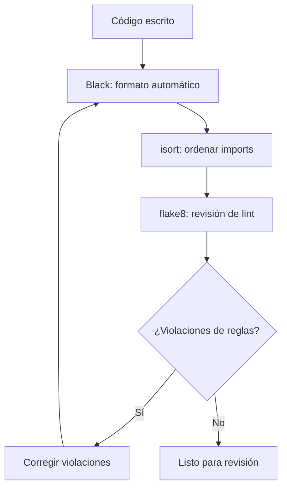
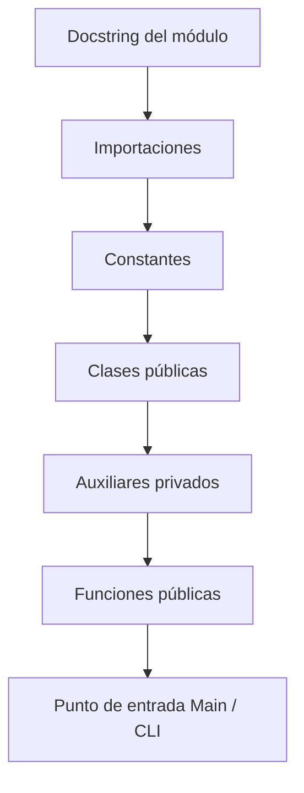
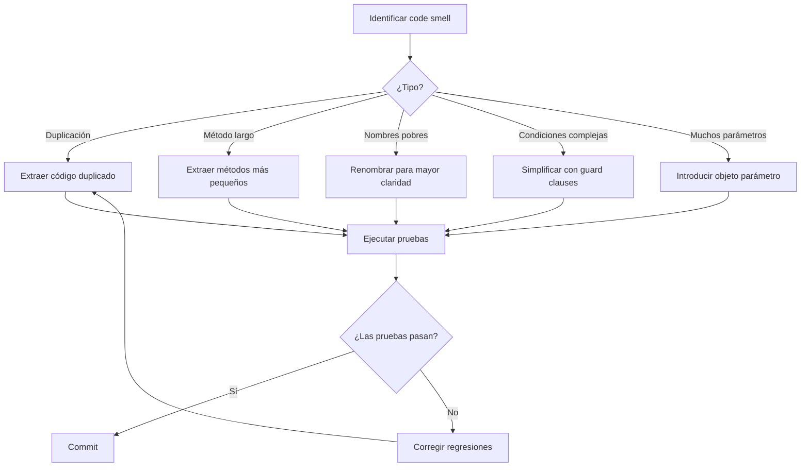

# Formato y estilo de código

El formato de código es como la puntuación en la escritura: hace que el significado quede claro. Un estilo consistente en toda la base de código reduce la carga cognitiva, evita debates triviales de estilo en las revisiones de código y ayuda a detectar errores con más rapidez.

> [!NOTE]
> "El formato de código trata de comunicación, no de preferencia personal. Un estilo consistente en un equipo elimina una clase entera de discusiones sin sentido.": Adaptado de *Clean Code*

## Por qué importa el formato

```python
# Poor formatting: hard to scan and understand
def calculate(items):
    result=0
    for i in items:
        if i['active']==True:
            result=result+i['value']
            if result>100:
                result=result*0.9
    return result

# Consistent formatting: easy to read and maintain
def calculate_discounted_total(items: list[dict]) -> float:
    result = 0.0
    for item in items:
        if item["active"]:
            result += item["value"]
            if result > DISCOUNT_THRESHOLD:
                result *= DISCOUNT_RATE
    return result
```

## PEP 8: la guía de estilo de Python

PEP 8 es la guía de estilo oficial del código Python. La mayoría de los proyectos de Python la siguen.

### Indentación

Usa 4 espacios por nivel de indentación. Nunca mezcles tabuladores y espacios.

```python
# Correct
def fetch_data(url: str) -> dict:
    response = requests.get(url)
    if response.status_code == 200:
        return response.json()
    return {}

# Incorrect (2 spaces)
def fetch_data(url: str) -> dict:
  response = requests.get(url)
  if response.status_code == 200:
    return response.json()
  return {}
```

### Longitud de línea

La longitud máxima de línea es de 79 caracteres para el código y 72 para comentarios y docstrings.

```python
# Too long
result = some_function_with_many_parameters(param_one, param_two, param_three, param_four, param_five)

# Properly wrapped
result = some_function_with_many_parameters(
    param_one, param_two, param_three,
    param_four, param_five,
)

# Using parentheses for implicit continuation
total = (
    subtotal
    + tax_amount
    - discount
    + shipping_cost
)
```

### Líneas en blanco

```python
import os
import sys

# Two blank lines between top-level definitions
class OrderProcessor:
    pass

class EmailService:
    pass

# One blank line between methods
class UserManager:
    def __init__(self):
        self.users = []

    def add_user(self, user):
        self.users.append(user)

    def remove_user(self, user):
        self.users.remove(user)
```

### Importaciones

```python
# Standard library imports
import os
import sys
from datetime import datetime

# Third-party imports
import pytest
import requests
from fastapi import FastAPI

# Local application imports
from models.user import User
from services.email import EmailService
```

## Herramientas automatizadas de formato



### Black

Black es un formateador de código opinativo que elimina los debates sobre formato. Formatea el código de forma determinista.

```bash
# Format a single file
black main.py

# Format entire project
black .

# Check if files would be reformatted
black --check .

# Show differences
black --diff .
```

```python
# Before Black
def complex_function(first_param,second_param,third_param,
                     fourth_param):
    result=first_param+second_param
    if result>100:
        result=result*0.9
        for item in fourth_param:
            if item.get('active'):
                result+=item['value']
    return result

# After Black
def complex_function(
    first_param, second_param, third_param, fourth_param
):
    result = first_param + second_param
    if result > 100:
        result = result * 0.9
        for item in fourth_param:
            if item.get("active"):
                result += item["value"]
    return result
```

### isort

isort ordena las importaciones alfabéticamente y las agrupa por tipo.

```python
# Before isort
from services.email import EmailService
import os
from models.user import User
import sys
import requests
from datetime import datetime

# After isort
import os
import sys
from datetime import datetime

import requests

from models.user import User
from services.email import EmailService
```

### flake8

flake8 comprueba las violaciones de PEP 8 y los errores comunes.

```bash
# Basic usage
flake8 src/

# With configuration
flake8 src/ --max-line-length 88 --ignore E203,W503
```

### Archivo de configuración

```ini
# setup.cfg
[flake8]
max-line-length = 88
extend-ignore = E203, W503
exclude = .git, __pycache__, venv

[isort]
profile = black
line_length = 88

[tool:black]
line-length = 88
target-version = py311
include = '\.pyw?$'
```

```toml
# pyproject.toml
[tool.black]
line-length = 88
target-version = ["py311"]

[tool.isort]
profile = "black"
line_length = 88

[tool.flake8]
max-line-length = 88
extend-ignore = ["E203", "W503"]
```

## Espaciado de variables y atributos

```python
# Inconsistent spacing
name="Alice"
age   = 30
address="123 Main St"

# Consistent spacing (PEP 8)
name = "Alice"
age = 30
address = "123 Main St"
```

## Comas finales

```python
# Without trailing comma — adding a new item changes two lines
ITEMS = [
    "apple",
    "banana",
    "cherry"  # Need to add comma when adding "date"
]

# With trailing comma — cleaner diffs
ITEMS = [
    "apple",
    "banana",
    "cherry",
]
```

## Técnicas de refactorización

### Extraer método

```python
# Before
def process_report(data):
    # Validate
    if not data:
        raise ValueError("Empty data")
    if "revenue" not in data:
        raise ValueError("Missing revenue")
    if "expenses" not in data:
        raise ValueError("Missing expenses")

    # Calculate
    revenue = sum(data["revenue"])
    expenses = sum(data["expenses"])
    profit = revenue - expenses
    margin = (profit / revenue * 100) if revenue > 0 else 0

    # Format
    report = f"""
    Revenue: ${revenue:,.2f}
    Expenses: ${expenses:,.2f}
    Profit: ${profit:,.2f}
    Margin: {margin:.1f}%
    """
    return report

# After
def validate_report_data(data: dict) -> None:
    if not data:
        raise ValueError("Empty data")
    if "revenue" not in data:
        raise ValueError("Missing revenue")
    if "expenses" not in data:
        raise ValueError("Missing expenses")

def calculate_financials(data: dict) -> dict:
    revenue = sum(data["revenue"])
    expenses = sum(data["expenses"])
    profit = revenue - expenses
    margin = (profit / revenue * 100) if revenue > 0 else 0
    return {"revenue": revenue, "expenses": expenses, "profit": profit, "margin": margin}

def format_report(financials: dict) -> str:
    return f"""
    Revenue: ${financials['revenue']:,.2f}
    Expenses: ${financials['expenses']:,.2f}
    Profit: ${financials['profit']:,.2f}
    Margin: {financials['margin']:.1f}%
    """

def process_report(data: dict) -> str:
    validate_report_data(data)
    financials = calculate_financials(data)
    return format_report(financials)
```

### Renombrar

```python
# Before
def proc(lst):
    r = []
    for x in lst:
        if x[3] == "active":
            r.append(x[0])
    return r

# After
def get_active_user_emails(users: list[dict]) -> list[str]:
    active_emails = []
    for user in users:
        if user["status"] == "active":
            active_emails.append(user["email"])
    return active_emails
```

### Simplificar condicionales

```python
# Before: nested conditionals
def can_access(user, resource):
    if user:
        if user.is_active:
            if user.role == "admin" or user.role == "manager":
                return True
            if resource.is_public:
                return True
            if resource.owner_id == user.id:
                return True
    return False

# After: guard clauses
def can_access(user: User | None, resource: Resource) -> bool:
    if not user:
        return False
    if not user.is_active:
        return False
    if user.role in ("admin", "manager"):
        return True
    if resource.is_public:
        return True
    if resource.owner_id == user.id:
        return True
    return False
```

## Organización del código dentro de un archivo



```python
"""Email notification service for the e-commerce platform.

This module handles sending transactional emails using the
SMTP protocol with support for HTML templates.
"""

import logging
import smtplib
from email.mime.text import MIMEText
from typing import Optional

import jinja2

# Constants
DEFAULT_SMTP_PORT = 587
DEFAULT_TIMEOUT = 30
TEMPLATE_DIR = "templates/emails"

logger = logging.getLogger(__name__)


class EmailSender:
    """Handles SMTP connection and email delivery."""

    def __init__(self, host: str, port: int = DEFAULT_SMTP_PORT):
        self.host = host
        self.port = port
        self._connection: Optional[smtplib.SMTP] = None

    def connect(self, username: str, password: str) -> None:
        self._connection = smtplib.SMTP(self.host, self.port, timeout=DEFAULT_TIMEOUT)
        self._connection.starttls()
        self._connection.login(username, password)

    def send(self, to: str, subject: str, body: str) -> None:
        if not self._connection:
            raise RuntimeError("Not connected. Call connect() first.")
        msg = MIMEText(body, "html")
        msg["Subject"] = subject
        msg["To"] = to
        self._connection.send_message(msg)

    def disconnect(self) -> None:
        if self._connection:
            self._connection.quit()
            self._connection = None
```

## Flujo de refactorización



## Hooks de pre-commit

Automatiza las comprobaciones de formato con hooks de pre-commit:

```yaml
# .pre-commit-config.yaml
repos:
  - repo: https://github.com/psf/black
    rev: 23.12.0
    hooks:
      - id: black

  - repo: https://github.com/pycqa/isort
    rev: 5.13.0
    hooks:
      - id: isort

  - repo: https://github.com/pycqa/flake8
    rev: 6.1.0
    hooks:
      - id: flake8

  - repo: https://github.com/pre-commit/mirrors-mypy
    rev: v1.8.0
    hooks:
      - id: mypy
```

```bash
# Install pre-commit hooks
pip install pre-commit
pre-commit install

# Run against all files
pre-commit run --all-files
```

## Comparación de reglas de formato

| Regla | PEP 8 | Black | flake8 |
|-------|-------|-------|--------|
| Indentación | 4 espacios | 4 espacios | Comprueba |
| Longitud máxima de línea | 79 | 88 (configurable) | 79 por defecto |
| Comillas | Se prefieren las simples | Dobles |: |
| Comas finales | Opcionales | Las añade en varias líneas |: |
| Líneas en blanco | 2 a nivel superior, 1 en métodos | Las exige | Comprueba |
| Importaciones | Grupos con líneas en blanco | Agrupa | Comprueba el orden |

> [!TIP]
> Deja de debatir sobre el formato. Usa Black: formatea todo de forma consistente y es lo más cercano que Python tiene a un formateador oficial.

> [!WARNING]
> No personalices la configuración de Black (salvo la longitud de línea). Toda la gracia de Black está en ser opinativo y eliminar los debates de formato.

## Ejercicios prácticos

1. **Formatea un archivo**: Ejecuta `black` sobre un archivo Python de tu proyecto. Revisa el diff y entiende qué cambió.

2. **Ordena las importaciones**: Ejecuta `isort` sobre un archivo con importaciones desordenadas. Haz commit del resultado.

3. **Haz lint de tu código**: Ejecuta `flake8` sobre tu proyecto y corrige todas las advertencias. Registra el número de advertencias antes y después.

4. **Configura pre-commit**: Crea un `.pre-commit-config.yaml` e instala hooks para black, isort y flake8.

5. **Extrae un método**: Encuentra una función de más de 30 líneas. Extráela en funciones más pequeñas hasta que ninguna supere las 15 líneas.

6. **Guard clauses**: Encuentra una función con condicionales anidados. Refactórala para usar guard clauses.

7. **Espaciado consistente**: Revisa tu base de código en busca de espaciado inconsistente alrededor de los operadores. Usa Black para corregirlo.

8. **Refactura un módulo**: Elige un módulo con una organización deficiente. Reorganízalo siguiendo la estructura estándar de archivo (importaciones, constantes, clases, funciones).
