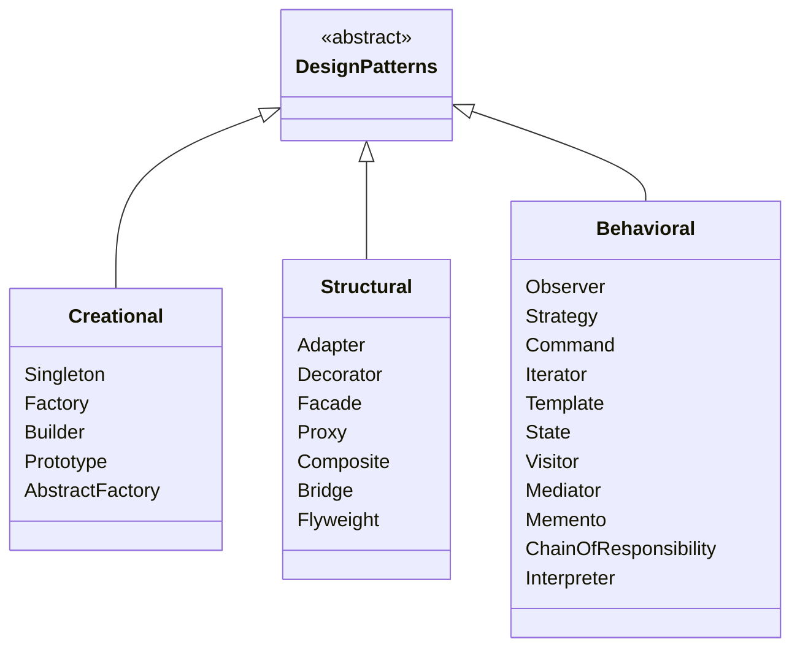
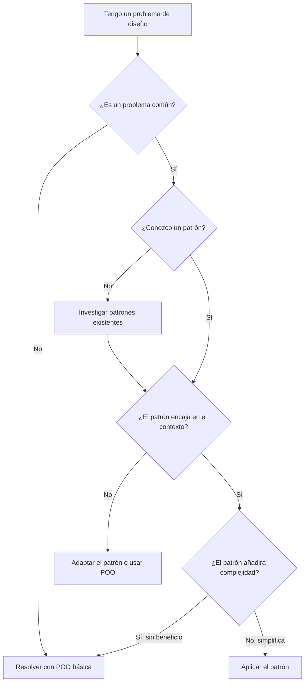
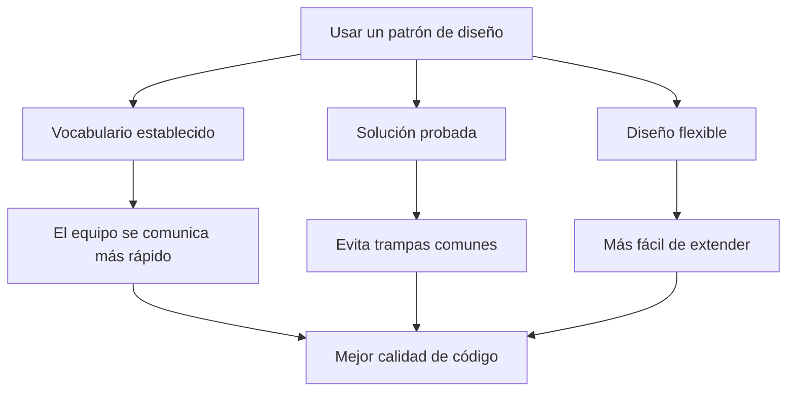
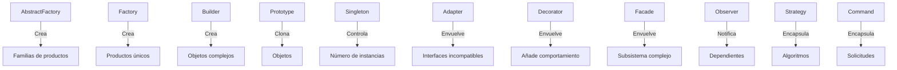

# Introducción a los patrones de diseño

Los patrones de diseño son soluciones reutilizables a problemas comunes del diseño de software. No son diseños terminados que copias y pegas, sino plantillas para resolver problemas dentro de un contexto. Los patrones representan enfoques probados en batalla que han evolucionado durante décadas.

> [!NOTE]
> El concepto de patrones de diseño lo popularizó la "Gang of Four" (GoF), Erich Gamma, Richard Helm, Ralph Johnson y John Vlissides, en su libro de 1994 *Design Patterns: Elements of Reusable Object-Oriented Software*.

## ¿Qué son los patrones de diseño?

Un patrón de diseño describe un problema que se repite, el núcleo de la solución y las consecuencias de aplicarla. Cada patrón tiene cuatro elementos esenciales:

1. **Nombre del patrón**: una etiqueta para describirlo
2. **Problema**: cuándo aplicar el patrón
3. **Solución**: los elementos y sus relaciones
4. **Consecuencias**: compensaciones y resultados

```python
# Without a pattern: ad-hoc approach to creating objects
def create_database_connection():
    # Every caller creates their own connection
    return Database("localhost", 5432)

# With Singleton pattern: controlled instance management
class DatabaseConnection:
    _instance = None

    def __new__(cls):
        if cls._instance is None:
            cls._instance = super().__new__(cls)
            cls._instance._connection = Database("localhost", 5432)
        return cls._instance
```

## La clasificación de la Gang of Four

El GoF catalogó 23 patrones en tres categorías según su propósito:



### Patrones de creación

Los patrones de creación abstraen el proceso de instanciación. Hacen que un sistema no dependa de cómo se crean, componen y representan sus objetos.

| Patrón | Propósito | Ejemplo en Python |
|--------|-----------|-------------------|
| Singleton | Garantizar que una clase tenga una sola instancia | Pool de conexiones a la base de datos |
| Factory | Crear objetos sin especificar la clase exacta | Creación de procesadores de pagos |
| Builder | Construir objetos complejos paso a paso | Constructor de informes HTML |
| Prototype | Clonar objetos existentes | Plantillas de configuración |
| Abstract Factory | Crear familias de objetos relacionados | Fábrica de temas de UI |

### Patrones estructurales

Los patrones estructurales componen clases y objetos en estructuras más grandes manteniéndolas flexibles y eficientes.

| Patrón | Propósito | Ejemplo en Python |
|--------|-----------|-------------------|
| Adapter | Hacer coincidir interfaces de clases distintas | Wrapper de una API heredada |
| Decorator | Añadir responsabilidades a los objetos dinámicamente | Middleware de registro |
| Facade | Ofrecer una interfaz unificada a un subsistema | API gateway |
| Proxy | Controlar el acceso a otro objeto | Carga diferida (lazy loading) |
| Composite | Tratar por igual los objetos individuales y compuestos | Árbol del sistema de archivos |

### Patrones de comportamiento

Los patrones de comportamiento distribuyen algoritmos y responsabilidades entre los objetos.

| Patrón | Propósito | Ejemplo en Python |
|--------|-----------|-------------------|
| Observer | Notificar a varios objetos sobre cambios de estado | Sistema de eventos |
| Strategy | Intercambiar algoritmos en tiempo de ejecución | Estrategia de ordenación |
| Command | Encapsular solicitudes como objetos | Deshacer/rehacer |
| Iterator | Recorrer colecciones sin exponer su interior | Iterable personalizado |
| Template | Definir el esqueleto de un algoritmo con métodos hook | Pipeline de datos |

## Cuándo usar patrones de diseño



> [!WARNING]
> No abuses de los patrones. Un patrón debe resolver un problema, no crear uno. Si basta una función simple, no añadas un patrón Strategy. Los patrones añaden complejidad: úsalos solo cuando la complejidad compense.

## Guía de selección de patrones

```python
# Problem: I need to create different types of objects based on input
# Solution: Factory pattern

def create_payment_processor(method: str) -> PaymentProcessor:
    processors = {
        "credit_card": CreditCardProcessor,
        "paypal": PayPalProcessor,
        "stripe": StripeProcessor,
    }
    processor_class = processors.get(method)
    if not processor_class:
        raise ValueError(f"Unknown payment method: {method}")
    return processor_class()
```

```python
# Problem: I need to add behavior to objects without modifying them
# Solution: Decorator pattern

def log_execution(func):
    def wrapper(*args, **kwargs):
        logger.info(f"Calling {func.__name__}")
        result = func(*args, **kwargs)
        logger.info(f"{func.__name__} returned {result}")
        return result
    return wrapper

@log_execution
def process_payment(amount: float) -> str:
    # Payment logic
    return "success"
```

## Los patrones no son recetas

Un error muy extendido es creer que los patrones de diseño son soluciones listas para enchufar. No lo son. Cada patrón debe adaptarse a tu contexto concreto.

```python
# Anti-pattern: copying GoF example blindly (Java-style Singleton)
class Singleton:
    _instance = None

    @staticmethod
    def get_instance():
        if Singleton._instance is None:
            Singleton._instance = Singleton()
        return Singleton._instance

# Pythonic Singleton: use module-level constant
# database.py
connection = DatabaseConnection("localhost", 5432)

# Use: from database import connection
```

## Beneficios de los patrones de diseño

| Beneficio | Descripción |
|-----------|-------------|
| Reutilización | Soluciones probadas que no tienes que reinventar |
| Comunicación | Vocabulario compartido para las discusiones de diseño |
| Mantenibilidad | El código bien estructurado es más fácil de cambiar |
| Flexibilidad | Los sistemas poco acoplados se adaptan a nuevos requisitos |
| Documentación | Los nombres de los patrones transmiten la intención del diseño |
| Buenas prácticas | Incorporan décadas de sabiduría de la industria |

## Ideas erróneas comunes sobre los patrones de diseño

### "Los patrones son la bala de plata"

Ningún patrón resuelve todos los problemas. Cada patrón atiende una preocupación concreta e introduce compensaciones. El patrón Factory añade complejidad a cambio de flexibilidad. El Singleton resuelve el control de instancias pero crea estado global.

### "Hay que usar patrones en todas partes"

Los patrones son soluciones, no objetivos. Si un simple diccionario sustituye a un patrón Strategy, usa el diccionario. La sobreingeniería con patrones es en sí misma un antipatrón muy común.

### "Los patrones son solo para lenguajes OOP"

Aunque los patrones del GoF enfatizan conceptos de POO como herencia y polimorfismo, muchos patrones se trasladan a lenguajes funcionales o multiparadigma. Python, por ejemplo, implementa Strategy con funciones de primera clase y Decorator con envoltorios de funciones.

### "Los patrones están obsoletos"

Algunos desarrolladores afirman que los patrones ya no son relevantes gracias a los frameworks modernos. En realidad, los frameworks se construyen *usando* patrones. Entender los patrones te ayuda a entender los frameworks a un nivel más profundo.

## Plantilla de documentación de patrones

Cuando documentes un patrón para tu equipo, usa esta plantilla:

```markdown
## Pattern: [Name]

**Intent**: One-sentence description.

**Problem**: When should you use this pattern?

**Solution**: Core structure and participants.

**Python Example**: Minimal working code.

**Trade-offs**: What do you gain and lose?

**Related Patterns**: How does this connect to other patterns?
```

Ejemplo:

```python
"""
Pattern: Factory Method

Intent: Define an interface for creating an object, but let subclasses
        decide which class to instantiate.

Problem: A class cannot anticipate the class of objects it must create.
         A class wants its subclasses to specify the objects it creates.

Solution: Define a factory method that returns a product. Subclasses
          override to return different product implementations.

Trade-offs:
  + Eliminates tight coupling to concrete classes
  + Follows Open/Closed Principle
  - Introduces many subclasses
  - Complexity may be unnecessary for simple cases
"""
```

## Uso de patrones en el mundo real

### Frameworks web

Django y FastAPI hacen un uso extensivo de patrones:

- **Singleton**: el objeto `settings` de Django es, en la práctica, un Singleton
- **Factory**: las clases de serialización de Django REST Framework usan Factory
- **Observer**: las señales de Django (pre_save, post_save) implementan Observer
- **Strategy**: los backends de autenticación de Django usan Strategy
- **Command**: los comandos de gestión de Django usan el patrón Command
- **Decorator**: `@login_required`, `@permission_required` son Decorators

### Ejemplos de la biblioteca estándar

La propia biblioteca estándar de Python contiene implementaciones de patrones:

```python
# Iterator pattern: built into every collection
for item in my_list:
    print(item)

# Strategy pattern: key functions for sorting
sorted(data, key=str.lower)

# Decorator pattern: property, classmethod, staticmethod
@property
def full_name(self):
    return f"{self.first} {self.last}"

# Observer pattern: asyncio events
import asyncio
event = asyncio.Event()
# Multiple coroutines can wait for the same event
```

## Flujo de los beneficios de los patrones de diseño



## Antipatrones comunes que evitar

### 1. Uso excesivo de patrones

```python
# Over-engineered: Strategy pattern for a simple if-else
class GreetingStrategy:
    def greet(self, name: str) -> str:
        raise NotImplementedError

class EnglishGreeting(GreetingStrategy):
    def greet(self, name: str) -> str:
        return f"Hello, {name}!"

class SpanishGreeting(GreetingStrategy):
    def greet(self, name: str) -> str:
        return f"¡Hola, {name}!"

def greet(name: str, language: str) -> str:
    strategies = {"en": EnglishGreeting(), "es": SpanishGreeting()}
    return strategies[language].greet(name)

# Simple alternative: just use a dictionary of functions
def greet(name: str, language: str) -> str:
    greetings = {"en": f"Hello, {name}!", "es": f"¡Hola, {name}!"}
    return greetings[language]
```

### 2. Abuso del Singleton

Usar Singleton para todo lo que "debería tener una sola instancia" crea dependencias globales ocultas.

### 3. Patrón por el simple hecho de usar un patrón

Aplicar patrones solo para que aparezcan patrones en el código de tu currículum.

## Patrones en Python frente a otros lenguajes

La naturaleza dinámica de Python hace que algunos patrones sean más simples o incluso estén integrados:

| Patrón | Enfoque en Java | Enfoque en Python |
|--------|-----------------|-------------------|
| Singleton | Clase con instancia estática | Variable a nivel de módulo |
| Iterator | Implementar la interfaz Iterable | `__iter__` / `__next__` o generador |
| Decorator | Framework de anotaciones | Funciones decoradoras de primera clase |
| Strategy | Interfaz + clases de implementación | Funciones de primera clase / dict |
| Observer | Interfaces de escucha de eventos | Callbacks / señales |

```python
# Java-style Iterator
class Range:
    def __init__(self, start, end):
        self.start = start
        self.end = end

    def __iter__(self):
        self.current = self.start
        return self

    def __next__(self):
        if self.current >= self.end:
            raise StopIteration
        value = self.current
        self.current += 1
        return value

# Pythonic generator
def range_generator(start: int, end: int):
    for i in range(start, end):
        yield i
```

## Relaciones entre patrones



> [!SUCCESS]
> Los patrones de diseño son herramientas, no reglas. Aprende para construir tu vocabulario y reconocer problemas comunes, pero elige siempre la solución más simple que funcione.

## Ejercicios prácticos

1. **Identificación de patrones**: Mira tu proyecto actual e identifica al menos 2 lugares donde ya estás usando un patrón de diseño (aunque sea sin saberlo).

2. **Catálogo del GoF**: Investiga un patrón de cada categoría (creación, estructural, comportamiento) y escribe un resumen de un párrafo de cada uno.

3. **Patrón frente a lo simple**: Toma un trozo de código que usa una cadena simple de if-else. Implémentalo con un patrón Strategy. Compara los dos enfoques: ¿cuál es mejor?

4. **Caza de antipatrones**: Encuentra un lugar de tu base de código donde un patrón se use en exceso o se aplique mal. Simplifícalo.

5. **Reescritura pythonica**: Toma una implementación de patrón al estilo Java y reescríbela de una forma más pythonica.

6. **Decisión de patrón**: Necesitas crear un sistema que pueda enviar notificaciones por correo, SMS y push. ¿Qué patrón o patrones usarías? Justifícalo.

7. **Auditoría de Singleton**: Encuentra todos los patrones tipo Singleton en tu base de código. Determina cuáles son apropiados y cuáles deberían reemplazarse por variables a nivel de módulo.

8. **Comunicación con patrones**: Describe una parte compleja de tu arquitectura a un colega usando solo nombres de patrones. ¿Mejora esto la comprensión?
