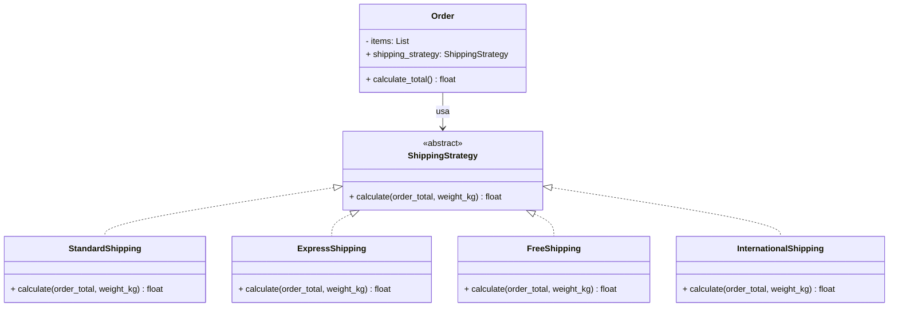
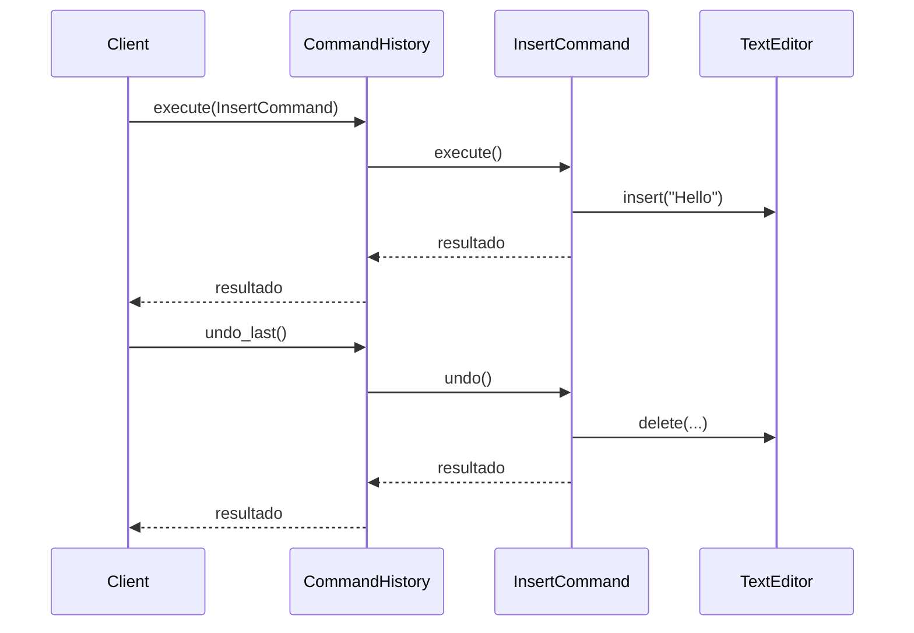
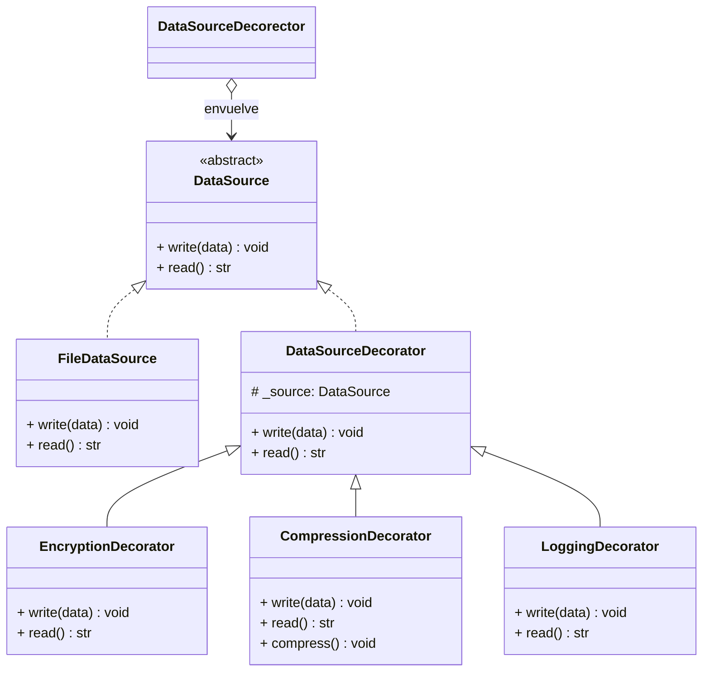
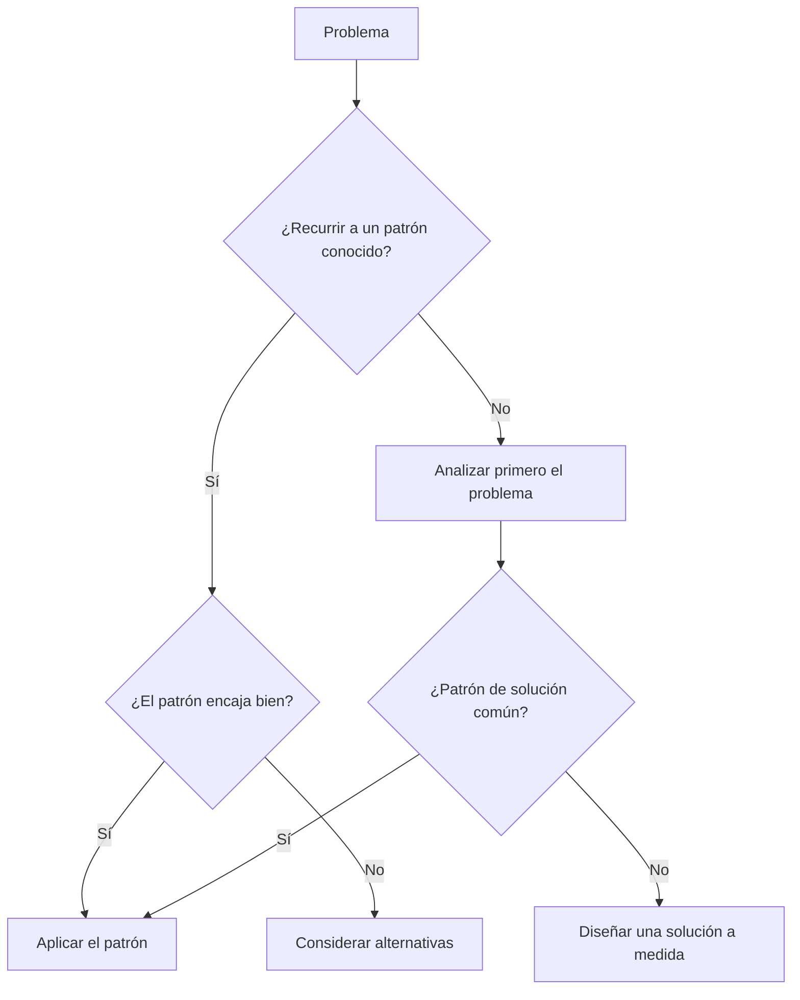
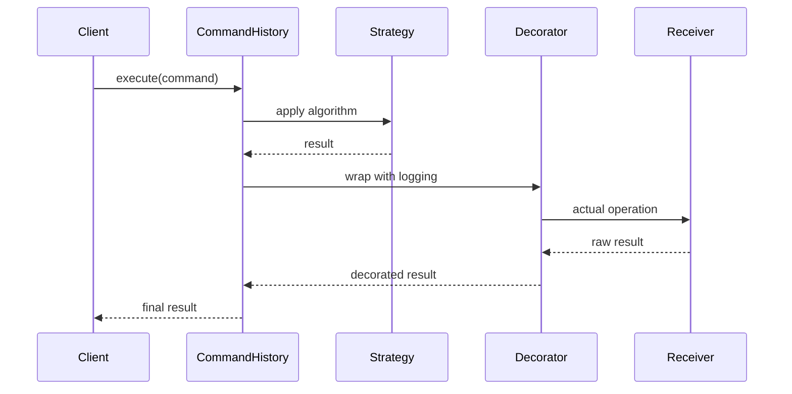

# Patrones de comportamiento y buenas prácticas

Los patrones de comportamiento se centran en los algoritmos y en la asignación de responsabilidades entre objetos. Capturan flujos de control complejos que son difíciles de seguir en tiempo de ejecución, lo que facilita razonar sobre el comportamiento de tu sistema.

> [!NOTE]
> Los patrones de comportamiento son la categoría más grande del catálogo GoF (11 patrones). Responden a la pregunta: ¿cómo se comunican y colaboran los objetos?

## Patrón Strategy

**Propósito**: Definir una familia de algoritmos, encapsular cada uno de ellos y hacerlos intercambiables. Strategy permite que el algoritmo varíe de forma independiente de los clientes que lo usan.

### Cuándo usarlo

- Varios algoritmos para la misma tarea
- Lógica condicional con muchas ramas if-else
- Selección de comportamiento en tiempo de ejecución

### Implementación en Python

```python
from abc import ABC, abstractmethod
from dataclasses import dataclass
from typing import List


# Strategy interface
class ShippingStrategy(ABC):
    @abstractmethod
    def calculate(self, order_total: float, weight_kg: float) -> float: ...


# Concrete strategies
class StandardShipping(ShippingStrategy):
    def calculate(self, order_total: float, weight_kg: float) -> float:
        base_rate = 5.99
        weight_surcharge = weight_kg * 0.50
        return base_rate + weight_surcharge


class ExpressShipping(ShippingStrategy):
    def calculate(self, order_total: float, weight_kg: float) -> float:
        base_rate = 14.99
        weight_surcharge = weight_kg * 1.20
        return base_rate + weight_surcharge


class FreeShipping(ShippingStrategy):
    def calculate(self, order_total: float, weight_kg: float) -> float:
        return 0.0


class InternationalShipping(ShippingStrategy):
    def calculate(self, order_total: float, weight_kg: float) -> float:
        base_rate = 25.00
        weight_surcharge = weight_kg * 3.50
        customs_fee = order_total * 0.10
        return base_rate + weight_surcharge + customs_fee


# Context
@dataclass
class Order:
    items: List[dict]
    shipping_strategy: ShippingStrategy

    def calculate_total(self) -> float:
        subtotal = sum(item["price"] * item["quantity"] for item in self.items)
        weight = sum(item.get("weight_kg", 0) * item["quantity"] for item in self.items)
        shipping = self.shipping_strategy.calculate(subtotal, weight)
        return subtotal + shipping


# Usage
order = Order(
    items=[
        {"name": "Laptop", "price": 999.99, "quantity": 1, "weight_kg": 2.5},
        {"name": "Mouse", "price": 29.99, "quantity": 2, "weight_kg": 0.2},
    ],
    shipping_strategy=ExpressShipping(),
)

print(f"Total with express shipping: ${order.calculate_total():.2f}")

# Switch strategy at runtime
order.shipping_strategy = FreeShipping()
print(f"Total with free shipping: ${order.calculate_total():.2f}")
```

### Diagrama de clases del Strategy



> [!TIP]
> En Python, a menudo puedes sustituir el patrón Strategy por una función simple o cualquier llamable. Usa el enfoque basado en clases cuando las estrategias compartan estado o tengan una configuración compleja.

## Patrón Command

**Propósito**: Encapsular una solicitud como un objeto, lo que te permite parametrizar a los clientes con solicitudes distintas, poner solicitudes en cola o registrarlas y admitir operaciones con deshacer.

### Cuándo usarlo

- Funcionalidad de deshacer/rehacer
- Colas de tareas y programación de trabajos
- Operaciones transaccionales
- Grabación de macros (composición de comandos)

### Implementación en Python

```python
from abc import ABC, abstractmethod
from dataclasses import dataclass, field
from typing import List


# Command interface
class Command(ABC):
    @abstractmethod
    def execute(self) -> str: ...

    @abstractmethod
    def undo(self) -> str: ...


# Receiver
class TextEditor:
    def __init__(self):
        self.content = ""

    def insert(self, text: str, position: int = -1) -> None:
        if position == -1:
            self.content += text
        else:
            self.content = self.content[:position] + text + self.content[position:]

    def delete(self, start: int, end: int) -> str:
        deleted = self.content[start:end]
        self.content = self.content[:start] + self.content[end:]
        return deleted


# Concrete commands
@dataclass
class InsertCommand(Command):
    editor: TextEditor
    text: str
    position: int = -1

    def execute(self) -> str:
        self.editor.insert(self.text, self.position)
        return f"Inserted '{self.text}' at position {self.position}"

    def undo(self) -> str:
        if self.position == -1:
            start = len(self.editor.content) - len(self.text)
        else:
            start = self.position
        self.editor.delete(start, start + len(self.text))
        return f"Undid insertion of '{self.text}'"


@dataclass
class DeleteCommand(Command):
    editor: TextEditor
    start: int
    end: int
    _deleted_text: str = ""

    def execute(self) -> str:
        self._deleted_text = self.editor.delete(self.start, self.end)
        return f"Deleted '{self._deleted_text}'"

    def undo(self) -> str:
        self.editor.insert(self._deleted_text, self.start)
        return f"Restored '{self._deleted_text}'"


# Invoker
class CommandHistory:
    def __init__(self):
        self._history: List[Command] = []

    def execute(self, command: Command) -> str:
        result = command.execute()
        self._history.append(command)
        return result

    def undo_last(self) -> str:
        if not self._history:
            return "Nothing to undo"
        command = self._history.pop()
        return command.undo()


# Usage
editor = TextEditor()
history = CommandHistory()

print(history.execute(InsertCommand(editor, "Hello, ")))
print(history.execute(InsertCommand(editor, "World!")))
print(f"Content: '{editor.content}'")

print(history.execute(DeleteCommand(editor, 7, 13)))
print(f"Content: '{editor.content}'")

print(history.undo_last())
print(f"Content: '{editor.content}'")

print(history.undo_last())
print(f"Content: '{editor.content}'")
```

### Diagrama de secuencia del Command



## Patrón Decorator

**Propósito**: Adjuntar responsabilidades adicionales a un objeto dinámicamente. Los decorators ofrecen una alternativa flexible a la herencia para ampliar la funcionalidad.

> [!NOTE]
> Python admite de primera clase el patrón Decorator mediante la sintaxis `@decorator`. Aunque los decoradores de Python modifican funciones, el patrón Decorator clásico de GoF trabaja con objetos.

### Cuándo usarlo

- Añadir registro de logs, autenticación o caché a las operaciones
- Calcular métricas y monitorizar el rendimiento
- Añadir capas de validación o saneamiento
- Extender clases de terceros

### Implementación en Python (basada en clases)

```python
from abc import ABC, abstractmethod
from dataclasses import dataclass


# Component interface
class DataSource(ABC):
    @abstractmethod
    def write(self, data: str) -> None: ...

    @abstractmethod
    def read(self) -> str: ...


# Concrete component
class FileDataSource(DataSource):
    def __init__(self, filename: str):
        self.filename = filename
        self._data = ""

    def write(self, data: str) -> None:
        self._data = data
        print(f"Written to {self.filename}: {data}")

    def read(self) -> str:
        return self._data


# Base decorator
class DataSourceDecorator(DataSource):
    def __init__(self, source: DataSource):
        self._source = source

    def write(self, data: str) -> None:
        self._source.write(data)

    def read(self) -> str:
        return self._source.read()


# Concrete decorators
class EncryptionDecorator(DataSourceDecorator):
    def write(self, data: str) -> None:
        encrypted = f"ENCRYPTED[{data}]"
        super().write(encrypted)

    def read(self) -> str:
        data = super().read()
        return data.replace("ENCRYPTED[", "").rstrip("]")


class CompressionDecorator(DataSourceDecorator):
    def write(self, data: str) -> None:
        compressed = f"COMPRESSED({data})"
        super().write(compressed)

    def read(self) -> str:
        data = super().read()
        return data.replace("COMPRESSED(", "").rstrip(")")

    def compress(self) -> None:
        print("Running compression algorithm...")


class LoggingDecorator(DataSourceDecorator):
    def write(self, data: str) -> None:
        print(f"[LOG] Writing {len(data)} bytes")
        super().write(data)

    def read(self) -> str:
        data = super().read()
        print(f"[LOG] Read {len(data)} bytes")
        return data


# Usage
source = FileDataSource("data.txt")
source = CompressionDecorator(source)
source = EncryptionDecorator(source)
source = LoggingDecorator(source)

source.write("Hello, World!")
print(f"Read: {source.read()}")
```

### Diagrama de clases del Decorator



## Antipatrones que evitar

### 1. Objeto Dios

Una clase centralizada que sabe demasiado o hace demasiado.

```python
# Anti-pattern: God Object
class Application:
    def __init__(self):
        self.users = []
        self.orders = []
        self.inventory = {}
        self.payments = []
        self.email_server = ...
        self.logger = ...

    def process_order(self, ...):
        # Handles validation, payment, inventory, email, logging...
        pass

    def manage_users(self, ...):
        pass

    def generate_reports(self, ...):
        pass

# Solution: Split into focused classes
class UserManager: ...
class OrderProcessor: ...
class InventoryManager: ...
class PaymentService: ...
class ReportGenerator: ...
```

### 2. Código espagueti

Código con estructuras de control complejas y enredadas.

```python
# Anti-pattern: Spaghetti code
def handle_request(request):
    if request.method == "GET":
        if request.path == "/users":
            if request.args.get("id"):
                # Get user by ID
                pass
            else:
                # List all users
                pass
        elif request.path == "/orders":
            # Handle orders
            pass
    elif request.method == "POST":
        # Handle POST
        pass

# Solution: Use clear routing
@app.get("/users/{user_id}")
def get_user(user_id: int): ...

@app.get("/users")
def list_users(): ...

@app.post("/orders")
def create_order(): ...
```

### 3. Programación de copiar y pegar

Duplicar código en lugar de abstraerlo.

```python
# Anti-pattern: Copy-paste
def validate_user_email(email):
    if "@" not in email:
        raise ValueError("Invalid email")
    if len(email) > 255:
        raise ValueError("Email too long")

def validate_admin_email(email):
    if "@" not in email:
        raise ValueError("Invalid email")
    if len(email) > 255:
        raise ValueError("Email too long")

# Solution: Single function
def validate_email(email: str, max_length: int = 255) -> None:
    if "@" not in email:
        raise ValueError("Invalid email")
    if len(email) > max_length:
        raise ValueError(f"Email exceeds {max_length} characters")
```

### 4. Optimización prematura

```python
# Anti-pattern: Premature optimization
class FastLookupCache:
    def __init__(self):
        self._data = {}
        self._index = {}
        self._reverse_index = {}
        self._bloom_filter = ...
        self._lru_cache = ...

    # Hundreds of lines of cache optimization
    # ... but the app handles 10 requests/day

# Solution: Start simple, optimize when needed
class SimpleCache:
    def __init__(self):
        self._data = {}

    def get(self, key):
        return self._data.get(key)

    def set(self, key, value):
        self._data[key] = value
```

### 5. Martillo dorado

Usar una herramienta o un patrón conocido para todos los problemas, incluso cuando no corresponde.



## Comparación de patrones

| Patrón | Propósito | Estructura | Cuándo usarlo |
|--------|-----------|------------|---------------|
| Strategy | Encapsular algoritmos | Contexto + interfaz Strategy | Varias formas de hacer la misma tarea |
| Command | Encapsular solicitudes | Invocador + Command + Receptor | Deshacer/rehacer, colas de tareas |
| Decorator | Añadir comportamiento dinámicamente | Cadena de wrappers | Extender código de terceros |
| Observer | Notificaciones uno a muchos | Sujeto + Observers | Sistemas de eventos, actualizaciones de UI |
| Adapter | Conversión de interfaces | Cliente + Adapter + Adaptee | Integración con sistemas heredados |
| Factory | Creación de objetos | Creador + interfaz Product | Polimorfismo en tiempo de ejecución |

## Arquitectura del mundo real



> [!WARNING]
> Los antipatrones no son solo "código malo": son soluciones comunes a problemas recurrentes que al principio parecen buenas pero tienen consecuencias negativas. Reconocerlos es el primer paso para evitarlos.

## Ejercicios prácticos

1. **Implementa Strategy**: Crea una calculadora de precios que admita distintas estrategias de descuento (porcentaje, importe fijo, llévate uno y paga dos).

2. **Deshacer en Command**: Amplía el ejemplo del editor de texto con un `ReplaceCommand` que admita deshacer/rehacer.

3. **Cadena de decorators**: Crea un pipeline de datos con decorators para validación, transformación y registro de logs.

4. **Caza de antipatrones**: Encuentra un Objeto Dios en tu base de código y divídelo en clases con responsabilidades concretas.

5. **Strategy frente a if-else**: Toma una función con una cadena de if-elif-else y refactórala usando el patrón Strategy. Compara la testabilidad.

6. **Cola de comandos**: Implementa una cola de tareas con el patrón Command en la que los comandos se puedan poner en cola, ejecutar y recoger sus resultados.

7. **Decorador de funciones**: Escribe un decorador `@` de Python que mida y registre el tiempo de ejecución de cualquier función.

8. **Documenta antipatrones**: Documenta 3 antipatrones presentes en un proyecto en el que trabajes, con ejemplos concretos y refactorizaciones propuestas.
