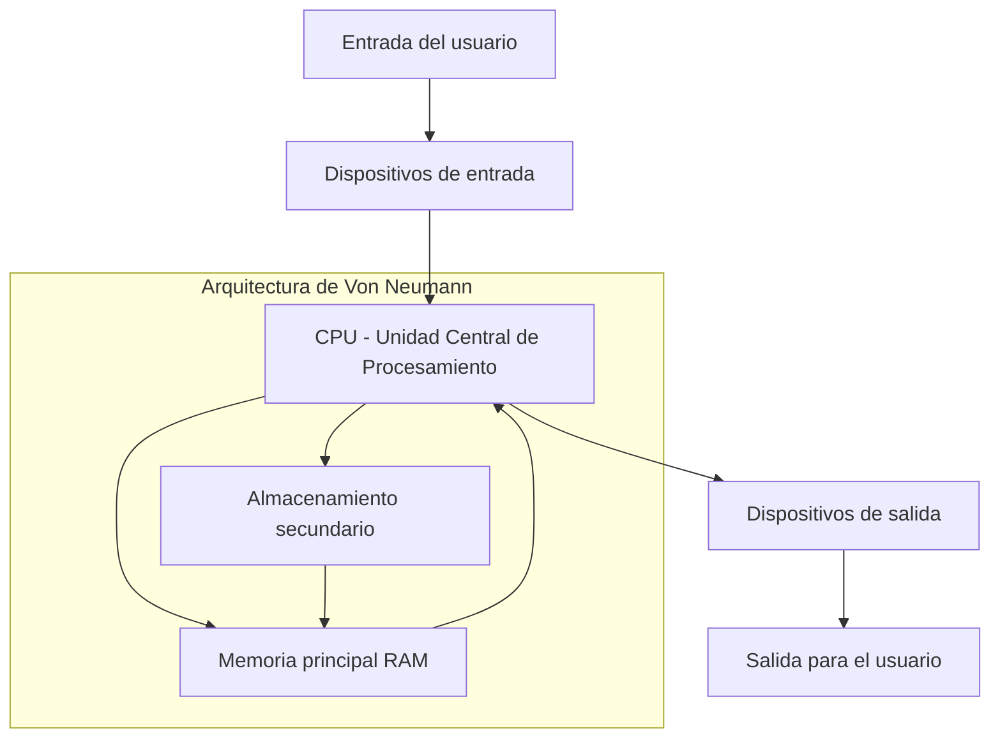
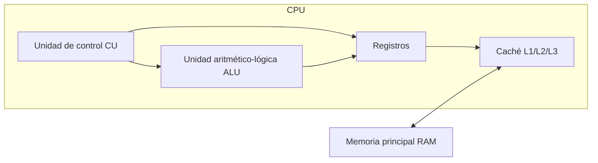
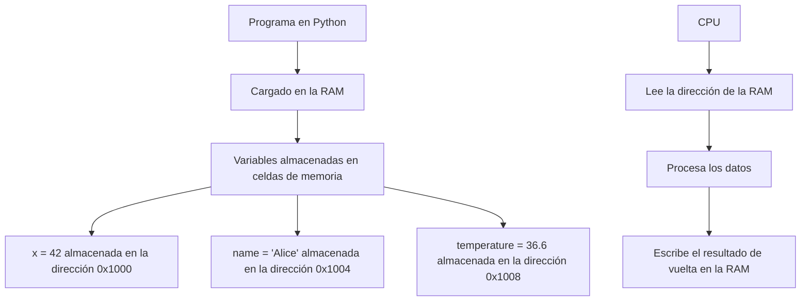
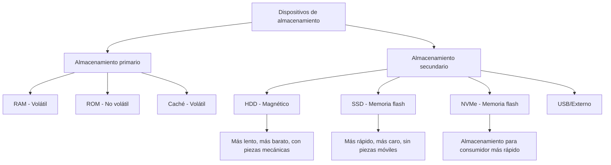
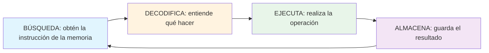
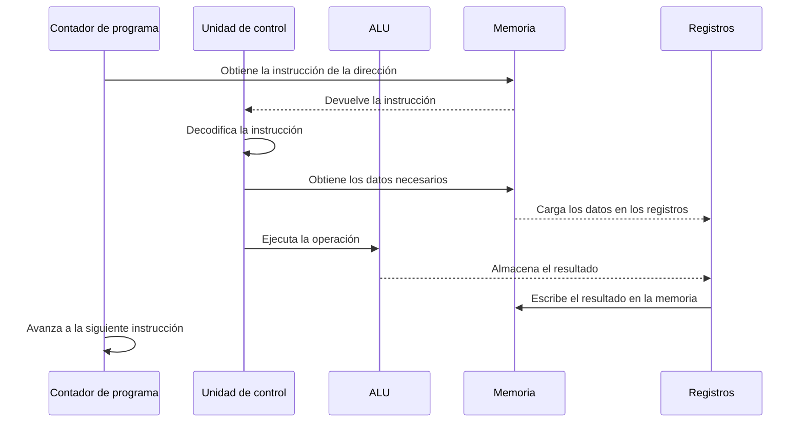
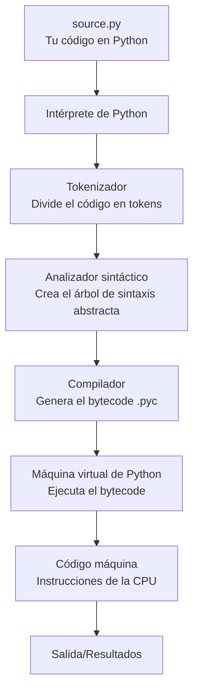

# Cómo funcionan las computadoras

Antes de adentrarte en la programación con Python, es esencial entender la máquina que ejecuta tu código. Esta lección cubre los componentes fundamentales de las computadoras, cómo procesan la información y cómo se ejecutan los programas.

## Visión general del sistema informático

Una computadora es un dispositivo electrónico que procesa datos según un conjunto de instrucciones llamado programa. Todo programa de Python que escribas se ejecuta, en última instancia, sobre este hardware.



### La arquitectura de Von Neumann

La mayoría de las computadoras modernas siguen la arquitectura de Von Neumann, propuesta por el matemático John von Neumann en 1945. Esta arquitectura consta de cuatro componentes principales:

| Componente | Función | Analogía en el mundo real |
|-----------|----------|-------------------|
| CPU | Procesa las instrucciones y los datos | El cerebro que piensa y calcula |
| Memoria (RAM) | Almacena los programas y los datos activos | Un banco de trabajo donde haces tu labor |
| Almacenamiento | Guarda permanentemente los datos y los programas | Un archivador para el almacenamiento a largo plazo |
| Dispositivos de E/S | Se comunica con el mundo exterior | Los ojos, los oídos, la boca y las manos |

## Unidad Central de Procesamiento (CPU)

La CPU es el «cerebro» de la computadora. Ejecuta las instrucciones de los programas, realiza cálculos y administra el flujo de datos entre los componentes.

### Componentes de la CPU



**Unidad de control (CU):** Dirige la operación del procesador. Obtiene las instrucciones de la memoria, las decodifica y coordina su ejecución.

**Unidad aritmético-lógica (ALU):** Realiza operaciones matemáticas (suma, resta, multiplicación y división) y operaciones lógicas (AND, OR, NOT y comparaciones).

**Registros:** Ubicaciones de almacenamiento pequeñas y ultrarrápidas dentro de la CPU. Contienen los datos que la CPU está procesando en ese momento.

**Caché:** Memoria de alta velocidad que almacena los datos de acceso frecuente. L1 es la más rápida pero la más pequeña; L3 es más lenta pero más grande.

### Velocidad de reloj de la CPU

El reloj de la CPU determina cuántos ciclos por segundo puede ejecutar el procesador:

| Velocidad de reloj | Ciclos por segundo | Uso típico |
|-------------|------------------|-------------|
| 1 GHz | 1,000,000,000 | Cómputo básico |
| 2.4 GHz | 2,400,000,000 | Portátiles estándar |
| 3.5 GHz | 3,500,000,000 | PC para juegos |
| 5.0 GHz | 5,000,000,000 | Estaciones de trabajo de alto rendimiento |

> [!NOTE]
> Una CPU de 3.5 GHz puede ejecutar miles de millones de instrucciones por segundo. Sin embargo, las CPU modernas no ejecutan una instrucción por ciclo: usan tuberías de ejecución (pipelining) y múltiples núcleos para procesar muchas instrucciones a la vez.

## Memoria (RAM)

La memoria de acceso aleatorio (RAM) es la memoria a corto plazo de la computadora. Almacena los datos y los programas que se están usando en ese momento.

### Cómo funciona la RAM



### Jerarquía de memoria

| Tipo | Velocidad | Tamaño | Volátil | Ejemplo |
|------|-------|------|----------|---------|
| Registros | La más rápida | Bytes | Sí | Registros de la CPU |
| Caché L1 | Muy rápida | KB | Sí | Caché de la CPU |
| Caché L2 | Rápida | MB | Sí | Caché de la CPU |
| Caché L3 | Moderada | MB | Sí | Caché de la CPU |
| RAM | Más lenta | GB | Sí | DDR4/DDR5 |
| SSD | Lenta | TB | No | SSD NVMe |
| HDD | La más lenta | TB | No | Unidad mecánica |

> [!TIP]
> Cuando ejecutas un script de Python, el programa completo se carga en la RAM. Por eso los programas con conjuntos de datos grandes necesitan más RAM. Si la RAM se llena, el sistema usa el espacio de intercambio (swap) en el disco, que es mucho más lento.

## Representación binaria

Las computadoras solo entienden dos estados: encendido (1) y apagado (0). Este sistema binario es la base de todo el cómputo digital.

### Sistema de numeración binario

El sistema binario usa la base 2, mientras que los humanos solemos usar la base 10 (decimal).

| Decimal | Binario | Explicación |
|---------|--------|-------------|
| 0 | 0000 | 0 × 2⁰ = 0 |
| 1 | 0001 | 1 × 2⁰ = 1 |
| 2 | 0010 | 1 × 2¹ = 2 |
| 3 | 0011 | 1 × 2¹ + 1 × 2⁰ = 3 |
| 4 | 0100 | 1 × 2² = 4 |
| 5 | 0101 | 1 × 2² + 1 × 2⁰ = 5 |
| 10 | 1010 | 1 × 2³ + 1 × 2¹ = 10 |
| 255 | 11111111 | Los 8 bits en 1 |

### Conversión de decimal a binario

```
Decimal 13 to Binary:
13 ÷ 2 = 6 remainder 1  (least significant bit)
 6 ÷ 2 = 3 remainder 0
 3 ÷ 2 = 1 remainder 1
 1 ÷ 2 = 0 remainder 1  (most significant bit)

Reading remainders from bottom to top: 1101
Verification: 1×8 + 1×4 + 0×2 + 1×1 = 13 ✓
```

### Bits, bytes y más allá

| Unidad | Tamaño | Puede almacenar |
|------|------|-----------|
| Bit | 1 dígito binario | 0 o 1 |
| Nibble | 4 bits | 0-15 |
| Byte | 8 bits | 0-255 o un carácter ASCII |
| Kilobyte (KB) | 1,024 bytes | Un párrafo corto |
| Megabyte (MB) | 1,024 KB | Una foto pequeña |
| Gigabyte (GB) | 1,024 MB | Una película |
| Terabyte (TB) | 1,024 GB | Miles de películas |

> [!NOTE]
> En Python, los enteros pueden ser arbitrariamente grandes (limitados solo por la memoria disponible). El lenguaje maneja la representación binaria automáticamente, así que rara vez necesitas pensar en bits y bytes de forma directa.

## Dispositivos de almacenamiento

Los dispositivos de almacenamiento conservan los datos de forma permanente, incluso cuando la computadora está apagada.

### Tipos de almacenamiento



### Comparación entre HDD y SSD

| Característica | HDD (unidad de disco duro) | SSD (unidad de estado sólido) |
|---------|----------------------|------------------------|
| Tecnología | Platos magnéticos | Chips de memoria flash |
| Velocidad | 80-160 MB/s | 500-7000 MB/s |
| Durabilidad | Frágil (piezas móviles) | Robusta (sin piezas móviles) |
| Ruido | Zumbido audible | Silenciosa |
| Precio | Más barato por GB | Más caro por GB |
| Mejor para | Almacenamiento masivo | El sistema operativo y las aplicaciones |

## El ciclo de búsqueda-decodificación-ejecución

Todo programa se ejecuta mediante un ciclo continuo llamado ciclo de búsqueda-decodificación-ejecución. Así es como tu código de Python se ejecuta realmente en la CPU.

### Etapas del ciclo



### Desglose detallado



### Ejemplo: ejecución de `x = 5 + 3`

Cuando Python ejecuta `x = 5 + 3`, la CPU realiza lo siguiente:

1. **BÚSQUEDA:** obtén la instrucción ADD de la memoria
2. **DECODIFICACIÓN:** reconoce que debe sumar dos números
3. **BÚSQUEDA:** obtén los valores 5 y 3 de la memoria
4. **EJECUCIÓN:** la ALU realiza 5 + 3 = 8
5. **ALMACENAMIENTO:** guarda el resultado 8 en la ubicación de memoria de la variable `x`

> [!WARNING]
> Este ciclo ocurre miles de millones de veces por segundo. Un programa de Python sencillo puede ejecutar millones de estos ciclos antes de completarse.

## Cómo se ejecuta el código de Python

Entender cómo se traduce tu código de Python en operaciones de la máquina te ayuda a escribir programas más eficientes.

### Canalización de ejecución de Python



### Ejemplo de bytecode

Cuando escribes código de Python, este se compila a bytecode antes de la ejecución:

```python
# Source code
x = 10
y = 20
result = x + y
print(result)
```

El intérprete de Python convierte esto en bytecode (mostrado con el módulo `dis`):

```python
import dis

def add_numbers():
    x = 10
    y = 20
    result = x + y
    print(result)

dis.dis(add_numbers)
```

Salida:
```
  2           0 LOAD_CONST               1 (10)
              2 STORE_FAST               0 (x)

  3           4 LOAD_CONST               2 (20)
              6 STORE_FAST               1 (y)

  4           8 LOAD_FAST                0 (x)
             10 LOAD_FAST                1 (y)
             12 BINARY_ADD
             14 STORE_FAST               2 (result)

  5          16 LOAD_GLOBAL              0 (print)
             18 LOAD_FAST                2 (result)
             20 CALL_FUNCTION            1
             22 POP_TOP
             24 LOAD_CONST               0 (None)
             26 RETURN_VALUE
```

> [!TIP]
> El módulo `dis` es una excelente herramienta para entender qué hace Python internamente. Úsalo para ver el bytecode de cualquier función.

## Ejemplo del mundo real: rendimiento de una calculadora

Veamos cómo la arquitectura de la computadora afecta el rendimiento de Python:

```python
import time

# Measure time for different operations
def benchmark_operations():
    iterations = 10_000_000
    
    # Test 1: Simple addition (uses ALU directly)
    start = time.time()
    total = 0
    for i in range(iterations):
        total += 1
    print(f"Addition: {time.time() - start:.4f} seconds")
    
    # Test 2: Multiplication (slightly more complex ALU operation)
    start = time.time()
    total = 1
    for i in range(iterations):
        total *= 1.0000001
    print(f"Multiplication: {time.time() - start:.4f} seconds")
    
    # Test 3: List access (involves memory access)
    data = list(range(iterations))
    start = time.time()
    total = 0
    for i in range(iterations):
        total += data[i]
    print(f"List access: {time.time() - start:.4f} seconds")

benchmark_operations()
```

Salida típica:
```
Addition: 0.5234 seconds
Multiplication: 0.6891 seconds
List access: 1.2456 seconds
```

> [!NOTE]
> El acceso a una lista es más lento porque implica búsquedas en la memoria, no solo cálculos de la CPU. Esto demuestra por qué comprender la jerarquía de memoria importa a la hora de escribir código eficiente.

## Ejercicios de práctica

### Ejercicio 1: Conversión binaria
Convierte los siguientes números decimales a binario:
- a) 7
- b) 15
- c) 32
- d) 100

### Ejercicio 2: Jerarquía de memoria
Ordena lo siguiente de más rápido a más lento:
- RAM, caché L1, HDD, registros, SSD, caché L2

### Ejercicio 3: Componentes de la CPU
Explica qué sucede en la CPU cuando Python ejecuta: `result = 10 * 5`

### Ejercicio 4: Cálculo de almacenamiento
Si un archivo de texto contiene 1,000 caracteres (1 byte cada uno), ¿cuántos bytes, KB y bits ocupa?

### Ejercicio 5: Búsqueda-decodificación-ejecución
Describe cada paso del ciclo de búsqueda-decodificación-ejecución para la sentencia de Python: `x = x + 1`

### Ejercicio 6: Análisis de rendimiento
¿Por qué es más rápido acceder a los datos de la RAM que acceder a los datos de un SSD? Explica la respuesta usando el concepto de jerarquía de memoria.

### Ejercicio 7: Bytecode de Python
Usa el módulo `dis` para examinar el bytecode de una función sencilla que devuelve el cuadrado de un número. ¿Qué operaciones observas?

### Ejercicio 8: Aplicación en el mundo real
Un programa necesita procesar 1 millón de registros. ¿Los almacenarías en la RAM o los leerías desde el disco? Justifica tu respuesta según lo que aprendiste sobre memoria y almacenamiento.

## Resumen

En esta lección aprendiste:
- La arquitectura de Von Neumann y sus cuatro componentes principales
- Los componentes de la CPU: la unidad de control, la ALU, los registros y la caché
- Cómo la RAM almacena los programas y los datos activos
- La representación binaria y por qué las computadoras usan la base 2
- La jerarquía de memoria, desde los registros hasta los discos duros
- El ciclo de búsqueda-decodificación-ejecución que ejecuta todos los programas
- Cómo el código de Python se transforma en instrucciones de la máquina

Comprender estos fundamentos te ayudará a escribir código de Python más eficiente y a depurar problemas de rendimiento con mayor eficacia.
