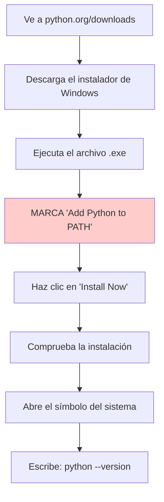
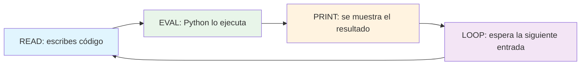
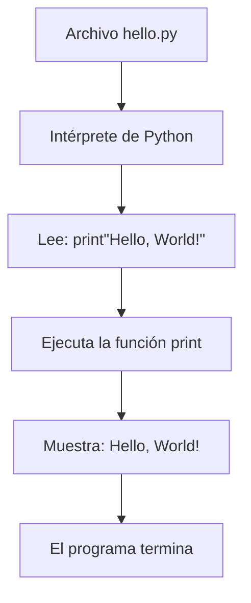
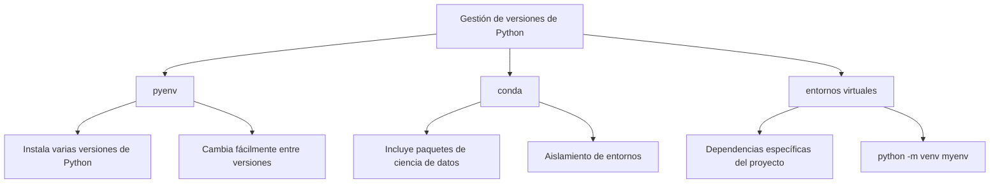

# Configuración de Python y primer programa

Te damos la bienvenida a tu primera lección práctica de Python. En esta lección instalarás Python, escribirás tu primer programa y aprenderás diferentes maneras de ejecutar código de Python.

## Instalación de Python

Python está disponible para todos los sistemas operativos principales. Vamos a preparar tu entorno.

### Comprobación de si Python ya está instalado

Muchos sistemas vienen con Python preinstalado. Abre tu terminal o tu símbolo del sistema y escribe:

```bash
python3 --version
# or on Windows:
python --version
```

Salida esperada:
```
Python 3.11.4
```

> [!NOTE]
> Este curso requiere Python 3.8 o superior. Si tienes una versión más antigua o Python no está instalado, sigue los pasos de instalación que aparecen a continuación.

### Instalación en Windows



**Paso a paso:**

1. Visita [python.org/downloads](https://www.python.org/downloads/)
2. Haz clic en "Download Python 3.x.x" (la última versión)
3. Ejecuta el instalador descargado
4. **IMPORTANTE:** marca "Add Python to PATH" en la parte inferior
5. Haz clic en "Install Now"
6. Comprueba la instalación abriendo el símbolo del sistema y escribiendo `python --version`

### Instalación en macOS

```bash
# Option 1: Using Homebrew (recommended)
brew install python3

# Option 2: Download from python.org
# Visit https://www.python.org/downloads/macos/
```

Comprueba la instalación:
```bash
python3 --version
```

### Instalación en Linux (Ubuntu/Debian)

```bash
# Update package list
sudo apt update

# Install Python 3
sudo apt install python3 python3-pip

# Verify installation
python3 --version
```

> [!TIP]
> En Linux es posible que Python ya esté instalado. Usa `python3` en lugar de `python` para asegurarte de que estás usando Python 3.

## El REPL de Python

REPL son las siglas de Read-Eval-Print Loop (leer, evaluar, imprimir, repetir). Es un entorno interactivo donde puedes escribir código de Python y ver los resultados de inmediato.

### Inicio del REPL

```bash
# Windows
python

# macOS/Linux
python3
```

Verás algo como:
```
Python 3.11.4 (main, Jun  1 2024, 00:00:00) [GCC 11.3.0] on linux
Type "help", "copyright", "credits" or "license" for more information.
>>>
```

### Uso del REPL

```python
# The >>> is the prompt. Type code after it.
>>> 2 + 2
4

>>> "Hello, World!"
'Hello, World!'

>>> name = "Alice"
>>> name
'Alice'

>>> len(name)
5

>>> type(42)
<class 'int'>

>>> type("hello")
<class 'str'>
```



### Salida del REPL

```python
# Method 1: Use exit()
>>> exit()

# Method 2: Use Ctrl+D (macOS/Linux) or Ctrl+Z then Enter (Windows)
```

> [!TIP]
> El REPL es perfecto para probar fragmentos de código pequeños, explorar características de Python y hacer cálculos rápidos. Úsalo con frecuencia mientras aprendes.

## Tu primer programa en Python: Hello World

La tradición en programación es empezar con un programa "Hello, World!". Vamos a crear el tuyo.

### Uso de un editor de texto

Crea un archivo nuevo llamado `hello.py` con el siguiente contenido:

```python
# hello.py - My first Python program
print("Hello, World!")
```

¡Eso es todo! Una sola línea de código. Vamos a desglosarla:

| Parte | Propósito |
|------|---------|
| `#` | Inicia un comentario (Python lo ignora) |
| `print()` | Una función integrada que muestra la salida |
| `"Hello, World!"` | Una cadena de texto para mostrar |

### Ejecución de tu script

```bash
# Navigate to the folder where hello.py is saved
cd path/to/your/folder

# Run the script
python3 hello.py
```

Salida:
```
Hello, World!
```



## Ejecución de scripts de Python

Hay varias maneras de ejecutar código de Python. Vamos a explorarlas todas.

### Método 1: ejecución directa del script

```bash
python3 script.py
```

### Método 2: ejecución como módulo

```bash
python3 -m script
```

### Método 3: convertir un script en ejecutable (Linux/macOS)

```python
#!/usr/bin/env python3
# hello.py

print("Hello, World!")
```

```bash
# Make the file executable
chmod +x hello.py

# Run it directly
./hello.py
```

### Método 4: uso de un IDE

IDE y editores de Python populares:

| IDE/Editor | Tipo | Mejor para |
|------------|------|----------|
| VS Code | Editor gratuito | Uso general |
| PyCharm | IDE gratuito o de pago | Desarrollo profesional |
| Thonny | IDE gratuito | Principiantes |
| Jupyter Notebook | Basado en la web | Ciencia de datos y exploración |
| IDLE | Incluido con Python | Pruebas sencillas |

> [!NOTE]
> Para este curso, cualquier editor de texto sirve. Se recomienda VS Code con la extensión de Python por su sencillez y sus funciones potentes.

## Comentarios en Python

Los comentarios son notas en tu código que Python ignora. Ayudan a explicar qué hace tu código.

### Comentarios de una sola línea

```python
# This is a single-line comment
print("Hello")  # This is an inline comment
```

### Comentarios de varias líneas

```python
# This is a comment
# that spans multiple lines
# explaining complex logic
print("Hello")

# Or use triple quotes (technically a string, but often used as multi-line comment)
"""
This is a multi-line comment
using triple quotes.
It's often used for documentation.
"""
print("Hello")
```

## Trabajo con entrada y salida

Vamos a hacer que nuestro programa sea interactivo recibiendo entrada del usuario.

### La función input()

```python
# greeting.py
name = input("What is your name? ")
print(f"Hello, {name}! Welcome to Python!")
```

Al ejecutar este script:
```
$ python3 greeting.py
What is your name? Alice
Hello, Alice! Welcome to Python!
```

> [!WARNING]
> La función `input()` siempre devuelve una cadena de texto. Si necesitas un número, debes convertirlo con `int()` o `float()`.

### Ejemplo completo: calculadora sencilla

```python
# simple_calculator.py
# A simple calculator that adds two numbers

# Get user input
print("=== Simple Addition Calculator ===")
num1 = float(input("Enter the first number: "))
num2 = float(input("Enter the second number: "))

# Perform calculation
result = num1 + num2

# Display result
print(f"{num1} + {num2} = {result}")
```

Ejemplo de salida:
```
=== Simple Addition Calculator ===
Enter the first number: 15.5
Enter the second number: 7.3
15.5 + 7.3 = 22.8
```

## Comprensión de las extensiones de archivo

Los archivos de Python usan la extensión `.py`. Esto es lo que significan los distintos tipos de archivo de Python:

| Extensión | Descripción |
|-----------|-------------|
| `.py` | Archivo de código fuente de Python |
| `.pyc` | Bytecode de Python compilado (generado automáticamente) |
| `.pyw` | Script de Python sin ventana de consola (Windows) |
| `.pyi` | Archivo stub de Python para las anotaciones de tipo |

## Gestión de versiones de Python

A medida que avances, es posible que necesites varias versiones de Python. Estas son algunas herramientas para gestionarlas:



### Creación de un entorno virtual

```bash
# Create a virtual environment
python3 -m venv myenv

# Activate it (Linux/macOS)
source myenv/bin/activate

# Activate it (Windows)
myenv\Scripts\activate

# Now python points to the environment's Python
python --version

# Deactivate when done
deactivate
```

> [!TIP]
> Usa siempre entornos virtuales en tus proyectos. Mantienen las dependencias aisladas y evitan conflictos entre proyectos.

## Ejemplo del mundo real: script de información del sistema

Vamos a crear un script útil que muestra información del sistema:

```python
# system_info.py
import platform
import sys
import os

def display_system_info():
    """Display basic system information."""
    print("=" * 40)
    print("       SYSTEM INFORMATION")
    print("=" * 40)
    print(f"Python Version: {sys.version}")
    print(f"Operating System: {platform.system()} {platform.release()}")
    print(f"Machine: {platform.machine()}")
    print(f"Processor: {platform.processor()}")
    print(f"Current Directory: {os.getcwd()}")
    print(f"Python Path: {sys.executable}")
    print("=" * 40)

if __name__ == "__main__":
    display_system_info()
```

Ejemplo de salida:
```
========================================
       SYSTEM INFORMATION
========================================
Python Version: 3.11.4 (main, Jun  1 2024, 00:00:00) [GCC 11.3.0]
Operating System: Linux 5.15.0-91-generic
Machine: x86_64
Processor: x86_64
Current Directory: /home/user/projects
Python Path: /usr/bin/python3
========================================
```

## Ejercicios de práctica

### Ejercicio 1: Comprobación de la instalación
Comprueba que Python está instalado correctamente ejecutando `python3 --version` y `pip3 --version` en tu terminal.

### Ejercicio 2: Exploración del REPL
Abre el REPL de Python e intenta lo siguiente:
- Calcular `17 * 23`
- Obtener la longitud de la cadena "Python Programming"
- Comprobar el tipo de `3.14`
- Usar `help(print)` para ver la documentación de la función print

### Ejercicio 3: Saludo personalizado
Crea un script llamado `greeting.py` que pida el nombre y la edad del usuario y luego imprima un saludo personalizado que incluya el año en que nació.

### Ejercicio 4: Conversor de temperatura
Escribe un script que pida una temperatura en grados Celsius y la convierta a Fahrenheit usando la fórmula: `F = C * 9/5 + 32`

### Ejercicio 5: Salida de varias líneas
Crea un script que imprima un sencillo arte ASCII o un patrón usando varias sentencias print:
```
  *
 ***
*****
 ***
  *
```

### Ejercicio 6: Entorno virtual
Crea un entorno virtual, actívalo, comprueba que está activo y luego desactívalo.

### Ejercicio 7: Práctica con comentarios
Escribe un script con al menos 5 líneas de código y añade comentarios significativos que expliquen cada paso.

### Ejercicio 8: Exploración de errores
En el REPL, prueba esto y observa los mensajes de error:
- `print("hello"` (falta el paréntesis de cierre)
- `2 + "two"` (suma de un número y una cadena de texto)
- `prnt("hello")` (error tipográfico en el nombre de la función)

## Resumen

En esta lección aprendiste:
- Cómo instalar Python en Windows, macOS y Linux
- Cómo usar el REPL de Python para programar de forma interactiva
- Cómo escribir y ejecutar tu primer script de Python
- Diferentes métodos para ejecutar código de Python
- Cómo usar comentarios para documentar tu código
- Cómo obtener la entrada del usuario con `input()`
- Cómo crear y usar entornos virtuales
- Cómo construir scripts prácticos

¡Ya estás listo para empezar a escribir programas de Python! La próxima lección se adentrará en las variables y los tipos de datos.
