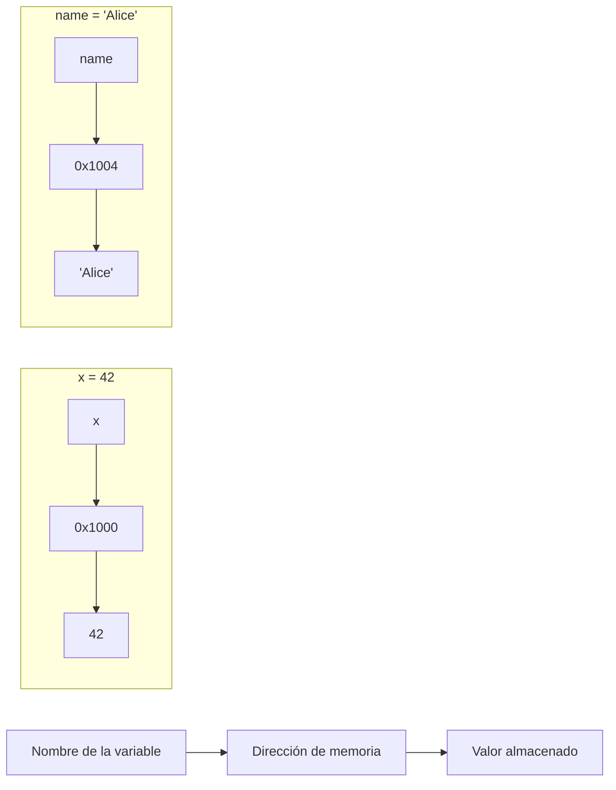
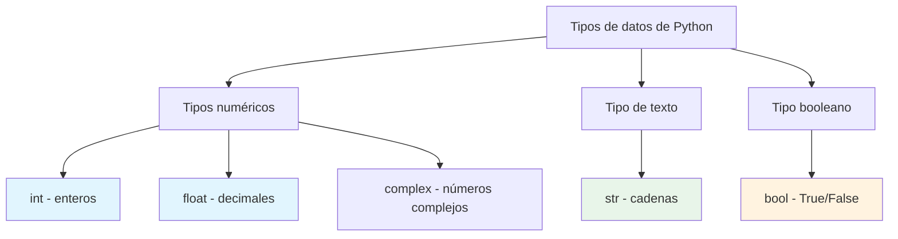
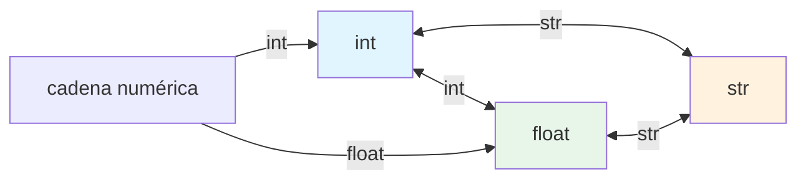

# Variables y tipos de datos

Las variables son la base de todo programa. Almacenan los datos que tu programa manipula. En Python, trabajar con variables es intuitivo y flexible.

## ¿Qué es una variable?

Una variable es una ubicación con nombre en la memoria que almacena un valor. Piensa en ella como una caja etiquetada en la que puedes colocar objetos diferentes.



### Creación de variables en Python

```python
# Variable assignment
age = 25
name = "Alice"
height = 1.75
is_student = True

# Multiple assignment
x, y, z = 10, 20, 30
a = b = c = 0

# Displaying variables
print(f"Name: {name}")
print(f"Age: {age}")
print(f"Height: {height}m")
print(f"Student: {is_student}")
```

Salida:
```
Name: Alice
Age: 25
Height: 1.75m
Student: True
```

> [!NOTE]
> A diferencia de lenguajes como C o Java, Python no te obliga a declarar el tipo de una variable. Python infiere el tipo a partir del valor que asignas. Esto se llama tipado dinámico.

## Los tipos de datos primitivos de Python

Python tiene varios tipos de datos integrados. Vamos a explorar los cuatro más fundamentales.

### Visión general de los tipos de datos



| Tipo | Nombre en Python | Ejemplo | Descripción |
|------|-------------|---------|-------------|
| Entero | `int` | `42`, `-7`, `0` | Números enteros (positivos, negativos y cero) |
| Flotante | `float` | `3.14`, `-0.5`, `2.0` | Números con decimales |
| Cadena | `str` | `"hello"`, `'world'` | Texto o caracteres |
| Booleano | `bool` | `True`, `False` | Valores de verdad |

## Enteros (int)

Los enteros representan números enteros sin punto decimal.

### Operaciones con enteros

```python
# Creating integers
positive = 100
negative = -50
zero = 0
large_number = 1_000_000  # Underscores for readability

# Arithmetic with integers
a = 15
b = 4

print(f"Addition: {a} + {b} = {a + b}")       # 19
print(f"Subtraction: {a} - {b} = {a - b}")    # 11
print(f"Multiplication: {a} * {b} = {a * b}") # 60
print(f"Division: {a} / {b} = {a / b}")       # 3.75 (returns float!)
print(f"Floor Division: {a} // {b} = {a // b}") # 3
print(f"Modulus: {a} % {b} = {a % b}")        # 3
print(f"Exponent: {a} ** {b} = {a ** b}")     # 50625
```

Salida:
```
Addition: 15 + 4 = 19
Subtraction: 15 - 4 = 11
Multiplication: 15 * 4 = 60
Division: 15 / 4 = 3.75
Floor Division: 15 // 4 = 3
Modulus: 15 % 4 = 3
Exponent: 15 ** 4 = 50625
```

> [!TIP]
> ¡Los enteros de Python tienen precisión ilimitada! Con el operador `**` puedes trabajar con números tan grandes como permita tu memoria:
> ```python
> >>> 2 ** 1000
> 107150860718626732094842504906000181056140481170553360744375038837...
> ```

## Flotantes (float)

Los flotantes representan números con punto decimal.

### Operaciones con flotantes y precisión

```python
# Creating floats
pi = 3.14159
temperature = -5.5
scientific = 6.022e23  # Scientific notation: 6.022 × 10²³

# Float operations
x = 10.5
y = 3.2

print(f"Addition: {x + y}")       # 13.7
print(f"Multiplication: {x * y}") # 33.6

# Float precision caveat
print(f"\n0.1 + 0.2 = {0.1 + 0.2}")  # 0.30000000000000004 (!)
print(f"0.1 + 0.2 == 0.3: {0.1 + 0.2 == 0.3}")  # False!
```

Salida:
```
Addition: 13.7
Multiplication: 33.6

0.1 + 0.2 = 0.30000000000000004
0.1 + 0.2 == 0.3: False
```

> [!WARNING]
> La aritmética de punto flotante puede tener problemas de precisión debido a la forma en que las computadoras representan los decimales en binario. Para cálculos financieros, usa el módulo `decimal` en lugar de los flotantes.

```python
# Using decimal for precise calculations
from decimal import Decimal

a = Decimal('0.1')
b = Decimal('0.2')
print(f"Decimal: {a + b}")  # 0.3 (exact!)
```

## Cadenas (str)

Las cadenas representan texto y van entre comillas.

### Creación y uso de cadenas

```python
# Different ways to create strings
single_quotes = 'Hello'
double_quotes = "World"
triple_quotes = """This is a
multi-line string"""

# String operations
first_name = "Alice"
last_name = "Smith"

# Concatenation
full_name = first_name + " " + last_name
print(f"Full name: {full_name}")

# Repetition
separator = "-" * 30
print(separator)

# String length
message = "Python Programming"
print(f"Length: {len(message)}")  # 18

# Accessing characters (indexing)
word = "Python"
print(f"First character: {word[0]}")    # P
print(f"Last character: {word[-1]}")    # n
print(f"Third character: {word[2]}")    # t
```

Salida:
```
Full name: Alice Smith
------------------------------
Length: 18
First character: P
Last character: n
Third character: t
```

### Métodos de cadenas

```python
text = "  Hello, World!  "

print(f"Original: '{text}'")
print(f"Upper: '{text.upper()}'")
print(f"Lower: '{text.lower()}'")
print(f"Title: '{text.title()}'")
print(f"Strip: '{text.strip()}'")
print(f"Replace: '{text.replace('World', 'Python')}'")
print(f"Split: {text.strip().split(',')}")
```

Salida:
```
Original: '  Hello, World!  '
Upper: '  HELLO, WORLD!  '
Lower: '  hello, world!  '
Title: '  Hello, World!  '
Strip: 'Hello, World!'
Replace: '  Hello, Python!  '
Split: ['Hello', 'World!']
```

### F-strings (literales de cadena con formato)

```python
name = "Alice"
age = 30
score = 95.678

# Basic f-string
print(f"My name is {name} and I am {age} years old.")

# Expressions in f-strings
print(f"Next year I will be {age + 1}.")

# Formatting numbers
print(f"Score: {score:.2f}")      # 2 decimal places: 95.68
print(f"Score as percent: {score:.1%}")  # Not applicable here, but useful
print(f"Right aligned: {name:>10}")     # Right aligned in 10 chars
print(f"Center aligned: {name:^10}")    # Center aligned
```

Salida:
```
My name is Alice and I am 30 years old.
Next year I will be 31.
Score: 95.68
Right aligned:      Alice
Center aligned:  Alice   
```

## Booleanos (bool)

Los booleanos representan valores de verdad: `True` o `False`.

### Fundamentos de los booleanos

```python
# Boolean values
is_active = True
is_admin = False

print(f"Active: {is_active}")       # True
print(f"Admin: {is_admin}")         # False
print(f"Type: {type(is_active)}")   # <class 'bool'>

# Boolean from comparisons
x = 10
y = 20

print(f"\n{x} > {y}: {x > y}")       # False
print(f"{x} < {y}: {x < y}")         # True
print(f"{x} == {y}: {x == y}")       # False
print(f"{x} != {y}: {x != y}")       # True
print(f"{x} >= 10: {x >= 10}")       # True
```

### Valores truthy y falsy en Python

```python
# Python evaluates many values as True or False in boolean context
print(f"bool(1): {bool(1)}")         # True
print(f"bool(0): {bool(0)}")         # False
print(f"bool('hello'): {bool('hello')}")  # True
print(f"bool(''): {bool('')}")       # False
print(f"bool([]): {bool([])}")       # False (empty list)
print(f"bool([1, 2]): {bool([1, 2])}")  # True (non-empty list)
print(f"bool(None): {bool(None)}")   # False
```

> [!NOTE]
> En Python, los siguientes se consideran falsy: `False`, `None`, `0`, `0.0`, `""`, `[]`, `{}`, `set()`. Todo lo demás se considera truthy.

## Conversión de tipos (casting)

A menudo necesitas convertir entre tipos. Python proporciona funciones integradas para ello.

### Conversión entre tipos



```python
# String to int
age_str = "25"
age_int = int(age_str)
print(f"int('25') = {age_int}")        # 25
print(f"Type: {type(age_int)}")        # <class 'int'>

# String to float
price_str = "19.99"
price_float = float(price_str)
print(f"float('19.99') = {price_float}")  # 19.99

# Int/float to string
number = 42
number_str = str(number)
print(f"str(42) = '{number_str}'")     # '42'

# Float to int (truncates, doesn't round!)
pi = 3.14159
pi_int = int(pi)
print(f"int(3.14159) = {pi_int}")     # 3

# Boolean to int/float
print(f"int(True) = {int(True)}")      # 1
print(f"int(False) = {int(False)}")    # 0
print(f"float(True) = {float(True)}")  # 1.0
```

### Ejemplo práctico: conversión de la entrada

```python
# calculator_input.py
# Getting numeric input from user

print("=== Rectangle Area Calculator ===")

# input() always returns a string, so we must convert
width_str = input("Enter width: ")
height_str = input("Enter height: ")

# Convert strings to floats
width = float(width_str)
height = float(height_str)

# Calculate area
area = width * height

print(f"\nRectangle Dimensions:")
print(f"  Width: {width}")
print(f"  Height: {height}")
print(f"  Area: {area}")
```

Ejemplo de salida:
```
=== Rectangle Area Calculator ===
Enter width: 5.5
Enter height: 3.2

Rectangle Dimensions:
  Width: 5.5
  Height: 3.2
  Area: 17.6
```

## Convenciones de nomenclatura de variables

Python tiene reglas y convenciones específicas para nombrar variables.

### Reglas (obligatorias)

| Regla | Válido | No válido |
|------|-------|---------|
| Empezar con una letra o un guion bajo | `name`, `_age` | `1name`, `2nd` |
| Usar solo letras, números y guiones bajos | `user_name`, `var2` | `user-name`, `var@2` |
| Distinguir entre mayúsculas y minúsculas | `age`, `Age` y `AGE` son distintos | - |
| No ser una palabra clave reservada | - | `if`, `for`, `class`, `def` |

### Convenciones (recomendadas)

```python
# Snake case for variables (recommended)
user_name = "Alice"
total_amount = 100.50
is_active = True

# Constants (all uppercase)
PI = 3.14159
MAX_RETRIES = 3
API_KEY = "secret123"

# Private variables (leading underscore - convention only)
_internal_value = 42
_temp_data = []

# Bad names - avoid these!
x = 10          # Too vague
temp123 = "hi"  # Not descriptive
myVariableName = "Alice"  # camelCase not standard in Python
```

> [!TIP]
> ¡Elige nombres descriptivos! `student_age` es mucho mejor que `sa` o `x`. Tu yo del futuro (y otros desarrolladores) te lo agradecerán.

## Comprobación de tipos con type() e isinstance()

```python
# Using type()
value1 = 42
value2 = 3.14
value3 = "hello"
value4 = True

print(f"type(42) = {type(value1)}")         # <class 'int'>
print(f"type(3.14) = {type(value2)}")       # <class 'float'>
print(f"type('hello') = {type(value3)}")    # <class 'str'>
print(f"type(True) = {type(value4)}")       # <class 'bool'>

# Using isinstance() for type checking
print(f"\nisinstance(42, int): {isinstance(42, int)}")          # True
print(f"isinstance(3.14, int): {isinstance(3.14, int)}")        # False
print(f"isinstance(3.14, float): {isinstance(3.14, float)}")    # True
print(f"isinstance(True, int): {isinstance(True, int)}")        # True (bool is subclass of int!)
```

## Ejemplo del mundo real: sistema de registro de estudiantes

```python
# student_record.py
# A simple student record using different data types

# Student information
student_id = 1001                    # int
name = "Maria Santos"                # str
age = 22                             # int
gpa = 3.85                           # float
is_enrolled = True                   # bool
courses = ["Math", "Physics", "CS"]  # list

# Display student record
print("=" * 40)
print("       STUDENT RECORD")
print("=" * 40)
print(f"Student ID: {student_id}")
print(f"Name: {name}")
print(f"Age: {age}")
print(f"GPA: {gpa:.2f}")
print(f"Enrolled: {'Yes' if is_enrolled else 'No'}")
print(f"Courses: {', '.join(courses)}")
print("=" * 40)

# Type summary
print("\nData Types Used:")
print(f"  student_id: {type(student_id).__name__}")
print(f"  name: {type(name).__name__}")
print(f"  age: {type(age).__name__}")
print(f"  gpa: {type(gpa).__name__}")
print(f"  is_enrolled: {type(is_enrolled).__name__}")
```

Salida:
```
========================================
       STUDENT RECORD
========================================
Student ID: 1001
Name: Maria Santos
Age: 22
GPA: 3.85
Enrolled: Yes
Courses: Math, Physics, CS
========================================

Data Types Used:
  student_id: int
  name: str
  age: int
  gpa: float
  is_enrolled: bool
```

## Ejercicios de práctica

### Ejercicio 1: Identificación de tipos
Identifica el tipo de cada valor:
- `42`
- `"42"`
- `42.0`
- `True`
- `"True"`
- `0`

### Ejercicio 2: Creación de variables
Crea variables para un producto: nombre (str), precio (float), cantidad (int) y en_stock (bool). Imprime un resumen.

### Ejercicio 3: Conversión de tipos
Convierte la cadena `"3.14159"` a float y luego a int. ¿Qué le ocurre a la parte decimal?

### Ejercicio 4: Operaciones con cadenas
Dado `text = "Python Programming"`, escribe código para:
- Obtener la longitud
- Convertirla a mayúsculas
- Reemplazar "Python" por "Java"
- Obtener los primeros 6 caracteres

### Ejercicio 5: Formato con f-strings
Crea un f-string que muestre un precio de $19.99 con 2 decimales, alineado a la derecha en 10 caracteres.

### Ejercicio 6: Corrección de convenciones de nomenclatura
Corrige estos nombres de variables para que sigan las convenciones de Python:
- `myVariableName`
- `2ndPlace`
- `user-email`
- `TOTALTAX`

### Ejercicio 7: Programa de conversión de temperatura
Escribe un programa que convierta grados Celsius a Fahrenheit y a Kelvin:
- F = C × 9/5 + 32
- K = C + 273.15

### Ejercicio 8: Función verificadora de tipos
Escribe una función que reciba cualquier valor e imprima su tipo y si es truthy o falsy.

## Resumen

En esta lección aprendiste:
- Cómo crear y usar variables en Python
- Los cuatro tipos de datos primitivos: int, float, str y bool
- Las operaciones aritméticas y su comportamiento con diferentes tipos
- Las operaciones y los métodos de las cadenas, y el formato con f-strings
- Los valores booleanos y el carácter truthy y falsy en Python
- La conversión de tipos entre los distintos tipos de datos
- Las reglas y las convenciones de nomenclatura de variables
- Cómo comprobar los tipos con `type()` e `isinstance()`

Las variables y los tipos de datos son los bloques de construcción de todo programa de Python. Domina estos fundamentos antes de pasar a los operadores y las expresiones.
