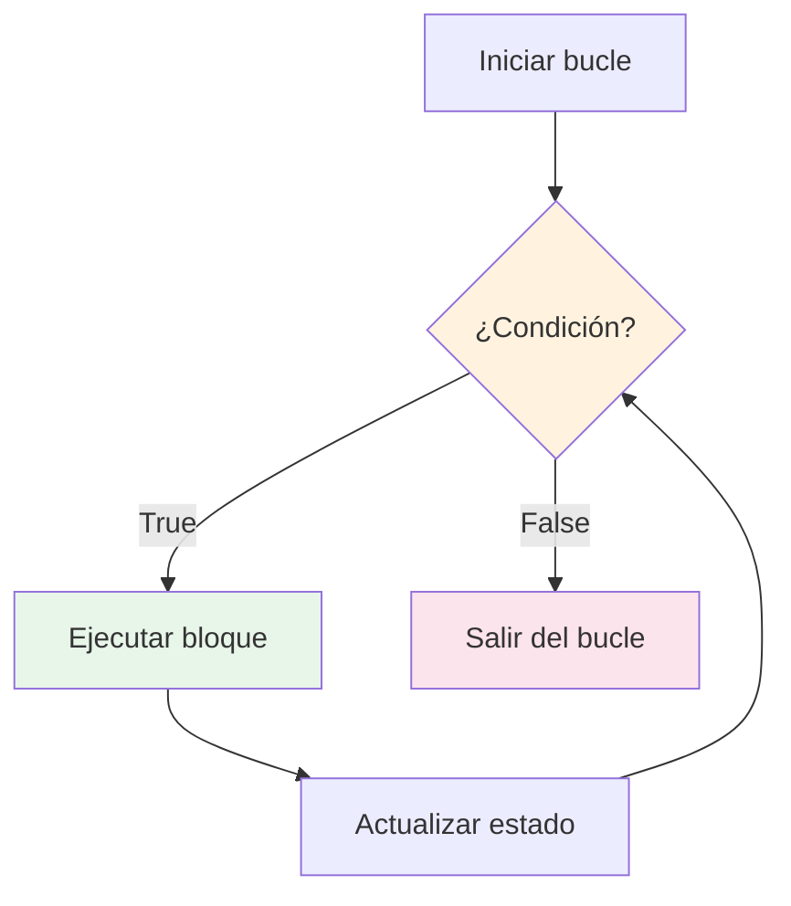
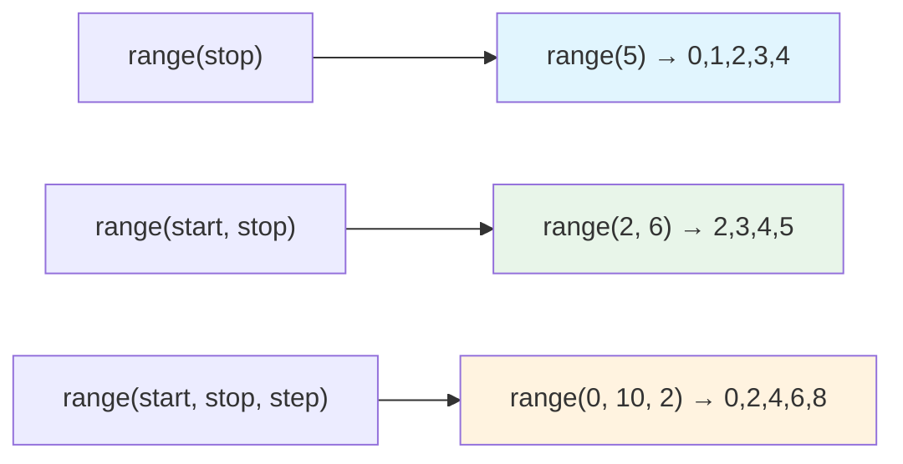
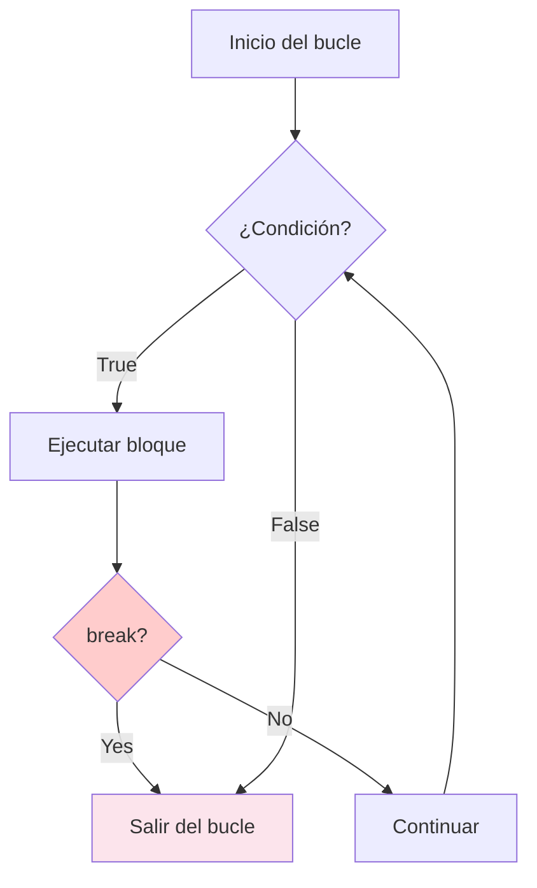
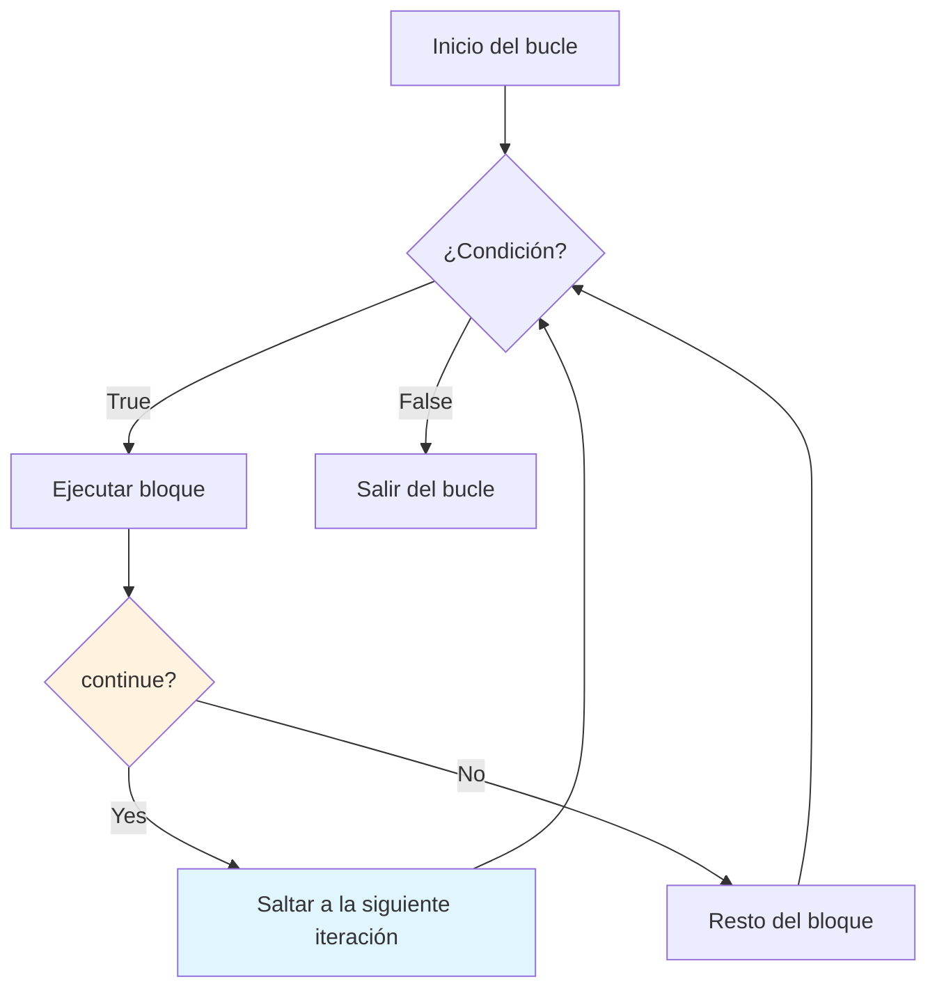
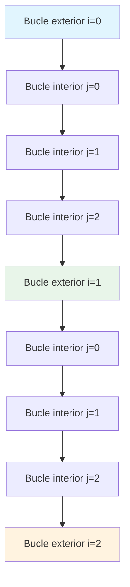

# Flujo de control: bucles

Los bucles permiten ejecutar un bloque de código varias veces. Son esenciales para procesar colecciones, repetir tareas e implementar algoritmos.

## ¿Qué son los bucles?

Un bucle repite un bloque de código hasta que se cumple una condición. Python ofrece dos tipos principales de bucle: `while` y `for`.



## El bucle while

El bucle `while` se repite mientras una condición siga siendo verdadera.

### Sintaxis básica

```python
while condition:
    # Code executes repeatedly while condition is True
    pass
```

### Ejemplo simple de while

```python
# Countdown from 5
count = 5

while count > 0:
    print(f"Count: {count}")
    count -= 1  # IMPORTANT: Update the counter!

print("Liftoff! 🚀")
```

Salida:
```
Count: 5
Count: 4
Count: 3
Count: 2
Count: 1
Liftoff! 🚀
```

> [!WARNING]
> ¡Asegúrate siempre de que la condición del bucle acabe siendo falsa! Olvidar actualizar la variable del bucle crea un bucle infinito:
> ```python
> # INFINITE LOOP - don't do this!
> count = 5
> while count > 0:
>     print(count)
>     # Forgot: count -= 1
> ```

### Bucle while con entrada del usuario

```python
# number_guessing.py
import random

def guess_the_number():
    """Simple number guessing game using while loop."""
    
    secret = random.randint(1, 20)
    attempts = 0
    max_attempts = 5
    
    print("=== Number Guessing Game ===")
    print("I'm thinking of a number between 1 and 20.")
    print(f"You have {max_attempts} attempts.\n")
    
    while attempts < max_attempts:
        guess = int(input(f"Attempt {attempts + 1}/{max_attempts}: "))
        attempts += 1
        
        if guess == secret:
            print(f"🎉 Correct! You got it in {attempts} attempts!")
            return
        elif guess < secret:
            print("Too low! Try higher.")
        else:
            print("Too high! Try lower.")
    
    print(f"\n😔 Game over! The number was {secret}.")

# Run the game
guess_the_number()
```

Salida de ejemplo:
```
=== Number Guessing Game ===
I'm thinking of a number between 1 and 20.
You have 5 attempts.

Attempt 1/5: 10
Too high! Try lower.
Attempt 2/5: 5
Too low! Try higher.
Attempt 3/5: 7
🎉 Correct! You got it in 3 attempts!
```

## El bucle for

El bucle `for` itera sobre una secuencia (lista, cadena, rango, etc.).

### Sintaxis básica

```python
for item in sequence:
    # Code executes once for each item in the sequence
    pass
```

### Iterar sobre diferentes secuencias

```python
# Iterating over a list
fruits = ["apple", "banana", "cherry"]
print("Fruits:")
for fruit in fruits:
    print(f"  - {fruit}")

# Iterating over a string
print("\nLetters in 'Python':")
for letter in "Python":
    print(f"  {letter}")

# Iterating over a tuple
coordinates = (10, 20, 30)
print("\nCoordinates:")
for coord in coordinates:
    print(f"  {coord}")
```

Salida:
```
Fruits:
  - apple
  - banana
  - cherry

Letters in 'Python':
  P
  y
  t
  h
  o
  n

Coordinates:
  10
  20
  30
```

## La función range()

`range()` genera una secuencia de números, comúnmente usada con bucles `for`.

### Variantes de range()



### Ejemplos de range()

```python
# range(stop) - starts at 0, stops before stop
print("range(5):")
for i in range(5):
    print(i, end=" ")
# Output: 0 1 2 3 4

print("\n\nrange(2, 6):")
for i in range(2, 6):
    print(i, end=" ")
# Output: 2 3 4 5

print("\n\nrange(0, 10, 2):")
for i in range(0, 10, 2):
    print(i, end=" ")
# Output: 0 2 4 6 8

print("\n\nrange(5, 0, -1):")
for i in range(5, 0, -1):
    print(i, end=" ")
# Output: 5 4 3 2 1
```

### Usos prácticos de range()

```python
# Sum of first n numbers
def sum_first_n(n):
    total = 0
    for i in range(1, n + 1):
        total += i
    return total

print(f"Sum of 1 to 100: {sum_first_n(100)}")  # 5050

# Multiplication table
def print_multiplication_table(number, up_to=10):
    print(f"\nMultiplication Table for {number}:")
    for i in range(1, up_to + 1):
        print(f"  {number} × {i:2d} = {number * i:3d}")

print_multiplication_table(7)
```

Salida:
```
Sum of 1 to 100: 5050

Multiplication Table for 7:
  7 ×  1 =   7
  7 ×  2 =  14
  7 ×  3 =  21
  7 ×  4 =  28
  7 ×  5 =  35
  7 ×  6 =  42
  7 ×  7 =  49
  7 ×  8 =  56
  7 ×  9 =  63
  7 × 10 =  70
```

## Control de bucles: break y continue

Las sentencias de control modifican el comportamiento del bucle.

### break: salir del bucle inmediatamente



```python
# break example: find first even number
numbers = [1, 3, 5, 8, 9, 10, 11]

for num in numbers:
    if num % 2 == 0:
        print(f"First even number found: {num}")
        break
    print(f"  Checking {num}... (odd)")
```

Salida:
```
  Checking 1... (odd)
  Checking 3... (odd)
  Checking 5... (odd)
First even number found: 8
```

### continue: saltar a la siguiente iteración



```python
# continue example: skip odd numbers
for num in range(1, 11):
    if num % 2 != 0:
        continue  # Skip odd numbers
    print(num, end=" ")
# Output: 2 4 6 8 10
```

### Comparación entre break y continue

```python
# Demonstration of break vs continue
print("Using break (stops at 5):")
for i in range(1, 11):
    if i == 5:
        break
    print(i, end=" ")
# Output: 1 2 3 4

print("\n\nUsing continue (skips 5):")
for i in range(1, 11):
    if i == 5:
        continue
    print(i, end=" ")
# Output: 1 2 3 4 6 7 8 9 10
```

## Bucles anidados

Los bucles dentro de otros bucles se llaman bucles anidados. El bucle interior completa todas sus iteraciones por cada iteración del bucle exterior.

### Flujo de un bucle anidado



### Ejemplos de bucles anidados

```python
# Multiplication table grid
print("Multiplication Table (1-5):")
print("    ", end="")
for j in range(1, 6):
    print(f"{j:4d}", end="")
print("\n" + "-" * 25)

for i in range(1, 6):
    print(f"{i:2d} |", end="")
    for j in range(1, 6):
        print(f"{i * j:4d}", end="")
    print()
```

Salida:
```
Multiplication Table (1-5):
       1   2   3   4   5
-------------------------
 1 |   1   2   3   4   5
 2 |   2   4   6   8  10
 3 |   3   6   9  12  15
 4 |   4   8  12  16  20
 5 |   5  10  15  20  25
```

### Impresión de patrones con bucles anidados

```python
# Print a pyramid pattern
def print_pyramid(height):
    """Print a pyramid of stars."""
    for i in range(1, height + 1):
        # Print spaces
        spaces = " " * (height - i)
        # Print stars
        stars = "*" * (2 * i - 1)
        print(spaces + stars)

print("Pyramid of height 5:")
print_pyramid(5)
```

Salida:
```
Pyramid of height 5:
    *
   ***
  *****
 *******
*********
```

## La cláusula else con bucles

Python permite una cláusula `else` con los bucles. Se ejecuta cuando el bucle termina normalmente (no mediante `break`).

### Sintaxis del else de bucle

```python
for item in sequence:
    if condition:
        break
else:
    # Executes if loop completed without break
    pass
```

### Ejemplo del else de bucle

```python
# Search with else clause
def search_number(numbers, target):
    """Search for a number and report if found."""
    for num in numbers:
        if num == target:
            print(f"Found {target}!")
            break
    else:
        print(f"{target} not found in the list.")

search_number([1, 3, 5, 7, 9], 5)   # Found
search_number([1, 3, 5, 7, 9], 10)  # Not found
```

Salida:
```
Found 5!
10 not found in the list.
```

## Enumerate y zip

Python ofrece funciones útiles para trabajar con bucles.

### enumerate(): obtener índice y valor

```python
fruits = ["apple", "banana", "cherry"]

# Without enumerate
print("Without enumerate:")
for i in range(len(fruits)):
    print(f"  {i}: {fruits[i]}")

# With enumerate (cleaner!)
print("\nWith enumerate:")
for index, fruit in enumerate(fruits):
    print(f"  {index}: {fruit}")

# Starting index at 1
print("\nStarting at 1:")
for index, fruit in enumerate(fruits, start=1):
    print(f"  {index}. {fruit}")
```

### zip(): iterar sobre múltiples secuencias

```python
names = ["Alice", "Bob", "Charlie"]
ages = [25, 30, 35]
cities = ["NYC", "London", "Tokyo"]

print("Using zip:")
for name, age, city in zip(names, ages, cities):
    print(f"  {name} is {age} years old and lives in {city}")
```

Salida:
```
Using zip:
  Alice is 25 years old and lives in NYC
  Bob is 30 years old and lives in London
  Charlie is 35 years old and lives in Tokyo
```

## Ejemplo del mundo real: análisis de datos con bucles

```python
# data_analysis.py
def analyze_grades(student_data):
    """Analyze student grades using loops."""
    
    print("=" * 55)
    print("         STUDENT GRADE ANALYSIS")
    print("=" * 55)
    
    total_students = 0
    total_grade = 0
    highest_grade = 0
    highest_student = ""
    lowest_grade = 100
    lowest_student = ""
    passed = 0
    failed = 0
    
    for name, grade in student_data:
        total_students += 1
        total_grade += grade
        
        # Track highest and lowest
        if grade > highest_grade:
            highest_grade = grade
            highest_student = name
        
        if grade < lowest_grade:
            lowest_grade = grade
            lowest_student = name
        
        # Count pass/fail
        if grade >= 60:
            passed += 1
        else:
            failed += 1
        
        # Print individual result
        status = "PASS" if grade >= 60 else "FAIL"
        print(f"  {name:15s} {grade:6.1f}  {status}")
    
    # Summary
    print("-" * 55)
    average = total_grade / total_students
    print(f"  Total Students: {total_students}")
    print(f"  Average Grade:  {average:.1f}")
    print(f"  Highest:        {highest_student} ({highest_grade:.1f})")
    print(f"  Lowest:         {lowest_student} ({lowest_grade:.1f})")
    print(f"  Passed:         {passed}")
    print(f"  Failed:         {failed}")
    print(f"  Pass Rate:      {passed/total_students*100:.1f}%")
    print("=" * 55)

# Sample data
students = [
    ("Alice", 92.5),
    ("Bob", 78.0),
    ("Charlie", 45.0),
    ("Diana", 88.5),
    ("Eve", 95.0),
    ("Frank", 62.0),
    ("Grace", 71.5),
    ("Henry", 55.0),
]

analyze_grades(students)
```

Salida:
```
=======================================================
         STUDENT GRADE ANALYSIS
=======================================================
  Alice            92.5  PASS
  Bob              78.0  PASS
  Charlie          45.0  FAIL
  Diana            88.5  PASS
  Eve              95.0  PASS
  Frank            62.0  PASS
  Grace            71.5  PASS
  Henry            55.0  FAIL
-------------------------------------------------------
  Total Students: 8
  Average Grade:  73.4
  Highest:        Eve (95.0)
  Lowest:         Charlie (45.0)
  Passed:         6
  Failed:         2
  Pass Rate:      75.0%
=======================================================
```

## Ejercicios prácticos

### Ejercicio 1: suma de números pares
Escribe un bucle que calcule la suma de todos los números pares del 1 al 100.

### Ejercicio 2: calculadora de factorial
Escribe un programa que calcule el factorial de un número usando un bucle for. (5! = 5 × 4 × 3 × 2 × 1 = 120)

### Ejercicio 3: FizzBuzz
Escribe un programa que imprima los números del 1 al 100, pero:
- Para múltiplos de 3, imprime "Fizz"
- Para múltiplos de 5, imprime "Buzz"
- Para múltiplos de ambos, imprime "FizzBuzz"

### Ejercicio 4: verificador de números primos
Escribe un programa que compruebe si un número es primo usando un bucle.

### Ejercicio 5: invertir una cadena
Escribe un bucle que invierta una cadena sin usar las funciones incorporadas de inversión.

### Ejercicio 6: impresión de patrones
Usa bucles anidados para imprimir este patrón:
```
1
12
123
1234
12345
```

### Ejercicio 7: juego de adivinación de números
Crea un juego de adivinación de números completo en el que el ordenador elija un número al azar y el usuario tenga que adivinarlo. Proporciona pistas (demasiado alto/demasiado bajo) y cuenta los intentos.

### Ejercicio 8: validador de contraseñas
Escribe un programa que pida una contraseña y use un bucle para comprobar:
- Al menos 8 caracteres
- Contiene al menos una letra mayúscula
- Contiene al menos un dígito
Sigue pidiendo hasta que se introduzca una contraseña válida.

## Resumen

En esta lección has aprendido:
- Cómo usar bucles `while` para la repetición basada en condiciones
- Cómo usar bucles `for` para iterar sobre secuencias
- Cómo `range()` genera secuencias de números
- Cómo `break` sale de un bucle inmediatamente
- Cómo `continue` salta a la siguiente iteración
- Cómo funcionan los bucles anidados y cuándo usarlos
- Cómo funciona la cláusula `else` con los bucles
- Cómo `enumerate()` y `zip()` mejoran la iteración
- Cómo aplicar los bucles al procesamiento de datos del mundo real

Los bucles son fundamentales en la programación. ¡Domínalos para procesar datos e implementar algoritmos de forma eficiente!
