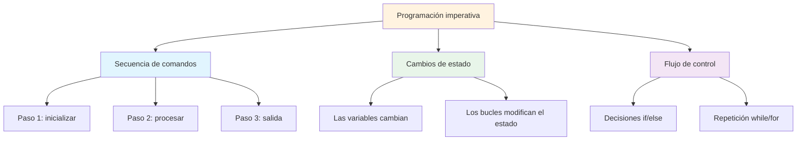
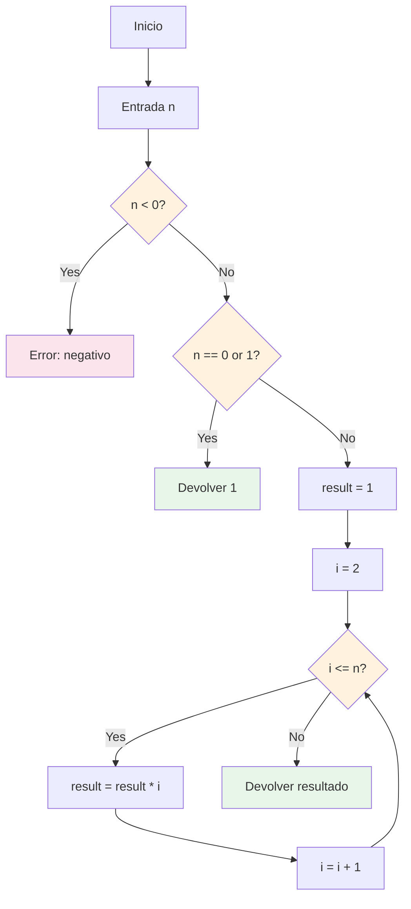
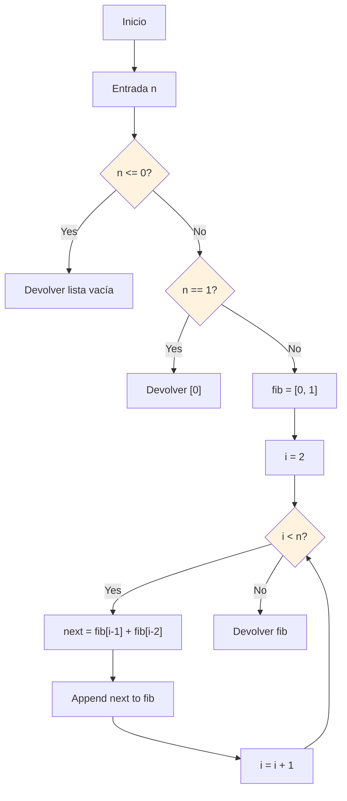
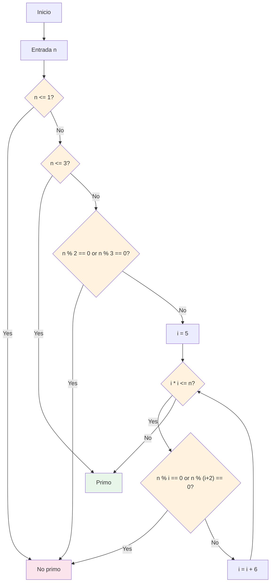
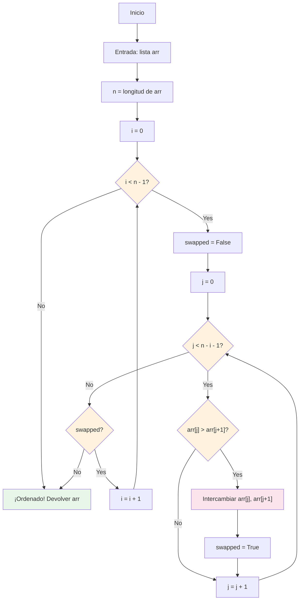
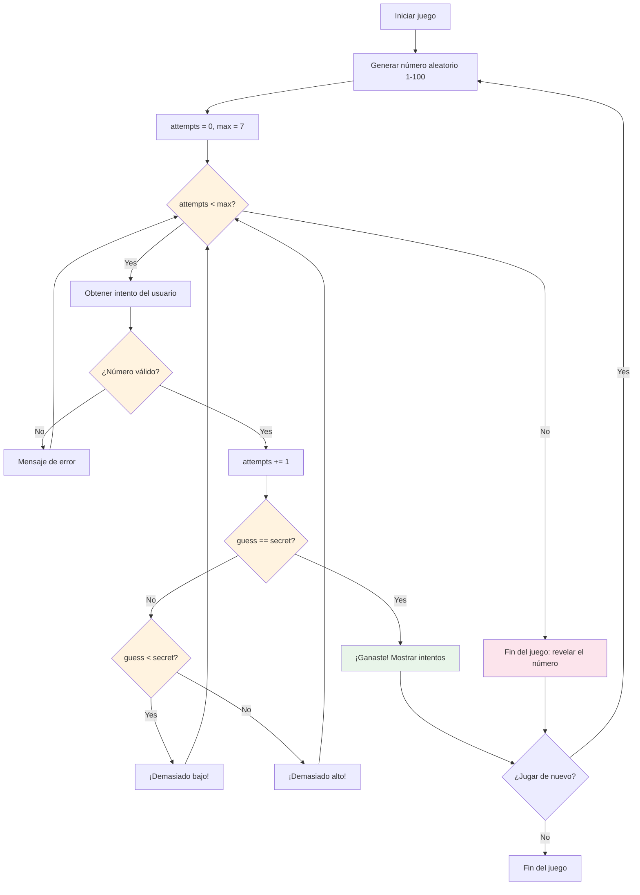

# Proyectos de algoritmos imperativos

Esta lección reúne todo lo que has aprendido para construir implementaciones completas de algoritmos. Escribiremos programas imperativos en Python que resuelven problemas computacionales clásicos.

## ¿Qué es la programación imperativa?

La programación imperativa describe CÓMO resolver un problema paso a paso, usando sentencias que cambian el estado del programa. Esto contrasta con la programación declarativa, que describe CUÁL debe ser el resultado.



## Proyecto 1: calculadora de factorial

El factorial de n (escrito n!) es el producto de todos los enteros positivos del 1 a n.

### Diagrama de flujo del algoritmo



### Implementación

```python
# factorial.py
"""Factorial calculator using imperative approach."""

def factorial_iterative(n):
    """
    Calculate factorial using a loop.
    
    Args:
        n: Non-negative integer
    
    Returns:
        int: n! (factorial of n)
    
    Raises:
        ValueError: If n is negative
    """
    if n < 0:
        raise ValueError("Factorial is not defined for negative numbers")
    
    result = 1
    for i in range(2, n + 1):
        result *= i
    
    return result

def factorial_with_steps(n):
    """Calculate factorial showing each step."""
    if n < 0:
        raise ValueError("Factorial is not defined for negative numbers")
    
    print(f"Calculating {n}!:")
    result = 1
    
    for i in range(1, n + 1):
        result *= i
        print(f"  Step {i}: result = {result}")
    
    return result

# Test the factorial function
print("=== Factorial Calculator ===\n")

# Test cases
test_values = [0, 1, 5, 10, 20]

for n in test_values:
    result = factorial_iterative(n)
    print(f"{n:2d}! = {result}")

print("\nDetailed calculation of 5!:")
factorial_with_steps(5)
```

Salida:
```
=== Factorial Calculator ===

 0! = 1
 1! = 1
 5! = 120
10! = 3628800
20! = 2432902008176640000

Detailed calculation of 5!:
Calculating 5!:
  Step 1: result = 1
  Step 2: result = 2
  Step 3: result = 6
  Step 4: result = 24
  Step 5: result = 120
```

## Proyecto 2: generador de la secuencia de Fibonacci

La secuencia de Fibonacci: cada número es la suma de los dos anteriores.

### Diagrama de flujo del algoritmo



### Implementación

```python
# fibonacci.py
"""Fibonacci sequence generator."""

def fibonacci_sequence(n):
    """
    Generate the first n Fibonacci numbers.
    
    Args:
        n: Number of Fibonacci numbers to generate
    
    Returns:
        list: First n Fibonacci numbers
    """
    if n <= 0:
        return []
    if n == 1:
        return [0]
    
    fib = [0, 1]
    for i in range(2, n):
        next_fib = fib[i - 1] + fib[i - 2]
        fib.append(next_fib)
    
    return fib

def fibonacci_nth(n):
    """
    Get the nth Fibonacci number (0-indexed).
    
    Args:
        n: Position in the sequence
    
    Returns:
        int: The nth Fibonacci number
    """
    if n < 0:
        raise ValueError("n must be non-negative")
    if n <= 1:
        return n
    
    a, b = 0, 1
    for _ in range(2, n + 1):
        a, b = b, a + b
    
    return b

def fibonacci_ratio(n):
    """Show how Fibonacci ratios approach the golden ratio."""
    print(f"{'n':>4} {'F(n)':>12} {'F(n)/F(n-1)':>14}")
    print("-" * 35)
    
    prev = 0
    for i in range(1, n + 1):
        curr = fibonacci_nth(i)
        if prev > 0:
            ratio = curr / prev
            print(f"{i:4d} {curr:12d} {ratio:14.10f}")
        else:
            print(f"{i:4d} {curr:12d} {'N/A':>14}")
        prev = curr

# Test Fibonacci
print("=== Fibonacci Sequence Generator ===\n")

# Generate sequences
print("First 10 Fibonacci numbers:")
print(fibonacci_sequence(10))

print("\nFirst 15 Fibonacci numbers:")
print(fibonacci_sequence(15))

# Golden ratio convergence
print("\nFibonacci ratios approaching golden ratio (φ ≈ 1.6180339887):")
fibonacci_ratio(15)
```

Salida:
```
=== Fibonacci Sequence Generator ===

First 10 Fibonacci numbers:
[0, 1, 1, 2, 3, 5, 8, 13, 21, 34]

First 15 Fibonacci numbers:
[0, 1, 1, 2, 3, 5, 8, 13, 21, 34, 55, 89, 144, 233, 377]

Fibonacci ratios approaching golden ratio (φ ≈ 1.6180339887):
   n         F(n)    F(n)/F(n-1)
-----------------------------------
   1            1            N/A
   2            1     1.0000000000
   3            2     2.0000000000
   4            3     1.5000000000
   5            5     1.6666666667
   6            8     1.6000000000
   7           13     1.6250000000
   8           21     1.6153846154
   9           34     1.6190476190
  10           55     1.6176470588
  11           89     1.6181818182
  12          144     1.6179775281
  13          233     1.6180555556
  14          377     1.6180257511
  15          610     1.6180371353
```

## Proyecto 3: verificador de números primos

Un número primo es un número natural mayor que 1 que no tiene divisores positivos distintos de 1 y de él mismo.

### Diagrama de flujo del algoritmo



### Implementación

```python
# prime_checker.py
"""Prime number checker and generator."""

def is_prime(n):
    """
    Check if a number is prime using optimized trial division.
    
    Args:
        n: Integer to check
    
    Returns:
        bool: True if prime, False otherwise
    """
    if n <= 1:
        return False
    if n <= 3:
        return True
    if n % 2 == 0 or n % 3 == 0:
        return False
    
    i = 5
    while i * i <= n:
        if n % i == 0 or n % (i + 2) == 0:
            return False
        i += 6
    
    return True

def find_primes_up_to(limit):
    """
    Find all prime numbers up to a given limit.
    
    Args:
        limit: Upper bound (inclusive)
    
    Returns:
        list: All prime numbers up to limit
    """
    primes = []
    for num in range(2, limit + 1):
        if is_prime(num):
            primes.append(num)
    return primes

def count_primes_in_range(start, end):
    """Count primes in a range."""
    count = 0
    for num in range(start, end + 1):
        if is_prime(num):
            count += 1
    return count

# Test prime checker
print("=== Prime Number Checker ===\n")

# Check individual numbers
test_numbers = [1, 2, 3, 4, 17, 25, 29, 97, 100]
print("Prime checks:")
for n in test_numbers:
    status = "Prime" if is_prime(n) else "Not prime"
    print(f"  {n:3d}: {status}")

# Find primes up to 50
print("\nPrimes up to 50:")
primes = find_primes_up_to(50)
print(f"  {primes}")
print(f"  Count: {len(primes)}")

# Prime density
print("\nPrime density:")
for limit in [10, 100, 1000]:
    count = count_primes_in_range(2, limit)
    density = count / limit * 100
    print(f"  Up to {limit:4d}: {count:4d} primes ({density:.1f}%)")
```

Salida:
```
=== Prime Number Checker ===

Prime checks:
    1: Not prime
    2: Prime
    3: Prime
    4: Not prime
   17: Prime
   25: Not prime
   29: Prime
   97: Prime
  100: Not prime

Primes up to 50:
  [2, 3, 5, 7, 11, 13, 17, 19, 23, 29, 31, 37, 41, 43, 47]
  Count: 15

Prime density:
  Up to   10:    4 primes (40.0%)
  Up to  100:   25 primes (25.0%)
  Up to 1000:  168 primes (16.8%)
```

## Proyecto 4: bubble sort

El bubble sort (ordenación por burbujas) es un algoritmo de ordenación sencillo que recorre la lista repetidamente, compara elementos adyacentes y los intercambia si están en el orden incorrecto.

### Diagrama de flujo del algoritmo



### Implementación

```python
# bubble_sort.py
"""Bubble sort implementation with visualization."""

def bubble_sort(arr):
    """
    Sort a list using bubble sort algorithm.
    
    Args:
        arr: List of comparable elements
    
    Returns:
        list: Sorted list (new list, original unchanged)
    """
    result = arr.copy()
    n = len(result)
    
    for i in range(n - 1):
        swapped = False
        for j in range(n - i - 1):
            if result[j] > result[j + 1]:
                # Swap
                result[j], result[j + 1] = result[j + 1], result[j]
                swapped = True
        
        if not swapped:
            break  # Already sorted
    
    return result

def bubble_sort_visual(arr):
    """Sort with step-by-step visualization."""
    result = arr.copy()
    n = len(result)
    passes = 0
    
    print(f"Initial: {result}")
    
    for i in range(n - 1):
        swapped = False
        passes += 1
        
        for j in range(n - i - 1):
            if result[j] > result[j + 1]:
                result[j], result[j + 1] = result[j + 1], result[j]
                swapped = True
                print(f"  Pass {passes}, Swap {j},{j+1}: {result}")
        
        if not swapped:
            print(f"  Pass {passes}: No swaps needed (sorted!)")
            break
    
    print(f"Final:   {result}")
    print(f"Total passes: {passes}")
    return result

# Test bubble sort
print("=== Bubble Sort ===\n")

# Simple sort
numbers = [64, 34, 25, 12, 22, 11, 90]
print(f"Original: {numbers}")
sorted_nums = bubble_sort(numbers)
print(f"Sorted:   {sorted_nums}")
print(f"Original unchanged: {numbers}\n")

# Visual sort
print("Visual bubble sort:")
bubble_sort_visual([5, 3, 8, 1, 2])
```

Salida:
```
=== Bubble Sort ===

Original: [64, 34, 25, 12, 22, 11, 90]
Sorted:   [11, 12, 22, 25, 34, 64, 90]
Original unchanged: [64, 34, 25, 12, 22, 11, 90]

Visual bubble sort:
Initial: [5, 3, 8, 1, 2]
  Pass 1, Swap 0,1: [3, 5, 8, 1, 2]
  Pass 1, Swap 2,3: [3, 5, 1, 8, 2]
  Pass 1, Swap 3,4: [3, 5, 1, 2, 8]
  Pass 2, Swap 1,2: [3, 1, 5, 2, 8]
  Pass 2, Swap 2,3: [3, 1, 2, 5, 8]
  Pass 3, Swap 0,1: [1, 3, 2, 5, 8]
  Pass 3, Swap 1,2: [1, 2, 3, 5, 8]
  Pass 4: No swaps needed (sorted!)
Final:   [1, 2, 3, 5, 8]
Total passes: 4
```

## Proyecto 5: juego de adivinación de números

Un juego interactivo completo que combina todos los conceptos aprendidos en este curso.

### Diagrama de flujo del juego



### Implementación

```python
# number_guessing_game.py
"""Number guessing game with scoring and difficulty levels."""

import random

def get_difficulty():
    """Let player choose difficulty level."""
    print("\nSelect difficulty:")
    print("  1. Easy   (1-50,  10 attempts)")
    print("  2. Medium (1-100,  7 attempts)")
    print("  3. Hard   (1-200,  5 attempts)")
    
    while True:
        choice = input("Choice (1-3): ").strip()
        if choice == "1":
            return 50, 10
        elif choice == "2":
            return 100, 7
        elif choice == "3":
            return 200, 5
        print("Invalid choice. Please enter 1, 2, or 3.")

def play_game():
    """Play one round of the guessing game."""
    max_num, max_attempts = get_difficulty()
    secret = random.randint(1, max_num)
    attempts = 0
    guesses = []
    
    print(f"\n{'=' * 40}")
    print(f"  Guess the number between 1 and {max_num}")
    print(f"  You have {max_attempts} attempts")
    print(f"{'=' * 40}\n")
    
    while attempts < max_attempts:
        # Get valid guess
        while True:
            try:
                guess = int(input(f"Attempt {attempts + 1}/{max_attempts}: "))
                if 1 <= guess <= max_num:
                    break
                print(f"  Please enter a number between 1 and {max_num}.")
            except ValueError:
                print("  Please enter a valid number.")
        
        attempts += 1
        guesses.append(guess)
        
        # Check guess
        if guess == secret:
            print(f"\n  🎉 Congratulations! You guessed it!")
            print(f"  The number was {secret}.")
            print(f"  Attempts: {attempts}/{max_attempts}")
            
            # Score calculation
            score = max(0, (max_attempts - attempts + 1) * 100)
            print(f"  Score: {score} points")
            return True, score
        
        elif guess < secret:
            diff = secret - guess
            hint = "Much too low!" if diff > 20 else "Too low! Try higher."
            print(f"  {hint}")
        else:
            diff = guess - secret
            hint = "Much too high!" if diff > 20 else "Too high! Try lower."
            print(f"  {hint}")
    
    # Game over
    print(f"\n  😔 Game over! The number was {secret}.")
    print(f"  Your guesses: {guesses}")
    return False, 0

def display_stats(games_played, games_won, total_score):
    """Display game statistics."""
    print(f"\n{'=' * 40}")
    print("         GAME STATISTICS")
    print(f"{'=' * 40}")
    print(f"  Games played: {games_played}")
    print(f"  Games won:    {games_won}")
    print(f"  Games lost:   {games_played - games_won}")
    
    if games_played > 0:
        win_rate = games_won / games_played * 100
        avg_score = total_score / games_played
        print(f"  Win rate:     {win_rate:.1f}%")
        print(f"  Avg score:    {avg_score:.0f}")
    
    print(f"  Total score:  {total_score}")
    print(f"{'=' * 40}")

def main():
    """Main game loop."""
    print("=" * 40)
    print("   NUMBER GUESSING GAME")
    print("=" * 40)
    
    games_played = 0
    games_won = 0
    total_score = 0
    
    while True:
        games_played += 1
        won, score = play_game()
        
        if won:
            games_won += 1
        total_score += score
        
        # Play again?
        while True:
            again = input("\nPlay again? (yes/no): ").strip().lower()
            if again in ("yes", "y", "no", "n"):
                break
            print("Please enter 'yes' or 'no'.")
        
        if again in ("no", "n"):
            break
    
    display_stats(games_played, games_won, total_score)
    print("\nThanks for playing! Goodbye! 👋")

# Run the game
if __name__ == "__main__":
    main()
```

Salida de ejemplo:
```
========================================
   NUMBER GUESSING GAME
========================================

Select difficulty:
  1. Easy   (1-50,  10 attempts)
  2. Medium (1-100,  7 attempts)
  3. Hard   (1-200,  5 attempts)
Choice (1-3): 2

========================================
  Guess the number between 1 and 100
  You have 7 attempts
========================================

Attempt 1/7: 50
  Too high! Try lower.
Attempt 2/7: 25
  Too low! Try higher.
Attempt 3/7: 37
  Too low! Try higher.
Attempt 4/7: 43
  🎉 Congratulations! You guessed it!
  The number was 43.
  Attempts: 4/7
  Score: 400 points

Play again? (yes/no): no

========================================
         GAME STATISTICS
========================================
  Games played: 1
  Games won:    1
  Games lost:   0
  Win rate:     100.0%
  Avg score:    400
  Total score:  400
========================================

Thanks for playing! Goodbye! 👋
```

## Ejercicios prácticos

### Ejercicio 1: factorial mejorado
Modifica la función factorial para usar un bucle while en lugar de un bucle for.

### Ejercicio 2: búsqueda de Fibonacci
Escribe una función que compruebe si un número dado es un número de Fibonacci.

### Ejercicio 3: factorización en primos
Escribe una función que devuelva la factorización en primos de un número como una lista de factores primos.

### Ejercicio 4: ordenación por selección
Implementa la ordenación por selección: encuentra el elemento mínimo, intercámbialo al principio y repite con los elementos restantes.

### Ejercicio 5: búsqueda binaria
Implementa la búsqueda binaria en una lista ordenada. Compara su eficiencia con la búsqueda lineal.

### Ejercicio 6: juego de adivinación mejorado
Añade funcionalidades al juego de adivinación:
- Lleva la cuenta de la mejor puntuación (menos intentos)
- Añade un sistema de pistas (revela si el número es par o impar)
- Añade un cronómetro para registrar cuánto dura cada partida

### Ejercicio 7: criba de Eratóstenes
Implementa el algoritmo de la criba de Eratóstenes para encontrar todos los primos hasta n. Compara su velocidad con el método de división por intentos.

### Ejercicio 8: comparación de algoritmos
Escribe un programa que compare el tiempo de ejecución del bubble sort con el de la función incorporada sorted() de Python para listas de diferentes tamaños (100, 1000 y 10000 elementos).

## Resumen

En esta lección has construido proyectos completos de algoritmos imperativos:
- **Factorial**: cálculo iterativo con visualización paso a paso
- **Fibonacci**: generación de la secuencia y convergencia de la razón áurea
- **Verificador de números primos**: división por intentos optimizada para la comprobación de primalidad
- **Bubble sort**: ordenación paso a paso con visualización de los intercambios
- **Juego de adivinación de números**: juego interactivo completo con niveles de dificultad y puntuación

Estos proyectos demuestran cómo las variables, los bucles, las condicionales, las funciones y las estructuras de datos trabajan juntas para resolver problemas computacionales reales. Practica modificando y ampliando estos algoritmos para profundizar en tu comprensión.
