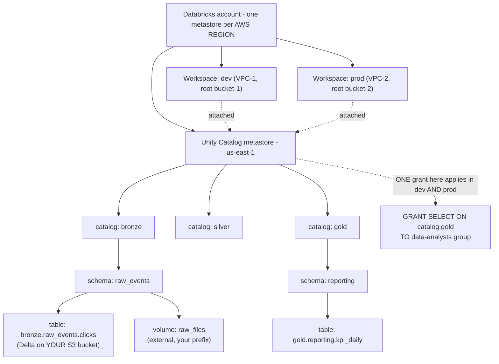
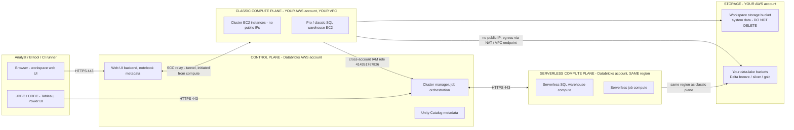
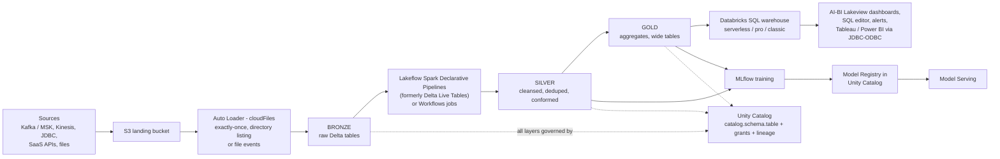
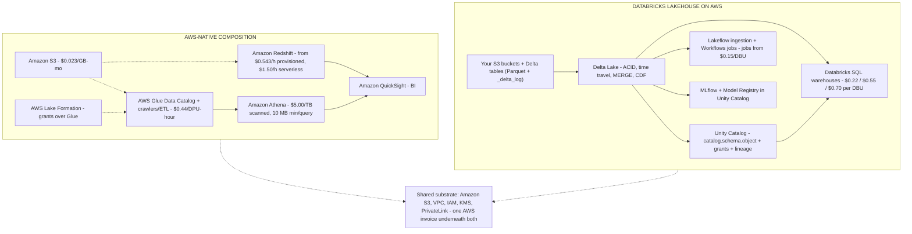
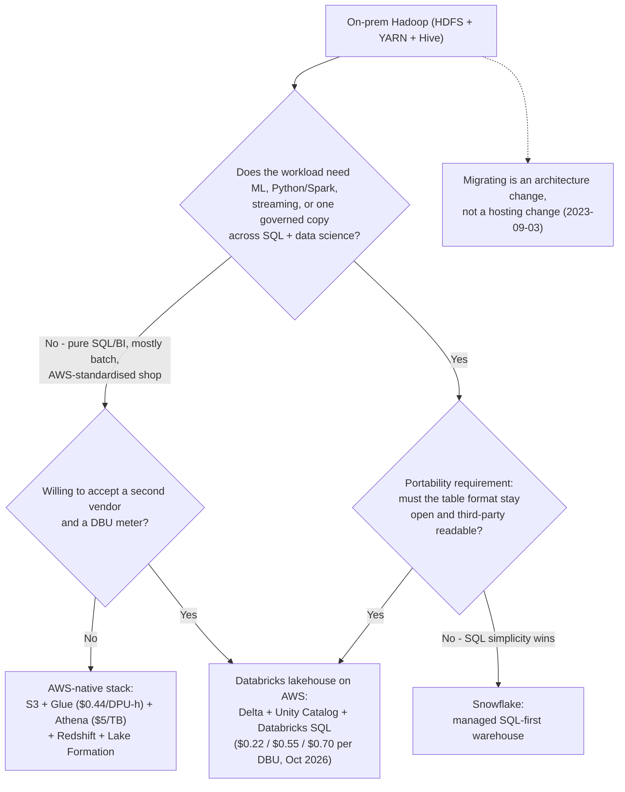

# Lakehouse Architecture on Databricks: Planes, Pillars, and the AWS Substrate

Every other lesson in this course assumes three things you have not yet proven to yourself: that a lakehouse is a real architectural category and not a marketing word, that Databricks software runs in *two cloud accounts at once*, and that the money arrives on *two separate bills*. Get any of those three wrong and you will design a workspace whose data lake sits in the wrong bucket, whose threat model points at the wrong account, and whose cost model undercounts by roughly half.

This lesson proves all three with primary sources. Every architectural fact below comes from `docs.databricks.com` pages dated between 2026-07-28 and 2026-09-25, from Databricks' own AWS deployment blogs (2022-09-30, 2023-01-27), and from AWS pricing pages accessed **October 2026**. Every price is a list price in USD, stamped with the date it was read, because DBU rates and AWS rates both move.

```text
 =============================================================
  DATABRICKS LAKEHOUSE ON AWS - the whole map, as of Oct 2026
 -------------------------------------------------------------
  CONTROL PLANE  (Databricks' AWS account, not yours)
    web UI - notebook & job metadata - cluster manager -
    job orchestration - Unity Catalog metadata
        ^  traffic always initiated FROM the data plane
        |  over HTTPS port 443, via the SCC relay
        v
  COMPUTE PLANE
    classic   - EC2 instances in YOUR VPC, NO public IPs,
                created through a cross-account IAM role
    serverless- in the Databricks account, same AWS region
                as your classic plane
        |
        v
  STORAGE  (YOUR AWS account)
    workspace storage bucket - system data only: cluster logs,
      notebook revisions, job results, query plans. DO NOT DELETE.
    data-lake buckets        - bronze/silver/gold DELTA tables,
      governed by Unity Catalog storage credentials
  -------------------------------------------------------------
  TWO METERS, ALWAYS
    AWS bills you ...... EC2, S3, NAT gateway, data transfer
    Databricks bills you  DBU per compute SKU:
      jobs from $0.15/DBU - SQL classic $0.22 - SQL pro $0.55
      - SQL serverless $0.70 (instance cost INCLUDED)
      (list rates, accessed 2026-10; vary by region and plan)
 =============================================================
```

In this lesson you will:

- define the **lakehouse** against the data lake and the data warehouse, using the three properties Databricks published in 2020 and the medallion (bronze → silver → gold) pattern;
- separate the **two pillars**, Delta Lake for reliability and format, Unity Catalog for governance, and map each to the AWS object it touches (your S3 bucket, your IAM role);
- draw the **control plane / compute plane** split, including secure cluster connectivity, the cross-account IAM role and the serverless plane's region rule;
- work out **where the data actually lives**, and why the workspace storage bucket is emphatically not your data lake;
- build the **workload map** (ingest → curate → serve → ML) and match each workload to the compute that runs it;
- read the **DBU rate card as of Oct 2026** and hand-compute six worked examples with real numbers;
- compare the platform **against the AWS-native stack, Snowflake and on-prem Hadoop** without repeating vendor marketing as fact;
- study **three named AWS case studies**, read the **2026 update box**, and answer **twelve exam-style questions**.

---

## 1. What a lakehouse is: one architecture, three properties

Databricks' current definition (databricks.com/blog/what-is-data-lakehouse-article, 2026-06-23) is the one to memorise:

> "A data lakehouse is a new, open data management architecture that combines the flexibility, cost-efficiency, and scale of data lakes with the data management and ACID transactions of data warehouses, enabling business intelligence (BI) and machine learning (ML) on all data."

The canonical 2020 post that named the pattern lists exactly three defining properties (databricks.com/blog/2020/01/30/what-is-a-data-lakehouse.html, 2020-01-30):

1. **Transaction support**: ACID transactions on object storage, so concurrent writers and failed jobs cannot corrupt a table.
2. **Schema enforcement and governance**: the storage layer rejects data that violates the declared schema instead of silently accepting it.
3. **Openness**: the storage formats are "open and standardized, such as Parquet", so engines other than the one that wrote the data can read it.

Read those three properties against the two architectures the lakehouse sits between:

| Property | Data lake (S3 + files) | Data warehouse (Redshift, Snowflake, Teradata) | **Lakehouse** |
|---|---|---|---|
| Storage cost and elasticity | Excellent (S3 Standard $0.023/GB-month, accessed 2026-10) | Premium (Redshift provisioned from $0.543/hour, serverless from $1.50/hour, accessed 2026-10) | **Lake cost: open formats on your S3** |
| ACID transactions | None without a table layer | Native | **Native, via Delta Lake** |
| Schema enforcement | Ad hoc, often at read time | Native | **Native, at write time** |
| BI on structured data | Weak | Strong | **Strong (Databricks SQL, ANSI SQL with Delta extensions)** |
| ML / Python / Spark on all data | Strong but ungoverned | Weak, requires export | **Strong and governed (Unity Catalog)** |
| Format lock-in | Low (Parquet) | High (proprietary) | **Low (Parquet + Delta log in your bucket)** |

The phrase "enabling BI and ML on all data" is the whole business case: warehouses force a choice between governed SQL and usable ML, lakes force a choice between cheap storage and trustworthy data. The lakehouse removes both choices by putting warehouse-grade table management directly on lake storage.

### 1.1 The medallion pattern

Databricks documents the standard logical layout as the **medallion architecture**, "a data design pattern used to logically organize data in a lakehouse ... (from Bronze ⇒ Silver ⇒ Gold layer tables)" (databricks.com/blog/what-is-medallion-architecture, 2022-03-09):

- **Bronze**: raw, append-only, everything that arrived, with the source metadata intact.
- **Silver**: cleansed, deduplicated, conformed, one row per real-world entity.
- **Gold**: business-level aggregates and wide tables ready for BI, dashboards and feature stores.

The layers are *logical*. Physically they are ordinary Delta tables in ordinary S3 buckets, separated by catalog or schema names; which is why lesson 03 (Unity Catalog) and lesson 04 (Delta transactions) both start from this diagram.

- **📚 Did you know?** "Lakehouse" is an architecture, not a Databricks product. Databricks' own 2020 naming post concedes: "Other managed services such as BigQuery and Redshift Spectrum have some of the lakehouse features listed above" (2020-01-30). Snowflake, Amazon Redshift, Microsoft Fabric and others all now claim lakehouse features. The discriminator in this course is never the word; it is the combination of an open table format on *your* storage plus a governance layer that spans every engine.

---

## 2. The two pillars: Delta Lake and Unity Catalog

Everything Databricks sells on AWS rests on two open-source projects. Databricks' own 2024 framing pairs them explicitly: "Data reliability ... Databricks provides Delta Lake" and "Eased Governance ... With the help of Unity Catalog" (databricks.com/blog/lakehouse-common-language-across-enterprise, 2024-06-21).

### 2.1 Pillar one, Delta Lake: the reliability and format layer

Delta Lake is the open-source storage layer that adds ACID transactions, schema enforcement, time travel and scalable metadata management to object storage, and it is the **default table format in Databricks**: "the foundation of the lakehouse" (databricks.com/blog/what-is-data-lakehouse, 2020-02-11). Physically it is simple: a **write-ahead transaction log stored alongside Parquet data files in your S3 bucket** (databricks.com/blog/2020/09/10/diving-deep-into-the-inner-workings-of-the-lakehouse-and-delta-lake.html, page updated 2024-06-20).

What that buys you, all covered in lesson 04: serialisable commits, `MERGE` upserts, change data feed, time travel by version or timestamp, check constraints, and schema evolution under explicit rules.

### 2.2 Pillar two, Unity Catalog: the governance layer

Unity Catalog models "Every asset you govern ... as a **securable object**", covering "tables, views, volumes, functions, models, and services", all following "a three-level namespace (`catalog.schema.object`)" (docs.databricks.com/aws/en/data-governance/unity-catalog, accessed 2026-10). Three facts shape every AWS design you will ever build:

- The **metastore is the top-level securable** and is scoped to one cloud region: "The metastore is the top-level securable object ... A metastore contains all securable objects registered in Unity Catalog in a single cloud region" (docs .../unity-catalog/securable-objects).
- You need "one metastore for each region in which your organization operates", and "users must be on a workspace that is attached to a metastore in their region" (docs .../unity-catalog/create-metastore).
- Grants travel across workspaces: "a privilege granted in one workspace is effective in all other workspaces sharing that metastore" (same source).
- On AWS, a **storage credential is an IAM role**; that is the seam where governance meets your cloud account (docs.../securable-objects).

Tables and volumes are either **managed** (Unity Catalog owns both governance and the file lifecycle) or **external** (Unity Catalog governs; you own the files) (docs .../unity-catalog).



### 2.3 Why the pairing matters on AWS

Delta answers *"can I trust these bytes?"* without moving them off S3. Unity Catalog answers *"who may read which bytes?"* with one grant model that survives workspace moves, region scoping and multiple AWS accounts. Neither replaces the other: a perfectly ACID table with no grants is an ungoverned leak, and a perfectly governed catalog over sloppy files is an audit waiting to fail.

| Question | Answered by | The AWS object it maps to |
|---|---|---|
| Was this write atomic? Did a concurrent job corrupt it? | **Delta Lake** | `_delta_log/` JSON commits next to Parquet in your bucket |
| What happens to this table if the job crashes mid-run? | **Delta Lake** | Roll back to the previous snapshot |
| May the finance analysts read `gold.reporting.kpi_daily`? | **Unity Catalog** | Grant on a securable, checked in every workspace attached to the metastore |
| Which IAM role may read the underlying prefix? | **Unity Catalog storage credential** | A cross-account or same-account **IAM role** you register |
| Which physical prefix does `bronze.raw_events.clicks` point at? | **Unity Catalog external location** | An S3 path + credential pair |

---

## 3. Workspace anatomy: the control plane and the compute plane

"Databricks operates out of a **control plane** and a **compute plane**" (docs.databricks.com/aws/en/getting-started/high-level-architecture, page last updated 2026-09-11). This is the single most testable sentence in lesson 01, and the one most often mangled by engineers who have only read Databricks' older engineering blogs.

### 3.1 The three planes

- **Control plane (Databricks' account).** "The control plane includes the backend services that Databricks manages in your Databricks account. The control plane is located in the Databricks account, not your cloud account" (same page, 2026-09-11). It holds the web UI, notebook commands and metadata, cluster manager, job orchestration and Unity Catalog metadata: encrypted at rest (databricks.com/blog/best-practices-and-guidance-cloud-engineers-deploy-databricks-aws-part-1, 2022-09-30).
- **Classic compute plane (your account).** Clusters and pro/classic SQL warehouses run as EC2 instances "within each workspace's virtual network in the customer's AWS account", which gives the plane "natural isolation because it runs in each customer's own AWS account" (docs .../high-level-architecture, 2026-09-11).
- **Serverless compute plane (Databricks' account).** "Databricks creates a serverless compute plane in the same AWS region as your workspace's classic compute plane" and isolates it "within a network boundary for the workspace" (same page). Same region as your classic plane: not an arbitrary Databricks region.

> Older material, including Databricks' own 2022 to 2023 deployment blogs, says **data plane** where today's docs say **compute plane**. Same concept, current vocabulary. If a tutorial says "data plane", it means the classic/serverless compute plane described here.

### 3.2 Secure cluster connectivity: no open ports, no public IPs

"All new workspaces are created with secure cluster connectivity by default. Secure cluster connectivity means that customer VPCs have no open ports and classic compute plane resources have no public IP addresses" (docs.databricks.com/aws/en/security/network/classic, updated 2026-09-25). Clusters reach the control plane through a secure tunnel over **HTTPS port 443** to an SCC relay, and traffic is always **initiated from the compute plane outward** (databricks.com/blog/...part-1, 2022-09-30). There is no inbound path for Databricks to open, because there is no inbound path at all.

The consequence students miss: **SCC is not "no egress".** Clusters still need an outbound route, NAT gateway, internet gateway or PrivateLink, to reach the control plane and AWS APIs, and an S3 gateway endpoint keeps S3 traffic on the AWS backbone so it never bills through the NAT (databricks.com/blog/optimizing-aws-s3-access-databricks, 2022-08-11). Lesson 02 sizes this properly.

### 3.3 The cross-account IAM role: how Databricks may launch your EC2

Workspace creation needs three configurations, **credential** (a cross-account IAM role), **network** (VPC/subnets/security groups) and **storage** (the workspace storage bucket), and can be driven from the account console, the Account API or Terraform (docs.databricks.com/aws/en/admin/workspace, 2026-07-28). The credential is a role you create in *your* account whose trust policy names Databricks' AWS account: "Create a new cross-account IAM role with an access policy... In the Account ID field, enter the Databricks account ID **414351767826**" (docs.../create-uc-workspace; docs.../administration-guide/account-api/iam-role.html, 2026-01-24), with your Databricks account ID as the external ID. Prerequisites on that page: "Have an available VPC and NAT gateway in your AWS account in the workspace's region."



```matching
{
  "question": "Match each plane or storage location to what it actually owns on AWS (as of Oct 2026):",
  "pairs": [
    {"left": "Control plane (Databricks AWS account)", "right": "Web UI backend, notebook and job METADATA, cluster manager, job orchestration, Unity Catalog metadata: never your table data"},
    {"left": "Classic compute plane (your AWS account, your VPC)", "right": "EC2 instances for clusters and pro/classic SQL warehouses, no public IPs, reached only over HTTPS 443 through the SCC relay"},
    {"left": "Serverless compute plane (Databricks AWS account)", "right": "Serverless SQL and job compute, created in the SAME AWS region as your classic compute plane, isolated in a workspace network boundary"},
    {"left": "Workspace storage bucket (your AWS account)", "right": "Workspace system data only: cluster logs, notebook revisions, job results, query plans; deleting it is unrecoverable"},
    {"left": "Your data-lake buckets (your AWS account)", "right": "Bronze/silver/gold Delta tables on Parquet, addressed through Unity Catalog storage credentials and external locations"}
  ],
  "explanation": "The split is ownership, not geography: metadata and orchestration live in the Databricks account; raw compute (classic) and all storage live in yours; serverless compute is the one workload that runs in the Databricks account yet still in your region. The trap is the workspace storage bucket: it is in YOUR account, sits next to your lake, and looks like a data bucket, but it holds only workspace system data. Databricks is explicit: 'Do not delete or modify the workspace storage in your cloud account... If workspace storage is deleted, the workspace cannot be recovered' (docs.../high-level-architecture, updated 2026-09-11)."
}
```

> [!WARNING]
> ⚠️ **The workspace storage bucket (the old "root bucket") is not your data lake, and it is not deletable.** Three rules, all official: (1) "Classic workspaces require you to provide an S3 bucket and prefix to use as the workspace storage bucket" (docs.../high-level-architecture, 2026-09-11); it holds cluster logs, notebook revisions, job results, query plans and library state. (2) "Do not delete or modify the workspace storage in your cloud account... If workspace storage is deleted, the workspace cannot be recovered" (same page). (3) The deployment guidance is blunt: "it's best practice that this bucket is not used for customer data or multiple workspaces" (databricks.com/blog/...part-2, 2023-01-27). Your bronze/silver/gold tables belong in **separate, purpose-built buckets** governed through Unity Catalog. Two workspaces sharing one root bucket, or customer PII dumped into it, are both design failures that will bite you in lesson 02 and lesson 11.

---

## 4. Where the data actually lives (and where it does not)

A classic workspace has three storage surfaces in *your* AWS account, and only one of them is the lake:

| Surface | Owner | Contents | Rule |
|---|---|---|---|
| **Workspace storage bucket** (older blogs: "root bucket") | You | Cluster logs, notebook revisions, job run results, SQL query results, query plans | Never delete, never share across workspaces, never store customer data in it |
| **Workspace file system** | Databricks-managed workspace storage | Notebooks, SQL queries, dashboards, alerts, repos, libraries, Python/YAML files | Collaborate here; it is metadata-ish, not analytical data |
| **Your data-lake buckets** | You | Delta tables (Parquet + `_delta_log/`) for bronze/silver/gold, and external volumes | Governed by Unity Catalog storage credentials and external locations |

Two distinctions from the official docs prevent the classic mistakes:

1. **Workspace system data vs DBFS root.** The docs separate them explicitly: "DBFS root is a user-accessible file system, while workspace system data is used internally by Databricks features": even when both sit in the same bucket. DBFS root and DBFS mounts are **legacy and not recommended** for new designs (docs.../high-level-architecture, 2026-09-11).
2. **Managed vs external tables.** A *managed* Delta table's files live where Unity Catalog put them (still your S3, under a path UC manages); an *external* table's files live at a prefix you already own, and UC governs only the metadata. Both are "your data": neither is in the workspace storage bucket.

Serverless workspaces change the *workspace* storage story (workspace data goes to Databricks-managed default storage), but they do not change the lake story: analytical tables still live in **your** S3 buckets, reached through Unity Catalog. The data-plane question and the storage question are separate questions.

- **📚 Did you know?** The terminology has drifted twice. Databricks' 2023 deployment blog says **S3 root bucket**; current docs say **workspace storage bucket**; and the "data plane" of the same blogs is now the **compute plane**. When you read an older tutorial or an exam-prep site and it uses the older words, translate: root bucket → workspace storage bucket, data plane → classic/serverless compute plane. Teaching materials that still present "data plane" as current Databricks vocabulary are quoting 2022 to 2023 engineering posts.

---

## 5. The workload map: ingest → curate → serve → ML

The reference flow for this course, assembled from the Auto Loader, medallion, Databricks SQL and MLflow docs:

1. **Sources**: Kafka/Amazon MSK, Kinesis, JDBC, SaaS APIs and files land raw payloads in an **S3 landing bucket**.
2. **Ingest**: **Auto Loader** (`cloudFiles`) incrementally discovers new files and writes **bronze** Delta tables. It "incrementally and efficiently processes new data files as they arrive in cloud storage" and its key-value state store "ensures that data is processed exactly once" (docs.../auto-loader, page dated 2026-04-01).
3. **Curate**: **Lakeflow Spark Declarative Pipelines** (the renamed Delta Live Tables) or ordinary jobs cleanse, dedupe and conform to **silver**, then aggregate to **gold**.
4. **Serve**: **Databricks SQL** on a serverless/pro/classic warehouse powers dashboards, the SQL editor, alerts and external BI over JDBC/ODBC. "Databricks SQL is a cloud data warehouse built on lakehouse architecture. It runs directly on your data lake, supports ANSI SQL with Delta Lake extensions" (docs.../aws/en/sql/, updated 2026-09-11).
5. **Learn**: **MLflow** tracks experiments, and the **Model Registry in Unity Catalog** provides "centralized access control, auditing, lineage, and model discovery across workspaces" (docs.../manage-model-lifecycle).
6. **Govern**: Unity Catalog covers every layer, with lineage and audit available from system tables.



### 5.1 Workload → compute mapping

This table is the practical core of the lesson; every later cost decision starts here.

| Workload | Typical interactive pattern | Compute you should use | Meter |
|---|---|---|---|
| Exploration, ad-hoc PySpark/SQL | Short-lived, shared, interactive | **Notebook clusters (all-purpose)** | All-purpose DBU rate + your EC2 |
| Production pipelines, nightly ETL | Scheduled, single-purpose, ephemeral | **Job clusters (Workflows)** | Jobs DBU rate ("starting at $0.15/DBU", databricks.com/pricing, accessed 2026-10) + your EC2 |
| Dashboards, BI, SQL reporting | High concurrency, elastic, must auto-stop | **SQL warehouse: serverless, pro or classic** | SQL DBU rate: $0.22 / $0.55 / $0.70 |
| Declarative batch/streaming transforms | Graph of dependent transforms, expectations | **Lakeflow Spark Declarative Pipelines** | Pipeline DBU rate + compute |
| ML training and model serving | GPU/high-memory, registry-backed | **Jobs clusters / serverless ML, Model Serving** | Jobs/AI DBU rates |
| Interactive data apps | Low-latency web backends | **Databricks Apps** | App SKU DBU (example SKU $0.75/DBU, databricks.com/product/pricing/databricks-apps, accessed 2026-10) |

- **📚 Did you know?** The same PySpark code can cost materially less as a job than as an interactive cluster. Databricks' cost-management guidance states the mechanism directly: "Better performance along with the lower cost rates per DBU that job clusters offer lead to dramatic cost savings" (databricks.com/blog/best-practices-cost-management-databricks, 2022-10-18). Job clusters are ephemeral and single-purpose; all-purpose clusters stay warm for humans. The exact rate gap between SKUs varies by region and plan tier: Databricks publishes only "starting at" figures on its public pricing pages (accessed 2026-10), so always re-check your own contract rather than memorising a grid from a third-party site.

```dragdrop
{
  "question": "Put the reference lakehouse flow in the order data actually moves through it on AWS:",
  "items": [
    "Sources land raw files and events in an S3 landing bucket",
    "Auto Loader (cloudFiles) discovers new files and writes BRONZE Delta tables exactly once",
    "Lakeflow Spark Declarative Pipelines or Workflows jobs cleanse and dedupe into SILVER",
    "Aggregations build GOLD business-level tables",
    "A Databricks SQL warehouse serves gold to dashboards, alerts and external BI over JDBC-ODBC",
    "MLflow trains on silver/gold feature tables and registers models in Unity Catalog"
  ],
  "correctOrder": [
    "Sources land raw files and events in an S3 landing bucket",
    "Auto Loader (cloudFiles) discovers new files and writes BRONZE Delta tables exactly once",
    "Lakeflow Spark Declarative Pipelines or Workflows jobs cleanse and dedupe into SILVER",
    "Aggregations build GOLD business-level tables",
    "A Databricks SQL warehouse serves gold to dashboards, alerts and external BI over JDBC-ODBC",
    "MLflow trains on silver/gold feature tables and registers models in Unity Catalog"
  ],
  "explanation": "Land -> ingest -> curate -> serve -> learn, with Unity Catalog governing all of it. Two ordering facts matter. First, Auto Loader sits between the landing bucket and bronze because it is the component that provides exactly-once state; writing raw files straight into a bronze table with a naive Spark read loses that guarantee. Second, serving and ML both read from curated layers: gold for BI, silver or gold for features: which is why the medallion order is not decoration but a dependency graph. The historic name for the transformation step is Delta Live Tables; Databricks renamed it to Lakeflow Spark Declarative Pipelines (docs.../ldp/concepts/where-is-dlt, 2026-01-23)."
}
```

---

## 6. The two meters: DBU rates and the AWS bill

"A Databricks Unit (DBU) is a normalized unit of processing power on the Databricks Lakehouse Platform used for measurement and pricing purposes" (databricks.com/product/pricing, accessed 2026-10), and the glossary puts it as "units of processing capability per hour based on VM instance type" (docs .../resources/glossary, updated 2026-08-15). You pay DBUs for *processing*; AWS bills you separately for *the metal and the plumbing*.

### 6.1 The rate card, as of October 2026

| SKU | List rate | Includes AWS instance cost? | Source (accessed 2026-10) |
|---|---|---|---|
| Databricks SQL **Classic** warehouse | **$0.22 / DBU** | No: AWS bills EC2 separately | databricks.com/product/pricing/databricks-sql |
| Databricks SQL **Pro** warehouse | **$0.55 / DBU** | No: AWS bills EC2 separately | same |
| Databricks SQL **Serverless** warehouse | **$0.70 / DBU** | **Yes** | same |
| Lakeflow Jobs (data engineering), "starting at" | **$0.15 / DBU** | No | databricks.com/pricing |
| Data warehousing, "starting at" | **$0.22 / DBU** |: | databricks.com/pricing |
| Interactive workloads, "starting at" | **$0.40 / DBU** |: | databricks.com/pricing |
| AI, "starting at" | **$0.07 / DBU** |: | databricks.com/pricing |
| Databricks Apps (example SKU) | **$0.75 / DBU** |: | databricks.com/product/pricing/databricks-apps |
| Lakehouse//RT (Beta), us-east-1 | **$0.55 Premium / $0.70 Enterprise per DBU**, 30% introductory discount (fewer DBUs emitted) **through 2027-01-31** | Yes (serverless) | docs .../sql-warehouse/real-time-pricing, updated 2026-09-22 |

List prices, USD, accessed **2026-10**; they vary by cloud, region and plan tier (AWS: Standard/Premium/Enterprise) and by contract. Databricks publishes "starting at" figures for jobs and interactive SKUs: treat any full grid you find on a third-party cost site as unverified.

> [!IMPORTANT]
> **Two bills, one platform: do not double-count, do not under-count.** In a classic workspace, **AWS bills the EC2 instances, the NAT gateway, the S3 requests and the data transfer in your account**, while **Databricks bills DBUs for the processing those instances did**. Serverless SQL and serverless jobs bundle the instance cost *into* the DBU rate; classic rates do not. "Databricks pricing is based on your compute usage. Storage, networking and related costs will vary..." (databricks.com/product/pricing, accessed 2026-10). The two most common student errors are (a) quoting the DBU number as the total cost of a cluster, and (b) applying a serverless rate to a classic workspace (or vice versa) and "discovering" a 30 to 60% phantom saving.

### 6.2 Worked example E1: a four-node job cluster, both meters

**As of Oct 2026.** A nightly job runs on a 4-node cluster whose instance type is billed at **3 DBU/hour** on the jobs SKU.

```text
Worked example E1 - 4-node jobs cluster, one hour, as of Oct 2026
Databricks meter:
  4 nodes x 3 DBU/h x $0.15/DBU (jobs, "starting at") = $1.80 / hour
AWS meter (your account, varies by instance type/region/RI-or-spot):
  EC2 for 4 nodes ......................... billed by AWS, separately
  NAT gateway data processing ............. billed by AWS, separately
  S3 PUT/GET on the Delta table ........... billed by AWS, separately
TOTAL (Databricks side only) ............. $1.80 / hour
8-hour nightly run x 30 days:
  4 x 3 x 8 x 30 = 2,880 DBU x $0.15 ... = $432.00 / month (DBU side)
```

**Reading:** the DBU side of an 8-hour nightly job is **$432/month at the published "starting at" jobs rate**; the AWS side is a second invoice you must add yourself. Same code, different SKU: if that workload were driven interactively at the "starting at" interactive rate of **$0.40/DBU**, the identical 2,880 DBU would bill **$1,152**: a **2.67× difference** for compute that does the same arithmetic. That gap is why production workloads belong on job clusters and BI belongs on warehouses.

### 6.3 Worked example E2: a serverless warehouse month, and the idle tax

A team runs one SQL serverless warehouse **8 hours/day, 20 days/month**, averaging **4 DBU/hour** (serverless auto-scales within the hour; 4 DBU/h is a plausible small-team average: adjust to your own `system.billing.usage` numbers when you get there).

```text
Worked example E2 - serverless SQL warehouse, as of Oct 2026
Run time .............. 8 h/day x 20 days = 160 h
DBUs consumed ......... 160 h x 4 DBU/h = 640 DBU
Databricks charge ..... 640 x $0.70 (SQL serverless) = $448.00 / month
AWS charge ............ $0 extra (serverless DBU rate includes instance cost)

Counterfactual - the same warehouse left running 24/7 for 30 days:
  720 h x 4 DBU/h = 2,880 DBU x $0.70 = $2,016.00 / month
  idle premium = $2,016 - $448 = $1,568 / month (a 4.5x overrun)
```

**Reading:** Databricks' own doc warns that "Idle SQL warehouses continue to accumulate DBU and cloud instance charges until they are stopped" (docs .../compute/sql-warehouse/create). Auto-stop defaults as of Oct 2026: **pro/classic 45 minutes** (minimum 10), **serverless 10 minutes** (UI minimum 5; the API can set **1 minute**). Turning auto-stop from 45 minutes down to 10 on a pro warehouse used in 30-minute sessions is a *free* saving; leaving anything on 24/7 is the single largest avoidable line item in a BI estate.

```plot
{
  "type": "bar",
  "title": "Monthly Databricks-side cost of the same 640-DBU month (list rates, as of Oct 2026)",
  "xLabel": "Compute SKU",
  "yLabel": "Databricks charge for 640 DBU (USD)",
  "xKey": "sku",
  "dataKeys": ["monthly_usd"],
  "data": [
    {"sku": "SQL Classic $0.22/DBU", "monthly_usd": 140.8},
    {"sku": "SQL Pro $0.55/DBU", "monthly_usd": 352},
    {"sku": "SQL Serverless $0.70/DBU", "monthly_usd": 448},
    {"sku": "Interactive from $0.40/DBU", "monthly_usd": 256}
  ]
}
```

### 6.4 Worked example E3: the storage bill under the same tables

The lake's own storage, for scale: **1 TB (1,024 GB) held one month in S3 Standard** at $0.023/GB-month (aws.amazon.com/s3/pricing, accessed 2026-10) = **$23.55/month**, plus PUT/GET requests (S3 Standard GET is $0.0004 per 1,000 requests). A 10 TiB curated gold estate therefore costs about **$235/month to hold**: roughly half what one idle serverless warehouse bills in the same window (E2). Storage is the *cheap* half of a lakehouse; compute discipline is where the money is.

```fillblank
{
  "question": "Complete the billing sentence for a Databricks lakehouse on AWS, using the list rates as of October 2026:",
  "template": "Databricks meters processing in {{1}}, which for a SQL warehouse costs $0.22/DBU on Classic, $0.55/DBU on Pro and $0.70/DBU on {{2}} - the only one of the three whose rate already includes the AWS instance cost: while AWS separately bills the EC2, {{3}} and S3 resources that live in your own account.",
  "answers": {
    "1": "DBUs",
    "2": "Serverless",
    "3": "NAT gateway"
  },
  "distractors": ["vCPUs", "Data warehouse units", "Glue Data Catalog", "EC2", "Kinesis", "Athena", "Lambda", "internet gateway", "CloudWatch"],
  "explanation": "The DBU is Databricks' processing meter ('a normalized unit of processing power', databricks.com/product/pricing, accessed 2026-10); the three SQL warehouse tiers are $0.22 / $0.55 / $0.70 per DBU (databricks.com/product/pricing/databricks-sql, accessed 2026-10), and only the serverless tier bundles the cloud instance cost. The third blank is the AWS-side resource that most often surprises teams: classic compute-plane egress runs through a NAT gateway, which bills data processing and hourly hours on your AWS invoice: the 'two bills' trap from section 6.1. Distractors such as 'EC2' or 'internet gateway' are AWS resources but not the one named in this sentence; 'Data warehouse units' is a Snowflake-ism, not a Databricks term."
}
```

---

## 7. The same query, three meters: Databricks versus the AWS-native stack

The AWS-native alternative is a composition, not a product: **S3** for storage, **Glue Data Catalog** for metadata/crawlers/ETL, **Athena** for serverless SQL, **Redshift** for a provisioned or serverless warehouse, **Lake Formation** for grants, **QuickSight** for BI. Prices, all accessed 2026-10:

| AWS-native component | List price | Metering model |
|---|---|---|
| Amazon S3 Standard | from **$0.023/GB-month**; GET **$0.0004/1,000 requests** | per GB-month + per request |
| AWS Glue (crawlers, ETL, table maintenance) | **$0.44 per DPU-hour**, billed per second, 1-minute minimum | per DPU-hour |
| Amazon Athena | **$5.00 per TB scanned**, rounded to the nearest MB, **10 MB minimum per query** | per byte scanned |
| Amazon Redshift | provisioned from **$0.543/hour**; serverless from **$1.50/hour**; Spectrum on bytes scanned (10 MB minimum/query) | per node-hour / per hour / per byte |
| AWS Lake Formation | grants over the Glue catalog | (governance layer) |
| Databricks SQL (for contrast) | **$0.22 / $0.55 / $0.70 per DBU** | per DBU-hour of processing |

### 7.1 Worked example E4: Athena versus Databricks SQL for a dashboard workload

A dashboard scans **20 GB/day** for **22 days/month**.

```text
Worked example E4 - monthly query meter, as of Oct 2026
Athena path:
  20 GB/day x 22 days = 440 GB = 0.4297 TB
  0.4297 TB x $5.00/TB ............... = ~$2.15 / month
  (plus the 10 MB per-query minimum - negligible here)
Databricks SQL path (illustrative):
  a serverless warehouse averaging 4 DBU/h x 60 h of dashboards
  = 240 DBU x $0.70 .................. = $168.00 / month
```

**Reading:** for a light, scan-heavy BI dashboard, Athena's per-TB meter is *dramatically* cheaper: **~$2.15 vs ~$168**. That is an honest result, not a Databricks failure: per-byte pricing punishes *repeated heavy scans, ETL, joins, MERGE, streaming and ML*, and rewards *rare, wide, ad-hoc reads*. The design question is never "which engine is cheaper" but "which meter matches the workload shape". This is exactly why lesson 15 teaches cost attribution through `system.billing.usage` instead of vendor benchmarks.

### 7.2 Worked example E5: sizing the landing zone

A pipeline lands **500 GB/day** of raw files into S3 Standard.

```text
Worked example E5 - landing-zone storage, as of Oct 2026
Daily ................ 500 GB
Monthly .............. 500 x 30 = 15,000 GB
Storage .............. 15,000 GB x $0.023/GB-month = $345.00 / month
Requests ............. plus LIST/GET/PUT at published per-request rates
Retention choice ..... 30 days raw + Delta compaction ~= $345 one month
                       180 days raw without cleanup = ~$2,070 cumulative
```

**Reading:** $345/month to *hold* a month of landing data. Two levers dominate: **retention** (clean source files after Auto Loader commits; the docs' `cleanSource` options exist for exactly this) and **file size** (thousands of tiny files inflate both request charges and Delta planning). Storage is predictable; the request and compute sides are where designs quietly fail.

### 7.3 The two stacks, side by side



| Capability | AWS-native stack | Databricks lakehouse |
|---|---|---|
| Table format / ACID | Glue tables over Parquet/ORC; Delta support in Athena is **read-only, Glue-catalog only, engine v3, no time travel** (docs.aws.amazon.com/athena/latest/ug/delta-lake-tables.html) | Delta Lake as the default, full ACID/MERGE/CDF |
| Governance | Lake Formation grants over Glue | Unity Catalog securables across workspaces and engines |
| Batch + streaming in one engine | Glue for ETL, Kinesis/MSK for streaming, Glue/Athena for micro-batches | Auto Loader + Structured Streaming + Lakeflow on one runtime |
| SQL / BI | Athena (per TB), Redshift (per node/hour) | Databricks SQL (per DBU), serverless, Lakeview dashboards |
| ML | SageMaker (separate platform, separate copies) | MLflow + UC registry on the same tables |
| Vendor surface | AWS-only, no second bill | Second vendor + DBU meter |
| Best fit | SQL-only, mostly batch, AWS-standardised shop wanting no platform vendor | Mixed SQL + Python/Spark + streaming + ML wanting one governed copy |

- **📚 Did you know?** AWS itself documents Delta interoperability rather than treating it as a competitor: Athena "can read Delta Lake tables stored in Amazon S3 directly without having to generate manifest files or run the MSCK REPAIR statement" (docs.aws.amazon.com/athena/latest/ug/delta-lake-tables.html, accessed 2026-10): with the honest limits of read-only, engine v3 and no time travel. Glue, EMR and Redshift Spectrum can also process Delta tables on S3 (databricks.com/blog/databricks-aws-guide-data-ai-summit-2023-featuring-labcorp-conde-nast-grammarly-vizio-ntt-data, 2023-06-23). Open formats cut both ways: your lake is portable, and your competitors' engines can read it.

---

## 8. The AWS substrate you inherit (worked sizing)

Lesson 02 goes deep; here is the frame. A standard deployment's core requirements are "a customer-managed VPC, data plane to control plane connectivity, cross-account IAM role, and S3 root bucket" (databricks.com/blog/...part-2, 2023-01-27), and "For each workspace there must be a minimum of two dedicated private subnets that each have a netmask of between /17 and /26 and are in separate availability zones" (same source). The well-architected guidance adds: "Create a VPC with minimum /18 CIDR block for workspace deployments" (docs.databricks.com/aws/en/lakehouse-architecture/security-compliance-and-privacy/best-practices, 2026-07-16).

### 8.1 Worked example E6: subnet sizing for one workspace

```text
Worked example E6 - workspace subnet math, as of Oct 2026
Requirement ....... >= 2 private subnets, netmask /17 .. /26, separate AZs,
                    dedicated per workspace (NOT reused across workspaces)
Choice ............ /24 each = 251 usable IPv4 addresses each
                    (AWS reserves 5 of the 256 per subnet: network, router,
                    DNS, future use and broadcast - AWS VPC documentation)
Capacity check .... each node consumes 1 primary ENI IP (+ per-ENI secondary IPs
                    by instance type); 254 IPs is ample for a 20-node cluster plus
                    cluster NICs, but concurrent workspaces need their own subnets
                    => dev and prod NEVER share subnets
If you need scale .. /22 = 1,022 usable IPs per AZ; /20 = 4,094; the ceiling is
                    /17 = 32,766 usable IPs, the floor is /26 = 62
Also required ...... NAT gateway for egress (SCC is not 'no egress'),
                    VPC endpoints for S3/API where possible to avoid NAT data
                    processing charges, and >= 1 AZ per subnet (2 AZs required)
```

**Reading:** two `/24`s in separate AZs satisfy the published rule with room to spare. The constraint that actually bites is **"dedicated per workspace"**: subnets are not pooled across workspaces, so each workspace you create consumes its own two subnets from your VPC CIDR. Plan the VPC as `/18` (per the well-architected guidance) and you can host several workspaces before you touch routing.

Three Databricks network reference architectures exist as of Oct 2026, **Managed security**, **Hardened connectivity** and **Isolated environment**, differing in PrivateLink depth, IP access lists, serverless egress controls and inbound PrivateLink, while **secure cluster connectivity plus a customer-managed VPC is present in all three** (docs.databricks.com/aws/en/security/network/deployment-architecture, accessed 2026-10). Also note the plan gates: customer-managed VPC, UC metastore creation and serverless SQL all require the **Premium plan or above** (docs.../permissions, updated 2026-09-11; docs.../create-metastore; docs.../admin/sql/serverless).

---

## 9. Choosing the platform: Snowflake, and the Hadoop you are leaving

### 9.1 Versus Snowflake

Neutral framing, because both vendors publish comparison pages that contradict each other:

| Dimension | Snowflake (as published) | Databricks (as published) | Teaching position |
|---|---|---|---|
| Format | Proprietary, cloud-agnostic warehouse | Open lakehouse: Delta/Parquet on *your* S3 | Portability favours open formats |
| SQL / BI strength | Core strength, mature concurrency | Strong via Databricks SQL (ANSI SQL + Delta extensions) | Both are credible for SQL-first estates |
| ML / Python / Spark | Growing, generally separate surface | First-class: notebooks, MLflow, UC registry | ML-heavy shops favour Databricks |
| Streaming | Micro-batch focused | Auto Loader, Structured Streaming, Lakeflow | Heavy streaming favours Databricks |
| Ops burden | Very low (fully managed) | Low: medium (you own VPC, IAM, subnets) | Snowflake is simpler to stand up |
| Evidence quality | snowflake.com comparison page ("As of November 5, 2025") | databricks.com comparison page | **Both are marketing; neither number is a fact** |

Both pages make opposing performance and price/performance claims. This course treats every one of them as a **vendor claim with a date**, never as a fact, and never quotes a head-to-head multiplier as something a student should remember. Choose Snowflake when the workload is pure SQL/BI with predictable concurrency and you want warehouse simplicity; choose Databricks when ML/AI, streaming, Python/Spark and open-format portability are first-class requirements; increasingly, co-exist: federation and Delta Sharing mean the two are not mutually exclusive (see lessons 12 and 17).

### 9.2 Versus on-prem Hadoop (HDFS + YARN + Hive)

Databricks' migration guidance is direct: "Even if you migrate legacy on-premises Hadoop workloads to cloud-based managed services like EMR ... you'll still run into the same reliability and scalability issues" (databricks.com/solutions/migration/hadoop, 2023-09-03). The mapping is mechanical:

| On-prem Hadoop | Lakehouse on AWS |
|---|---|
| HDFS (3× replication, capacity waste) | S3 (99.999999999% designed durability, $0.023/GB-month) |
| YARN (fixed cluster, static capacity) | Elastic clusters + serverless compute planes |
| Hive metastore (workspace-local, ACL sprawl) | Unity Catalog (one metastore per region, securables, lineage) |
| HDFS-only file formats / proprietary marts | Open Parquet + Delta, readable by other engines |
| Batch-only ETL | Auto Loader + Structured Streaming + Lakeflow |

Skills and BI investments carry over precisely *because* the formats stay open: the SQL does not have to be rewritten to move from Hive-style tables to Delta-backed gold tables, and lesson 03 covers that migration path (`hive_metastore` appears as a legacy top-level catalog).

### 9.3 The decision, drawn



The diagram encodes three rules of thumb from this lesson: open-format portability and mixed workloads point at the lakehouse; SQL-only plus one-vendor preference points at AWS-native; and a Hadoop estate is not "lifted and shifted"; it is redesigned (which is why lesson 03 treats `hive_metastore` migration as a first-class path).

---

## 10. Why openness is a design requirement, not a slogan

Three concrete interoperability facts, each official and each dated:

1. **Your data is Parquet plus a Delta transaction log in your S3 bucket**: any engine that understands the format can read it without exporting from a proprietary store (databricks.com/blog/2020/01/30/what-is-a-data-lakehouse.html).
2. **AWS-side readers:** Athena reads Delta tables registered in the AWS Glue catalog (read-only, engine v3, no time travel: docs.aws.amazon.com/athena/latest/ug/delta-lake-tables.html, accessed 2026-10).
3. **Third-party readers via Unity Catalog:** "Through open APIs and credential vending, Unity Catalog enables external engines such as Trino, DuckDB, Apache Spark, Daft, and Iceberg REST catalog-integrated engines, such as Dremio, to access managed tables" (docs .../tables/managed, 2026-08-18), through the **Unity REST API** and the **Iceberg REST Catalog (IRC)** (docs .../external-access/unity-rest, 2026-08-26).

The strategic point is Databricks' own: a proprietary lakehouse stores data "in formats only one vendor can read", whereas open lakehouse data lives in "Delta Lake and Apache Iceberg ... on open file formats like Apache Parquet" (databricks.com/blog/what-open-lakehouse-open-data-standards-explained, 2026-06-16). On AWS that matters in a second way: **you keep the data in your account**, so an engine change, a vendor dispute or an acquisition does not become a data-extraction project.

- **📚 Did you know?** Sharing is also open: **Delta Sharing** is an open protocol (covered in lesson 12), while **Databricks Marketplace** is the commercial catalogue built on top of it. Because the underlying files are open formats, a share can be consumed by engines that are not Databricks; which is the practical answer to "what happens to my lake if we ever leave?".

---

## 11. The traps: eleven confusions this course will not let you keep

1. **"Data plane" vs "compute plane."** Same thing; docs since 2026 say *compute plane*, split into *classic* and *serverless*. Older blogs say data plane.
2. **Control plane ≠ your account.** It is in the Databricks AWS account, but the workspace storage bucket in a classic workspace is in *your* account. Confusing the two produces a wrong threat model.
3. **Workspace storage bucket ≠ data lake.** System data only; undeletable; never shared across workspaces; never used for customer data.
4. **DBFS root is legacy.** It may sit in the same bucket as workspace system data, but "DBFS root is a user-accessible file system, while workspace system data is used internally by Databricks features" (docs.../high-level-architecture, 2026-09-11), and DBFS root/mounts are not recommended for new designs.
5. **Renames are real; verify before teaching or answering.** Delta Live Tables → **Lakeflow Spark Declarative Pipelines** (docs .../ldp/concepts/where-is-dlt, 2026-01-23; release note 2025-11-12) with **no code migration required** and classic SKUs still beginning `DLT`; SQL endpoints → **SQL warehouses** (2023); workspace Model Registry → **Models in Unity Catalog**.
6. **Two bills.** DBUs plus your AWS invoice; serverless rates bundle instances, classic rates do not.
7. **Jobs vs all-purpose SKU.** The same code can cost materially less as a job, official guidance says so (2022-10-18), but the exact gap is region/contract dependent, so re-check rather than memorise.
8. **Athena reading Delta ≠ full Delta support.** Glue-catalog only, engine v3, **read-only, no time travel**.
9. **Metastore scope is regional, not per workspace.** One metastore per region; `hive_metastore` is a workspace-level legacy catalog.
10. **Serverless is conditional.** Premium plan required, and serverless compute runs in the Databricks account **in the same AWS region** as your classic plane.
11. **Vendor benchmarks are marketing in both directions.** Databricks-vs-Snowflake and Snowflake-vs-Databricks pages make mutually contradictory claims; cite them only as "vendor claim, date-stamped".

> [!WARNING]
> ⚠️ **Exam-day and design-day traps for this lesson:**
> - **The control plane is in the Databricks account; the classic compute plane is in yours; the workspace storage bucket is in yours but is not your lake.** Three different ownership answers: get one wrong and your data-flow diagram is wrong.
> - **SCC means no public IPs and no open inbound ports, not no egress.** You still need NAT/VPC endpoints/PrivateLink, and S3 gateway endpoints exist to keep S3 traffic (and its NAT billing) off the public path.
> - **Never publish a DBU number without its SKU, region, plan tier and date.** "Starting at $0.15/DBU" for jobs and the SQL tier table ($0.22/$0.55/$0.70) are the figures Databricks publishes openly as of Oct 2026; full per-SKU grids circulating on third-party sites are not official.
> - **Serverless rates include instance cost; classic rates do not.** Comparing them without adding EC2 to the classic side invents savings.
> - **Delta Live Tables still appears everywhere in older tutorials and customer stories**; it means Lakeflow Spark Declarative Pipelines as of 2026-01-23.

### 2026 Updates (as of October 2026)

> [!NOTE]
> **What changed in the platform this lesson depends on:**
> - **2026-01-23: Delta Live Tables is now Lakeflow Spark Declarative Pipelines.** "The product formerly known as Delta Live Tables (DLT) has been updated to Lakeflow Spark Declarative Pipelines (SDP)... there is no migration required" (docs.databricks.com/aws/en/ldp/concepts/where-is-dlt, page dated 2026-01-23; the earlier rename notice "Lakeflow Declarative Pipelines" is dated 2025-11-12). Classic SKUs still begin `DLT`.
> - **2026-01-06: liquid clustering is mature and running at scale.** "Liquid Clustering became Generally available in 2024... customers running it at scale, including dozens with **petabyte scale tables** in production" (databricks.com/blog/debunking-8-data-layout-myths-why-liquid-clustering-outperforms-partitioning, 2026-01-06). Partitioning/ZORDER debates in older material are superseded; lesson 14 covers it.
> - **2026-09-22, Lakehouse Real-Time (Beta) warehouses publish AWS pricing.** SKU `LAKEHOUSE_SERVERLESS_COMPUTE`, us-east-1 **$0.55 Premium / $0.70 Enterprise per DBU**, with a "30% introductory discount until January 31, 2027... your workloads consume 30% fewer DBUs" (docs.../sql-warehouse/real-time-pricing, updated 2026-09-22), Beta status, so re-check after the promotional window.
> - **2026-08-18 / 2026-08-26: Unity Catalog opens managed tables to outside engines** through credential vending plus the **Unity REST API** and the **Iceberg REST Catalog**, naming Trino, DuckDB, Spark, Daft, Flink and Dremio (docs.../tables/managed, 2026-08-18; docs.../external-access/unity-rest, 2026-08-26). Interoperability is now an API surface, not a blog claim.
> - **2026-05-04, the certification blueprint itself follows the rebrand.** The Data Engineer Associate exam guide of record dated May 4, 2026 says "working with **Lakeflow Jobs**" where the July 30, 2025 version said "Databricks Workflows", official confirmation that Workflows/Lakeflow naming has settled (exam-guide PDFs, both versions accessed 2026-10).

---

## Real-World Case Studies

> **📋 Case A: Biogen (pharmaceuticals, Cloud: AWS)**
> **Challenge.** On-premises informatics could not scale to petabytes of genomics: "a pipeline that previously required 2 weeks to process 700,000 variants".
> **Stack on AWS.** Databricks for Genomics runtime with Delta Lake, alongside the DNAnexus platform on AWS: the customer story page carries Databricks' own `Cloud: AWS` tag.
> **Reported outcome.** "2 million Genomic variants analyzed in 15 minutes · 2 drug targets Discovered" (https://www.databricks.com/customers/biogen, undated page, accessed 2026-10; story origin 2020-11).
> **Maps to this lesson.** L01: migration to a cloud lakehouse measured in *weeks of compute removed*, not only dollars: the lakehouse concept and the open-format pillar made an on-prem estate portable.
> ⏳ *Temporal note: a 2020-origin figure; treat it as what Biogen reported then, not a 2026 platform guarantee.*

> **📋 Case B: Punchh / retail loyalty (Cloud: AWS)**
> **Challenge.** Outgrown AWS MySQL, a warehouse too costly, tools without ACID, and Tableau reports paying a 12-table join on every refresh.
> **Stack on AWS.** Databricks SQL over Delta Lake bronze/silver/gold, notebooks, Tableau on top: `Cloud: AWS` on the story page.
> **Reported outcome.** "10x Faster time-to-insight · 30% Lower operational costs · 12% Increase in customer satisfaction" (https://www.databricks.com/customers/punchh, undated page, accessed 2026-10; story origin 2021-09).
> **Quote.** "We are able to store raw data as well as refined data in the same lakehouse.": Jagan Mangalampalli, Punchh (same URL).
> **Maps to this lesson.** L01 secondary: the medallion layout of section 5 as a *cost* control: pre-joined gold tables beat 12-way joins at report time.
> ⏳ *Temporal note: reported in 2021; the ratios are Punchh's, not a platform SLA.*

> **📋 Case C: Rivian (electric vehicles, Cloud: AWS)**
> **Challenge.** Terabytes of vehicle data per day from 70,000+ vehicles, with legacy tooling that "struggled to scale pipelines cost-effectively" and siloed teams blocking predictive-maintenance ML.
> **Stack on AWS.** Databricks SQL, Delta Lake, Unity Catalog and liquid clustering: `Cloud: AWS` on the story page; the 100-use-case roundup names "Unity Catalog for data governance, Delta Tables for storage, and Liquid Clustering for data layout" for real-time charge-prediction ML.
> **Reported outcome.** "1,000+ platform users, a 75% increase from a year ago" (https://www.databricks.com/customers/rivian, undated page, accessed 2026-10); "50% better runtime performance" (https://www.databricks.com/your-ai/customers/rivian, 2024-05-30); stack detail from https://www.databricks.com/blog/data-intelligence-action-100-data-and-ai-use-cases-databricks-customers (2025-07-09).
> **Maps to this lesson.** L01: one governed AWS lakehouse feeding dashboards *and* production ML from the same tables, which is the "single copy of data" claim of section 1 made concrete.
> ⏳ *Temporal note: metrics are from 2024 to 2025 pages; date-stamp them when you quote them.*

> **Comparative Verdict: lakehouse vs AWS-native vs Snowflake vs on-prem Hadoop**
> - **Versus a pure data lake (S3 + Parquet, no table layer):** you keep the cost and elasticity but lose ACID, schema enforcement and time travel. If nothing ever fails, overwrites or runs concurrently, a raw lake is cheaper; in production, Delta's transaction log is the cheapest insurance in the stack.
> - **Versus the AWS-native stack (S3 + Glue + Athena + Redshift + Lake Formation):** AWS-native wins for SQL-only, mostly-batch, AWS-standardised shops that want one vendor and per-usage meters ($5.00/TB Athena, $0.44/DPU-hour Glue). Databricks wins when you need one governed copy for SQL *and* Python/Spark *and* streaming *and* ML: at the price of a second vendor, a DBU meter and a Premium plan for the full feature set. Both sit on the same S3, and AWS documents Delta interop rather than walling it off.
> - **Versus Snowflake:** Snowflake wins on pure SQL/BI simplicity and zero VPC work; Databricks wins on ML/AI, streaming and open-format portability. Publish no head-to-head multiplier in a design doc: both vendors' comparison pages are date-stamped marketing that contradicts the other side's.
> - **Versus on-prem Hadoop (HDFS + YARN + Hive):** not a close contest in 2026, S3 replaces HDFS, elastic/serverless compute replaces YARN, and Unity Catalog replaces the Hive metastore, while open formats keep your SQL and BI assets. The honest caveat: "Even if you migrate legacy on-premises Hadoop workloads to cloud-based managed services like EMR... you'll still run into the same reliability and scalability issues" (2023-09-03), the architecture, not the hosting, is what you are changing.

> [!SUCCESS]
> **Key Takeaways:**
> 1. **A lakehouse = lake economics + warehouse management on open formats.** Three published properties (2020-01-30): ACID transaction support, schema enforcement and governance, openness on standardised formats such as Parquet: enabling "BI and ML on all data" (definition dated 2026-06-23).
> 2. **Two pillars, two roles.** Delta Lake = reliability/format (write-ahead log beside Parquet in *your* S3); Unity Catalog = governance (`catalog.schema.object` securables, one metastore **per region**, a privilege applies in every attached workspace, storage credentials are IAM roles on AWS).
> 3. **The planes.** Control plane in the Databricks account (UI, notebook/job metadata, cluster manager, UC metadata); classic compute plane as EC2 in *your* VPC with **no public IPs and no open ports** (SCC default, HTTPS 443, egress initiated from compute); serverless compute plane in the Databricks account **in the same AWS region**.
> 4. **Storage ownership.** Workspace storage bucket = system data (logs, revisions, job results, plans): **undeletable, not shared, not your lake**; your bronze/silver/gold Delta tables live in your own buckets behind UC storage credentials; DBFS root is legacy.
> 5. **Workload map.** Sources → S3 landing → Auto Loader (exactly-once) → bronze → Lakeflow SDP/jobs → silver → gold → Databricks SQL/AI-BI/external BI; MLflow trains on silver/gold and registers in UC. Match compute: exploration → all-purpose, production → job clusters, BI → SQL warehouse, transforms → Lakeflow, ML → MLflow/UC.
> 6. **Two meters, Oct 2026 list:** SQL **$0.22 Classic / $0.55 Pro / $0.70 Serverless** per DBU (serverless includes instance cost; classic does not), jobs **from $0.15/DBU**, interactive **from $0.40/DBU**, AI **from $0.07/DBU**: plus your AWS bill for EC2/NAT/S3. Auto-stop defaults: **45 min** pro/classic, **10 min** serverless.
> 7. **Worked math you can reuse:** 4-node jobs cluster at 3 DBU/h = **$1.80/h** (**$432/month** for an 8h × 30d schedule), E1; 640-DBU serverless month = **$448** vs **$2,016** if left on 24/7, E2; 1 TiB in S3 Standard = **$23.55/month**, E3; 440 GB of dashboard scans on Athena ≈ **$2.15/month** vs ~$168 of warehouse DBUs, E4; 500 GB/day landing zone = **$345/month**, E5; two dedicated `/24` subnets in separate AZs satisfy the `/17`, `/26` rule, E6.
> 8. **Comparisons, honestly held:** AWS-native (Glue $0.44/DPU-hour, Athena $5.00/TB, Redshift from $0.543/h) suits SQL-only batch shops; Snowflake suits pure SQL/BI simplicity; Hadoop maps mechanically to S3/YARN→elastic/UC. Vendor-vs-vendor numbers are claims with dates, never facts.
> 9. **Openness is load-bearing:** your data is Parquet + a Delta log in your bucket; Athena reads Delta read-only via Glue (engine v3, no time travel); Unity REST API and the Iceberg REST Catalog expose UC tables to Trino, DuckDB, Flink, Spark and Dremio (2026-08-18 / 2026-08-26).
> 10. **Names have moved:** Delta Live Tables → **Lakeflow Spark Declarative Pipelines** (2026-01-23, no migration, `DLT` SKUs remain); SQL endpoints → **SQL warehouses**; workspace Model Registry → **Models in Unity Catalog**; "data plane" → **compute plane**.

---

## Practice Questions

```question
{
  "id": "dbl-01-q1",
  "type": "multiple-choice",
  "question": "Databricks' 2020 post naming the lakehouse pattern lists three defining properties. Which set is correct?",
  "options": [
    "ACID transaction support, schema enforcement and governance, and openness on standardised formats such as Parquet",
    "Columnar storage, elastic scaling, and a fully managed control plane",
    "Zero-copy replication, schema-on-read, and proprietary table formats",
    "Managed Identity, encryption at rest, and automatic tiering"
  ],
  "correct": 0,
  "explanation": "The 2020-01-30 Databricks post names exactly those three: transaction support, schema enforcement and governance, and openness ('the storage formats they use are open and standardized, such as Parquet'). Option B mixes real lakehouse attributes with a deployment detail; option C is wrong because lakehouse formats are open, not proprietary; option D lists cloud security features that belong to any architecture, including a plain S3 bucket."
}
```

```question
{
  "id": "dbl-01-q2",
  "type": "true-false",
  "question": "The Databricks control plane runs in the Databricks AWS account rather than in the customer's AWS account, while a classic workspace's EC2 compute runs in the customer's account.",
  "options": ["True", "False"],
  "correct": 0,
  "explanation": "True. 'The control plane is located in the Databricks account, not your cloud account' and classic compute runs 'within each workspace's virtual network in the customer's AWS account' (docs.../high-level-architecture, updated 2026-09-11). The trap is the workspace storage bucket: it is in the customer's account even though it is managed by Databricks features: account location and ownership are not the same question."
}
```

```question
{
  "id": "dbl-01-q3",
  "type": "multiple-choice",
  "question": "Secure cluster connectivity is enabled by default on all new workspaces as of Oct 2026. What does it actually guarantee?",
  "options": [
    "Customer VPCs have no open ports and classic compute plane resources have no public IP addresses; clusters reach the control plane over HTTPS port 443",
    "No traffic ever leaves the customer VPC, so NAT gateways and internet egress costs disappear",
    "All S3 traffic bypasses AWS billing and is charged only as DBUs",
    "Inbound PrivateLink is mandatory, and IP access lists are no longer needed"
  ],
  "correct": 0,
  "explanation": "The docs are literal: 'customer VPCs have no open ports and classic compute plane resources have no public IP addresses' (docs.../security/network/classic, updated 2026-09-25), with a secure tunnel over HTTPS 443. Option B is the classic misreading: SCC constrains inbound paths, not egress; clusters still need NAT/IGW or PrivateLink, which is why an S3 gateway endpoint matters (2022-08-11). Option D is wrong: inbound PrivateLink appears only in the 'Isolated environment' reference architecture."
}
```

```question
{
  "id": "dbl-01-q4",
  "type": "multiple-choice",
  "question": "Where do bronze/silver/gold Delta tables live in a classic Databricks workspace on AWS?",
  "options": [
    "In your own S3 buckets, addressed through Unity Catalog storage credentials and external locations: never in the workspace storage bucket",
    "In the workspace storage bucket, alongside cluster logs and notebook revisions",
    "In the Databricks control plane, encrypted with a Databricks-managed key",
    "In DBFS root, which is the recommended location for all new production tables"
  ],
  "correct": 0,
  "explanation": "The workspace storage bucket holds workspace system data - 'cluster logs, notebook revisions, job results and libraries': and Databricks advises it 'is not used for customer data or multiple workspaces' (2023-01-27), while the docs warn deletion is unrecoverable (2026-09-11). Analytical tables sit in your buckets under UC-managed or external paths. Option D fails because DBFS root/mounts are legacy and not recommended; option C is wrong because the control plane holds metadata, not table data."
}
```

```question
{
  "id": "dbl-01-q5",
  "type": "multiple-choice",
  "question": "Your organisation operates in us-east-1 and eu-west-1 and wants Unity Catalog governance in both. How many metastores do you need, and how do grants behave?",
  "options": [
    "Two metastores: one per region: and a privilege granted in one workspace is effective in all other workspaces that share that metastore",
    "One global metastore for the whole account, because catalogs are account-wide everywhere",
    "One metastore per workspace, so each workspace can be governed independently",
    "Two metastores, but grants must be re-applied in every workspace manually"
  ],
  "correct": 0,
  "explanation": "'You must have one metastore for each region in which your organization operates' (docs .../create-metastore), and 'a privilege granted in one workspace is effective in all other workspaces sharing that metastore' (docs .../securable-objects). Because 'your Databricks account has one metastore per region, catalogs are inherently isolated by region' (docs .../catalogs). The distractors invert both rules: per-workspace metastores are exactly what Unity Catalog replaced, and re-applying grants per workspace describes the legacy hive_metastore/ACL model."
}
```

```question
{
  "id": "dbl-01-q6",
  "type": "true-false",
  "question": "As of the January 2026 documentation, Delta Live Tables has been renamed to Lakeflow Spark Declarative Pipelines, and existing pipelines require a code migration.",
  "options": ["True", "False"],
  "correct": 1,
  "explanation": "False: the rename is real, the migration is not. 'The product formerly known as Delta Live Tables (DLT) has been updated to Lakeflow Spark Declarative Pipelines (SDP)... there is no migration required' (docs.../ldp/concepts/where-is-dlt, page dated 2026-01-23); classic SKUs still begin with DLT. The trap is assuming every rebrand implies work: this one is naming and packaging only, which is why old customer stories quoting 'Delta Live Tables' stay quotable with the modern name bracketed."
}
```

```question
{
  "id": "dbl-01-q7",
  "type": "multiple-choice",
  "question": "A team wants the cheapest appropriate compute for a scheduled nightly ETL job and for a high-concurrency BI dashboard. Which pairing is correct?",
  "options": [
    "Nightly ETL on Workflows job clusters (jobs from $0.15/DBU); dashboards on a SQL warehouse ($0.22/$0.55/$0.70 per DBU)",
    "Nightly ETL on an all-purpose cluster; dashboards on the same all-purpose cluster for simplicity",
    "Nightly ETL on a SQL warehouse; dashboards on interactive all-purpose compute",
    "Both should use Databricks Apps at $0.75/DBU, which is the cheapest published SKU"
  ],
  "correct": 0,
  "explanation": "Workloads map to compute: scheduled single-purpose production runs belong on job clusters - 'the lower cost rates per DBU that job clusters offer lead to dramatic cost savings' (2022-10-18) - while BI belongs on SQL warehouses that auto-stop and scale for concurrency (list rates accessed 2026-10). Option B pays interactive rates for a machine schedule; option C runs SQL reporting on general compute and ETL on warehouse capacity; option D quotes the Apps SKU ($0.75/DBU), which is the most expensive figure on the card, not the cheapest."
}
```

```question
{
  "id": "dbl-01-q8",
  "type": "multiple-choice",
  "question": "A 4-node job cluster averages 3 DBU/hour on the jobs SKU. Using the published 'starting at' rate of $0.15/DBU (as of Oct 2026), what is the Databricks-side cost of one 8-hour run?",
  "options": ["$14.40", "$36.00", "$1.80", "$432.00"],
  "correct": 0,
  "explanation": "4 nodes x 3 DBU/h x 8 h = 96 DBU; 96 x $0.15 = $14.40 for the run (and 2,880 DBU x $0.15 = $432 for a 30-day month of such runs: worked example E1). Option B is the same DBU count at a warehouse-style rate; option C is the per-hour figure, not the 8-hour run; option D is the monthly figure. Also remember this is only the Databricks meter: AWS bills the EC2 separately, and any third-party grid of 'official' per-SKU rates beyond the published 'starting at' figures is unverified."
}
```

```question
{
  "id": "dbl-01-q9",
  "type": "multiple-choice",
  "question": "Which statement about Databricks SQL warehouse pricing as of October 2026 is correct?",
  "options": [
    "SQL Serverless is $0.70/DBU and includes the cloud instance cost; SQL Classic ($0.22/DBU) and SQL Pro ($0.55/DBU) do not, so AWS still bills EC2 for those",
    "All three warehouse types include instance cost, so the AWS bill is identical in every case",
    "SQL Classic is the most expensive tier because it runs in the customer's account",
    "Serverless warehouses cannot be auto-stopped, so they always bill less than classic"
  ],
  "correct": 0,
  "explanation": "The published tier card (databricks.com/product/pricing/databricks-sql, accessed 2026-10) is $0.22 Classic / $0.55 Pro / $0.70 Serverless, with serverless explicitly bundling cloud instance cost: which is why classic/pro DBU rates look lower but arrive with a second AWS invoice. Option B double-counts nothing and misses the split entirely; option C confuses account location with price; option D is backwards: serverless defaults to a 10-minute auto-stop (pro/classic 45 minutes), and an un-stopped warehouse 'continue[s] to accumulate DBU and cloud instance charges' (docs.../compute/sql-warehouse/create)."
}
```

```question
{
  "id": "dbl-01-q10",
  "type": "multiple-choice",
  "question": "A colleague claims Amazon Athena fully supports Delta Lake, so the team can drop Databricks SQL entirely. What is accurate as of Oct 2026?",
  "options": [
    "Athena reads Delta tables registered in the AWS Glue catalog, but support is read-only, engine v3 only, and has no time travel",
    "Athena reads and writes Delta tables with full MERGE, time travel and change data feed support",
    "Athena can only read Delta tables that are exported to Iceberg first",
    "Athena support for Delta requires running a MSCK REPAIR statement on every query"
  ],
  "correct": 0,
  "explanation": "AWS documents that Athena 'can use Amazon Athena to read Delta Lake tables stored in Amazon S3 directly without having to generate manifest files or run the MSCK REPAIR statement': with the stated limitations 'Tables with AWS Glue catalog only', 'V3 engine only', 'No time travel support' and 'Read only' (docs.aws.amazon.com/athena/latest/ug/delta-lake-tables.html, accessed 2026-10). Option A is the only one that matches; option B describes Databricks, not Athena; option D inverts the doc: no MSCK REPAIR is needed for this path."
}
```

```question
{
  "id": "dbl-01-q11",
  "type": "true-false",
  "question": "The performance and price/performance numbers published on databricks.com/databricks-vs-snowflake and snowflake.com/en/snowflake-vs-databricks should be quoted in design documents as factual benchmarks.",
  "options": ["True", "False"],
  "correct": 1,
  "explanation": "False. Both pages are vendor marketing and they contradict each other (Databricks' claims versus Snowflake's page, 'As of November 5, 2025'), so this course treats every head-to-head multiplier as 'vendor claim, date-stamped' and never as a fact. What you may state as fact are the official, sourced mechanics: open formats on your S3, Unity Catalog grant semantics, and published list prices with an access date."
}
```

```question
{
  "id": "dbl-01-q12",
  "type": "multiple-choice",
  "question": "Which pair correctly matches an AWS-side dependency to the Databricks feature it enables on AWS?",
  "options": [
    "Cross-account IAM role trusting Databricks account 414351767826 -> provisioning classic compute in your VPC; two private subnets /17-/26 in separate AZs -> workspace network configuration",
    "AWS Glue Data Catalog -> the Unity Catalog metastore; Amazon QuickSight -> SQL warehouses",
    "An S3 gateway endpoint -> secure cluster connectivity (it replaces the SCC relay)",
    "AWS Lambda -> serverless compute plane; Amazon Kinesis -> the control plane's cluster manager"
  ],
  "correct": 0,
  "explanation": "The credential configuration is a cross-account IAM role naming Databricks' AWS account ID 414351767826 with your Databricks account as external ID, and workspace creation requires 'an available VPC and NAT gateway' plus two dedicated private subnets netmasked /17 to /26 in separate availability zones (docs.../iam-role.html, 2026-01-24; deployment blog, 2023-01-27). Option B conflates the AWS-native catalog with Unity Catalog; option C confuses an S3 data-path optimisation with the SCC control-plane tunnel; option D maps AWS services to planes they do not populate: the serverless plane is Databricks-managed compute, not Lambda."
}
```
