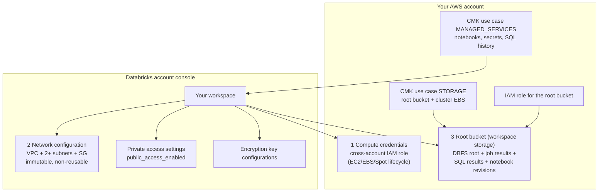
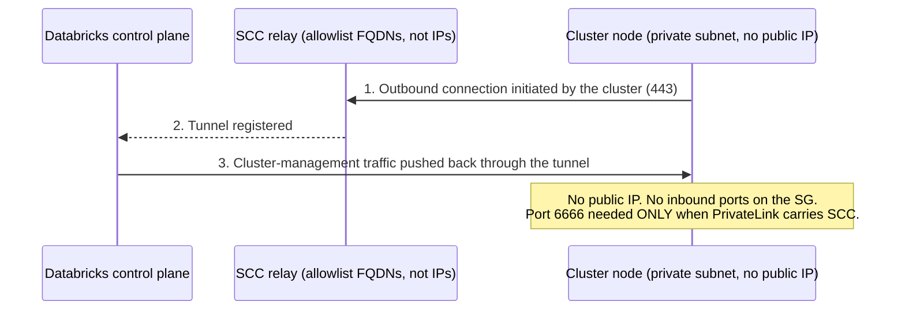
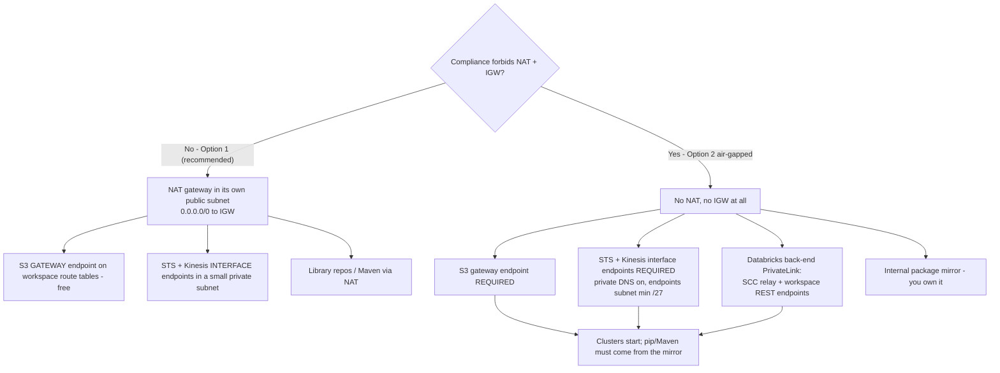
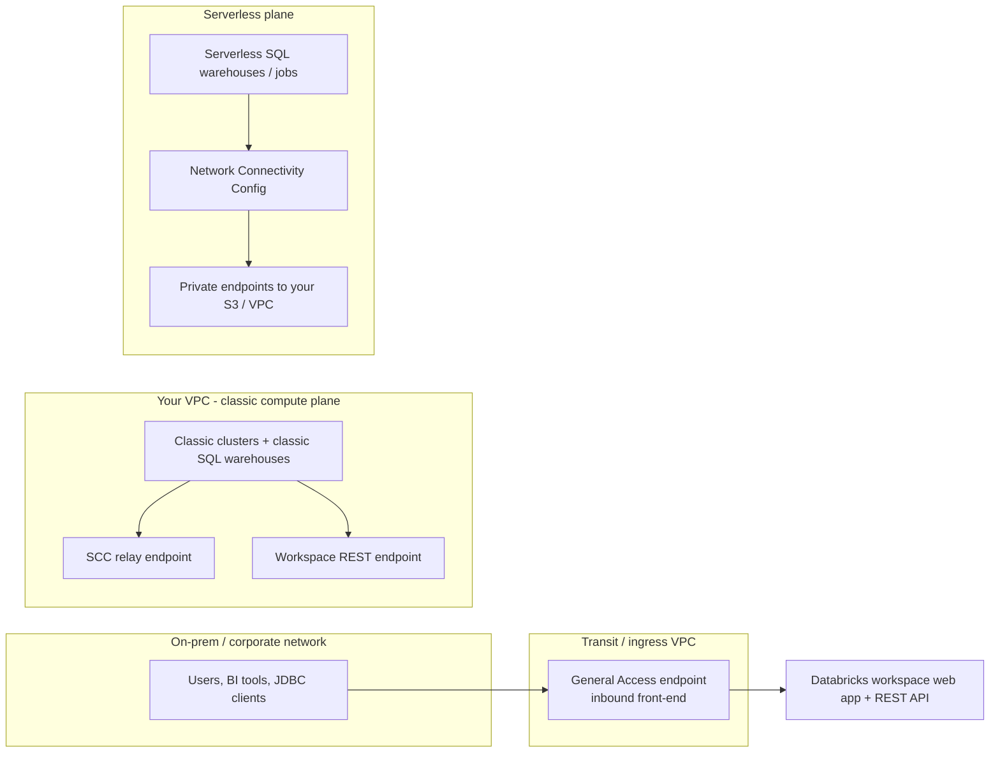
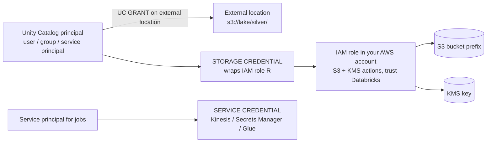
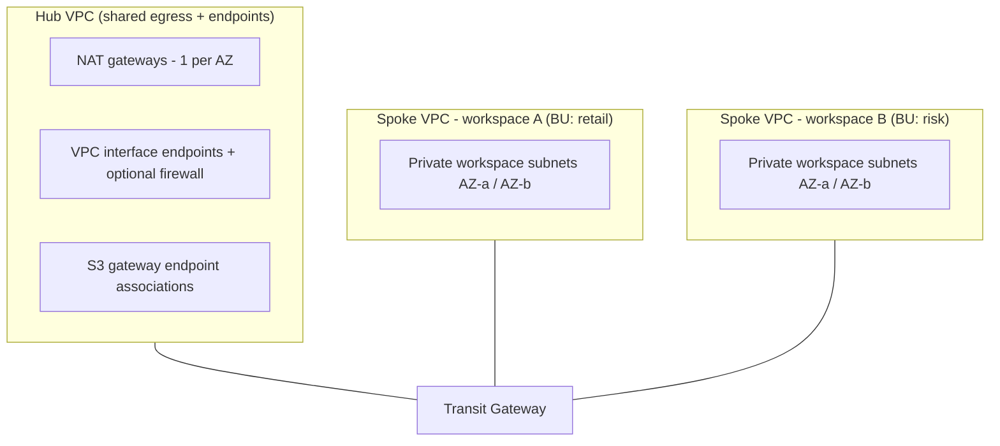

# AWS Foundation for Databricks: VPC Design, Root Bucket, PrivateLink, KMS and IAM

Every Databricks lakehouse in this course runs on one AWS-shaped assumption: **the data plane lives in your VPC, the data lives in your S3, and the control plane talks to both over paths you can name on a whiteboard**. Get the substrate wrong and nothing downstream saves you: cluster launches fail with cryptic assume-role errors, a 100-node cluster cannot start because a `/26` subnet ran out of addresses, an S3 bill balloons because 1 TB a month of lake traffic hairpinned through a NAT gateway at $0.045/GB, or a TLS-inspecting firewall silently kills every cluster the moment it touches the pinned control-plane certificates.

Every fact below comes from Databricks' AWS documentation (customer-managed VPC page *last updated Oct 8, 2026*; well-architected network phase *Sep 11, 2026*; PrivateLink pages *Oct 9, 2026*), the Databricks Security Reference Architecture, and AWS pricing pages: all accessed **October 2026**. Do the arithmetic yourself; it is the only way to defend a network design in a review.

```text
 =============================================================
  THE AWS SUBSTRATE AT A GLANCE - as of Oct 2026
 -------------------------------------------------------------
  Control plane      Databricks account (notebooks, jobs,
                     metastore metadata, SQL history)
  Compute plane      EC2 in YOUR VPC - private subnets,
                     no public IPs (SCC default)
  Data plane storage YOUR S3: root bucket + UC locations
  Trust              Databricks acct 414351767826 assumes
                     roles in YOUR account (external ID)
  Required egress    STS, S3, Kinesis (+ RDS legacy HMS only)
  PrivateLink        inbound / classic back-end / outbound
  Encryption         SSE by default; CMK STORAGE +
                     MANAGED_SERVICES on Enterprise
  IAM modern path    UC storage + service credentials
                     (instance profiles = legacy)
 =============================================================
```

In this lesson you will:

- dissect **workspace anatomy**: the four account-console objects a Databricks-on-AWS workspace is assembled from, and the cross-account trust that binds them;
- size a **customer-managed VPC** with the documented `(addresses − 5) ÷ 2` rule, from `/26` (29 nodes) to `/17` (16,381 nodes), and pick subnets against a real node target;
- run **secure cluster connectivity (SCC)** correctly: what it removes, what it does not, and why certificate pinning makes TLS inspection a cluster-killer;
- design **egress** the Databricks way: S3 **gateway** endpoints (free), STS + Kinesis **interface** endpoints, NAT economics, and the air-gapped Option 2 build;
- wire **all three PrivateLink flavors** (inbound, classic back-end, outbound/serverless) with the correct prerequisites and NCC limits;
- encrypt the **root bucket and control-plane artifacts** with the right KMS use cases, and read the key policy line by line;
- write the **annotated root-bucket policy**: the `aws:PrincipalTag/DatabricksAccountId` condition and the `unity-catalog/*` deny;
- choose between **instance profiles, storage credentials and service credentials**, and see why the modern path attaches IAM to *principals*, not to boxes;
- hand-compute **seven worked examples**: subnet capacity, the NAT-vs-endpoints bill, endpoint-inventory costing, KMS monthly cost, the trust-policy JSON, the security-group matrix and the root-bucket policy;
- study **two named AWS customer cases** (Block and Amgen), read the **2026 update box**, and practise with **12 exam-style questions** plus four interactive checks.

---

## 1. Workspace anatomy: the four objects you actually create

A Databricks workspace on AWS is not "an EC2 fleet". It is an **account-console object assembled from four pieces**: three supplied or approved by you, one created by Databricks (customer-managed VPC page, Oct 8, 2026; create-a-workspace guide, Sep 11, 2026):

| # | Object | Lives in | What it binds |
|---|---|---|---|
| 1 | **Compute credentials** | Your AWS account | A cross-account IAM role Databricks assumes to launch/manage EC2, EBS and Spot capacity |
| 2 | **Network configuration** | Databricks account console | VPC ID + ≥2 subnet IDs (one per AZ) + ≥1 security group ID |
| 3 | **Workspace storage configuration** | Your AWS account | The **root bucket** name + the IAM role Databricks assumes to read/write it |
| 4 | *(optional)* **Private access settings**, **encryption key configurations** | Databricks account console | PrivateLink front-door behaviour; CMK use cases `MANAGED_SERVICES` and `STORAGE` |



**Automated vs manual creation.** Automated setup (recommended) uses AWS IAM temporary delegation so you never hand-copy trust policies. Manual setup makes you build every role and policy yourself; which is exactly why the manual guide publishes the trust-account IDs and the bucket-policy shape you will see in section 7 (create-a-workspace guide, Sep 11, 2026).

- **📚 Did you know?** Databricks' AWS account IDs are public and partition-specific: **`414351767826`** for commercial regions, `044793339203` for AWS GovCloud, `170661010020` for GovCloud DoD (create-a-workspace guide, Sep 11, 2026). The AMI source account for workspace images is `601306020600`. Any trust policy you write for Databricks names one of these, and always pairs it with **`aws:ExternalId` equal to *your* Databricks account ID**, so a second Databricks customer cannot assume your role.

### 1.1 Worked example E1: the cross-account trust policy, line by line

Manual setup asks for a role in *your* account trusted by Databricks. The essential shape (pattern from the Databricks create-a-workspace guide and the Databricks Security Reference Architecture, accessed 2026-10):

```json
{
  "Version": "2012-10-17",
  "Statement": [
    {
      "Effect": "Allow",
      "Principal": {
        "Federated": "arn:aws:iam::414351767826:saml-provider/Databricks-<your-account-id>"
      },
      "Action": "sts:AssumeRole",
      "Condition": {
        "StringEquals": {
          "sts:ExternalId": "<YOUR-DATABRICKS-ACCOUNT-ID>"
        }
      }
    }
  ]
}
```

Three checks a reviewer must run on this JSON: (1) the account in the ARN is the commercial Databricks account `414351767826` (or the GovCloud ID if you are GovCloud); (2) the **external ID equals your Databricks account ID**, not a made-up string; (3) the role's permission policy scopes to EC2/EBS/Spot actions tagged for Databricks where your org standards require it: the SRA reference build uses `Vendor=Databricks` tag conditions so only Databricks-launched instances carry the profile.

> [!IMPORTANT]
> ⚠️ **A network configuration is immutable and non-reusable.** You cannot edit a created network configuration or a VPC endpoint registration. Changing subnets or CIDRs means: terminate all clusters → create new subnets → create a *new* network configuration → update the workspace. And "You cannot reuse a network configuration object across workspaces" (customer-managed VPC page, Oct 8, 2026): even when two workspaces share subnets, each gets its own registration. Design CIDRs once, generously, in section 2.

---

## 2. The customer-managed VPC: private subnets, sizing, and the capacity formula

### 2.1 The rules that are hard failures, not advice

| Requirement | Value (customer-managed VPC page, Oct 8, 2026) |
|---|---|
| Workspace subnets | **At least two, private, in different AZs** |
| Subnet netmask | **Between `/17` and `/26`** |
| Subnets per AZ per workspace | One selectable per AZ (more may exist; one attaches) |
| VPC DNS | Hostnames **and** resolution enabled |
| Subnet type | **Must be private**; egress via NAT+IGW or endpoints |
| Route tables | Workspace subnets carry a `0.0.0.0/0` route (to NAT or appliance): unless air-gapped Option 2 |
| NACLs | Must allow `0.0.0.0/0` inbound as the highest-priority rule; must not deny required egress ports |
| Security groups | **1 to 5** per workspace; unique subnets + SGs per workspace recommended |
| IPs per node | **Two** (one management, one Spark application) |
| Capacity rule | Usable nodes per subnet = **(addresses − 5) ÷ 2** |
| Guidance | "Subnets must be at least `/26`, but most use cases require at least `/23`" (well-architected network phase, Sep 11, 2026) |
| VPC CIDR | Unrestricted in principle; **at least `/25`** when PrivateLink endpoints are used; best-practice page suggests a minimum `/18` for workspace deployments |

The `0.0.0.0/0` route is the part that confuses people: the *workspace* subnets are private, but in Option 1 (the recommended standard configuration) their route table still points default traffic at a **NAT gateway sitting in its own public subnet** that routes quad-zero to an internet gateway. Private means "no public IPs on my nodes", not "no egress".

### 2.2 Worked example E2: sizing subnets for 450 concurrent nodes per AZ

**Target:** a platform team wants clusters of up to **450 nodes per availability zone**, two AZs, plus headroom for instance pools and SQL warehouses. Apply the documented formula `nodes = (addresses − 5) ÷ 2`:

```text
Worked example E2 - subnet capacity, per Databricks' documented rule (Sep 11, 2026)
Formula: usable nodes = (2^(32 - prefix) - 5) // 2

/26 .. (64 - 5) // 2   =   29 nodes   FAIL - 450 needed
/25 .. (128 - 5) // 2  =   59 nodes   FAIL
/24 .. (256 - 5) // 2  =  125 nodes   FAIL
/23 .. (512 - 5) // 2  =  253 nodes   FAIL - and below the "/23 most
                                      use cases" guidance at scale
/22 .. (1024 - 5) // 2 =  509 nodes   PASS (509 >= 450, 12% headroom)
/21 .. (2048 - 5) // 2 = 2,045 nodes   PASS (comfortable)
/17 .. (16384 - 5) // 2 = 16,381 nodes PASS (documented upper bound)

Chosen: two /22 workspace subnets, e.g. 10.42.0.0/22 (AZ-a) and
10.42.4.0/22 (AZ-b), inside a 10.42.0.0/18 VPC (16,384 addresses).
Remaining VPC space: NAT subnets /24s, an endpoints subnet, growth.
```

Two traps live in that arithmetic. First, **the `/26` floor is legal but useless**: 29 nodes per AZ dies on the first real workload, yet it satisfies the letter of the netmask rule, so workspace-creation validation passes and the failure arrives later as "clusters stuck pending". Second, capacity is consumed by **idle** things too: instance pools keep warm capacity, SQL warehouses hold nodes between queries, and an all-purpose cluster someone forgot to terminate holds IPs for days. Size for peak *plus* the idle fleet.

```plot
{
  "type": "bar",
  "title": "Databricks nodes per subnet: (addresses - 5) / 2, as documented Sep 2026",
  "data": [
    {"Subnet CIDR": "/26", "Nodes per subnet": 29},
    {"Subnet CIDR": "/25", "Nodes per subnet": 59},
    {"Subnet CIDR": "/24", "Nodes per subnet": 125},
    {"Subnet CIDR": "/23", "Nodes per subnet": 253},
    {"Subnet CIDR": "/22", "Nodes per subnet": 509},
    {"Subnet CIDR": "/21", "Nodes per subnet": 2045}
  ],
  "xKey": "Subnet CIDR",
  "dataKeys": ["Nodes per subnet"],
  "xLabel": "Workspace subnet netmask (/17-/26 is the legal range)",
  "yLabel": "Usable EC2 nodes per subnet"
}
```

- **📚 Did you know?** The halving is not arbitrary: "Databricks assigns two IP addresses per node, one for management traffic and one for Spark applications. The total number of instances for each subnet is equal to half of the number of IP addresses that are available" (customer-managed VPC page, Oct 8, 2026). The five subtracted addresses are AWS-reserved (network, router, DNS, future-use). So a `/23` is not "512 nodes"; it is **253**, and every capacity review that quotes raw CIDR math is wrong by 2×.

### 2.3 Security groups: the two-SG matrix

One to five security groups per workspace; the documented egress and ingress shape (customer-managed VPC page, Oct 8, 2026):

| SG | Ingress | Egress |
|---|---|---|
| **`sg-workspace`** (attached to the workspace network configuration) | **All TCP and all UDP from itself** (cluster-internal traffic) | TCP **443** to `0.0.0.0/0`; **3306** (legacy Hive metastore only); **6666** (SCC, *only if PrivateLink*); **8443, 8445** (compute → control-plane API); **8444** (Unity Catalog logging/lineage streaming); optionally **2443** (FIPS security profile), **5432** (Lakebase), **53** (custom DNS) |
| **`sg-endpoints`** (interface-endpoint ENIs) | TCP **443** from `sg-workspace` | No rules required: security groups are stateful |

Do not port-copy from Azure NSG templates. **3306 exists only for the legacy Databricks Hive metastore** (disabled by default on new Unity Catalog workspaces), **6666 is PrivateLink-only SCC**, **8444 is the Unity Catalog lineage/logging stream**, and **2443 is FIPS**. A "secure" rule set that drops 8443/8444 produces launch failures that look like product bugs.

---

## 3. Secure cluster connectivity: the default, and what it does not buy you

**SCC is the default deployment mode and the default recommendation** (well-architected network phase, Sep 11, 2026). The mechanism reverses the call direction: each cluster *initiates* a connection out to the SCC relay in the control plane, and cluster-management traffic comes back through that tunnel. Result: **no open inbound ports and no public IP addresses on classic compute-plane nodes**.



Three consequences engineers get wrong:

1. **SCC ≠ no internet.** SCC removes *inbound* needs. Databricks still requires **outbound** reachability to the SCC relay FQDNs, `s3.amazonaws.com:443`, `sts.amazonaws.com:443`, Kinesis, and library repositories. Private subnets with neither NAT nor endpoints give you clusters that never start and `pip`/Maven installs that hang.
2. **Allowlist FQDNs, not IP addresses.** "Always allowlist the provided domain names (FQDNs) for secure cluster connectivity (SCC) relay endpoints, rather than individual IP addresses" (IP addresses and domains page, accessed 2026-10). Control-plane NAT IPs are published per region (e.g. us-east-1 `3.237.73.224/28`) and matter for *bucket policies*, not for SCC egress.
3. **SCC is a prerequisite for classic (back-end) PrivateLink.** If PrivateLink is on your roadmap, SCC must be on from day one, and an existing workspace without SCC is a rebuild conversation, not a toggle.

> [!WARNING]
> ⚠️ **Never put a TLS-intercepting proxy in front of the Databricks control plane or SCC relay.** "Databricks control plane and SCC relay connections use TLS with certificate pinning. Do not enable TLS inspection (decrypt and re-encrypt) on traffic between your clusters and the Databricks control plane. Doing so causes cluster failures" (managed security architecture page, accessed 2026-10). Inspect other egress paths instead. This single line saves more incident-review hours than any other on this page.

### 3.1 Interactive check: match each egress port to its job

```matching
{
  "question": "Match each TCP port in the documented security-group egress list to what it is actually for (customer-managed VPC page, Oct 8, 2026):",
  "pairs": [
    {"left": "TCP 443", "right": "General HTTPS egress: AWS APIs, S3, STS, web calls"},
    {"left": "TCP 3306", "right": "Legacy Hive metastore only: not needed on UC workspaces"},
    {"left": "TCP 6666", "right": "Secure cluster connectivity: required only with PrivateLink"},
    {"left": "TCP 8444", "right": "Unity Catalog logging and lineage streaming to Databricks"},
    {"left": "TCP 8443 / 8445", "right": "Internal calls from the compute plane to the control-plane API"},
    {"left": "TCP 2443", "right": "FIPS / compliance security profile only"}
  ],
  "explanation": "The trap set is deliberate: 3306 is legacy-HMS-only and does not traverse PrivateLink; 6666 appears only when PrivateLink carries SCC; 8444 is the Unity Catalog telemetry stream; 2443 is FIPS-only. Teams that copy Azure NSG rules or open 'all egress' fail the design review; teams that open 443/3306/6666 and forget 8443/8444/8445 pass workspace creation and then watch lineage and API calls die."
}
```

---

## 4. Egress architecture: gateway endpoints, interface endpoints, NAT

### 4.1 What a customer-managed VPC must reach

"There are four AWS services that a Databricks workspace with a customer-managed VPC must reach: **STS, S3, Kinesis, and RDS**" (customer-managed VPC page, Oct 8, 2026). RDS is only for the **legacy Databricks Hive metastore**: a Unity Catalog workspace does not need it. So the modern required set is **STS + S3 + Kinesis**.

The endpoint-type mechanics that decide your bill:

| Service | Endpoint type available | Price (accessed 2026-10) |
|---|---|---|
| **S3** | **Gateway** (attached to route tables) | **Free**: "There is no additional charge for using gateway endpoints" (AWS VPC user guide) |
| S3 | Interface (PrivateLink) | Hourly per AZ + per-GB processing: Databricks: "Unless strictly required for compliance reasons, prefer the gateway S3 VPC endpoints, which are free of charge" (Sep 11, 2026) |
| **DynamoDB** | Gateway | Free (SRA lists it as *optional* for Databricks; documented specifically for same-region **serverless** access) |
| **STS** | Interface only | ~**$0.01/AZ-hour** (commonly published US rate: verify on the pricing page for your region) + $0.01/GB first 1 PB |
| **Kinesis** | Interface only | Same interface-endpoint pricing |

Gateway endpoints exist **only for S3 and DynamoDB** (AWS VPC user guide). Everything else that you want off the public path is an interface endpoint billed **per AZ, per hour, whether or not traffic flows**.

### 4.2 Worked example E3: the NAT-vs-endpoints bill

Scenario from the Databricks network guidance: a workspace moving **1 TB/month of S3 traffic** plus **500 GB/month of other AWS API traffic**, two AZs, rates as of Oct 2026 (NAT gateway $0.045/hour + $0.045/GB; interface endpoints ~$0.01/AZ-hour; gateway endpoints free):

```text
Worked example E3 - monthly egress plumbing, 2 AZs, as of Oct 2026 (US rates)
Workload: 1,000 GB/mo via S3 + 500 GB/mo other AWS APIs

Scenario A - NAT only, no VPC endpoints
  2 NAT gateways ....... 2 x $0.045/hr x 730 hr     = $ 65.70
  NAT data processing .. 1,500 GB x $0.045/GB       = $ 67.50
  TOTAL .............................................. $133.20 / month

Scenario B - recommended: NAT + S3 gateway + STS/Kinesis interfaces
  2 NAT gateways ....... (fixed)                     = $ 65.70
  S3 gateway endpoint ... free, on workspace routes   = $  0.00
  STS + Kinesis interfaces 2 svc x 2 AZ x $0.01 x 730= $ 29.20
  Residual NAT on non-endpoint traffic ~500 GB x .045 = $ 22.50
  Interface data (first 1 PB tier) ~1,000 GB x $0.01  = $ 10.00
  TOTAL .............................................. $127.40 / month
  (and S3 traffic no longer touches NAT at all)

Scenario C - air-gapped Option 2: no NAT, no IGW
  NAT ................................. none          = $  0.00
  S3 gateway + STS/Kinesis interfaces (as B)          = $ 29.20
  Back-end PrivateLink endpoints (see E4)             = $ 29.20
  Internal mirror for libraries/repos ................. you own it
  TOTAL (networking line items only) ......... $ 58.40 / month
```

The teaching point is not the $6 swing; it is the **shape**. NAT charges hourly *and* per GB forever; the S3 **gateway** endpoint is free and removes the largest data path from NAT entirely; interface endpoints are the only way to keep STS/Kinesis private but you pay for them per AZ even idle. Databricks' own words: "If most traffic through your NAT gateway is to AWS services that support interface endpoints or gateway endpoints, consider creating an interface endpoint or gateway endpoint for these services" (AWS NAT gateway guide). And per GB through PrivateLink: first 1 PB **$0.01/GB**, next 4 PB **$0.006**, over 5 PB **$0.004** (AWS PrivateLink pricing, accessed 2026-10).

### 4.3 Option 1 vs Option 2: the egress decision

The classic PrivateLink page defines the two official configurations: **Option 1 (standard, recommended)** keeps a NAT gateway + internet gateway and adds optional S3/STS/Kinesis endpoints; **Option 2 (fully private / air-gapped)** eliminates NAT and IGW and *requires* the S3, STS and Kinesis endpoints plus Databricks back-end PrivateLink (classic PrivateLink page, Oct 9, 2026).



Air-gapped builds still owe outbound reachability to `s3.amazonaws.com:443`, `sts.amazonaws.com:443` and the SCC relay FQDNs: via endpoints, not the internet. The trade-off is explicit in the docs: Option 2 removes NAT cost and public paths, and hands you *every* endpoint as an operational dependency.

### 4.4 Interactive check: order an air-gapped build

```dragdrop
{
  "question": "Put the air-gapped (Option 2) workspace build in the order the official flow implies (classic PrivateLink page + customer-managed VPC page, 2026):",
  "items": [
    "Create two private workspace subnets in different AZs (/26 to /17) with DNS hostnames + resolution on",
    "Attach an S3 gateway endpoint to the workspace route tables",
    "Create a dedicated endpoints subnet (minimum /27) for AWS service interface endpoints",
    "Create STS and Kinesis interface endpoints with private DNS; SG ingress 443 from the workspace SG",
    "Create and register Databricks back-end PrivateLink endpoints: SCC relay + workspace REST API",
    "Create the workspace, then wait 20 minutes after status RUNNING before launching clusters"
  ],
  "correctOrder": [
    "Create two private workspace subnets in different AZs (/26 to /17) with DNS hostnames + resolution on",
    "Attach an S3 gateway endpoint to the workspace route tables",
    "Create a dedicated endpoints subnet (minimum /27) for AWS service interface endpoints",
    "Create STS and Kinesis interface endpoints with private DNS; SG ingress 443 from the workspace SG",
    "Create and register Databricks back-end PrivateLink endpoints: SCC relay + workspace REST API",
    "Create the workspace, then wait 20 minutes after status RUNNING before launching clusters"
  ],
  "explanation": "Order matters: the S3 gateway endpoint lives on route tables and needs no ENI, so it comes before the endpoints subnet; STS/Kinesis interfaces go in the dedicated /27-or-larger subnet with private DNS before workspace creation, because a workspace whose STS is unreachable fails at cluster launch; back-end PrivateLink registrations must exist and be referenced by the network configuration; and the docs require waiting an extra 20 minutes after RUNNING before using clusters (classic PrivateLink page, Oct 9, 2026)."
}
```

---

## 5. PrivateLink at Databricks: three flavors, one prerequisite matrix

Databricks supports **three types of Private Link connectivity** (Private Link concepts page, Oct 9, 2026):

| Flavor | Path | Endpoint types | Prerequisites |
|---|---|---|---|
| **Inbound (front-end)** | Users/BI/on-prem → VPC interface endpoint → workspace web app + REST API | **General Access** | Enterprise plan; a **private access settings** object; with `public_access_enabled=false` the workspace is reachable *only* over PrivateLink |
| **Classic (back-end)** | Clusters in your VPC → two interface endpoints → control plane | **SCC relay** + **workspace (REST APIs)** | Enterprise plan + **customer-managed VPC** + **SCC**; endpoints registered as VPC endpoint registrations and referenced by the network configuration |
| **Outbound (serverless)** | Serverless compute plane → NCC-attached private endpoints → your S3 buckets or VPC | Private endpoints via **Network Connectivity Config (NCC)** | NCC in the account; S3 private connectivity was in **Public Preview** as of the Oct 9, 2026 concepts page |

A fourth, narrower type, **Service Direct**, exists for performance-intensive services (Zerobus Ingest, Lakebase Autoscaling). Databricks "recommends at most one endpoint of each endpoint type" within the same VPC.



**NCC limits worth memorising** (Private Link concepts page, Oct 9, 2026): up to **10 NCCs per region per account**; **50 workspaces per NCC**; **30 S3 private endpoints per region**; **100 private endpoints per region for VPC resources**. VPC endpoint registrations are **immutable once created**. Port **3306** (legacy HMS) does **not** traverse PrivateLink. And per the private access settings page (May 4, 2026), private access level `ANY` is deprecated: use **Account** (only VPC endpoints registered in your Databricks account) or **Endpoint** (explicit allow list).

### 5.1 Worked example E4: endpoint inventory and idle cost

Take the two-AZ workspace from E2 adding classic back-end PrivateLink. Interface endpoints at the commonly published US rate of ~$0.01/AZ-hour (**≈ $7.30 per AZ-month**; verify your region on aws.amazon.com/privatelink/pricing, accessed 2026-10):

```text
Worked example E4 - interface endpoint inventory, 2 AZs, as of Oct 2026 (US rate; verify per region)
Required for private STS/Kinesis + back-end PrivateLink:
  STS interface ....... 2 AZ x $7.30            = $14.60 / month
  Kinesis interface ... 2 AZ x $7.30            = $14.60 / month
  SCC relay endpoint .. 2 AZ x $7.30            = $14.60 / month
  Workspace REST ep. .. 2 AZ x $7.30            = $14.60 / month
  Subtotal idle hours ........................... = $58.40 / month
  Data processing ..... first 1 PB tier $0.01/GB (on private data volumes)

Free companions:
  S3 gateway endpoint (route-table attached) ..... $ 0.00
  DynamoDB gateway endpoint (optional, SRA) ...... $ 0.00

Anti-pattern - S3 INTERFACE endpoint by reflex, 3 AZs, unused:
  3 AZ x $7.30 = $21.90/month idle for what the free gateway does.
```

The anti-pattern at the bottom is the one design reviews keep catching: **interface S3 endpoints charge hourly per AZ and per GB, while the gateway endpoint is free** and covers in-VPC S3. Four interface endpoints across three AZs idles at ~$87.60/month; the same S3 access through a gateway endpoint idles at $0. Databricks says it directly: prefer gateway "unless strictly required for compliance reasons" (Sep 11, 2026).

---

## 6. Encryption: the root bucket, managed services, and the key policy

Databricks encrypts at rest by default (SSE on the root bucket; control-plane artifacts encrypted in the Databricks-managed layer). Customer-managed keys (CMK) on the **Enterprise** tier extend that control to two distinct use cases (customer-managed keys pages, accessed 2026-10):

| Use case | Configuration value | What it encrypts |
|---|---|---|
| **Managed services** | `MANAGED_SERVICES` | Data in the Databricks control plane: notebooks, secrets, SQL query data/history, default storage |
| **Workspace storage** | `STORAGE` | Your **workspace storage bucket** (DBFS root, FileStore, MLflow models, Lakeflow pipeline data, job results, SQL results, notebook revisions) and, optionally, the **EBS volumes** of classic compute |

Unity Catalog separately "supports the ability to read from and write to S3 buckets with KMS encryption enabled": each storage credential's IAM role gets the `kms:` actions it needs on the bucket's key.

### 6.1 Worked example E5: KMS cost for a three-key estate

The Databricks Security Reference Architecture reference build uses **three KMS keys**: workspace storage, managed services, and the Unity Catalog workspace catalog. AWS KMS pricing (accessed 2026-10): **$1.00 per key per month** (prorated hourly) plus **$0.03 per 10,000 requests**, with a free tier of 20,000 requests/month.

```text
Worked example E5 - CMK monthly cost, as of Oct 2026 (aws.amazon.com/kms/pricing)
Keys ......... 3 (workspace storage, managed services, UC catalog)
             3 x $1.00                    = $ 3.00 / month
Requests ..... AWS's own worked example shape: 2,010,000 requests
             1,990,000 billable (above 20k free tier)
             x $0.03 / 10,000             = $ 5.97
TOTAL (illustrative estate) ....................... $ 8.97 / month

Read the lever: the request term dominates only at high call rates;
key count is cheap insurance. A 30-key sprawl still costs $30/month
in key fees - the auditability cost, not the KMS bill, is what kills
key sprawl.
```

### 6.2 The key policy line you must get right

The customer-managed-keys configuration guide requires the key policy to allow the Databricks principal: with a **tag condition**, not open access (accessed 2026-10):

```json
{
  "Sid": "Allow Databricks use of the key",
  "Effect": "Allow",
  "Principal": { "AWS": "arn:aws:iam::414351767826:root" },
  "Action": [
    "kms:Encrypt", "kms:Decrypt", "kms:ReEncrypt*",
    "kms:GenerateDataKey*", "kms:DescribeKey"
  ],
  "Condition": {
    "StringEquals": {
      "aws:PrincipalTag/DatabricksAccountId": "<YOUR-DATABRICKS-ACCOUNT-ID>"
    }
  }
}
```

Plus a separate statement scoped to your own cross-account role for EBS-related use. The tag condition is the guardrail: it ensures only Databricks principals *tagged with your account ID* can use the key: not every principal in the Databricks AWS account. Pair it with `MANAGED_SERVICES` vs `STORAGE` use-case configuration so notebooks-secrets-SQL-history and bucket-EBS are independently rotatable.

- **📚 Did you know?** In transit, Databricks uses TLS 1.2+ between users/APIs/BI tools and between control and compute planes; worker-to-worker shuffle encryption is **opt-in** (Enterprise tier: via an init script on AES-256/TLS 1.3, or by picking instance families that encrypt inter-node traffic natively). So "encryption at rest via CMK" and "encryption in transit everywhere" are three separate checkboxes, not one.

---

## 7. The root bucket: what lives in it, and the policy that guards it

The **root bucket** (workspace storage) is an S3 bucket **in your AWS account** that Databricks provisions (automated setup) or you register (manual setup: bucket name + IAM role ARN). It stores workspace assets "such as data, libraries, and logs", **DBFS root** (FileStore, MLflow models, Lakeflow pipeline data), workspace system data (job results, Databricks SQL results, notebook revisions), and, per the create-a-workspace guide (Sep 11, 2026), **"the workspace's default catalog"**.

Two facts about it that stop two classic disasters:

1. **It is customer-owned but Databricks-operated.** The Databricks control plane reaches it as principal `arn:aws:iam::414351767826:root`, which your bucket policy permits *only* under the account-tag condition.
2. **It is not your analytics lake.** DBFS root and DBFS mounts are **deprecated**: "New accounts are provisioned without access to these features. Databricks recommends using Unity Catalog volumes, external locations, or workspace files instead" (DBFS + UC best-practices page, accessed 2026-10). And the same page: **"You should never load a storage account used as a DBFS root as an external location in Unity Catalog."**

### 7.1 Worked example E6: annotated root-bucket policy

Manual-setup shape from the create-a-workspace guide (Sep 11, 2026), annotated:

```json
{
  "Version": "2012-10-17",
  "Statement": [
    {
      "Sid": "AllowDatabricksControlPlane",
      "Effect": "Allow",
      "Principal": { "AWS": "arn:aws:iam::414351767826:root" },
      "Action": ["s3:ListBucket", "s3:GetObject", "s3:PutObject", "s3:DeleteObject"],
      "Resource": [
        "arn:aws:s3:::<YOUR-ROOT-BUCKET>",
        "arn:aws:s3:::<YOUR-ROOT-BUCKET>/*"
      ],
      "Condition": {
        "StringEquals": {
          "aws:PrincipalTag/DatabricksAccountId": ["<YOUR-DATABRICKS-ACCOUNT-ID>"]
        }
      }
    },
    {
      "Sid": "PreventDBFSFromAccessingUnityCatalogPrefix",
      "Effect": "Deny",
      "Principal": "*",
      "Action": ["s3:DeleteObject", "s3:PutObject", "s3:DeleteObjectVersion"],
      "Resource": "arn:aws:s3:::<YOUR-ROOT-BUCKET>/unity-catalog/*",
      "Condition": { "StringNotLike": { "aws:PrincipalArn": "arn:aws:iam::<YOUR-ACCOUNT>:role/<UC-ADMIN-ROLE>" } }
    }
  ]
}
```

Hardening moves seen in production designs (patterns from the Databricks SRA and the documented condition-key list): add `aws:SourceIp` conditions for your region's control-plane NAT range (a brand-new workspace provisioning fails if the `us-west` control-plane NAT IP is not allowed), and/or `aws:sourceVpce` bound to your S3 gateway endpoint so the bucket answers only from inside the VPC. Databricks notes that control-plane access uses **VPC IDs for same-region S3** and **NAT IPs for cross-region S3**: design the condition for the region pair you actually run.

---

## 8. IAM: instance profiles vs storage credentials vs service credentials

This is the single most important conceptual shift from 2021-era Databricks-on-AWS material to the Unity Catalog era:

| Mechanism | Attaches to | Status as of Oct 2026 | Use for |
|---|---|---|---|
| **Instance profile** | The **EC2 instance** (and therefore the cluster) | **Legacy**: still administrable (Settings → Security), useful only for legacy DBFS mounts / `fs.s3a` / legacy HMS ACLs | Nothing new on UC workspaces |
| **Storage credential** (UC securable) | **Principals**: users, groups, service principals, via UC grants | **Modern path** | IAM role wrapped as a UC object, used by **external locations** for tables and volumes |
| **Service credential** (UC) | **Principals** | **Modern path** | Non-storage AWS services: Kinesis, Secrets Manager, Glue |
| **Credential passthrough** | Per-user identity passthrough | **Deprecated from DBR 15.0**, "Databricks recommends that you upgrade to Unity Catalog" (archive page, May 13, 2024) | Nothing, migrate |

Databricks states the shift plainly: service credentials are "the Unity Catalog alternative to instance profiles, with the advantage that access is not tied to a specific compute resource but instead to users, groups, or service principals" (service-credentials docs, accessed 2026-10). A storage credential is defined as "a Unity Catalog credential used to access external locations and tables" (storage-credential SQL reference, Sep 11, 2026).



### 8.1 Worked example E7: modern data-access path, end to end

```sql
-- 1. The IAM role (your account) trusts Databricks with an external ID,
--    and its policy allows s3 on the lake prefix + kms on the bucket key.

-- 2. Register it as a UC storage credential (account admin):
CREATE STORAGE CREDENTIAL finance_cred
  AWS_IAM_ROLE_ARN 'arn:aws:iam::<ACCOUNT>:role/finance-lake-role'
  COMMENT 'Lake read/write for finance domains';

-- 3. Bind it to a path exactly once:
CREATE EXTERNAL LOCATION finance_loc
  URL 's3://acme-finance-lake/silver/'
  WITH (CREDENTIAL finance_cred);

-- 4. Govern by principal, not by box:
GRANT READ VOLUME, WRITE VOLUME
  ON EXTERNAL LOCATION finance_loc
  TO `data-eng-finance`;

-- Never the legacy move on a UC workspace:
--   spark.conf.set('fs.s3a.path.style.access', ...)  + instance profile
```

The examinable difference: step 4 grants follow the **group**, so the same notebook works on a jobs cluster, a SQL warehouse and a serverless compute without any instance-profile attachment, and revocation is one `REVOKE`, not a cluster-patch plus a bucket-policy edit.

### 8.2 Interactive check: fill the terms

```fillblank
{
  "question": "Complete the sentence with the correct Unity Catalog / IAM terms (service-credentials and storage-credential docs, accessed 2026-10):",
  "template": "In Unity Catalog, the securable that wraps an IAM role for S3 external locations is a storage {{1}}; the alternative for non-storage AWS services such as Kinesis is a {{2}} {{3}}; both supersede the legacy instance {{4}} pattern, and credential passthrough is deprecated from DBR 15.0.",
  "answers": {
    "1": "credential",
    "2": "service",
    "3": "credential",
    "4": "profile"
  },
  "distractors": ["metastore", "endpoint", "gateway", "passthrough", "namespace", "mount"],
  "explanation": "Storage credentials govern external locations and tables; service credentials cover Kinesis/Secrets Manager/Glue-style access; both attach to principals via UC grants, while instance profiles attach to compute and survive only for legacy mounts. Databricks explicitly positions service credentials as 'the Unity Catalog alternative to instance profiles'. 'Mount' is the trap word: DBFS mounts are deprecated and must never point at a UC external location."
}
```

---

## 9. Cross-account patterns, hub-and-spoke, and the network-configuration traps

Three root-bucket/account patterns appear in official material (digest-grounded, create-a-workspace guide Sep 11 2026):

1. **Single account**: bucket, roles and workspace all in one AWS account (default automated flow).
2. **Tag-gated bucket policy**: bucket in your account, allow for `414351767826:root` conditioned on `aws:PrincipalTag/DatabricksAccountId`, plus the `unity-catalog/*` deny (E6).
3. **Network-restricted bucket**: the same policy plus `aws:SourceIp` (control-plane NAT IPs / corporate VPN) and/or `aws:sourceVpce` (your S3 gateway endpoint) conditions.

For many business units, Databricks' documented topology is hub-and-spoke: "You can use a VPC hub-and-spoke architecture, where all VPC endpoints, NAT gateways, firewalls, and so on, are installed in the hub VPC. Each workspace is associated with subnets … in a different VPC, within the same or a different AWS account. The spoke VPCs are connected to the hub VPC using a Transit Gateway" (well-architected network phase, Sep 11, 2026). Remember the constraint from section 1: **each workspace still registers its own network configuration**, even when subnets are shared.



Operational traps collected from the documented failure modes (pitfalls section of the customer-managed VPC and PrivateLink pages, 2026):

- **Blocked STS = dead clusters.** STS is mandatory. Enforce regional endpoints or a new firewall rule without an STS interface endpoint (or an allow for `sts.amazonaws.com:443`) and assume-role failures stop cluster launches and S3 access. Manual workspace creation additionally requires the **STS endpoint activated for `us-west-2`**.
- **NACLs that "help".** Databricks validates that NACLs allow `0.0.0.0/0` inbound as the top rule; a deny on 8443/8444/6666 causes cryptic launch failures. Re-associate route tables if you recreate subnets.
- **Kinesis in `us-west-1`** is cross-region (target streams live in `us-west-2`), so a regional Kinesis endpoint there behaves differently (customer-managed VPC note).
- **Databricks-managed VPC is on the way out:** "In a future release, Databricks plans to deprecate classic workspace creation with a Databricks-managed VPC. New classic workspaces will require a customer-managed VPC" (Oct 8, 2026), and an existing Databricks-managed-VPC workspace **cannot be converted in place**; plan a rebuild.

- **📚 Did you know?** The Databricks-managed-VPC → customer-managed-VPC migration story has a hard Unity-Catalog edge: DBFS root/mounts must never become a UC external location, instance-profile access is replaced by storage/service credentials, and PrivateLink requires Enterprise + SCC. The realistic path is provision-new-workspace-in-customer-VPC → attach metastore → recreate access via storage credentials + external locations → migrate tables: the full sequence is lesson 3's topic.

---

## 10. Classic vs serverless networking, and the 2026 deltas

| Dimension | Classic compute plane (customer VPC) | Serverless (SQL warehouses, serverless jobs) |
|---|---|---|
| Where nodes run | EC2 in **your** VPC, private subnets | Databricks-managed serverless compute plane |
| Public IPs | None (SCC default) | None: "Serverless SQL warehouses do not have public IP addresses" (serverless SQL page, Aug 13, 2026) |
| Customer-managed VPC | Required for PrivateLink flavors | "Customer-managed VPCs are not applicable to compute resources for serverless SQL warehouses" |
| Private path to your data | S3/STS/Kinesis endpoints + back-end PrivateLink | **NCC** private endpoints; network policies for egress (`FULL_ACCESS` or restricted destinations); same-region DynamoDB via gateway endpoints |
| Who owns routing | You | Databricks (you supply endpoint registrations / NCC rules) |
| Per-endpoint billing | Hourly per AZ + per GB (interface) | Charged per hour per private endpoint and per GB through them (serverless networking page, Sep 25, 2026) |
| Egress controls | SGs, NACLs, firewall, NAT | Network policies with dry-run mode; denials land in `system.access.outbound_network` |

### 2026 Updates (as of October 2026)

> [!NOTE]
> **What changed in the Databricks-on-AWS substrate that this lesson depends on:**
> - **SCC is the default everywhere**: "Secure cluster connectivity (SCC) has become the default recommendation and is the default deployment mode for workspaces" (well-architected network phase, *last updated Sep 11, 2026*). Any tutorial that opens inbound ports for cluster management is pre-SCC material.
> - **Classic workspaces will require customer-managed VPCs**: "In a future release, Databricks plans to deprecate classic workspace creation with a Databricks-managed VPC" (customer-managed VPC page, *last updated Oct 8, 2026*). Greenfield designs should never start in a Databricks-managed VPC, and existing ones need a rebuild plan, not an in-place upgrade.
> - **Serverless egress controls moved to network policies; the NCC stable-IP list is gone**: "The legacy list of stable IPs from the Public Preview was decommissioned and is no longer available through the NCC UI or Network Connectivity API"; network policies offer "Allow access to all destinations" (`FULL_ACCESS`) or "Restricted access to specific destinations" (serverless networking + manage-network-policies pages, *Sep 25, 2026*). Old allow-list runbooks that cite stable serverless IPs are stale.
> - **S3 private connectivity for serverless is in Public Preview**: listed as a PrivateLink endpoint capability on the concepts page (*Oct 9, 2026*); treat GA claims as premature and re-check before relying on it in a compliance design.
> - **PrivateLink prerequisites hardened in the docs**: Enterprise plan for both inbound and classic back-end; customer-managed VPC **and** SCC for back-end; endpoint subnet minimum `/27` for the air-gapped option; private access level `ANY` deprecated in favour of Account/Endpoint levels (PrivateLink + private-access-settings pages, *May: Oct 2026*).
> - **The AWS Platform Architect accreditation now explicitly tests this lesson's scope**: "Customer-managed VPCs · Customer-managed keys · Cloud service integrations" across 20 questions, 80% pass, free for Databricks customers and partners, valid one year (databricks.com/learn/certification/databricks-on-aws, accessed 2026-10-12).

---

## Real-World Case Studies

Customer pages publish architecture *outcomes*, not VPC diagrams: "Cloud: AWS" tells you the substrate is this course's substrate, never which CIDR or KMS layout a company chose. Every figure below is customer-claimed, with the source and its date named so you can check it.

### Case A, Block (Square, Cash App, TIDAL): 12 PB on S3, IAM plumbing collapsed into Unity Catalog

| Element | Detail |
|---|---|
| Customer | **Block** (Square, Cash App, TIDAL): financial services; story page tagged **Cloud: AWS** |
| Challenge | 12 PB of graph + analytics data fragmented across business units; a painful two-step IAM flow (attach IAM policies to roles, *then* to S3 buckets); GDPR/CCPA PII governance |
| Services | Databricks, Delta Lake, **Unity Catalog**, Spark Declarative Pipelines; **S3 as co-located storage** |
| Outcome | "12X Reduction in compute cost · 20% Reduction in data egress cost · 12PB Of data managed and governed"; data-sharing permission time cut "from days to seconds"; "the adoption of Unity Catalog promoted the collection of data into S3 buckets, resulting in improved latency and the co-location of compute and storage" |
| Source | https://www.databricks.com/customers/block/unity-catalog (undated page, accessed 2026-10) |
| Maps to this lesson | The modern IAM path of section 8: governance replaced bucket-by-bucket IAM plumbing on an S3 substrate |

> ⏳ *Temporal note: undated customer page accessed Oct 2026; treat the 12×/20%/12 PB figures as reported outcomes, not guarantees.*

### Case B, Amgen: from 120+ IAM roles to one or two, via Unity Catalog

| Element | Detail |
|---|---|
| Customer | **Amgen**: biopharma (verified via dated blog; no `/customers/amgen` story page exists as of 2026-10) |
| Challenge | **AWS Glue** as enterprise catalog plus **AWS IAM** role-per-use-case sprawl; auditing meant parsing IAM policies |
| Services | Unity Catalog over an AWS estate: the blog names Glue and IAM as the prior stack, so the substrate is AWS |
| Outcome | "we didn't have to create or manage at least 120+ IAM roles … we went from hundreds of IAM roles to just one or two principal IAM role"; "This reduces the audit effort for the function by 50%"; "around ~500 objects mapped in Unity Catalog"; "90 percent of our use cases are on Databricks" |
| Source | https://www.databricks.com/blog/how-databricks-unity-catalog-helped-amgen-enable-data-governance-enterprise-scale (**May 2023**) |
| Maps to this lesson | Why storage/service credentials (section 8) beat instance-profile sprawl: the role *count* is the metric auditors understand |

> ⏳ *Temporal note: May 2023 figures; the mechanism (principals governed in UC, roles collapsed) remains the documented pattern in 2026.*

### Case C, Nubank: S3 as the storage layer of a regulated fintech lakehouse

| Element | Detail |
|---|---|
| Customer | **Nubank**: LATAM fintech, 100MM+ customers |
| Challenge | Cost efficiency and continuity across a 12-month warehouse-platform migration with zero downtime |
| Services | Databricks SQL + Unity Catalog; storage layer "mostly … AWS in S3" per a Databricks talk transcript |
| Outcome | "+40% annual cost savings" while monthly queries grew "20MM to 40MM"; 17k users; "Leverage of UC for centralized data governance in highly regulated FSI industry" |
| Source | https://www.databricks.com/dataaisummit/session/how-nubank-migrated-databricks-sql-reducing-costs-40-and-doubling (session abstract, undated, accessed 2026-10); AWS/S3 confirmation at https://answers.databricks.com/nubank-s-fine-grained-access-control-at-scale-from-permission-groups-unity-catal-RcsHbHSL97Q (**2026-08-27**) |
| Maps to this lesson | The S3 + IAM substrate decision (sections 4 and 7) is what "cost per query, not total spend" rests on |

> ⏳ *Temporal note: session-abstract evidence, not an audited case study; teach the migration pattern, not a promised discount.*

---

## Practice Questions

```question
{
  "id": "dbl-02-q1",
  "type": "multiple-choice",
  "question": "A classic Databricks workspace on AWS is being created with a customer-managed VPC. Which set matches the documented requirements as of October 2026?",
  "options": [
    "At least two private subnets in different AZs, each with a netmask between /17 and /26, plus DNS hostnames and DNS resolution enabled on the VPC",
    "At least two public subnets in different AZs, each between /24 and /28, with public IP assignment enabled on the subnets",
    "Exactly one subnet per workspace with a netmask of /16, plus a separate public subnet for clusters",
    "One subnet per cluster, netmask /28, with the VPC DNS options disabled to avoid resolver conflicts"
  ],
  "correct": 0,
  "explanation": "The customer-managed VPC page (Oct 8, 2026) requires at least two private subnets in different AZs, subnet netmasks between /17 and /26, and VPC DNS hostnames + resolution enabled. 'Public subnets for clusters' is the classic trap: with SCC as the default, cluster nodes hold no public IPs; public subnets exist only to host NAT gateways. The /28 option is below the /26 floor and would fail validation."
}
```

```question
{
  "id": "dbl-02-q2",
  "type": "multiple-choice",
  "question": "Using Databricks' documented capacity rule, how many EC2 nodes can a /22 workspace subnet support?",
  "options": [
    "1,024 nodes: the raw address count, because Databricks uses one IP per node",
    "509 nodes - (1,024 - 5) / 2, because each node takes a management IP and a Spark IP",
    "512 nodes: the raw address count minus AWS-reserved addresses only",
    "253 nodes: because capacity is always halved twice: once for the two-AZ split and once for the two IPs"
  ],
  "correct": 1,
  "explanation": "Databricks documents nodes = (addresses - 5) / 2: two IPs per node (management + Spark) and five AWS-reserved addresses. So /22 = (1,024 - 5) / 2 = 509. The 1,024 and 512 distractors are the two halves of the mistake teams make in capacity reviews; the 253 answer is the /23 figure, off by one prefix."
}
```

```question
{
  "id": "dbl-02-q3",
  "type": "multiple-choice",
  "question": "Secure cluster connectivity (SCC) is enabled. Which statement is true as of October 2026?",
  "options": [
    "Clusters no longer need any outbound connectivity: all traffic is tunneled inbound",
    "Classic compute nodes need no public IPs and no open inbound ports, but clusters still dial out to the SCC relay and to AWS endpoints such as STS and S3",
    "SCC replaces VPC endpoints entirely, so STS and S3 are reached through the control plane",
    "SCC requires every workspace subnet to become a public subnet so the relay can connect"
  ],
  "correct": 1,
  "explanation": "SCC reverses the call: each cluster initiates a connection to the SCC relay, so no public IPs or inbound ports are needed on classic compute nodes (network phase, Sep 11 2026). Outbound is still mandatory: SCC relay FQDNs, s3.amazonaws.com:443, sts.amazonaws.com:443, Kinesis, package repos. 'SCC = no internet' is the single most common misconception in this section; without NAT or endpoints, clusters never start."
}
```

```question
{
  "id": "dbl-02-q4",
  "type": "multiple-choice",
  "question": "A platform team wants 1 TB/month of S3 traffic to stay off the public internet at the lowest networking cost. Which design matches Databricks' published recommendation?",
  "options": [
    "S3 interface (PrivateLink) endpoint in each AZ: interface endpoints are cheaper than NAT at all volumes",
    "S3 gateway endpoint attached to the workspace route tables: gateway endpoints are free and Databricks says to prefer them unless compliance requires otherwise",
    "No endpoints at all: SCC tunnels S3 traffic so no VPC endpoint is needed",
    "A NAT gateway per AZ with S3 traffic forced through it for central inspection"
  ],
  "correct": 1,
  "explanation": "Gateway VPC endpoints for S3 are free ('There is no additional charge'), and Databricks states: 'Unless strictly required for compliance reasons, prefer the gateway S3 VPC endpoints, which are free of charge' (Sep 11, 2026). Interface S3 endpoints bill hourly per AZ and per GB. SCC does not carry S3 data. NAT-per-AZ is the $0.045/GB + $0.045/hr anti-pattern from worked example E3."
}
```

```question
{
  "id": "dbl-02-q5",
  "type": "true-false",
  "question": "True or false: with secure cluster connectivity enabled and no PrivateLink, port 6666 must be open in the workspace security group's egress rules.",
  "options": ["True", "False"],
  "correct": 1,
  "explanation": "False. The documented egress list includes TCP 6666 'for secure cluster connectivity' but the same page qualifies it: 'This is only required if you use PrivateLink' (customer-managed VPC page, Oct 8, 2026). Opening 6666 without PrivateLink is harmless but signals a copy-pasted rule set; forgetting 8443/8444/8445 while opening 6666 is the failure that actually breaks control-plane API calls and Unity Catalog lineage streaming."
}
```

```question
{
  "id": "dbl-02-q6",
  "type": "multiple-choice",
  "question": "Classic (back-end) PrivateLink for a Databricks workspace requires which combination?",
  "options": [
    "Enterprise pricing tier, customer-managed VPC, and secure cluster connectivity",
    "Premium pricing tier, Databricks-managed VPC, and public subnets",
    "Enterprise pricing tier, any VPC, and credential passthrough enabled",
    "Any pricing tier, customer-managed VPC, and a dedicated SQL-warehouse PrivateLink endpoint"
  ],
  "correct": 0,
  "explanation": "The classic PrivateLink page (Oct 9, 2026) lists: Enterprise pricing tier; customer-managed VPC for the classic compute plane (and for inbound PrivateLink on classic workspaces); and SCC. 'SQL-warehouse PrivateLink endpoint' is unverified phrasing: classic warehouses ride the workspace/SCC back-end endpoints, serverless warehouses have no public IPs and use Databricks-managed private paths. Credential passthrough is deprecated from DBR 15.0 and is never a PrivateLink prerequisite."
}
```

```question
{
  "id": "dbl-02-q7",
  "type": "multiple-choice",
  "question": "Which pair correctly matches a Databricks KMS use case to what it encrypts?",
  "options": [
    "MANAGED_SERVICES encrypts the root bucket and cluster EBS volumes; STORAGE encrypts notebooks and SQL history",
    "STORAGE encrypts the workspace storage bucket (DBFS root, job/SQL results, notebook revisions) and optionally cluster EBS; MANAGED_SERVICES encrypts control-plane artifacts such as notebooks, secrets and SQL query data",
    "Both use cases encrypt only the Databricks control plane: customer buckets always use SSE-S3",
    "STORAGE is for Unity Catalog external locations only; MANAGED_SERVICES is for DBFS root only"
  ],
  "correct": 1,
  "explanation": "The customer-managed keys pages define exactly two use cases: MANAGED_SERVICES for control-plane data (notebooks, secrets, SQL query data, default storage) and STORAGE for your workspace storage bucket: which contains DBFS root, FileStore, MLflow models, Lakeflow pipeline data: plus optionally the EBS volumes of classic compute. The distractor swaps the two; the 'always SSE-S3' option ignores that UC can read/write KMS-encrypted buckets and that a STORAGE CMK is customer-controlled."
}
```

```question
{
  "id": "dbl-02-q8",
  "type": "multiple-choice",
  "question": "As of October 2026, what is the correct modern path for a Databricks job on AWS to read an S3-based Delta table governed by Unity Catalog?",
  "options": [
    "Attach an instance profile to the jobs cluster and mount the bucket with fs.s3a in the notebook",
    "Enable credential passthrough so each user's own IAM identity reaches S3",
    "Use a UC storage credential wrapped around an IAM role, bound to an external location, with READ grants on the users/service principals that need access",
    "Copy the long-term access keys into a Databricks secret scope and set spark.hadoop.fs.s3a.credentials.provider"
  ],
  "correct": 2,
  "explanation": "Storage credentials are the UC securable for external locations; access follows users/groups/service principals via UC grants, not the box (service-credentials docs, accessed 2026-10). Instance profiles are legacy (tied to compute, useful only for deprecated DBFS mounts); credential passthrough is deprecated from DBR 15.0; long-term keys in secret scopes violate the role-based trust model entirely."
}
```

```question
{
  "id": "dbl-02-q9",
  "type": "multiple-choice",
  "question": "A workspace's clusters stopped launching after a new firewall rule was deployed. Clusters previously started fine. STS, S3 and Kinesis interface endpoints exist. Which is the most likely documented cause?",
  "options": [
    "The firewall now blocks TLS inspection of the SCC relay, and Databricks requires inspection for tunnel setup",
    "The firewall blocks the SCC relay FQDNs or the STS path, and clusters can no longer complete assume-role and control-plane handshakes",
    "The security group now exceeds the five-SG maximum for a workspace",
    "The VPC CIDR was changed, which Databricks handles automatically via the immutable network configuration"
  ],
  "correct": 1,
  "explanation": "Blocked STS or SCC-relay reachability is the documented cause of assume-role and launch failures (pitfalls, customer-managed VPC page). TLS inspection is the opposite of the fix: Databricks explicitly warns that inspecting control-plane/SCC traffic causes cluster failures because of certificate pinning. The SG count is unrelated (max five, not exceeded by a firewall). Network configurations are immutable: a CIDR change is NOT handled automatically; it requires new subnets and a new network configuration."
}
```

```question
{
  "id": "dbl-02-q10",
  "type": "multiple-choice",
  "question": "The manual root-bucket policy grants arn:aws:iam::414351767826:root access. Which condition makes that grant safe?",
  "options": [
    "aws:PrincipalArn matching your own account's root user: Databricks always acts as your root",
    "aws:PrincipalTag/DatabricksAccountId equal to your Databricks account ID: so only Databricks principals tagged for your account can use the bucket",
    "aws:SourceIp restricted to 0.0.0.0/0: the control plane has no stable IPs",
    "aws:RequestedRegion equal to the workspace region only: region alone scopes the grant"
  ],
  "correct": 1,
  "explanation": "The create-a-workspace guide (Sep 11, 2026) conditions the bucket-policy allow on aws:PrincipalTag/DatabricksAccountId set to YOUR Databricks account ID. Without that tag condition the grant would let the entire Databricks AWS account principal touch your bucket. Source-IP conditions are a useful hardening add-on (control-plane NAT IPs), but 0.0.0.0/0 scoping is meaningless, and region conditions do not identify the caller's account."
}
```

```question
{
  "id": "dbl-02-q11",
  "type": "true-false",
  "question": "True or false: an existing Databricks workspace created in a Databricks-managed VPC can be converted in place to a customer-managed VPC.",
  "options": ["True", "False"],
  "correct": 1,
  "explanation": "False. The documented migration path is a new workspace: you cannot convert a Databricks-managed-VPC workspace in place to customer-managed VPC. And the direction of travel is one-way: Databricks plans to deprecate classic workspace creation with a Databricks-managed VPC, with new classic workspaces requiring a customer-managed VPC (Oct 8, 2026). Budget a rebuild: new VPC/subnets/network configuration, metastore attach, storage credentials + external locations, table migration."
}
```

```question
{
  "id": "dbl-02-q12",
  "type": "multiple-choice",
  "question": "A fintech must eliminate NAT gateways and internet gateways entirely for its analytics VPC (official PrivateLink Option 2). Which set is required?",
  "options": [
    "Only inbound PrivateLink: back-end connectivity is unnecessary once public access is disabled",
    "S3 gateway endpoint, STS and Kinesis interface endpoints, Databricks back-end PrivateLink (SCC relay + workspace endpoints), a private endpoints subnet of at least /27, and an internal source for libraries",
    "Only interface endpoints for all four required services, with NAT retained for library installs",
    "A Databricks-managed VPC with SCC disabled, because air-gapped designs cannot use customer-managed VPCs"
  ],
  "correct": 1,
  "explanation": "Option 2 (classic PrivateLink page, Oct 9, 2026) eliminates NAT/IGW by requiring the S3, STS and Kinesis endpoints, back-end PrivateLink endpoints, an endpoints subnet of minimum /27, and private DNS. Inbound-only PrivateLink does not carry cluster-to-AWS traffic. Retaining NAT contradicts the goal. Air-gapped designs are precisely a customer-managed-VPC + SCC + Enterprise construct: the prerequisites stack in the opposite direction of option D."
}
```

> [!WARNING]
> ⚠️ **Exam-day and design-day traps for this lesson:**
> - **Two IPs per node**: capacity is `(addresses − 5) ÷ 2`; a `/26` is **29 nodes**, a `/23` is **253**, a `/22` is **509**. Never quote raw CIDR math in a capacity review.
> - **SCC ≠ no internet**: outbound to SCC relay FQDNs, `s3.amazonaws.com:443`, `sts.amazonaws.com:443` and Kinesis is still mandatory; no NAT and no endpoints = clusters that never start.
> - **TLS inspection on control-plane/SCC traffic causes cluster failures** (certificate pinning). Allowlist FQDNs, not IPs, for the SCC relay.
> - **Port 6666 is PrivateLink-only**; **3306 is legacy-HMS-only and does not traverse PrivateLink**; **8444 streams Unity Catalog lineage/logging**; **2443 is FIPS**; **5432 is Lakebase**.
> - **Prefer the free S3 gateway endpoint**; interface S3 endpoints bill per AZ hourly *and* per GB. STS/Kinesis need interface endpoints.
> - **Network configurations and VPC endpoint registrations are immutable and non-reusable** across workspaces: design CIDRs once, with headroom.
> - **The root bucket is yours, operated by Databricks**: tag-conditioned bucket policy; DBFS root is deprecated; **never** register a DBFS-root bucket as a UC external location.
> - **Modern IAM = storage credentials + service credentials on principals**; instance profiles are legacy; credential passthrough is deprecated from DBR 15.0.
> - **PrivateLink needs Enterprise** (inbound and classic back-end), plus customer-managed VPC + SCC for back-end; wait **20 minutes** after workspace status `RUNNING` before using clusters.
> - **STS blocked = clusters dead**, and manual creation requires STS regional activation for `us-west-2`.

> [!IMPORTANT]
> **Comparative Verdict: classic customer-managed VPC vs serverless vs Databricks-managed VPC**
> - **Classic (customer-managed VPC + SCC + endpoints, optionally PrivateLink):** maximum control and the only mode where *you* own routing, NACLs, endpoint policies and hub-and-spoke topology, and therefore maximum surface area: you own NAT economics, the `(addresses − 5) ÷ 2` capacity math, SG port lists, and every rebuild of an immutable network configuration. Choose it when compliance mandates private subnets, PrivateLink, or explicit egress paths, or when you need classic all-purpose/jobs clusters with custom networking. This is the default teaching target of this course because Unity Catalog workspaces with classic compute still require it for PrivateLink flavors.
> - **Serverless (SQL warehouses, serverless jobs):** Databricks owns the compute plane; there are no public IPs, customer-managed VPCs "are not applicable" to serverless SQL compute, and your levers shift to **NCC private endpoints** and **network policies** (FULL_ACCESS vs restricted destinations, dry-run mode, `system.access.outbound_network` denials). You pay per private endpoint hour and per GB through them instead of per AZ ENI. Choose it for BI/SQL estates and bursty jobs where VPC plumbing is not the differentiator, but remember your *data* still sits in S3 reached through those private endpoints, so the KMS and storage-credential decisions in sections 6 to 8 are unchanged.
> - **Databricks-managed VPC (legacy classic):** the shortest path to a first workspace in old tutorials, and a dead end in 2026: Databricks plans to deprecate it for classic workspace creation, and an existing workspace **cannot be converted in place**. Never greenfield into it; treat any existing one as a migration backlog item with a rebuild plan.
> - **Rule of thumb:** if the question is "who routes and who inspects", pick classic; if the question is "who operates the compute fleet", pick serverless; if the answer is "I clicked default in 2021", you are looking at a rebuild ticket.

> [!SUCCESS]
> **Key Takeaways:**
> 1. **A workspace = four objects:** cross-account compute credentials (trust `414351767826` + external ID = your Databricks account ID), an immutable network configuration (VPC + ≥2 subnets + 1 to 5 SGs), a storage configuration (root bucket + IAM role), and optional private-access-settings + encryption-key configurations (`MANAGED_SERVICES`, `STORAGE`).
> 2. **Customer-managed VPC rules (Oct 8, 2026):** ≥2 **private** subnets in different AZs, netmasks **/17: /26**, DNS hostnames + resolution on, NACLs permitting `0.0.0.0/0` inbound as top rule, workspace route tables with `0.0.0.0/0` toward NAT (Option 1) or endpoints-only (Option 2). Capacity = **(addresses − 5) ÷ 2**: /26→29, /24→125, /23→253, /22→509, /17→16,381 nodes.
> 3. **SCC is the default**: clusters dial out to the SCC relay, so no public IPs and no inbound ports; outbound to relay FQDNs, S3, STS and Kinesis remains mandatory; **6666 only with PrivateLink**; **never TLS-inspect** pinned control-plane traffic; allowlist FQDNs, not IPs.
> 4. **Required egress: STS, S3, Kinesis** (+ RDS only for legacy HMS). **S3 gateway endpoint = free**; STS/Kinesis need **interface** endpoints (~$0.01/AZ-hour ≈ $7.30/AZ-month US, verify per region + $0.01/GB first-1-PB tier). E3: NAT-only ≈ **$133.20/mo** vs recommended ≈ **$127.40/mo** with gateway + interfaces; air-gapped Option 2 drops NAT entirely but you own every endpoint.
> 5. **PrivateLink has three flavors:** inbound/front-end (General Access; Enterprise; private access settings), classic back-end (SCC relay + workspace endpoints; Enterprise + customer-managed VPC + SCC), outbound/serverless (NCC private endpoints). NCC limits: **10/region/account**, **50 workspaces/NCC**, **30 S3 private endpoints/region**, **100 VPC-resource endpoints/region**; wait **20 minutes** after `RUNNING`.
> 6. **Encryption:** SSE by default; CMK `STORAGE` covers the root bucket (+ optional EBS); CMK `MANAGED_SERVICES` covers notebooks/secrets/SQL history; key policy must allow `414351767826:root` conditioned on `aws:PrincipalTag/DatabricksAccountId`. KMS: **$1/key/month + $0.03/10k requests**, 20k free tier; three-key estate ≈ **$8.97/month** at AWS's own 2.01M-request example.
> 7. **Root bucket:** in *your* account, Databricks-operated; holds DBFS root + workspace system data + default catalog; DBFS root/mounts are deprecated and **must never become a UC external location**; policy = tag-conditioned allow + `unity-catalog/*` deny + optional `aws:SourceIp`/`aws:sourceVpce` hardening.
> 8. **IAM modern path:** UC **storage credentials** (external locations) and **service credentials** (Kinesis/Secrets Manager/Glue) attach to **principals** via grants; instance profiles are legacy (compute-bound); credential passthrough is deprecated from **DBR 15.0**. Amgen's published outcome, 120+ IAM roles down to one or two, is the metric that sells the shift.
> 9. **Operating constraints:** network configurations and VPC endpoint registrations are **immutable and non-reusable**; hub-and-spoke with a Transit Gateway is the documented multi-workspace pattern; a Databricks-managed-VPC workspace **cannot be converted in place**, and Databricks plans to deprecate managed-VPC classic creation.
