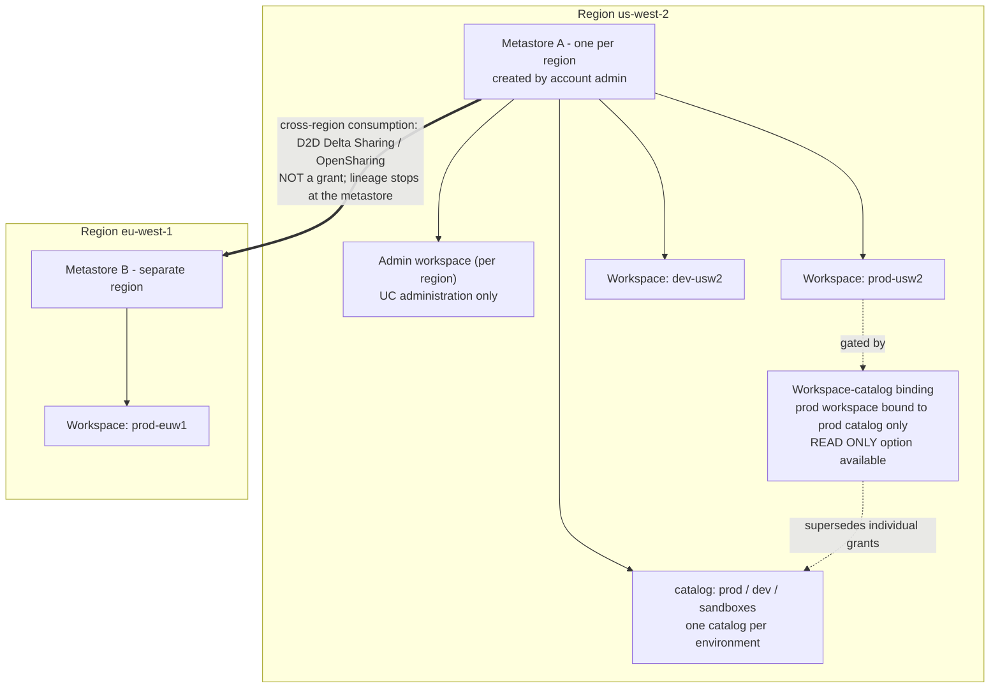
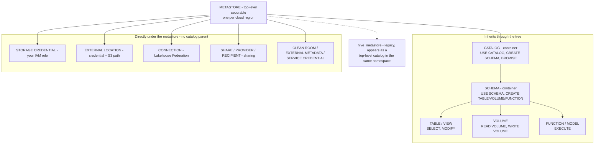
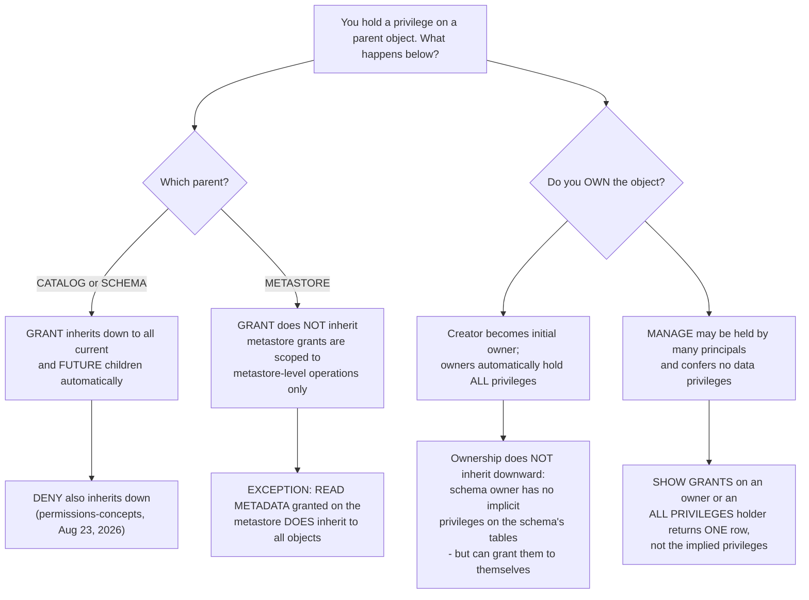
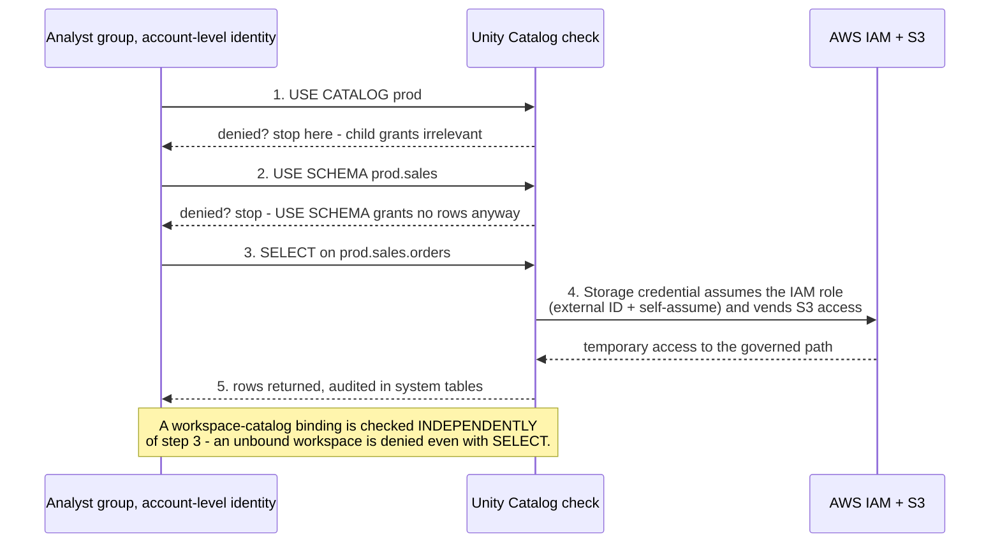
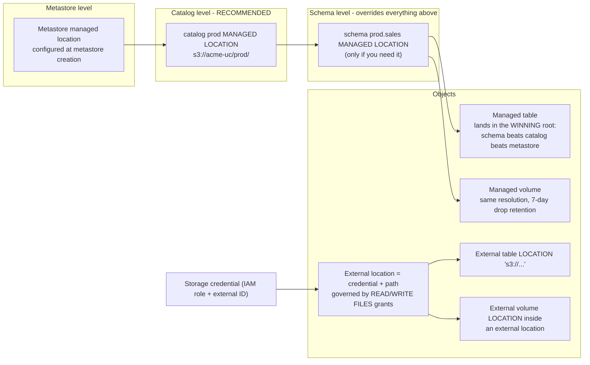
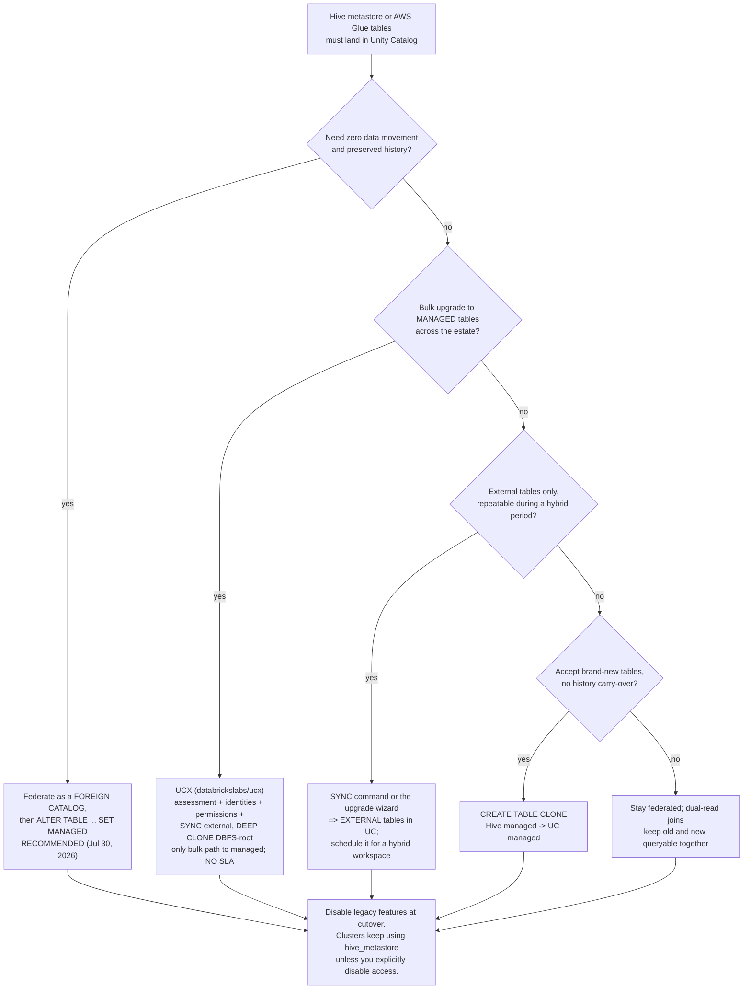

# Unity Catalog Fundamentals: Metastore, Hierarchy, Grants, Storage Credentials and External Locations

Lesson 02 built the AWS substrate: VPC, root bucket, PrivateLink, KMS, IAM. This lesson puts the **governance plane** on top of it. Unity Catalog is where that substrate stops being plumbing and starts being policy: one `GRANT` that follows a *group* across every workspace in a region, one IAM role wrapped in a securable so that revoking access is a `REVOKE` instead of a bucket-policy edit, and one three-level namespace (`catalog.schema.table`) that finally gives S3 paths a name you can put in a review.

The teaching rule for this lesson: **Unity Catalog decides *who*, your AWS account still holds *what*.** Data files never leave your S3 account, IAM still has to let Databricks assume a role, and every grant you write is only as good as the chain of `USE CATALOG` → `USE SCHEMA` → `SELECT` that delivers it. Confuse those two sentences and every symptom below becomes a mystery.

```text
=============================================================
 UNITY CATALOG SURFACE ON AWS - as of October 2026
-------------------------------------------------------------
 Metastore ...... top-level securable; ONE per cloud region;
                  account admins create/attach it; a workspace
                  is assigned to EXACTLY ONE metastore
 Hierarchy ...... metastore > catalog > schema >
                  table | view | volume | function |
                  model | service | secret
                  (non-data securables hang directly under the
                  metastore: storage credentials, external
                  locations, connections, shares, ...)
 Namespace ...... three-level: catalog.schema.object
 Inheritance .... catalog/schema grants reach current AND
                  future children; METASTORE grants do NOT
                  (only READ METADATA inherits)
 Ownership ...... creator owns; owners hold all privileges;
                  ownership does NOT inherit downward
 Default ........ deny-by-default - "Initially, users have
                  no access to data in a metastore"
 Storage ........ storage credential = your IAM role (with
                  mandatory external ID) as a securable
                  external location = credential + S3 path
 Managed ........ UC picks location + lifecycle, files stay
                  in YOUR account, UNDROP 7 days
 External ....... you pick LOCATION, UC governs only;
                  DROP removes metadata, S3 keeps billing
 Migration ...... hive_metastore shows up as a catalog;
                  federate -> ALTER TABLE ... SET MANAGED
=============================================================
```

In this lesson you will:

- place the **metastore** correctly: one per region, created at account level, attached to many workspaces, with account / workspace / metastore admin roles separated;
- draw the **securable hierarchy** and name the objects that deliberately hang *outside* the catalog tree;
- master **privileges and inheritance**: why `USE CATALOG` is required but grants no data, why metastore-level grants do not cascade, and why ownership does not inherit downward;
- operate **deny-by-default** with its two documented default-open carve-outs (`main`, the workspace catalog) and the **workspace binding** rule that overrides even a perfect `SELECT` grant;
- build the **worked AWS setup end to end**: IAM trust policy with external ID → `CREATE STORAGE CREDENTIAL` → `CREATE EXTERNAL LOCATION` → four `GRANT`s → an external Delta table;
- separate **managed from external** tables and volumes, predict where a managed table physically lands, and know exactly what `DROP` deletes in each case;
- choose a **hive_metastore migration tool** per table type (`SYNC`, upgrade wizard, `CREATE TABLE CLONE`, `DEEP CLONE` via UCX, federate-then-`SET MANAGED`);
- study **three named customer cases** (Amgen, Rivian, nCino), read the **October 2026 update box**, and practise with **12 exam-style questions** plus four interactive checks.

---

## 1. The metastore: a regional, account-managed object

Unity Catalog's own reference opens with the definition everything else hangs off:

> "The **metastore** is the top-level securable object in Unity Catalog. A metastore contains all securable objects registered in Unity Catalog in a single cloud region.": Databricks docs, *Unity Catalog securable objects* (last updated Oct 8, 2026)

Three consequences follow, and each one is examinable:

1. **One metastore per cloud region.** "A metastore is scoped to a single cloud region. Your organization requires one metastore per region in which it operates." A single metastore "can be attached to multiple workspaces in the same region" (same page, Oct 8, 2026).
2. **One workspace, one metastore.** "Each workspace must be assigned to exactly one metastore" (Databricks well-architected deployment guide, *Design Unity Catalog architecture*, accessed 2026-10). A workspace cannot straddle two metastores, so cross-region reads are never "just a grant".
3. **Grants travel with the metastore, not the workspace.** "Permission grants in a metastore apply to all workspaces attached to that metastore. In other words, a privilege granted in one workspace is effective in all other workspaces sharing that metastore" (Oct 8, 2026). That is the whole reason to consolidate: one policy surface, many workspaces.

The metastore itself is "hosted as a multi-tenant service in the Databricks control plane" while "the data itself still lives in your cloud account": the control plane holds metadata, your S3 holds bytes (deployment guide; *Managed versus external assets*, Sep 11, 2026).

### 1.1 Who administers what

| Admin tier | Scope | Created / notes (admin-privileges page, Jun 23, 2026) |
|---|---|---|
| **Account admin** | The Databricks account | Creates and links metastores and workspaces; can grant directly on a metastore; if an account admin creates the metastore manually, that admin is its initial owner *and* metastore admin |
| **Workspace admin** | A single workspace | Can create catalogs and other top-level securables for **workspaces created after Mar 6, 2024** |
| **Metastore admin** | One metastore (optional role) | As owner of the metastore: may manage privileges or transfer ownership of *any* object inside it, storage credentials, external locations, connections, shares, and may grant anyone read/write to any data in it |

Auto-provisioned metastores (workspace auto-assignment, or the automatic enablement for AWS accounts created after **Nov 8, 2023**) may have been "created without a metastore admin", so do not assume the role is populated just because Unity Catalog works.



- **📚 Did you know?** Enabling an existing workspace for Unity Catalog is a one-way door: "enabling a workspace for Unity Catalog **cannot be reversed**. Once you enable the workspace, you will manage users, groups, and service principals for this workspace using account-level interfaces" (Databricks docs, *Enable a workspace for Unity Catalog*, last updated May 20, 2026). Identity federation, account-level users and groups, is switched on at the same time, which is why grants in this lesson always name **account-level identities**, never workspace-local ones.

### 1.2 Worked example E1: the two-region topology, decided on paper

**Scenario:** a retailer runs production and development in `us-west-2` and a European entity in `eu-west-1`. Four workspaces, one platform team, one data-ownership model.

```text
Worked example E1 - metastore topology (as of Oct 2026)

Region us-west-2
  metastore ...... 1 (one per region - hard limit)
  workspaces ..... 2 attached: prod-usw2, dev-usw2
  admin workspace  yes, 1 per region (deployment guide)
  catalogs ....... prod, dev, sandboxes (data isolation
                   "begins at the catalog level" -
                   UC best practices, May 20, 2026)
  bindings ....... prod-usw2  -> catalog prod   (read-write)
                   dev-usw2   -> catalog dev    (read-write)
                   both       -> sandboxes      (read-only)

Region eu-west-1
  metastore ...... 1
  workspaces ..... 1 attached: prod-euw1
  catalogs ....... prod_eu
  cross-region ... EU analytics of US data goes through
                   D2D Delta Sharing, not a grant
                   (lineage does not cross the boundary)

Why NOT four metastores
  - grants would be re-issued per region
  - no shared catalog across workspaces in a region
  - "Metastores provide regional isolation but are not
     intended as default units of data isolation"
     (UC best practices, May 20, 2026)
Why NOT one metastore for both regions
  - impossible: metastores are regional and a workspace
    belongs to exactly one
```

**Reading:** environments are separated by **catalogs and bindings inside one metastore**, not by extra metastores. Databricks' own new-workspace guidance says the same: "adopt a single metastore per region with multiple catalogs… Isolate environments with workspace bindings" (Databricks Answers, 2026-08-27). One caveat worth storing: that official Q&A also advises planning "the storage root carefully because it cannot be changed after creation": a Databricks Answers post, not a docs page, so treat the immutability claim as official-Q&A-grade evidence.

---

## 2. The hierarchy: what hangs where, and why it matters

Unity Catalog exposes "a three-level namespace (that is, `catalog.schema.table`)" (docs, *Enable a workspace*, May 20, 2026). Data and AI assets, "tables, views, volumes, functions, models, and services", follow it, while a second family of objects sits **directly under the metastore**, outside the tree entirely (*What is Unity Catalog?*, Jul 7, 2026; securable-objects, Oct 8, 2026).



Two structural facts students miss repeatedly:

- **Containers are the catalog and the schema.** "Every object in this hierarchy is a securable object", and privileges granted on a parent "automatically apply to all current and future child objects", but that inheritance engine starts at the **catalog**, not at the metastore (permissions-concepts, Aug 23, 2026; privileges blog: "The highest level object that privileges are inherited from is the catalog", 2023-05-05).
- **Storage credentials and external locations are *not* under a catalog.** They live at metastore level, which is why creating one is a metastore-scoped operation and why you grant on them with `ON STORAGE CREDENTIAL …` / `ON EXTERNAL LOCATION …` syntax rather than a three-level name.

The legacy Hive metastore is *additive*: "The Unity Catalog metastore is additive, meaning it can be used with the per-workspace Hive metastore in Databricks. The Hive metastore appears as a top-level catalog called `hive_metastore` in the three-level namespace" (docs, *Work with the legacy Hive metastore*, accessed 2026-10). Section 8 turns that fact into a migration plan.

- **📚 Did you know?** Unity Catalog was open-sourced on **2024-06-12/13** under Apache 2.0, built on an OpenAPI spec and "compatible with Apache Hive's metastore API and Apache Iceberg's REST catalog API", with support announced from AWS, Google Cloud, Microsoft, NVIDIA and Salesforce (Databricks blog, 2024-06-13; press release, 2024-06-12). So the securable vocabulary you are learning in this lesson is not Databricks-UI-deep; it is the same model served through the Iceberg REST and Hive Metastore interfaces.

---

## 3. Privileges: the chain, the inheritance rules, the owner trap

> "Securable objects in Unity Catalog are hierarchical, from the metastore at the top, through catalogs and schemas, down to the data objects they contain (tables, views, volumes, functions, and models).": Databricks docs, *Unity Catalog privileges* (last updated Oct 8, 2026)

That reference documents **Privilege Model version 1.0**; a metastore "created during the public preview (before August 25, 2022)" may sit on an earlier model without today's inheritance behaviour. Assume 1.0 for everything below.

### 3.1 The privileges you will actually type

| Level | Privileges worth memorising (privileges reference, Oct 8, 2026) |
|---|---|
| **Metastore** | `CREATE CATALOG`, `CREATE STORAGE CREDENTIAL`, `CREATE EXTERNAL LOCATION`, `READ METADATA`, `USE SHARE`, `CREATE CONNECTION` … |
| **Catalog** | `USE CATALOG`, `CREATE SCHEMA`, `BROWSE`, `APPLY TAG`, plus child-level ones such as `SELECT`, `MODIFY`, `CREATE TABLE` |
| **Schema** | `USE SCHEMA`, `CREATE TABLE`, `CREATE VOLUME`, `CREATE FUNCTION`, `CREATE MATERIALIZED VIEW`, `EXTERNAL USE SCHEMA`, plus child-level `SELECT`, `MODIFY`, `READ VOLUME`, `WRITE VOLUME` |
| **Table** | `SELECT`, `MODIFY`, `INSERT`, `UPDATE`, `DELETE` (the three DML ones are "currently in Beta"), `READ METADATA`, `MANAGE` |
| **Volume** | `READ VOLUME`, `WRITE VOLUME`, `READ METADATA`, `MANAGE` |
| **Storage credential** | `CREATE EXTERNAL LOCATION`, `READ FILES`, `WRITE FILES`, `MANAGE` |
| **External location** | `READ FILES`, `WRITE FILES`, `CREATE EXTERNAL TABLE`, `CREATE EXTERNAL VOLUME`, `EXTERNAL USE LOCATION`, `READ METADATA`, `BROWSE`, `MANAGE` |

Two navigation privileges carry the whole read path:

> "`USE CATALOG`: Required to interact with any object inside a catalog. **Does not itself grant access to data.**" … "`USE SCHEMA`: Required to interact with any object inside a schema. Does not itself grant access to data.": privileges reference, Oct 8, 2026

### 3.2 Inheritance versus ownership: two mechanisms, one confusion



Read that diagram as three separate laws:

1. **Catalog and schema grants cascade** to "all current and future schemas, tables, views, volumes, and functions"; that is why granting `SELECT` on a catalog is the efficient bulk move (securable-objects, Oct 8, 2026).
2. **Metastore grants do not cascade**, with the single documented exception of `READ METADATA`: "privileges granted at the metastore level do not inherit to child objects… This differs from the privilege inheritance behavior for catalog and schema grants" (Oct 8, 2026). Holding `CREATE CATALOG` on the metastore gives you zero readable tables.
3. **Ownership is not inheritance.** "The principal that creates an object becomes its initial owner"; "Owners of an object are automatically granted all privileges on that object"; but "**Ownership doesn't inherit downward in Unity Catalog**": a schema owner does not automatically get privileges on the schema's tables, though they "can grant themselves privileges" (permissions-concepts, Aug 23, 2026; GCP ownership wording, Mar 5, 2026).

Who may grant at all: "The owner of the object. The owner of the catalog or schema that contains the object. A user with the MANAGE privilege on the object. A metastore admin. Account admins can also grant privileges directly on a metastore" (manage-privileges, accessed 2026-10).

### 3.3 Worked example E2: the grant chain, and a `SHOW GRANTS` autopsy

**Target:** the group `analysts` must read `prod.sales.orders`.

```sql
-- The full documented chain (Databricks Answers, 2026-08-27:
-- "reading a table requires the full USE CATALOG -> USE SCHEMA ->
--  SELECT chain")
GRANT USE CATALOG ON CATALOG prod      TO `analysts`;
GRANT USE SCHEMA  ON SCHEMA  prod.sales TO `analysts`;
GRANT SELECT      ON TABLE   prod.sales.orders TO `analysts`;

-- Shorter, equally valid: a catalog-level grant inherits down,
-- provided the usage privileges are there too:
--   "granting SELECT on a catalog allows a user to read any table
--    in that catalog (with the appropriate USE CATALOG and
--    USE SCHEMA usage privileges)" - securable-objects, Oct 8 2026
GRANT SELECT ON CATALOG prod TO `analysts`;

-- Audit: what does this principal actually hold?
SHOW GRANTS ON TABLE prod.sales.orders;
SHOW GRANTS ON CATALOG prod;
```

**Forensics.** Suppose `SHOW GRANTS ON SCHEMA sales_staging` returns exactly one row: `OWNERSHIP`. Why can the owner still `SELECT` from `sales_staging.t`? Because ownership *is* all privileges, rendered as a single row, the reference is explicit that for an `ALL PRIVILEGES` holder "only `ALL PRIVILEGES` is returned, not the individual implied privileges like `SELECT` or `MODIFY`" (Oct 8, 2026). Why can a *second* user not? Deny by default (section 4). What must the schema owner run for a colleague? An explicit `GRANT SELECT ON SCHEMA …`, ownership does not cascade, so the colleague gets nothing from the owner's status.

### 3.4 Interactive check: match the privilege to its level

```matching
{
  "question": "Match each Unity Catalog privilege to the securable level where it is documented as a first-class grant (privileges reference, Oct 8, 2026):",
  "pairs": [
    {"left": "USE CATALOG", "right": "Catalog: required before you can interact with anything inside it; grants no data"},
    {"left": "CREATE EXTERNAL LOCATION", "right": "Must be held on BOTH the metastore AND the storage credential"},
    {"left": "READ VOLUME / WRITE VOLUME", "right": "Volume: governs non-tabular files, not table rows"},
    {"left": "EXTERNAL USE LOCATION", "right": "External location: excluded from ALL PRIVILEGES on purpose"},
    {"left": "READ METADATA", "right": "The one metastore-level privilege that inherits downward"},
    {"left": "BROWSE", "right": "Catalog: lets a user discover data without holding USE CATALOG"}
  ],
  "explanation": "The trap set is deliberate: USE CATALOG and USE SCHEMA are navigation privileges and never expose rows; CREATE EXTERNAL LOCATION is documented as 'Required on both the metastore and the storage credential'; EXTERNAL USE LOCATION is one of four privileges (with EXTERNAL USE SCHEMA, MANAGE and READ METADATA) that ALL PRIVILEGES deliberately does not include, because location owners do not hold it by default: an anti-exfiltration carve-out. READ METADATA is the sole metastore-level privilege that inherits."
}
```

- **📚 Did you know?** `ALL PRIVILEGES` sounds absolute and is not: "ALL PRIVILEGES does not include the `EXTERNAL USE SCHEMA`, `EXTERNAL USE LOCATION`, `MANAGE`, or `READ METADATA` privileges" (privileges reference, Oct 8, 2026). And to avoid accidental data exfiltration, "schema owners do not have the `EXTERNAL USE SCHEMA` privilege by default and external location owners do not have the `EXTERNAL USE LOCATION` privilege by default" (permissions-concepts, Aug 23, 2026). `EXTERNAL USE LOCATION` can only be granted by a principal that holds `MANAGE` on the location.

---

## 4. Deny by default, the two default-open carve-outs, and bindings that beat grants

> "**Initially, users have no access to data in a metastore.** Databricks account admins, workspace admins, and metastore admins have default privileges for managing Unity Catalog.": Databricks docs, *Manage privileges in Unity Catalog* (accessed 2026-10)

Databricks' own Q&A restates it as a "deny-by-default model" (answers.databricks.com, 2026-08-27). Everything a user can reach, they were granted. Two documented exceptions keep new workspaces usable, and both are worth naming precisely, because they are what makes a "locked down" estate leak in its first week:

1. **The `main` catalog:** "All users have `USE CATALOG` on the `main` catalog by default" (privileges reference, Oct 8, 2026).
2. **The workspace catalog:** "All workspace users receive the `USE CATALOG` privilege on the workspace catalog. Workspace users also receive the `USE SCHEMA`, `CREATE TABLE`, `CREATE VOLUME`, `CREATE MODEL`, `CREATE FUNCTION`, and `CREATE MATERIALIZED VIEW` privileges on the default schema in the catalog" (manage-privileges, accessed 2026-10).



### 4.1 Bindings are a second, independent gate

> "By default, a catalog is accessible from all workspaces attached to the same metastore. You can restrict this by binding the catalog to specific workspaces, optionally as read-only. **Workspace binding supersedes individual privilege grants.** Even a user with an explicit `SELECT` grant cannot access an object in a catalog that is not bound to their workspace.": securable-objects, Oct 8, 2026

Bindings exist for **catalogs**, **storage credentials** and **external locations** (workspace-catalog binding page, Apr 29, 2026), which is the mechanism that keeps a production credential from being usable in a sandbox workspace. The same page notes access "from an unbound workspace is denied, even for users with explicit privilege grants on the catalog".

A second default worth knowing: "A metastore admin must enable external data access for each metastore you need to access externally. This option is **disabled by default** to prevent unauthorized external access" (docs, *Enable external data access*, May 14, 2026).

### 4.2 Worked example E3: three broken grants, diagnosed

```text
Worked example E3 - the three failures every team hits first

(a) SQL error: GRANT USAGE ON CATALOG prod TO `analysts`;
    WHY ... USAGE is legacy Hive-metastore / Lake Formation
           vocabulary. Unity Catalog spells it USE CATALOG
           (and USE SCHEMA at the next level).
    FIX .. GRANT USE CATALOG ON CATALOG prod TO `analysts`;

(b) SELECT denied on prod.sales.orders even though the user
    holds SELECT on the table.
    WHY ... the parent chain is broken: no USE CATALOG on prod
           or no USE SCHEMA on prod.sales. The privileges
           reference: USE CATALOG is "Required to interact with
           any object inside a catalog" regardless of child
           privileges.
    FIX .. grant the two usage privileges, then re-test.

(c) The external location was marked read-only this morning,
    yet a legacy writer still appears to succeed.
    WHY ... "It can take up to 60 minutes for this change to
           take effect across all compute resources"
           (manage-external-locations, accessed 2026-10).
    FIX .. wait out the propagation window, then retest; the
           read-only flag also overrides write rights granted
           by the IAM role underneath the credential.
```

Pattern (b) is the one that generates tickets: a `SELECT` grant is a *key to a door*, and `USE CATALOG`/`USE SCHEMA` are the *corridor that leads to it*: without the corridor, the key is unused.

---

## 5. Storage credentials: your IAM role, wrapped in a securable

On AWS, "a **credential** is a securable object representing an AWS IAM role" (Databricks SQL credentials reference, accessed 2026-10), and the storage-credential flavour is specifically the one that reaches S3:

> "The first is a **storage credential**, which specifies an AWS IAM role that allows access to the S3 location. You need this storage credential for the second required object: an **external location**, which defines the path to your S3 storage location and the credentials required to access that location.": Databricks docs, *Connect to cloud object storage using Unity Catalog* / *S3 external location* (Sep 11, 2026)

What the object actually stores (Storage Credential API, accessed 2026-10):

| Field | Role |
|---|---|
| `role_arn` | "The Amazon Resource Name (ARN) of the AWS IAM role used to vend temporary credentials" |
| `unity_catalog_iam_arn` (output) | "The Amazon Resource Name (ARN) of the AWS IAM user managed by Databricks. This is the identity that is going to assume the AWS IAM role" |
| `external_id` (output) | "The external ID used in role assumption to prevent the confused deputy problem" |

Three hard rules on the AWS side:

- **The external ID has been mandatory since 2023-11-30.** "IAM policies for storage credentials now require an external ID: November 30, 2023. To create a storage credential, you now must add the external ID for your storage credential in the IAM role's policy in AWS" (release notes, Nov 2023). The docs' trust example carries `"sts:ExternalId": "0000"` as a placeholder for *your* returned value.
- **The role must live in the same AWS account as the bucket**, and "You must have `iam:CreateRole` permissions to create the IAM role"; automated setup "uses AWS IAM temporary delegation" and is the recommended path for "most deployments" (S3 external-location pages, Sep 11 / Aug 7, 2026).
- **Self-assuming roles are enforced.** "Databricks blocks new and existing storage credentials based on IAM roles that are not self-assuming" (S3 connect page, Sep 11, 2026). Trust is a cross-account `sts:AssumeRole` into Databricks' fixed Unity Catalog master role.

```text
The trust chain, in one picture (as of Oct 2026)

  Databricks UC master role (Databricks account 414351767826)
    arn:aws:iam::414351767826:role/unity-catalog-prod-UCMasterRole-...
        |  sts:AssumeRole + sts:ExternalId = <yours>
        v
  Your storage-credential role  (SAME AWS account as the bucket)
    arn:aws:iam::111122223333:role/acme-uc-raw-s3
        |  s3:GetObject / PutObject / List* / DeleteObject on your prefix
        |  kms:Decrypt / Encrypt / GenerateDataKey* (if SSE-KMS)
        v
  s3://acme-lake/raw/   (+ optional KMS key policy grant)
```

### 5.1 Worked example E4: the trust policy, line by line

```json
{
  "Version": "2012-10-17",
  "Statement": [
    {
      "Sid": "AllowDatabricksUCToAssumeThisRole",
      "Effect": "Allow",
      "Principal": {
        "AWS": "arn:aws:iam::414351767826:role/unity-catalog-prod-UCMasterRole-14S5ZJVKOTYTL"
      },
      "Action": "sts:AssumeRole",
      "Condition": {
        "StringEquals": {
          "sts:ExternalId": "0000"
        }
      }
    },
    {
      "Sid": "SelfAssumeRequiredByUCPolicy",
      "Effect": "Allow",
      "Principal": { "AWS": "arn:aws:iam::111122223333:role/acme-uc-raw-s3" },
      "Action": "sts:AssumeRole"
    }
  ]
}
```

Reviewer's checklist: (1) the principal is the Databricks Unity Catalog master role for the commercial partition `414351767826` (GovCloud uses different account IDs: lesson 02); (2) `sts:ExternalId` equals the value Databricks returned for *this* credential, not a made-up string; (3) the role's **permission** policy scopes `s3:*` to your prefix only; (4) if the bucket uses SSE-KMS, add `kms:Decrypt`, `kms:Encrypt`, `kms:GenerateDataKey*` on that key to the role policy *and* update the **key policy** to allow the role with `kms:ViaService: s3.<region>.amazonaws.com` (docs, *Configure encryption for S3 with KMS*, accessed 2026-10).

**Legacy contrast, in one line:** an *instance profile* attaches an IAM role to a **cluster**, so everyone using that box inherits it; a storage credential attaches the role to a **securable governed by grants**. Databricks positions service credentials, the sibling object for AWS Glue and Secrets Manager, as "the Unity Catalog alternative to instance profiles, with the advantage that access is not tied to a specific compute resource" (docs, accessed 2026-10), and labels instance-profile KMS configuration "legacy configuration".

- **📚 Did you know?** OAuth 2.0 machine-to-machine authentication, service-principal client credentials, **one-hour** access tokens, up to **five** OAuth secrets per service principal each valid up to **two years**, is how a *service principal authenticates to Databricks* (API, CLI, JDBC). It is not how Unity Catalog reaches S3: on AWS, storage access is always IAM-role vending with an external ID (OAuth M2M + CLI authentication docs, accessed 2026-10). Teach M2M as the identity layer for *jobs calling Databricks*, and IAM roles as the identity layer for *Databricks calling S3*.

---

## 6. External locations: credential plus path, governed by grants

> "An external location is a securable object that combines a storage path with a storage credential that authorizes access to that path.": Databricks SQL external-locations reference (accessed 2026-10)

Privileges on it decide who may touch files: `READ FILES` to read directly, `WRITE FILES` to write (securable-objects, Oct 8, 2026), plus `CREATE EXTERNAL TABLE`, `CREATE EXTERNAL VOLUME`, `EXTERNAL USE LOCATION` and `BROWSE`. Two structural rules cause most `CREATE EXTERNAL LOCATION` failures:

- **No nesting.** "The storage path of any external location cannot be contained within another external location's storage path"; "External locations can't overlap other external locations" (external-locations reference; *Path rules and access*, accessed 2026-10).
- **Both gates for creation.** "`CREATE EXTERNAL LOCATION`: Create an external location that associates a cloud storage path with a storage credential. **Required on both the metastore and the storage credential**" (privileges reference, Oct 8, 2026).

And the operational fact that surprises everyone: flipping a location to read-only "can take **up to 60 minutes** … to take effect across all compute resources", while the flag itself "Prevents users from writing to files in those external locations, regardless of any write permissions granted by the IAM role that underlies the storage credential" (manage-external-locations, accessed 2026-10).

### 6.1 Worked example E5, the worked setup: credential → location → grants → external table

The centrepiece of this lesson. Students fill in their own role ARN and bucket; everything else is documented syntax (credentials reference; external-locations reference; S3 manual page, Aug 7, 2026).

```sql
-- 0) AWS prerequisites (outside Databricks)
--    * IAM role in the SAME account as the bucket
--    * trust: Databricks UC master role 414351767826 with your
--      sts:ExternalId  (E4 above)
--    * permission policy: s3:GetObject/PutObject/List*/DeleteObject
--      on s3://acme-lake/raw/*
--    * KMS bucket? add kms:Decrypt/Encrypt/GenerateDataKey* to the
--      role policy AND allow the role in the key policy

-- 1) Metastore level (metastore admin holds these by default)
CREATE STORAGE CREDENTIAL acme_raw_cred
  AWS_IAM_ROLE_ARN 'arn:aws:iam::111122223333:role/acme-uc-raw-s3'
  COMMENT 'raw landing zone credential';

CREATE EXTERNAL LOCATION acme_raw_loc
  URL 's3://acme-lake/raw/'
  WITH (CREDENTIAL acme_raw_cred)
  COMMENT 'raw landing zone';

-- 2) Delegate creation, nothing else, to the platform team.
--    Databricks' recommendation: "grant only CREATE EXTERNAL
--    LOCATION and no other privileges on storage credentials"
GRANT CREATE EXTERNAL LOCATION
  ON STORAGE CREDENTIAL acme_raw_cred TO `data-platform`;

-- 3) Ingest team: file rights at the location
GRANT READ FILES, WRITE FILES, CREATE EXTERNAL TABLE
  ON EXTERNAL LOCATION acme_raw_loc TO `ingest-engineers`;

-- 4) Analyst team: the normal three-step chain
GRANT USE CATALOG ON CATALOG sales              TO `analysts`;
GRANT USE SCHEMA  ON SCHEMA  sales.raw          TO `analysts`;
GRANT SELECT      ON SCHEMA  sales.raw          TO `analysts`;

-- 5) External table - files stay exactly where they are
CREATE TABLE sales.raw.orders_ext (
  order_id BIGINT,
  ts       TIMESTAMP,
  amount   DECIMAL(12,2)
)
USING DELTA
LOCATION 's3://acme-lake/raw/orders/2026-10/';

-- 6) Audit the storage side
SHOW GRANTS ON EXTERNAL LOCATION acme_raw_loc;
SHOW GRANTS ON STORAGE CREDENTIAL acme_raw_cred;
```

**Variant A: read-only landing zone.** Mark the location read-only in Catalog Explorer (or the API's `read_only` flag), then re-test writes after the **60-minute** propagation window; do not declare victory at minute five.

**Variant B, SSE-KMS bucket.** Add the three KMS actions to the storage-credential role policy, allow the role in the key policy with `kms:ViaService`, and set the **encryption algorithm on the external location**, a documented option since **2024-10-28** (release notes, Oct 2024).

**Variant C: the group that should never write.** Grant `READ FILES` only, and rely on the location's read-only mode plus binding to a production workspace as belt-and-braces: cloud administrators "often bind storage credentials to specific workspaces to ensure production credentials are only used to create external locations within production workspaces" (manage-storage-credentials, accessed 2026-10).

### 6.2 Interactive check: fill the terms

```fillblank
{
  "question": "Complete the setup sentence using the documented Unity Catalog / AWS terms (S3 external-location and credentials docs, Sep 11 2026 and Aug 7 2026; release notes Nov 2023):",
  "template": "The securable that stores an AWS IAM role for S3 is a storage {{1}}; pairing it with a cloud path creates an {{2}} {{3}}; the role's trust policy must carry the {{4}} returned by Databricks, required since November 30, 2023, and the privilege needed to create the second object must be held on both the metastore and that credential - {{5}}.",
  "answers": {
    "1": "credential",
    "2": "external",
    "3": "location",
    "4": "external ID",
    "5": "CREATE EXTERNAL LOCATION"
  },
  "distractors": ["metastore", "endpoint", "gateway", "access key", "instance profile", "USE CATALOG", "READ FILES", "namespace", "mount", "session token"],
  "explanation": "Storage credential = the IAM role securable; external location = credential + path; the external ID has been mandatory since 2023-11-30 (placeholder 0000 in the docs) and prevents the confused-deputy problem; CREATE EXTERNAL LOCATION is documented as required on both the metastore and the storage credential. The distractor traps are real objects: an instance profile is the legacy compute-bound mechanism, a DBFS mount is deprecated and must never be registered as an external location, and READ FILES grants file access on an existing location rather than the right to create one."
}
```

- **📚 Did you know?** File-event plumbing for streaming over external locations is provisioned for you in AWS: the documented IAM policy resources for file events include `arn:aws:sqs:*:*:csms-*` and `arn:aws:sns:*:*:csms-*`: the managed file-event queues and topics that drive notification-based ingestion (manage-external-locations, accessed 2026-10). And governance of non-tabular data increasingly goes through **volumes** instead of raw path grants: "When you define an external volume, cloud URI access to data under the volume path is governed by the privileges granted on the volume, **not** the privileges granted on the external location where the volume is stored" (docs, *What are Unity Catalog volumes?*, accessed 2026-10).

---

## 7. Managed versus external: same governance, different lifecycle

> "**Managed assets**: Unity Catalog controls both governance (access control, auditing, lineage) and the underlying file storage lifecycle (file optimization, how they are organized, and when they are deleted). **External assets**: Unity Catalog controls governance only.": Databricks docs, *Managed versus external assets in Unity Catalog* (Sep 11, 2026)

| Dimension | **Managed** table/volume | **External** table/volume |
|---|---|---|
| Storage location | Chosen by Unity Catalog: schema → catalog → metastore managed location | You choose a `LOCATION` inside an external location |
| Where the bytes live | "The data files always remain in your cloud account" | Your cloud storage, unchanged |
| Lifecycle | UC optimises, organises, and **deletes on DROP**; `UNDROP` available **7 days**, permanent deletion **within 30 days** | DROP removes **metadata only**; "data files in your cloud storage are not deleted" |
| Format | "**Managed tables use the Delta or Apache Iceberg format**" | Whatever you register (Delta in practice for UC tables) |
| Path-based access | "Path-based access to Unity Catalog managed tables is not supported": use table names | Files reachable through the governed external location / volume |
| Extra capability | Qualifies for **predictive optimization** (compaction, clustering, vacuum) | No automatic storage maintenance |
| Retention on drop (volumes) | Managed volume files retained **7 days** after drop | Data remains in cloud storage |

Resolution order for managed storage: "Managed storage locations at lower levels in the hierarchy override storage locations defined at higher levels… Databricks recommends that you assign managed storage at the **catalog level** for logical data isolation" (docs, *Specify a managed storage location*, accessed 2026-10). Hashed subdirectories keep tenants apart: schemas land under `<storage-root>/__unitystorage/schemas/<uuid>` and catalogs under `<storage-root>/__unitystorage/catalogs/<uuid>`.



### 7.1 Worked example E6, placement math: where does the table actually land?

**Setup:** metastore root `s3://acme-uc/metastore-root/`; catalog `prod` created with `MANAGED LOCATION 's3://acme-uc/prod/'`; schema `prod.sales` created **without** a managed location; a second schema `prod_sandbox` created **with** `MANAGED LOCATION 's3://acme-uc/sandbox/'`.

```text
Worked example E6 - managed placement, as of Oct 2026

Q1  New managed table in prod.sales?
    Schema has no override -> CATALOG root wins
    => s3://acme-uc/prod/__unitystorage/catalogs/<catalog-uuid>/
       (documented catalog-level hashed pattern)

Q2  New managed table in prod_sandbox?
    Schema override wins over the catalog root
    => s3://acme-uc/sandbox/__unitystorage/schemas/<schema-uuid>/

Q3  New managed table in a catalog with NO managed location
    anywhere above it?
    Falls back to the metastore managed location - if one was
    configured at metastore creation; otherwise Databricks
    default storage in your Databricks account.

Q4  You ALTER the schema to add MANAGED LOCATION later. Do the
    existing tables move?
    NO. Managed locations apply to tables created afterwards;
    existing tables keep their original paths. Plan the root
    before the first CREATE TABLE.
```

Managed versus external DDL, side by side (Q5):

```sql
-- Managed: Unity Catalog picks the location and the lifecycle
CREATE TABLE sales.orders (
  order_id BIGINT, ts TIMESTAMP, amount DECIMAL(12,2)
) USING DELTA;

-- External: you pick the location, inside an external location
CREATE TABLE sales.orders_ext (
  order_id BIGINT, ts TIMESTAMP, amount DECIMAL(12,2)
) USING DELTA
LOCATION 's3://acme-lake/raw/orders/2026-10/';

-- Different DROP semantics (Sep 11, 2026)
DROP TABLE sales.orders;      -- files deleted; UNDROP 7 days,
                              -- permanent delete within 30 days
DROP TABLE sales.orders_ext;  -- metadata only; S3 keeps billing
```

```plot
{
  "type": "bar",
  "title": "Unity Catalog time windows you can be asked about (hours), as of Oct 2026",
  "data": [
    {"Window": "OAuth M2M access token", "Hours": 1},
    {"Window": "Read-only location flip", "Hours": 1},
    {"Window": "Managed table UNDROP", "Hours": 168},
    {"Window": "Dropped managed volume", "Hours": 168},
    {"Window": "Purge after managed DROP", "Hours": 720}
  ],
  "xKey": "Window",
  "dataKeys": ["Hours"],
  "xLabel": "Documented window (60 minutes = 1 hour; 7 days = 168; 30 days = 720)",
  "yLabel": "Hours"
}
```

> [!WARNING]
> ⚠️ **"Managed" never means "Databricks' storage."** Managed tables are still files in *your* S3 account, Unity Catalog only chooses the path and the lifecycle (Sep 11, 2026). Three consequences: (1) dropping a managed table **deletes files** after the 7-day `UNDROP` window, with permanent deletion within 30 days, while dropping an external table leaves S3 billing you for orphaned files; (2) you cannot address managed tables by `s3://` path at all; and (3) **never** register a bucket used as DBFS root as an external location, "You should never load a storage account used as a DBFS root as an external location in Unity Catalog" (docs, *Best practices for DBFS and Unity Catalog*, accessed 2026-10).

---

## 8. Migrating off `hive_metastore`: the documented ladder

Unity Catalog is additive, so migration starts from coexistence: the legacy metastore "appears as a top-level catalog called `hive_metastore`", and queries can join a legacy table with a Unity Catalog table in one statement while you cut over (docs, *Work with the legacy Hive metastore*, accessed 2026-10: a behaviour this course calls **dual-read**, for the record, not a docs product name).

Two documented paths exist (same page): "Upgrade all tables registered in the Hive metastore to Unity Catalog" or "Federate your Hive metastore to Unity Catalog using Hive Metastore federation for a more gradual approach."

The recommended sequence is explicit:

> "The recommended approach is to first **federate your Hive metastore or AWS Glue catalog as a foreign catalog, then upgrade the foreign tables in place.** This two-step process allows you to migrate tables without data movement while preserving table history, configuration, permissions, and views.": Databricks docs, *Upgrade a Databricks workspace to Unity Catalog* (Jul 30, 2026)

The in-place conversion command is `ALTER TABLE <foreign_catalog>.<schema>.<table_name> SET MANAGED`, which "Databricks recommends… to unlock Unity Catalog **predictive optimization**, which includes automatic maintenance (compaction, clustering, vacuuming)" (same page).

### 8.1 The four tools, by what they produce

| Tool | Hive table types it handles | Result in UC | Data moved? | History preserved? | Source |
|---|---|---|---|---|---|
| **Federate → `ALTER TABLE … SET MANAGED`** | External and managed (via foreign catalog) | Managed, in place | **No** | **Yes**: "preserving table history, configuration, permissions, and views" | upgrade page, Jul 30, 2026 |
| **UCX** (Databricks Labs, `databrickslabs/ucx`) | Both; `SYNC` for external, **`DEEP CLONE`** for DBFS-root managed | Managed or external | Clone copies data for DBFS-root managed tables | UCX-managed | migrate + UCX pages, accessed 2026-10 |
| **Unity Catalog upgrade wizard / `SYNC`** | External tables (and managed tables stored outside DBFS root) | **External** | No (metadata copy; repeatable/schedulable) | Tables stay as they are | migrate page; SYNC blog, 2022-11-03 |
| **`CREATE TABLE CLONE`** | Hive managed tables | Managed | Copy | **No**: "Table history is not migrated… treated as new tables" | migrate page, accessed 2026-10 |

Constraints to memorise: "If you want to perform a bulk upgrade of Hive tables to Unity Catalog managed tables, this is your only option": UCX (migrate page); UCX "is a public GitHub repo and **not supported directly by Databricks**" and carries no SLA; and "Hive managed tables must be in Delta or Parquet format to be upgraded" (UCX page, accessed 2026-10).



### 8.2 Worked example E7: pick the tool per table type

```text
Worked example E7 - migration decision matrix (fill-in, answered)

Table                                   Tool                 Result      Move?  History
-------------------------------------------------------------------------------
1 Hive EXTERNAL table on S3             SYNC / upgrade wiz   external    no     n/a
2 Hive managed table on DBFS root       UCX (DEEP CLONE)     managed     YES    no
3 Hive managed table on external S3     federate -> SET MGD  managed     no     YES
4 AWS Glue catalog table                federate -> SET MGD  managed     no     YES
5 Hive managed table, needs new life,   CREATE TABLE CLONE   managed     YES    no
   history not required
6 Legacy report reading hive_metastore  dual-read join       unchanged   no     yes
   during hybrid period

Cutover checklist (upgrade page, Jul 30, 2026)
  [ ] Attach the workspace to a Unity Catalog metastore
  [ ] Upgrade Hive tables and views to Unity Catalog
  [ ] Grant account-level users/groups/service principals access
  [ ] Update queries and jobs to the new table names
  [ ] Migrate files, notebooks and scripts off DBFS
  [ ] Upgrade compute to supported Databricks Runtime versions
  [ ] Disable access to legacy features
```

**Reading:** rows 1 and 4 are the cheap ones (metadata only, `SET MANAGED` where supported); row 2 is the expensive one: DBFS-root storage forces a physical `DEEP CLONE`, which is exactly why "DBFS root and DBFS mounts are deprecated and not recommended by Databricks. New accounts are provisioned without access to these features" (docs, *Best practices for DBFS and Unity Catalog*, accessed 2026-10). Row 6 is the safety net: because `hive_metastore` keeps working until you disable it, old and new can be joined in a single query while jobs migrate one by one.

### 8.3 Interactive check: order the cutover

```dragdrop
{
  "question": "Put the Unity Catalog migration in the order the official upgrade page implies (docs, Jul 30 2026; UCX pages, accessed 2026-10):",
  "items": [
    "Attach the workspace to a Unity Catalog metastore in the region",
    "Federate the Hive metastore or AWS Glue catalog as a foreign catalog",
    "Upgrade tables in place with ALTER TABLE ... SET MANAGED, or bulk-migrate identities, permissions, storage and tables with UCX",
    "Grant account-level users, groups or service principals access to the upgraded tables",
    "Update queries and jobs to reference the new Unity Catalog tables",
    "Migrate files, notebooks and scripts from DBFS, then upgrade compute to supported Databricks Runtime versions",
    "Disable access to legacy features in your workspaces"
  ],
  "correctOrder": [
    "Attach the workspace to a Unity Catalog metastore in the region",
    "Federate the Hive metastore or AWS Glue catalog as a foreign catalog",
    "Upgrade tables in place with ALTER TABLE ... SET MANAGED, or bulk-migrate identities, permissions, storage and tables with UCX",
    "Grant account-level users, groups or service principals access to the upgraded tables",
    "Update queries and jobs to reference the new Unity Catalog tables",
    "Migrate files, notebooks and scripts from DBFS, then upgrade compute to supported Databricks Runtime versions",
    "Disable access to legacy features in your workspaces"
  ],
  "explanation": "The documented order is: metastore attach first (it is the prerequisite for everything), then federate, then upgrade tables in place (or UCX for bulk), then re-grant to account-level identities, then repoint queries and jobs, then clear DBFS and lift the runtime, and only then disable legacy features: because 'By default, Databricks compute clusters continue to connect to the Hive metastore even after migration, unless you explicitly disable Hive metastore access'. Turning off legacy access before jobs are repointed breaks the hybrid period that makes this migration safe."
}
```

- **📚 Did you know?** Unity Catalog gives you a recovery window the Hive metastore never had: in Unity Catalog "you can `UNDROP` a managed table for 7 days, and data is permanently deleted within 30 days", whereas "When you drop a managed table in Hive metastore, all underlying data files are deleted immediately" (docs, *Database objects in the legacy Hive metastore*, accessed 2026-10). That difference is the single best argument for finishing the migration, and the single best reason to stop treating `DROP` as an undoable button in legacy scripts.

---

### 2026 Updates (as of October 2026)

> [!NOTE]
> **What changed in the Unity Catalog story that this lesson depends on: each line checked against a primary source:**
> - **Privilege and securable references refreshed 2026-10-08.** Privilege Model **1.0** remains current; fine-grained `INSERT` / `UPDATE` / `DELETE` grants are "currently in Beta" (see *Fine-grained DML privileges*), and the newer `feature` securable is in Public Preview: older tutorials that list only tables, views, volumes and functions are incomplete (docs.databricks.com/aws/en/data-governance/unity-catalog/securable-objects and access-control/privileges-reference, last updated Oct 8, 2026).
> - **Workspace bindings now cover the storage side too.** Catalogs, **storage credentials** and **external locations** are all bindable, with an optional **read-only** level, and "Access from an unbound workspace is denied, even for users with explicit privilege grants on the catalog" (docs, workspace-catalog binding, last updated Apr 29, 2026).
> - **Storage-credential hygiene hardened.** Databricks "blocks new and existing storage credentials based on IAM roles that are not self-assuming", the external ID has been mandatory since **2023-11-30**, and automated setup via IAM temporary delegation is the documented default for most deployments (S3 connect page, Sep 11, 2026; external-location manual, Aug 7, 2026).
> - **JDBC Unity Catalog connections went GA on 2026-10-02** while OAuth M2M for that path remains Beta: relevant when a BI tool must read governed tables over JDBC (release notes, October 2026).
> - **Managed-asset semantics restated 2026-09-11:** UC controls "governance… and the underlying file storage lifecycle" for managed assets and "governance only" for external ones, and the docs now steer foreign-table conversions toward `SET MANAGED` for **predictive optimization** (managed-versus-external, Sep 11, 2026; upgrade page, Jul 30, 2026).
> - **Certification now tests this exact surface.** The *Databricks Certified Data Engineer Associate* exam guide (live **May 4, 2026**) carries a **Governance and Security 15%** domain, the Data Engineer Professional blueprint includes **Data Governance 7%** plus **Data Sharing and Federation 5%**, and the AWS Platform Architect accreditation explicitly names "storage credentials vs instance profiles" in scope (exam guides + databricks.com/learn/certification/databricks-on-aws, accessed 2026-10-12).

---

## Real-World Case Studies

Databricks publishes governance outcomes, not grant matrices. Every figure below is **customer- or Databricks-claimed, unaudited**, with its URL and date so you can check it: the examinable point is the *pattern*, not the marketing.

### Case A, Amgen: from 120+ IAM roles to one or two, via Unity Catalog

| Element | Detail |
|---|---|
| Customer | **Amgen**: biopharma |
| Challenge | **AWS Glue** as enterprise catalog plus **AWS IAM** role-per-use-case sprawl; auditing meant parsing IAM policies; governance not scaling to enterprise adoption |
| Services | Unity Catalog over an AWS estate: the blog names Glue and IAM as the prior stack, so the substrate is AWS; ACLs, dynamic views, query history |
| Outcome | "we didn't have to create or manage at least 120+ IAM roles … we went from hundreds of IAM roles to just one or two principal IAM role"; "This reduces the audit effort for the function by 50%"; "around ~500 objects mapped in Unity Catalog"; "90 percent of our use cases are on Databricks" |
| Source | https://www.databricks.com/blog/how-databricks-unity-catalog-helped-amgen-enable-data-governance-enterprise-scale (**May 2023**) |
| Maps to this lesson | Sections 5 and 8: one governed identity replacing role sprawl, and moving a Glue/Hive-style catalog into Unity Catalog |

> ⏳ *Temporal note: May 2023 figures: a snapshot of that deployment at the time. The mechanism (principals governed in UC, roles collapsed) is still the documented pattern in Oct 2026.*

### Case B, Rivian: one governed catalog across teams on AWS

| Element | Detail |
|---|---|
| Customer | **Rivian**: electric vehicles; story page tagged **Cloud: AWS** |
| Challenge | Terabytes of vehicle and field data per day across 70,000+ vehicles; siloed teams blocking predictive-maintenance and battery-efficiency ML |
| Services | Databricks SQL, Delta Lake, **Unity Catalog**, Liquid Clustering |
| Outcome | "1,000+ platform users, a 75% increase from a year ago" and "Unity Catalog gives us a truly centralized data catalog across all of our different teams" (https://www.databricks.com/customers/rivian, undated, accessed 2026-10); "50% better runtime performance" and "More than 70,000 Rivians on the road, generating terabytes of data every day" (https://www.databricks.com/your-ai/customers/rivian, **2024-05-30**); the stack "Unity Catalog for data governance, Delta Tables for storage, and Liquid Clustering for data layout" for real-time charge-prediction ML (https://www.databricks.com/blog/data-intelligence-action-100-data-and-ai-use-cases-databricks-customers, **2025-07-09**) |
| Maps to this lesson | Sections 1 to 3: a metastore shared by workspaces, one catalog hierarchy, grants that follow account-level groups rather than boxes |

> ⏳ *Temporal note: mixed dates: an undated customer page (accessed Oct 2026) plus dated 2024 and 2025 posts. Teach the "centralized catalog across teams" claim as reported, not guaranteed.*

### Case C, nCino: banking data inside one AWS boundary

| Element | Detail |
|---|---|
| Customer | **nCino**: banking software; story page tagged **Cloud: AWS** |
| Challenge | Consolidating 13 years of banking data and "trillions in loan history" while keeping compliance posture tight |
| Services | Databricks on AWS, **Unity Catalog**, AI/BI Genie; use cases list Analytics and BI, AI, Data Warehousing, Governance and Security |
| Outcome | "Keeping data within a single AWS ecosystem reduces complexity, strengthens compliance and gives teams full control over sensitive financial information."; "With Unity Catalog governing access and AI/BI Genie democratizing insights, executives, analysts and relationship managers all benefit from domain-driven AI solutions that no generic model can replicate." |
| Source | https://www.databricks.com/customers/ncino (undated page, accessed 2026-10) |
| Maps to this lesson | Sections 4 and 6: bindings and external locations as the compliance boundary: one account, one credential family, one grant model |

> ⏳ *Temporal note: undated customer page accessed Oct 2026; architecture claims are current, the loan-history figure is as published.*

| Case | Unity Catalog pattern it demonstrates | Section |
|---|---|---|
| Amgen | IAM-role sprawl collapsed into governed principals; Glue/Hive-era catalog moved to UC | 5, 8 |
| Rivian | One metastore-level catalog hierarchy serving many teams and workloads | 1 to 3 |
| nCino | Bindings + external locations as a single-AWS-ecosystem compliance boundary | 4, 6 |

---

## Practice Questions

```question
{
  "id": "dbl-03-q1",
  "type": "multiple-choice",
  "question": "Which statement about Unity Catalog metastores on AWS is correct as of October 2026?",
  "options": [
    "A metastore can span multiple cloud regions, and each workspace may be attached to one metastore per region",
    "There is one metastore per cloud region, it can be attached to multiple workspaces in that region, and each workspace must be assigned to exactly one metastore",
    "Each workspace gets its own metastore automatically, and metastores can be freely re-assigned between regions",
    "Metastores are workspace-local objects that account admins may optionally consolidate"
  ],
  "correct": 1,
  "explanation": "The securable-objects page (Oct 8, 2026) says a metastore is 'scoped to a single cloud region' and can be attached to multiple workspaces in that region, and the deployment guide says 'Each workspace must be assigned to exactly one metastore'. The distractors smuggle in cross-region metastores, per-workspace metastores and free re-assignment: none of which exist; cross-region consumption goes through D2D Delta Sharing instead."
}
```

```question
{
  "id": "dbl-03-q2",
  "type": "multiple-choice",
  "question": "Which objects sit DIRECTLY under the metastore rather than under a catalog?",
  "options": [
    "Tables, views and volumes, because data objects always hang off the metastore",
    "Schemas and tables, because the metastore is the catalog layer",
    "Storage credentials, external locations, service credentials, connections, shares, providers, recipients and clean rooms",
    "Only external locations; every other securable must be nested inside a catalog"
  ],
  "correct": 2,
  "explanation": "Unity Catalog documents that alongside the catalog/schema tree, 'Storage credentials, External locations, External metadata, Service credentials, Connections, Shares, Providers, Recipients, Clean rooms' all exist directly under the metastore (securable-objects, Oct 8, 2026). Tables and views hang under schemas; treating the metastore as a data-object parent is the structural misunderstanding behind most failed three-level GRANT attempts."
}
```

```question
{
  "id": "dbl-03-q3",
  "type": "true-false",
  "question": "True or false: granting CREATE CATALOG on the metastore also grants access to the contents of every catalog in that metastore.",
  "options": ["True", "False"],
  "correct": 1,
  "explanation": "False. 'Importantly, privileges granted at the metastore level do not inherit to child objects in the hierarchy. Metastore-level grants are scoped to metastore-level operations only' (securable-objects, Oct 8, 2026). The one documented exception is READ METADATA, which does inherit. Catalog and schema grants, by contrast, apply to all current and future children: which is why the hierarchy instinct breaks precisely at the top rung."
}
```

```question
{
  "id": "dbl-03-q4",
  "type": "multiple-choice",
  "question": "A user holds SELECT on prod.sales.orders but the query fails with a permission error. What is the most likely cause?",
  "options": [
    "SELECT on a table is never valid; you must hold MODIFY instead",
    "The user lacks USE CATALOG on prod or USE SCHEMA on prod.sales: both are required to interact with objects inside, and neither grants data on its own",
    "The table is managed, and managed tables require a separate S3 IAM policy on the user",
    "The metastore admin must first run SHOW GRANTS to materialise the privilege"
  ],
  "correct": 1,
  "explanation": "The privileges reference states USE CATALOG is 'Required to interact with any object inside a catalog' regardless of what child privileges the user holds, and USE SCHEMA is required for objects inside a schema. Databricks' own Q&A summarises the read path as the full USE CATALOG -> USE SCHEMA -> SELECT chain. SELECT is perfectly valid as the data privilege; managed tables are reached through Unity Catalog, not raw S3 policies; SHOW GRANTS is an audit tool, not an activation step."
}
```

```question
{
  "id": "dbl-03-q5",
  "type": "multiple-choice",
  "question": "Which pair of statements about ownership is correct?",
  "options": [
    "Ownership inherits downward, so a schema owner automatically holds every privilege on the schema's tables",
    "The creator becomes the initial owner, owners automatically hold all privileges on the object, but ownership does not inherit downward: a schema owner must grant themselves privileges on the schema's tables",
    "Owners hold no privileges until they grant them to themselves, and ownership transfers automatically when a child object is created",
    "Ownership and MANAGE are identical: MANAGE can be held by many principals and confers all data privileges"
  ],
  "correct": 1,
  "explanation": "Permissions-concepts (Aug 23, 2026) says the creating principal becomes the initial owner, that owners 'are automatically granted all privileges on that object', and that 'Ownership doesn't inherit downward': a schema owner does not automatically have privileges on tables but can grant them to themselves. MANAGE is different: it can be held by many principals and confers no data privileges, and SHOW GRANTS renders ownership or ALL PRIVILEGES as a single row rather than a list of implied privileges."
}
```

```question
{
  "id": "dbl-03-q6",
  "type": "multiple-choice",
  "question": "What is the correct relationship between an IAM role, a storage credential and an external location on AWS?",
  "options": [
    "The external location stores the IAM role, and the storage credential stores the S3 path",
    "They are three names for the same object, so granting on one grants on all three",
    "The storage credential is the securable holding the IAM role ARN plus external ID; the external location pairs that credential with an S3 path; grants on the credential govern who may CREATE EXTERNAL LOCATION, grants on the location govern who may read or write files",
    "The IAM role is attached to the cluster as an instance profile, and Unity Catalog only registers the path"
  ],
  "correct": 2,
  "explanation": "A credential is 'a securable object representing an AWS IAM role' storing role_arn plus the returned unity_catalog_iam_arn and external_id; an external location 'combines a storage path with a storage credential'. Databricks recommends granting only CREATE EXTERNAL LOCATION on storage credentials, while READ FILES / WRITE FILES / CREATE EXTERNAL TABLE live on the location. The instance-profile option describes the legacy compute-bound model that storage credentials replaced."
}
```

```question
{
  "id": "dbl-03-q7",
  "type": "true-false",
  "question": "True or false: since November 30, 2023, creating a storage credential requires the external ID to be present in the IAM role's trust policy, and Databricks blocks roles that are not self-assuming.",
  "options": ["True", "False"],
  "correct": 0,
  "explanation": "True. The November 2023 release notes state 'IAM policies for storage credentials now require an external ID', and the S3 documentation says Databricks 'blocks new and existing storage credentials based on IAM roles that are not self-assuming'. The external ID prevents the confused-deputy problem; the docs' trust example carries sts:ExternalId = 0000 as a placeholder for the value your credential returns."
}
```

```question
{
  "id": "dbl-03-q8",
  "type": "multiple-choice",
  "question": "A team drops an external Delta table and then discovers the S3 files are still there and still billing. What is the correct explanation?",
  "options": [
    "The DROP failed; external tables cannot be dropped while they hold data",
    "Databricks quarantines deleted external files for 7 days before removing them",
    "Unity Catalog removes only the metadata for external assets while the data files in cloud storage are not deleted: unlike a managed table, whose files are deleted with a 7-day UNDROP window and permanent deletion within 30 days",
    "The files belong to the external location, which deletes them only when the location itself is dropped"
  ],
  "correct": 2,
  "explanation": "Object-storage lifecycle documentation: 'When you delete an external table or external volume, Unity Catalog removes the metadata from the metastore. The data files in your cloud storage are not deleted.' Managed assets are the opposite: UC controls the file storage lifecycle, you can UNDROP for 7 days and data is permanently deleted within 30 days. Dropping an external location does not clean up table files either, so orphan reclamation is an S3-side job."
}
```

```question
{
  "id": "dbl-03-q9",
  "type": "multiple-choice",
  "question": "You must bulk-upgrade Hive metastore tables to Unity Catalog MANAGED tables with data movement only where unavoidable. Which tool do the docs name?",
  "options": [
    "The Unity Catalog upgrade wizard, because it always creates managed tables",
    "The SYNC command, because SYNC converts managed tables in place",
    "UCX (databrickslabs/ucx) - 'your only option' for a bulk upgrade to managed tables, using SYNC for external tables and DEEP CLONE for DBFS-root managed tables",
    "CREATE TABLE CLONE, because clones preserve table history"
  ],
  "correct": 2,
  "explanation": "The migrate page states that for a bulk upgrade of Hive tables to Unity Catalog managed tables UCX 'is your only option', while noting UCX is a public repo 'not supported directly by Databricks' with no SLA. SYNC and the upgrade wizard produce EXTERNAL tables; CREATE TABLE CLONE does produce managed tables but 'Table history is not migrated… treated as new tables'. DEEP CLONE is the UCX path for DBFS-root managed tables, which is why format matters: Hive managed tables must be Delta or Parquet."
}
```

```question
{
  "id": "dbl-03-q10",
  "type": "multiple-choice",
  "question": "A user holds SELECT on catalog prod and USE SCHEMA on prod.sales, but cannot write a file to the raw landing path. What is missing?",
  "options": [
    "MODIFY on the table: file writes are always table privileges",
    "READ FILES or WRITE FILES on the external location covering that path (plus the path must be inside a registered external location that is bound to the workspace)",
    "CREATE CATALOG on the metastore, because writes are metastore-level operations",
    "Ownership of the schema: only owners may write files"
  ],
  "correct": 1,
  "explanation": "Direct file access is governed by READ FILES / WRITE FILES on the external location, which pairs the path with a storage credential; CREATE EXTERNAL LOCATION itself must be held on both the metastore and the credential. Table privileges such as SELECT or MODIFY apply to table data, not to raw paths; CREATE CATALOG is unrelated; ownership is not required and does not inherit anyway. And bindings are checked independently: an unbound workspace fails regardless of grants."
}
```

```question
{
  "id": "dbl-03-q11",
  "type": "multiple-choice",
  "question": "An analyst has an explicit SELECT grant on catalog prod but still cannot access it from the finance workspace. Which explanation is documented?",
  "options": [
    "Grants expire after 60 minutes unless re-issued",
    "The catalog is not bound to the finance workspace: workspace binding supersedes individual privilege grants, so access from an unbound workspace is denied even for users with explicit grants",
    "The finance workspace is attached to a different metastore in the same region, which voids the grant",
    "SELECT must be re-granted at the table level before a catalog-level grant takes effect"
  ],
  "correct": 1,
  "explanation": "The securable-objects page is explicit: 'Workspace binding supersedes individual privilege grants. Even a user with an explicit SELECT grant cannot access an object in a catalog that is not bound to their workspace', and the binding page confirms unbound-workspace access is denied. There is no 60-minute grant expiry (the 60-minute figure belongs to the external-location read-only toggle); grants survive metastore sharing across workspaces in the same region; and table-level re-grants are not a validity condition."
}
```

```question
{
  "id": "dbl-03-q12",
  "type": "multiple-choice",
  "question": "Which comparative verdict for governing S3 data on Databricks is correct as of October 2026?",
  "options": [
    "Legacy instance profiles plus Hive-metastore table ACLs are equivalent to Unity Catalog because both issue grants, so the choice is cosmetic",
    "Raw S3 bucket policies alone are sufficient because Unity Catalog cannot revoke access that IAM still allows",
    "Unity Catalog (storage credential + external location + account-level groups) wins on where identity binds: principals, not boxes: on audited grants, on DROP semantics and on surviving a second workspace in the same region; the legacy stack binds roles to compute, deletes Hive managed files immediately with no UNDROP window, and keeps grants workspace-local, while bucket policies alone never express table, schema or column scope",
    "Neither model matters as long as the bucket is private, because encryption replaces access control"
  ],
  "correct": 2,
  "explanation": "The differences are structural, not stylistic: UC storage credentials attach IAM to securables governed by grants (service credentials are documented as 'the Unity Catalog alternative to instance profiles'), Hive managed drops delete files immediately while UC offers a 7-day UNDROP window and 30-day purge, metastore-level grants apply to every attached workspace, and audit/lineage ride along. Bucket policies remain necessary for the network perimeter but are bucket- or prefix-shaped with no table or schema dimension: and encryption is orthogonal to authorisation."
}
```

> [!WARNING]
> ⚠️ **Pattern traps for this lesson: walk this list before you design anything:**
> - **`GRANT USAGE ON …` is not Unity Catalog syntax.** It is legacy/Lake-Foundation vocabulary; write `USE CATALOG` / `USE SCHEMA`.
> - **`USE CATALOG` ≠ data access.** Navigation privileges open the corridor; only `SELECT`/`MODIFY`/`READ VOLUME` open doors, and without the corridor the door key is unusable.
> - **Metastore-level grants do not cascade**: only `READ METADATA` inherits from the metastore. Inheritance starts at the catalog.
> - **Ownership does not inherit downward**, and `SHOW GRANTS` shows ownership or `ALL PRIVILEGES` as one row: no implied privileges are listed.
> - **`ALL PRIVILEGES` excludes `EXTERNAL USE SCHEMA`, `EXTERNAL USE LOCATION`, `MANAGE` and `READ METADATA`** on purpose; location owners do not hold `EXTERNAL USE LOCATION` by default, and only a `MANAGE` holder may grant it.
> - **Bindings beat grants.** An unbound workspace is denied even with a perfect `SELECT`; the same applies to bound storage credentials and external locations.
> - **External location ≠ storage credential ≠ IAM role.** Credential = role ARN + external ID; location = credential + path + read-only mode; and `CREATE EXTERNAL LOCATION` must be held on **both** the metastore and the credential.
> - **Read-only flips take up to 60 minutes** to bite across compute, and they override IAM write rights too. Paths must never nest or overlap.
> - **Managed ≠ Databricks' storage.** Files stay in your account; `DROP` on a managed table deletes them (7-day `UNDROP`, 30-day purge), `DROP` on an external table deletes metadata only, and path-based access to managed tables is unsupported.
> - **Never register a DBFS-root bucket as an external location**, and do not give non-UC identities storage-level access to UC managed tables or volumes.
> - **Migration order:** metastore attach → federate → `SET MANAGED` / UCX → re-grant to account identities → repoint jobs → leave DBFS → disable legacy access. Clusters keep using `hive_metastore` until you explicitly disable it.

> [!IMPORTANT]
> **Comparative Verdict: Unity Catalog vs the legacy stack (Hive TACL + instance profiles + DBFS) vs raw S3 bucket policies**
> - **Versus legacy Hive metastore ACLs + instance profiles:** identity binds to the **compute resource** in the legacy stack (anyone on the cluster inherits the profile) and to **principals** in Unity Catalog (storage credential + grants), so the same `GRANT` works on a jobs cluster, a SQL warehouse and serverless compute. Drop semantics diverge sharply, Hive managed drops "delete all underlying data files… immediately", Unity Catalog gives a **7-day `UNDROP`** window and 30-day purge, and grants are workspace-local in Hive but apply to **every workspace attached to the metastore** in UC. Amgen's published collapse from "120+ IAM roles" to "one or two principal IAM role" is the operational form of this verdict (May 2023).
> - **Versus raw S3 bucket policies and IAM alone:** bucket policies are **bucket- or prefix-shaped**, no catalog, schema, table, column or row dimension, no lineage, no `SHOW GRANTS` audit trail, and they must be restated per principal per prefix (Lesson 02's arithmetic: policy sprawl grows with every new team). Keep them for the **network and account perimeter**; put authorisation on securables. Remember the docs' standing rule: "The only identity that should have access to data managed by Unity Catalog is the identity used by Unity Catalog" (connect-to-cloud-storage, Jun 3, 2026).
> - **Versus doing nothing (one instance profile per cluster):** the difference is *revocation*. With UC, one `REVOKE` on a group ends access everywhere; with instance profiles you are patching clusters and editing bucket policies, and ungoverned S3 paths survive the change.
> - **The one-sentence verdict:** in October 2026, **model every S3 path as a storage credential plus a non-overlapping external location, grant file rights on the location and data rights on the three-level namespace to account-level groups, bind production catalogs and credentials to production workspaces, keep managed tables wherever UC can manage the lifecycle, and treat Hive/instance-profile access as a migration backlog: not a design option.**

> [!SUCCESS]
> **Key Takeaways:**
> 1. **The metastore is the top-level securable: one per cloud region**, created/administered at account level and attached to multiple workspaces in that region: "Each workspace must be assigned to exactly one metastore", and **grants apply across every attached workspace**. Isolate environments with **catalogs and workspace bindings**, not extra metastores; cross-region reads go through D2D Delta Sharing, and lineage stops at the metastore boundary.
> 2. **The hierarchy is `metastore → catalog → schema → table|view|volume|function|model|service|secret`**, with **storage credentials, external locations, connections, shares and clean rooms hanging directly under the metastore**; the legacy `hive_metastore` appears as a top-level catalog in the same three-level namespace.
> 3. **Inheritance starts at the catalog**: catalog/schema grants reach all current *and future* children, and denies inherit too, but **metastore grants do not inherit**, the single exception being `READ METADATA`. **Ownership is separate**: creator owns, owners hold all privileges, **ownership does not inherit downward**, and `SHOW GRANTS` prints ownership/`ALL PRIVILEGES` as one row.
> 4. **Deny by default** ("Initially, users have no access to data in a metastore") with two default-open carve-outs: `USE CATALOG` on `main`, and the **workspace catalog**'s default-schema privileges. **Workspace binding supersedes grants**, even explicit `SELECT` fails from an unbound workspace, and external data access is off by default per metastore.
> 5. **Read path = `USE CATALOG` → `USE SCHEMA` → `SELECT`**; `USAGE` is not UC syntax; `USE *` privileges "do not itself grant access to data".
> 6. **Storage credential = your IAM role as a securable** (`role_arn` + `unity_catalog_iam_arn` + `external_id`), external ID **mandatory since 2023-11-30**, self-assuming roles enforced, trust into Databricks' UC master role in account `414351767826`; **external location = credential + path**, never nested or overlapping, with `READ FILES`/`WRITE FILES`/`CREATE EXTERNAL TABLE` on it and `CREATE EXTERNAL LOCATION` required on **both** metastore and credential. Read-only flips propagate in **up to 60 minutes**.
> 7. **Managed vs external is a lifecycle decision, not a hosting decision**: data always stays in your account. Managed storage resolves **schema → catalog → metastore** (hashed `__unitystorage/...` paths; catalog-level is Databricks' recommendation), managed tables are Delta/Iceberg with **7-day `UNDROP`** and 30-day purge plus predictive optimization; external `DROP` removes metadata only.
> 8. **Migration:** federate Hive/Glue as a foreign catalog, then `ALTER TABLE … SET MANAGED` (no data movement, history preserved); **UCX is the only bulk path to managed tables** (SYNC for external, `DEEP CLONE` for DBFS-root, no SLA); upgrade wizard/`SYNC` yield **external** tables; `CREATE TABLE CLONE` loses history. Legacy access persists until you disable it, and DBFS-root buckets must never become external locations.
> 9. **Anchors:** Amgen, "120+ IAM roles" → "one or two principal IAM role", audit effort down **50%**, ~500 objects governed (Databricks blog, **May 2023**); Rivian, "a truly centralized data catalog across all of our different teams", 1,000+ users (undated, accessed 2026-10; 2024-05-30; 2025-07-09); nCino, "Keeping data within a single AWS ecosystem reduces complexity, strengthens compliance" (undated, accessed 2026-10), customer-claimed, date-stamped, unaudited.
