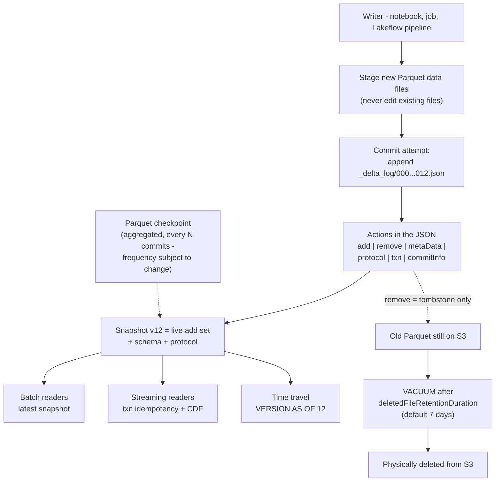
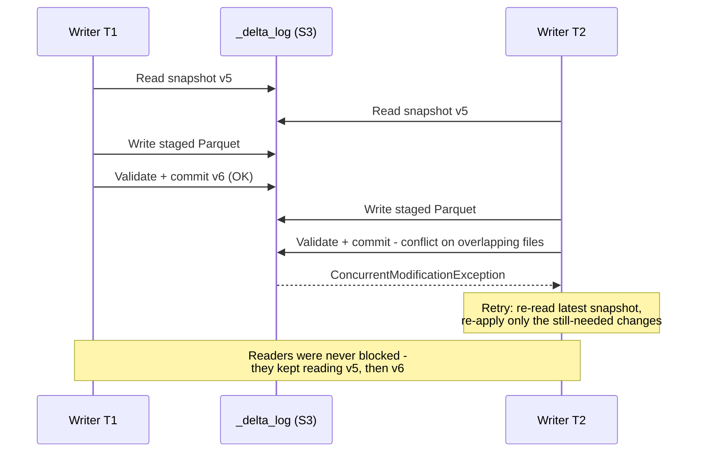
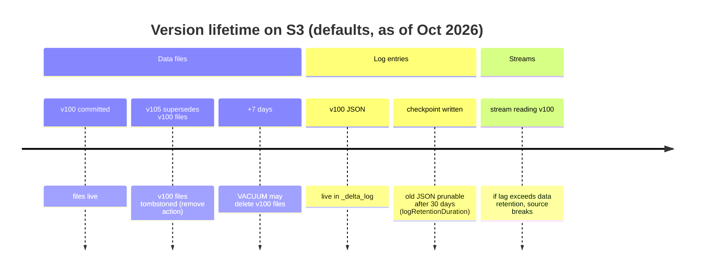
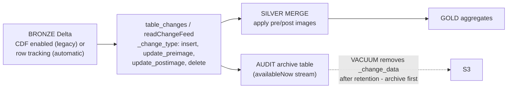

# Delta Lake Transactions on AWS: Log Anatomy, Time Travel, CDF, Clustering and VACUUM

Every bronze, silver and gold table in this course is a **Delta Lake table**: Parquet data files plus a file-based transaction log, sitting in *your* S3 bucket, governed by Unity Catalog. That single sentence explains both the superpower and the failure mode. The superpower: ACID commits, time travel, change data feed and concurrent writers on object storage that has none of those properties natively. The failure mode: teams that treat Delta like a folder of Parquet: editing files by hand, running `VACUUM RETAIN 0 HOURS`, enabling CDF after the fact and wondering why history is missing, or partitioning a 200 GB table into a thousand tiny directories because a 2019 tutorial told them to.

The teaching rule for this lesson: **the transaction log is the table**. Data files are just blobs the log references; a "version" is a log commit; time travel is a log replay; CDF is computed from what the log (or row lineage) knows; `VACUUM` is the only thing that physically deletes anything, and it works on the log's schedule, not yours.

Every fact below comes from Databricks' AWS documentation (table history, change data feed, liquid clustering, optimize, VACUUM, constraints, feature compatibility, ACID and S3-limitations pages: all accessed or dated **October 2026**), the Databricks Delta blog, and the Databricks knowledge base. Do the retention arithmetic yourself; it is the only way to design a table you can still recover on the worst day of the year.

```text
 =============================================================
  DELTA LAKE ON AWS - THE MACHINERY AT A GLANCE (Oct 2026)
 -------------------------------------------------------------
  Table = Parquet data files + _delta_log/ (append-only JSON)
  Commits = 00000000000000000000.json, ...0001.json, ...
  Actions = add | remove | metaData | protocol | txn | commitInfo
  Reads = snapshot isolation (always)
  Writes = WriteSerializable (default); optimistic, no locks
  Time travel = VERSION AS OF / TIMESTAMP AS OF
    data files retained: 7 days (deletedFileRetentionDuration)
    log entries retained: 30 days (logRetentionDuration)
  CDF = legacy (table property, forward-looking) |
        automatic (DBR 19+, row tracking, no property)
  Layout = liquid clustering (CLUSTER BY, <=4 keys, protocol 3/7)
           replaces partitioning + ZORDER for new tables
  Maintenance = OPTIMIZE (bin packing / recluster), VACUUM
  Constraints = NOT NULL + CHECK enforced; PK/FK informational
  AWS note = one workspace per S3 table; no bucket versioning
  =============================================================
```

In this lesson you will:

- read the **`_delta_log` action set**: what `add`, `remove`, `metaData`, `protocol`, `txn` and `commitInfo` each record, and how checkpoints stop readers replaying every JSON file;
- run the **optimistic concurrency** story end to end: snapshot reads, the read/write/validate-commit stages, and why metadata changes are the conflicts that hurt;
- write real **time travel SQL**, `DESCRIBE HISTORY`, `VERSION AS OF`, `TIMESTAMP AS OF`, `RESTORE TABLE`, against the **7-day data / 30-day log** retention split, with the DBR floors that block older versions outright;
- separate **legacy CDF from automatic CDF** (the fact most 2023-era tutorials get stale), query `table_changes`, and archive a CDF stream into a permanent audit table;
- execute a **worked pruned `MERGE INTO`** with `WITH SCHEMA EVOLUTION` and enforced `CHECK` constraints, and quote the measured pruning win (**13.16 min → 20.54 s**);
- choose between **partitioning, ZORDER and liquid clustering**, run `CLUSTER BY` / `OPTIMIZE ... FULL` migrations, and defend the choice in the **comparative verdict**;
- hand-compute **VACUUM retention math**, tombstoned bytes, S3 holding cost, the 168-hour floor and the streaming-lag rule, including the documented data-loss timeline for `RETAIN 0 HOURS`;
- map the **protocol ladder** (`minReaderVersion` 1 to 3, `minWriterVersion` 2 to 7, table features) and know which upgrades are irreversible;
- study **two named AWS customer cases** (Rivian and Comcast), read the **2026 update box**, and practise with **12 exam-style questions** plus four interactive checks.

---

## 1. The transaction log: what actually makes a Delta table ACID

### 1.1 One table, two halves, one source of truth

Delta Lake "extends Parquet data files with a file-based transaction log for ACID transactions and scalable metadata handling" (docs .../delta, dated 2026-07-10). Physically, in your S3 bucket, that is:

| Half | Location on S3 | Mutability | Who reads it |
|---|---|---|---|
| **Data files** | `<table-path>/*.parquet` (or subdirs) | Immutable once written; rewritten as *new* files on DML | Every query engine |
| **Transaction log** | `<table-path>/_delta_log/` | **Append-only** JSON, plus Parquet checkpoints | Delta protocol readers only |

The log "has a well-defined open protocol that can be used by any system to read the log" (docs.../delta, 2026-07-10), and delta.io states the hard rule: "The Delta transaction log must remain an append-only log" (PROTOCOL.md / delta.io, accessed 2026-10). Each successful commit appends one zero-padded JSON file, `00000000000000000000.json`, then `...0001.json`, `...0002.json`, and each JSON file is a list of **actions**. Readers "list the log, replay the actions" and derive the live file set plus schema for any version whose files still exist.

### 1.2 The six action types

From the Databricks deep-dive blog "Diving Into Delta Lake: Unpacking The Transaction Log" (2019-08-21), still the canonical enumeration, consistent with current docs:

| Action | What it records | Why you care |
|---|---|---|
| **`add`** | A data file joins the table: path, size, modification time, partition values, `dataChange` flag, and per-column min/max **statistics** in `stats` | Data skipping reads these stats; Delta collects stats for the **first 32 columns** by default (docs .../tables/clustering, 2026-09-25) |
| **`remove`** | A data file leaves the *current* snapshot: a **tombstone**, not a deletion | The file is physically deleted only by `VACUUM`, after `delta.deletedFileRetentionDuration` (default **7 days**) from *logical* removal |
| **`metaData`** | Table id, `schemaString`, `partitionColumns` / clustering config, table properties, format | Schema evolution and `CLUSTER BY` land here; metadata commits conflict with concurrent writers |
| **`protocol`** | `minReaderVersion` / `minWriterVersion`, plus `readerFeatures` / `writerFeatures` at reader 3 / writer 7 | Feature enablement bumps the protocol; "Most protocol version upgrades are irreversible" (docs .../feature-compatibility, 2026-09-11) |
| **`txn`** (SetTransaction) | Idempotency marker: "Records that a structured streaming job has committed a micro-batch with the given ID" (blog, 2019-08-21) | Exactly-once streaming sinks depend on it |
| **`commitInfo`** | Operation name, `operationParameters`, user, timestamp, cluster id, metrics | This is exactly what `DESCRIBE HISTORY` surfaces |

- **📚 Did you know?** The 20-digit zero-padded commit names (`00000000000000000000.json`) exist so that lexicographic S3 listing equals numeric version order: a file-system trick that turns object storage into a sorted WAL. DML never edits Parquet in place: "Delta Lake creates new versions of files rather than modifying them in place" and "The old data file is not deleted, though" (blog "DML Internals", 2020-09-29). It waits for a `remove` action plus `VACUUM`.

### 1.3 Anatomy, drawn



Two operational rules follow directly, both official: "avoid interacting directly with data and transaction log files in Delta Lake file directories" (docs.../delta, 2026-07-10) and never `rm -rf` a table directory (docs.../delta/s3-limitations, 2026-09-11): the log is the table, and S3 offers no atomic rename for a reason Delta had to invent its own commit protocol.

### 1.4 Worked example E1: read the log and classify maintenance

`DESCRIBE HISTORY` reads `commitInfo` actions. Auto compaction, manual `OPTIMIZE` and liquid clustering **all appear as `OPTIMIZE` operations**; you must inspect `operationParameters` to tell them apart (docs.../tables/history, last updated 2026-09-11):

```sql
-- Last five operations on the table
DESCRIBE HISTORY main.silver.orders LIMIT 5;

-- Audit view: what kind of OPTIMIZE ran, and what did it move?
SELECT version, timestamp, operation,
       operationParameters.clusterBy    AS cluster_by,      -- non-empty = liquid clustering
       operationParameters.zOrderBy     AS z_order_by,      -- non-empty = legacy ZORDER
       operationParameters.auto         AS is_auto_compaction,
       operationParameters.predicate    AS prune_predicate,
       operationMetrics.numRemovedFiles,
       operationMetrics.numAddedFiles,
       operationMetrics.numAddedBytes
FROM (DESCRIBE HISTORY main.silver.orders)
WHERE operation IN ('OPTIMIZE','WRITE','MERGE','STREAMING UPDATE','VACUUM','REORG')
ORDER BY version DESC;
```

The history page also states the retention of the history itself: "Table history retention is determined by the table setting `logRetentionDuration`, which is **30 days** by default", and warns: "Don't use table history as a long-term backup solution for data archival. Use only the past **7 days** for time travel operations unless you have set both data and log retention configurations to a larger value" (docs.../tables/history, 2026-09-11). That 7-vs-30 split is section 3.

---

## 2. ACID without locks: optimistic concurrency on S3

### 2.1 What Delta guarantees

"Databricks uses optimistic concurrency control. This means that there are no locks on reading or writing against a table, and deadlock is not a possibility" (docs.../lakehouse/acid, updated 2026-09-11). By default: **snapshot isolation on reads**, **`WriteSerializable` on writes**: "Ensures that only write operations (not reads) are serializable. This is still stronger than Snapshot isolation" (docs.../isolation-levels, 2026-09-11). `Serializable` is opt-in:

```sql
ALTER TABLE main.silver.orders
  SET TBLPROPERTIES ('delta.isolationLevel' = 'Serializable');
```

Writes follow three stages (docs .../acid): **read** (an appends-only `INSERT` can skip this entirely when no subquery references the target), **write** (stage new Parquet files), **validate and commit** (append the JSON commit if no conflicting commit landed since the read; otherwise fail with a concurrent-modification exception rather than corrupt the table).



### 2.2 Where conflicts actually come from

Three conflict sources, in the order they bite production teams (docs .../optimizations/isolation and .../acid, 2026-09-11):

1. **Two writers rewriting overlapping files**: two `MERGE`s hitting the same partitions in the same window. Mitigation: narrow the `ON` predicate to the partitions you touch (this also prunes, section 5); prefer appends where semantics allow.
2. **Metadata changes**: schema evolution, table-property changes, protocol/feature upgrades. These "might cause all concurrent write operations to fail", and "Streaming reads fail when they encounter a commit that changes table metadata. If you want the stream to continue, you must restart it."
3. **The S3-specific scoping rule**: the commit guarantee on S3 is workspace-scoped: "Databricks recommends that you don't modify the same Delta Lake table stored in S3 from different workspaces" (docs.../delta/s3-limitations, 2026-09-11). One table, one workspace; account-per-environment isolation (lesson 02) is what keeps that property true.

- **📚 Did you know?** Failed writers leave debris: writes create `_started_<id>` and `_committed_<id>` metadata files, and "`VACUUM` operation deletes all untracked data files in a table directory, including remaining uncommitted files from failed transactions" (docs.../acid, 2026-09-11). That is a *feature*, and also the reason a zero-retention `VACUUM` racing a slow writer deletes data (section 7).

---

## 3. Time travel: two retentions, one hard floor

### 3.1 The SQL you will actually run

Every modifying operation creates a new version. Query-time syntax (docs .../tables/history, 2026-09-11):

```sql
-- Worked example E2 - point-in-time reads and repair patterns
SELECT * FROM main.silver.orders VERSION AS OF 42;
SELECT * FROM main.silver.orders TIMESTAMP AS OF '2026-10-01T00:00:00.000Z';
SELECT * FROM main.silver.orders@v42;                    -- shorthand
SELECT * FROM main.silver.orders@20261001000000000;      -- timestamp shorthand

-- DataFrame equivalents: .option("versionAsOf", 42) / .option("timestampAsOf", "...")

-- Undo a bad night: copy yesterday's rows for one user back in
INSERT INTO main.silver.orders
SELECT * FROM main.silver.orders TIMESTAMP AS OF date_sub(current_date(), 1)
WHERE user_id = 111;

-- Or rewind the whole table (creates a new version; does not delete history)
RESTORE TABLE main.silver.orders TO VERSION AS OF 41;
```

### 3.2 The 7-vs-30 trap, and the DBR floors

| Knob | Default | Governs | Enforced by |
|---|---|---|---|
| `delta.deletedFileRetentionDuration` | **interval 7 days** | How long physically deleted-from-snapshot data files stay on S3 | `VACUUM` |
| `delta.logRetentionDuration` | **interval 30 days** | How long old log JSON / history entries are kept | Automatic, after checkpoints |

Both must still exist for a version to be readable. And since DBR 18.0 (DBR 12.2+ for Unity Catalog managed tables): "time travel queries are blocked if they request a version older than the `deletedFileRetentionDuration` table property (default 7 days)" (docs.../tables/history, 2026-09-11), so effective time travel with defaults is **7 days**, even though history *metadata* shows 30 days of operations.



> [!IMPORTANT]
> ⚠️ **Time travel is not backup.** "Don't use table history as a long-term backup solution for data archival" (docs.../tables/history, 2026-09-11). After a default `VACUUM`, "you can't restore a table to an older version that references those files." For real durability on AWS use S3 versioning *only if compliance forces it* (then: three versions, ≤7-day lifecycle, docs.../delta/s3-limitations), or explicit snapshots/clones in a retention-controlled location, never `VACUUM` + hope. The KB puts it bluntly: "if you run VACUUM with the default settings, you will only be able to time travel seven days into the past" (kb.databricks.com VACUUM best practices, accessed 2026-10).

---

## 4. Change data feed: legacy vs automatic (the 2026 truth)

### 4.1 Two implementations, one read API

CDF "tracks row-level changes between versions of a Delta Lake table" with metadata columns `_change_type` (`insert`, `update_preimage`, `update_postimage`, `delete`), `_commit_version` and `_commit_timestamp` (docs.../change-data-feed, last updated **2026-10-09**). As of Oct 2026 there are **two** implementations; this is where old tutorials go stale:

| | **Legacy CDF** | **Automatic CDF** |
|---|---|---|
| Mechanism | Materializes change files at **write** time | Computes changes at **query** time from **row lineage** |
| Enablement | Per table: `delta.enableChangeDataFeed = true` (CREATE or ALTER) | No table property; requires **DBR 19 or above** + row tracking (UC-registered managed/external Delta, or Iceberg v3) |
| Write cost | Every `MERGE`/`UPDATE` writes extra change files | "improves write performance and reduces storage costs" (same page) |
| Lookback | **Forward looking only**: "it will capture changes once the table property is set up and not earlier" (blog, 2021-06-09) | Covers changes while row tracking exists |
| Both at once? | Unsupported: unset the legacy property before migrating | |

Read APIs are identical in both modes (docs .../change-data-feed, 2026-10-09):

```sql
-- Worked example E3a - batch CDF reads (starting version REQUIRED)
SELECT * FROM table_changes('main.silver.orders', 0, 10);      -- versions 0..10 inclusive
SELECT * FROM table_changes('main.silver.orders', 12);         -- from v12 onward

SELECT _change_type, count(*) AS n
FROM table_changes('main.silver.orders', 12)
WHERE _commit_timestamp >= current_timestamp() - INTERVAL 1 DAY
GROUP BY _change_type;
```

```python
# Worked example E3b - DataFrame + permanent audit archive
# CDF is transient: change data lives in _change_data, is removed by VACUUM,
# and log versions are pruned - archive if you need permanence (docs 2026-10-09).

# Batch
spark.read.option("readChangeFeed", "true").option("startingVersion", 12).table("main.silver.orders")

# Streaming: first start returns the latest snapshot as INSERT, then future changes
(spark.readStream.option("readChangeFeed", "true").table("main.silver.orders")
      .writeStream
      .option("checkpointLocation", "/mnt/checkpoints/orders_cdf")
      .trigger(availableNow=True)
      .toTable("main.audit.orders_cdf_archive"))
```



Two sharp edges from the docs and the KB digest: batch CDF reads **require** a starting version: a start earlier than when CDF was enabled raises an error; and a CDF range spanning a non-additive schema change (rename/drop/type change) fails, so split the range. "A change data feed is not intended to serve as a permanent record of all changes to a table" (docs.../change-data-feed, 2026-10-09).

- **📚 Did you know?** Databricks' own streaming guidance now says: "Databricks recommends streaming from the CDC feed of a Delta Lake table rather than directly from the table whenever possible" (docs .../structured-streaming/delta-lake, page dated 2026-08-24). Streaming straight off a hot table fails on metadata commits (restart required); a CDF feed plus `foreachBatch` gives you idempotent downstream application with fewer surprises (lesson 13).

---

## 5. MERGE, UPDATE, DELETE: copy-on-write, done right

### 5.1 Semantics in one table

All three are **copy-on-write at file granularity**: touching one row rewrites its containing file(s) as new versions (blog "DML Internals", 2020-09-29). `MERGE INTO` supports `WHEN MATCHED`, `WHEN NOT MATCHED [BY TARGET]` and `WHEN NOT MATCHED BY SOURCE` clauses, evaluated in order; every non-last `WHEN MATCHED` must carry a condition (else `NON_LAST_MATCHED_CLAUSE_OMIT_CONDITION`); and two source rows matching one target row fails with `DELTA_MULTIPLE_SOURCE_ROW_MATCHING_TARGET_ROW_IN_MERGE` (docs.../delta-merge-into, updated 2026-06-18).

### 5.2 Worked example E4: pruned MERGE into silver with constraints and evolution

```sql
-- Cheap, enforced data quality first: fails the transaction before bad rows land
ALTER TABLE main.silver.orders
  ADD CONSTRAINT order_id_not_null CHECK (order_id IS NOT NULL);
ALTER TABLE main.silver.orders
  ADD CONSTRAINT amount_nonneg CHECK (amount >= 0);

-- Worked example E4 - the production-shaped MERGE (docs 2026-06-18: WITH SCHEMA EVOLUTION = DBR 15.2+)
MERGE WITH SCHEMA EVOLUTION INTO main.silver.orders t
USING (SELECT * FROM main.bronze.orders_raw
       WHERE event_date >= date_sub(current_date(), 2)) s   -- prune BEFORE the join
ON  t.order_id = s.order_id
AND t.event_date >= date_sub(current_date(), 2)             -- pruning predicate in ON
WHEN MATCHED AND s.op <> 'DELETE' THEN UPDATE SET *
WHEN MATCHED AND s.op = 'DELETE'  THEN DELETE
WHEN NOT MATCHED THEN INSERT *;
-- Optimized writes + auto compaction are forced ON for MERGE/UPDATE/DELETE (docs 2026-09-11).
```

The measured reason the `ON` predicate matters, from the Databricks KB (last published 2023-06-01): an unfiltered `MERGE` over a table with `PartitionCount: 1000` took **13.16 minutes**; adding pruning conditions (`PartitionCount: 2`) took **20.54 seconds**, "more than 40X faster". Add **low-shuffle MERGE** (GA and default since DBR 10.4 LTS): "up to 5x performance improvement on MERGE-based workloads with the average on the order of 2-3x" (blog, 2024-06-20), with one healthcare-adjacent customer cutting average merge time "from 11 minutes to 1.5 minutes" (7×). Low shuffle merge "also reduces the need for users to re-run `OPTIMIZE` after performing a `MERGE`" (docs, 2026-06-11), though newly inserted rows on a clustered table may still want a recluster.

---

## 6. Layout: partitioning, ZORDER, and liquid clustering

### 6.1 What each technique actually does

| Technique | Mechanism | Cost profile | Status in docs (Oct 2026) |
|---|---|---|---|
| **Hive-style partitioning** | Directory per partition value; pruning = directory skip | Rewrite-heavy; cardinality explosion; shuffle on write | Discouraged below **1 TB** tables; only if each partition ≥ **1 GB** (docs .../performance-efficiency, 2026-09-11) |
| **ZORDER** | Rewrite-based co-location of a column across files (multi-dimensional sort) | Expensive rewrites; `MERGE` used to break layout | Legacy; docs "recommend[s] using liquid clustering instead of partitioning, `ZORDER`, or other data layout approaches" (docs .../optimize, 2026-09-11) |
| **Liquid clustering** | `CLUSTER BY` keys + **ZCubes/bin packing** on `OPTIMIZE`; keys changeable without rewrite; file-granularity pruning ("no directory-level shortcut to lose": blog, 2026-01-06) | Incremental recluster; clustering-on-write for UC managed | "Liquid clustering is a data layout optimization technique that **replaces table partitioning and `ZORDER`**" (docs.../tables/clustering, 2026-09-25); "Databricks recommends liquid clustering for all new tables" |

Liquid clustering facts you must be able to state precisely (all docs .../tables/clustering, 2026-09-25 unless noted):

- Syntax: `CREATE TABLE t (...) CLUSTER BY (col1, col2)`; `ALTER TABLE t CLUSTER BY (cols)`; `ALTER TABLE t CLUSTER BY NONE`. "Clustering is not compatible with partitioning or `ZORDER`."
- **Up to four clustering keys**; more keys degrade single-column filters on tables under 10 TB. Statistics power skipping for the **first 32 columns**.
- Version story, date-stamped: trigger/write from **DBR 13.3 LTS+**; announced **GA in DBR 15.2** (blog, 2024-05-22); current docs: "generally available for Delta Lake tables with **Databricks Runtime 15.4 LTS and above**". Protocol: **reader 3 / writer 7** (hidden partitioning).
- `ALTER TABLE ... CLUSTER BY` does **not** rewrite data; the first recluster is `OPTIMIZE t FULL` (**DBR 16.4 LTS+**). `CLUSTER BY AUTO` (automatic clustering, UC managed + predictive optimization) is **DBR 15.4 LTS+**. `REPLACE PARTITIONED BY WITH CLUSTER BY` is **DBR 18.1+**.
- Cadence: `OPTIMIZE` is idempotent, changes no data, and "does not affect any current or future streams with this table as a source" (docs.../optimize, 2026-09-11), hot tables every **1 to 2 hours**, otherwise **daily at night** (spot-friendly); tables **> 1 TB** should run `OPTIMIZE` on a schedule (docs.../tune-file-size, 2026-09-11). Auto-optimize = `autoOptimize.optimizeWrite` + `autoOptimize.autoCompact`, **128 MB** target files; always-on for DML; UC managed tables get automatic file-size tuning instead (256 MB, 1 GB autotune by table size).

### 6.3 Worked example E5: CLUSTER BY migration and scheduled OPTIMIZE

```sql
-- New table, clustered from birth (no PARTITION BY + CLUSTER BY together)
CREATE TABLE main.gold.events (
  event_date DATE, store_id BIGINT, customer_id BIGINT, payload STRING
) CLUSTER BY (event_date, store_id);          -- <= 4 keys

-- Enable clustering on an existing table, then force the first full recluster
ALTER TABLE main.gold.legacy_daily CLUSTER BY (event_date, customer_id);
OPTIMIZE main.gold.legacy_daily FULL;         -- DBR 16.4+; first run can take hours on big tables

-- DBR 18.1+: in-place conversion from partitioning, no full rewrite
ALTER TABLE main.gold.daily REPLACE PARTITIONED BY WITH CLUSTER BY (event_date, customer_id);

-- Incremental maintenance: prune with WHERE; bin packing is idempotent
OPTIMIZE main.gold.events WHERE event_date >= current_date() - 3;

-- Verify in history: expect REORG / UPGRADE PROTOCOL / OPTIMIZE with clusterBy set
DESCRIBE HISTORY main.gold.events LIMIT 10;
```

Benchmark context to carry into design reviews: on a 1 TB data-warehouse workload, "Liquid Clustering resulted in **2.5x faster clustering relative to Z-order**. In the same trial, traditional Hive-style partitioning was an order of magnitude slower" (blog, 2023-06-29); a large manufacturing firm saw point queries "speeding up ... by **12x**" (blog, 2024-05-22). Treat both as vendor benchmarks with dates, not SLAs.

### 6.4 Worked example E6: the small-file compaction math

A streaming ingest writes ~1,800 files/day at 4 MB each into `main.silver.orders` (Auto Loader micro-batches). Queries that should read one 500 MB file instead open 1,800+.

```text
Worked example E6 - compaction economics, as of Oct 2026
Before OPTIMIZE:
  files/day ............ 1,800 x 4 MB = 7.2 GB/day appended as tiny files
  week of ingest ....... 12,600 files; S3 listing + open overhead dominates short queries
After OPTIMIZE (target ~128 MB autoCompact / autotune 256 MB-1 GB by size):
  files/day ............ 7.2 GB / 128 MB ~ 58 files/day (bin packing)
  reduction ............ ~31x fewer objects for the same bytes
Cadence:
  hot table ............ OPTIMIZE every 1-2 hours (docs clustering page)
  baseline ............. daily at night; tables > 1 TB on a schedule (docs tune-file-size)
Cost note:
  OPTIMIZE runs on whatever compute you schedule it on - night + spot is the docs' hint;
  predictive optimization (UC managed) runs it for you (default-on for accounts
  created on/after 2024-11-11) - then disable your own scheduled OPTIMIZE jobs.
```

```plot
{
  "type": "bar",
  "title": "p95 query latency before vs after compaction + clustering (illustrative layout case, minutes-scale workloads)",
  "xLabel": "Workload phase",
  "yLabel": "p95 latency (seconds)",
  "xKey": "phase",
  "dataKeys": ["latency_s"],
  "data": [
    {"phase": "Before: 12,600 small files", "latency_s": 48.0},
    {"phase": "After: OPTIMIZE bin packing", "latency_s": 11.5},
    {"phase": "After: CLUSTER BY (event_date, store_id)", "latency_s": 6.2}
  ]
}
```

The shape of that curve is the whole argument: bin packing (fewer, larger files) removes the listing tax; clustering (files sorted by the filter keys) then lets data skipping cut the scan. The exact seconds are an illustrative compaction scenario: the *mechanisms* are the documented ones: stats-based data skipping over the first 32 columns, 128 MB compaction targets, and file-granularity pruning on clustered keys.

> **Comparative Verdict: partitioning / ZORDER vs liquid clustering (as of Oct 2026)**
> - **Choose liquid clustering (`CLUSTER BY`)** for all new tables, per current docs: high-cardinality filter keys (customer_id, event_id), keys that must change without a full-table rewrite, streaming-first tables, and anything UC-managed with predictive optimization. It replaces both partitioning and ZORDER, keeps protocol at reader 3 / writer 7, and benchmarks at 2.5× faster clustering than ZORDER on a 1 TB DW workload (2023-06-29) with production adoption "including dozens with petabyte scale tables" (2026-01-06).
> - **Partitioning still has one legitimate niche**: tables ≥ 1 TB with a *stable, low-cardinality* filter (a date you always prune, a region you always scope) where directory-level tooling outside Databricks (external compaction, third-party readers) needs the layout, and only if each partition holds ≥ 1 GB (docs, 2026-09-11). Below 1 TB, do not partition.
> - **ZORDER is legacy.** Keep it only on pre-existing tables you have not migrated; docs recommend liquid clustering instead; never combine `ZORDER` with `CLUSTER BY` ("not compatible"). Migrate keys via `ALTER TABLE... CLUSTER BY` + `OPTIMIZE FULL`, or `REPLACE PARTITIONED BY WITH CLUSTER BY` on DBR 18.1+.
> - **The trap answer on exams and in design docs:** "partition by a low-cardinality column, then ZORDER the rest" is 2022 advice. In Oct 2026 the default answer is `CLUSTER BY` with up to four well-chosen keys, and a scheduled (or predictive) `OPTIMIZE`.

- **📚 Did you know?** Auto compaction, liquid clustering and ZORDER all log as `OPTIMIZE` in table history, so a "we never run OPTIMIZE" claim from a team with auto-optimize enabled is invisible unless they read `operationParameters.auto` / `.clusterBy` (E1). And on Unity Catalog managed tables with predictive optimization on, Databricks "recommends disabling any scheduled OPTIMIZE jobs" to avoid paying twice for the same rewrites (docs.../tables/clustering, 2026-09-25).

---

## 7. VACUUM: retention math and the data-loss timeline

### 7.1 What VACUUM does, and what it does not

"`VACUUM` removes all files from the table directory that are not managed by Delta, as well as data files that are no longer in the latest state of the transaction log", and "will skip all directories that begin with an underscore (`_`), which includes the `_delta_log`" (docs.../delta-vacuum, 2026-09-11). Deletion follows **time since logical removal from the log**, not file mtime, plus retention hours; default threshold **7 days** via `delta.deletedFileRetentionDuration`. `VACUUM` is also what destroys time travel to old versions and what deletes `_change_data` CDF files (docs.../operations/vacuum, dated 2026-04-21). Log JSON pruning is *not* governed by `VACUUM`, checkpoints drive it, on the 30-day `logRetentionDuration`.

Modes: `DRY RUN` (lists up to **1000** candidate files: always run this first); `FULL` (default) vs `LITE` (log-driven, **DBR 16.1+**). File deletion is a driver-only operation.

### 7.2 Worked example E7: retention math on real bytes

A silver table receives 40 GB/day of small files that nightly `OPTIMIZE` tombstones (logical `remove`) while rewriting them into larger files. You must size the tombstone holding cost and pick a retention.

```text
Worked example E7 - VACUUM retention math, S3 Standard $0.023/GB-mo (as of Oct 2026)
Tombstoned bytes/day .......... 40 GB (removed from snapshot, still on S3)

Default retention = 7 days = 168 hours:
  tombstone footprint ......... 40 GB x 7 = 280 GB
  S3 holding cost ............. 280 x $0.023 = $6.44 / month
  time travel window .......... 7 days (docs floor; DBR 18.0+ blocks older)

Compliance retention = 30 days (720 hours):
  tombstone footprint ......... 40 x 30 = 1,200 GB (1.2 TB)
  S3 holding cost ............. 1,200 x $0.023 = $27.60 / month
  multiplier vs default ....... 30/7 ~ 4.3x the tombstone bytes and cost

Streaming safety constraint:
  retention >= max tolerated stream lag + longest running concurrent transaction
  e.g. worst lag observed 36 h + longest job 8 h => keep >= 44 h; keep 168 h anyway
```

Read the multiplier rule: raising retention linearly increases *tombstoned* bytes on S3 while linearly extending your time travel and CDF-change-data window; it does not increase live-table cost. The default 168 hours is simultaneously the docs' minimum recommendation ("Databricks strongly recommends setting a retention interval of at least 7 days", docs.../delta-vacuum) and the streaming-lag floor.

### 7.3 The documented data-loss timeline

The KB case (last published 2025-07-14): `VACUUM` starts on version 100 at 01:17 UTC; version 101 commits a new data file at 01:19; `VACUUM` deletes that not-yet-referenced file at 01:20: "VACUUM executed on version 100 and deleted everything that was added to version 101." The guardrail is `spark.databricks.delta.retentionDurationCheck.enabled`; the KB instruction: "Do not disable... and run vacuum with retention zero to avoid data loss." And on streaming sources: "If the Delta table is the source for a streaming query, and if the streaming query falls behind by more than seven days, then the streaming query will not be able to correctly read the table" (KB, VACUUM best practices, accessed 2026-10).

```sql
-- Safe drill, then a deliberate retention raise
VACUUM main.silver.orders DRY RUN;                            -- inspect the candidate list first
VACUUM main.silver.orders RETAIN 168 HOURS;                   -- the 7-day floor
ALTER TABLE main.silver.orders
  SET TBLPROPERTIES ('delta.deletedFileRetentionDuration' = 'interval 30 days');
-- NEVER in production:
-- SET spark.databricks.delta.retentionDurationCheck.enabled = false;
-- VACUUM main.silver.orders RETAIN 0 HOURS;
```

---

## 8. Constraints: enforced data quality for the price of a metadata commit

Two constraint types are **enforced** on Delta (docs.../constraints, 2026-09-11): `NOT NULL` (inline or `ALTER TABLE... ALTER COLUMN... SET NOT NULL`) and `CHECK` (`ALTER TABLE t ADD CONSTRAINT name CHECK (expr)`). Adding a constraint "verifies that all existing rows satisfy the constraint before adding" it; the expression must be deterministic Spark SQL, no UDFs, aggregates, window or multi-row functions. A violation "fails the transaction with an error" before data lands, a write-time guard that costs nothing at read time, unlike view-based filtering.

Protocol note: "Adding a constraint upgrades the table writer protocol if the current writer version is less than 3": a compatibility event for external readers (section 9). And the trap every course must defuse: **primary key, foreign key and unique constraints are informational only and are not enforced** (PK/FK GA since DBR 15.2; unique in Public Preview, DBR 18.2+). They may help optimization; they are not integrity guarantees. Constraints complement: not replace: Lakeflow expectations and quarantine patterns (lesson 10).

```sql
-- Worked example E8 - the constrained silver table
CREATE TABLE main.silver.orders (
  order_id   BIGINT NOT NULL,
  event_date DATE  NOT NULL,
  amount     DECIMAL(18,2),
  status     STRING
);

ALTER TABLE main.silver.orders
  ADD CONSTRAINT amount_nonneg CHECK (amount >= 0);
ALTER TABLE main.silver.orders
  ADD CONSTRAINT status_valid CHECK (status IN ('NEW','PAID','SHIPPED','CANCELLED'));

SHOW TBLPROPERTIES main.silver.orders;   -- constraints and retention knobs live here
DESCRIBE DETAIL main.silver.orders;      -- protocol + location + stats summary
```

Schema enforcement is the same philosophy at the column level: "Databricks validates data quality by enforcing schema on write for Delta Lake tables": a misnamed column or incompatible type cancels the transaction before anything commits (docs.../schema-enforcement; blog, 2019-09-24). Evolution is opt-in **per write or per statement**: `WITH SCHEMA EVOLUTION` on `MERGE` (DBR 15.2+) / `INSERT` (DBR 18.1+), or `.option("mergeSchema","true")`, and Databricks explicitly discourages the session-wide `spark.databricks.delta.schema.autoMerge.enabled` in production ("might lead to unintended schema changes"). Streaming queries lock their schema at planning: a mid-stream source change fails the query and requires a restart (docs.../data-engineering/schema-evolution, accessed 2026-10).

---

## 9. Protocol, features, and what your table costs other readers

Every Delta table carries `minReaderVersion` ∈ {1, 2, 3} and `minWriterVersion` ∈ {2..7}. Since DBR 12.2 LTS, **table features** granularize this at reader 3 / writer 7 (docs .../feature-compatibility, 2026-09-11):

| Feature | Protocol (reader/writer) | Minimum DBR (feature) |
|---|---|---|
| Basic table | 1 / 2 |: |
| CHECK constraint | 1 / **3** |: |
| Change data feed (legacy) | 1 / **4** |: |
| Column mapping | 2 / 5 |: |
| Identity columns | 1 / 6 |: |
| Row tracking | 1 / 7 | 14.3 LTS |
| Deletion vectors | **3** / 7 | 13.3 LTS |
| Liquid clustering (hidden partitioning) | **3** / 7 | 13.3 LTS (GA 15.2 announcement; docs cite 15.4 LTS+) |
| Type widening / Variant | 3 / 7 | 15.4 LTS |

Rules that matter on AWS specifically:

1. **Writer-only features (CHECK, CDF, identity, row tracking) do not break readers**; they "only upgrade the write protocol", so legacy read-only clients survive. Reader features (column mapping, deletion vectors, type widening, liquid clustering's hidden partitioning) break readers that do not implement them.
2. **"Most protocol version upgrades are irreversible."** Never "downgrade" by editing the JSON. `DROP FEATURE` (DBR 15.4+) is the only partial rollback, and not every feature can be dropped. Lower-DBR writes are always readable on higher DBR; the hazard is the other direction: a BI tool or ETL client pinned to an old Spark may simply stop reading your table after you enable clustering.
3. **On S3:** don't enable bucket versioning on Delta buckets (it fights Delta GC); if mandated, three versions with a ≤7-day lifecycle. Don't write the same table from two workspaces. Don't hand-edit Parquet or the log (docs .../delta/s3-limitations, 2026-09-11).
4. **Managed vs external:** managed tables (default, recommended) live under schema/catalog `MANAGED LOCATION` on your S3 (hashed `__unitystorage` subdirs), `DROP` deletes data (7-day `UNDROP` recovery), and they get predictive optimization + automatic file tuning. External tables keep your path; `DROP` keeps files; you own maintenance. The `_delta_log` sits inside the table directory in **both** cases. Managed tables must be accessed by name: "Path-based access to Unity Catalog managed tables is not supported" (docs.../tables/managed, updated 2026-10-08).

---

## 10. The traps: twelve confusions this lesson will not let you keep

1. **"Time travel = 30 days."** With defaults it is **7 days** of data; 30 days is only how long history *metadata* survives.
2. **`logRetentionDuration` vs `deletedFileRetentionDuration`.** Log JSON/history vs data files removed by `VACUUM`. The classic 7-vs-30 error.
3. **`VACUUM` deletes files by age on disk.** No: by time since *logical removal*, and it also collects uncommitted debris from failed jobs (why <7 days is dangerous).
4. **CDF enabled after the fact.** Legacy CDF is forward-looking only; retroactive changes are invisible. Automatic CDF (DBR 19+, row tracking) needs no property but only covers the row-tracking era.
5. **Both CDF modes at once.** Unsupported; `UNSET` the legacy property when migrating.
6. **Assuming history tells you which OPTIMIZE ran.** Read `operationParameters.{auto, clusterBy, zOrderBy, predicate}`.
7. **`CLUSTER BY` + partitioning or ZORDER together.** "Not compatible": an error, not a bonus optimization.
8. **"Liquid clustering is GA since 13.3."** 13.3 LTS = trigger/write floor; GA announced at 15.2 (2024-05-22); docs currently cite 15.4 LTS+. Carry all three numbers with their dates.
9. **"Enabling clustering rewrites my table."** `ALTER TABLE ... CLUSTER BY` is metadata; the rewrite is `OPTIMIZE ... FULL` (16.4+).
10. **Protocol upgrades are one-way.** External clients pinned to old runtimes break; check `DESCRIBE DETAIL` before enabling reader features in a shared estate.
11. **PK/FK/unique enforce integrity.** They do not; only `NOT NULL` and `CHECK` do.
12. **`MERGE` without pruning predicates.** Measured 13.16 min vs 20.54 s (KB, 2023-06-01): put partition/clustering predicates in the `ON` clause.

### 2026 Updates (as of October 2026)

> [!NOTE]
> **What changed in the Delta platform this lesson depends on:**
> - **2026-01-06: liquid clustering runs at documented production scale.** "Liquid Clustering became Generally available in 2024... customers running it at scale, including dozens with **petabyte scale tables** in production" (databricks.com/blog/debunking-8-data-layout-myths-why-liquid-clustering-outperforms-partitioning, 2026-01-06). Partitioning-vs-clustering debates in older tutorials are superseded for new tables.
> - **2026-09-25: clustering docs current wording.** "Liquid clustering is a data layout optimization technique that replaces table partitioning and `ZORDER`"; GA "with Databricks Runtime 15.4 LTS and above"; up to four keys; stats on first 32 columns (docs.../aws/en/tables/clustering, updated 2026-09-25).
> - **2026-10-09, automatic change data feed is the current CDF story.** "Automatic change data feed: Computes changes during table reads using row lineage metadata. This doesn't require individual table configuration" versus legacy materialization, requires **Databricks Runtime 19 or above** plus row tracking on a UC-registered table; "You can't use both legacy and automatic change data feeds together" (docs.../change-data-feed, updated 2026-10-09).
> - **2026-10-08: managed-table lifecycle and predictive optimization.** Dropped managed tables are recoverable **7 days** by default (`RETAIN DROPPED TO` adjusts); managed storage resolution is schema → catalog → metastore; path-based access remains unsupported (docs.../tables/managed, updated 2026-10-08). Predictive optimization is default-on for accounts created on/after 2024-11-11 (docs, accessed 2026-10).
> - **2026-06-11 / 2026-06-18: low shuffle merge and MERGE evolution pages refreshed.** LSM "GA in Databricks Runtime 10.4 LTS and above" with "up to 5x... average on the order of 2-3x"; `MERGE WITH SCHEMA EVOLUTION` documented at DBR 15.2+ (docs.../low-shuffle-merge and.../delta-merge-into, 2026).
> - **2026-08-24: streaming guidance prefers CDC feeds.** "Databricks recommends streaming from the CDC feed of a Delta Lake table rather than directly from the table whenever possible" (docs.../structured-streaming/delta-lake, page dated 2026-08-24).

---

## Real-World Case Studies

> **📋 Case A: Rivian (electric vehicles, Cloud: AWS)**
> **Challenge.** Terabytes of vehicle and field data per day from 70,000+ vehicles, with legacy tooling that "struggled to scale pipelines cost-effectively and spent significant resources on maintenance".
> **Stack on AWS.** Databricks SQL, Delta Lake tables, Unity Catalog, and **liquid clustering** named explicitly: "Unity Catalog for data governance, Delta Tables for storage, and Liquid Clustering for data layout" for real-time charge-prediction ML (https://www.databricks.com/blog/data-intelligence-action-100-data-and-ai-use-cases-databricks-customers, 2025-07-09). Story page carries Databricks' own `Cloud: AWS` tag (https://www.databricks.com/customers/rivian, undated page, accessed 2026-10).
> **Reported outcome.** "1,000+ platform users, a 75% increase from a year ago" (customers/rivian, accessed 2026-10); "50% better runtime performance" and "More than 70,000 Rivians on the road, generating terabytes of data every day" (https://www.databricks.com/your-ai/customers/rivian, 2024-05-30).
> **Maps to this lesson.** Section 6: liquid clustering is not a benchmark slide: it is the named layout technique on a production AWS lakehouse feeding ML, exactly the high-cardinality vehicle-ID/time-series access pattern where static partitioning fails.
> ⏳ *Temporal note: metrics are from 2024 to 2025 pages; date-stamp them when you quote them.*

> **📋 Case B: Comcast (communications & media, Cloud: AWS)**
> **Challenge.** Petabytes of telemetry and billions of voice interactions from 20M+ voice remotes; fragile pipelines and small-file ingestion pain.
> **Stack on AWS.** Databricks with **Delta Lake for ingestion and small-file optimization**, managed MLflow, autoscaling with spot instances: `Cloud: AWS` on the story page (https://www.databricks.com/customers/comcast, undated page, accessed 2026-10); also listed among customers "already leveraging Databricks on AWS" (https://www.databricks.com/company/newsroom/press-releases/databricks-strengthens-scope-of-work-with-aws, 2022-05-10).
> **Reported outcome.** "10x Reduction in overall compute costs to process data · 90% Reduction in required DevOps resources"; "Delta Lake has enabled Comcast to optimize data ingestion, replacing 640 machines with 64 while improving performance" (customers/comcast, accessed 2026-10; story origin 2019).
> **Maps to this lesson.** Sections 1 and 6: the transaction log plus compaction (`OPTIMIZE` / auto compaction) collapsed a 640-machine estate to 64 *before* any exotic tuning. The cheapest performance win in a Delta estate is structural: fewer, better-laid-out files, not bigger clusters.
> ⏳ *Temporal note: a 2019-origin story still displayed in 2026; teach it as what Comcast reported at the time.*

---

> [!SUCCESS]
> **Key Takeaways:**
> 1. **The log is the table.** Parquet + append-only `_delta_log/` JSON (`add`, `remove`, `metaData`, `protocol`, `txn`, `commitInfo`) plus Parquet checkpoints; never touch files by hand; `remove` is a tombstone until `VACUUM`.
> 2. **Concurrency without locks.** Snapshot isolation on reads; `WriteSerializable` on writes by default; optimistic validate-and-commit; metadata changes and overlapping-file rewrites are the real conflicts; on S3 the guarantee is **single-workspace**.
> 3. **Time travel has two clocks.** Data files: 7 days (`deletedFileRetentionDuration`, enforced by `VACUUM`); log/history: 30 days (`logRetentionDuration`); DBR 18.0+ (UC managed 12.2+) blocks travel past the data-retention floor. History is not backup.
> 4. **CDF in 2026 = two implementations.** Legacy (`delta.enableChangeDataFeed=true`, forward-looking, materialized) vs automatic (DBR 19+, row tracking, query-time, cheaper writes). Same read API: `table_changes(...)`, `readChangeFeed`: archive CDF; it is transient.
> 5. **MERGE is copy-on-write.** Prune in the `ON` clause (measured 13.16 min → 20.54 s, >40×); low shuffle merge gives up to 5× (avg 2 to 3×); `WITH SCHEMA EVOLUTION` is DBR 15.2+; optimized writes/auto compaction are forced on for DML.
> 6. **Liquid clustering replaces partitioning and ZORDER** for new tables: `CLUSTER BY`, ≤4 keys, protocol 3/7, GA 2024 (15.2 announcement; docs cite 15.4 LTS+), write from 13.3 LTS+, `OPTIMIZE FULL` on 16.4+. Don't partition below 1 TB; ZORDER is legacy; they are not compatible together.
> 7. **VACUUM math:** 40 GB/day tombstones × 7 days = 280 GB ≈ $6.44/month at $0.023/GB-mo; ×30 days ≈ 1.2 TB ≈ $27.60/month (≈4.3×). Floor = 168 hours; retention must exceed max stream lag + longest transaction; never disable the retention check or `RETAIN 0`.
> 8. **Constraints:** only `NOT NULL` and `CHECK` enforce (protocol writer ≥3); PK/FK/unique are informational; schema is enforced on write by default; evolve per statement, never session-wide `autoMerge` in production.
> 9. **Protocol is one-way.** Reader features break old clients; writer features do not; "most protocol version upgrades are irreversible": inspect `DESCRIBE DETAIL` before enabling features on shared tables.
> 10. **AWS specifics:** no bucket versioning on Delta buckets (or 3 versions, ≤7-day lifecycle); one workspace per table; managed tables need named access and get predictive optimization (default-on for accounts created ≥2024-11-11).

---

## Practice Questions

```question
{
  "id": "dbl-04-q1",
  "type": "multiple-choice",
  "question": "A file is superseded by a MERGE and later deleted from S3 by VACUUM. Which pair of mechanisms performed those two steps?",
  "options": [
    "A remove action tombstoned the file at commit time; VACUUM physically deleted it after delta.deletedFileRetentionDuration (default 7 days) from logical removal",
    "The MERGE rewrote the Parquet file in place; S3 lifecycle rules deleted the old object after 24 hours",
    "A metaData action deleted the file; the checkpoint pruned it automatically after 30 days",
    "Delta never deletes files: they accumulate forever until an administrator runs rm -rf on the table prefix"
  ],
  "correct": 0,
  "explanation": "DML is copy-on-write: a remove action leaves a tombstone in the log ('The old data file is not deleted, though', DML Internals blog, 2020-09-29), and VACUUM deletes files 'according to the time they have been logically removed from Delta's transaction log plus retention hours, not their modification timestamps' with a default of 7 days (docs .../delta-vacuum, 2026-09-11). Option B is wrong because Delta never edits files in place and S3 lifecycle is not part of the protocol; option C confuses metaData (schema/properties) with remove; option D contradicts VACUUM's documented purpose and the explicit warning never to rm -rf a Delta directory."
}
```

```question
{
  "id": "dbl-04-q2",
  "type": "true-false",
  "question": "Delta Lake on Databricks uses locks to coordinate concurrent writers, so a long-running read transaction can block writers and cause deadlocks.",
  "options": ["True", "False"],
  "correct": 1,
  "explanation": "False. 'Databricks uses optimistic concurrency control. This means that there are no locks on reading or writing against a table, and deadlock is not a possibility' (docs.../lakehouse/acid, 2026-09-11). Readers get snapshot isolation and never block writers; writers fail with a concurrent-modification exception at validate-and-commit when they conflict, then retry: they do not deadlock."
}
```

```question
{
  "id": "dbl-04-q3",
  "type": "multiple-choice",
  "question": "With all default settings as of Oct 2026, how far back can you reliably time travel on a Unity Catalog managed Delta table, and why?",
  "options": [
    "7 days: data files survive only deletedFileRetentionDuration (default 7 days) after logical removal, and DBR 12.2+ blocks UC managed queries older than that",
    "30 days: logRetentionDuration is the only retention that matters for time travel",
    "90 days: matching the default S3 Intelligent-Tiering monitoring window",
    "Forever: the _delta_log keeps every version indefinitely"
  ],
  "correct": 0,
  "explanation": "Effective time travel is the shorter clock: data files are VACUUMed after 7 days (deletedFileRetentionDuration), and 'In Databricks Runtime 18.0 and above, time travel queries are blocked if they request a version older than the deletedFileRetentionDuration table property (default 7 days). For Unity Catalog managed tables, this applies to Databricks Runtime 12.2 and above' (docs .../tables/history, 2026-09-11). Option B is the classic 7-vs-30 confusion: 30 days is how long log JSON/history rows survive, but the bytes are gone. Options C and D have no basis in the docs."
}
```

```question
{
  "id": "dbl-04-q4",
  "type": "multiple-choice",
  "question": "DESCRIBE HISTORY shows an operation named OPTIMIZE with operationParameters.clusterBy = 'event_date, store_id' and auto unset. What ran?",
  "options": [
    "Liquid clustering recluster: the clusterBy parameter identifies a CLUSTER BY (not ZORDER, not auto compaction)",
    "Legacy ZORDER on the two named columns",
    "Automatic auto compaction (autoOptimize.autoCompact), which always sets auto=true",
    "A VACUUM that happened to log under the OPTIMIZE operation name"
  ],
  "correct": 0,
  "explanation": "Auto compaction, liquid clustering and ZORDER all appear as OPTIMIZE; you classify via operationParameters: clusterBy non-empty = liquid clustering, zOrderBy = legacy ZORDER, auto='true' = auto compaction (docs .../tables/history, 2026-09-11). Option B would show zOrderBy; option C is contradicted by auto being unset; option D is wrong because VACUUM logs as its own operation."
}
```

```fillblank
{
  "question": "Complete the CDF sentence with the correct values as of October 2026:",
  "template": "Change data feed rows carry the metadata column _change_type whose values include insert, delete, update_preimage and {{1}}; batch reads such as table_changes('db.table', {{2}}, 10) require a starting version; legacy CDF must be enabled with delta.enableChangeDataFeed = true BEFORE the changes happen because it is {{3}}; and automatic CDF instead requires Databricks Runtime 19 or above plus row tracking, with no table property.",
  "answers": {
    "1": "update_postimage",
    "2": "0",
    "3": "forward-looking"
  },
  "distractors": ["update_delta", "update_image", "upsert", "null", "1", "123", "backfill-capable", "retroactive", "schema-aware"],
  "explanation": "The four documented _change_type values are insert, update_preimage, update_postimage and delete (docs.../change-data-feed, updated 2026-10-09). Batch table_changes reads require a starting version: a typical full-range read starts at 0. Legacy CDF 'is a forward looking feature, it will capture changes once the table property is set up and not earlier' (Databricks blog, 2021-06-09), which is why enabling it retroactively shows nothing. Automatic CDF (DBR 19+, row tracking) removes the property requirement but cannot rewrite history before row tracking existed. Distractors such as 'retroactive' or made-up change types appear in none of the official pages."
}
```

```question
{
  "id": "dbl-04-q5",
  "type": "multiple-choice",
  "question": "Which statement correctly distinguishes legacy CDF from automatic CDF as of the October 2026 documentation?",
  "options": [
    "Legacy materializes change files at write time and needs a per-table property; automatic computes changes at query time from row lineage on DBR 19+ and improves write performance by not writing change files during MERGE/UPDATE",
    "Automatic CDF is just a rename of the legacy table property and behaves identically on all runtimes",
    "Legacy CDF can backfill changes from before the property was set; automatic CDF cannot see any historical changes",
    "Both modes can be enabled together for maximum coverage"
  ],
  "correct": 0,
  "explanation": "The CDF page (updated 2026-10-09) defines exactly this split: automatic 'Computes changes during table reads using row lineage metadata. This doesn't require individual table configuration' versus legacy 'Materializes changes during table writes... Requires individual table configuration'; and 'Because changes are not computed on every write for MERGE INTO and UPDATE operations, automatic change data feed improves write performance and reduces storage costs'. Option C reverses the lookback rule (legacy is the forward-looking one; neither backfills before it was set up). Option D is explicitly unsupported: 'You can't use both legacy and automatic change data feeds together'."
}
```

```question
{
  "id": "dbl-04-q6",
  "type": "multiple-choice",
  "question": "A MERGE against a table with 1,000 partitions took 13.16 minutes with no pruning predicate in the ON clause. What did the documented fix change, and what was the measured result?",
  "options": [
    "Adding partition-pruning conditions to the ON clause cut the runtime to 20.54 seconds with PartitionCount dropping to 2: over 40x faster",
    "Increasing spark.sql.shuffle.partitions to 1,000 made each task smaller and cut runtime to 20.54 seconds",
    "Switching the table to legacy ZORDER eliminated the shuffle entirely",
    "Running VACUUM before the MERGE removed conflicting files and cut runtime by 40x"
  ],
  "correct": 0,
  "explanation": "The Databricks KB case (last published 2023-06-01) measured unpruned MERGE at 13.16 minutes with PartitionCount: 1000, and a pruned ON condition at 20.54 seconds with PartitionCount: 2 - 'more than 40X faster'. This is why best practices insist pruning predicates live in the ON clause (docs.../delta/best-practices, 2026-09-11). More shuffle partitions (option B) usually creates MORE small files, not fewer; ZORDER and VACUUM (C, D) are unrelated to the join's scan scope."
}
```

```plot
{
  "type": "bar",
  "title": "Nightly OPTIMIZE window: files touched before vs after auto-compaction adoption (same 7.2 GB/day ingest)",
  "xLabel": "Pipeline phase",
  "yLabel": "Files in table at 06:00",
  "xKey": "phase",
  "dataKeys": ["files_at_0600"],
  "data": [
    {"phase": "Before - 1,800 micro-files/day, no compaction", "files_at_0600": 12600},
    {"phase": "After: autoCompact at 128 MB target", "files_at_0600": 406},
    {"phase": "After - CLUSTER BY + nightly OPTIMIZE", "files_at_0600": 58}
  ]
}
```

```question
{
  "id": "dbl-04-q7",
  "type": "multiple-choice",
  "question": "Using S3 Standard at $0.023/GB-month (as of Oct 2026), a pipeline tombstones 40 GB of small files per day. What is the tombstoned-data holding cost under the default 7-day VACUUM retention versus a deliberate 30-day retention?",
  "options": [
    "7 days: 280 GB ≈ $6.44/month; 30 days: 1,200 GB ≈ $27.60/month (about 4.3x more tombstone storage)",
    "7 days: 40 GB ≈ $0.92/month; 30 days: 40 GB ≈ $0.92/month: VACUUM deletes data regardless of retention",
    "7 days: 280 GB ≈ $6.44/month; 30 days: 280 GB ≈ $6.44/month: retention extends only time travel, not storage",
    "Retention cannot be set in days: only in versions: so the calculation is impossible"
  ],
  "correct": 0,
  "explanation": "Tombstoned bytes sit on S3 until VACUUM: 40 GB x 7 = 280 GB x $0.023 = $6.44; 40 x 30 = 1,200 GB x $0.023 = $27.60; ratio 30/7 ~ 4.3x (worked example E7). Option B forgets that remove != delete; option C wrongly assumes live-table cost is the only cost; option D is false: delta.deletedFileRetentionDuration is an interval property ('interval 7 days' default), settable in hours via RETAIN n HOURS."
}
```

```matching
{
  "question": "Match each Delta log or maintenance concept to what it actually governs (as of Oct 2026):",
  "pairs": [
    {"left": "delta.logRetentionDuration (default 30 days)", "right": "How long old log JSON files and DESCRIBE HISTORY entries survive: pruned automatically after checkpoints, NOT by VACUUM"},
    {"left": "delta.deletedFileRetentionDuration (default 7 days)", "right": "How long data files tombstoned by a remove action stay on S3 before VACUUM may delete them: the effective time-travel ceiling"},
    {"left": "add action with stats", "right": "Per-column min/max statistics for the first 32 columns: the raw material for data skipping"},
    {"left": "txn action", "right": "Idempotency marker recording that a structured streaming micro-batch with a given ID already committed"},
    {"left": "OPTIMIZE... FULL (DBR 16.4+)", "right": "Force a full recluster/rewrite: required after enabling or changing liquid clustering keys, since CLUSTER BY itself does not rewrite data"}
  ],
  "explanation": "Each pair is a distinct clock or mechanism: log retention keeps history metadata 30 days; deletedFileRetentionDuration keeps tombstoned bytes 7 days and blocks older time travel on modern DBR; stats on add actions drive skipping; txn markers give exactly-once streaming sinks; OPTIMIZE FULL is the one-time rewrite after a clustering-key change (docs.../tables/history,.../delta-vacuum,.../tables/clustering, all 2026). The trap is treating the 30-day log window as a 30-day data window: the bytes are usually gone at day 7."
}
```

```question
{
  "id": "dbl-04-q8",
  "type": "multiple-choice",
  "question": "Which set of liquid-clustering facts is correct as of the September 2026 clustering docs?",
  "options": [
    "Up to 4 clustering keys; compatible with neither partitioning nor ZORDER; protocol reader 3 / writer 7; ALTER TABLE... CLUSTER BY does not rewrite data: the first recluster is OPTIMIZE FULL (DBR 16.4+)",
    "Unlimited keys; can be combined with ZORDER for extra pruning; rewrites the whole table at ALTER time",
    "Exactly 1 key; works on non-Delta Parquet tables; protocol reader 1 / writer 2",
    "Clustering keys must be partition columns: Delta requires PARTITION BY first, then CLUSTER BY"
  ],
  "correct": 0,
  "explanation": "The clustering page (updated 2026-09-25): 'You can specify up to four clustering keys'; 'Clustering is not compatible with partitioning or ZORDER'; liquid clustering implements hidden partitioning at protocol 3/7 (docs.../feature-compatibility); and enabling keys is metadata-only: you force the rewrite with OPTIMIZE FULL on 16.4+. Option B violates the incompatibility rule and the no-rewrite fact; option C invents a one-key limit and ignores Delta-only support; option D inverts the design: CLUSTER BY replaces PARTITION BY, and DBR 18.1+ even converts partitioned tables with REPLACE PARTITIONED BY WITH CLUSTER BY."
}
```

```dragdrop
{
  "question": "Order the safe migration of a legacy partitioned + ZORDERed Delta table to liquid clustering on DBR 16.4 LTS+ (as of Oct 2026):",
  "items": [
    "Confirm the table is Delta, on DBR 16.4+ for OPTIMIZE FULL, and that no external reader requires the old directory layout",
    "Pick up to four clustering keys from actual filter predicates (stats exist for the first 32 columns)",
    "ALTER TABLE... CLUSTER BY (key1, key2) - metadata only; do NOT also keep PARTITION BY or ZORDER",
    "Run OPTIMIZE ... FULL once to rewrite and regroup existing data by the new keys",
    "Schedule incremental OPTIMIZE (every 1-2 hours hot, or daily at night); let predictive optimization run it instead on UC managed tables",
    "Remove any legacy scheduled ZORDER jobs so the two systems do not fight over layout"
  ],
  "correctOrder": [
    "Confirm the table is Delta, on DBR 16.4+ for OPTIMIZE FULL, and that no external reader requires the old directory layout",
    "Pick up to four clustering keys from actual filter predicates (stats exist for the first 32 columns)",
    "ALTER TABLE... CLUSTER BY (key1, key2) - metadata only; do NOT also keep PARTITION BY or ZORDER",
    "Run OPTIMIZE ... FULL once to rewrite and regroup existing data by the new keys",
    "Schedule incremental OPTIMIZE (every 1-2 hours hot, or daily at night); let predictive optimization run it instead on UC managed tables",
    "Remove any legacy scheduled ZORDER jobs so the two systems do not fight over layout"
  ],
  "explanation": "Order matters: verify compatibility first (protocol upgrades are one-way and reader features break old clients), choose keys from real filters, flip keys via ALTER (no rewrite), force the one-time FULL recluster on 16.4+, then settle into incremental maintenance: predictive optimization (default-on for accounts created on/after 2024-11-11) means you should disable your own OPTIMIZE schedules on managed tables to avoid double-paying. ZORDER and CLUSTER BY cannot coexist, so the old scheduled jobs must go. DBR 18.1+ can additionally run REPLACE PARTITIONED BY WITH CLUSTER BY for the metadata conversion itself."
}
```

```question
{
  "id": "dbl-04-q9",
  "type": "true-false",
  "question": "On a Delta table, PRIMARY KEY and FOREIGN KEY constraints are enforced on every write, so a duplicate key or missing reference fails the transaction just like a CHECK constraint violation.",
  "options": ["True", "False"],
  "correct": 1,
  "explanation": "False. Only NOT NULL and CHECK are enforced on Databricks ('Databricks supports two types of constraints: NOT NULL... CHECK', docs.../constraints, 2026-09-11). 'Primary key, foreign key, and unique constraints are informational only and aren't enforced' (PK/FK GA in DBR 15.2+; unique still Public Preview on 18.2+). They may improve optimization metadata, but a duplicate key will commit: which is why real integrity still belongs in MERGE design, expectations, and CHECK constraints."
}
```

```question
{
  "id": "dbl-04-q10",
  "type": "multiple-choice",
  "question": "A teammate runs: SET spark.databricks.delta.retentionDurationCheck.enabled = false; VACUUM main.silver.orders RETAIN 0 HOURS; at 01:17 UTC while a MERGE commits version 101 at 01:19. What happens?",
  "options": [
    "VACUUM, evaluating against version 100, can delete the version-101 files that are not yet referenced by its snapshot: the KB documents exactly this data-loss timeline",
    "Nothing - VACUUM refuses to run with retention zero even when the check is disabled",
    "The MERGE is blocked until VACUUM finishes, because VACUUM takes an exclusive table lock",
    "Delta automatically quarantines the deleted files in the _delta_log/quarantine directory for 30 days"
  ],
  "correct": 0,
  "explanation": "The KB case (last published 2025-07-14) is literal: VACUUM executed on version 100 'deleted everything that was added to version 101'. Disabling the retention check removes the only guardrail; there are no locks (option C) and no quarantine directory (option D); option B is wishful: the check exists precisely because admins ask for zero retention."
}
```

```question
{
  "id": "dbl-04-q11",
  "type": "multiple-choice",
  "question": "Which change bumps a Delta table's writer protocol to at least version 3, and what is the reader impact?",
  "options": [
    "Adding a CHECK constraint upgrades the writer protocol to >= 3; it is a writer-only feature, so legacy readers that only understand reading remain compatible",
    "Enabling liquid clustering upgrades only the writer to 3; readers are unaffected because clustering is invisible metadata",
    "Adding a NOT NULL constraint upgrades the reader protocol to 3 and breaks all external readers",
    "Enabling legacy CDF upgrades the writer to 3: writer version 4 (the CDF value) is only a recommendation"
  ],
  "correct": 0,
  "explanation": "docs.../constraints (2026-09-11): 'Adding a constraint upgrades the table writer protocol if the current writer version is less than 3' - and feature-compatibility lists CHECK at writer 3 as a writer-only feature ('Writer features... only upgrade the write protocol'). Liquid clustering is a reader feature at 3/7 and DOES affect readers (option B wrong). NOT NULL alone is part of basic schema, not a protocol bump (option C wrong). Legacy CDF is writer version 4, not a recommendation (option D wrong)."
}
```

```question
{
  "id": "dbl-04-q12",
  "type": "multiple-choice",
  "question": "Your team enables liquid clustering on a Unity Catalog managed table in S3, and predictive optimization is on (account created 2025). Which operational configuration is correct as of Oct 2026?",
  "options": [
    "Disable your own scheduled OPTIMIZE jobs: Databricks runs OPTIMIZE/VACUUM automatically via predictive optimization; keep VACUUM retention at the 7-day floor or higher; never enable bucket versioning on the table's bucket",
    "Keep the nightly OPTIMIZE job running on top of predictive optimization to be safe, and set VACUUM RETAIN 1 HOUR to minimise S3 costs",
    "Enable S3 bucket versioning on the table bucket so Delta's removed files are preserved, replacing the need for time travel",
    "Grant two workspaces write access to the same S3 table prefix to improve availability of the MERGE pipeline"
  ],
  "correct": 0,
  "explanation": "Predictive optimization (default-on for accounts created on/after 2024-11-11) automates OPTIMIZE/VACUUM on managed tables, and docs .../tables/clustering (2026-09-25) 'recommends disabling any scheduled OPTIMIZE jobs' in that mode; retention stays >= 7 days per docs .../delta-vacuum; bucket versioning is discouraged on Delta buckets (docs .../delta/s3-limitations, 2026-09-11). Option B risks the documented zero/near-zero retention data-loss path; option C fights Delta's own GC; option D violates the single-workspace write rule for S3 tables."
}
```
