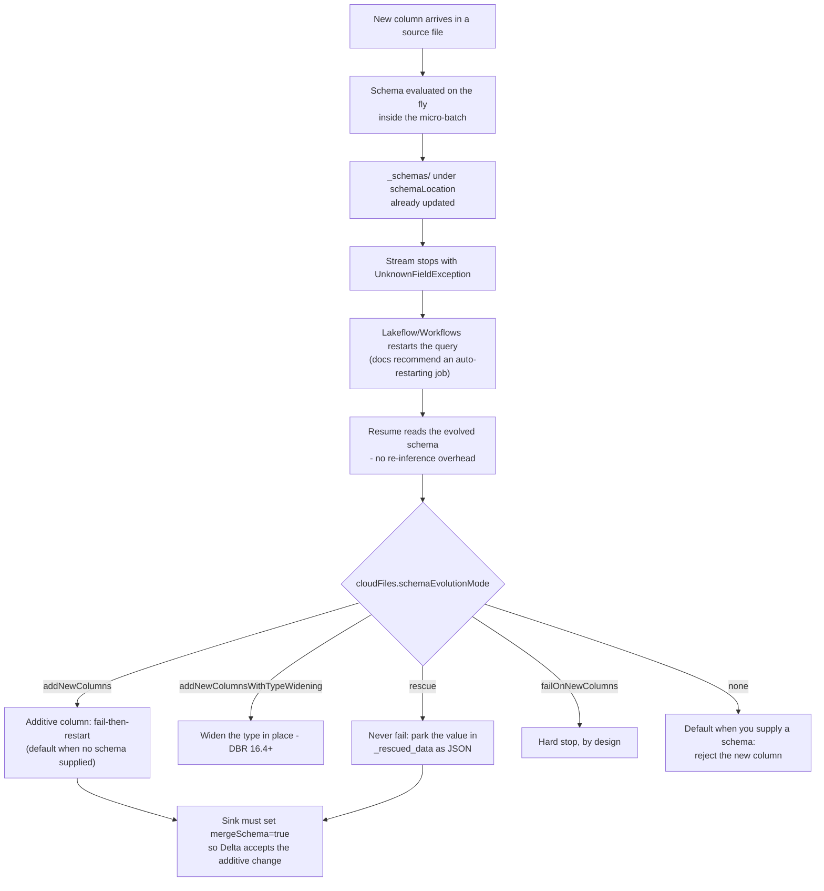
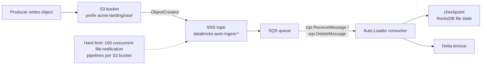
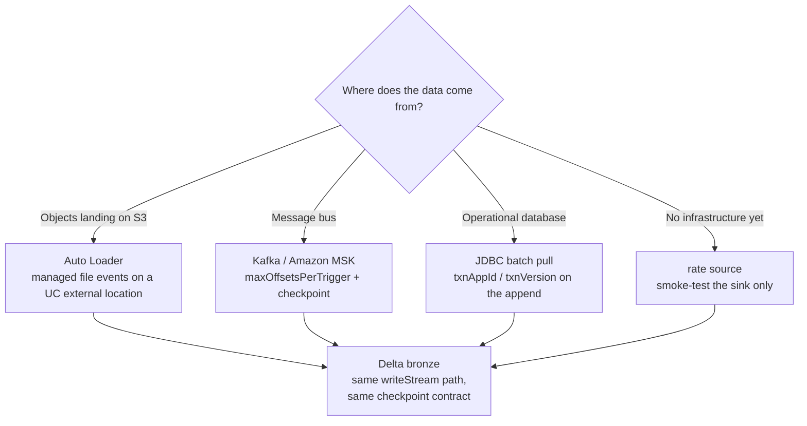
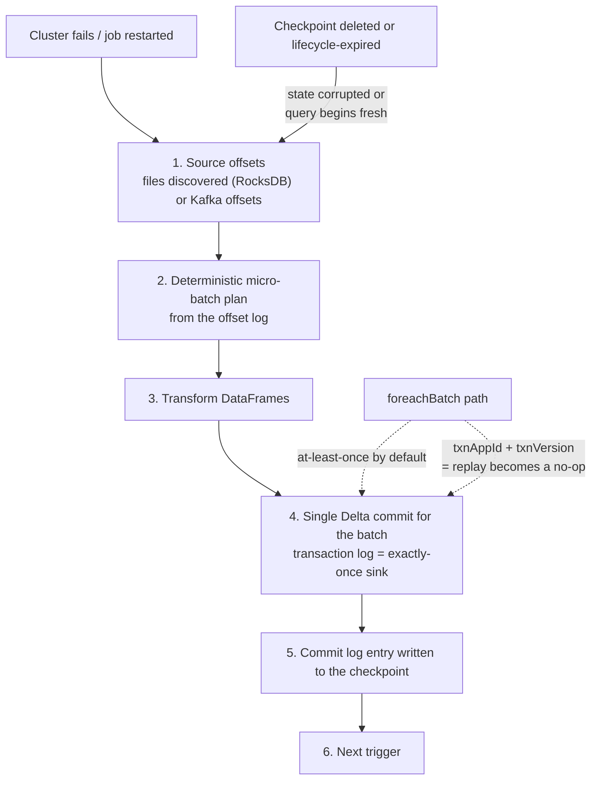

# Ingestion on AWS: Auto Loader, File Events, Kafka/MSK and Idempotent Sinks

Everything downstream in this course, the Delta transactions of lesson 04, the declarative pipelines of lesson 07, the quality gates of lesson 10, assumes a **bronze table that is already being filled correctly**. Ingestion is where lakehouse projects quietly fail: a checkpoint dropped "to fix lag", a schema directory parked inside the landing prefix so the stream discovers its own state files, a Kafka query left on the default `startingOffsets` so the first run skipped three hours of backlog, or a directory-listing stream on a one-second trigger whose `LIST` bill grows with every hour of uptime.

The mechanics are not complicated. Databricks' own recommendation is one sentence: "Databricks also recommends Auto Loader whenever you use Apache Spark Structured Streaming to ingest data from cloud object storage" (docs.../auto-loader, last updated **2026-09-11**). What is complicated is the *hygiene*: where state lives, what happens when a column appears, which discovery mode pays for itself, and how a retried micro-batch avoids writing rows twice. That is this lesson.

Every fact below comes from Databricks' AWS documentation (Auto Loader, directory-listing, file-notification, schema, production, clean-source, best-practices, FAQ, checkpoints, output-mode, triggers, foreach, Delta streaming, Kafka and JDBC pages), the Apache Spark and AWS documentation, and dated Databricks engineering blogs: all accessed or dated **October 2026**. Platform scope is **Databricks on AWS**: Azure Event Hubs does not exist on this substrate and is out of scope here.

```text
 =============================================================
  INGESTION ON DATABRIKS/AWS - SHAPE OF THE PIPELINE (Oct 2026)
 -------------------------------------------------------------
  Source families (all converge on Delta bronze)
    files on S3    -> Auto Loader (spark.readStream "cloudFiles")
    Kafka/MSK      -> spark.readStream.format("kafka")
    operational DB -> JDBC batch pull (no Databricks streaming
                      JDBC source; upserts go via foreachBatch)
    rate source    -> testing only (timestamp + value rows)
  Auto Loader file-detection modes
    directory listing   -> S3 LIST API every trigger (DEFAULT)
    file notifications  -> SNS topic + SQS queue per stream
    managed file events -> 1 queue per external location
                           (DBR 14.3 LTS+, recommended)
  State (two locations, both durable, both lifecycle-free)
    checkpointLocation        -> offsets + commits + state +
                                 RocksDB file-discovery state
    cloudFiles.schemaLocation -> _schemas/ schema history
                                 (docs allow it == checkpoint)
  Guarantees
    file discovery exactly once (RocksDB in the checkpoint)
    Delta appends exactly once  (transaction log)
    foreachBatch -> at-least-once; make it idempotent with
                    txnAppId / txnVersion
  Triggers
    default ~3-5s | processingTime | availableNow (DBR 10.4+)
    continuous -> NOT supported on Databricks (use realTime)
  Hard numbers (docs, Oct 2026)
    maxFilesPerTrigger 1000 (hard) - auto-tuned on DBR 18.0+
    maxBytesPerTrigger soft, files never split
    schema inference    first 50 GB or 1,000 files
    maxFileAge          min 14 days, recommend 90 days
    S3 LIST             $0.005 per 1,000 (same rate as PUT)
    classic notifications: 100 pipelines per S3 bucket
 =============================================================
```

In this lesson you will:

- write the **Auto Loader bronze notebook** itself, `cloudFiles.format`, `schemaLocation`, `checkpointLocation`, `useManagedFileEvents`, `inferColumnTypes`, `schemaEvolutionMode`, `mergeSchema` on the Delta sink, and narrate every default;
- place the **schema location and checkpoint** where they cannot be discovered, expired or shared, and defend the choice against the "put state next to the data" instinct;
- compute the **three `LIST` bills** for one landing prefix under three trigger policies, and choose between **directory listing, classic SNS+SQS file notifications and managed file events** with their permissions, caps and backfill behaviour;
- run a **throughput sketch** for a 1.8-million-file peak: arrival rate versus service rate, the hard file cap versus the soft byte cap, and what happens when someone "carefully" sets `maxFilesPerTrigger` too low;
- configure **Amazon MSK with `AWS_MSK_IAM`**, including the shaded class names and the port that must match the authentication mode, plus `maxOffsetsPerTrigger` sizing arithmetic;
- choose an **output mode against the Delta support matrix**, make `foreachBatch` **idempotent** with `txnAppId`/`txnVersion`, and defend the end-to-end exactly-once chain;
- unify **batch and streaming** on one code path with `Trigger.AvailableNow`, and price the nightly bronze job in **DBUs as of October 2026**;
- study **two named AWS customer cases** (Asurion and Burberry), read the **2026 update box**, and practise with **13 exam-style questions** plus four interactive checks.

---

## 1. Ingestion on the AWS lakehouse: three source families, one write path

Databricks-on-AWS ingestion has three families that matter in production, plus one toy:

| Family | Reader | What you pay for | Exactly-once posture | Auth on AWS |
|---|---|---|---|---|
| **Files on S3** (landing zone, DMS/Firehose exports, partner extracts) | `spark.readStream.format("cloudFiles")`: Auto Loader | Discovery (`LIST` or queue APIs) + compute | Discovery exactly once (RocksDB in checkpoint); Delta appends exactly once | IAM instance profile / Unity Catalog storage credential on the external location |
| **Message bus** (Amazon MSK / self-managed Kafka; Amazon Kinesis is also named by Databricks as a low-latency source) | `spark.readStream.format("kafka")` | Offsets per micro-batch (`maxOffsetsPerTrigger`) + compute | Kafka is at-least-once on the broker side; the Delta sink closes the loop | `SSL` / `SASL_SSL` + `AWS_MSK_IAM`, or a Unity Catalog service credential |
| **Operational database** | `spark.read.format("jdbc")` batch pulls (governed by a Unity Catalog JDBC connection) | Full scans per pull + compute | Append with `txnAppId`/`txnVersion` so reruns are no-ops | `dbutils.secrets` or a UC JDBC connection: never credentials in the URL |
| **Rate source** (testing only) | `spark.readStream.format("rate")` | Nothing real | N/A | None |

Three things in that table are load-bearing. First, **all four converge on the same write path**: `writeStream` → `checkpointLocation` → output mode → Delta. The transformation code is identical for `spark.read` and `spark.readStream` because both return DataFrames, that is the batch/streaming unification story in section 9. Second, **JDBC has no Databricks-documented streaming source**: current docs describe batch reads, governed UC connections, and `foreachBatch` for writes; row-level DML into the source database is explicitly unsupported ("The Spark JDBC data source does not support arbitrary DML statements", docs.../connect/jdbc-connection, accessed 2026-10). Third, **the checkpoint is the query**, delete it and you get a fresh start: for Kafka that means `startingOffsets` applies again, for Auto Loader the discovered-file state is gone.

```mermaid
graph LR
  subgraph Src["Source families on AWS"]
    F["S3 landing zone<br/>s3://acme-landing/raw/orders/"]
    K["Amazon MSK topic<br/>orders (6 partitions)"]
    J["PostgreSQL<br/>JDBC batch pull"]
    R["rate source<br/>(smoke tests)"]
  end
  subgraph Read["Readers"]
    AL["Auto Loader<br/>cloudFiles"]
    KS["Kafka source"]
    JB["JDBC read"]
    RS["rate source"]
  end
  CK["checkpointLocation<br/>offsets + commits + state<br/>+ RocksDB file state"]
  SP["Shared DataFrame transforms<br/>same code, batch or stream"]
  BR["Delta bronze<br/>lake.raw_orders"]
  F --> AL
  K --> KS
  J --> JB
  R --> RS
  AL --> CK
  KS --> CK
  AL --> SP
  KS --> SP
  JB --> SP
  RS --> SP
  SP --> BR
```



- **📚 Did you know?** Auto Loader is not new. Databricks announced it on **2020-02-24** as "an optimized cloud file source for Apache Spark that loads data continuously and efficiently from cloud storage as new data arrives", naming Fivetran, Qlik, Infoworks, StreamSets and Syncsort as partner ingest tools at launch (databricks.com/blog/2020/02/24/introducing-databricks-ingest-easy-data-ingestion-into-delta-lake.html, 2020-02-24). The problem it solved has never changed: "Both cost and latency can add up quickly as more and more files get added to a directory due to repeated listing of files." The scale figures you will see quoted, "billions of files" for backfills and "millions of files per hour" for near-real-time ingest, are **vendor capability claims** from the docs page (2026-09-11), not customer benchmarks: treat them as design headroom, never as a SLA.

---

## 2. Auto Loader anatomy: the `cloudFiles` source

### 2.1 The options that matter (Oct 2026)

`spark.readStream.format("cloudFiles")` is an ordinary Structured Streaming source. What makes it Auto Loader is the discovery engine: as files are found, their metadata is persisted "in a scalable key-value store (RocksDB) in the *checkpoint location*", which "ensures that data is processed **exactly once**" (docs .../auto-loader, 2026-09-11).

| Option | Default | What it actually does |
|---|---|---|
| `cloudFiles.format` | required | Parser: `json`, `csv`, `xml`, `parquet`, `avro`, `text`, `binaryFile` (`ORC` is unsupported for inference/evolution) |
| `cloudFiles.schemaLocation` | unset | Enables inference/evolution; holds the `_schemas/` history. May equal the checkpoint: the docs say so explicitly |
| `cloudFiles.useManagedFileEvents` | `false` | Use the managed file-events queue on a Unity Catalog external location (DBR 14.3 LTS+) |
| `cloudFiles.inferColumnTypes` | `false` | Typed inference for JSON/CSV/XML; otherwise everything lands as `string` |
| `cloudFiles.schemaEvolutionMode` | `addNewColumns` with no schema, `none` with a supplied schema | `addNewColumns` · `addNewColumnsWithTypeWidening` · `rescue` · `failOnNewColumns` · `none` |
| `cloudFiles.maxFilesPerTrigger` | `1000` (hard) | Cap on files per micro-batch. **DBR 18.0+ configures this dynamically: do not pin it manually** |
| `cloudFiles.maxBytesPerTrigger` | unset (soft) | Byte cap as a string (`"10g"`); a file is never split across micro-batches |
| `cloudFiles.includeExistingFiles` | `true` | Evaluated **only on the first start** of a stream; changing it later has no effect |
| `cloudFiles.maxFileAge` | `7d` in the file-source table; Auto Loader event-tracking TTL **min 14 days, recommend 90 days** | Too low means duplicate ingestion or missing files |
| `checkpointLocation` | required | Offsets, commits, state, metadata: plus Auto Loader's RocksDB file state |

Two defaults surprise everyone. `includeExistingFiles=true` means the first start of a fresh checkpoint walks the whole prefix (that is your backfill). And `maxFilesPerTrigger=1000` is a **hard** limit while the byte limit is soft: "An individual file is never split across micro-batches" (docs.../spark/api-options, page date **2026-10-05**).

### 2.2 Worked example E1: a production-shaped bronze Auto Loader notebook

```python
BRONZE   = "lake.raw_orders"                    # Unity Catalog managed Delta table
SRC      = "s3://acme-landing/raw/orders/"      # external location, file events enabled
CKPT     = "/Volumes/lake/ops/checkpoints/orders_bronze"
SCHEMA_P = "/Volumes/lake/ops/schemas/orders_bronze"   # docs allow SCHEMA_P == CKPT

df = (spark.readStream.format("cloudFiles")
      .option("cloudFiles.format", "json")
      .option("cloudFiles.schemaLocation", SCHEMA_P)
      .option("cloudFiles.useManagedFileEvents", "true")   # DBR 14.3+; needs file events on the EL
      .option("cloudFiles.inferColumnTypes", "true")       # typed JSON instead of all-string
      .option("cloudFiles.schemaEvolutionMode", "addNewColumns")
      # .option("cloudFiles.maxFilesPerTrigger", 1000)     # omit on DBR 18.0+ (auto-tuned)
      .load(SRC))

query = (df.writeStream
      .option("checkpointLocation", CKPT)
      .option("mergeSchema", "true")            # additive change must reach the Delta table
      .trigger(availableNow=True)               # scheduled incremental batch, rate-limited
      .toTable(BRONZE))
```

What the numbers mean while it runs: the first start samples **the first 50 GB or 1,000 files** (whichever is crossed first, most recent by modification time) to infer the schema; every subsequent micro-batch is capped at **1,000 files** unless the runtime auto-tunes it (DBR 18.0+); `Trigger.AvailableNow` processes only files that arrived **before the query start time** and turns itself off; and if a new column appears, the query stops with `UnknownFieldException` *after* `_schemas` has already been updated, so the job, not a human, restarts it (section 3).

> [!IMPORTANT]
> **One query, one checkpoint, forever.** "Give each query its own checkpoint directory in durable cloud storage" (docs.../structured-streaming/production, accessed 2026-10). Two Auto Loader streams pointed at one checkpoint corrupt each other's file state; switching a query to a brand-new checkpoint makes it begin fresh: with `includeExistingFiles=true` it will reprocess the entire prefix. And "When you delete the files in a checkpoint directory or change to a new checkpoint location, the next run of the query begins fresh" (docs.../structured-streaming/checkpoints, dated 2026-06-30). Never delete a checkpoint to "fix" lag; fix the trigger and the rate limits instead.

---

## 3. Schema inference, evolution and rescue

### 3.1 What inference actually samples

On the first definition of the DataFrame, Auto Loader "lists your source directory and chooses the **most recent (by file modification time) 50 GB of data or 1000 files**, and uses those to infer your data schema" (Auto Loader FAQ, dated **2026-06-23**). The result is written to a `_schemas` directory under `cloudFiles.schemaLocation`, and it is the schema history the stream reloads on every restart: "When the stream restarts, it picks up the evolved schema from the schema location and starts executing **without any overhead from inference**" (same FAQ).

Defaults that bite:

- JSON, CSV and XML infer **all columns as strings** unless you set `cloudFiles.inferColumnTypes=true`. Typed formats (Parquet, Avro) merge encoded types instead.
- If the source directory is empty, **you must supply a schema**; there is nothing to sample.
- `cloudFiles.schemaHints` lets you pin known types (`"order_id=STRING, amount=DECIMAL(12,2)"`) without hand-writing the whole schema.
- Partition columns are inferred from Hive-style paths, but **new partition columns are not evolved**: declare them with `cloudFiles.partitionColumns`.
- Overrides exist: `spark.databricks.cloudFiles.schemaInference.sampleSize.numBytes` (e.g. `10gb`) and `...sampleSize.numFiles`.

### 3.2 Evolution modes and the restart loop

The sequence on a schema change is fixed, and worth memorising, because it is an *alert-and-replay* design rather than a silent fix:



Two supporting facts. The **write side must agree**: `.option("mergeSchema", "true")` on the Delta sink, or the table refuses the additive change. And a **rename is treated as an add**: the new name becomes a column while the old one is populated with `NULL` for new rows (docs.../data-engineering/schema-evolution, accessed 2026-10). A streaming query's schema is "locked in during the planning phase", so any mid-flight source change fails the query and requires a restart; that is why the docs recommend running Auto Loader streams as **Lakeflow/Workflows jobs** rather than as forever-running all-purpose notebooks.

### 3.3 Worked example E2: a never-fail events stream with pinned types

```python
SRC      = "s3://acme-landing/raw/events/"
CKPT     = "/Volumes/lake/ops/checkpoints/raw_events"
SCHEMA_P = "/Volumes/lake/ops/schemas/raw_events"

df = (spark.readStream.format("cloudFiles")
      .option("cloudFiles.format", "json")
      .option("cloudFiles.schemaLocation", SCHEMA_P)
      .option("cloudFiles.inferColumnTypes", "true")
      .option("cloudFiles.schemaHints", "user_agent=STRING, device_id=STRING")
      .option("cloudFiles.schemaEvolutionMode", "rescue")   # new columns never stop the lane
      .load(SRC))

(df.writeStream
   .option("checkpointLocation", CKPT)
   .option("mergeSchema", "true")
   .trigger(availableNow=True)
   .toTable("lake.raw_events"))

# morning audit: what did we not understand yesterday?
#   SELECT * FROM lake.raw_events WHERE _rescued_data IS NOT NULL
```

`_rescued_data` holds whatever the schema could not take, "column is missing from the schema / type mismatches / case mismatches", as a JSON blob alongside the source file path, which is how you keep a zero-loss lane *and* a measurable quality signal at the same time. Use `rescue` for lanes that must never stop (clickstream, IoT); use `addNewColumns` plus an auto-restarting job for lanes where a new column is an event you want to *notice*.

### 3.4 ⚠️ WARNING: never put schema or checkpoint state in the data path

> ⚠️ **WARNING: `cloudFiles.schemaLocation` and `checkpointLocation` must never live inside the source landing directory, and neither may sit under a cloud object lifecycle policy.**
> 1. **Inside the data path means self-discovery.** If `_schemas/` or the checkpoint sits under `s3://acme-landing/raw/orders/`, Auto Loader will eventually list its own state files as inputs. Keep state on a **different prefix or a Unity Catalog volume** (`/Volumes/<catalog>/<schema>/checkpoints/...`), never under the table's data directory.
> 2. **A lifecycle rule that expires state destroys the query.** "Databricks recommends setting the checkpoint location to a location **without a cloud object lifecycle policy**. If files in the checkpoint location are cleaned according to the policy, **the stream state is corrupted**. If this happens, you must restart the stream from scratch" (docs .../auto-loader/production, footer **2026-09-18**). The same sentence applies to `schemaLocation`.
> 3. **Separate per workload.** Each Auto Loader ingestion workload requires a separate streaming checkpoint. Two workloads sharing one checkpoint, or one `_schemas` directory, will fight over state.
> 4. **State beside a Delta table must be underscore-prefixed.** If you must co-locate a checkpoint with a table, use `/_checkpoints`: `VACUUM` "skips any directories that begin with `_`" (docs .../structured-streaming/delta-lake, dated 2026-08-24), so maintenance will not eat it.
> 5. **Equality is fine, containment is not.** The docs explicitly allow `schemaLocation == checkpointLocation`; what they never allow is state inside the input path or under expiry.

---

## 4. File detection: directory listing vs file notifications

Auto Loader "supports two file detection modes. By default, Auto Loader uses **directory listing** mode. However, Databricks recommends **file notification mode using file events** for most workloads" (docs .../auto-loader, 2026-09-11). Choosing between them is the cost-and-infrastructure decision of this lesson.

### 4.1 Directory listing (default)

Every trigger lists the input tree. Two properties make it viable at all: Auto Loader "uses native cloud APIs to get lists of files", and on S3 each `LIST` returns up to **1,000 keys**, so the number of API calls scales as *files ÷ 1,000* rather than *directories × triggers*. That is the difference against the OSS Spark file source, whose cost the docs model as "1 (base directory) + 365 (per day) × 24 (per hour) = **8761 calls**" for a `YYYY/MM/DD/HH` layout (docs .../auto-loader/directory-listing-mode, 2026-09-11).

The documented warning is about *frequency*: with continuous triggers such as `Trigger.ProcessingTime`, directory listing mode "continuously lists the entire directory and can significantly increase `LIST` API costs". Three hygiene rules:

- keep **lexical file naming** (`YYYY/MM/DD/HH`, zero-padded: AWS DMS CDC files like `LOAD00000001.csv` and Kinesis Firehose object names are the docs' own examples), even though **Auto Loader does not guarantee the order in which files are discovered or processed**;
- prefer `Trigger.AvailableNow` over a continuous trigger in this mode;
- **incremental listing is deprecated**: in `auto` mode a full directory list runs after **7 consecutive incremental lists** (tunable with `cloudFiles.backfillInterval`), and DBR 11.3 LTS+ lets you change the input path *without* a new checkpoint: a capability **not supported** for file notifications.

### 4.2 Classic file notifications: SNS + SQS



In this mode Auto Loader wires the S3 **bucket notification** (`ObjectCreated`) through an **AWS SNS topic** to an **AWS SQS queue** (resource prefix `databricks-auto-ingest`), then consumes the queue. The setup policy needs the documented action set, `s3:GetBucketNotification`, `s3:PutBucketNotification`, `sns:CreateTopic`, `sns:Subscribe`, `sns:Publish`, `sqs:CreateQueue`, `sqs:ReceiveMessage`, `sqs:DeleteMessage`, `sqs:SendMessage`, `sqs:SetQueueAttributes`, `sqs:ChangeMessageVisibility`, `sqs:PurgeQueue` on `databricks-auto-ingest-*`, and after setup the running stream needs only the reduced consumption policy (docs.../auto-loader/file-notification-mode, footer **2026-10-07**). The same page caps the pattern at **100 per S3 bucket**.

Two caveats travel with it. Event delivery is best-effort, "Cloud providers do not guarantee 100% delivery of all file events", so completeness SLAs in classic mode are bought with `cloudFiles.backfillInterval` asynchronous relists that ingest **only missed files** (no duplicates, because the checkpoint already knows what it saw). And you cannot move the input path without a new checkpoint in this mode.

### 4.3 Managed file events (recommended)

The modern form is enabled **on the external location**, not per stream: a single file notification queue for all streams that process files from a given external location, activated with `cloudFiles.useManagedFileEvents=true`. Requirements: a Unity Catalog-enabled workspace, permission to create a storage credential and external location, and **Databricks Runtime 14.3 LTS or above** (same page, 2026-10-07).

What you get: fewer IAM grants (one-time cloud permission, then no per-stream queue), automatic tuning and cleanup, automatic backfill, "Databricks automatically backfills those external locations with a full listing when file events are first enabled, and then continues to backfill about **every 24 hours**", and the explicit instruction **not** to set a backfill interval in this mode. What you must respect: "The file events service optimizes file discovery by **caching** the most recently created files. If Auto Loader runs infrequently, this cache can expire … invoke Auto Loader at least **once every seven days**." A nightly or hourly `AvailableNow` job clears that bar with room to spare; a quarterly manual run does not.

Mode switching is safe: "you can switch between file notifications and directory listing at any time and still maintain **exactly-once** data processing guarantees" (same page).

### 4.4 Worked example E3: the `LIST` bill, computed three ways

Inputs (all official): S3 returns **1,000 keys per `LIST`**; "LIST requests for any storage class are charged at the same rate as S3 Standard PUT, COPY, and POST requests": **$0.005 per 1,000** in `us-east-1`, while DELETE and CANCEL are free (aws.amazon.com/s3/pricing, accessed **2026-10**). Landing prefix: **2,000,000 files**. The arithmetic below is ours; the inputs are AWS's.

| Policy | Listing cycles/day | `LIST` calls/cycle | `LIST` calls/month (30 d) | Charge/month |
|---|---|---|---|---|
| OSS file-source layout `YYYY/MM/DD/HH` (the docs' own 8,761 example) | 1 | 8,761 | 262,830 | **$1.31** |
| Auto Loader + `Trigger.AvailableNow` every 15 min | 96 | 2,000 | 5,760,000 | **$28.80** |
| Auto Loader + `processingTime="10 seconds"` | 8,640 | 2,000 | 518,400,000 | **$2,592** |
| Auto Loader + 1-second continuous trigger | 86,400 | 2,000 | 5,184,000,000 | **$25,920** |
| **Managed file events** (automatic full listing ≈ every 24 h) | 1 | 2,000 | 60,000 | **$0.30** |

Read the shape, not just the dollars: the same 2M-file prefix costs **900× more** at a one-second trigger than at a 15-minute `AvailableNow`, because listing *frequency*, not data volume, is the multiplier. Managed file events replace per-trigger listing with queue API calls, leaving only the automatic ~24-hour backfill listing. We deliberately do not price the SQS/SNS side here: this lesson's sources carry no verified AWS queue-price figure, so check aws.amazon.com/pricing yourself before you model it.

```plot
{
  "type": "bar",
  "title": "Monthly S3 LIST charges for a 2,000,000-file landing prefix (us-east-1, $0.005 per 1,000 requests, as of Oct 2026)",
  "xLabel": "Discovery policy",
  "yLabel": "US$ per month in LIST requests",
  "xKey": "policy",
  "dataKeys": ["usd_per_month"],
  "data": [
    {"policy": "Managed file events (~24 h backfill listing)", "usd_per_month": 0.3},
    {"policy": "Directory listing, AvailableNow every 15 min", "usd_per_month": 28.8},
    {"policy": "Directory listing, processingTime 10 s", "usd_per_month": 2592},
    {"policy": "Directory listing, 1 s continuous", "usd_per_month": 25920}
  ]
}
```

- **📚 Did you know?** `LIST` is billed like a write, not like a read: "LIST requests for any storage class are charged at the same rate as S3 Standard PUT, COPY, and POST requests": **$0.005 per 1,000**; while `DELETE` and `CANCEL` are free (aws.amazon.com/s3/pricing, accessed 2026-10). And there is no general-purpose rename on S3: "S3 Express One Zone is the only storage class that supports the `RenameObject` API", so a MOVE-style archive is a **copy + delete** pair billed at PUT/COPY/LIST rates, and in classic notification terms that copy surfaces as yet another `ObjectCreated` event. That is a second reason managed file events, which do not re-fire on your own bookkeeping copies, are the recommended mode.

---

## 5. Throughput and production hygiene

### 5.1 Worked example E4: a throughput sketch for a 1.8-million-file peak

Scenario: a partner drops **1,800,000 JSON files of 120 KB** into the landing prefix during a two-hour nightly window (**216 GB**), then keeps a trickle arriving afterwards. Arrival rate = 1,800,000 ÷ 7,200 s = **250 files/s**.

Sizing the micro-batches:

- Default `maxFilesPerTrigger=1000` → each micro-batch carries **1,000 files = 120 MB**.
- Set `maxBytesPerTrigger="500mb"` instead and that *soft* byte cap would allow 500 MB ÷ 120 KB ≈ **4,166 files**, but the **file limit is a hard limit**, so the effective batch stays at 1,000 files. Whichever limit is reached first wins.
- Assume the cluster sustains **1.0 s per micro-batch** → service rate **1,000 files/s (120 MB/s)**. Utilisation ρ = 250 ÷ 1,000 = **0.625**: the queue drains.
- Backlog of 1.8M files drains at 1,000 − 250 = 750 files/s net → **2,400 s = 40 minutes**, having processed 2.4M files in total (≈288 GB).

Now the failure mode a "careful" engineer creates: setting `maxFilesPerTrigger=100` "to be gentle on the cluster" caps service at **100 files/s < 250 files/s arrival**, the queue grows by 150 files/s without bound, and no amount of cluster size fixes a bad admission-control knob. On **DBR 18.0+** both `cloudFiles.maxFilesPerTrigger` and `cloudFiles.maxBytesPerTrigger` are "dynamically configured and do not need to be set manually" (docs.../spark/api-options, 2026-10-05); pinning them there fights the automatic tuning. And if the peak is genuinely huge and one-shot, run `Trigger.AvailableNow` as a Workflows task instead of a continuous trigger, it rate-limits across micro-batches and turns itself off when caught up.

### 5.2 Retention: `maxFileAge`, `cleanSource`, backfill

| Knob | Rule (source, date) |
|---|---|
| `cloudFiles.maxFileAge` | Minimum **14 days**; Databricks recommends "a conservative setting … such as **90 days**"; tuning too aggressively causes "duplicate ingestion or missing files" (production page, **2026-09-18**). This is a *different* clock from the file source's 7-day discovery filter |
| `cloudFiles.cleanSource` | **DBR 16.4+**; `OFF` (default) / `MOVE` / `DELETE`; `retentionDuration` default **30 days**; `DELETE` must be **> 7 days**; `waitForCompletion` is **DBR 19+** (clean-source page, **2026-08-21**) |
| `MOVE` destination | Must **not** be a child of the source directory (or files are ingested again), must stay in the **same external location**; cross-bucket moves are not supported (same page) |
| Who may enable it | "Do not enable `cloudFiles.cleanSource` if multiple Auto Loader streams or other clients read from the same source directory" (best-practices, **2026-06-29**) |
| Backfill (classic modes) | `cloudFiles.backfillInterval` runs asynchronous full relists that ingest **only missed files**; with managed file events it is automatic (on enablement and about every 24 h): do not set it there (production page, 2026-09-18; file-notification page, 2026-10-07) |

The economics of `cleanSource` are the same argument as section 4: "Archive processed files with `cloudFiles.cleanSource` … This reduces both storage costs and directory listing costs for long-lived streams"; you stop paying to re-list files you will never read again.

### 5.3 Monitoring the source

Three metrics tell you whether ingestion is healthy *before* downstream freshness alerts fire: `numFilesOutstanding`, `numBytesOutstanding`, and (file notifications) `approximateQueueSize`: plus the state table:

```sql
-- DBR 11.3 LTS+: what does this checkpoint believe?
SELECT * FROM cloud_files_state('/Volumes/lake/ops/checkpoints/orders_bronze');
```

A growing `numFilesOutstanding` at a stable processing rate means you are under-sized (fix the rate limits, not the checkpoint); a stuck `approximateQueueSize` in classic notification mode means the consumer cannot drain the queue: permissions, or the 100-per-bucket cap.

---

## 6. Kafka and Amazon MSK as a source

### 6.1 The options that matter

Minimal read: `spark.readStream.format("kafka").option("kafka.bootstrap.servers", "<server:9094>").option("subscribe", "orders").option("startingOffsets", "latest").load()`, and then the four options that decide whether your first day goes well:

| Option | Default | Behaviour |
|---|---|---|
| `startingOffsets` | **`latest`** (streaming), `earliest` (batch) | Applies **only when a new query starts**; "Resumed queries always use the checkpoint." A newly added partition starts at `earliest` |
| `maxOffsetsPerTrigger` | none | Max records per micro-batch, "distributed proportionally across topic partitions": your catch-up rate limiter |
| `minOffsetsPerTrigger` + `maxTriggerDelay` | none / **`15m`** | Batch up small traffic; when `maxTriggerDelay` is reached, the micro-batch runs regardless |
| `failOnDataLoss` | **`true`** | Fails the query on deleted topics or truncated offsets instead of silently skipping data |

The row schema is a fixed seven columns: `key` binary, `value` binary, `topic` string, `partition` int, `offset` long, `timestamp` timestamp, `timestampType` int. Authentication on AWS is `SSL` or `SASL_SSL` with `PLAIN`/`SCRAM`/`AWS_MSK_IAM`, or, in the governed path, a **Unity Catalog service credential / connection**, in which case you must *not* set `kafka.security.protocol` or `sasl.*` yourself. If you do drive the client directly: **always prefix client properties with `kafka.`** and always use Databricks' **shaded class names** (`kafkashaded.`, `shadedmskiam.`), or you will meet `SaslException` / `RESTRICTED_STREAMING_OPTION_PERMISSION_ENFORCED`.

### 6.2 Worked example E5: MSK IAM read with rate limiting

```python
kafka_opts = {
  "kafka.bootstrap.servers": "b-1.mskcluster.acme.amazonaws.com:9098",  # 9098 = IAM port
  "subscribe": "orders",
  "startingOffsets": "earliest",        # FIRST run only; the checkpoint wins from then on
  "maxOffsetsPerTrigger": 600000,       # records per micro-batch, split across 6 partitions
  "failOnDataLoss": "true",
  # Omit the next four lines when a Unity Catalog service credential governs the connection:
  "kafka.security.protocol": "SASL_SSL",
  "kafka.sasl.mechanism": "AWS_MSK_IAM",
  "kafka.sasl.jaas.config": "shadedmskiam.software.amazon.msk.auth.iam.IAMLoginModule required awsRoleArn='arn:aws:iam::123456789012:role/msk_client';",
  "kafka.sasl.client.callback.handler.class": "shadedmskiam.software.amazon.msk.auth.iam.IAMClientCallbackHandler",
}

raw = (spark.readStream.format("kafka").options(**kafka_opts).load()
        .selectExpr("cast(value as string) as json", "timestamp as ingest_ts"))
```

Sizing arithmetic (ours, on official semantics): peak arrival is **12,000 msg/s** across 6 partitions at **400 bytes** average. With `processingTime="30 seconds"` and `maxOffsetsPerTrigger=300000`, capacity is 300,000 ÷ 30 = **10,000 msg/s < 12,000 msg/s**, the backlog grows by 2,000 msg/s. Raise it to **600,000** → 20,000 msg/s capacity, micro-batch payload 600,000 × 400 B = **240 MB**, ρ = 0.6, stable. Two supporting facts for the ops runbook: the IAM role needs `kafka-cluster:Connect` and `kafka-cluster:ReadData`, and the port must match the mode (**9092** PLAINTEXT, **9094** SASL/SSL, **9098** IAM), plus VPC peering or PrivateLink between the Databricks VPC and the MSK VPC (docs.../kafka/authentication, 2026-07-10).

### 6.3 JDBC and the rate source

JDBC is a **batch** pull on this platform: credentials via `dbutils.secrets.get(scope="jdbc", key="username")` (never in the URL), or the governed `.option("databricks.connection", "prod_pg")` path with the driver JAR on a Volume: driver memory is capped at **400 MiB**, and the default `externalOptionsAllowList` permits only six read options. Because row-level writes into the source are unsupported, the upsert pattern is always *pull → Delta* with idempotent appends:

```python
(df.write.format("delta").mode("append")
   .option("txnAppId", f"jdbc-pull-{run_date}").option("txnVersion", 0)
   .saveAsTable("lake.raw_orders_jdbc"))   # rerun of the same run_date is a no-op
```

The **rate source** (`spark.readStream.format("rate")`, `rowsPerSecond` default 1, plus `rampUpTime` and `numPartitions`) emits synthetic `timestamp` + `value` rows and is "intended for testing and benchmarking": perfect for verifying checkpoint, output mode and Delta sink wiring in two minutes before any S3 or MSK permissions are involved.



```matching
{
  "question": "Match each ingestion source to its primary property as of October 2026:",
  "pairs": [
    {"left": "Files landing in s3://acme-landing/raw/", "right": "Auto Loader (cloudFiles): discovery cost scales with files ingested, not directories; RocksDB state in the checkpoint gives exactly-once discovery"},
    {"left": "Amazon MSK topic with 6 partitions", "right": "Kafka source: maxOffsetsPerTrigger bounds records per micro-batch, startingOffsets applies only to a fresh query, checkpoint wins on resume"},
    {"left": "Operational PostgreSQL table", "right": "JDBC batch pull governed by a Unity Catalog JDBC connection; no Databricks streaming JDBC source, and no row-level DML into the source"},
    {"left": "spark.readStream.format('rate')", "right": "Testing only: rowsPerSecond synthetic rows carrying timestamp and value: never a production source"},
    {"left": "Delta table upstream (preferred CDC path)", "right": "Streaming reads of a Delta source require append-only inputs; Databricks recommends streaming from the CDC feed rather than directly from the table"}
  ],
  "explanation": "Each source has one governing cost driver and one governing failure mode: files -> discovery frequency and schema hygiene; Kafka -> offset admission control and startingOffsets on first start; JDBC -> full-scan cost and credential handling; rate -> nothing, it is a probe; Delta CDC -> the documented recommendation for change-driven pipelines (docs .../structured-streaming/delta-lake, 2026-08-24). The trap is assuming any of these shares another's exactly-once story: only the Delta sink closes the loop, and foreachBatch does not."
}
```

---

## 7. Sinks: output modes, idempotency and MERGE

### 7.1 Output modes and the Delta matrix

| Output mode | Semantics | Delta sink? |
|---|---|---|
| **append** (default) | Only rows that will not change in future triggers; stateful operators wait out the watermark | Supported |
| **update** | All rows that changed during this trigger | **Not supported by Delta**: use MERGE in `foreachBatch` |
| **complete** | Every row the operator has ever produced; "can perform poorly as data scales" | Supported (use materialized views for aggregation-heavy cases) |

"**Delta Lake**, which backs all Unity Catalog managed tables, **supports append and complete modes but not update mode**" (docs .../structured-streaming/output-mode, 2026-09-11). Also note "Joins only support the append output mode". Plain Delta appends are exactly-once through the transaction log: "The Delta Lake transaction log guarantees exactly-once processing, even when there are other streams or batch queries running concurrently against the table" (docs .../structured-streaming/delta-lake, 2026-08-24).

### 7.2 Worked example E6: idempotent upserts in `foreachBatch`

"You must use `foreachBatch` for Delta Lake merge operations in Structured Streaming", and `foreachBatch()` "provides only **at-least-once** write guarantees", so idempotency is your job (docs.../structured-streaming/foreach, dated **2026-08-24**).

```python
from delta.tables import DeltaTable

def upsert(batch_df, batch_id):
    if batch_df.isEmpty():
        return
    (DeltaTable.forName(spark, "lake.silver_orders")
       .merge(batch_df.alias("s"), "s.order_id = t.order_id")     # pruned ON clause
       .whenMatchedUpdateAll(condition="s.ingest_ts > t.ingest_ts")
       .whenNotMatchedInsertAll()
       .execute())                                                # must itself be idempotent

(silver.writeStream.format("delta")
   .option("checkpointLocation", "/Volumes/lake/ops/checkpoints/silver_orders")
   .outputMode("update")            # accepted by foreachBatch; the Delta table itself gets append/complete
   .foreachBatch(upsert)
   .trigger(processingTime="1 minute")
   .start())
```

For plain appends written from `foreachBatch`, bind the batch identity explicitly: `.option("txnAppId", app_id).option("txnVersion", batch_id)`, Delta "uses `txnAppId` and `txnVersion` to identify and **ignore duplicate writes**". Three rules from the same pages: **if you delete the checkpoint and restart, you must provide a different `txnAppId`**, because "New checkpoints start with a **batch ID of 0**"; **do not catch and retry exceptions locally**, let errors propagate so the orchestrator retries the whole batch and metrics stay honest; and prefer **one streaming write per sink**, since multiple sinks inside `foreachBatch` serialize your parallelism.

```dragdrop
{
  "question": "Order the incident response for a schema change on the bronze Auto Loader lane (as of Oct 2026):",
  "items": [
    "New column appears in a source file; the micro-batch evaluates it on the fly",
    "_schemas under cloudFiles.schemaLocation is updated, then the stream stops with UnknownFieldException",
    "The Lakeflow/Workflows job restarts the query (docs recommend an auto-restarting job, not a human)",
    "The resumed stream loads the evolved schema from schemaLocation with no re-inference overhead",
    "The Delta sink applies mergeSchema=true so the additive column reaches the bronze table",
    "Audit: DESCRIBE HISTORY on the table, then check _rescued_data if the lane runs schemaEvolutionMode=rescue"
  ],
  "correctOrder": [
    "New column appears in a source file; the micro-batch evaluates it on the fly",
    "_schemas under cloudFiles.schemaLocation is updated, then the stream stops with UnknownFieldException",
    "The Lakeflow/Workflows job restarts the query (docs recommend an auto-restarting job, not a human)",
    "The resumed stream loads the evolved schema from schemaLocation with no re-inference overhead",
    "The Delta sink applies mergeSchema=true so the additive column reaches the bronze table",
    "Audit: DESCRIBE HISTORY on the table, then check _rescued_data if the lane runs schemaEvolutionMode=rescue"
  ],
  "explanation": "The documented order is: evaluate on the fly, update _schemas, fail with UnknownFieldException, job restarts, resume from the evolved schema, sink mergeSchema. The two classic mistakes are reversing steps 2 and 3 (people assume the stream fails before the schema location is written; the docs say it stops after the schema location has been updated) and forgetting mergeSchema on the write side, which turns an evolved source into a failed Delta commit."
}
```

---

## 8. Exactly-once end to end

The guarantee is a chain, and every link is a component you have already met:



Checkpoint contents are fixed: **offsets** (what was read), **commits** (which micro-batches reached the sink: "enabling exactly-once semantics"), **state**, and **metadata** (the unique query ID plus configuration settings). Consequences you should be able to recite:

- one checkpoint per query, on durable storage, outside any lifecycle policy;
- deleting or moving it starts fresh: Kafka replays per `startingOffsets`, Auto Loader re-lists (and reprocesses the prefix if `includeExistingFiles` was true on the original first start), and Delta writes replay unless `txnAppId` changes;
- for non-Delta targets (an OLTP database, a queue, an HTTP API) *you* own idempotency keyed on `batchId`: "If the `batchId` stays the same, the result of your operation must remain the same";
- `foreachBatch` never runs in continuous processing mode, and on serverless only `Trigger.AvailableNow()` and the deprecated `Trigger.Once()` are supported.

- **📚 Did you know?** A checkpoint stored *beside* a Delta table survives maintenance only if you name it with an underscore: `VACUUM` "skips any directories that begin with `_`", which is why the docs' own suggestion is "a directory structure such as `/_checkpoints`" (docs .../structured-streaming/delta-lake, 2026-08-24). It is a small naming convention standing between your stream state and a routine maintenance command.

---

## 9. Batch + streaming unification

One code path, two triggers. The same bronze reader runs as a nightly incremental job or as a low-latency stream; only trigger, checkpoint and cluster differ.

| Shape | Trigger | Use when |
|---|---|---|
| Scheduled incremental batch | `.trigger(availableNow=True)` in a Workflows task (DBR 10.4 LTS+) | Nightly/hourly bronze; wants rate limiting plus self-termination; the only supported trigger story on serverless alongside the deprecated `Once` |
| Continuous micro-batch | default (≈**3 to 5 s** latency) or `processingTime="10 seconds"` | Near-real-time SLAs on classic compute |
| Real-time | `realTime='5 minutes'`: "'5 minutes' indicates the length of a micro-batch" | Sub-second operational workloads; detail belongs to lesson 13 |
| Continuous processing | `continuous='1 second'` → "**Not supported.** This is an experimental feature included in Spark OSS. Use real-time mode instead." | Never on Databricks |

`Trigger.AvailableNow` "processes all files that arrived **before** the query start time", which is exactly the semantic a scheduled batch wants, and SQL users get the same thing through `STREAM read_files(...)`; which itself uses Auto Loader for streaming tables (docs.../read_files, 2026-08-03).

### 9.1 Worked example E7: what the nightly bronze job costs

One `AvailableNow` run per night, **25 minutes** per run, **30 runs/month** → **12.5 cluster-hours/month** on a 4-node job cluster (1 driver + 3 workers). For emission we use Databricks' own illustrative node: "an instance type which runs at 3 DBU/hour … a four node jobs cluster would be charged at $2.40 ($0.2 × 3 × 4)" (best-practices cost blog, **2022-10-18**) → **12 DBU/h**. Rates: **Jobs Compute $0.15/DBU** and **All-Purpose $0.55/DBU** (AWS, US, Premium list, as of Oct 2026: documentary source: Databricks G-Cloud 15 supplier record captured 2026-09-25, corroborated by independent reads in 2026-10; always re-check `system.billing.list_prices` in your own account). AWS side: `m5.xlarge` at **$0.192/h** (EC2 price list, read 2026-10) × 4 nodes.

| Configuration | DBU cost | AWS cost | Total |
|---|---|---|---|
| **Job cluster** (the correct home for a pipeline) | 12 × 12.5 × $0.15 = **$22.50** | 4 × 12.5 × $0.192 = **$9.60** | **$32.10** |
| All-purpose cluster (same code, wrong SKU) | 12 × 12.5 × $0.55 = **$82.50** | $9.60 | **$92.10** |

The all-purpose version is **3.7× the DBU line**, matching Databricks' own rule of thumb that pipelines belong on job compute, and it also bills for idle time you would have to manage yourself. Workers on spot cut the AWS column by up to 90% (driver stays on-demand, two-minute eviction notice); the DBU column is unchanged, because spot changes the instance price, never the emission rate.

- **📚 Did you know?** The old "S3 list-after-write lag might make Auto Loader miss files" warning is **history**: since **2020-12-01** "all S3 GET, PUT, and LIST operations … are now **strongly consistent**" (AWS News Blog, 2020-12-01), confirmed in the S3 user guide (accessed 2026-10). The *current* miss risk is event delivery, cloud providers "do not guarantee 100% delivery of all file events", which is what `cloudFiles.backfillInterval` (classic mode) and the automatic ~24-hour backfill (managed file events) exist to cover. If a 2021 tutorial tells you to build an eventual-consistency workaround for S3, you can delete that paragraph.

---

## 10. The traps: twelve confusions this lesson will not let you keep

1. **"`startingOffsets=latest` is fine; it is the default."** On a **fresh** query it silently skips the backlog; resumed queries use the checkpoint anyway. Set `earliest` on the first run, then trust the checkpoint forever.
2. **Deleting a checkpoint to fix lag.** It begins fresh: Kafka replays or skips per `startingOffsets`, Auto Loader re-lists, and Delta replays unless `txnAppId` changes (new checkpoints restart at batch ID 0).
3. **State in the data path or under a lifecycle rule.** Schema/checkpoint inside the landing prefix → self-discovery; lifecycle expiry → "the stream state is corrupted".
4. **"`schemaLocation` and `checkpointLocation` must always differ."** Wrong: the docs allow them to be equal. What must differ is *state vs data*, and *one checkpoint per workload*.
5. **Delta + `outputMode("update")`.** Unsupported; use MERGE in `foreachBatch`. Delta gives you append and complete only.
6. **Trusting `foreachBatch` for exactly-once.** It is at-least-once: bind `txnAppId`/`txnVersion`, keep the MERGE idempotent, and never swallow exceptions locally.
7. **Continuous trigger + directory listing mode.** The classic cost blow-up: listing the whole tree every trigger. Switch to `AvailableNow` or file events.
8. **Pinning `maxFilesPerTrigger` on DBR 18.0+.** It is dynamically configured there, and manual pins fight the tuning; on older runtimes the 1,000-file default can be far too small for a multi-TB backfill.
9. **`maxFileAge` means one thing.** The file source uses it as a 7-day discovery filter; Auto Loader uses it as event-tracking state with a **14-day minimum** and a **90-day recommendation**, and on first run it bounds how far back you ingest.
10. **`cleanSource` with two readers.** The second reader finds nothing. Also: a `MOVE` destination inside the source path causes infinite re-ingestion, and cross-bucket moves error out.
11. **Unshaded Kafka classes or a missing `kafka.` prefix.** Use `kafkashaded.` / `shadedmskiam.`, and when a UC service credential governs the connection, do not set `kafka.security.protocol` yourself.
12. **"`maxOffsetsPerTrigger` resets on every restart."** Admission controls apply to fresh queries; a resumed query reads its checkpoint. Size it once, deliberately, and watch lag rather than re-tuning after every incident.

> **Comparative Verdict: directory listing vs file notifications (as of Oct 2026)**
> - **Choose managed file events** (one queue per Unity Catalog external location, `cloudFiles.useManagedFileEvents=true`, DBR 14.3 LTS+) for **most production workloads**; that is Databricks' stated recommendation: "Databricks recommends file notification mode using file events for most workloads" (docs.../auto-loader/file-notification-mode, 2026-10-07). You get event-driven discovery with no per-trigger `LIST` (E3: **$0.30/month vs $28.80 to $25,920/month** on the same 2M-file prefix), one-time permissions instead of per-stream IAM, automatic full backfills at enablement and about every 24 hours, and the hard requirement to **run the stream at least once every 7 days** so the file-events cache does not expire.
> - **Stay on directory listing** when the prefix is small and short-lived, when the job is a scheduled `Trigger.AvailableNow` run (96 listings/day ≈ $28.80/month at 2M files: a rounding error next to compute), when you cannot grant `s3:GetBucketNotification` / `s3:PutBucketNotification` plus SNS/SQS rights, or when you need to **change the input path without a new checkpoint** (a directory-listing-only capability). It is the default precisely because it needs nothing beyond read access.
> - **Classic SNS+SQS file notifications** are the legacy middle: event-driven like file events, but with the published IAM action set, a resource prefix to govern (`databricks-auto-ingest-*`), a hard cap of **100 pipelines per S3 bucket**, per-stream queues to clean up, best-effort delivery requiring `cloudFiles.backfillInterval`, and no input-path mobility. New designs belong on managed file events; classic mode survives in estates that predate Unity Catalog external locations.
> - **The trap answer:** "file notifications cost more because you pay for SNS and SQS." The bill you can actually model, S3 `LIST` at $0.005 per 1,000, scales with *listing frequency*, and this lesson's sources carry no verified SQS/SNS price (so do not model one from memory). Decide on permissions, backfill behaviour, the 7-day cache rule and the 100-per-bucket cap; treat request pennies as secondary.

---

## Real-World Case Studies

> **📋 Case A: Asurion (insurance & device protection, Cloud: AWS)**
> **Challenge.** A legacy estate of 8,000 tables, 10,000 views and ~600 data marts, with per-table ETL mappings and a duplicated batch/speed layer that could not absorb new sources cheaply.
> **Stack on AWS.** Spark **Structured Streaming**, **Auto Loader** and `foreachBatch` into Delta tables, ingesting "database CDC feeds, APIs and flat files to streams from Kinesis, Kafka, SNS and SQS", with Databricks SQL feeding 600 data marts: a production data lake explicitly "on AWS" (https://www.databricks.com/blog/2021/09/16/large-scale-etl-and-lakehouse-implementation-at-asurion.html, **2021-09-16**).
> **Reported outcome.** "The Asurion data lake executes **4,000+ streaming jobs** and hosts over 4,000 tables in a production data lake on AWS" (https://www.databricks.com/blog/2021/05/10/aws-guide-to-data-ai-summit-featuring-disney-comcast-capital-one-and-mcdonalds.html, **2021-05-10**). Architecturally: "an unified approach to data movement from traditional ETL to streaming data pipelines between Delta tables" (2021-09-16).
> **Maps to this lesson.** Sections 1, 6 and 7: at 4,000+ streaming jobs the architecture *is* a parameterised ingestion framework (one Auto Loader / `foreachBatch` pattern, many feeds), and the AWS-native source list (Kinesis, SNS, SQS) is exactly why the substrate choices in sections 4 and 6 matter.
> ⏳ *Temporal note: 2021 figures reported at the time; re-check any workspace concurrency statement in that blog against current docs before reusing it.*

> **📋 Case B: Burberry (luxury retail, Cloud: AWS)**
> **Challenge.** Daily clickstream batches arriving "anywhere between **2:00 and 7:00 PM GMT**", and a cloud warehouse that pre-aggregated away the detail needed for Customer 360.
> **Stack on AWS.** Databricks Data Intelligence Platform with Snowplow Behavioral Data Platform for real-time Customer 360: the story page carries Databricks' own `Cloud: AWS` tag (https://www.databricks.com/customers/burberry, undated page, accessed **2026-10**).
> **Reported outcome.** "**99% Reduction in latency** for customer clickstream data · **52x Increase in cookie duration**"; "we've broken free from daily data batches and formed an accurate real-time view of our customers' digital activity" (same URL, accessed 2026-10; story origin 2023).
> **Maps to this lesson.** Sections 4 and 9: a latency SLA on event files is a business requirement, met by event-driven discovery plus a low-latency trigger rather than by a bigger cluster. File-arrival cadence, not compute, was the bottleneck.
> ⏳ *Temporal note: a 2023-origin figure still displayed in 2026: quote it as what Burberry reported at the time.*

---

### 2026 Updates (as of October 2026)

> [!NOTE]
> **What changed in the ingestion platform this lesson depends on:**
> - **2026-09-11: Auto Loader is the documented default.** "Databricks also recommends Auto Loader whenever you use Apache Spark Structured Streaming to ingest data from cloud object storage", and directory-listing docs add that Databricks "recommends file notification mode using file events on external locations instead of directory listing mode for most workloads" (docs.../auto-loader and.../auto-loader/directory-listing-mode, last updated 2026-09-11). OSS file-source tutorials are legacy material.
> - **2026-10-07: file events are configured on the external location.** One queue per external location, requiring DBR **14.3 LTS+** and a UC-enabled workspace; automatic full listing on enablement and "about every 24 hours"; run the stream "at least **once every seven days**" or the cache expires; classic SNS+SQS mode is capped at **100 pipelines per S3 bucket**; switching modes mid-stream keeps exactly-once guarantees (docs.../auto-loader/file-notification-mode, footer 2026-10-07).
> - **2026-10-08: triggers page, current wording.** Default ≈ **3 to 5 s** latency; `continuous` is "**Not supported** … Use real-time mode instead"; on serverless only `AvailableNow`/`Once` are supported and Databricks recommends `Trigger.AvailableNow()`; `Trigger.Once` is deprecated (docs.../structured-streaming/triggers, footer 2026-10-08).
> - **2026-10-05: stop hand-tuning the rate limits.** In DBR 18.0+ `cloudFiles.maxFilesPerTrigger` and `cloudFiles.maxBytesPerTrigger` are "dynamically configured and do not need to be set manually"; defaults elsewhere remain 1,000 files (hard) and no byte cap (soft) (docs.../spark/api-options, page date 2026-10-05).
> - **2026-08-21: source retention is a named feature.** `cloudFiles.cleanSource` with `OFF` / `MOVE` / `DELETE`, default 30-day retention, `DELETE` requiring **more than 7 days**, `waitForCompletion` on **DBR 19+** (docs.../auto-loader/clean-source, dated 2026-08-21).
> - **2026-09-18: production hygiene page.** Checkpoints must sit on locations **without a cloud object lifecycle policy** ("the stream state is corrupted" otherwise); `maxFileAge` minimum **14 days**, recommended **90 days**; `Trigger.AvailableNow` processes files that arrived before query start; inspect state with `cloud_files_state()` (DBR 11.3 LTS+) (docs.../auto-loader/production, footer 2026-09-18).

---

> [!SUCCESS]
> **Key Takeaways:**
> 1. **Auto Loader is the documented default** for Structured Streaming from cloud object storage; it discovers files **exactly once** via RocksDB state stored in the checkpoint, and the docs claim headroom to billions of files for backfills (vendor-stated, 2026-09-11).
> 2. **Two state locations, both sacred.** `checkpointLocation` = offsets/commits/state + file-discovery state; `cloudFiles.schemaLocation` = `_schemas/` history (equal locations are allowed). Neither belongs inside the data path, under a lifecycle policy, or shared between workloads.
> 3. **Schema evolution is fail-then-restart.** Sample **50 GB or 1,000 files** on first definition; a new column updates `_schemas` and *then* stops the query with `UnknownFieldException`; a job restarts it with the evolved schema; the Delta sink needs `mergeSchema=true`. `rescue` mode parks unknowns in `_rescued_data` instead of failing.
> 4. **Three discovery modes, one recommendation.** Directory listing (default; `LIST` cost scales with listing *frequency*), classic SNS+SQS notifications (100 per bucket, published IAM set, backfill for best-effort delivery), and **managed file events** (DBR 14.3 LTS+, one queue per external location, automatic ~24 h backfills, run at least every 7 days).
> 5. **Do the `LIST` math:** 2M files at $0.005/1,000, `AvailableNow` every 15 min ≈ **$28.80/month**; 10 s trigger ≈ **$2,592**; 1 s continuous ≈ **$25,920**; managed file events ≈ **$0.30**. S3 has been strongly consistent for GET/PUT/LIST since **2020-12-01**, event delivery, not listing, is today's miss risk.
> 6. **Throughput is admission control.** Default 1,000 files/trigger (hard) against a soft byte cap; service rate must exceed arrival rate (E4: 1,000 files/s vs 250 files/s → 40-minute drain; a 100-file cap queues forever). DBR 18.0+ auto-tunes both knobs.
> 7. **Kafka starts at `latest`.** Set `earliest` for the first run only, bound catch-up with `maxOffsetsPerTrigger` (E5: 600,000 offsets per 30 s = 20,000 msg/s vs 12,000 msg/s arrival), keep `failOnDataLoss=true`, and use `shadedmskiam.` classes on port **9098** for MSK IAM.
> 8. **Delta rejects `update` mode.** Append and complete only; upserts go through `foreachBatch` + MERGE, which is at-least-once: bind `txnAppId`/`txnVersion`, make the MERGE idempotent, let exceptions propagate, one streaming writer per sink.
> 9. **Exactly-once is a chain:** RocksDB file state → offset log → deterministic plan → one Delta commit → commit log; the weakest link is checkpoint hygiene (own directory, durable, no lifecycle policy, never deleted "to fix lag").
> 10. **Unify batch and streaming** with `Trigger.AvailableNow` (DBR 10.4 LTS+, the serverless-recommended trigger); price pipelines as job compute, E7's nightly bronze job costs **$32.10/month** on a job cluster versus **$92.10** on all-purpose (3.7× on the DBU line alone).

---

## Practice Questions

```question
{
  "id": "dbl-05-q1",
  "type": "multiple-choice",
  "question": "Which statement correctly describes Auto Loader file-detection modes as of the October 2026 docs?",
  "options": [
    "Directory listing is the default, but Databricks recommends file notification mode using file events for most workloads; switching between the modes mid-stream keeps exactly-once processing guarantees",
    "File notification mode is the default because it is cheaper, and directory listing must be requested explicitly with cloudFiles.useIncrementalListing",
    "The two modes cannot be switched once a stream has started: changing the mode forces a new checkpoint and a full re-ingestion",
    "Directory listing is deprecated and errors on prefixes above one million files"
  ],
  "correct": 0,
  "explanation": "Auto Loader supports two detection modes: 'By default, Auto Loader uses directory listing mode. However, Databricks recommends file notification mode using file events for most workloads' (docs.../auto-loader, 2026-09-11), and 'you can switch between file notifications and directory listing at any time and still maintain exactly-once data processing guarantees' (file-notification page, 2026-10-07). Option B inverts the default; option C contradicts the documented mode-switch rule; option D invents a file-count error that appears nowhere: listing scales by API call, not by rejection."
}
```

```question
{
  "id": "dbl-05-q2",
  "type": "true-false",
  "question": "Auto Loader guarantees the order in which files are discovered and processed, so downstream consumers can rely on lexicographic arrival order.",
  "options": ["True", "False"],
  "correct": 1,
  "explanation": "False. The docs state directly that 'Auto Loader does not guarantee the order in which files are discovered or processed, regardless of whether you use directory listing or file notifications' (docs.../auto-loader, 2026-09-11). Lexical naming (DMS LOAD00000001.csv, Firehose prefixes) still matters for backfills and human debugging, but any design that needs ordering must carry an explicit event-time key: not rely on discovery order."
}
```

```question
{
  "id": "dbl-05-q3",
  "type": "multiple-choice",
  "question": "A team wants to store cloudFiles.schemaLocation and the checkpoint for the orders bronze stream. Which layout is correct?",
  "options": [
    "/Volumes/lake/ops/schemas/orders_bronze and /Volumes/lake/ops/checkpoints/orders_bronze: separate volume paths, outside any lifecycle policy, one checkpoint per workload",
    "s3://acme-landing/raw/orders/_schemas and s3://acme-landing/raw/orders/_checkpoint: state next to the data so the stream can find it",
    "Both in s3://acme-landing/raw/orders/ but under a 30-day lifecycle rule so old state files expire automatically",
    "One shared checkpoint at /Volumes/lake/ops/checkpoints/shared used by every Auto Loader stream in the workspace"
  ],
  "correct": 0,
  "explanation": "State belongs on durable, non-expiring paths outside the source prefix: 'Databricks recommends setting the checkpoint location to a location without a cloud object lifecycle policy. If files in the checkpoint location are cleaned according to the policy, the stream state is corrupted' (production page, 2026-09-18), and each workload needs its own checkpoint. Option B would make Auto Loader discover its own state; option C is the lifecycle corruption case verbatim; option D violates the one-checkpoint-per-query rule. Note the trap: the docs DO allow schemaLocation to equal checkpointLocation: equality is fine, containment in the data path is not."
}
```

```fillblank
{
  "question": "Complete the Auto Loader and Kafka defaults as of October 2026:",
  "template": "Auto Loader processes at most {{1}} files per micro-batch by default (a hard limit), samples the first {{2}} GB or {{3}} files for schema inference, requires cloudFiles.maxFileAge to be at least {{4}} days with a recommended setting of about {{5}} days, and a brand-new Kafka streaming query defaults to startingOffsets {{6}}.",
  "answers": {
    "1": "1000",
    "2": "50",
    "3": "1000",
    "4": "14",
    "5": "90",
    "6": "latest"
  },
  "distractors": ["500", "10000", "10", "7", "14 days is wrong - 30", "30", "earliest", "100", "5", "128"],
  "explanation": "Defaults straight from the docs (Oct 2026): cloudFiles.maxFilesPerTrigger = 1000 and hard (api-options, 2026-10-05); schema inference samples the first 50 GB or 1,000 files (schema page, 2026-09-11); cloudFiles.maxFileAge minimum is 14 days with 'a conservative setting ... such as 90 days' (production page, 2026-09-18); startingOffsets defaults to 'latest' for streaming and 'earliest' for batch (Kafka options). The traps: 7 days is the file-source maxFileAge discovery filter, not Auto Loader's TTL; 'earliest' is what you must set deliberately on the first run, never the default; 500/10,000/128 have no basis in these pages."
}
```

```question
{
  "id": "dbl-05-q4",
  "type": "multiple-choice",
  "question": "A Kafka streaming query has been running for a week with startingOffsets left at its default. A colleague restarts it after a cluster failure and claims it will skip the backlog accumulated while it was down. What actually happens?",
  "options": [
    "Nothing is skipped: resumed queries always read the checkpoint, and startingOffsets only applies when a query starts for the first time",
    "The query resumes at 'latest' because that is the streaming default, so the downtime backlog is lost",
    "The query resumes at 'earliest' automatically after any failure, replaying the whole topic",
    "The query fails with failOnDataLoss=true until an engineer sets startingOffsets explicitly"
  ],
  "correct": 0,
  "explanation": "Kafka options page: for streaming queries startingOffsets 'only applies when a new query starts. Resumed queries always use the checkpoint.' The danger is the OPPOSITE of the claim: a genuinely fresh query with the default 'latest' silently skips everything already in the topic: which is why you set 'earliest' on the first run. Option C describes checkpoint deletion, not a restart; option D confuses data-loss handling (deleted topics/truncated offsets) with resume behaviour."
}
```

```question
{
  "id": "dbl-05-q5",
  "type": "multiple-choice",
  "question": "Which Amazon MSK authentication configuration is correct when the Databricks cluster authenticates with an IAM role and no Unity Catalog service credential is in use?",
  "options": [
    "kafka.security.protocol=SASL_SSL, kafka.sasl.mechanism=AWS_MSK_IAM, kafka.sasl.jaas.config=shadedmskiam.software.amazon.msk.auth.iam.IAMLoginModule required awsRoleArn='...', kafka.sasl.client.callback.handler.class=shadedmskiam.software.amazon.msk.auth.iam.IAMClientCallbackHandler, bootstrap port 9098",
    "kafka.security.protocol=SASL_SSL with mechanism PLAIN, using the MSK admin username and password, on port 9092",
    "security.protocol=SASL_SSL and sasl.mechanism=AWS_MSK_IAM without the kafka. prefix, using software.amazon.msk.auth.iam.IAMLoginModule on port 9094",
    "kafka.security.protocol=SSL with the unshaded org.apache.kafka classes, on port 9098"
  ],
  "correct": 0,
  "explanation": "The documented MSK IAM shape is SASL_SSL + AWS_MSK_IAM with Databricks' shaded class names (shadedmskiam.) and the IAM port 9098; AWS' own MSK client guide lists the same four properties (docs.aws.amazon.com/msk/.../configure-clients-for-iam-access-control, accessed 2026-10). Option B invents MSK credentials; option C drops the mandatory 'kafka.' prefix and uses the unshaded upstream class, the two most common causes of SaslException / RESTRICTED_STREAMING_OPTION_PERMISSION_ENFORCED; option D uses plain SSL (truststore) which does not perform IAM auth. And when a UC service credential governs the connection, you must NOT set these properties at all."
}
```

```question
{
  "id": "dbl-05-q6",
  "type": "true-false",
  "question": "A streaming aggregation can be written to a Unity Catalog managed Delta table with outputMode('update'), because Delta follows the source's update semantics.",
  "options": ["True", "False"],
  "correct": 1,
  "explanation": "False. 'Delta Lake, which backs all Unity Catalog managed tables, supports append and complete modes but not update mode' (docs.../structured-streaming/output-mode, 2026-09-11). For update-like behaviour you run MERGE inside foreachBatch: the docs call it 'Merge in streaming'. Kafka accepts all three modes, which is exactly why students over-generalise; joins support append only, regardless of sink."
}
```

```question
{
  "id": "dbl-05-q7",
  "type": "multiple-choice",
  "question": "A foreachBatch upsert job is deleted and restarted with a NEW checkpoint, reusing the same txnAppId that the old run used. What happens to the first batch's writes?",
  "options": [
    "The writes are silently ignored: new checkpoints restart at batch ID 0, and Delta sees that txnAppId/txnVersion combination as already committed",
    "The writes are applied twice, producing duplicate rows in the target table",
    "The job fails validation because txnAppId must be derived from the checkpoint path",
    "Delta automatically allocates a fresh txnAppId and applies the batch normally"
  ],
  "correct": 0,
  "explanation": "docs.../structured-streaming/delta-lake (2026-08-24): Delta 'uses txnAppId and txnVersion to identify and ignore duplicate writes', 'If you delete the streaming checkpoint and restart the query with a new checkpoint, you must provide a different txnAppId', and 'New checkpoints start with a batch ID of 0'. Reusing the old app id makes replayed batches no-ops: the silent-data-loss trap. Option B is what happens WITHOUT txnAppId/txnVersion on an at-least-once foreachBatch path; option D is invented; option C confuses the two directions of the rule."
}
```

```question
{
  "id": "dbl-05-q8",
  "type": "multiple-choice",
  "question": "A landing prefix holds 2,000,000 files and is read by Auto Loader in directory listing mode (1,000 keys per LIST, $0.005 per 1,000 LIST requests, us-east-1, 30-day month). What is the approximate S3 LIST charge for Trigger.AvailableNow every 15 minutes?",
  "options": [
    "About $28.80 per month - 96 listing cycles/day x 2,000 LIST calls = 5,760,000 LIST/month",
    "About $1.31 per month: the docs' 8,761-call example applies to every Auto Loader stream",
    "About $0.30 per month: file notifications are the default, so no listing is billed",
    "About $10 per month: LIST is billed at the GET rate of $0.0004 per 1,000"
  ],
  "correct": 0,
  "explanation": "2,000,000 files / 1,000 keys = 2,000 LIST calls per full cycle; 96 cycles/day x 30 days = 2,880 cycles -> 5,760,000 LIST requests -> x $0.005/1,000 = $28.80 (worked example E3; inputs from aws.amazon.com/s3/pricing, accessed 2026-10). Option B misapplies the OSS file-source directory-tree example (8,761 calls) to Auto Loader; option C confuses the recommended mode with the default (directory listing is default) - and the $0.30 figure belongs to managed file events; option D uses the GET rate, but 'LIST requests... are charged at the same rate as S3 Standard PUT, COPY, and POST requests'."
}
```

```question
{
  "id": "dbl-05-q9",
  "type": "multiple-choice",
  "question": "Which set correctly states the requirements and obligations of managed file events?",
  "options": [
    "Unity Catalog-enabled workspace, permission to create a storage credential and external location, DBR 14.3 LTS+, cloudFiles.useManagedFileEvents=true, and the stream must run at least once every seven days",
    "Any workspace on any runtime, cloudFiles.useNotifications=true, and a manual backfillInterval of 5 minutes",
    "DBR 11.3 LTS+, an instance profile only (no external location), and one SQS queue per stream",
    "Managed file events require no permissions beyond read on the bucket and impose no run-frequency obligation"
  ],
  "correct": 0,
  "explanation": "The file-notification page (2026-10-07) lists exactly these: UC-enabled workspace, storage credential + external location rights, 'Compute on Databricks Runtime 14.3 LTS or above', enabled via the external location plus cloudFiles.useManagedFileEvents=true; and the file-events service caches recent files, so 'invoke Auto Loader at least once every seven days' (production page, 2026-09-18) or discovery falls back to a full listing. Option B's useNotifications and 5-minute backfill belong to classic mode; option C under-states the runtime gate and invents per-stream queues (managed events are one queue per external location); option D ignores the one-time cloud permission grant the feature explicitly requires."
}
```

```question
{
  "id": "dbl-05-q10",
  "type": "multiple-choice",
  "question": "Which cleanSource configuration is safe on DBR 16.4 LTS+?",
  "options": [
    "cloudFiles.cleanSource=MOVE with moveDestination=s3://acme-archive/orders/, retentionDuration 30 days, and a single reader of the source directory",
    "cloudFiles.cleanSource=DELETE with retentionDuration=3 days, because deleted files are already in the checkpoint",
    "cloudFiles.cleanSource=MOVE with moveDestination inside the source directory s3://acme-landing/raw/orders/archive/",
    "cloudFiles.cleanSource=MOVE targeting a different S3 bucket, with two Auto Loader streams reading the same prefix"
  ],
  "correct": 0,
  "explanation": "clean-source page (2026-08-21): MOVE destination 'Must not be a child of the source directory' (else files are ingested again), must stay in the same external location/volume/mount (cross-bucket is unsupported), and best-practices (2026-06-29) says 'Do not enable cloudFiles.cleanSource if multiple Auto Loader streams or other clients read from the same source directory'. Option B violates the hard floor: DELETE 'Must be greater than 7 days for DELETE'. Option C is the infinite re-ingestion layout; option D breaks both the same-location rule and the single-reader rule."
}
```

```question
{
  "id": "dbl-05-q11",
  "type": "multiple-choice",
  "question": "During a two-hour peak your landing zone receives 250 files/s. A cluster processes 1,000 files/s at the default rate limit, but an engineer sets cloudFiles.maxFilesPerTrigger=100 to be safe. What is the correct assessment?",
  "options": [
    "Service capacity drops to 100 files/s, below the 250 files/s arrival rate, so the backlog grows without bound; on DBR 18.0+ the knob is dynamically configured and should be left alone",
    "The stream is safer because smaller micro-batches reduce cost: DBUs are billed per file, not per second",
    "Nothing changes: maxFilesPerTrigger is only evaluated on the first start of a stream, like includeExistingFiles",
    "The arrival rate automatically pauses while the queue is non-empty, so a lower cap only adds latency"
  ],
  "correct": 0,
  "explanation": "Admission control sets the service rate: 100 files per trigger at 1 s/micro-batch = 100 files/s versus 250 files/s arriving means the queue diverges (worked example E4). On DBR 18.0+ both maxFilesPerTrigger and maxBytesPerTrigger are 'dynamically configured and do not need to be set manually' (api-options, 2026-10-05), so pinning them fights the tuning. Option B misremembers the meter (DBUs are per-hour/per-second compute, not per file); option C confuses it with includeExistingFiles, which IS first-start-only; option D describes no documented backpressure."
}
```

```question
{
  "id": "dbl-05-q12",
  "type": "true-false",
  "question": "Because Amazon S3 historically offered eventual consistency for LIST operations, Auto Loader pipelines on S3 in 2026 still need an eventual-consistency workaround to avoid missing files.",
  "options": ["True", "False"],
  "correct": 1,
  "explanation": "False: the premise is stale. Since 2020-12-01 'all S3 GET, PUT, and LIST operations... are now strongly consistent' (AWS News Blog, 2020-12-01), confirmed by the S3 user guide (accessed 2026-10). The current residual risk is best-effort file-event delivery ('Cloud providers do not guarantee 100% delivery of all file events'), which is handled by cloudFiles.backfillInterval in classic mode and by the automatic ~24-hour backfill with managed file events (docs, 2026-10-07)."
}
```

```question
{
  "id": "dbl-05-q13",
  "type": "multiple-choice",
  "question": "A nightly Auto Loader job uses Trigger.AvailableNow, runs 25 minutes x 30 days (12.5 cluster-hours) on a 4-node job cluster emitting 3 DBU/h per node. At AWS Premium list (Jobs $0.15/DBU, All-Purpose $0.55/DBU, Oct 2026), what is the DBU cost difference between running it on job compute versus all-purpose compute?",
  "options": [
    "$60.00 per month more on all-purpose - $82.50 vs $22.50, the documented 3.7x per-DBU gap between the SKUs",
    "$9.60 per month more, because only the EC2 side differs between the two SKUs",
    "$22.50 per month either way: DBU rates do not differ between job and all-purpose compute",
    "$82.50 per month more on job compute, because job clusters bill a concurrency premium"
  ],
  "correct": 0,
  "explanation": "12 DBU/h x 12.5 h = 150 DBU: x $0.55 = $82.50 all-purpose vs x $0.15 = $22.50 jobs -> a $60.00 gap, i.e. 3.7x on the DBU line (worked example E7; rates from the documentary Oct-2026 record described in the lesson: always re-check system.billing.list_prices). The AWS column is identical in both rows ($9.60 of m5.xlarge time), which is why option B is wrong; option C contradicts the SKU ladder; option D invents a concurrency premium: job compute is the cheaper, correct home for pipelines."
}
```


