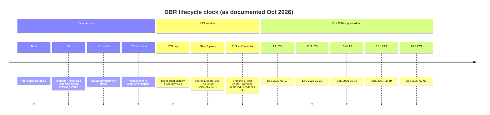
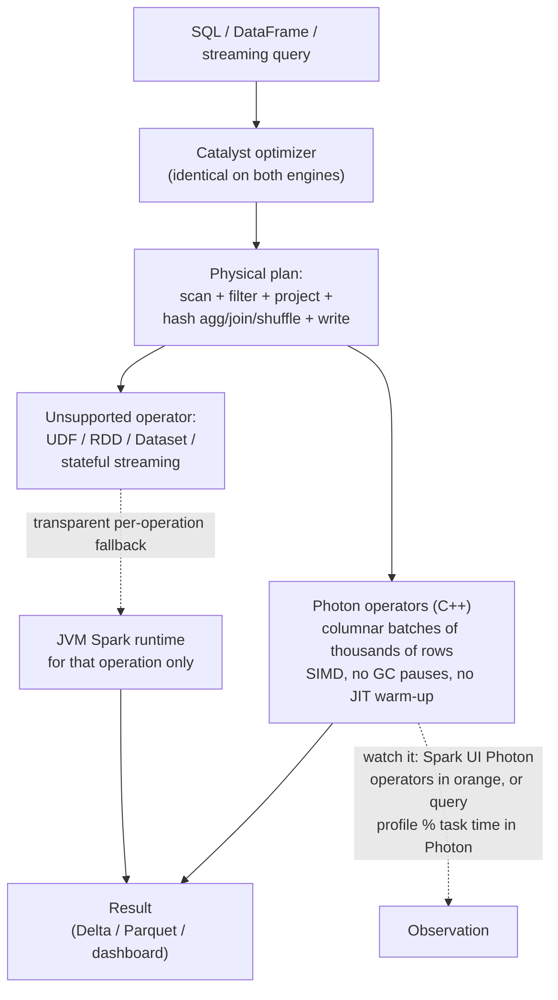
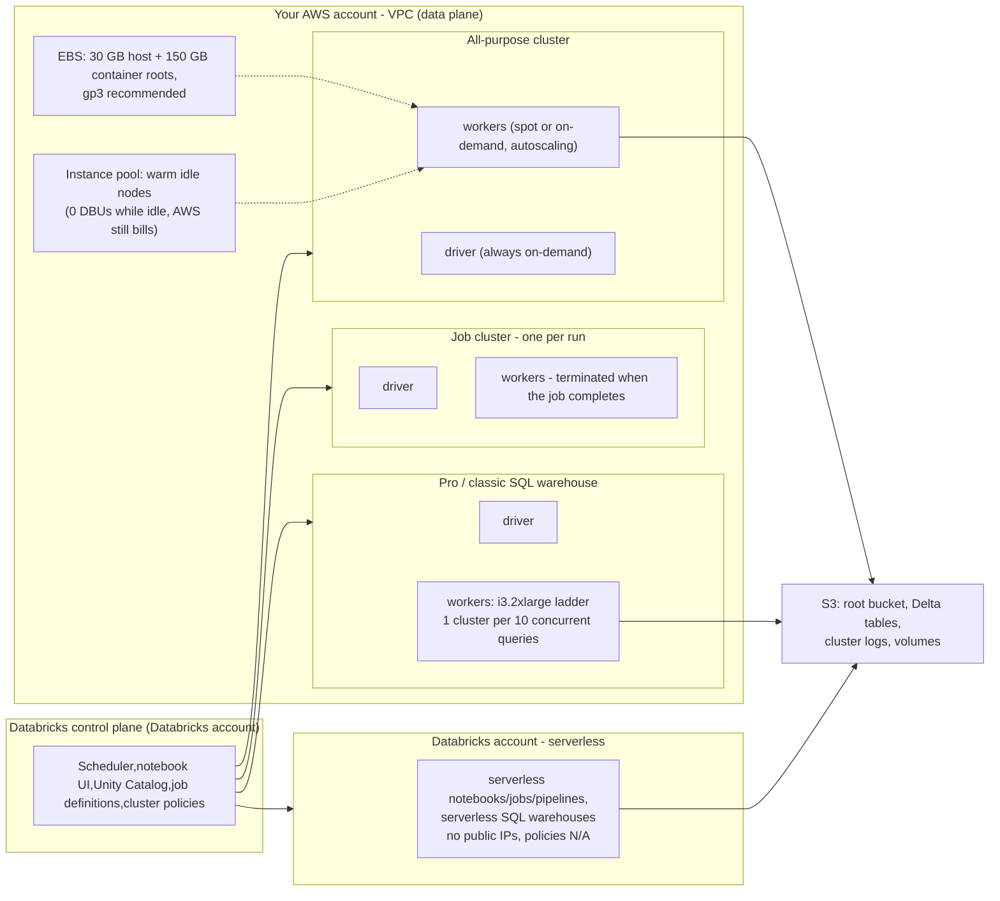
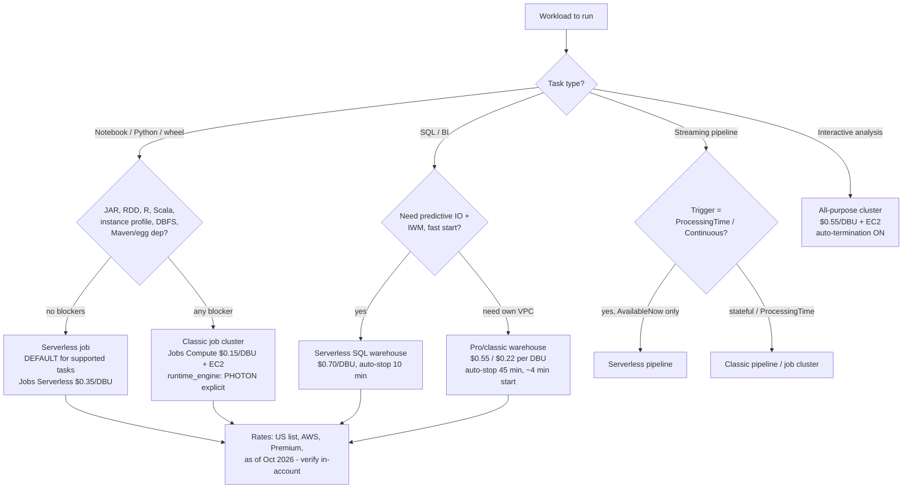
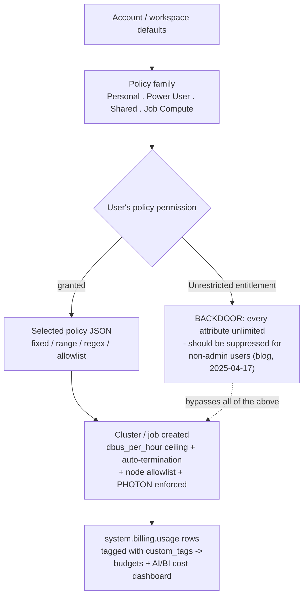

# Databricks Runtime, Photon and Clusters: DBR/LTS, Policies, Pools and Compute Cost Shape

Every pipeline in this course runs on something. Delta tables do not optimise themselves, Auto Loader does not list a prefix for free, and a Lakeflow pipeline is only as cheap as the machines underneath it. This lesson is about that *something*: which **Databricks Runtime** version you pin, whether **Photon** is executing your plan, which **kind of cluster** (or warehouse, or serverless session) the work runs on, who is allowed to create it (**cluster policies**), how fast it can start (**instance pools**), which **EC2 family** it uses, and — the part that shows up on the invoice — which **DBU rate** applies to it.

That last point is the spine of the lesson. On AWS, **the same EC2 instance bills at a different DBU rate depending on the compute type you attached it to.** The Jobs API 2.0 states it without hedging: "When you run a job on a new jobs cluster, the job is treated as a Jobs Compute (automated) workload subject to Jobs Compute pricing" and "When you run a job on an existing all-purpose cluster, it is treated as an All-Purpose Compute (interactive) workload subject to All-Purpose Compute pricing" (docs .../jobs-2.0-api, page dated 2026-08-03). Same nodes, same Spark, same data — and at US list prices as of Oct 2026 a **$0.15/DBU** SKU versus a **$0.55/DBU** SKU. Everything else in this lesson is either a performance decision or a governance decision; this one is pure arithmetic, and it is the reason a 45-minute nightly ETL can cost either $1,027 or $2,947 a month (worked example E5).

```text
 =============================================================
  LESSON 06 MAP - compute on AWS, as of Oct 2026
 ------------------------------------------------------------
  Version    DBR 19 (current) / 18 LTS (to 2029-06-10)
  Engine     Photon (C++, columnar, SIMD) + Catalyst planner
  Kinds      all-purpose | job | SQL warehouse | serverless
  Guardrail  cluster policies (JSON) + instance pools
  Hardware   M/C/R/I families, Graviton, fleet, EBS, spot
  Meter      $0.15 jobs . $0.55 all-purpose . $0.22/$0.55/$0.70 SQL
             (US list, Premium tier, AWS, as of Oct 2026 -
              confirm against system.billing.list_prices)
 -------------------------------------------------------------
  Rule of the lesson: pick the compute TYPE before you tune
  the cluster. Type sets the rate; tuning only sets hours.
 =============================================================
```

In this lesson you will:

- read the **supported DBR table as of Oct 2026** with every EoS date, and drive the **Beta → GA → LTS → EoS → EoL** lifecycle as a diagram;
- trace a query through **Catalyst and Photon**, name the four cases where Photon does not help, and date-stamp every benchmark you quote;
- separate **all-purpose, job, SQL warehouse and serverless** compute, including the pricing rule that decides the bill;
- work through **six worked examples**: an annotated **cluster-policy JSON**, an **instance-pool configuration**, **instance-family selection** for four workload shapes, the **job-vs-all-purpose cost shape**, a **Photon-or-not triage**, and a **production notebook posture**;
- apply **cluster policies** (fixed/allowlist/regex/range, `dbus_per_hour`, `cluster_type`, `auto:latest-lts`) and close the **Unrestricted backdoor**;
- set **autoscaling windows, auto-termination, spot topology and `first_on_demand`** without tripping the documented traps;
- study **Comcast and Addepar** on AWS, read the **2026 update box**, and practise with **twelve questions** plus four interactive checks.

---

## 1. Databricks Runtime: the version ladder and the LTS clock

### 1.1 The supported set (release-notes page last updated Sep 11, 2026)

Databricks ships two lines at once: a **current** line that keeps receiving features, and an **LTS** line that trades novelty for a three-year support window. The supported-versions table on AWS (docs .../release-notes/runtime, last updated **Sep 11, 2026**, accessed 2026-10) is the only version list you should trust:

| Runtime | Spark | Released | End of support (EoS) | Line |
|---|---|---|---|---|
| **DBR 19** | 4.2.0 | **Jun 15, 2026** | Determined at LTS transition | current (listed as supported) |
| **18 LTS** | 4.1.0 | **Jun 10, 2026** | **Jun 10, 2029** | current LTS |
| **17.3 LTS** | 4.0.0 | **Oct 22, 2025** | **Oct 22, 2028** | LTS |
| **16.4 LTS** | 3.5.2 | **May 9, 2025** | **May 9, 2028** | LTS |
| **15.4 LTS** | 3.5.0 | **Aug 19, 2024** | **Aug 19, 2027** | LTS |
| **14.3 LTS** | 3.5.0 | **Feb 1, 2024** | **Feb 1, 2027** | LTS (oldest supported) |

Each version also ships an **ML variant** (same number, MLflow plus ML libraries pinned to it): the MLflow matrix reads 19 → MLflow **3.12.0**, 18 LTS → **3.8.1**, 17.3 LTS → **3.0.1**, 16.4 LTS → **2.21.3** (same page, accessed 2026-10).

Two 2026 wrinkles matter more than the numbers themselves:

1. **Numbering changed at DBR 19.** "Prior to Databricks Runtime 19, Databricks released runtimes as minor feature versions (for example, 18.0, 18.1, 18.2), each with its own Beta and GA release" (docs .../release-notes/runtime/databricks-runtime-ver, accessed 2026-10). From 19 the feature-development phase runs as a single major line.
2. **A retired minor and a live LTS coexist.** The **DBR 18.0** release-note page is already labelled **(EoS)** — "Support for this Databricks Runtime version has ended" — even though that page also records "This version incorporates all features … Databricks released this version in January 2026", Spark **4.1.0** and default **JDK 21** (docs .../release-notes/runtime/18.0, accessed 2026-10). Meanwhile **18 LTS** is supported through **Jun 10, 2029**. Pin to the *LTS line*, never to a retired minor number.

### 1.2 The lifecycle, drawn



The four durations come straight from the support-lifecycle page (accessed 2026-10): a **~six-month** GA feature phase, LTS backports for **three years**, **"The end-of-support date is three years after the GA release date"**, and "Databricks makes a best effort to set the end-of-life date **six months after the end-of-support date**". At EoS the version "is no longer selectable using the UI when you create or update a compute resource"; at EoL it "becomes unusable … existing workloads running on these versions fail". That is the difference between *a job that stops scheduling* and *a job that crashes* — and it is why pinning is a production control, not a preference.

### 1.3 Which line for which workload

The compute-configuration page is explicit (docs .../compute/configure, last updated **Oct 6, 2026**): "For all-purpose compute, use the most current version … For job compute running operational workloads, consider using the Long Term Support (LTS) Databricks Runtime version." Translated:

- **Interactive/exploratory (all-purpose):** newest supported version — you want the features and you restart often anyway.
- **Operational jobs:** an LTS line, pinned by exact string (`17.3.x-scala2.12`), because a surprise Spark minor in the middle of a quarter is an outage.
- **Data science / ML:** the ML variant of whichever line you chose.
- **In a cluster policy:** `spark_version` with a special token — `auto:latest-lts`, `auto:latest-ml`, `auto:prev-major`, `auto:prev-lts` — which "does not make the compute auto-update when a new runtime version is released"; it resolves **when a user edits** the compute (docs .../admin/clusters/policy-definition, last updated **Oct 1, 2026**).

- **📚 Did you know?** Databricks retains "cluster configuration information for terminated clusters for **30 days**" (Clusters API intro, accessed 2026-10). That is long enough to answer "what runtime and node type did that failing job use last Tuesday?" and short enough that you should export the shapes you care about (via asset bundles or Terraform) rather than archaeology-in-the-UI.

---

## 2. Photon: what the vectorized engine does — and what it does not

### 2.1 One planner, two execution engines

"Photon is the Databricks-native **vectorized query engine** that accelerates your SQL workloads, DataFrame API calls, ETL pipelines, and **stateless streaming** workloads" (docs .../compute/photon, last updated **Sep 11, 2026**). The architecture sentence to memorise: "The Apache Spark query optimizer (Catalyst) still plans your query, but Photon takes over at the **execution layer**" — and "When Photon encounters an unsupported operation … it transparently falls back to the Spark runtime for the remainder of that operation."



Photon processes "data in batches of thousands of rows at a time, enabling modern CPUs to use **SIMD** instructions", and features such as predictive I/O and dynamic file pruning in `MERGE`/`UPDATE`/`DELETE` *require* Photon (same page). It is "the **default engine for all SQL warehouses**", is enabled on serverless compute and serverless Lakeflow pipelines, and — since DBR 9.1 LTS — "Photon is enabled by default on compute running Databricks Runtime 9.1 LTS and above" for classic all-purpose and job compute created through the UI.

> [!IMPORTANT]
> ⚠️ **The API trap: API-created clusters silently run non-Photon.** The same docs page says: "If you create these resources using the **Clusters API or Jobs API**, you must explicitly enable Photon by setting `runtime_engine` to `PHOTON`." Terraform, CLI and asset-bundle teams benchmark "Photon is slow" every year when they actually benchmarked *non-Photon*. Set `"runtime_engine": "PHOTON"` in your job/cluster definitions (or let a cluster policy force it — section 6), then confirm in the Spark UI.

### 2.2 Where Photon does not help

The docs are unusually blunt, and every clause below is quotable:

| Case | What the docs say (docs .../compute/photon, Sep 11, 2026) | What to do instead |
|---|---|---|
| **Queries under ~2 seconds** | "Queries that normally complete in under two seconds don't see meaningful improvement because execution time is dominated by planning and scheduling overhead." | Fix the plan, caching, or the number of queries — not the engine. |
| **Python UDFs** | "Photon doesn't support **UDFs**, RDD APIs, or Dataset APIs." UDF bodies run outside Photon. | Rewrite hot UDFs as DataFrame expressions / pandas UDFs / built-ins. |
| **Stateful streaming** | "**Stateful streaming is not supported.**" Stateless streaming *is* supported to Delta or Parquet sinks, from Delta, Parquet, CSV, JSON, Kafka and Kinesis sources. | Keep the stateful operator on Spark, or reshape to stateless + `foreachBatch`. |
| **A single unsupported operator** | Fallback is per-operation: a plan mixes Photon (orange) and classic Spark operators. | Read the query profile before concluding either way. |

There is also an economics clause: Photon is not free speed. "Photon instance types consume DBUs at a **different rate** than the same instance type running the non-Photon runtime" (Databricks blog, "Announcing Photon Public Preview", **2021-06-17**). The operative rule: **Photon pays only when it is more than proportional in speed** — so benchmark *your* workload, and measure Photon share in the Spark UI rather than guessing.

### 2.3 The evidence, date-stamped

Quote these with their dates; they are not interchangeable:

| Claim | Source (date) |
|---|---|
| "up to **5x better price/performance** for data and analytics workloads compared to other cloud data warehouses" (TPC-DS) | docs .../compute/photon (updated **2021→2026-09-11**) |
| "Photon is up to **2x faster** than Databricks Runtime 8.0" (TPC-DS 1TB) and "2-4x average speedups" in preview | blog, Photon Public Preview (**2021-06-17**) |
| "delivered benchmark-setting price/performance at **up to 12x better** than traditional cloud data warehouses"; 90% of 400 preview customers reported faster queries | blog, Photon GA (**2022-08-03**) |
| "Photon has accelerated some customer workloads by **over 10×**"; TPC council ran TPC-DS 100TB on **S3**, **256-node cluster of i3.2xlarge**, DBR + Photon | SIGMOD '22 paper, *Photon: A Fast Query Engine for Lakehouse Systems* (**June 2022**, DOI 10.1145/3514221.3526054) |
| "Databricks SQL has set a new world record in 100TB TPC-DS … outperformed the previous record by **2.2x**", formally audited by the TPC council | blog (**2021-11-02**) |
| Photon + AWS **i4i** vs i3 without Photon: **5.3x** latency improvement, **2.5x** cost improvement | blog, *Faster Insights with Databricks Photon using AWS i4i instances* (workloads run **July 2022**, page dated **2024-06-21**) |
| DBSQL Serverless: **5x** performance gain since 2022, plus "up to **25% faster**" from Predictive Query Execution and Photon Vectorized Shuffle (**1.5x** shuffle throughput) | blog, *Databricks SQL Accelerates Customer Workloads by 5x* (**2025-06-17**) |

- **📚 Did you know?** The audited 100 TB TPC-DS record ran **on this course's substrate**: data in **Amazon S3**, 256 × **i3.2xlarge** (SIGMOD '22). Storage-optimized instances plus a vectorized engine is the reference "lakehouse beats warehouse" datapoint — and it is the same instance family that classic and pro SQL warehouses still standardise on today (all classic/pro warehouse workers are **i3.2xlarge**, docs .../warehouse-behavior, accessed 2026-10).

### 2.4 Worked example E1 — Photon or not? triage two notebooks

**As of Oct 2026.** Two teams claim "Photon didn't help". Triage before you change anything:

```text
Worked example E1 - Photon triage (mechanisms per docs .../compute/photon, 2026-09-11)
-----------------------------------------------------------------------------
Team A: 30-minute TPC-DS-style joins/aggregations over 2 TB on r5 nodes,
        queries 8-90 s each, pure DataFrame API.
  -> Expect a win. Confirm: Spark UI shows Photon operators in orange;
     query profile shows % task time in Photon.
     Reference points: i4i vs i3 non-Photon = 5.3x latency (2024-06-21 page);
     SIGMOD over-10x on some customer workloads (Jun 2022).

Team B: per-row Python UDF pipeline, 200 ms queries, plus one stateful
        streaming step with a windowed aggregation.
  -> Two documented no-gain cases stacked: UDF bodies are not vectorized,
     and "Stateful streaming is not supported". Plus every query is < 2 s,
     where "execution time is dominated by planning and scheduling overhead".
  -> Action: rewrite the UDF as DataFrame expressions, drop Photon if the
     emission difference is measurable in YOUR account (read
     system.billing.list_prices filtered on Photon SKUs), keep the stateful
     operator on Spark. Do not conclude from a dashboard of 200 ms queries.

Rule: Photon is an execution-layer swap. Benchmark the plan, not the vibe.
```

---

## 3. Cluster anatomy: all-purpose vs job vs warehouse vs serverless

### 3.1 What runs where, on AWS

"Databricks components" (docs, page dated **2026-07-28**) draws the line simply: "There are two types of clusters: all-purpose and job." Add SQL warehouses and serverless sessions and you have the four compute kinds this course uses.



Three AWS-specific facts from that picture: classic clusters and pro/classic warehouses run on **EC2 in your VPC** ("With a pro SQL warehouse (unlike a serverless SQL warehouse), the **compute layer exists in your AWS account**", docs .../warehouse-types, last updated **Feb 12, 2026**); serverless runs in the **Databricks account with no public IPs**; and with secure cluster connectivity on (the default deployment mode), nothing in the data plane needs an inbound public IP.

### 3.2 The lifecycle difference — and the price difference

| | All-purpose | Job cluster |
|---|---|---|
| Created by | You (UI/CLI/REST API) | The **job scheduler**, per run |
| Lifecycle | "You can manually terminate and restart" it; multiple users share it | "terminates the cluster when the job is complete. **You cannot restart a job cluster**" |
| Workload class | interactive | automated |
| DBU rate (US list, Oct 2026) | **All-Purpose Compute $0.55/DBU** | **Jobs Compute $0.15/DBU** |
| Production fit | exploration, ad-hoc analysis | every scheduled pipeline |

Docs quote (components page, 2026-07-28): "The Databricks job scheduler creates a job cluster when you run a job on a new job cluster and terminates the cluster when the job is complete." And the pricing consequence, from the Jobs API 2.0 (page dated **2026-08-03**): "When you run a job on a new jobs cluster, the job is treated as a Jobs Compute (automated) workload subject to Jobs Compute pricing" — while pointing a job at an existing all-purpose cluster is **All-Purpose pricing**, and per the components page "running a job on an existing all-purpose cluster is also treated as an **interactive** workload." The same API adds: "We suggest running jobs on new clusters for greater reliability."

Databricks' jobs-compute guidance goes further (docs .../jobs/compute, last updated **Sep 15, 2026**): "**Serverless compute for jobs is the default for all tasks that support it**", and "All-purpose compute — You can optionally configure tasks using classic all-purpose compute. **Databricks does not recommend this configuration for production jobs.**"

One nuance worth carrying into lesson 09: a **shared job cluster** is "scoped to a single job run and cannot be used by other jobs or runs of the same job. **Libraries cannot be declared in a shared job cluster configuration.**" Declare dependencies per task (or via job environments), not on the shared cluster object.

### 3.3 Worked example E2 — the cost shape: one pipeline, three configurations

**As of Oct 2026, US list, Premium tier, AWS.** Scenario: a nightly 45-minute ETL that runs **400 cluster-hours per month**, 4 nodes total (1 driver + 3 workers). Databricks' own worked example uses a node that "runs at 3 DBU/hour" (blog, *Best practices for cost management in Databricks*, **2022-10-18**) — treat that emission value as **illustrative**: per-node DBU emission is not published as an official table, so read yours from `system.billing.list_prices` or the pricing calculator.

```text
Worked example E2 - same pipeline, three compute types (US list, Oct 2026)
--------------------------------------------------------------------------
DBU/hour  = 4 nodes x 3 DBU/h/node          = 12 DBU/h   (illustrative emission)
DBU cost  = 12 DBU/h x 400 h x rate
AWS cost  = 4 x m5.xlarge x $0.192/h x 400 h = $307.20    (us-east-1, read 2026-10-12)

(A) New job cluster, Jobs Compute $0.15/DBU
    DBU  4,800 x 0.15 =   $720.00   + AWS $307.20  =  $1,027.20 / month
(B) Same job pointed at a long-running all-purpose cluster, $0.55/DBU
    DBU  4,800 x 0.55 = $2,640.00   + AWS $307.20  =  $2,947.20 / month
    delta A->B = $1,920.00 / month  (65% of the combined bill)
(C) Same shape, spot workers at -60% on the AWS column only
    AWS  $307.20 x 0.40 = $122.88 ; DBU column UNCHANGED  =  $1,142.88 (A + spot)
```

Configuration (B) also carries idle hours: an all-purpose cluster bills while it is *up*, not while it works — which is exactly why auto-termination (section 8) and policies (section 6) exist. Notice what did **not** change between (A) and (B): nodes, runtime, Spark, data. Only the **compute type** — and with it the SKU. That is the single highest-leverage decision in this lesson, and it is why Databricks reports customers "saved tens of thousands of dollars by simply moving just ten percent of their workloads from all-purpose clusters to jobs clusters" (blog, 2022-10-18).

```plot
{
  "type": "bar",
  "title": "Monthly cost of one 400-hour pipeline by compute type (US list, AWS, as of Oct 2026)",
  "xLabel": "Compute configuration",
  "yLabel": "USD per month (DBU + AWS)",
  "xKey": "config",
  "dataKeys": ["usd_per_month"],
  "data": [
    {"config": "New job cluster, Jobs $0.15/DBU", "usd_per_month": 1027.2},
    {"config": "Job + spot workers (-60% AWS side)", "usd_per_month": 1142.88},
    {"config": "Existing all-purpose cluster, $0.55/DBU", "usd_per_month": 2947.2}
  ]
}
```

---

## 4. Serverless compute and SQL warehouses

### 4.1 The recommended-compute matrix

Databricks publishes a per-task recommendation table (docs .../jobs/compute, last updated **Sep 15, 2026**). Read it as "the default, unless your dependency list forbids it":

| Task type | Recommended | Also supported |
|---|---|---|
| Notebook / Python script / Python wheel | **Serverless jobs** | classic jobs, classic all-purpose |
| SQL | **Serverless SQL warehouse** | pro SQL warehouse |
| Lakeflow (declarative) pipeline | **Serverless pipeline** | classic pipeline |
| dbt | **Serverless SQL warehouse** | — |
| **JAR task** | — | **classic jobs only** |
| **Spark Submit** | — | **classic jobs only** |

Serverless eligibility on AWS (docs .../sql/admin/serverless, last updated **Jun 10, 2026**): workspace on **Premium plan or above**, not a free trial, supported in **all AWS regions**, no public IPs — and "**Cluster policies, including spot instance policies, are not supported**". That last clause is the boundary of everything in section 6: policies govern *classic* compute; serverless is governed by account/workspace-level controls instead.

### 4.2 Serverless limitations — read this list before you migrate a job

From docs .../compute/serverless/limitations (accessed 2026-10), the blockers that force classic compute:

- "**R is not supported.**" · "Scala and R are not supported in notebooks."
- "Only **Spark Connect** APIs are supported. Spark RDD APIs are not supported."
- "**Maven coordinates are not supported.**" · "**JAR libraries are not supported in notebooks** … JAR tasks in jobs are supported." · "Task libraries are not supported for notebook tasks."
- "You must use **Unity Catalog** to connect to external data sources." · "Access to **DBFS** is limited."
- "**Serverless compute has a maximum runtime of 7 days.**"
- Streaming triggers: `Trigger.AvailableNow()` (recommended) and deprecated `Trigger.Once()` only — `Trigger.ProcessingTime` and `Trigger.Continuous` are **not** supported.

The migration page (last updated **2026-07-10**) lists the same blockers as things to replace *first*: custom images, ML Runtime variants, DBR < 13, instance profiles, and "dependencies such as **eggs, JARs, and Maven libraries**", with replacement patterns — RDD APIs → DataFrame APIs, DBFS paths → UC volumes, IAM instance profiles → UC external locations, custom JDBC JARs → Lakehouse Federation.

### 4.3 SQL warehouses: three types, two clocks

(docs .../sql-warehouse/warehouse-types, last updated **Feb 12, 2026**; auto-stop from docs .../sql-warehouse/create, accessed 2026-10)

| | Serverless | Pro | Classic |
|---|---|---|---|
| Runs in | Databricks account | **your AWS account** | **your AWS account** |
| Photon | yes (default) | yes | yes |
| Predictive IO | yes | yes | no |
| Intelligent Workload Management | yes | no | no |
| Startup | fast | "typically approximately **4 minutes**" | "approximately 4 minutes" |
| Workers | vertical + IWM | **i3.2xlarge** ladder | **i3.2xlarge** ladder |
| **Auto-stop default** | **10 minutes** (min 5 UI / 1 API) | **45 minutes** (min 10) | **45 minutes** (min 10) |

Sizing for classic/pro is one cluster per 10 concurrent queries, from 2X-Small (1 driver + 1 worker) through X-Small, Small … X-Large (32 workers), 2X (64), 3X (128), 4X (256), with **5X-Large (512) in Public Preview** (docs .../warehouse-behavior, accessed 2026-10). Databricks' standing guidance: "**Databricks recommends using serverless SQL warehouses when available**" — and the billing sentence to memorise: "**Idle SQL warehouses continue to accumulate DBU and cloud instance charges until they are stopped.**"



> **Comparative Verdict — job cluster vs all-purpose vs SQL warehouse vs serverless (as of Oct 2026)**
> - **Job cluster (classic, Jobs Compute $0.15/DBU + your EC2)** — the **default answer for production batch**. Ephemeral per run, no restart, auto-terminates with the run, spot-capable, policy-governed, cheapest per-DBU classic SKU. Pay for hours it actually runs; you own EC2, EBS and warm-up time. Use when dependencies are classic-only (JAR/Spark Submit, RDD, instance profiles, DBFS) or when the job runs long and hot on a predictable shape.
> - **All-purpose (All-Purpose Compute $0.55/DBU + your EC2)** — **interactive only**: exploration, shared notebooks, teaching. 3.7× the per-DBU rate of jobs at US list, it bills while *up*, and pointing production jobs at it is both an interactive-billing and a reliability anti-pattern ("Databricks does not recommend this configuration for production jobs"). Mandatory controls: auto-termination, a policy, never a spot driver.
> - **SQL warehouse (SQL Classic $0.22 / Pro $0.55 / Serverless $0.70 per DBU)** — the BI serving path, billed while **up**, sized by T-shirt not by workers you choose. Serverless adds Predictive IO + IWM and a 10-minute auto-stop; pro/classic run in your VPC on i3.2xlarge with a 45-minute auto-stop and ~4-minute start. Choose by *query concurrency and latency SLA*, not by DBU rate alone — the classic/serverless gap ($0.48 per DBU-hour) is the machine+ops serverless absorbs for you.
> - **Serverless jobs/notebooks (Jobs Serverless $0.35/DBU, All-Purpose Serverless $0.75/DBU)** — **the platform default wherever the limitations list permits**: no EC2 bill, no pools, no warm-up, no policy surface, 7-day max runtime, per-second billing, zero idle cost. Costs roughly 1.3–2.3× more per DBU than classic but deletes the idle-time and admin columns of the bill.
> - **Verdict in one line:** *serverless by default → classic job clusters when a blocker or a long hot shape demands it → all-purpose for humans, never for pipelines → SQL warehouse for BI with auto-stop enforced.* Every rate above is US list, Premium tier, AWS, as of Oct 2026; confirm against `system.billing.list_prices` in your account before you commit a budget to it.

---

## 5. Instance pools: warm start, not free compute

A pool is "A set of idle, ready-to-use instances that reduce cluster start and auto-scaling times" (docs .../getting-started/concepts, 2026-07-28). Attached clusters take their driver and workers from the pool and give them back on termination. Three sizing knobs (docs .../compute/pools, accessed 2026-10): **`min_idle_instances`**, **`max_capacity`**, **`idle_instance_autotermination_minutes`**.

The billing rule is the one students get wrong: "**Databricks does not charge DBUs while instances are idle in the pool. Instance provider billing does apply**" (docs .../pool-best-practices / pool-index, accessed 2026-10). Pools shift cost from the DBU column to the AWS column and buy you start-up minutes; they do not delete the bill. Constraints and rules from the same pages:

- A pool is "**either all spot instances or all on-demand instances**"; the Instance Pools API adds **`SPOT_WITH_FALLBACK`** — "the pool acquires spot instances first, and falls back to on-demand instances when spot capacity is unavailable".
- "By default, Databricks sets the max spot price at **100% of the on-demand price**."
- Over-scale fails loudly: "If a cluster using the pool requests more instances than this number during autoscaling, the request fails with an **INSTANCE_POOL_MAX_CAPACITY_FAILURE** error." Keep max cluster size ≤ pool `max_capacity`.
- Clusters inherit the pool's **availability zone**; use **separate pools** when driver and worker requirements differ.
- **Never spot the driver:** "Do not use a pool with spot instances as your driver type. Select an on-demand driver type to prevent your driver from being reclaimed."
- Where serverless fits, Databricks' advice is blunt: "If your workload supports serverless compute, Databricks recommends using serverless compute instead of pools."
- Sizing guidance: spot pools for cost-tolerant workers; **on-demand pools for "jobs with short execution times and strict execution time requirements"**.

### 5.1 Worked example E3 — pool configuration + the idle bill

**As of Oct 2026 (us-east-1 list, read 2026-10-12).** A team wants warm starts for a 45-minute nightly job and for interactive dev clusters.

```json
{
  "pool_name": "etl-workers-spot-fallback",
  "node_type_id": "r5.xlarge",
  "min_idle_instances": 2,
  "max_capacity": 8,
  "idle_instance_autotermination_minutes": 20,
  "aws_attributes": { "availability": "SPOT_WITH_FALLBACK" },
  "custom_tags": { "COST_CENTER": "9531", "team": "data-eng" }
}
```

```text
Worked example E3 - what the pool costs while it keeps you warm (Oct 2026)
--------------------------------------------------------------------------
Rules applied: 0 DBUs while idle (pool), AWS bills regardless;
               workers may be spot, driver NEVER (separate on-demand pool);
               keep cluster max_workers <= max_capacity = 8.

Driver pool (on-demand, separate):   1 x r5.xlarge
  AWS  1 x $0.252/h x 6 h idle/day x 30 d = $45.36/mo   DBU = $0
Worker pool (SPOT_WITH_FALLBACK, 2 warm):
  AWS  2 x $0.252/h x 6 h idle/day x 30 d = $90.72/mo   DBU = $0
  (if spot is unavailable the pool falls back to on-demand at the
   same node price; default max spot price = 100% of on-demand)
Total warm-start insurance:  $136.08/month AWS, $0 DBU
What you buy: nodes already running -> cluster start and autoscale
              latency drop from minutes to seconds, plus capacity
              reservation. Cross-check: idle_instance_autotermination
              20 min beats a 45-min job gap; no DBUs accrue meanwhile.
Trap: 8-node cluster against a 6-node pool -> INSTANCE_POOL_MAX_CAPACITY_FAILURE
```

- **📚 Did you know?** The pool's idle insurance costs about **$136/month** in this example — while one accidental *day* of that 4-node all-purpose cluster left up (12 DBU/h × 24 h × $0.55 = **$158.40** of DBUs **plus** 4 × $0.192 × 24 ≈ **$18.43** of EC2 ≈ **$177**) already costs more than a whole month of warm starts. Pools are for **start latency and capacity**, auto-termination is for **cost**; teams that install pools but skip auto-termination usually end up with both bills.

---

## 6. Cluster policies: governance and cost guardrails as JSON

"A policy is a tool workspace admins can use to limit a user or group's compute creation permissions based on a set of policy rules" (docs .../admin/clusters/policies, page dated **2026-06-10**). The documented benefits: prescribed settings, limits on how many clusters a user may create, a simplified UI, "**Control cost by limiting per-cluster maximum cost**", and "Enforce cluster-scoped library installations". Databricks' own policy-onboarding blog (2025-04-17) names the two payoffs — "**Simplification of platform usage and effective cost control are the two main benefits of cluster policies**" — and the four-family starter set: **Personal Compute, Power User Compute, Shared Compute, Job Compute**.

Mechanics you must know before you write JSON (docs .../admin/clusters/policy-definition, last updated **Oct 1, 2026**):

- Rules attach to "any of the attributes controlled with the Clusters API", and "**There can only be one limitation per attribute.**"
- Limitation types: **`fixed`, `forbidden`, `allowlist`, `blocklist`, `regex`, `range`, `unlimited`** (each may carry `defaultValue`, `isOptional`, `hidden`).
- **Virtual attributes:** `dbus_per_hour` — "Calculated attribute representing the maximum DBUs a resource can use on an hourly basis including the driver node … Use with **range**" — and `cluster_type` (`all-purpose` / `job` / `dlt`), which lets you block a compute class outright.
- `runtime_engine` accepts `PHOTON` or `STANDARD`; `spark_version` accepts the `auto:*` tokens (section 1); `workload_type.clients.jobs` / `.notebooks` gate which client type may attach.
- **API trap:** "Default values don't automatically get applied to compute created with the Clusters API. To apply default values using the API, add the parameter `apply_policy_default_values` … set it to true."
- Deleting a policy does not clean up: running compute continues but "cannot be edited unless the user has unrestricted cluster creation permissions."

### 6.1 Worked example E4 — a job-only cost-guardrail policy

Built on the docs' own job-only example (policy-definition page, Oct 1, 2026) and extended with Photon, spot topology and tags. This is the JSON you would paste into a Terraform `databricks_cluster_policy` resource or the admin UI:

```json
{
  "cluster_type":                 { "type": "fixed", "value": "job", "hidden": true },
  "dbus_per_hour":                { "type": "range", "maxValue": 100 },
  "spark_version":                { "type": "unlimited", "defaultValue": "auto:latest-lts" },
  "runtime_engine":               { "type": "fixed", "value": "PHOTON", "hidden": true },
  "node_type_id":                 { "type": "regex", "pattern": "[rmci][3-5][rnad]*.[0-8]{0,1}xlarge" },
  "driver_node_type_id":          { "type": "regex", "pattern": "[rmci][3-5][rnad]*.[0-8]{0,1}xlarge" },
  "num_workers":                  { "type": "range", "minValue": 1, "maxValue": 10, "defaultValue": 2 },
  "aws_attributes.availability":  { "type": "fixed", "value": "SPOT_WITH_FALLBACK" },
  "aws_attributes.first_on_demand": { "type": "fixed", "value": 1 },
  "autotermination_minutes":      { "type": "fixed", "value": 60, "hidden": true },
  "custom_tags.COST_CENTER":      { "type": "allowlist", "values": ["9999", "9921", "9531"] },
  "workload_type.clients.notebooks": { "type": "fixed", "value": false },
  "workload_type.clients.jobs":      { "type": "fixed", "value": true }
}
```

```text
Worked example E4 - line-by-line intent (policy-definition page, 2026-10-01)
-----------------------------------------------------------------------------
cluster_type fixed "job"      policy appears only in the JOB compute UI;
                              ad-hoc notebooks cannot select it
dbus_per_hour range <= 100    the real hourly DBU ceiling incl. driver -
                              the one number that bounds worst-case spend
spark_version auto:latest-lts every job lands on the LTS line; token resolves
                              at edit time, it does NOT auto-upgrade running compute
runtime_engine fixed PHOTON   closes the API-created-cluster trap (section 2.1)
node/driver regex             admits r/m/c/i families, generations 3-5, up to
                              xlarge only - no 8xl monsters without an exception
num_workers range 1..10       worker ceiling; default 2
SPOT_WITH_FALLBACK +          workers may be spot with on-demand fallback;
first_on_demand = 1           the FIRST instance (driver) is always on-demand
autotermination_minutes 60    an enforced idle killer - the guardrail that beats
                              a weekly manual sweep (value is a policy choice;
                              no official default is published for clusters)
custom_tags.COST_CENTER       allowlist only - tags that reach EC2 + DBU reports
notebooks=false / jobs=true   production policy, no one runs ad-hoc on it
Reminder: API-created compute needs apply_policy_default_values=true to pick
up the defaults above.
```



> [!WARNING]
> ⚠️ **Close the Unrestricted backdoor before you write a single rule.** "The 'unrestricted' cluster policy entitlement provides a **backdoor route for bypassing the cluster policies** and should be suppressed for non-admin users" (Cluster Policy Onboarding Primer, databricks.com/blog, **2025-04-17**). And note the docs: "By default, workspace admins have permissions on all policies. Non-admin users must be granted permissions on a policy to access it" — so a policy set with no assignment to your user group protects nobody. Roll policies out as: write JSON → grant to group → remove Unrestricted from that group → verify by trying to over-provision.

---

## 7. Libraries and notebook posture

### 7.1 Four scopes, one source matrix

(docs .../libraries, last updated **Sep 11, 2026**)

| Scope | Set on | Persists? | Notes |
|---|---|---|---|
| **Compute-scoped** | cluster / warehouse | yes, while compute lives | "used by all notebooks and jobs running on the compute" — best practice page says **avoid** where environments/job deps suffice |
| **Job/task libraries** | Jobs API `libraries` object | per run | on serverless only via **job environments**; task libraries unsupported for notebook tasks |
| **Notebook-scoped** | `%pip` / `%R` magics | **no** — "do not persist and must be re-installed for each session" | Python/R only; "**JARs cannot be installed at the notebook level.**" |
| **Environments** | YAML base environment (Beta, DBR 19+ standard access mode) | yes | replaces cluster libraries for declarative setups |

Sources: **PyPI, Maven, CRAN**, workspace files, **Unity Catalog volumes**, cloud object storage. The cut lines as of Oct 2026:

- Standard access mode needs **DBR 13.3 LTS+** for PyPI, Maven, volumes and workspace files; "**CRAN: Not supported**" on standard access mode (dedicated/legacy keep it).
- Python **eggs** only on "Databricks Runtime 13.3 LTS and below"; `requirements.txt` needs **DBR 15.0+**.
- "**storing library files in the DBFS root is deprecated and disabled by default in Databricks Runtime 15.1 and above**" — use workspace files, UC volumes or package repos.
- "**Workspace libraries have been deprecated** and should not be used" — note that workspace *files* remain fully supported.
- Python import precedence (highest first): Git-folder cwd → Git-folder root → notebook-scoped (`%pip`) → compute-scoped → libraries included in DBR.

Notebook ergonomics worth memorising: "`%pip` — Install Python packages (notebook-scoped)" but "%pip commands do not automatically restart the Python process … you may need `dbutils.library.restartPython()`"; "`%run` — Execute another notebook, importing its functions and variables" and "**%run must be in a cell by itself, because it runs the entire notebook inline.**" On serverless, `%uv pip` is the faster alternative (environment version 5+).

### 7.2 Worked example E5 — the production notebook posture

```text
Worked example E5 - parameterised production notebook (docs, Sep 11 2026)
--------------------------------------------------------------------------
DO
  from a Git folder / Databricks Repo (trunk-based, single repository)
  dbutils.widgets.text("env", "dev")            # params; SQL parameter markers
                                                # need DBR 15.2+ (injection guard)
  %run /Shared/helpers $X = "10"                # inline helper definitions;
                                                # MUST occupy its own cell
  task-level libraries OR job environments      # declared in code, versioned
  "Run as" a service principal                   # token-bound runs inherit the
                                                # token identity's permissions
  keep business logic in src/*.py, notebooks as
  "thin orchestration and visualization layers"

DON'T
  %pip install pandas==2.2.2 mid-notebook on a shared all-purpose cluster
      -> per-session only; a fresh job cluster will not have it
  hardcode spark.executor.memory / spark.dynamicAllocation.* in job defs
  commit build artifacts (.jar/.whl), tokens or credentials to the repo
  treat the notebook as the business-logic container
      -> "if something isn't in version control, it doesn't exist"

Production dependency rule: declarative (job/env/cluster) beats magic;
%pip is for interactive iteration only.
```

- **📚 Did you know?** Databricks' engineering guidance now reads: "**Declarative automation is built on the idea that if something isn't in version control, it doesn't exist**" and "**Minimize business logic in notebooks** … Use notebooks only as thin orchestration and visualization layers that call the underlying code" (docs .../notebooks/best-practices and .../developers/best-practices, both last updated **2026-09-11**). The companion repo is `github.com/databricks/notebook-best-practices`.

---

## 8. Autoscaling, auto-termination and spot

### 8.1 Horizontal on classic, vertical on the serverless side

Classic all-purpose and job clusters autoscale **workers only**, between `autoscale.min_workers` and `max_workers`. Optimized autoscaling (Premium and above; Standard-plan workspaces get standard autoscaling) has four documented characteristics (docs .../compute/configure, last updated **Oct 6, 2026**):

- "Scales up from min to max in **at most 2 scaling events**."
- "On job compute, scales down if the compute resource is underutilized over the last **40 seconds**. On all-purpose compute … **150 seconds**." (`spark.databricks.aggressiveWindowDownS`, up to **600 s**, slows that decay.)
- It can scale down non-idle nodes using shuffle-file state — so a warm-but-waiting node is not protected.
- Standard autoscaling instead starts at "+8 nodes, then exponential" and "scales down when 90% of the nodes are not busy for 10 minutes".

Vertical scaling does not exist on classic: "Scale vertically by adding or removing resources from a single machine … This typically means **stopping the workload, moving it to a larger machine, and restarting it**" (docs .../performance-efficiency, accessed 2026-10). Vertical instance selection is a **serverless pipelines** feature — "Vertical autoscaling is used for all serverless pipelines", picking cost-efficient instance types on OOM evidence (docs .../ldp/auto-scaling, accessed 2026-10).

Two documented traps: "**Do not enable Apache Spark Dynamic Allocation** (`spark.dynamicAllocation.enabled`) **on compute resources that use Databricks autoscaling**" (conflicting executors → `NODES_LOST`), and autoscaling "has limitations scaling down … for Structured Streaming workloads" — long-lived streams want a floor, not a floor that moves.

### 8.2 Auto-termination and spot topology

**Auto-termination** kills an idle all-purpose cluster after `autotermination_minutes` of inactivity. The API accepts **10–10,000 minutes, with `0` disabling it** (Databricks asset-bundle/job schema docs, accessed 2026-10) — and the docs pages read in October 2026 print **no numeric default**, so set it explicitly rather than trusting a UI value you have not checked. SQL warehouse auto-stop defaults *are* documented (section 4.3): **45 min** pro/classic, **10 min** serverless.

**Spot**, from the same compute-configuration page: `aws_attributes.availability` ∈ `SPOT` / `ON_DEMAND` / `SPOT_WITH_FALLBACK`; `aws_attributes.first_on_demand` pins the driver (and N nodes) to on-demand; `aws_attributes.spot_bid_price_percent` defaults to **100% of on-demand**. "The first instance will always be on-demand (the driver node is always on-demand) and subsequent instances will be spot instances." AWS prices Spot at "up to 90% off On-Demand prices" (aws.amazon.com/ec2/spot, accessed 2026-10) with a **two-minute interruption notice** — and the saving lands **only on the AWS column**: DBU rates and emission counts do not change with spot.

> [!IMPORTANT]
> ⚠️ **Never run the driver on spot.** "Do not use a pool with spot instances as your driver type. Select an on-demand driver type to prevent your driver from being reclaimed" (docs .../compute/configure, 2026-10-06); pool best practices repeat it: "Only use spot pools as worker nodes. Your driver node should use on-demand instances." A reclaimed driver takes the whole Spark context with it — mid-task, after AWS's two-minute notice. Set `first_on_demand >= 1`, use a dedicated on-demand driver pool, and make every stage restartable (lesson 13).

---

## 9. AWS node types: families, Graviton, fleet and disks

### 9.1 The families

From the EC2 instance-types documentation (accessed 2026-10): **M** general purpose, **C** compute-optimized, **R** memory-optimized, and **D/I** storage-optimized with local NVMe — "Storage optimized instances are designed for workloads that require high, sequential read and write access to very large data sets on local storage" (family classes span C5…C9g, R5…R9g, D3/D3en/I3en/I4i/I7i/I8g/Im4gn/Is4gen).

Databricks' own selection guidance (docs .../cluster-config-best-practices, page dated **2026-06-11**): simple batch ETL that "don't require wide transformations" → "instances with lower requirements for memory and storage"; analytical workloads "will likely require reading the same data repeatedly, so recommended node types are **storage optimized with disk cache enabled or instances with local storage**"; and "For simple batch ETL jobs … use spot instances for workloads that have lax latency requirements."

### 9.2 Worked example E6 — instance-family selection for four workload shapes

**As of Oct 2026; EC2 Linux on-demand, us-east-1, read from the AWS price list 2026-10-12.**

```text
Worked example E6 - pick the family before you tune Spark
--------------------------------------------------------------------------
(A) Nightly dedupe + join ETL, 45 min, lax latency, mostly CPU
    -> C or M family, spot workers:  c6i.xlarge  $0.170/h
       (simple batch ETL: lean memory/storage per docs 2026-06-11)
    Shape: 4 nodes = 0.68/h AWS  + Jobs Compute $0.15/DBU

(B) Wide aggregations / in-memory caching / skewy joins
    -> R family:  r5.xlarge  $0.252/h  (memory-optimized)
       Graviton alternative r6g/r7g class is cheaper per vCPU but needs
       DBR 10.2+ for Photon, and "Databricks does not support mixing AWS
       Graviton and non-AWS Graviton instance types" - one ISA per cluster;
       verify x86-only third-party wheels before you switch.

(C) Analytical / BI-style repeated scans on classic or pro SQL warehouse
    -> storage-optimized:  i3.2xlarge  $0.624/h
       (the documented warehouse workhorse: ALL classic/pro warehouse
        workers are i3.2xlarge; sizing ladder 2X-Small -> 4X-Large = 256
        workers, 5X-Large preview; 1 cluster per 10 concurrent queries)

(D) Huge local NVMe scans, e.g. i3.4xlarge  $1.248/h
    -> only when local storage genuinely beats S3 + disk cache;
       remember the EBS side too: 30 GB host root + 150 GB container root
       per worker, gp3 recommended, autoscaling local storage up to 5 TB
       per instance, workspace EBS default capacity 50 TiB.

Cost-shape cross-check for (A): 4 x $0.170 x 400 h = $272 AWS/mo
plus 4,800 DBU x $0.15 = $720  ->  $992/mo total (list, Oct 2026).
Compare with E2(B): same hours on all-purpose = $2,640 + AWS. The
family choice saved ~11%; the compute TYPE saved 65%.
```

Two more hardware facts worth carrying: **fleet instance types** (`m-fleet.xlarge`, `rd-fleet.4xlarge`, …) are "a variable instance type that automatically resolves to the best available instance type of the same size" using AWS's Spot Placement Score — and "If you update the spot instance bid percentage using the API or JSON, it has no effect when the worker node type is a fleet instance type." Fleet types carry no GPUs. EC2 **P2 is no longer supported** (same page). For guaranteed GPU/instance windows, Capacity Blocks attach via the tag `X-Databricks-AwsCapacityBlockId` plus an AZ and on-demand-only.

---

## 10. The meter: same instance, different bill

### 10.1 The rate table you will be examined on

**US list, Premium tier, AWS, as of Oct 2026** — documentary sources (Databricks' own pricing pages render client-side; these figures come from the UK G-Cloud 15 supplier record captured **2026-09-25** plus six independent reads of the same rate card dated between **2026-06-03 and 2026-10-06**, and are corroborated for SQL by databricks.com page snapshots). Confirm in your account with `system.billing.list_prices` before budgeting:

| Compute SKU | Classic $/DBU | Serverless $/DBU |
|---|---|---|
| **Jobs Compute** (Lakeflow Jobs) | **0.15** (Enterprise 0.20) | **0.35** |
| **All-Purpose Compute** | **0.55** (Enterprise 0.65) | **0.75** (Enterprise 0.95) |
| **SQL Classic / Pro / Serverless** | 0.22 / 0.55 | **0.70** |
| Lakeflow Pipelines (legacy Standard tier) | 0.20 Core / 0.25 Pro / 0.36 Advanced | 0.35 (serverless) |
| Legacy Jobs "Light" (Standard tier) | 0.10 — **retired** | — |

Three rules around that table:

1. **Region:** classic rates are flat across AWS regions (you pay local EC2 anyway); **serverless rates are not** — SQL Serverless is **$0.70/DBU in us-east-1 vs $0.91 in eu-central-1** (page-data read, 2026-08-07). A US quote never transfers to Frankfurt.
2. **The Standard tier is gone.** "Databricks has announced end-of-life for the Standard tier. All current Standard tier workspaces will be upgraded to the Premium tier effective **October 1, 2025 on AWS and GCP**" — so the old $0.10 jobs rate is history (databricks.com/product/pricing/lakeflow-jobs, accessed 2026-10).
3. **Two bills on classic, one on serverless.** Classic = DBUs + EC2/EBS in your account; serverless folds the machine into the DBU. `system.billing.usage` contains only the Databricks side: "The `system.billing.usage` only contains Databricks costs … cloud infrastructure spend is not included and would need to be reviewed via the relevant cloud console" (blog, **2026-09-22**).

### 10.2 Attribution: give every DBU an address

`system.billing.usage` (page dated **2026-07-23**) carries `sku`, `usage_type`, `product_feature`, `workspace_name`, `region`, `tags`, `run_as`, `metered_quantity`, `list_price` and `unblended_cost` — "When a classic compute resource's driver and worker nodes use different instance types, their usage appears as **separate records**". Group by `sku` + `run_as` and you can see exactly how much of your estate sits on All-Purpose versus Jobs. One boundary to remember when you build the dashboard: job cost-attribution queries "only calculate costs for jobs run on **jobs compute and serverless compute**. Jobs run on SQL warehouses and all-purpose compute are **not billed as jobs**" (docs .../system-tables/jobs-cost, accessed 2026-10). And budgets (up to **1,000** per account, **4 thresholds** each, USD at list price) **monitor** spend — they do not cap it (budgets doc, **2026-10-07**).

---

## 11. The traps: fourteen confusions this lesson will not let you keep

1. **"LTS means the number with `.x`."** As of Oct 2026 **18 LTS is supported (to 2029-06-10) while 18.0 is EoS.** Pin `spark_version` to the LTS line.
2. **"`auto:latest-lts` keeps my clusters current."** It resolves **when compute is edited**, not continuously — running clusters do not upgrade themselves.
3. **"Our API-created clusters are on Photon."** Not unless `runtime_engine` is `"PHOTON"` — the UI default does not travel to the Clusters/Jobs API.
4. **"Photon will fix my 100 ms dashboard."** "Queries that normally complete in under two seconds don't see meaningful improvement."
5. **"Photon handles everything Spark handles."** No UDFs, no RDD/Dataset APIs, no stateful streaming; fallback is per-operation and silent.
6. **"A job on an existing all-purpose cluster is the cheap option."** It is billed at **All-Purpose (interactive)** pricing and flagged interactive — 3.7× the per-DBU rate at US list.
7. **"Pools are free."** 0 DBUs while idle, but **AWS instance charges continue**; set `min_idle_instances` deliberately.
8. **"Spot workers, spot driver."** Never — driver always on-demand (`first_on_demand >= 1`), and spot only discounts the AWS column.
9. **"Dynamic Allocation + Databricks autoscaling = more safety."** Explicitly warned against: executor churn and `NODES_LOST`.
10. **"Bigger memory = bigger node, no restart."** Classic clusters have no vertical autoscaling; changing node type means a restart.
11. **"Policy defaults apply automatically."** Not via the Clusters API — you must pass `apply_policy_default_values: true`.
12. **"We deleted the policy, so the spend stopped."** Existing compute keeps running and becomes un-editable (except for unrestricted users).
13. **"`%pip install` in the notebook means the job has the package."** Notebook-scoped libraries "do not persist" — declare deps at task/cluster/environment level.
14. **"The DBU rate is my total cost."** On classic it is half the bill; the EC2/EBS/NAT/S3 half lives only in AWS Cost Explorer.

### 2026 Updates (as of October 2026)

> [!NOTE]
> **What changed in the compute/runtime layer this lesson depends on:**
> - **2026-09-11 — the supported-versions table is the DBR source of truth.** DBR 19 (Spark 4.2.0, Jun 15, 2026, "EoS: Determined at LTS transition") and **18 LTS** (Spark 4.1.0, Jun 10, 2026 → **EoS Jun 10, 2029**) lead the AWS list, with 17.3/16.4/15.4/14.3 LTS behind them; "Prior to Databricks Runtime 19, Databricks released runtimes as minor feature versions (for example, 18.0, 18.1, 18.2)" (docs .../release-notes/runtime, last updated **2026-09-11**). 18.0's own page is already marked **(EoS)**.
> - **2026-10-06 — compute configuration is the current rulebook** for Photon defaults, spot topology ("the driver node is always on-demand"), autoscaling windows (40 s job / 150 s all-purpose, ≤2 resize events) and the 30 GB + 150 GB EBS roots (docs .../compute/configure, last updated **2026-10-06**).
> - **2026-10-01 — policy reference now documents the virtual attributes** `dbus_per_hour` (range = hourly DBU ceiling) and `cluster_type`, plus the `auto:latest-lts`-family `spark_version` tokens and `apply_policy_default_values` (docs .../admin/clusters/policy-definition, last updated **2026-10-01**).
> - **2026-09-15 — serverless is the documented default for job tasks**, with JAR and Spark Submit forced to classic jobs, and all-purpose explicitly discouraged for production (docs .../jobs/compute, last updated **2026-09-15**).
> - **2026-10-07 — cost controls moved into platform surface area**: auto-stop defaults restated (45 min Pro/Classic, 10 min Serverless), "custom tags can be enforced via compute policies and serverless usage policies", plus a Governance Hub Cost page (Beta) and new **query tags** (Public Preview) in `system.query.history` (blog, *Set budgets and alerts for cloud data warehouse costs*, **2026-10-07**; system-table cost queries, **2026-09-22**).
> - **2026-05-04 — the certification blueprint tests this lesson's scope**: the DEA exam guide (version live **2026-05-04**) maps "Troubleshooting, Monitoring, and Optimization" to 10% of the exam, and the course-to-blueprint mapping ties "L06 (DBR, Photon, compute, cost models)" to the platform domain (digest 19, accessed **2026-10-12**).

---

## Real-World Case Studies

> **📋 Case A — Comcast (communications & media, Cloud: AWS)**
> **Challenge.** Petabytes of telemetry and billions of voice interactions from 20M+ voice remotes; fragile pipelines and small-file ingestion pain, with hundreds of models deployed to cloud, on-prem and edge.
> **Stack on AWS.** Databricks with Delta Lake for ingestion and small-file optimisation, managed MLflow, and **autoscaling with spot instances** — `Cloud: AWS` on the story page (https://www.databricks.com/customers/comcast, undated page, accessed 2026-10); also listed among customers "already leveraging Databricks on AWS" (https://www.databricks.com/company/newsroom/press-releases/databricks-strengthens-scope-of-work-with-aws, **2022-05-10**).
> **Reported outcome.** "**10x Reduction in overall compute costs** to process data · **90% Reduction in required DevOps resources**"; "Delta Lake has enabled Comcast to optimize data ingestion, **replacing 640 machines with 64** while improving performance" (https://www.databricks.com/customers/comcast, undated, accessed 2026-10; story origin 2019).
> **Maps to this lesson.** Sections 8–10 — spot workers plus horizontal autoscaling and structural right-sizing are exactly the levers in worked example E2: the saving came from *which compute shape ran the work*, not from a discount.
> ⏳ *Temporal note: a 2019-origin story still displayed in 2026 — teach it as what Comcast reported at the time, not as a guaranteed 10×.*

> **📋 Case B — Addepar (wealth management, Cloud: AWS)**
> **Challenge.** Engineering and data teams siloed, slow pipeline delivery and rising infrastructure cost on a platform modelling over $8 trillion of investments.
> **Stack on AWS.** Databricks running on AWS with Unity Catalog, shared notebooks and Databricks SQL — `Cloud: AWS` tag on the story page.
> **Reported outcome.** "Addepar models over **$8 trillion** in investments on Databricks running on AWS. Shared notebooks, Unity Catalog and collaborative data access bring engineering and data teams together in one place, **accelerating pipeline delivery by 5x and cutting infrastructure costs by $2 million**" (https://www.databricks.com/customers/addepar/aws, undated page, accessed 2026-10).
> **Maps to this lesson.** Sections 6 and 10 — a $2M infrastructure reduction with 5× delivery speed is what "governance and compute standardisation" look like on an invoice: shared, policy-governed compute beats one-cluster-per-notebook sprawl, which is the personal-compute policy problem from section 6 solved at company scale.
> ⏳ *Temporal note: undated page, accessed Oct 2026; the $2M is infrastructure cost, not DBU cost.*

---

> [!SUCCESS]
> **Key Takeaways:**
> 1. **Two lines, one clock.** DBR 19 is the current line (Spark 4.2.0, Jun 15, 2026); **18 LTS runs to Jun 10, 2029**; EoS = GA + 3 years, EoL ≈ EoS + 6 months. All-purpose → newest; operational jobs → pinned LTS; ML → ML variant. As of Oct 2026, **18.0 is EoS while 18 LTS is not**.
> 2. **Photon is an execution-layer swap, not a planner.** Catalyst plans; Photon executes in columnar SIMD batches with transparent per-operation fallback. It cannot help <2 s queries, UDF/RDD/Dataset code, or stateful streaming — and API-created compute needs `runtime_engine: "PHOTON"` explicitly.
> 3. **Compute type sets the rate; tuning only sets hours.** New job cluster = Jobs Compute (**$0.15/DBU**), existing all-purpose = All-Purpose (**$0.55/DBU**) and interactive classification — same nodes, 3.7× the rate (US list, AWS, Oct 2026).
> 4. **Serverless is the default where the limitations permit**: no JAR/Spark Submit tasks, no RDD/R/Scala, no Maven, 7-day max runtime, `AvailableNow` only, UC required, policies N/A — Premium plan+, all AWS regions, no public IPs.
> 5. **Warehouses bill while up**: auto-stop **45 min** pro/classic (min 10), **10 min** serverless (min 5 UI / 1 API); all classic/pro workers are **i3.2xlarge**; ~4-minute pro/classic start; one cluster per 10 concurrent queries.
> 6. **Pools = 0 DBUs while idle, AWS still bills.** Size with `min_idle_instances` / `max_capacity` / `idle_instance_autotermination_minutes`, watch `INSTANCE_POOL_MAX_CAPACITY_FAILURE`, and keep the driver on-demand in its own pool.
> 7. **Policies are the cheapest guardrail**: one rule per attribute; `dbus_per_hour` range is the true hourly ceiling; `cluster_type` gates compute class; `apply_policy_default_values` is required for API creates; suppress the **Unrestricted** backdoor.
> 8. **Libraries**: compute/job/task/notebook scopes, `%pip` is per-session, JARs can't be notebook-scoped, CRAN is out on standard access mode, DBFS-root storage off since DBR 15.1 — production deps belong in task libraries or environments, and notebooks stay thin.
> 9. **Autoscaling is horizontal-only on classic** (≤2 resize events; 40 s job / 150 s all-purpose scale-down windows) — never combine it with Dynamic Allocation; spot discounts the AWS column only, and the driver is always on-demand.
> 10. **Everything is two columns.** `system.billing.usage` holds the DBU column (group by `sku` + `run_as`); AWS Cost Explorer holds the EC2/EBS/NAT/S3 column; budgets alert but never cap — and jobs on all-purpose or SQL warehouses "are not billed as jobs".

---
## Practice Questions

```question
{
  "id": "dbl-06-q1",
  "type": "multiple-choice",
  "question": "As of the supported-versions page last updated Sep 11, 2026, which statement about Databricks Runtime versions on AWS is correct?",
  "options": [
    "18 LTS is supported through June 10, 2029, while the DBR 18.0 release-note page is already marked EoS - so operational jobs must pin to the LTS line, not to a retired minor",
    "DBR 18.0 and 18 LTS are the same thing and both receive fixes until June 10, 2029",
    "DBR 19 was removed from the supported table after its Beta period ended",
    "End-of-life happens before end-of-support, so EoS is the softer deadline"
  ],
  "correct": 0,
  "explanation": "The release-notes page (last updated 2026-09-11) lists 18 LTS (Spark 4.1.0, Jun 10 2026) with EoS Jun 10 2029, while 18.0's own page says 'Support for this Databricks Runtime version has ended' - which is exactly why you pin the LTS line. Option B merges two different artifacts; DBR 19 is on the supported table (release date Jun 15 2026, EoS determined at LTS transition), so C is false; the lifecycle is EoS (GA + 3 years) then best-effort EoL (~6 months later), so D inverts the order."
}
```

```question
{
  "id": "dbl-06-q2",
  "type": "true-false",
  "question": "A job cluster created by the Databricks job scheduler can be stopped and restarted later by an administrator, exactly like an all-purpose cluster.",
  "options": ["True", "False"],
  "correct": 1,
  "explanation": "False. 'The Databricks job scheduler creates a job cluster when you run a job on a new job cluster and terminates the cluster when the job is complete. You cannot restart a job cluster' (docs .../getting-started/concepts, page dated 2026-07-28). Only all-purpose clusters are manually startable, stoppable and shareable - which is also why they are the interactive SKU and job clusters are the automated SKU."
}
```

```question
{
  "id": "dbl-06-q3",
  "type": "multiple-choice",
  "question": "A nightly job is repointed from a new job cluster to an existing shared all-purpose cluster. According to the Jobs API 2.0, what changes?",
  "options": [
    "Billing switches from Jobs Compute pricing to All-Purpose Compute pricing, and the run is classified as an interactive workload - even though nothing about the code changed",
    "Nothing changes: DBU pricing depends only on the instance type, not on the compute type",
    "Billing switches to SQL warehouse pricing because the job runs SQL",
    "The job automatically moves to serverless and keeps the Jobs Compute rate"
  ],
  "correct": 0,
  "explanation": "'When you run a job on a new jobs cluster, the job is treated as a Jobs Compute (automated) workload subject to Jobs Compute pricing' versus 'When you run a job on an existing all-purpose cluster, it is treated as an All-Purpose Compute (interactive) workload subject to All-Purpose Compute pricing' (docs .../jobs-2.0-api, page dated 2026-08-03), and the components page adds that it 'is also treated as an interactive workload'. At US list (Oct 2026) that is $0.15 vs $0.55 per DBU - roughly 3.7x. Option B is the core misconception this lesson exists to kill; C and D invent SKUs."
}
```

```fillblank
{
  "question": "Fill in the Photon facts exactly as the October 2026 documentation states them:",
  "template": "Photon is the Databricks-native {{1}} query engine, and although the Apache Spark query optimizer Catalyst still {{2}} your query, Photon takes over at the execution layer; queries that normally complete in under {{3}} seconds do not see meaningful improvement, and Photon does not support UDFs, RDD APIs or Dataset APIs - while stateful streaming is not supported at all, though stateless streaming to a Delta or Parquet sink is.",
  "answers": {
    "1": "vectorized",
    "2": "plans",
    "3": "two"
  },
  "distractors": ["row-oriented", "distributed", "relational", "executes", "optimizes", "compiles", "one", "five", "ten", "thirty"],
  "explanation": "docs .../compute/photon (last updated 2026-09-11) calls Photon 'the Databricks-native vectorized query engine', says 'The Apache Spark query optimizer (Catalyst) still plans your query, but Photon takes over at the execution layer', and states 'Queries that normally complete in under two seconds don't see meaningful improvement because execution time is dominated by planning and scheduling overhead'. The distractors are plausible-sounding engine and threshold words that appear nowhere in that page - Catalyst plans rather than executes, and the floor is two seconds, not one or five."
}
```

```question
{
  "id": "dbl-06-q4",
  "type": "multiple-choice",
  "question": "Your Terraform module creates job clusters via the Clusters API. What must it do for Photon to actually run?",
  "options": [
    "Set runtime_engine to \"PHOTON\" explicitly - the UI default does not apply to Clusters API or Jobs API creations",
    "Nothing: Photon is enabled by default on every compute resource since DBR 9.1 LTS, API or not",
    "Install the Photon wheel as a compute-scoped library at cluster start",
    "Choose a Graviton instance type, which forces Photon on"
  ],
  "correct": 0,
  "explanation": "Photon docs (last updated 2026-09-11): Photon is enabled by default on serverless, SQL warehouses and (since DBR 9.1 LTS) classic compute created through the UI, but 'If you create these resources using the Clusters API or Jobs API, you must explicitly enable Photon by setting runtime_engine to PHOTON'. Option B is the classic IaC blind spot; C confuses an engine with a library; D is wrong - Graviton support (DBR 10.2+ with Photon) is orthogonal and you still cannot mix Graviton and non-Graviton in one cluster."
}
```

```question
{
  "id": "dbl-06-q5",
  "type": "true-false",
  "question": "A Structured Streaming job with a windowed aggregation will run entirely inside Photon once Photon is enabled, because Photon accelerates all streaming workloads.",
  "options": ["True", "False"],
  "correct": 1,
  "explanation": "False. Photon supports 'stateless streaming' only, to a Delta or Parquet sink, from sources including Delta, Parquet, CSV, JSON, Kafka and Kinesis - 'Stateful streaming is not supported' (docs .../compute/photon, 2026-09-11). A windowed aggregation is stateful, so that operator transparently falls back to the Spark runtime - correct behaviour, but no Photon speed-up. Fallback is per-operation, so the plan will mix Photon and classic operators."
}
```

```question
{
  "id": "dbl-06-q6",
  "type": "multiple-choice",
  "question": "Two on-demand r5.xlarge instances sit idle in an instance pool for six hours a day. What is billed?",
  "options": [
    "Zero DBUs, but AWS instance charges continue - pools do not charge DBUs while instances are idle, instance provider billing does apply",
    "Zero total cost, because pooled instances are reserved capacity paid for by Databricks",
    "Full All-Purpose DBU charges, because the nodes are attached to a cluster's capacity pool",
    "DBUs only while the instances are actively running a Spark task, and nothing otherwise"
  ],
  "correct": 0,
  "explanation": "'Databricks does not charge DBUs while instances are idle in the pool. Instance provider billing does apply' (docs .../pool best-practices, accessed 2026-10). Pools buy start latency and capacity, not free compute: 2 x r5.xlarge at $0.252/h (us-east-1, read 2026-10-12) x 6 h x 30 days = $181.44/month on the AWS column with $0 DBUs (worked example E3 uses a 6-hour illustration of the same rule). Option B and D both contradict the quoted sentence; C confuses pool capacity with cluster attachment - an idle pool node is not cluster compute."
}
```

```question
{
  "id": "dbl-06-q7",
  "type": "multiple-choice",
  "question": "An admin writes a cluster policy with a spark_version default of auto:latest-lts and a dbus_per_hour range with maxValue 100, then creates a cluster through the Clusters API. Which pair of statements is correct?",
  "options": [
    "dbus_per_hour is a documented virtual attribute usable with a range limitation to cap hourly DBUs, and API-created compute needs apply_policy_default_values set to true to pick up the default values",
    "dbus_per_hour is rejected because policies cannot constrain cost, and defaults always apply automatically",
    "The default upgrades running clusters automatically whenever a new LTS is released",
    "The range limitation applies to DBUs per run rather than per hour, and only to SQL warehouses"
  ],
  "correct": 0,
  "explanation": "The compute policy reference (last updated 2026-10-01) documents dbus_per_hour as a 'Calculated attribute representing the maximum DBUs a resource can use on an hourly basis including the driver node … Use with range', and warns 'Default values don't automatically get applied to compute created with the Clusters API. To apply default values using the API, add the parameter apply_policy_default_values … set it to true'. Option C misreads the special spark_version tokens: they resolve when compute is edited, they do not auto-upgrade running clusters; B and D contradict both clauses."
}
```

```question
{
  "id": "dbl-06-q8",
  "type": "multiple-choice",
  "question": "Which migration path is blocked from serverless jobs, forcing classic job clusters as of the October 2026 limitations page?",
  "options": [
    "A JAR task that needs a custom JDBC driver from Maven - JAR/Spark Submit tasks run on classic jobs, and Maven coordinates are not supported on serverless",
    "A notebook that reads Delta tables through Unity Catalog external locations",
    "A Python job using Trigger.AvailableNow() and pandas DataFrame operations",
    "A pipeline running on serverless SQL warehouses in an AWS region outside us-east-1"
  ],
  "correct": 0,
  "explanation": "The recommended-compute table sends JAR and Spark Submit tasks to classic jobs, and the serverless limitations page states 'Maven coordinates are not supported', 'JAR libraries are not supported in notebooks … JAR tasks in jobs are supported', plus no R, no Scala/R notebooks, Spark Connect only (no RDD APIs), 7-day max runtime, and serverless SQL warehouses supported in all AWS regions (docs, Jun 10 2026). Options B, C and D are all supported serverless patterns - UC external locations are in fact required on serverless, AvailableNow is the recommended trigger, and serverless SQL is region-independent on AWS."
}
```

```question
{
  "id": "dbl-06-q9",
  "type": "multiple-choice",
  "question": "A team enables spark.dynamicAllocation.enabled alongside Databricks autoscaling on a job cluster. What do the docs warn about?",
  "options": [
    "Do not enable Dynamic Allocation on compute that uses Databricks autoscaling - the two fight over executor counts and produce NODES_LOST failures",
    "Dynamic Allocation doubles the DBU rate of the cluster automatically",
    "The combination is required for optimized autoscaling to scale in at most 2 events",
    "It is supported, but only when the cluster is attached to an instance pool"
  ],
  "correct": 0,
  "explanation": "Compute configuration (last updated 2026-10-06): 'Do not enable Apache Spark Dynamic Allocation (spark.dynamicAllocation.enabled) on compute resources that use Databricks autoscaling.' Two managers reserving and releasing the same executors causes churn and NODES_LOST. Options B, C and D invent mechanics: autoscaling already scales workers (job scale-down window 40 s, all-purpose 150 s, min→max in at most 2 events) and no doc ties Dynamic Allocation to pools or to pricing."
}
```

```question
{
  "id": "dbl-06-q10",
  "type": "multiple-choice",
  "question": "You configure a spot pool for an ETL cluster. Which arrangement is documented as correct?",
  "options": [
    "Workers from the spot (or SPOT_WITH_FALLBACK) pool, driver on an on-demand type - 'Do not use a pool with spot instances as your driver type' - with first_on_demand >= 1",
    "Driver and workers both from the all-spot pool, to maximise the discount",
    "Driver from a spot pool with spot_bid_price_percent set to 25 to limit interruption risk",
    "Workers on spot and the driver on spot too, as long as the pool sets max_capacity high enough"
  ],
  "correct": 0,
  "explanation": "Compute configuration (2026-10-06): 'Do not use a pool with spot instances as your driver type. Select an on-demand driver type to prevent your driver from being reclaimed' and 'The first instance will always be on-demand (the driver node is always on-demand)'; pool best practices add 'Only use spot pools as worker nodes. Your driver node should use on-demand instances.' A pool is all-spot or all-on-demand (the API adds SPOT_WITH_FALLBACK), so a mixed driver/worker shape needs separate pools; lower bid percentages do not protect a reclaimed driver, and AWS still issues a two-minute interruption notice."
}
```

```question
{
  "id": "dbl-06-q11",
  "type": "multiple-choice",
  "question": "Using the worked example E2 arithmetic (12 DBU/h, 400 hours, 4 x m5.xlarge at $0.192/h, US list Oct 2026), what is the monthly difference between running the pipeline on a new job cluster ($0.15/DBU) and on an existing all-purpose cluster ($0.55/DBU)?",
  "options": [
    "$1,920 - about 65% of the combined $2,947.20 all-purpose bill - from the compute type alone, since the AWS column is identical",
    "$307.20 - the difference between the two AWS columns",
    "$0 - the same instance type always bills the same DBU rate",
    "$720 - exactly the job-cluster DBU cost, which is the entire saving"
  ],
  "correct": 0,
  "explanation": "4 nodes x 3 DBU/h (illustrative emission from Databricks' own worked example, blog 2022-10-18) = 12 DBU/h; 12 x 400 = 4,800 DBU. Jobs: 4,800 x 0.15 = $720 + AWS $307.20 = $1,027.20. All-purpose: 4,800 x 0.55 = $2,640 + AWS $307.20 = $2,947.20. Difference = $1,920 (65% of the all-purpose total). Option B is the AWS column (identical in both, so it cannot be the difference); C is the misconception under test; D confuses a cost component with the delta."
}
```

```dragdrop
{
  "question": "Order the rollout of a compute cost-guardrail programme for a Databricks-on-AWS workspace (as of Oct 2026):",
  "items": [
    "Write and review the cluster-policy JSON: cluster_type gate, dbus_per_hour range, node allowlist, autotermination, enforced custom_tags",
    "Assign the policy to every non-admin group, then suppress the Unrestricted entitlement so the backdoor is closed",
    "Create on-demand driver and SPOT_WITH_FALLBACK worker pools sized to real demand, keeping max cluster size within pool max_capacity",
    "Flip production tasks from all-purpose to serverless jobs by default, falling back to classic job clusters only where the limitations list forces it",
    "Verify in system.billing.usage that the sku/run_as mix moves from All-Purpose toward Jobs and serverless, and set budgets with four thresholds",
    "Right-size and tune: autoscale windows, Photon where it helps, spot workers for lax-latency stages - now safe because the guardrails hold"
  ],
  "correctOrder": [
    "Write and review the cluster-policy JSON: cluster_type gate, dbus_per_hour range, node allowlist, autotermination, enforced custom_tags",
    "Assign the policy to every non-admin group, then suppress the Unrestricted entitlement so the backdoor is closed",
    "Create on-demand driver and SPOT_WITH_FALLBACK worker pools sized to real demand, keeping max cluster size within pool max_capacity",
    "Flip production tasks from all-purpose to serverless jobs by default, falling back to classic job clusters only where the limitations list forces it",
    "Verify in system.billing.usage that the sku/run_as mix moves from All-Purpose toward Jobs and serverless, and set budgets with four thresholds",
    "Right-size and tune: autoscale windows, Photon where it helps, spot workers for lax-latency stages - now safe because the guardrails hold"
  ],
  "explanation": "Governance before optimisation: a policy nobody can bypass (and whose Unrestricted backdoor is suppressed - blog, 2025-04-17) makes every later saving enforceable rather than advisory. Pools come next because they set the capacity envelope the policy must respect (max_capacity vs max_workers, else INSTANCE_POOL_MAX_CAPACITY_FAILURE). SKU choice (serverless default, jobs for classic-only tasks) is the 65% lever from worked example E2 and should precede micro-tuning; measurement via system.billing.usage with tags proves the shift and budgets (monitoring, not caps) alert on regressions; performance tuning lands last so its effect is measurable against a stable baseline."
}
```

```matching
{
  "question": "Match each compute kind to its billing rule and control as of October 2026:",
  "pairs": [
    {"left": "New job cluster", "right": "Jobs Compute pricing (US list $0.15/DBU) - automated workload, terminated when the run completes, EC2 billed separately"},
    {"left": "Existing all-purpose cluster", "right": "All-Purpose Compute pricing ($0.55/DBU) and classified as interactive - even when the caller is a scheduled job"},
    {"left": "SQL warehouse (classic/pro)", "right": "Billed while up at $0.22/$0.55 per DBU with auto-stop default 45 min, workers are i3.2xlarge, startup ~4 minutes"},
    {"left": "Serverless job / notebook", "right": "$0.35 jobs serverless / $0.75 all-purpose serverless per DBU, machine folded into the rate, no EC2 bill, 7-day max runtime"},
    {"left": "Instance pool, idle", "right": "Zero DBUs while idle - AWS instance charges still apply, so pools shift cost between columns rather than deleting it"}
  ],
  "explanation": "Each row is a different meter: compute type sets the SKU (Jobs API 2.0, page dated 2026-08-03), warehouse uptime sets the clock ('Idle SQL warehouses continue to accumulate DBU and cloud instance charges until they are stopped'), serverless bundles the machine into a higher per-DBU rate, and pools charge no DBUs while idle but still cost AWS money. Trap answers: treating all four as 'just DBU x hours', or assuming a job inherits the jobs rate no matter which cluster it points at."
}
```

```question
{
  "id": "dbl-06-q12",
  "type": "multiple-choice",
  "question": "A production notebook runs %pip install great-expectations==1.1.0 in its first cell on a job cluster that is recreated for every run. What is the correct dependency strategy?",
  "options": [
    "Declare the dependency at task or cluster level (or via job environments) so fresh job clusters get it; %pip is notebook-scoped, does not persist, and may need dbutils.library.restartPython() anyway",
    "Keep %pip - notebook-scoped libraries persist on the cluster for the lifetime of the workspace",
    "Upload the egg file to the DBFS root so every run can install from there",
    "Install it as a workspace library, which is the currently recommended scope"
  ],
  "correct": 0,
  "explanation": "Notebook-scoped libraries 'do not persist and must be re-installed for each session' and 'JARs cannot be installed at the notebook level' (docs .../libraries, 2026-09-11); a job cluster created fresh per run means the %pip cell is the only thing standing between the job and an ImportError - declarative task/cluster/environment dependencies are the production answer (best-practices: avoid compute-scoped installs where environments/job deps suffice). Option B misstates persistence; C is blocked since 'storing library files in the DBFS root is deprecated and disabled by default in Databricks Runtime 15.1 and above'; D is wrong - 'Workspace libraries have been deprecated and should not be used'."
}
```

```question
{
  "id": "dbl-06-q13",
  "type": "multiple-choice",
  "question": "Which set of AWS node-selection facts is correct as of October 2026?",
  "options": [
    "Analytical workloads that re-read the same data are steered toward storage-optimized instances with disk cache or local storage; classic/pro SQL warehouses standardise on i3.2xlarge workers; Graviton and non-Graviton types cannot be mixed in one cluster",
    "Graviton nodes can be mixed freely with x86 nodes because Spark abstracts the CPU architecture",
    "Fleet instance types respond to spot_bid_price_percent, since the bid is what resolves the fleet",
    "EC2 P2 instances remain fully supported for legacy GPU clusters on DBR 19"
  ],
  "correct": 0,
  "explanation": "The classic compute best-practices page (dated 2026-06-11) recommends storage-optimized or local-storage instances for analytical workloads; warehouse behavior docs list i3.2xlarge as the worker for every classic/pro size; and compute configuration (2026-10-06) states 'Databricks does not support mixing AWS Graviton and non-AWS Graviton instance types, as each type requires a different Databricks Runtime' (Graviton + Photon needs DBR 10.2+). Option C is explicitly false - 'If you update the spot instance bid percentage … it has no effect when the worker node type is a fleet instance type'; option D is false: EC2 P2 is no longer supported."
}
```
