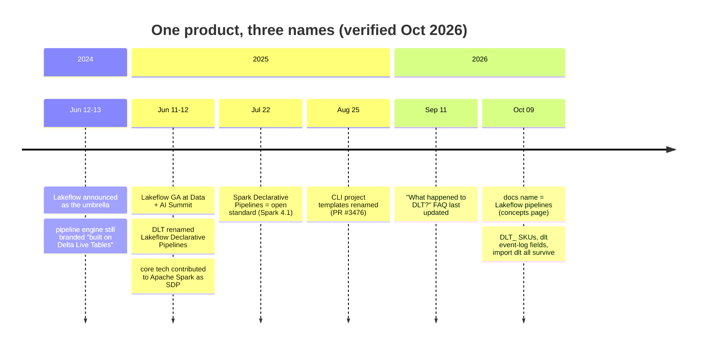
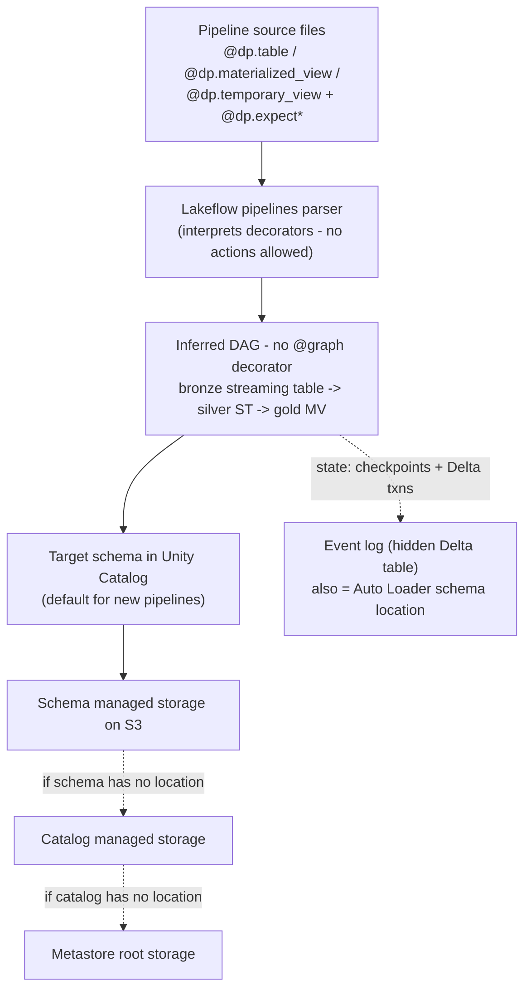
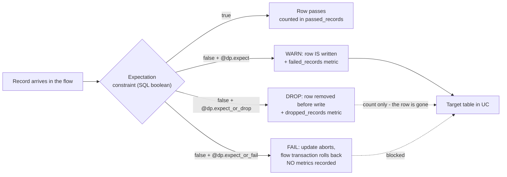
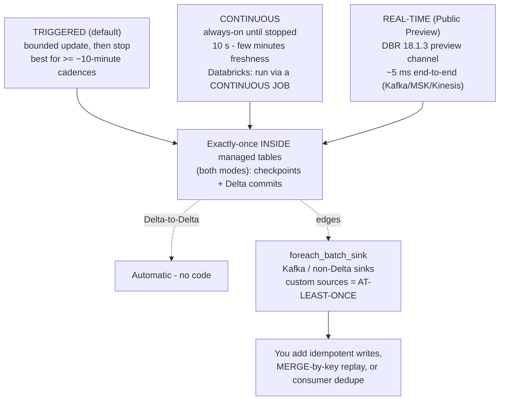
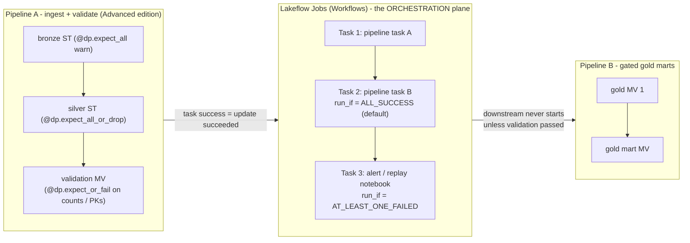

# Lakeflow Declarative Pipelines (formerly Delta Live Tables): Expectations, Modes and the DLT vs Jobs Decision

Every data estate eventually asks two questions of its ETL layer: *is the data any good?* and *did the job actually run?* On Databricks on AWS, the first question is answered inside **Lakeflow pipelines**: the product your 2023 tutorials called **Delta Live Tables (DLT)**: by a feature called **expectations**: per-record SQL checks with three graded actions (warn, drop, fail) and machine-readable metrics. The second question is answered by orchestration, which in the Databricks world means **Lakeflow Jobs** (Workflows). The single most expensive mistake in this domain is confusing the two planes: expectations enforce **data quality**, jobs enforce **orchestration**, and the docs say so in as many words: "**Expectations enforce data quality, not orchestration**" (docs.../ldp/expectation-patterns, dated **2026-07-14**).

This lesson teaches the product under its **current name with its full rename history**, because as of October 2026 your estate will contain all three names at once: notebooks with `import dlt`, invoices with `DLT_` SKUs, event-log fields with `dlt` in them, and documentation that says "Lakeflow pipelines". "The product formerly known as Delta Live Tables (DLT) has been updated to **Lakeflow pipelines**. If you have previously used DLT, there is **no migration required** to use Lakeflow pipelines: your code will still work" (docs.../ldp/concepts/where-is-dlt, footer **Sep 11, 2026**). Three names, one product, zero forced rewrites, and a billing surface that still says DLT.

```text
 =============================================================
  LESSON 07 MAP - Lakeflow pipelines on AWS, as of Oct 2026
 ------------------------------------------------------------
  Name       DLT -> Lakeflow Declarative Pipelines (GA 2025-06)
             -> "Lakeflow pipelines" in the docs (Oct 2026)
             open standard: Apache Spark Declarative Pipelines
             (SDP, pyspark.pipelines, Apache Spark 4.1)
  Model      pipelines | flows | streaming tables | MVs |
             views | sinks - the DAG is INFERRED (no @graph)
  Quality    6 expectation decorators, 3 actions
             warn (keep + metrics) | drop (remove + count)
             | fail (abort, NO metrics)
             metrics live in flow_progress EVENTS, not columns
             quarantine = documented PATTERN, not a decorator
  Modes      triggered (default, >= ~10 min cadences)
             | continuous (run it via a CONTINUOUS JOB)
             | real-time (Public Preview, DBR 18.1.3 preview)
  Compute    serverless is the default for new ETL pipelines
             (Unity Catalog required) | classic (Hive/legacy)
  Editions   Core (ingest) < Pro (+CDC) < Advanced (+expect)
  Meter      serverless $0.35/DBU reported on the pricing page
             (community thread 2025-07-10, staff-confirmed)
             classic DLT_CORE $0.20 / DLT_PRO $0.25 /
             DLT_ADVANCED $0.36 (third-party CSV, 2026-04-10 -
             corroboration only; confirm on the pricing page)
  -------------------------------------------------------------
  Rule of the lesson: pipelines enforce DATA quality;
  jobs enforce ORCHESTRATION. Never confuse the two.
 =============================================================
```

In this lesson you will:

- reconstruct the **naming timeline** (2024-06 Lakeflow announce → 2025-06 GA + DLT rename + Spark contribution → Oct 2026 docs name) and triage the **DLT vestiges** that survive it;
- write pipeline Python in the **`dp` API** and prove to yourself that the old `@dlt.expect` style still runs;
- apply all **six expectation decorators** and the **three actions**, and explain precisely why **fail records no metrics**;
- query expectation metrics from the **event log** and the Beta **`pipeline_events`** system table;
- build the **quarantine pattern** with NULL-safe rules so clean and bad rows partition the input exactly once;
- choose between **triggered, continuous and real-time** modes, and compute the **$105 vs $2,520 per month** cost shape of that choice;
- configure pipelines on AWS: **Unity Catalog storage cascade, serverless vs classic, editions, run-as service principals, Declarative Automation Bundles**;
- decide **Lakeflow pipelines vs Workflows jobs** with a decision matrix, study **NAB and Shell** on AWS, read the **2026 update box**, and practise with **twelve questions** plus four interactive checks.

---

## 1. One product, three names: the timeline you will be tested on

### 1.1 The rename, with dates

| Date | What Databricks announced | Source |
|---|---|---|
| **2024-06-12/13** | **Lakeflow** unveiled as the unified data-engineering umbrella (Connect + Pipelines + Jobs); the pipeline engine is "Lakeflow Pipelines, built on Delta Live Tables technology" | blog *Introducing Databricks Lakeflow* (**2024-06-13**) + press release (**2024-06-12**) |
| **2025-06-11/12** (Data + AI Summit) | **Lakeflow goes GA**; **DLT renamed Lakeflow Declarative Pipelines**, "100% source-compatible with the open standard" Apache Spark Declarative Pipelines and "100% backward-compatible with DLT pipelines"; core tech contributed to Apache Spark | blog *Announcing the GA of Databricks Lakeflow* (**2025-06-12**) |
| **2025-07-22** | "We've **contributed our core declarative pipeline technology to the Apache Spark™ project as Spark Declarative Pipelines** … It's now an open standard"; "**DLT is now Lakeflow Declarative Pipelines**, with the same core benefits and full backward compatibility" | blog *What's New in Lakeflow Declarative Pipelines: July 2025* (**2025-07-22**) |
| **2025-08-25** | Tooling catches up: Databricks CLI project templates renamed off "Delta Live Tables" (databricks/cli PR #3476, merged **2025-08-25**) | GitHub PR |
| **Oct 2026** | Docs product name is **"Lakeflow pipelines"**; the FAQ page *What happened to Delta Live Tables (DLT)?* (footer **2026-09-11**) documents the rename and the surviving DLT vestiges | docs .../ldp/ (concepts page dated **2026-10-09**) |



Course wording to memorise: **Delta Live Tables (DLT), renamed Lakeflow Declarative Pipelines at GA in June 2025 and now called Lakeflow pipelines in the docs: same product, three names, one timeline.** Two related names must not be confused with the product name: **Apache Spark™ Declarative Pipelines (SDP)** is the *open standard* Databricks extended ("All Lakeflow pipelines Python APIs are implemented in the `pyspark.pipelines` module"; "Apache Spark™ includes declarative pipelines **beginning in Spark 4.1**", docs.../ldp/developer/python-dev, dated **2026-07-10**), and **Lakeflow** is the *family*: **Lakeflow Connect** (managed ingestion), **Lakeflow Declarative Pipelines** (this lesson), **Lakeflow Jobs** (Workflows) (GA blog, 2025-06-12).

### 1.2 The vestiges: why your billing queries still grep for `dlt`

The FAQ page is explicit about what did *not* change: "There are still some references to the DLT name in Databricks. The **classic SKUs for Lakeflow pipelines still begin with `DLT`**, and **event log schemas with `dlt` in the name have not changed**. Python APIs that used `dlt` in the name can still be used, but Databricks recommends moving to the new names" (docs .../ldp/concepts/where-is-dlt, **2026-09-11**).

| Surface | Still says DLT (Oct 2026) | What you do about it |
|---|---|---|
| Classic DBU SKUs | `DLT_CORE_COMPUTE`, `DLT_PRO_COMPUTE`, `DLT_ADVANCED_COMPUTE` (and Photon variants) | Keep `DLT_` filters in cost queries |
| Serverless billing | `billing_origin_product` in (`JOBS`, **`DLT`**); SQL-warehouse MV refreshes show `billing_origin_product='SQL'` **with** `usage_metadata.dlt_pipeline_id` set (docs .../admin/system-tables/serverless-billing, **2026-06-01**) | Join on `dlt_pipeline_id`, not on the product name alone |
| Event-log fields | `dlt`-named fields in legacy schemas unchanged | Don't rewrite historical event queries |
| Python | `import dlt`, `@dlt.expect`, `dlt.read` still function | New code: `from pyspark import pipelines as dp` |

- **📚 Did you know?** A support ticket that reads "why is there a *pipeline* ID on our **SQL** bill?" has a documented answer: "When you create a materialized view in a Databricks SQL warehouse, a **serverless pipeline is created** to process refreshes", and the billing row appears as `billing_origin_product = 'SQL'` with `usage_metadata.dlt_pipeline_id IS NOT NULL` (docs.../admin/system-tables/serverless-billing, **2026-06-01**). Pipelines are not only the thing you build; they are also machinery other products spin up behind your back.

### 1.3 Worked example E1, the migration: legacy `dlt` code vs current `dp` code

**As of Oct 2026.** Team A ships a 2023-era DLT notebook. Team B asks whether to rewrite it. Answer per the docs: *no migration required, but the split of `@dlt.table` into two decorators matters*.

```python
# --- LEGACY STYLE (2022-2024 tutorials). STILL RUNS on Lakeflow pipelines.
import dlt

@dlt.table
@dlt.expect("order_id_not_null", "order_id IS NOT NULL")            # warn
@dlt.expect_or_drop("valid_amount", "amount IS NOT NULL AND amount >= 0")  # drop
def silver_orders():
    return spark.readStream.table("bronze_orders").filter("event_type = 'ORDER'")
```

```python
# --- CURRENT STYLE (docs .../ldp/developer/python-ref, dated 2026-08-06).
from pyspark import pipelines as dp

@dp.table                                                             # streaming DF -> streaming table
@dp.expect("order_id_not_null", "order_id IS NOT NULL")              # warn
@dp.expect_or_drop("valid_amount", "amount IS NOT NULL AND amount >= 0")
def silver_orders():
    return spark.readStream.table("bronze_orders").filter("event_type = 'ORDER'")
```

The mapping table from the Python reference (dated **2026-08-06**): learn the middle column, quote the left column only when reading old code:

| DLT (`import dlt`) | Lakeflow / SDP (`pipelines as dp`) | Note |
|---|---|---|
| `@dlt.table` on a **streaming** DF | `@dp.table` | creates a **streaming table** |
| `@dlt.table` on a **batch** DF | `@dp.materialized_view` | the 2025 split: same decorator, two dataset kinds |
| `@dlt.view` | `@dp.temporary_view` | evaluated on demand, not persisted |
| `dlt.read(t)` / `dlt.read_stream(t)` | `spark.read.table(t)` / `spark.readStream.table(t)` | plain Spark readers inside dataset functions |
| `dlt.apply_changes(...)` | `dp.create_auto_cdc_flow(...)` | Databricks-only (not in Apache Spark), Pro edition+ |
| `@dlt.create_sink` | `dp.create_sink` | sinks cannot carry expectations |
| `@dlt.expect*` | `dp.expect*` | six decorators, Databricks-only (not in SDP) |
|: (unavailable in DLT) | `@dp.update_flow`, `dp.foreach_batch_sink`, `dp.create_auto_cdc_from_snapshot_flow`, `dp.replace_flow` | new Lakeflow capabilities |

Two traps visible in this example. First, the **decorator split**: `@dlt.table` used to cover both dataset kinds; `@dp.table` with a *batch* DataFrame (or `@dp.materialized_view` with a streaming one) mis-declares the dataset and breaks flow planning (python-ref mapping, 2026-08-06). Second, the **NULL-safe predicate**: `amount >= 0` drops only rows where the predicate is *false*; a NULL amount evaluates to NULL and is **kept** by drop-mode expectations. Write `amount IS NOT NULL AND amount >= 0` (section 5 returns to this with the quarantine partition proof).

> ⚠️ **WARNING, do not copy-paste the rest of a 2023 DLT blog post.** Old material also says "set continuous in the pipeline settings for production", "query `LIVE.my_table`", and "serverless is preview". As of Oct 2026: default publishing mode **ignores `LIVE`** (query `catalog.schema.table`), **serverless is the default** for new ETL pipelines, and Databricks **discourages the built-in continuous setting for new pipelines**, wrap the pipeline in a **continuous job** instead (docs.../ldp/concepts/pipeline-mode, accessed 2026-10;.../ldp/serverless, **2026-10-09**;.../ldp/target-schema, **2026-09-11**).

---

## 2. The declarative model: what you write vs what the platform does

### 2.1 Pipelines, flows, datasets, and an inferred DAG

"A pipeline is the main unit of development and execution of Apache Spark™ Declarative Pipelines (SDP) in Lakeflow. A pipeline is a collection of source code files and a configuration" (docs.../ldp/concepts/pipelines, dated **2026-10-09**). The concepts page names the building blocks: "pipelines, **flows**, **streaming tables**, **materialized views**, and **sinks**" (docs.../ldp/concepts/, dated **2026-08-15**). You declare datasets with decorators; the platform "automatically infer[s] dependencies between datasets and arrange[s] them in a **directed acyclic graph (DAG)**"; **there is no `@graph` decorator**; the graph is inferred from what your dataset functions read (concepts/pipelines, 2026-10-09).

| Dataset kind | Python | Semantics (concepts, 2026-08-15) |
|---|---|---|
| **Streaming table** | `@dp.table` returning a **streaming** DataFrame | "Each record is processed **exactly one time**, assuming an append-only source" |
| **Materialized view** | `@dp.materialized_view` returning a **batch** DataFrame | "Results are recomputed as needed" (incremental refresh on serverless) |
| **View** | `@dp.temporary_view` | "Evaluated on demand, not persisted" |
| **Sink** | `dp.create_sink` / `dp.foreach_batch_sink` | custom/external writes, and the exactly-once envelope ends here |

A **flow** is the processing edge: "A flow reads data from a source, applies user-defined processing logic, and writes the result into a target … (Currently, only the **Append** and **Update** flows are exposed.)" (concepts, 2026-08-15). Append flows are the default, one per target; update flows are Python-only via `@dp.update_flow`.



### 2.2 Coding laws: the engine evaluates your function repeatedly

"Python pipeline code does not directly call the functions that perform data ingestion and transformation … Instead, Lakeflow pipelines **interpret the decorator functions** … and build a dataflow graph" (docs.../ldp/developer/python-dev, **2026-07-10**). Dataset functions "must return a Spark DataFrame", and you must never call `collect()`, `count()`, `toPandas()`, `save()`, `saveAsTable()`, `start()`, `toTable()` inside them: the planner evaluates definitions multiple times, so actions and side effects break idempotency. Reading other datasets is done with ordinary Spark readers (`spark.read.table`, `spark.readStream.table`, SQL `STREAM(...)`), not a special `source()` helper.

### 2.3 Sources on AWS: where the bytes come from

| Source | How (docs, Oct 2026) | AWS-substrate note |
|---|---|---|
| **Unity Catalog tables** | batch `spark.read.table` → materialized view; streaming `spark.readStream.table` → streaming table; SQL `STREAM(cat.schema.table)` | governed by UC grants |
| **Auto Loader / `read_files`** | `spark.readStream.format("cloudFiles").load(<path>)` or SQL `read_files("/path", format => "json")` | "**Auto Loader using the `read_files()` function to read from Unity Catalog external locations**": external location + storage credential (IAM role) + **`READ FILES`** grant required (docs.../ldp/unity-catalog, **2026-10-09**;.../ldp/load, **2026-08-15**) |
| **Kafka / Amazon MSK, Kinesis** | streaming sources in UC pipelines | the AWS-native streaming pair; Event Hubs is Azure |
| **Lakeflow Connect** | managed connectors → pipeline type `MANAGED_INGESTION` | SaaS sources without writing code |
| **Hive metastore** | via the federation catalog | **cannot be upgraded to UC**: clone + re-ingest (unity-catalog doc, 2026-10-09) |

Inside pipelines the platform owns the plumbing: "If you use Lakeflow pipelines, Databricks manages schema location and other checkpoint information automatically" (auto-loader schema docs, **2026-07-10**), and "The **event log location also serves as the schema location** for any Auto Loader queries in the pipeline" (docs .../ldp/monitor-event-logs, **2026-10-09**). The Auto Loader best-practices page states the production default plainly: "For most users and production pipelines, **Auto Loader with Lakeflow pipelines is a good fit**. However, if you need maximum control and customization, use Auto Loader with Structured Streaming" (docs, **2026-06-29**).

> [!IMPORTANT]
> ⚠️ **Never delete the event log.** The same page warns: "Do not delete the event log or the parent catalog or schema … Deleting the event log might result in your pipeline failing to update during future runs"; because that location doubles as the **Auto Loader schema location**. Moving or publishing the event log is a schema-tracking event, not a housekeeping one (docs.../ldp/monitor-event-logs, **2026-10-09**).

---

## 3. Expectations: six decorators, three actions, one rulebook

### 3.1 The verified inventory: exactly six, no quarantine decorator

"Expectations are optional clauses in pipeline materialized view, streaming table, or view creation statements that apply data quality checks on each record passing through a query. Expectations use standard SQL Boolean statements" (docs.../ldp/expectations, footer **Sep 11, 2026**). The Python reference (dated **2026-09-11**) is unambiguous: "The `dp` module includes **six decorators** to control expectations behavior", and the canonical order is *after* the dataset decorator and *before* the function:

| Decorator | Signature | Action on violation |
|---|---|---|
| `@dp.expect(description, constraint)` | single check | **warn** (default): row is **written** to the target; passed/failed counted |
| `@dp.expect_or_drop(...)` | single check | **drop**: "Invalid records are dropped before data is written to the target. The count of dropped records is logged alongside other dataset metrics" |
| `@dp.expect_or_fail(...)` | single check | **fail**: "Invalid records prevent the update from succeeding. Manual intervention is required before reprocessing" |
| `@dp.expect_all({description: constraint, ...})` | **dict** of checks | warn on any failure |
| `@dp.expect_all_or_drop({...})` | dict | drop on any failure |
| `@dp.expect_all_or_fail({...})` | dict | fail the update on any failure |

SQL twin (for SQL-authored datasets): `CONSTRAINT name EXPECT (expr)` with optional `ON VIOLATION DROP ROW` or `ON VIOLATION FAIL UPDATE`. There is **no `expect_all_or_quarantine` decorator**: quarantine is a documented *pattern* you build yourself (section 5). Expectations require the **Advanced** product edition: "Core to run streaming ingest workloads … doesn't require advanced features such as change data capture (CDC) or expectations. Pro … plus … CDC. Advanced … and includes **data quality constraints with expectations**" (docs.../ldp/configure-pipeline, dated **2026-10-01**).

### 3.2 The three actions, drawn



Three clauses from the expectations doc (2026-09-11) that decide production design:

1. "**Because `fail` causes the update to fail when an invalid record is detected, metrics are not recorded.**" Fail is a *stop sign*, not a *measurement instrument*: never instrument a table with fail-mode expectations and then wonder why your quality dashboard is blank.
2. "An expectation **name must be unique for a given dataset**. You can reuse expectations across multiple datasets in a pipeline."
3. Constraints "must use valid SQL syntax and cannot contain … Custom Python functions, External service calls, Subqueries referencing other tables." No UDFs, no external APIs, no cross-table checks: if you need those, they belong in a validation notebook or a separate pipeline.

Run-mode semantics matter too: "In a triggered pipeline, the failure of a single flow does not cause other parallel flows to fail. In a continuous pipeline, an expectation failure **stops the flow, all dependent flows**, and the pipeline emits a message explaining why it stopped" (same page). The docs' own debugging artifact for fail-mode: `[EXPECTATION_VIOLATION.VERBOSITY_ALL] Flow 'sensor-pipeline' failed to meet the expectation. Violated expectations: 'temperature_in_valid_range'. Input data: '{"id":"TEMP_001",…}'`: flow name, expectation name, and the offending record, in one error.

### 3.3 Worked example E2: one medallion pipeline, all three actions

**As of Oct 2026, serverless, Advanced edition, Unity Catalog targets.** The complete pipeline source (adapted from the docs' worked shape; `@dlt.expect*` aliases work identically):

```python
# file: transformations/orders_pipeline.py   (pipeline source; NO actions allowed)
from pyspark import pipelines as dp
from pyspark.sql.functions import col, expr

LANDING = "/Volumes/lake/landing/orders/"   # UC volume; external location also fine

bronze_rules = {
    "order_id_not_null": "order_id IS NOT NULL",
    "event_ts_not_null": "event_ts IS NOT NULL",
}

@dp.table(
    name="bronze_orders",
    table_properties={"quality": "bronze", "pipelines.autoOptimize.managed": "true"},
    # path omitted -> managed storage of the target schema (the S3 cascade)
)
@dp.expect_all(bronze_rules)                     # WARN: keep rows, emit metrics
def bronze_orders():
    return (
        spark.readStream.format("cloudFiles")
             .option("cloudFiles.format", "json")
             .option("cloudFiles.schemaEvolutionMode", "addNewColumns")
             .load(LANDING)
    )

silver_rules = {
    "valid_order_id":  "order_id IS NOT NULL",                          # total (NULL-safe)
    "valid_amount":    "amount IS NOT NULL AND amount >= 0",
    "valid_currency":  "currency IN ('USD','EUR','GBP')",
}

@dp.table(name="silver_orders")
@dp.expect_all_or_drop(silver_rules)            # DROP: bad rows excluded, counts logged
def silver_orders():
    return (
        spark.readStream.table("bronze_orders")
             .filter(expr("event_type = 'ORDER'"))
    )

@dp.materialized_view(name="gold_daily_revenue")
@dp.expect_or_fail("row_count_positive", "total_revenue >= 0")   # FAIL: abort this flow
def gold_daily_revenue():
    return (
        spark.read.table("silver_orders")
             .groupBy("order_date", "currency")
             .agg(col("amount").sum().alias("total_revenue"))
    )
```

Narrate the graph before you run it: **bronze warns** (metrics only, bronze is for forensics, not serving), **silver drops** (bad rows never reach consumers; only counts remain, section 5 shows what to do when counts are not enough), **gold fails** (a negative revenue total is impossible, so stop the update rather than publish it). The engine infers the DAG (`bronze_orders` → `silver_orders` → `gold_daily_revenue`), publishes all three to the pipeline's **target schema in Unity Catalog** (physically landing in that schema's managed S3 storage), and a **triggered** update processes the data available at start, then stops. Note the dataset-kind split in action: `gold_daily_revenue` is a *batch* aggregation, so it is `@dp.materialized_view`, not `@dp.table`.

---

## 4. Metrics: where expectation numbers actually live

### 4.1 The event-log payload is the metrics API

Metrics are **not** columns on your target table. Current docs define them purely as **event-log payloads**: "the metrics for the number of records that passed and failed an expectation are stored in the `details:flow_progress.data_quality.expectations` object. The metric for the number of dropped records is stored in the `details:flow_progress.data_quality` object. Events … have the event type `flow_progress`" (docs .../ldp/monitor-event-logs, **2026-10-09**). The expectations array schema is published: `array<struct<name: string, dataset: string, passed_records: int, failed_records: int>>`, and `dropped_records` counts rows that "failed one or more expectations".

Three surfaces read the same numbers:

1. **Pipeline monitoring UI → dataset → Data quality tab** (warn/drop expectations; the human view).
2. **The per-pipeline event log**: a hidden Delta table queryable as `SELECT * FROM event_log(<pipeline_id>)` (formatted `event_log_{pipeline_id}`), which you can **publish** to a named Unity Catalog table for wider access (Advanced settings JSON `{"event_log": {"catalog", "schema", "name"}}`).
3. **The `pipeline_events` system table (Beta)**: `system.lakeflow_pipeline_events_preview.pipeline_events`, which "contains events for all pipelines across the workspaces in a region" and is now the **recommended** query surface, complete with a downloadable Lakeview dashboard (docs.../ldp/monitor-and-query-events, **2026-10-09**).

> ⚠️ **Do not go hunting for `_expectation_name` columns on your silver table.** Older community material shows expectation metadata columns; the current docs define the contract above and nothing else. If your monitoring SQL selects `_expectation_*` from a pipeline table, you are running stale code (docs .../ldp/monitor-event-logs, **2026-10-09**; expectations doc, **2026-09-11**). And remember: fail-mode expectations leave **no metrics by design**, which is exactly why fail belongs in orchestrated gates (section 7), not in monitored serving tables.

### 4.2 Worked example E3, DQ monitoring SQL: event log, system table, bill

```sql
-- (a) Per-update expectation metrics from the per-pipeline event log
WITH exploded AS (
  SELECT explode(from_json(
           details:flow_progress:data_quality:expectations,
           "array<struct<name: string, dataset: string, passed_records: int, failed_records: int>>"
         )) AS row_expectations
  FROM event_log(<pipeline_id>)
  WHERE event_type = 'flow_progress'
)
SELECT row_expectations.dataset           AS dataset,
       row_expectations.name              AS expectation,
       SUM(row_expectations.passed_records) AS passing_records,
       SUM(row_expectations.failed_records) AS failing_records
FROM exploded
GROUP BY 1, 2;

-- (b) Region-wide, cross-pipeline (Beta system table; requires USE/SELECT on system schemas)
SELECT pipeline_id, update_id,
       coalesce(expectation.dataset, origin.dataset_name) AS dataset_name,
       expectation.name,
       SUM(expectation.failed_records) AS failed
FROM system.lakeflow_pipeline_events_preview.pipeline_events
LATERAL VIEW explode(variant_get(details,
  '$.flow_progress.data_quality.expectations',
  'ARRAY<STRUCT<name:STRING,dataset:STRING,passed_records:BIGINT,failed_records:BIGINT>>')) AS expectation
WHERE event_type = 'flow_progress'
GROUP BY 1, 2, 3, 4
HAVING SUM(expectation.failed_records) > 0;

-- (c) What did this pipeline cost? (billing still keys on the dlt_pipeline_id)
SELECT sku_name, product_features.performance_target, SUM(usage_quantity) AS dbus
FROM system.billing.usage
WHERE usage_metadata.dlt_pipeline_id = '<pipeline_id>'
GROUP BY 1, 2;
```

Query (c) is the §1.2 vestige table in executable form: pipelines bill under `usage_metadata.dlt_pipeline_id`, and serverless rows carry `product_features.performance_target` ∈ {`PERFORMANCE_OPTIMIZED`, `STANDARD`} (docs .../admin/system-tables/serverless-billing, **2026-06-01**). The **Data quality** tab in the UI is fine for a human checking one dataset; queries (a) and (b) are what you put in a scheduled alert or a Lakeview health dashboard.

- **📚 Did you know?** Pipelines retain "**60 days** of past updates in the pipeline UI and the Pipelines API" (docs.../ldp/configure-pipeline, **2026-10-01**), but "older ones remain only in the event log". Any audit or incident review that reaches back beyond 60 days is an **event-log** (or published event-log table) query, which is one more reason never to delete that table.

---

## 5. Quarantine: a pattern, not a decorator, and the NULL trap inside it

When drop-mode expectations are too destructive (regulated data, replay requirements) you need the bad rows *kept*. Databricks documents the recipe: a **temporary streaming table partitioned by a computed `is_quarantined` flag**, annotated with `@dp.expect_all(rules)` so metrics still flow, then two views that split the stream (docs.../ldp/expectation-patterns, dated **2026-07-14**).

### 5.1 Worked example E4: the official quarantine shape, made NULL-safe

```python
from pyspark import pipelines as dp
from pyspark.sql.functions import expr

rules = {
    "valid_pickup_zip":  "(pickup_zip IS NOT NULL)",
    "valid_dropoff_zip": "(dropoff_zip IS NOT NULL)",
}
# NOT(all rules) -> TRUE means "at least one rule failed" (NULL-safe: rules are total)
quarantine_expr = "NOT({0})".format(" AND ".join(rules.values()))

@dp.view
def raw_trips_data():
    return spark.readStream.table("samples.nyctaxi.trips")

@dp.table(temporary=True, partition_cols=["is_quarantined"])
@dp.expect_all(rules)                            # metrics still recorded per rule
def trips_data_quarantine():
    return (spark.readStream.table("raw_trips_data")
                 .withColumn("is_quarantined", expr(quarantine_expr)))

@dp.view
def valid_trips_data():
    return spark.read.table("trips_data_quarantine").filter("is_quarantined = false")

@dp.view
def invalid_trips_data():
    return spark.read.table("trips_data_quarantine").filter("is_quarantined = true")
```

Then, in production, promote `invalid_trips_data` to a real `@dp.table(name="trips_quarantine")` (it must persist on S3 under Unity Catalog: for UC pipelines that means the schema's managed storage, the catalog location, or the metastore root, in that fallback order) and **alert on its row count**; nothing in the platform auto-replays or auto-expires quarantine tables.

> [!WARNING]
> **The NULL trap in every hand-rolled split.** `expect_or_drop` drops a row only when the predicate is **false**: SQL NULL is *not* false. So the naive rule `fare > 0` silently **keeps** NULL fares, and its negation `NOT(fare > 0)` is also NULL, meaning a NULL-fare row lands in *neither* branch of a `valid`/`invalid` split and your two branches no longer partition the input. Make every rule **total** (`fare IS NOT NULL AND fare > 0`) or compute a single explicit boolean and branch on *it*, exactly as the `is_quarantined` flag above does (documented pattern, expectation-patterns, **2026-07-14**; NULL behaviour, expectations doc, **2026-09-11**).

**Replay story (course practice, consistent with the documented pattern):** triage quarantine rows → fix upstream or accept them → re-run the same filtered transform with a widened predicate or `MERGE` from the quarantine table after repair → the pipeline's next update continues (Delta ACID + pipeline state keep replays idempotent **as long as you replay by key**, not by blind append) → archive or drop quarantine rows under UC `MODIFY` rights with an audit trail.

---

## 6. Modes and guarantees: triggered, continuous, real-time

### 6.1 The mode table

"Triggered mode refreshes available data and stops, while continuous mode keeps tables fresh as new data arrives" (docs .../ldp/concepts/pipeline-mode, accessed 2026-10). Two facts students routinely get wrong: "**Pipeline mode is independent of the type of table** being computed" (both MVs and streaming tables update in either mode), and "Refresh operations for **standalone** materialized views and streaming tables **always run using triggered pipeline mode**".

| | **Triggered** (default) | **Continuous** | **Real-time** (Public Preview) |
|---|---|---|---|
| Lifecycle | "Automatically when complete": processes data available at start, then stops | "Runs continuously until manually stopped" | a flow-level optimisation **on top of continuous** |
| Freshness | "every 10 minutes, hourly, or daily" | "between every 10 seconds and a few minutes" | end-to-end "as low as **five milliseconds**" |
| Cost shape | pay per update | always-on compute: the biggest lever in this lesson | always-on, low-latency |
| Extras | cheapest; standalone MVs/STs only here | auto-skips work when dependent Delta tables haven't changed; cadence via `pipelines.trigger.interval` (prefer **per table**: streaming and batch flows "have different defaults") | DBR **18.1.3 preview channel**; `spark.databricks.streaming.realTimeMode.enabled=true` + `pipelines.trigger: RealTime` on an `@dp.update_flow` targeting a `dp.create_sink`; Kafka/MSK in+out, Kinesis in (EFO), **Delta not supported**; one real-time flow per pipeline recommended |

### 6.2 Exactly-once: inside the envelope and at its edges

"Lakeflow pipelines give you **exactly-once processing by default within the tables they manage**, and at the edges you add idempotent writes to keep re-runs safe" (docs.../ldp/best-practices/processing-guarantees, dated **2026-08-15**). Mechanism: "Streaming tables use Structured Streaming checkpoints combined with Delta Lake's transactional writes: each micro-batch commits its source offsets and its output together, so a retried batch after a failure either fully succeeds or is fully rolled back … **never partially applied twice**", for Auto Loader, Kafka, Kinesis and `AUTO CDC` upserts, "without any code from you". The rule of thumb: "if your entire pipeline is **Delta-to-Delta** … you already have exactly-once." Where it stops: `foreach_batch_sink`, Kafka/non-Delta sinks and custom Python sources are **at-least-once**, make the write idempotent or dedupe downstream.



### 6.3 The continuous-job rule (production hygiene)

Databricks' current guidance is a pattern, not a preference: "Databricks recommends running continuous pipelines with a **continuous job** rather than setting … Pipeline mode to continuous … the job manages the pipeline's execution lifecycle and unlocks serverless performance modes, such as Standard mode, that the pipeline's built-in continuous mode doesn't support." And when a job orchestrates a pipeline, "the job determines the execution mode and takes precedence … **set the pipeline's Pipeline mode to triggered (the default) when you wrap it in a continuous job.**" The built-in setting "is not being removed, but Databricks **discourages its use for new pipelines**" (docs .../ldp/concepts/pipeline-mode, accessed 2026-10). Real-time mode rides the same stack: "Continuous mode is still required" (docs .../ldp/real-time, accessed 2026-10).

### 6.4 Worked example E5: the mode decision, in dollars

**As of Oct 2026.** Arithmetic on the documented rates: serverless Lakeflow pipelines are reported at **$0.35/DBU** (customer quotation of the pricing page confirmed in substance by a Databricks staff answer, "While the **DBU price is the same for both modes**, the Performance Optimized mode … can significantly increase total cost due to higher DBU consumption", Databricks Community, **2025-07-10**); classic DLT SKUs corroborated by a third-party rate CSV (fetched **2026-04-10**): `DLT_CORE_COMPUTE` **$0.20**, `DLT_PRO_COMPUTE` **$0.25**, `DLT_ADVANCED_COMPUTE` **$0.36**, treat that CSV as SKU-name corroboration and confirm the live card before you sign a budget.

```text
Worked example E5 - triggered vs continuous, 10 DBU/hour burn rate
(a) Triggered, nightly 1-hour update, serverless:
      10 DBU/h x 1 h x $0.35/DBU  = $3.50/night  ~= $105/month (30 days)
(b) Continuous, always-on, serverless (same burn rate):
      10 DBU/h x 24 h x $0.35/DBU = $84/day      ~= $2,520/month
(c) Same nightly run on classic Advanced edition (DBU column only):
      10 DBU/h x 1 h x $0.36/DBU  = $3.60/night  (+ EC2 - separate bill)
DELTA of the mode choice ............ ~$2,415/month
Break-even question to ask the business:
  "Is data that is up to ~24 hours late worth more than $2.4k/month?"
  If no -> triggered. If yes -> continuous job, then tune the interval.
```

```plot
{
  "type": "bar",
  "title": "Monthly DBU cost at a 10 DBU/h burn rate (worked example E5, as of Oct 2026)",
  "data": [
    {"mode": "Triggered nightly 1h (serverless $0.35/DBU)", "usd_per_month": 105},
    {"mode": "Triggered nightly 1h (classic ADV $0.36/DBU, DBU only)", "usd_per_month": 108},
    {"mode": "Continuous 24x7 (serverless $0.35/DBU)", "usd_per_month": 2520}
  ],
  "xKey": "mode",
  "dataKeys": ["usd_per_month"],
  "xLabel": "Pipeline mode and rate",
  "yLabel": "USD per month (DBU column only)"
}
```

The break-even framing is the discipline this course wants: **start triggered**, and buy continuous (or real-time) only with a latency SLA whose business value beats the always-on premium. The same maths extends to performance modes: standard serverless performance mode "typically start[s] within **four to six minutes** after being triggered" and "Both modes use the same SKU, but standard performance mode consumes **fewer DBUs**": the saving is in consumption, not rate, and standard mode for continuous pipelines is only reachable through a continuous job with "Performance optimized" cleared (docs.../ldp/serverless, **2026-10-09**).

---

## 7. Topology: one pipeline or many? (and why expectations cannot gate)

### 7.1 One pipeline: the medallion graph in a single update

A single pipeline can host bronze→silver→gold: the engine infers the dependencies, publishes every non-`private` dataset to the target schema, and lets you hide intermediates with `private=True` (table ref, **2026-08-06**). You get one update, one compute assignment, automatic ordering and shared incremental state; which is why the worked example E2 graph is one pipeline. But orchestration logic **cannot live inside it**: a validation dataset with `expect_or_fail` fails only its own flow (triggered mode) or its dependents (continuous mode), and "A validation table doesn't gate its downstream tables … To stop downstream processing when a validation fails, **split the validation logic and the downstream work into separate pipelines and orchestrate them with a job**" (expectation-patterns, **2026-07-14**).



Practical rule for this course: **one pipeline per bounded domain/SLA** (e.g., orders ingest+clean; a second pipeline for the gated gold marts), jobs orchestrating them in order, run as a **service principal**. The job's default `run_if = ALL_SUCCESS` is what turns a fail-mode expectation into a real gate: "Because a pipeline task fails when its update fails, the downstream task doesn't run unless the validation pipeline succeeds" (expectation-patterns, 2026-07-14).

### 7.2 Development updates vs production updates

Interactive updates from the **Lakeflow Pipelines Editor** (the "IDE for data engineering" announced in the GA release, with code-DAG pairing, contextual previews and selective execution of a single file/table) use "fast-start, debugging-focused behavior"; updates from **Jobs or the Pipelines API, and all continuous updates, use automatic retry and restart** (cluster restart on recoverable errors such as stale credentials, retry on cluster-start failure, cluster torn down after the run) (monitor-event-logs, 2026-10-09; updates doc). Production hygiene checklist: schedule a **pipeline task** in Workflows (update triggers are "Manual … Scheduled (jobs) … Programmatic"), set **run-as** to a service principal ("Running pipelines as service principals is considered a best practice because they are not tied to individual users"), promote code with **Declarative Automation Bundles**, keep the pipeline **triggered** unless a proven sub-second SLA demands continuous/real-time, and remember the **60-day** UI/API history window.

---

## 8. Configuring the pipeline on AWS: storage, compute, editions, identity

### 8.1 Where the data lands: the Unity Catalog storage cascade

"Unity Catalog is the **default** for newly created pipelines" and a **requirement** for serverless (docs .../ldp/unity-catalog, **2026-10-09**). Storage follows one rule: "Data for materialized views and streaming tables are stored in the **storage location for the containing schema**. If a schema storage location is not specified, tables are stored in the **catalog** storage location. If schema and catalog storage locations are not specified, tables are stored in the **root storage location of the metastore**." Two overrides to know cold:

- The Python **`path=`** parameter on `@dp.table(...)`/`create_table`, "A storage location for table data. **If not set, use the managed storage location for the schema containing the table**" (table ref, **2026-08-06**), the supported way to pin a pipeline table to an explicit location (e.g., a UC volume or an external-location-backed S3 prefix).
- The SQL **`LOCATION` property is not supported** when defining tables in UC pipelines (unity-catalog limitations, 2026-10-09). Legacy `storage` pipeline settings (pre-**February 5, 2025** pipelines, Hive-metastore era) default to `dbfs:/pipelines/` and "cannot be changed after a pipeline is created" (properties ref, **2026-07-14**).

Deletion semantics also changed with UC: deleting a pipeline **retains** its tables by default (they go inactive but remain queryable); `DELETE /api/2.0/pipelines/{id}?cascade=true` removes them; `UNDROP` recovers dropped tables within **7 days**; and backing data lives under a `__databricks_internal` catalog: "This is expected" (unity-catalog doc, 2026-10-09).

### 8.2 Serverless vs classic (AWS)

New ETL pipelines default to "**Unity Catalog · Current channel · Serverless compute**" (configure-pipeline, 2026-10-01). Serverless requirements: UC-enabled workspace, accepted serverless terms, a **serverless-enabled region** (check the region support matrix, do not assume), and "If you need to use an **AWS PrivateLink** connection with your serverless Lakeflow pipelines, **contact your Databricks representative**" (serverless doc, 2026-10-09). No cluster-creation permission is required. Serverless-only capabilities: "**Incremental refresh for Materialized views**", "**Stream pipelining**" (enabled by default) and "**Vertical autoscaling**". Classic remains for legacy Hive metastore pipelines, unsupported network setups and non-serverless regions; its knobs are enhanced autoscaling, worker/driver instance types, instance profile, cluster policy, cluster tags and the Photon toggle. You cannot mix: one pipeline writes to either UC or Hive metastore, never both, and "Existing pipelines that use the Hive metastore **cannot be upgraded** to use Unity Catalog … you must create a new pipeline and re-ingest data" (unity-catalog doc, 2026-10-09).

### 8.3 Worked example E6, production wiring: DAB bundle, pipeline config, continuous job, run-as

```yaml
# databricks.yml (Declarative Automation Bundles - the documented CI/CD vehicle)
bundle:
  name: orders-lakeflow
resources:
  pipelines:
    orders_pipeline:
      name: orders_etl
      channel: CURRENT
      serverless: true
      edition: ADVANCED               # expectations need Advanced
      catalog: lake
      schema: silver
      pipeline_mode: TRIGGERED        # leave triggered; the JOB owns execution mode
      continuous: false
      configuration: {}               # extra JSON settings if needed (e.g. spark_conf)
  jobs:
    orders_continuous:
      name: orders-continuous
      continuous: true                # continuous JOB - the recommended pattern
      tasks:
        - pipeline_task:
            pipeline_key: orders_pipeline
        - job_task:
            notebook_path: ../notebooks/alert_on_quarantine.py
            depends_on: [ orders_pipeline ]
run_as:
  service_principal_name: "sp-lakeflow-prod"
targets:
  dev:  { mode: development }
  prod: { mode: production, git_branch: main }
```

The run-as identity must hold, in Unity Catalog: "`USE CATALOG` on the target catalog; `USE SCHEMA` and `CREATE TABLE` on the target schema; `MODIFY` permission on existing tables that the pipeline updates" (configure-pipeline, 2026-10-01): plus cloud-storage access via **storage credentials** and **external locations** (the IAM-role-backed objects from lesson 03) for every S3 path the pipeline touches. Note every non-obvious line: `pipeline_mode: TRIGGERED` + `continuous: true` on the **job** is the §6.3 pattern (the job takes precedence anyway, but leaving the pipeline on triggered avoids surprises); `edition: ADVANCED` is the §3.1 gate for expectations; and the dev/prod **targets** promote the same code without forking it.

- **📚 Did you know?** The Auto Loader **file-notification** mode has a hard scale limit you will hit eventually: "**100 pipelines per S3 bucket**" in classic file-notification mode (docs, 2026-10, via digest 07). Managed file events (DBR 14.3 LTS+) use one queue per external location instead; which is another reason external locations, not raw `s3://` paths, are the unit of ingestion governance on AWS.

---

## 9. Lakeflow pipelines vs Workflows jobs: the decision matrix

The docs' framing: pipelines are "declarative datasets + flows" with managed state and incremental processing; classic jobs are for work the abstraction hides. Auto Loader best practices make the default explicit: "For most users and production pipelines, **Auto Loader with Lakeflow pipelines is a good fit**. However, if you need maximum control and customization, use Auto Loader with Structured Streaming" (2026-06-29).

| Dimension | **Lakeflow pipeline** | **Workflows job (notebook/JAR/Python tasks)** |
|---|---|---|
| State & checkpoints | Managed: checkpoints + Delta commits give exactly-once on managed tables | You build and babysit checkpoints (`checkpointLocation`), idempotency, retries |
| Data quality | **Expectations** (six decorators, warn/drop/fail + metrics) | Hand-rolled asserts in the notebook; no metrics contract |
| Orchestration | DAG **of datasets**, inferred; no branching/conditionals | Full control flow: `ifelse`, `forEach`, `run_if`, dependencies, retries, notifications |
| Non-DataFrame work | Not allowed (no actions in dataset functions) | API calls, ML training, file moves, `%pip` jobs: anything imperative |
| Libraries | Third-party **Python only**: "**JARs are not supported**" for UC pipelines | JARs, Spark Submit, environments, libraries scopes |
| Compute | Serverless by default (UC only); classic for Hive/legacy | Serverless jobs by default, classic job clusters, all-purpose (interactive only) |
| Cost shape | Per-DBU serverless (`$0.35/DBU` reported) or classic `DLT_*` SKU; continuous = always-on | Jobs Compute `$0.15/DBU` classic + EC2, or jobs serverless `$0.35/DBU` |
| Portability | Built on **Apache Spark Declarative Pipelines** (open standard, Spark 4.1): SDP code moves | Databricks-only job APIs |
| Production shape | Pipeline **task inside a multi-task job** (schedule, retries, run-as, notifications) | Multi-task jobs, DABs, Airflow/Step Functions at the edge |

In practice production estates **combine** them: a pipeline task inside a multi-task job for scheduling, dependencies, retries and notifications; separate pipelines coordinated by job dependencies for quality gates (§7.1); and classic jobs for the non-DataFrame work no dataset function may contain.

> **Comparative Verdict: Lakeflow pipelines (DLT) vs Workflows jobs (as of Oct 2026)**
> - **Lakeflow pipeline**, the **default answer for incremental batch-or-stream ETL over Delta**. You declare datasets and expectations; the platform infers the DAG, manages checkpoints, applies schema evolution, emits exactly-once on managed tables, records quality metrics and publishes to Unity Catalog, on serverless by default, with serverless-only extras (incremental MV refresh, stream pipelining, vertical autoscaling). Buy the **Advanced** edition when you need expectations; wrap continuous workloads in a **continuous job**; treat the built-in continuous setting as legacy for new pipelines.
> - **Workflows job**: the **default answer for orchestration and everything non-DataFrame**: scheduling (pipeline tasks, notebook tasks, `run_if` gates), retries, notifications, run-as service principals, branching, JAR/Spark-Submit work, ML training, file moves. Jobs are also where *cross-pipeline quality gates* live, because expectations cannot gate a pipeline's own downstream datasets.
> - **Verdict in one line:** *pipelines for the data plane, jobs for the control plane: one pipeline per bounded domain/SLA, gated by a validation pipeline inside a multi-task job, running as a service principal, triggered by default, continuous only against a written latency SLA.* Portability bonus: the pipeline half is open-standard SDP; the job half is Databricks-native.

---

## 10. The traps: twelve confusions this lesson will not let you keep

1. **"DLT is gone."** Half-right and operationally dangerous: the product is now Lakeflow pipelines, but `DLT_` SKUs, `dlt` event-log fields, `billing_origin_product='DLT'` and `import dlt` all survive: new code uses `dp`, monitoring still greps `dlt`.
2. **"`@dlt.table` covers both dataset kinds."** Not in the current API: streaming DF → `@dp.table`, batch DF → `@dp.materialized_view`. The mismatch breaks flow planning.
3. **"There is an `expect_all_or_quarantine` decorator."** There is not. Six decorators exist; quarantine is the documented pattern in section 5.
4. **"Fail-mode expectations populate my quality dashboard."** "Because `fail` causes the update to fail … **metrics are not recorded**." Fail = gate, warn/drop = measurement.
5. **"Expectations gate the whole pipeline."** `expect_or_fail` fails only the offending flow (triggered) or its dependents (continuous); downstream datasets do not wait for a validation table's verdict. Cross-pipeline gating = separate pipelines + a job.
6. **"`NOT(rule)` splits NULLs correctly."** NULL is neither true nor false; both branches can miss the row. Make rules total or branch on one explicit flag.
7. **"Continuous is the production default."** It is the largest cost factor on the meter ($2,520 vs $105/month at 10 DBU/h in E5). Start triggered; prefer a **continuous job** over the built-in setting.
8. **"Editing a live continuous pipeline is safe."** "Continuous pipelines automatically restart with the updated configuration. **This can interrupt an active update**"; switching continuous→triggered cancels the running update.
9. **"Raw `s3://` paths work in UC pipelines."** Auto Loader must go through a **UC external location + storage credential + `READ FILES`**; and the event-log location doubles as the schema location, so moving or deleting it breaks future updates.
10. **"Deleting the pipeline deletes the data."** UC pipelines **retain** tables by default (inactive, still queryable); `cascade=true` deletes; `UNDROP` has **7 days**.
11. **"Expectations work on any edition."** Core = ingest, Pro = +CDC, **Advanced = +expectations**; CDC needs Pro+. Pick per pipeline, price per SKU.
12. **"Standard serverless is a cheaper rate."** Same SKU, **fewer DBUs** and a 4 to 6 minute start; and standard mode for continuous pipelines only exists via a continuous job.

### 2026 Updates (as of October 2026)

> [!NOTE]
> **What changed in the Lakeflow-pipelines layer this lesson depends on:**
> - **2026-09-11: the DLT FAQ is the naming source of truth**: "The product formerly known as Delta Live Tables (DLT) has been updated to **Lakeflow pipelines** … no migration required"; classic SKUs still begin `DLT`; `dlt` event-log schemas unchanged (docs.../ldp/concepts/where-is-dlt).
> - **2026-10-09: concepts, Unity Catalog, serverless and observability pages refreshed**: UC + serverless are the default for new ETL pipelines; the **`pipeline_events`** system table (Beta) is the recommended event surface; the event-log location doubles as the Auto Loader schema location (docs.../ldp/concepts/pipelines,.../unity-catalog,.../serverless,.../monitor-and-query-events).
> - **2026-10-01: configure-pipelines**: editions **Core < Pro (+CDC) < Advanced (+expectations)**; **60-day** update retention; run-as service principals as best practice; CI/CD via **Declarative Automation Bundles** (docs.../ldp/configure-pipeline).
> - **2026-09-11 / 2026-08-06: Python references**: exactly **six** expectation decorators (no quarantine decorator); DLT→SDP mapping table; expectations require the **Advanced** edition (docs.../ldp/developer/*).
> - **2026-08-15: processing guarantees and pipeline concepts**: "**exactly-once processing by default within the tables they manage**"; pipeline mode independent of dataset type; standalone MV/ST refreshes always triggered (docs.../ldp/best-practices/processing-guarantees,.../concepts).
> - **2026-07-14: expectation patterns**: quarantine documented as pattern; "Expectations enforce data quality, not orchestration"; cross-pipeline gating via separate pipelines + job (docs.../ldp/expectation-patterns).

---

## Real-World Case Studies

> **📋 Case A: National Australia Bank (NAB) (banking, Cloud: AWS)**
> **Challenge.** A 26-year-old Teradata warehouse with ~1,000 use cases, plus hand-written Spark/legacy-SQL ETL carrying 5,000 to 8,000-line DML and up to **64 `union-all` per pipeline**, maintained inconsistently by 300 to 400 engineers.
> **Stack on AWS.** Databricks SQL, **Auto Loader**, **Spark Declarative Pipelines on Lakeflow**, Unity Catalog (lineage, masking, access control) and asset bundles for CI/CD: `Cloud: AWS` on the story page (https://www.databricks.com/customers/national-australian-bank-nab, undated page, accessed 2026-10).
> **Reported outcome.** "**1,800 Spark Declarative Pipelines running on Databricks Lakeflow** · **99.6% job success rate** · **80% less transformation complexity**"; end-to-end latency "under 15 minutes"; data quality "+38%"; some pipelines went from 64 `union-all` to 3 (same URL, undated, accessed 2026-10). Companionship page: 26-year-old Teradata decommissioned, 456 use cases migrated to Databricks SQL (https://www.databricks.com/customers/nab/dbsql, undated, accessed 2026-10).
> **Maps to this lesson.** Sections 2, 7 and 9: 1,800 declarative pipelines is what "the DAG is inferred, the platform owns the state" looks like at bank scale; the 80%-less-complexity figure is the medallion + declarative model replacing tens of thousands of lines of imperative ETL.
> ⏳ *Temporal note: undated page, accessed Oct 2026: treat every figure as what NAB reported, not a platform guarantee.*

> **📋 Case B, Shell (energy, Cloud: AWS, Azure, dual-cloud tag)**
> **Challenge.** Millions of industrial time-series tags, legacy infrastructure and exponential data growth: ETL at IoT scale with a shortage of data-engineering skills.
> **Stack.** Shell.ai's platform on Databricks: **Delta Live Tables** (historic name; today *Lakeflow Declarative Pipelines*), Delta Lake, Databricks SQL and the open-source **RTDIP** streaming framework. ⚠️ **Cloud-scope note: the story page is tagged `Cloud: AWS, Azure`**: the pattern (S3-backed Delta tables + streaming ingestion + declarative pipelines) is cloud-portable; the AWS-specific part is the substrate: S3, IAM storage credentials, VPC.
> **Reported outcome.** "**1.3 trillion rows of sensor data processed** with Delta Live Tables · millions of dollars saved with data-driven operations · 70+ AI-driven transformation use cases" (Shell DLT case-study PDF, **August 2021**: historic product name inside the period-correct source); "Real-time data consumption has increased **15-fold** over the last 5 years at Shell" (https://www.databricks.com/blog/developing-time-series-lakehouse-shell, **2023-10-09**); 600 data-science team members supporting 100+ AI applications (https://www.databricks.com/customers/shell, undated, accessed 2026-10).
> **Maps to this lesson.** Sections 2 and 6: declarative pipelines are what let a century-old industrial operator run trillions of sensor rows without a 100-person ETL team; the DLT name in the 2021 PDF is this lesson's rename timeline made concrete.
> ⏳ *Temporal note: the 1.3-trillion figure is a 2021 report; the 15× figure is 2023: both are reported outcomes, not 2026 platform capabilities.*

---

> [!SUCCESS]
> **Key Takeaways:**
> 1. **Three names, one product.** DLT → **Lakeflow Declarative Pipelines** (GA, 2025-06-12, "100% backward-compatible with DLT pipelines") → **Lakeflow pipelines** in the Oct 2026 docs; the open standard is **Apache Spark Declarative Pipelines** (`pyspark.pipelines`, Spark 4.1). No migration required, but `DLT_` SKUs, `dlt` event-log fields and `billing_origin_product='DLT'` survive, so cost queries still grep `dlt`.
> 2. **Declare, don't orchestrate.** You write decorator-annotated dataset functions (no actions, no side effects); the platform **infers the DAG**, manages checkpoints/schema locations, publishes to Unity Catalog via the **schema → catalog → metastore-root** storage cascade, and gives **exactly-once inside managed Delta-to-Delta tables** (edges like `foreach_batch_sink` and Kafka sinks are at-least-once).
> 3. **Six decorators, three actions.** `expect`/`expect_all` (warn, keep + metrics), `expect_or_drop`/`expect_all_or_drop` (drop + count), `expect_or_fail`/`expect_all_or_fail` (abort, **no metrics recorded**). SQL-only constraints, unique names per dataset, **Advanced edition** required. **Quarantine is a pattern** (temporary table + `is_quarantined` flag + views), not a decorator, and every rule must be NULL-safe.
> 4. **Metrics are events, not columns.** `flow_progress` payloads carry `passed_records` / `failed_records` per expectation plus `dropped_records`; read them from the **Data quality tab**, `event_log(<id>)` (never delete it; it is also the Auto Loader schema location), or the Beta **`system.lakeflow_pipeline_events_preview.pipeline_events`** table. UI/API history: **60 days**.
> 5. **Modes cost more than rates.** Triggered (default) for ≥~10-minute cadences; continuous always-on: prefer a **continuous job** with the pipeline left triggered; real-time is Public Preview (DBR 18.1.3 preview, ~5 ms, Kafka/MSK/Kinesis). At 10 DBU/h: **~$105/month triggered vs ~$2,520/month continuous** (serverless $0.35/DBU, reported 2025-07-10).
> 6. **Pipelines do data quality; jobs do orchestration.** Cross-pipeline gates are validation pipelines sequenced by a multi-task job (`run_if = ALL_SUCCESS`), run as a **service principal** (`USE CATALOG`/`USE SCHEMA`/`CREATE TABLE`/`MODIFY`), promoted with **Declarative Automation Bundles**, and NAB's 1,800 pipelines at 99.6% job success is what that shape looks like at bank scale on AWS.

---

## Practice Questions

```question
{
  "id": "dbl-07-q1",
  "type": "multiple-choice",
  "question": "A teammate claims in a design review: 'Delta Live Tables was retired, so all our pipelines need rewrites and our DLT cost queries are obsolete.' As of October 2026, which statement is correct?",
  "options": [
    "The product was renamed twice: Lakeflow Pipelines (2024), Lakeflow Declarative Pipelines at GA (2025-06), docs name 'Lakeflow pipelines' (2026) - but there is no required migration, and DLT_ SKUs plus dlt event-log fields still exist, so billing queries keep their DLT filters",
    "DLT was fully removed in 2026 and every pipeline must be rewritten in SQL",
    "The rename only affected the UI; the Python API is unchanged and import dlt was removed",
    "Lakeflow is a completely separate product that does not include pipelines"
  ],
  "correct": 0,
  "explanation": "The FAQ page (last updated 2026-09-11) says the product 'has been updated to Lakeflow pipelines' with 'no migration required', while 'classic SKUs... still begin with DLT' and 'event log schemas with dlt in the name have not changed': which is why cost queries must still filter DLT_. Option B invents a removal; C is false because the Python surface did change (@dlt -> @dp, @dlt.table split) while import dlt keeps working; D contradicts the 2024-06-12 announcement that Lakeflow is the umbrella including the pipelines engine."
}
```

```question
{
  "id": "dbl-07-q2",
  "type": "true-false",
  "question": "In the current Python API, the same decorator @dp.table is used for both streaming DataFrames and batch DataFrames, because the platform infers the dataset kind.",
  "options": ["True", "False"],
  "correct": 1,
  "explanation": "False. The mapping table (docs.../ldp/developer/python-ref, dated 2026-08-06) splits the old @dlt.table: a streaming DataFrame gets @dp.table (streaming table), a batch DataFrame gets @dp.materialized_view. Using the wrong one mis-declares the dataset kind and breaks flow planning: the platform infers the DAG, not the dataset kind."
}
```

```fillblank
{
  "question": "Fill in the naming timeline exactly as the October 2026 documentation and blogs date it:",
  "template": "Lakeflow was announced as the unified data-engineering umbrella in {{1}} 2024; the pipeline engine was renamed Lakeflow Declarative Pipelines at GA in {{2}} 2025, and the core declarative technology was contributed to Apache Spark as Spark Declarative Pipelines, which ships in the pyspark.pipelines module beginning with Apache Spark {{3}}.",
  "answers": {
    "1": "June",
    "2": "June",
    "3": "4.1"
  },
  "distractors": ["January", "July", "October", "December", "March", "May", "August", "November", "3.5", "4.0", "2.12", "5.0"],
  "explanation": "Databricks announced Lakeflow on 2024-06-12/13 (blog 2024-06-13, press release 2024-06-12); the GA blog is dated 2025-06-12 at Data + AI Summit, and the July 2025 blog (2025-07-22) records both the Spark contribution and that 'DLT is now Lakeflow Declarative Pipelines'; the Python dev docs (2026-07-10) state 'Apache Spark includes declarative pipelines beginning in Spark 4.1'. The distractors are months that appear elsewhere in Databricks release news and Spark versions that do not carry pyspark.pipelines."
}
```

```question
{
  "id": "dbl-07-q3",
  "type": "multiple-choice",
  "question": "A code review flags a proposed decorator @dp.expect_all_or_quarantine on a silver table. What is the correct response as of the September 11, 2026 Python reference?",
  "options": [
    "Reject it: the dp module has exactly six expectation decorators and none is quarantine: quarantine is a documented pattern (temporary table partitioned by an is_quarantined flag plus valid/invalid views)",
    "Accept it: quarantine was added to the platform in 2026 as a seventh decorator",
    "Accept it only on the Core edition, since quarantine is a lightweight ingest feature",
    "Reject it, but only because quarantine requires SQL rather than Python"
  ],
  "correct": 0,
  "explanation": "'The dp module includes six decorators to control expectations behavior' (expectations Python reference, dated 2026-09-11): expect, expect_or_drop, expect_or_fail, expect_all, expect_all_or_drop, expect_all_or_fail. The documented quarantine shape (expectation-patterns, 2026-07-14) is built by hand with a temporary streaming table, an is_quarantined column and two views. Options B and C invent a platform feature that appears only in third-party helpers; D confuses the pattern with the SQL CONSTRAINT ... EXPECT syntax, which is a different thing entirely."
}
```

```question
{
  "id": "dbl-07-q4",
  "type": "multiple-choice",
  "question": "A gold materialized view carries @dp.expect_or_fail('revenue_sane', 'total_revenue >= 0') and the update aborted on bad input. An engineer asks why the Data quality tab shows nothing for that expectation. What is the correct explanation?",
  "options": [
    "Because fail aborts the update, metrics are not recorded at all: fail is a stop sign, not a measurement instrument; use warn/drop expectations when you need metrics",
    "Metrics are only recorded for streaming tables, never for materialized views",
    "The metrics were written to a _expectation_name column that requires ALTER TABLE to reveal",
    "Fail-mode metrics appear only in the billing system tables, not in the event log"
  ],
  "correct": 0,
  "explanation": "The expectations doc (last updated 2026-09-11) states: 'Because fail causes the update to fail when an invalid record is detected, metrics are not recorded.' Option B is wrong: expectations attach to streaming tables, materialized views and temporary views alike (views' metrics are unreliable, but MVs are fine); C invents a metadata-column contract that current docs do not define; D confuses quality metrics with DBU billing rows."
}
```

```question
{
  "id": "dbl-07-q5",
  "type": "multiple-choice",
  "question": "Where do expectation metrics live in current Databricks documentation, and how do you query them region-wide across all pipelines?",
  "options": [
    "In flow_progress event payloads: details:flow_progress.data_quality.expectations (array of name/dataset/passed_records/failed_records) plus dropped_records: queryable via the Beta system table system.lakeflow_pipeline_events_preview.pipeline_events",
    "As _expectation_name and _failed boolean columns automatically added to every pipeline target table",
    "In the Delta transaction log of the target table, readable only via DESCRIBE HISTORY",
    "In system.billing.usage, joinable on usage_metadata.dlt_pipeline_id"
  ],
  "correct": 0,
  "explanation": "The event-log page (2026-10-09) defines the metrics contract as flow_progress payloads and the monitoring page (2026-10-09) names system.lakeflow_pipeline_events_preview.pipeline_events (Beta) as the recommended region-wide surface with published 'failed expectations by dataset' queries. Option B is the stale-community-material trap; C confuses metrics with table history; D is the cost surface (DBU usage per pipeline), which carries no expectation counts."
}
```

```question
{
  "id": "dbl-07-q6",
  "type": "true-false",
  "question": "A Lakeflow pipeline that reads Auto Loader files and writes only to its own Delta streaming tables receives exactly-once processing by default, including across failures and retries.",
  "options": ["True", "False"],
  "correct": 0,
  "explanation": "True, within the managed-table envelope: 'Lakeflow pipelines give you exactly-once processing by default within the tables they manage' because 'each micro-batch commits its source offsets and its output together, so a retried batch after a failure either fully succeeds or is fully rolled back... never partially applied twice': covering Auto Loader, Kafka, Kinesis and AUTO CDC (processing-guarantees, 2026-08-15). The guarantee ends at foreach_batch_sink, Kafka/non-Delta sinks and custom sources, which are at-least-once: but a Delta-to-Delta Auto Loader pipeline is inside the envelope."
}
```

```question
{
  "id": "dbl-07-q7",
  "type": "multiple-choice",
  "question": "A payments pipeline needs sub-minute freshness in production. What is the documented current pattern (Oct 2026)?",
  "options": [
    "Wrap the pipeline in a continuous job and leave the pipeline's own Pipeline mode set to triggered: the job determines the execution mode and unlocks serverless performance options; the built-in continuous setting is discouraged for new pipelines",
    "Set the pipeline's Pipeline mode to continuous in the pipeline settings and schedule nothing else, because the built-in setting is now the recommended path",
    "Switch the pipeline to real-time mode, which no longer requires continuous mode underneath",
    "Convert the pipeline to a classic jobs notebook so it can poll every 30 seconds"
  ],
  "correct": 0,
  "explanation": "The pipeline-mode page states Databricks 'recommends running continuous pipelines with a continuous job', that 'the job determines the execution mode and takes precedence', that you should 'set the pipeline's Pipeline mode to triggered (the default) when you wrap it in a continuous job', and that the built-in continuous setting, while not being removed, is something Databricks 'discourages... for new pipelines'. Option B reverses the guidance; C is wrong - 'Continuous mode is still required' for real-time (and real-time is Public Preview on DBR 18.1.3 preview channel); D abandons the declarative model for polling."
}
```

```question
{
  "id": "dbl-07-q8",
  "type": "multiple-choice",
  "question": "A team wants 'no gold data unless the validation checks pass'. They add @dp.expect_or_fail checks to a validation dataset inside the same pipeline as the gold tables. Why is that insufficient?",
  "options": [
    "Expectations enforce data quality, not orchestration: in a triggered pipeline a fail only rolls back the offending flow's update, and downstream datasets do not wait for a validation table's verdict: the documented pattern is separate pipelines orchestrated by a job with run_if = ALL_SUCCESS",
    "expect_or_fail is not supported on materialized views, only on streaming tables",
    "The job will not run a pipeline that contains any fail-mode expectation",
    "Validation datasets require the Core edition, so the Advanced edition will reject them"
  ],
  "correct": 0,
  "explanation": "The expectation-patterns page (2026-07-14) says exactly this: 'Expectations enforce data quality, not orchestration', 'A validation table doesn't gate its downstream tables', and to 'split the validation logic and the downstream work into separate pipelines and orchestrate them with a job ... the downstream task doesn't run unless the validation pipeline succeeds'. Option B is false (expectations attach to STs and MVs); C invents a platform veto; D inverts the edition ladder (expectations need Advanced)."
}
```

```question
{
  "id": "dbl-07-q9",
  "type": "multiple-choice",
  "question": "Your team's Auto Loader source path in a Unity Catalog pipeline keeps failing with an access error. Which fix matches the documented requirements?",
  "options": [
    "Configure a Unity Catalog external location backed by a storage credential (an IAM role) for that S3 path and grant READ FILES to the pipeline's run-as identity: UC pipelines must read Auto Loader sources through external locations",
    "Attach an instance profile to a classic cluster and pass the raw s3:// path to cloudFiles, because instance profiles bypass Unity Catalog",
    "Move the files into the event log location, since that location is exempt from external-location governance",
    "Set cloudFiles.schemaLocation to the metastore root, which carries implicit read grants"
  ],
  "correct": 0,
  "explanation": "The load docs (2026-08-15): 'Auto Loader uses Unity Catalog external locations to authenticate against cloud storage. You must configure an external location for the storage path you want to read from and grant the READ FILES privilege', backed by a storage credential referencing an S3 bucket; the UC page (2026-10-09) repeats that UC pipelines read via external locations. Option B is the pre-UC pattern that UC pipelines reject; C is actively dangerous: the event log location is also the schema location and must not be repurposed or deleted; D misuses the storage cascade, which governs where pipeline tables are WRITTEN, not who may read."
}
```

```question
{
  "id": "dbl-07-q10",
  "type": "multiple-choice",
  "question": "Using worked example E5's arithmetic (10 DBU/h burn, serverless $0.35/DBU as reported on 2025-07-10), what is the monthly difference between running the workload as a nightly one-hour triggered update versus continuously, and what does it justify?",
  "options": [
    "About $2,415/month ($105 vs $2,520) - continuous mode must be bought against a written latency SLA whose value beats that premium, otherwise stay triggered",
    "About $105/month: continuous is nearly free because standard performance mode uses a cheaper SKU",
    "$0: mode choice affects latency only; DBU consumption depends solely on the cluster size",
    "About $2,520/month: triggered updates are billed a retry premium that continuous mode avoids"
  ],
  "correct": 0,
  "explanation": "Triggered: 10 x 1 x 0.35 = $3.50/night ~= $105/month. Continuous: 10 x 24 x 0.35 = $84/day ~= $2,520/month. Delta ~= $2,415/month for the same burn rate: the always-on premium. Option B is wrong: standard performance mode uses the SAME SKU (it saves DBUs, not the rate, and starts in 4-6 minutes); C is the misconception under test; D invents a retry premium that no doc describes."
}
```

```question
{
  "id": "dbl-07-q11",
  "type": "multiple-choice",
  "question": "NAB (Cloud: AWS) reports 1,800 Spark Declarative Pipelines on Lakeflow with a 99.6% job success rate. According to the customer page (undated, accessed 2026-10), what dropped by 80%?",
  "options": [
    "Transformation complexity: some pipelines went from 64 union-all statements to 3",
    "Data volume flowing through the lakehouse",
    "The number of engineers maintaining the pipelines",
    "Cloud spend on Databricks SQL warehouses"
  ],
  "correct": 0,
  "explanation": "The NAB Lakeflow story page publishes '1,800 Spark Declarative Pipelines... 99.6% job success rate... 80% less transformation complexity' plus latency 'under 15 minutes' and data quality '+38%'. The 80% figure is complexity, not volume, headcount or spend: those distractors either come from other stories (cost savings belong to Nubank/Addepar) or invert a metric. Always pin a case-study number to its page: https://www.databricks.com/customers/national-australian-bank-nab (undated, accessed 2026-10)."
}
```

```question
{
  "id": "dbl-07-q12",
  "type": "true-false",
  "question": "A pipeline created with Unity Catalog can be migrated in place from the Hive metastore to Unity Catalog by flipping the catalog setting in the pipeline configuration.",
  "options": ["True", "False"],
  "correct": 1,
  "explanation": "False. The Unity Catalog limitations page (2026-10-09) states: 'Existing pipelines that use the Hive metastore cannot be upgraded to use Unity Catalog ... you must create a new pipeline and re-ingest data.' A pipeline writes to either Unity Catalog or the Hive metastore, never both; Hive pipelines also cannot use serverless, and UC pipelines reject SQL LOCATION clauses and JARs (standard access mode only)."
}
```

```matching
{
  "question": "Match each expectation decorator to its documented action (docs .../ldp/expectations, last updated Sep 11, 2026):",
  "pairs": [
    {"left": "@dp.expect(name, constraint)", "right": "WARN (default): the invalid record IS written to the target, and passed/failed counts are emitted in flow_progress metrics"},
    {"left": "@dp.expect_or_drop(name, constraint)", "right": "DROP: the invalid record is removed before the write; only the dropped_records count survives as evidence"},
    {"left": "@dp.expect_or_fail(name, constraint)", "right": "FAIL: the update aborts and rolls back the flow: and NO metrics are recorded, by design"},
    {"left": "@dp.expect_all({desc: sql,...})", "right": "WARN on any failing rule in the dict: the expect_all family takes a Python dict of description: constraint pairs"},
    {"left": "@dp.expect_all_or_drop({desc: sql,...})", "right": "DROP on any failing rule: make every rule NULL-safe or rows can slip past the predicate as NULL"}
  ],
  "explanation": "Three actions (warn/drop/fail) across six decorators; the expect_all* variants just batch the same actions over a dict. Traps: assuming fail records metrics (it does not), assuming warn protects serving tables (it does not: warn keeps the bad row), and forgetting that a NULL predicate is neither true nor false, so a non-total rule can keep a NULL row even under drop-mode."
}
```

```dragdrop
{
  "question": "Order the production rollout of a Lakeflow pipeline on AWS (as of Oct 2026):",
  "items": [
    "Author pipeline Python with from pyspark import pipelines as dp: streaming STs with @dp.table, batch MVs with @dp.materialized_view, NULL-safe rules via @dp.expect_all*",
    "Configure the target: Unity Catalog catalog/schema (serverless + UC are the defaults), Advanced edition for expectations, external location + storage credential + READ FILES for Auto Loader sources",
    "Add the quality layer: warn on bronze, drop-or-quarantine on silver, fail-mode checks in a SEPARATE validation pipeline for job gating",
    "Wire orchestration: pipeline task inside a multi-task job, run-as service principal with USE CATALOG/USE SCHEMA/CREATE TABLE/MODIFY, triggered mode by default",
    "Observe: publish the event log (never delete it), query pipeline_events (Beta) and system.billing.usage on dlt_pipeline_id, alert on quarantine row counts",
    "Promote: same code via Declarative Automation Bundles dev -> prod targets; only then consider a continuous job (or real-time, preview) against a written latency SLA"
  ],
  "correctOrder": [
    "Author pipeline Python with from pyspark import pipelines as dp: streaming STs with @dp.table, batch MVs with @dp.materialized_view, NULL-safe rules via @dp.expect_all*",
    "Configure the target: Unity Catalog catalog/schema (serverless + UC are the defaults), Advanced edition for expectations, external location + storage credential + READ FILES for Auto Loader sources",
    "Add the quality layer: warn on bronze, drop-or-quarantine on silver, fail-mode checks in a SEPARATE validation pipeline for job gating",
    "Wire orchestration: pipeline task inside a multi-task job, run-as service principal with USE CATALOG/USE SCHEMA/CREATE TABLE/MODIFY, triggered mode by default",
    "Observe: publish the event log (never delete it), query pipeline_events (Beta) and system.billing.usage on dlt_pipeline_id, alert on quarantine row counts",
    "Promote: same code via Declarative Automation Bundles dev -> prod targets; only then consider a continuous job (or real-time, preview) against a written latency SLA"
  ],
  "explanation": "Code shape before configuration, configuration before quality gates, gates before orchestration, orchestration before observability, observability before promotion: because each step constrains the next (expectations need the Advanced edition; job gating needs separate pipelines; serverless needs UC; continuous is a cost decision, not a default). Skipping straight to continuous mode is how teams discover the $2,520-vs-$105 gap in worked example E5 on their first invoice."
}
```

```question
{
  "id": "dbl-07-q13",
  "type": "multiple-choice",
  "question": "Which set of statements about pipeline compute and editions on AWS is correct as of October 2026?",
  "options": [
    "New ETL pipelines default to Unity Catalog + serverless; serverless requires UC and a serverless-enabled region (PrivateLink + serverless means contacting a Databricks representative); editions are Core (ingest) < Pro (+CDC) < Advanced (+expectations); standard performance mode starts in 4-6 minutes and consumes fewer DBUs at the same SKU",
    "Serverless pipelines work with the Hive metastore and need no cluster-creation permission but do require a classic cluster policy",
    "Expectations are included in the Core edition because they run at the SQL layer",
    "Standard performance mode is cheaper because it uses a lower per-DBU rate than performance-optimized mode"
  ],
  "correct": 0,
  "explanation": "Every clause in A is documented: defaults 'Unity Catalog - Current channel: Serverless compute' (configure-pipeline 2026-10-01); serverless requirements including the PrivateLink note (serverless doc 2026-10-09); the edition ladder (same configure-pipeline page); and 'Both modes use the same SKU, but standard performance mode consumes fewer DBUs' with a 4-6 minute start. B is wrong: serverless requires UC and classic is the Hive path; C inverts the edition gate (expectations need Advanced); D confuses consumption with rate: the DBU price is the same for both modes (community staff reply, 2025-07-10)."
}
```
