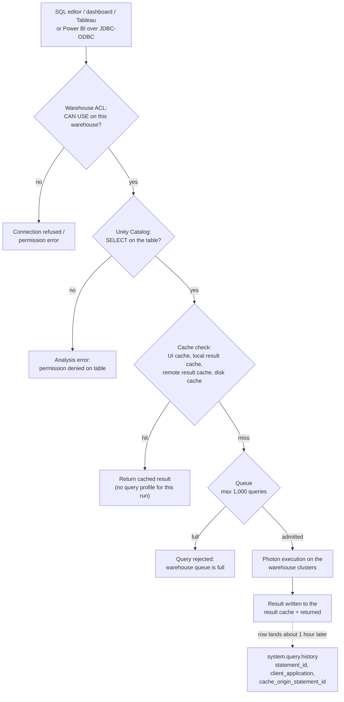
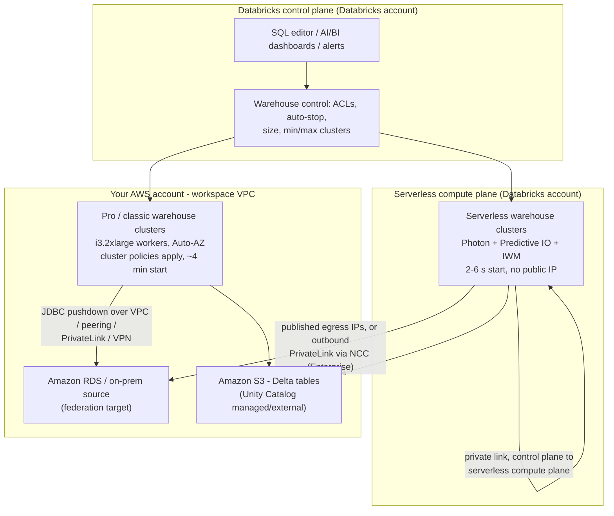
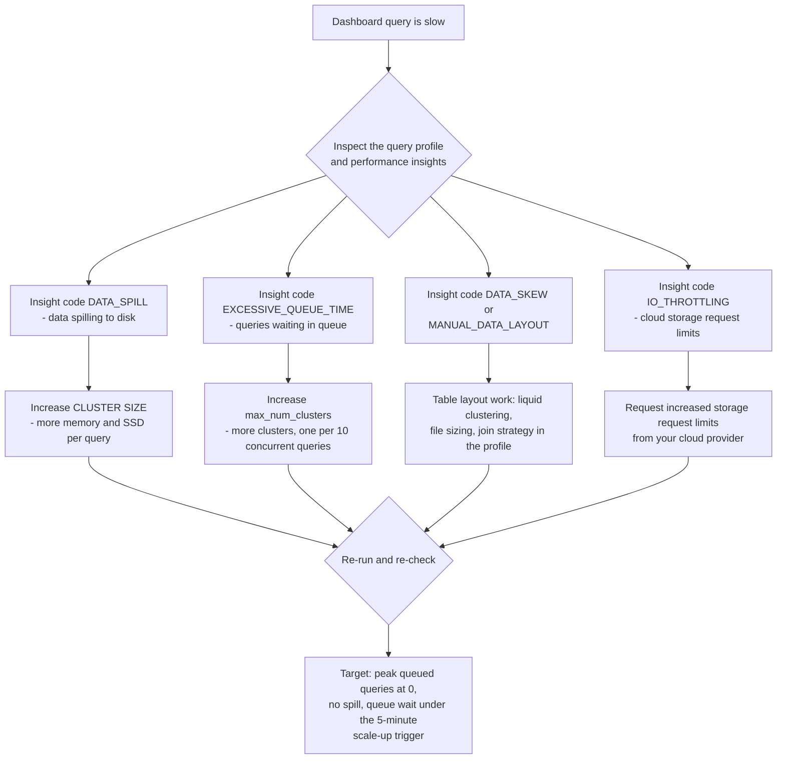
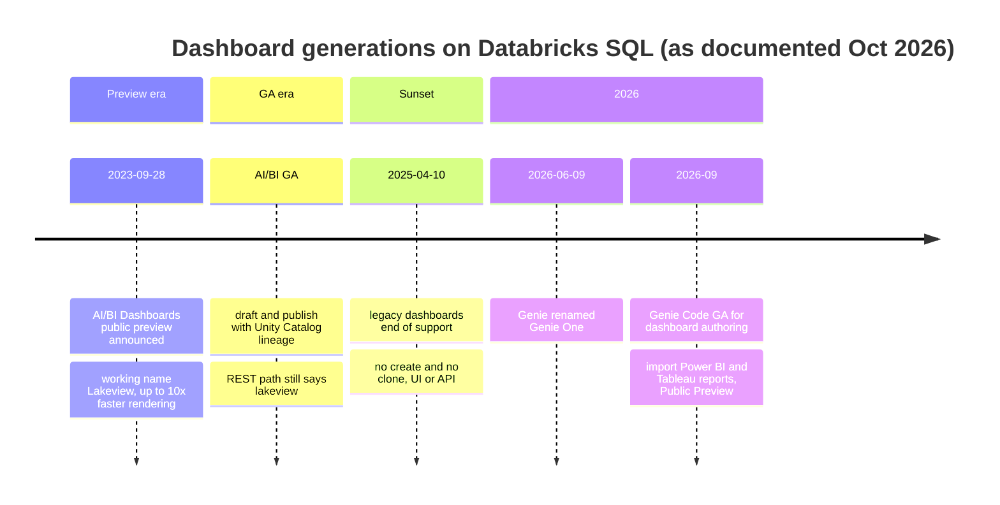
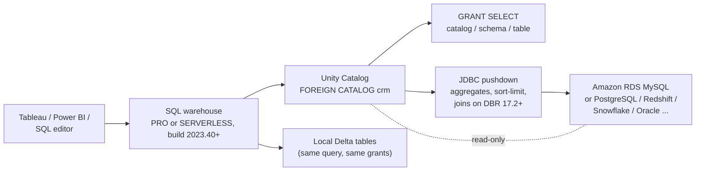

# Databricks SQL Warehouses and the Serving Layer: Serverless, Scaling, Dashboards, BI and Federation

Everything upstream in this course ends the same way: a Delta table, governed by Unity Catalog, that somebody has to *read*. Analysts read it in a SQL editor, executives read it in a dashboard, Tableau reads it over ODBC, and a reporting pipeline reads it through a federated catalog. On Databricks all of that reading happens on one piece of compute, the **SQL warehouse**, and the choice you make about which warehouse type, which size, which auto-stop window and which BI driver is simultaneously a latency decision, a governance decision and an invoice.

This lesson is that choice, worked end to end. The spine is a single distinction that the October 2026 docs state without hedging: **with a pro or classic SQL warehouse the compute layer exists in your AWS account; with a serverless SQL warehouse it exists in the Databricks account** (docs.../compute/sql-warehouse/warehouse-types, last updated **Sep 11, 2026**). Everything else, 2-to-6-second cold starts versus roughly four minutes, cluster policies that stop applying, a customer-managed VPC that stops mattering, the $0.70 "includes cloud instance cost" footnote, falls out of that one line.

```text
 =============================================================
  LESSON 08 MAP - the Databricks SQL serving layer, Oct 2026
 ------------------------------------------------------------
  Types     serverless | pro | classic  (GA)
            + Lakehouse//RT (Beta, SELECT only)
  Power     Photon all three . Predictive IO serverless+pro
            IWM serverless only
  Placement serverless = Databricks account (no public IP)
            pro/classic = your AWS account, VPC, i3 workers
  Starts    serverless 2-6 s  .  pro/classic ~4 minutes
  Auto-stop 45/10 min pro-classic  .  10/5/1 min serverless
  Sizing    1 cluster : 10 concurrent queries
            queue cap 1,000 . max_num_clusters 40
  Rates     $0.22 classic . $0.55 pro . $0.70 serverless
            (US list, AWS, page snapshot 2026-10 - verify
             against system.billing.list_prices in-account)
  Serve     SQL editor . AI/BI dashboards . alerts . BI tools
            Lakehouse Federation foreign catalogs
 ------------------------------------------------------------
  Rule of the lesson: type sets where compute lives and what
  features exist; size sets power per query; cluster count
  sets concurrency; auto-stop sets how much of the bill is
  air.
 =============================================================
```

In this lesson you will:

- read the **Oct 2026 warehouse lineup**, three GA types plus the Lakehouse//RT Beta, and the capability matrix that separates them (Photon, Predictive IO, Intelligent Workload Management);
- draw **where the compute lives** on AWS (Databricks account vs your VPC), including the serverless egress and outbound-PrivateLink story;
- work through **seven worked examples**: a **warehouse-type decision table with the API incantation**, **concurrency sizing math**, an **auto-stop waste calculation**, a **monitoring-query pack**, a **BI connection card for Tableau and Power BI**, a **federated-query DDL sequence**, and a **two-column DBU + EC2 monthly cost sketch at Oct 2026 rates**;
- size a warehouse from **symptom to knob** using the query profile and performance-insight codes;
- build **AI/BI dashboards, saved queries and alerts** and know exactly what happened to legacy dashboards;
- wire **Tableau, Power BI, Excel and Partner Connect** tools with the current driver names and minimums;
- sketch **Lakehouse Federation** with foreign catalogs, and name the requirement that silently excludes classic warehouses;
- study **NAB, Punchh and nCino** on AWS, read the **2026 update box**, and practise with **twelve questions** plus four interactive checks.

---

## 1. What Databricks SQL is, and the two gates every query passes

### 1.1 One interface, many surfaces

Databricks SQL is "a cloud data warehouse built on lakehouse architecture. It runs directly on your data lake" with ANSI SQL and Delta Lake extensions (docs.../sql/, last updated **Sep 11, 2026**). The documented surfaces: **SQL editor** (AI-assisted authoring, code comments, version history), **notebooks** attached to a warehouse, **jobs**, **dashboards**, **metric views**, **alerts**, **ETL** (streaming tables and materialised views defined straight from SQL) and a **REST API**: plus the monitors: query history, query profile and query performance insights.

The compute rule worth memorising: "Databricks uses SQL warehouses for compute in the following interfaces: **SQL editor · Databricks SQL queries · Dashboards · SQL alerts**" and, optionally, notebooks, the file editor and Lakeflow Jobs (docs .../query, last updated **Sep 11, 2026**). The same page adds two constraints that shape everything downstream:

- "When you query data with SQL warehouses, you can use **only SQL syntax**."
- "For workspaces that are enabled for Unity Catalog, **SQL warehouses always use Unity Catalog** to manage access to data sources."

And from the warehouse-types page: "SQL warehouses do not support credential passthrough. Databricks recommends using Unity Catalog for data governance." There is no per-user-credential path on a warehouse: governance is Unity Catalog grants, full stop.

### 1.2 The two gates

Every query through a warehouse passes two independent checks, and students routinely conflate them:

1. **The warehouse ACL**, can this principal use this *compute*? (`CAN USE` to run, `CAN MONITOR` to see profiles, `CAN MANAGE` to reconfigure, section 9.)
2. **The Unity Catalog grant**: can this principal read this *table*? (`SELECT` on catalog/schema/table.)

Passing one says nothing about the other. A user with `CAN USE` on the warehouse and no `SELECT` on the table gets an authorization error; a user with `SELECT` and no `CAN USE` cannot even reach the engine. Teach both, every time.



That diagram is also the mental model for the rest of the lesson: sections 2 to 4 decide *where the compute is and how much of it there is*, sections 5 to 6 decide *what the user sees*, sections 7 to 8 decide *which tools can talk to it*, section 9 decides *who may*, and section 10 decides *what it costs*.

---

## 2. The warehouse lineup as of Oct 2026: serverless, pro, classic, and one Beta

### 2.1 Three GA types, one Beta

"Databricks SQL supports **serverless, pro, and classic** types" and "Additionally, **Lakehouse Real-Time (Beta)** is a specialized serverless warehouse type for sub-second, high-concurrency read queries" that "supports (SELECT) queries only" (docs .../warehouse-types, last updated **Sep 11, 2026**). The capability matrix from the same page:

| Capability | Serverless | Pro | Classic |
|---|---|---|---|
| Photon engine | ✓ | ✓ | ✓ |
| Predictive IO | ✓ | ✓ |: |
| Intelligent Workload Management (IWM) | ✓ |, |, |
| Compute location | **Databricks account** | **your AWS account** | **your AWS account** |
| Cold start | **2 to 6 seconds** | **~4 minutes** | **~4 minutes** |
| List rate (US, AWS, snapshot 2026-10) | **$0.70/DBU** ("includes cloud instance cost") | **$0.55/DBU** | **$0.22/DBU** |

Three consequences follow from the middle row alone:

1. **Pro and classic inherit your AWS network.** They run as EC2 in the workspace VPC, pick an availability zone through Auto-AZ, and are governed by cluster policies, spot settings and your VPC/PrivateLink design (Lesson 02's workspace network).
2. **Serverless does not.** "Customer-managed VPCs are not applicable to compute resources for serverless SQL warehouses", "**Cluster policies, including spot instance policies, are not supported**", and "serverless SQL warehouses do not have public IP addresses" (docs .../sql/admin/serverless, last updated **Jun 10, 2026**).
3. **Classic is the API default while being the least capable type.** Using the UI "the default SQL warehouse type is serverless"; using the SQL warehouses API with defaults "the default SQL warehouse type is **classic**. To use serverless, set the `enable_serverless_compute` parameter to true and `warehouse_type` to pro." Terraform and scripts that omit that flag silently create the one warehouse type that cannot federate, cannot create materialised views or streaming tables and cannot call AI Functions.

### 2.2 Serverless prerequisites on AWS (read before you promise it)

From docs .../sql/admin/serverless (last updated **Jun 10, 2026**): the account "must not be on a free trial"; the workspace "must be on the **Premium plan or above**"; "Serverless SQL warehouses are supported in **all AWS regions**"; the workspace "must not use S3 access policies" and must not use "an **external Hive legacy metastore**" (warehouse-types repeats the metastore clause: "If your workspace uses a legacy external Hive metastore, serverless SQL warehouses are not supported"). Identity is Unity Catalog, connectivity is private: serverless "use[s] private connectivity between the Databricks control plane and the serverless compute plane in nearly all cases."

- **📚 Did you know?** Serverless egress to *your* resources is a separate problem from serverless's own lack of public IPs. For anything outside same-region Amazon S3 or DynamoDB, "serverless compute uses **public IP addresses** to reach your resources", and since **mid-February 2026** Databricks "publishes outbound IPs in JSON format on a public endpoint", after **May 25, 2026** the legacy IP lists were decommissioned (docs.../serverless-firewall, accessed 2026-10). For dedicated connectivity you use **outbound PrivateLink through a network connectivity configuration**: each account gets up to **10 NCCs per region**, each region **30 private endpoints**, and each NCC attaches up to **50 workspaces**, and that path needs the **Enterprise plan** (docs.../pl-to-internal-network, accessed 2026-10).

### 2.3 Where the compute lives, drawn



The right-hand edge is the one students miss: **federation from a serverless warehouse to a private database still has to traverse a network path**, and serverless brings its own egress rules with it. Pro is the documented pick when "you have custom-defined networking and want to connect to databases in your network" (warehouse-types, Sep 11, 2026).

### 2.4 Worked example E1: warehouse-type decision table and the API incantation

**Inputs (three forks, all AWS-specific):**

1. Is the workspace eligible for serverless (Premium+, not a trial, no legacy external Hive metastore, no S3 access policies)?
2. Do you need to reach a private/on-prem database for federation, or enforce custom networking?
3. Do you need AI Functions, or materialised views / streaming tables created from SQL?

| Fork | Serverless | Pro | Classic |
|---|---|---|---|
| Eligible + no private-network need | **✓ default choice**: 2 to 6 s start, IWM, Predictive IO | OK, but ~4 min start and you own EC2 | OK at $0.22/DBU, but see row 5 |
| Needs custom networking / federation path | egress rules apply (published IPs or outbound PrivateLink/Enterprise) | **✓ documented choice**: compute in your account | ✗ federation unsupported |
| AI Functions (`ai_gen`, `ai_query`, `ai_summarise`) | ✓ | ✓ | **✗ "not available on Classic SQL warehouses"** (docs .../ai-functions, **Oct 9, 2026**) |
| `CREATE MATERIALIZED VIEW` / streaming table from SQL | ✓ | **✓ "created using a Pro or Serverless SQL warehouse"** | ✗ |
| Cheapest per DBU | $0.70 all-in | $0.55 + your EC2 | **$0.22 + your EC2** |

**The API body that gets you serverless** (docs .../api/warehouses/v1/warehouse, accessed 2026-10):

```text
POST /api/2.0/sql/warehouses
{
  "name": "bi-serverless-lg",
  "warehouse_type": "PRO",
  "enable_serverless_compute": true,
  "cluster_size": "Large",
  "min_num_clusters": 1,
  "max_num_clusters": 4,
  "auto_stop_minutes": 10,
  "tags": [{"key": "team", "value": "bi"}]
}
```

`warehouse_type` accepts only `PRO` or `CLASSIC`; serverless is `PRO` **plus** `enable_serverless_compute: true`. Omit the flag and you have built a pro warehouse; which is a perfectly good warehouse, just one with a four-minute cold start and an EC2 line on your AWS bill. Tags are capped at **fewer than 45 per warehouse** and exist, in the API's own words, "to monitor the cost of cloud resources used by users and groups."

---

## 3. Sizing: T-shirt sizes, the concurrency rule and the hard limits

### 3.1 The size ladder

Sizes run **2X-Small → 5X-Large**, and for classic/pro the ladder is concrete: "All workers use **i3.2xlarge** instances" (docs .../compute/sql-warehouse/warehouse-behavior, last updated **Oct 8, 2026**).

| Size | Workers (classic/pro) | Driver instance type |
|---|---|---|
| 2X-Small | 1 | i3.2xlarge |
| X-Small | 2 | i3.2xlarge |
| Small | 4 | i3.4xlarge |
| Medium | 8 | i3.8xlarge |
| Large | 16 | i3.8xlarge |
| X-Large | 32 | i3.16xlarge |
| 2X-Large | 64 | i3.16xlarge |
| 3X-Large | 128 | i3.16xlarge |
| 4X-Large | 256 | i3.16xlarge |
| **5X-Large** | **512** | i3.16xlarge: **Public Preview** for pro and serverless |

Only the driver escalates, i3.2xlarge → i3.4xlarge → i3.8xlarge → i3.16xlarge, while every worker stays i3.2xlarge (same page). The docs note the table "can vary based on product or region availability and workload"; read `system.compute.warehouses` for the shape you actually got.

The default when you create a warehouse in the UI is **X-Large**. The disk cache lives on those workers' local SSDs (section 6), which is why the i3 storage-optimised family matters for query performance and why the AWS-side price of an i3 node matters for the cost sketch in section 10.

### 3.2 Concurrency is a *cluster count* knob, not a size knob

Documented rules (warehouse-behavior Oct 8, 2026; create Sep 11, 2026):

- **"a cluster for every 10 concurrent queries"**: the sizing rule of thumb, stated on both pages.
- **"The maximum number of queries in a queue for all warehouse types is 1,000."**
- API bounds: `max_num_clusters` **≤ 40**; `min_num_clusters` ≤ min(max, **30**); default min **1**. Raising `min_num_clusters` "will ensure that a larger number of clusters are always running and therefore may **reduce the cold start time**": at a continuous billing cost.
- Workspace cap: **1,000 SQL warehouses** total, fixed (docs .../resources/limits, **Oct 9, 2026**).
- **"Databricks recycles clusters that have been running for more than 24 hours"** and may forcefully terminate them, so no single query or attached notebook session should assume immortal clusters.

The two-knob rule that fixes most dashboards: **size (cluster size) buys power per query; `max_num_clusters` buys concurrency.** Disk spill means the first knob; queueing means the second.

```plot
{
  "type": "bar",
  "title": "Warehouse size vs concurrency (classic/pro ladder, as of Oct 8, 2026): size adds workers, cluster count adds query slots",
  "xLabel": "Warehouse size",
  "yLabel": "Workers per cluster / concurrent query slots",
  "xKey": "size",
  "dataKeys": ["workers_per_cluster", "query_slots_at_max_4_clusters"],
  "data": [
    {"size": "2X-Small", "workers_per_cluster": 1, "query_slots_at_max_4_clusters": 40},
    {"size": "X-Small", "workers_per_cluster": 2, "query_slots_at_max_4_clusters": 40},
    {"size": "Small", "workers_per_cluster": 4, "query_slots_at_max_4_clusters": 40},
    {"size": "Medium", "workers_per_cluster": 8, "query_slots_at_max_4_clusters": 40},
    {"size": "Large", "workers_per_cluster": 16, "query_slots_at_max_4_clusters": 40},
    {"size": "X-Large", "workers_per_cluster": 32, "query_slots_at_max_4_clusters": 40},
    {"size": "2X-Large", "workers_per_cluster": 64, "query_slots_at_max_4_clusters": 40},
    {"size": "3X-Large", "workers_per_cluster": 128, "query_slots_at_max_4_clusters": 40},
    {"size": "4X-Large", "workers_per_cluster": 256, "query_slots_at_max_4_clusters": 40},
    {"size": "5X-Large (Preview)", "workers_per_cluster": 512, "query_slots_at_max_4_clusters": 40}
  ]
}
```

The flat series is the lesson: with `max_num_clusters` pinned at 4 you get **4 × 10 = 40 concurrent query slots at every size**, from a 1-worker 2X-Small to a 512-worker 5X-Large. Going wider on the size axis multiplies per-query power (and cost) without admitting one extra concurrent query; going wider on `max_num_clusters` does the opposite. Warehouse sizes are identical in name across types, but serverless sizes are billed at a fixed DBU-per-hour rate that depends on the size you pick (docs answers, page dated **2026-08-27**).

### 3.3 Worked example E2: sizing 30 concurrent dashboard users

**Scenario.** A BI team with **30 concurrent dashboard users**, average query 4 s, dashboards running 09:00 to 18:00, **21 working days per month**.

```text
Step 1  concurrency -> clusters
        documented ratio: 1 cluster per 10 concurrent queries
        clusters = ceil(30 / 10) = 3 clusters
        -> min_num_clusters 1 .. max_num_clusters >= 3 (API allows up to 40)

Step 2  size per cluster: Medium (8 workers) vs Large (16 workers)
        decide from the query profile, not from the org chart:
        DATA_SPILL present      -> raise cluster SIZE (memory/SSD per query)
        queue time dominates    -> raise max_num_clusters (concurrency)
        neither, but still slow -> operator/join tuning in the profile

Step 3  fan-out check (the dashboard trap)
        a 20-widget dashboard can fire 20 near-simultaneous queries
        20 widgets x ~30 users is NOT 600: widgets share the user's
        session, but the burst still lands as dozens of queued queries
        -> size max_num_clusters for the FIRST big meeting of the day

Step 4  classic/pro autoscaler latency (docs, Oct 8, 2026)
        a query waits 5 minutes          -> warehouse scales up
        low load for 15 consecutive min  -> scales down to the peak need
        load 2-6 min -> +1 cluster, 6-12 -> +2, 12-22 -> +3,
        over 22 min  -> +3 plus 1 more per additional 15 minutes
        => the autoscaler will NOT save a 60-query burst in minute one.

Step 5  serverless alternative
        start with ONE LARGER warehouse and let IWM manage concurrency;
        "It is usually more efficient to size down if necessary than to
         start small and scale up" (warehouse-behavior, Oct 8, 2026)
```

Answer: **three clusters minimum** under the documented ratio, sized Medium or Large from the spill evidence, with `max_num_clusters` set ahead of the peak burst, and on serverless, a single larger warehouse with IWM instead of hand-tuning three clusters.

### 3.4 Symptom → knob



Two hard limits sit behind that tree: the queue holds at most **1,000 queries**, and the profile of a **cached** result does not exist (section 6), so benchmarking must defeat the cache first or the tree will look cleaner than reality.

---

## 4. Scaling, auto-stop and cold-start economics

### 4.1 Two scaling models, not one

Two documented scaling models: one per warehouse family:

- **Classic and pro: min/max clusters plus load-based autoscaling**, with the load bands quoted in E2 (add clusters after 2 to 6, 6 to 12, 12 to 22 minutes of load; scale up when a query waits **5 minutes**; scale down after **15 consecutive minutes** of low load). Availability zones resolve to **Auto-AZ**.
- **Serverless: Intelligent Workload Management.** "IWM uses **machine learning models** to dynamically manage compute resources"; when capacity is short "the query is placed in a queue", and "if wait times increase, the autoscaler quickly provisions more clusters" (warehouse-behavior, Oct 8, 2026). IWM is serverless-only: pro and classic get Photon and Predictive IO but not IWM.

### 4.2 Auto-stop: the cheapest optimization in this course

| Warehouse type | Auto-stop default | Minimum | Source (date) |
|---|---|---|---|
| Pro and classic | **45 minutes** | **10 minutes** | docs .../sql-warehouse/create (**Sep 11, 2026**) |
| Serverless | **10 minutes** | **5 minutes** (UI) · **1 minute** (API) | same |

And the money sentence, verbatim: "**Idle SQL warehouses continue to accumulate DBU and cloud instance charges until they are stopped.**" (same page). A warehouse bills while it is *up*: not while it is busy.

> ⚠️ **WARNING: an auto-stop default is a billing decision you inherit.** The pro/classic default of 45 minutes is chosen for comfort, not economy: every gap shorter than 45 minutes keeps a warehouse (and its EC2 instances, in *your* AWS account) billable. Conversely, a serverless warehouse at its **1-minute API minimum** will stop between a user's two dashboard refreshes: cheap, and only a **2 to 6 second** restart away. On a **pro/classic** warehouse that same restart is **~4 minutes**, which users read as an outage. Match auto-stop to client behaviour: scheduled extracts and refreshes → longer auto-stop or `min_num_clusters = 1`; interactive humans on serverless → short auto-stop. And never set auto-stop to "never": the docs' idle-charge sentence is unconditional.

### 4.3 Worked example E3: what an auto-stop default costs per month

**Scenario (declared assumptions: re-run with your own traffic):** one pro warehouse serving dashboards with real traffic only in two bursts: **09:00 to 10:00 and 14:00 to 15:00**: over **21 working days**.

```text
Useful traffic      2 h/day x 21 days            =  42.0 h/month

Auto-stop 45 min (the pro/classic default)
  morning session   09:00 -> 10:00 + 45 min       =  1.75 h/day
  afternoon session 14:00 -> 15:00 + 45 min       =  1.75 h/day
  up-time           3.50 h/day x 21               =  73.5 h/month
  waste             73.5 - 42.0                   =  31.5 h/month

Auto-stop 10 min (the documented pro/classic minimum)
  morning session   09:00 -> 10:10                =  1.167 h/day
  afternoon session 14:00 -> 15:10                =  1.167 h/day
  up-time           2.333 h/day x 21              =  49.0 h/month
  waste             49.0 - 42.0                   =   7.0 h/month

Hours reclaimed by one setting change = 73.5 - 49.0 = 24.5 h/month
At the illustrative 2X-Small shape (4 DBU/h, 2 x i3.2xlarge):
  DBU column   24.5 h x 4 DBU/h x $0.22  = $ 21.56
  AWS column   24.5 h x 2 x $0.624/h     = $ 30.58
  saving on ONE warehouse                 = $ 52.14/month
  x 20 warehouses in a workspace          ~ $ 1,043/month
```

Rates: SQL Classic **$0.22/DBU** (page snapshot **2026-10**) and AWS us-east-1 on-demand **i3.2xlarge $0.624/h** (AWS EC2 price list, read **2026-10-12**). The **4 DBU/h** emission is an *illustrative* per-size figure: the pricing page publishes **$/DBU only**, so read your own per-size DBU/hour from `system.billing.list_prices` (section 10). The point survives the substitution: **twenty minutes of unnecessary auto-stop across twenty warehouses dwarfs a size-tier change.**

- **📚 Did you know?** Auto-stop is only half of the idle story. Raising `min_num_clusters` "reduce[s] the cold start time for new queries" (Warehouses API, accessed 2026-10) but keeps billable clusters warm around the clock; while on serverless the cold start is already **2 to 6 seconds**, so `min_num_clusters > 1` is rarely worth paying for. And because "Databricks recycles clusters that have been running for more than 24 hours", a warehouse that never idles still gets its clusters recycled, with a possible force-termination of long-running work (docs.../sql-warehouse/create, Sep 11, 2026).

---

## 5. Queries, dashboards and alerts: the DBSQL workbench

### 5.1 Saved queries have their own permissions

The SQL editor ships with AI assistance, code comments and version history (docs .../sql/, Sep 11, 2026). Saved queries are securables in their own right (docs .../sql/user/queries, last updated **Apr 29, 2026**):

- sharing a query requires **`CAN MANAGE`** on that query;
- two credential modes: **"Run as viewer"**, "The viewer's credential is used to run the query. The viewer must also have at least **CAN USE** permissions on the warehouse", versus **"Run as owner"**;
- "A Databricks workspace admin user has view access to all queries in the workspace."

The query-history UI keeps **30 days** of history; you see your own queries as owner, or others' if you hold at least `CAN VIEW` on the warehouse that ran them. Anything longer-lived goes to `system.query.history` (section 6).

### 5.2 AI/BI dashboards: the Lakeview generation, now the only generation

"AI/BI dashboards feature AI-assisted authoring, an enhanced visualization library, and a streamlined configuration experience" (docs .../dashboards, last updated **Sep 11, 2026**). The documented capability set: datasets and visualisations; filters at global/page/widget level with **cross-filtering** and **drill-through**; custom calculations; draft/publish; **"When published, your dashboards can be shared with anyone registered to your Databricks account, even if they don't have access to the workspace"**; **iframe embedding**; schedule-and-subscribe by email or Slack; **Git integration / source control**; **Declarative Automation Bundles**; REST APIs; scheduling as a **Lakeflow Job**; Genie agents; usage monitoring via audit logs and system tables; and Unity Catalog lineage built in.

**Legacy dashboards are gone.** "End of support for legacy dashboards: **April 10, 2025**. You can no longer create or clone legacy dashboards using the UI or API" (docs.../ai-bi/release-notes/2025); the legacy documentation is retired, and the migration endpoint `POST /api/2.0/lakeview/dashboards/migrate` is marked **Deprecated** with the note "Use Lakeview (AI/BI) dashboards instead" (Lakeview API reference, accessed 2026-10).



- **📚 Did you know?** The name you see in the API is a fossil. AI/BI dashboards "were previously known as Lakeview dashboards. The Lakeview API still retains that name", so every create/list/publish call is still `/api/2.0/lakeview/dashboards/*` even though the UI says AI/BI (docs.../dashboards, Sep 11, 2026; REST API reference, accessed 2026-10). Any script, Terraform resource or tutorial that talks about "migrating to Lakeview" is writing 2023 to 2024 history: the migration endpoint is deprecated and legacy dashboards cannot be created at all since **2025-04-10**.

### 5.3 Alerts

"Use Databricks SQL alerts to periodically run queries, evaluate defined conditions, and send notifications if a condition is met" (docs.../sql/user/alerts, page dated **Jul 28, 2026**). Since May 2025 the editor is consolidated, query setup, conditions, schedules and notification destinations in one interface, and legacy alerts still work alongside it (release notes, May 2025). Alerts are the closing half of the monitoring loop: attach one to the fleet-hygiene query in E4 and a warehouse whose auto-stop creeps past 30 minutes pages someone instead of quietly billing.

---

## 6. Caching, the query profile and the system tables

### 6.1 Four caches, four lifetimes

| Cache | Scope | Lifetime | Trap |
|---|---|---|---|
| **Databricks SQL UI cache** | per user | **at most 7 days** | "does not apply to AI/BI dashboards" |
| **Local result cache** | per cluster | cluster lifetime | dies when the warehouse stops |
| **Remote result cache** | workspace-wide | survives stop/start | **serverless-only**; reachable from ODBC/JDBC and the SQL Statement API |
| **Disk cache** | worker local SSD | invalidated on file change | **≤ half** of worker local SSD; `CACHE SELECT` is **ignored** on SQL warehouses and DBR 14.2+ |

(docs.../queries/query-caching and.../optimizations/disk-cache, accessed 2026-10). To benchmark honestly: `SET use_cached_result = false;`: documented as appropriate "only in testing or benchmarking". Deterministic queries hit caches; a `NOW()`-style predicate defeats them and then you pay full price every run.

### 6.2 The profile, the insights and their meanings

- **Query profile**; you must be the **owner of the query** or hold at least **`CAN MONITOR`** on the warehouse; "A query profile is **not available for queries that run from the query cache**. To circumvent the query cache, make a trivial change to the query, such as changing or removing the LIMIT" (docs.../query-profile, Jun 10, 2026).
- **Query performance insights**: coded recommendations (docs.../performance-insights, Sep 11, 2026): `DATA_SPILL` → "Increase the warehouse size to add memory"; `EXCESSIVE_QUEUE_TIME` → "Increase the **maximum number of clusters**"; `IO_THROTTLING` → request higher storage request limits; plus `DATA_SKEW`, `MANUAL_DATA_LAYOUT`, and applied accelerations `AUTO_LIQUID_CLUSTERING`, `HISTORY_BASED_JOIN_STRATEGY`, `SHORT_QUERY_PRIORITIZATION`.
- **System tables**: the same story as data: `system.query.history` (Public Preview, **365 days**, regional, records "typically available **within one hour**"), `system.compute.warehouses` (config snapshots), `system.compute.warehouse_events` (start/stop/scale events), `system.billing.usage` and `system.billing.list_prices` (the price log, indefinite, global).

Access note on `system.query.history`: "By default, **only admins** have access to the system table… Databricks recommends creating a **dynamic view** for each user or group" (docs .../system-tables/query-history, page dated **Sep 21, 2026**). Its `client_application` column is what tells you whether a query came from the "Databricks SQL Editor, Tableau, and Power BI", and `cache_origin_statement_id` is how you prove a result came from cache.

### 6.3 Worked example E4: a monitoring pack for the warehouse fleet

```sql
-- (a) fleet hygiene: warehouses that idle-expire late
SELECT warehouse_name, warehouse_type, warehouse_size,
       min_clusters, max_clusters, auto_stop_minutes
FROM   system.compute.warehouses
WHERE  delete_time IS NULL AND auto_stop_minutes > 30;

-- (b) who is actually using which warehouse (about 1-hour latency)
SELECT w.warehouse_name, q.client_application,
       COUNT(*) AS queries, SUM(q.total_duration_ms)/1000 AS seconds
FROM   system.query.history q
JOIN   system.compute.warehouses w ON w.warehouse_id = q.warehouse_id
WHERE  q.execution_status = 'FINISHED'
GROUP  BY 1, 2 ORDER BY queries DESC;

-- (c) cache effectiveness: rows whose statement differs from the origin
SELECT COUNTIF(cache_origin_statement_id <> statement_id) / COUNT(*) AS hit_rate
FROM   system.query.history
WHERE  warehouse_id = 'abc123';

-- (d) cost: DBU spend by SKU for the month
SELECT sku, usage_type, product_feature,
       SUM(metered_quantity) AS dbus, SUM(unblended_cost) AS cost
FROM   system.billing.usage
WHERE  billing_month = date_format(current_date, 'yyyy-MM')
GROUP  BY 1, 2, 3 ORDER BY cost DESC;
```

Sources: monitoring-queries page (docs.../sql-warehouse/monitor/queries, **Sep 11, 2026**), query-history reference (**Sep 21, 2026**), billing system tables (updated **2026-10-08**). Query (a) is the one to wire to an alert; query (d) is the one to publish on an AI/BI dashboard: Databricks ships ready-made cost queries and a prebuilt Usage Dashboard for exactly this (docs.../admin/usage/system-tables, Sep 11, 2026).

---

## 7. BI connectivity: drivers first, tools second

### 7.1 The driver situation as of Oct 2026

| Driver line | Current version (Oct 2026) | Status |
|---|---|---|
| **Databricks JDBC Driver** (open source) | **3.4.3** | current; "Databricks supports each driver version for at least **2 years**" |
| Simba JDBC | 2.8.3 (2026-07-20) | legacy: migrate |
| **Databricks ODBC Driver** | **2.12.1** (2026-08-06) | current |
| Simba Spark ODBC | last entry 2.10.0 (2026-02-26) | **"The Simba Spark ODBC Driver is deprecated."** |

(docs .../integrations/odbc/download, page mirror dated **Sep 11, 2026**; driver download and archive pages, accessed 2026-10). The February 2026 rename matters operationally: "As of February 2026, new versions of the ODBC driver are being released by Databricks and the driver has been renamed to Databricks ODBC Driver." Install paths: Windows `C:\Program Files\Databricks ODBC Driver`, macOS `/Library/databricks/databricksodbc`, Linux `/opt/databricks/databricksodbc`. Some tools bundle the driver (recent Power BI Desktop releases); Tableau Desktop does not.

The common denominator across every tool: connection = **Server Hostname + HTTP Path of a SQL warehouse**, authentication = OAuth / Databricks login / personal access token / service principal. **Username/password is dead**: Tableau's own help records that "Basic authentication using a Databricks user name and password reached end of life as of **July 2024**."

### 7.2 The tool matrix

| Tool | Minimums (docs, 2026) | Notes |
|---|---|---|
| **Tableau** | Tableau Desktop **2021.4+**, Databricks ODBC **2.6.19+** (page dated **Jul 22, 2026**) | Server Hostname + HTTP Path; Partner Connect tile; auth: Databricks login (recommended), PAT, service principal |
| **Power BI** | native SQL queries need **Power BI v2.112.603.0+**; **ADBC or ODBC** (page dated **Aug 20, 2026**) | "**Databricks SQL warehouses are recommended when using Power BI in DirectQuery mode**"; ADBC **required for Lakehouse//RT**; M2M OAuth service principals, Microsoft Entra ID SSO, publish-to-service |
| **Excel** | Databricks Excel Add-in, Public Preview (pages dated **Sep 11 / Aug 6, 2026**) | a workspace admin must **enable the Excel Connector preview**; **SSO only**; needs `CAN USE` on a warehouse; can write back to a Unity Catalog table and use Genie |
| **Partner Connect tiles** |: | **Hex, Power BI, Preset, Qlik Sense, Sigma, Tableau, ThoughtSpot** (docs.../partner-connect/bi) |

- **📚 Did you know?** Driver versions are a *support* commitment, not just a download list: "Databricks supports each driver version for at least **2 years**" (driver download page, accessed 2026-10). The archive also carries a warning worth reading once: Simba JDBC versions before **2.6.21** depend on a library with **CVE-2021-44228** (Log4Shell): a concrete reason the docs "strongly recommend migrating" off the Simba lines.

### 7.3 Worked example E5: BI connection card (copy/paste spec)

**Tableau Desktop → a serverless SQL warehouse**

```text
Server        : dbc-01234567890abcdef0123.cloud.databricks.com   (port 443)
HTTP Path     : /sql/1.0/warehouses/a1b2c3d4e5f67890              (warehouse HTTP path)
Driver        : Databricks ODBC Driver 2.12.1  (>= 2.6.19 required)
Auth          : OAuth / Databricks login  (username+password EOL July 2024)
Catalog       : main            Schema: analytics
Minimums      : Tableau Desktop 2021.4+
On-ramp      : Marketplace -> Partner Connect -> Tableau tile
                (downloads a connection file; needs CAN USE on the warehouse)
```

**Power BI → the same warehouse**

```text
Connector     : Databricks (ADBC driver supported; ADBC REQUIRED for Lakehouse//RT)
Mode          : Import for scheduled refresh; DirectQuery -> SQL warehouse recommended
Native SQL    : Power BI v2.112.603.0 or above
Service auth  : M2M OAuth with a service principal registered in Unity Catalog
SSO           : Microsoft Entra ID
Metric views  : BI compatibility mode, or MEASURE() inside a native query
Gotcha        : a stopped warehouse errors in every client until someone with
                CAN MONITOR (or the owner) starts it again
```

Both cards assume the two gates from section 1: `CAN USE` on the warehouse for the *tool's* identity, `SELECT` on the underlying tables for that same identity (a service principal needs both). Add the warehouse's `auto_stop_minutes` to the card: an extract scheduled every 15 minutes against a 10-minute auto-stop serverless warehouse will pay a 2 to 6 second restart each time, while the same schedule against a pro warehouse pays ~4 minutes.

---

## 8. Lakehouse Federation: querying other systems from Databricks SQL

### 8.1 What it is

"**Lakehouse Federation** is the Databricks query federation platform. It provides governed, **read-only** access to external data through Unity Catalog foreign catalogs, with automatic query pushdown and fine-grained access controls at the table level" (docs .../query-federation, last updated **Sep 29, 2026**). Two flavours:

- **query federation**: pushed down to the external database over **JDBC**; "The query runs on both Databricks and remote compute… **Not supported (read-only)**" for writes;
- **catalog federation**: "Runs directly against object storage on Databricks compute only. More cost-effective and performance-optimized."

**Verified source lists (Oct 2026).** Query federation: MySQL, PostgreSQL, Teradata, Oracle, Amazon Redshift, Salesforce Data 360, Snowflake, Microsoft SQL Server, Azure Synapse, Google BigQuery, Databricks. Catalog federation: legacy Databricks Hive metastore, external Hive metastore, **AWS Glue metastore**, Salesforce Data 360, Snowflake, Palantir Foundry, Workday Data Connect, Google Cloud Lakehouse.

### 8.2 The requirement that excludes classic warehouses

From the MySQL and SQL Server federation pages (**Aug 19 / Sep 11, 2026**): "Databricks compute must use Databricks Runtime **13.3 LTS or above** and **Standard or Dedicated access mode**"; "**SQL warehouses must be pro or serverless and must use 2023.40 or above**"; the workspace must be Unity-Catalog enabled (workspaces created after **November 8, 2023** are). MySQL additionally requires **SSL**. Pushdown is uneven by design: aggregates, arithmetic, boolean/bitwise and sort-with-limit push down on 13.3 LTS+; **joins need DBR 17.2+** (MySQL: a Public Preview toggle); **window functions are not supported on MySQL**. And when both paths exist, "When your source supports both Lakehouse Federation and Lakeflow Connect, Databricks recommends **Lakeflow Connect** if performance on higher data volumes and lower latency are priorities."

> [!IMPORTANT]
> **Classic warehouses cannot federate.** Federation needs "pro or serverless" warehouses on build **2023.40+**: the same three gaps recur: classic cannot federate, cannot create materialised views/streaming tables from SQL, and cannot run AI Functions. Because the **SQL warehouses API defaults to classic**, every Terraform module or script that forgets `enable_serverless_compute: true` (or `warehouse_type: PRO` for a pro warehouse) creates exactly the warehouse type that fails all three. Audit the fleet with `SELECT warehouse_name, warehouse_type FROM system.compute.warehouses WHERE warehouse_type = 'CLASSIC'`.

### 8.3 Worked example E6: federated query, MySQL on RDS → Databricks SQL

```sql
-- 1) connection: credentials come from a secret scope, never inline
CREATE CONNECTION mysql_crm TYPE MYSQL
  OPTIONS (host 'crm-cluster.abc.us-east-1.rds.amazonaws.com', port '3306',
           user     secret('crm.secrets', 'user'),
           password secret('crm.secrets', 'pass'));

-- 2) foreign catalog mirrors the remote database under Unity Catalog
CREATE FOREIGN CATALOG crm USING CONNECTION mysql_crm;

-- 3) governance is ordinary UC: catalog/schema/table level grants
GRANT SELECT ON CATALOG crm TO `data-analysts`;

-- 4) federated query: JDBC pushdown runs on BOTH the warehouse and MySQL
SELECT c.region, COUNT(*) AS orders, SUM(o.amount) AS revenue
FROM   crm.shop.customers c
JOIN   local_bronze.orders o ON o.customer_id = c.id   -- local Delta join
GROUP  BY c.region
ORDER  BY revenue DESC
LIMIT  20;
```

The language reference (docs.../sql-ref-federated-queries, dated **Jun 29, 2026**) frames it as exactly three prerequisites: create a **foreign connection**, register **foreign catalogs**, grant access, and notes it applies to "Databricks SQL · Databricks Runtime 13.3 LTS and above · **Unity Catalog only**". The join in step 4 is the interesting half: local Delta joined to remote MySQL, with the remote side pushed down over JDBC and governed by the same grants as your native tables. It is **read-only**, it is **not** a substitute for ETL at volume, and the network path from your warehouse to RDS is yours to build (VPC peering, PrivateLink or VPN: section 2.3).



---

## 9. Who may touch the warehouse: ACLs, entitlements and the group pattern

Warehouse permissions, from the ACL matrix (docs .../access-control, last updated **Jul 10, 2026**) and the create-warehouse page (**Sep 11, 2026**):

| Permission | What it grants |
|---|---|
| **CAN VIEW** | see warehouse details and its queries; cannot run (the UI's read-only level; the Permissions API calls it `CAN READ`) |
| **CAN MONITOR** | run queries **and** see monitoring, query history and **profiles**: the level profile access keys off |
| **CAN USE** | run queries |
| **IS OWNER** | applied automatically to the warehouse's creator; carries stop, delete and modify-permissions rights (the same stop/delete rights `CAN MANAGE` has) plus ownership of the object |
| **CAN MANAGE** | stop, delete, edit configuration, modify permissions; **workspace admins hold it on all objects** |

Two entitlements sit above all of that: the **`databricks-sql-access`** entitlement gates who may use Databricks SQL at all, and creating warehouses needs workspace admin **or** the **`Allow unrestricted cluster creation`** entitlement: "Most users cannot create SQL warehouses, but can restart any SQL warehouse they can connect to." Deleted warehouses can be restored by support **within 14 days**.

The delegation pattern to teach: `data-analysts` → `CAN USE` on the BI warehouse plus `SELECT` on the gold schemas; `bi-viewers` → `CAN VIEW`; `data-engineers` → `CAN MANAGE` on the platform warehouse and its auto-stop; service principals for Power BI/Tableau → `CAN USE` plus `SELECT`. Groups, not individuals: otherwise workspace admins' blanket `CAN MANAGE` becomes the only working model and admin sprawl follows.

---

## 10. What it costs: rates, meters and the two-column bill

### 10.1 The rates (US list, AWS, page snapshot 2026-10)

| SKU | Rate | Includes machine? |
|---|---|---|
| SQL Classic | **$0.22 / DBU** | pricing page does not state instance inclusion; the auto-stop sentence bills "DBU **and cloud instance charges**" |
| SQL Pro | **$0.55 / DBU** | same |
| SQL Serverless | **$0.70 / DBU** | **yes**: footnote "Includes cloud instance cost" |
| Lakehouse//RT (Beta) | **$0.55 / DBU** | Beta product (page snapshot 2026-10) |

Caveats you must print next to any number: "Databricks prices and Cloud Infrastructure prices may vary based on geographic region and cloud service provider" (pricing FAQ, 2026-10); serverless rates track regional infrastructure while classic rates are flat across AWS regions because you pay the local EC2 price (a secondary read of the pricing page's data file reported **$0.91/DBU** for SQL Serverless in eu-central-1 vs $0.70 in us-east-1, 2026-08-07: verify in-account); **materialised-view and streaming-table refreshes bill at DLT serverless rates**, not your warehouse's rate (pricing page footnote 3, 2026-10); AI Function inference bills separately under `MODEL_SERVING` / `AI_FUNCTIONS` (docs.../ai-functions, Oct 9, 2026). The authoritative number is always your own: `system.billing.list_prices` (indefinite retention, global) joined to `system.billing.usage`.

### 10.2 Worked example E7: a two-column monthly cost sketch

**Declared assumptions:** one **2X-Small** warehouse (driver + 1 worker = **2 × i3.2xlarge**), up **193 h/month** (≈9.2 h/day × 21 working days of business-hours BI), illustrative emission **4 DBU/h**, AWS us-east-1 on-demand **i3.2xlarge $0.624/h** (AWS price list, read **2026-10-12**), rates as of **2026-10**.

```text
DBUs consumed   193 h x 4 DBU/h                       =  772 DBU
AWS column      193 h x 2 nodes x $0.624/h            = $240.86 / month

(A) SQL Classic  $0.22/DBU
    DBU  772 x 0.22 = $169.84   + AWS $240.86  =  $410.70 / month
(B) SQL Pro      $0.55/DBU
    DBU  772 x 0.55 = $424.60   + AWS $240.86  =  $665.46 / month
(C) SQL Serverless $0.70/DBU ("Includes cloud instance cost")
    DBU  772 x 0.70 = $540.40   + AWS   $0.00  =  $540.40 / month

Sensitivity: +50 idle h/month (auto-stop drift) on (A)
    DBU  50 x 4 x 0.22 = $44.00  + AWS 50 x 1.248 = $62.40
    total added                    = $106.40 / month
    -> drift costs more than a whole size tier on this shape
```

Read it as three lessons, not as a ranking. **(A) is cheapest only if you accept** a ~4-minute cold start, no Predictive IO, no federation, no AI Functions and no materialised-view creation. **(C) beats (B) here** because at this light, steady shape the pro warehouse's EC2 column ($240.86) exceeds the entire serverless premium ($540.40 − $424.60 = $115.80). And **(A)'s sensitivity line is the real headline**: idle hours, not list rates, dominate; which is section 4's auto-stop arithmetic showing up again on the invoice. The **4 DBU/h** figure is illustrative per-size emission; the pricing page publishes **$/DBU only**, so pull your own per-size emission from `system.billing.list_prices` for your contract before you quote anyone a number.

---

## 11. The traps: fourteen confusions this lesson will not let you keep

1. **"Serverless runs in my VPC."** It runs in the Databricks account: "Customer-managed VPCs are not applicable", no cluster policies, no public IPs.
2. **"The API creates the same warehouse as the UI."** UI default = **serverless**; API default = **classic** unless `enable_serverless_compute` is true and `warehouse_type` is `PRO`.
3. **"Classic is the budget option."** It is also the option that **cannot federate, cannot create MVs/STs, and cannot run AI Functions**.
4. **"A bigger size means more concurrent queries."** Concurrency is `max_num_clusters` × 10; size is power per query. Spill → size; queue → clusters.
5. **"The autoscaler will handle the 9 a.m. burst."** Classic/pro scale up only after a query waits **5 minutes**; the queue cap is **1,000**.
6. **"Auto-stop 45 minutes is harmless."** "Idle SQL warehouses continue to accumulate DBU and cloud instance charges until they are stopped."
7. **"Serverless auto-stop can be zero."** Minimum **5 min** in the UI, **1 min** via API; pro/classic minimum is **10 min**.
8. **"I got a query profile, so I understand the run."** No profile exists for a **cached** result: change the `LIMIT`.
9. **"Cache is cache."** UI cache (≤7 days, not AI/BI) ≠ local result cache (dies with the cluster) ≠ remote result cache (serverless-only, survives stop) ≠ disk cache (files, ≤50% of SSD).
10. **"Legacy dashboards still work."** End of support **2025-04-10**: no create, no clone, migration endpoint deprecated.
11. **"Lakeview is a different product from AI/BI."** Same product, 2023 preview name retained in the REST path `/api/2.0/lakeview/dashboards`.
12. **"Password auth works for Tableau."** Basic auth "reached end of life as of **July 2024**"; and the Simba ODBC line is deprecated since the **February 2026** rename.
13. **"Federation lets me write back."** Read-only, JDBC pushdown with uneven support; use **Lakeflow Connect** when volume and latency matter.
14. **"The $0.70 rate is the whole serverless bill."** MV refreshes bill at **DLT serverless** rates, AI inference under `MODEL_SERVING`/`AI_FUNCTIONS`, and networking to your VPC can carry its own charges.

---

> **Comparative Verdict: classic vs pro vs serverless SQL warehouses (AWS, as of Oct 2026)**
> - **Classic, $0.22/DBU plus cloud instance charges, ~4-minute start.** The API default and the floor of the lineup: Photon only, no Predictive IO, no IWM. **Cannot federate, cannot create materialised views or streaming tables from SQL, cannot run AI Functions.** Runs in your VPC with cluster policies, spot settings and the disk cache on i3 local SSD. Choose it when the workload is simple SQL at a steady shape, cost per DBU is the binding constraint, and none of the three missing features apply, and set auto-stop to **10 minutes**, not 45.
> - **Pro, $0.55/DBU plus cloud instance charges, ~4-minute start.** Everything classic has **plus Predictive IO**, and the documented pick when "you have custom-defined networking and want to connect to databases in your network", i.e. federation from inside your VPC. Still your instances, your Auto-AZ, your policies, your EC2 column. Choose it when private-network reach matters more than cold-start latency.
> - **Serverless: $0.70/DBU, machine included, 2 to 6-second start.** The documented default for most workloads: **Photon + Predictive IO + IWM**, no cluster policies (so no policy-based guardrails either), no customer-managed VPC, no public IPs, auto-stop default **10 minutes**, per-second billing with no idle-charge beyond the auto-stop window. Choose it unless a fork in E1 says otherwise.
> - **Verdict in one line:** *serverless by default → pro when you need the compute inside your AWS account for federation or custom networking → classic only for narrow, steady, feature-light SQL where $0.22 wins the arithmetic.* Every rate is US list, AWS, page snapshot **2026-10**; the per-size DBU/hour emission must come from `system.billing.list_prices`, not from a tutorial.

---

### 2026 Updates (as of October 2026)

> [!NOTE]
> **What changed in the Databricks SQL serving layer that this lesson depends on: each line checked against a primary source:**
> - **2026-10-07: cost controls became platform surface.** Auto-stop defaults restated (45 min Pro/Classic, 10 min Serverless, down to 5 in the UI and 1 via API); materialised-view refreshes confirmed as **serverless pipeline** usage rather than warehouse usage; new **query tags (Public Preview)** land in `system.query.history`; Governance Hub Cost page (Beta); predictive optimization on by default for accounts created on/after **2024-11-11** (Databricks blog, *Set budgets and alerts for cloud data warehouse costs*, **2026-10-07**).
> - **2026-10-08: the sizing/scaling page is the current rulebook**: "one cluster per 10 concurrent queries", queue cap **1,000**, scale-up after a **5-minute** queue wait, scale-down after **15 consecutive** low-load minutes, **Auto-AZ**, and **5X-Large in Public Preview** for pro and serverless (docs.../compute/sql-warehouse/warehouse-behavior, last updated **2026-10-08**).
> - **2026-09-29: Lakehouse Federation documentation consolidated** the query-federation vs catalog-federation split and the verified source lists used in section 8 (docs.../query-federation, last updated **2026-09-29**); federation requirements pages are dated **2026-08-19 / 2026-09-11**.
> - **2026-06-09 → 2026-09, the dashboard surface renamed and re-armed**: "**Genie renamed to Genie One**, June 9, 2026"; "**Genie Code for dashboard authoring … is now generally available**" (Sept 2026); "**Import BI files (Public Preview)**: Importing **Power BI and Tableau reports as AI/BI dashboards with Genie Code**" (docs.../ai-bi/release-notes/2026, last updated **2026-09-17**).
> - **February 2026 → 2026-08-06: the ODBC driver was renamed.** "As of February 2026 … the driver has been renamed to Databricks ODBC Driver", "**The Simba Spark ODBC Driver is deprecated**", current release **2.12.1 (2026-08-06)** (docs.../integrations/odbc/download, mirror dated **2026-09-11**; driver archive, accessed 2026-10).
> - **2026-05-25: serverless egress lists changed shape.** Outbound IPs are published as **JSON** since mid-February 2026 and "legacy IP lists will be decommissioned" after **May 25, 2026**; dedicated connectivity is outbound PrivateLink via NCCs (Enterprise plan) (docs.../serverless-firewall and.../pl-to-internal-network, accessed 2026-10).

---

## Real-World Case Studies

> **📋 Case A: NAB (National Australia Bank, banking, Cloud: AWS)**
> **Challenge.** A **26-year-old Teradata warehouse** carrying ~1,000 use cases and ~140 reporting suites, with hand-written ETL and inconsistent practice across 300 to 400 engineers.
> **Stack on AWS.** Databricks SQL as the warehouse replacement, plus Auto Loader, Spark Declarative Pipelines (Lakeflow), Unity Catalog and asset bundles: `Cloud: AWS` on the story page.
> **Reported outcome.** "**26-year-old Teradata warehouse decommissioned · 456 Use cases migrated to Databricks SQL · 1,200+ Users enabled**"; "95% of critical workloads migrated"; ~140 reporting suites retired (https://www.databricks.com/customers/nab/dbsql, undated page, accessed 2026-10).
> **Quote.** "The migration wouldn't have been possible without Databricks SQL": Gurry, same URL.
> **Maps to this lesson.** Sections 3, 7 and 9: replacing a warehouse is a *report rationalisation* plus a sizing/ACL exercise: 1,200 users need `CAN USE` by group, and 456 use cases need a concurrency budget across the fleet, not one giant warehouse.
> ⏳ *Temporal note: undated page, accessed Oct 2026: a reported customer outcome, not a 2026 guarantee.*

> **📋 Case B: Punchh (retail loyalty / restaurant tech, Cloud: AWS)**
> **Challenge.** Outgrown AWS MySQL, a warehouse too costly to keep, and Tableau reporting slowed by 12-table joins executed fresh for every report.
> **Stack on AWS.** Databricks SQL over bronze/silver/gold Delta tables, notebooks, and **Tableau on top**: `Cloud: AWS` on the story page.
> **Reported outcome.** "**10x Faster time-to-insight · 30% Lower operational costs · 12% Increase in customer satisfaction**" (https://www.databricks.com/customers/punchh, undated page, accessed 2026-10; story origin 2021).
> **Quote.** "When you're joining 12 tables on the fly every time a report is run by a customer, the cost to generate the report can be high. Databricks not only increased ETL performance but lowered overall costs": Phylis Savari, same URL.
> **Maps to this lesson.** Sections 7 and 10: the external-BI pattern in its purest form: Tableau over ODBC to a SQL warehouse, pre-joined gold tables doing what a bigger warehouse would otherwise have to brute-force.
> ⏳ *Temporal note: a 2021-origin story still displayed in 2026: teach the mechanism, date the metrics.*

> **📋 Case C: nCino (banking software, Cloud: AWS)**
> **Challenge.** Consolidating 13 years of banking data and "trillions in loan history" while keeping sensitive financial information under full control.
> **Stack on AWS.** Databricks on AWS with **Unity Catalog** and **AI/BI Genie**: `Cloud: AWS`; use cases list Analytics and BI, AI, Data Warehousing, Governance and Security.
> **Reported outcome.** "Keeping data within a single AWS ecosystem reduces complexity, strengthens compliance and gives teams full control over sensitive financial information"; "With Unity Catalog governing access and AI/BI Genie democratizing insights, executives, analysts and relationship managers all benefit from domain-driven AI solutions" (https://www.databricks.com/customers/ncino, undated page, accessed 2026-10).
> **Maps to this lesson.** Sections 5 and 9: AI/BI dashboards plus Genie as the governed serving layer, with the two gates (warehouse ACL + UC grant) doing the compliance work.
> ⏳ *Temporal note: undated page, accessed Oct 2026.*

---

> [!SUCCESS]
> **Key Takeaways:**
> 1. **One line decides everything: serverless compute lives in the Databricks account; pro and classic live in your AWS account.** That single distinction explains 2 to 6 s vs ~4-minute cold starts, why cluster policies and customer-managed VPCs stop applying, and why pro is the documented choice for custom networking and federation.
> 2. **The Oct 2026 lineup is three GA types plus one Beta**: serverless (Photon + Predictive IO + IWM), pro (Photon + Predictive IO), classic (Photon), and Lakehouse//RT Beta for sub-second SELECT-only reads. UI default is serverless; **API default is classic** unless you set `warehouse_type: PRO` with `enable_serverless_compute: true`.
> 3. **Size ≠ concurrency.** One cluster per **10 concurrent queries**, queue cap **1,000**, `max_num_clusters` ≤ **40**, workspace cap **1,000** warehouses. Spill → raise cluster size; queueing → raise `max_num_clusters`; serverless guidance is to start larger and size down.
> 4. **Auto-stop is the cheapest lever**: 45/10 min pro-classic (default/minimum), 10/5/1 serverless; because "Idle SQL warehouses continue to accumulate DBU and cloud instance charges until they are stopped." E3 shows **24.5 reclaimed hours/month** from one setting change, ~$52/month per 2X-Small warehouse.
> 5. **Rates as of Oct 2026 (US list, AWS):** SQL Classic **$0.22**, SQL Pro **$0.55**, SQL Serverless **$0.70** "Includes cloud instance cost". Always carry two columns, `system.billing.usage` for DBUs, AWS Cost Explorer for EC2/EBS, and read per-size emission from `system.billing.list_prices`.
> 6. **Dashboards are AI/BI now**: legacy dashboards ended **2025-04-10**, the Lakeview name survives only in the REST path, and Genie became **Genie One** on **2026-06-09** with Genie Code GA in Sept 2026.
> 7. **BI tools connect the same way**: Server Hostname + HTTP Path, OAuth/PAT/service principal, current **Databricks ODBC 2.12.1** (renamed Feb 2026, Simba deprecated), Tableau ≥2021.4 with ODBC ≥2.6.19, Power BI ≥ v2.112.603.0 with ADBC/ODBC: password auth died in July 2024.
> 8. **Federation is read-only and pro/serverless-only** (build 2023.40+, DBR 13.3 LTS+, Unity Catalog, Standard/Dedicated): `CREATE CONNECTION` → `CREATE FOREIGN CATALOG` → `GRANT` → query, with uneven JDBC pushdown.
> 9. **Two gates, always**: warehouse ACL answers *can you use the compute*; Unity Catalog grants answer *what can you see*. `CAN MONITOR` is the level that unlocks query profiles; `system.query.history` is admin-only by default: delegate it with a dynamic view.

---
## Practice Questions

```question
{
  "id": "dbl-08-q1",
  "type": "multiple-choice",
  "question": "According to the warehouse-types page (last updated Sep 11, 2026), which statement about where SQL warehouse compute runs on AWS is correct?",
  "options": [
    "Pro and classic warehouses run their compute layer in your AWS account, while serverless warehouses run in the Databricks account",
    "All three warehouse types run inside the customer's workspace VPC so that security groups always apply",
    "Serverless warehouses run in your AWS account and pro warehouses run in the Databricks account",
    "Classic warehouses run in the Databricks account because they are the API default"
  ],
  "correct": 0,
  "explanation": "The docs state it directly: 'With a pro SQL warehouse (unlike a serverless SQL warehouse), the compute layer exists in your AWS account rather than in the Databricks account': and serverless documentation adds that 'Customer-managed VPCs are not applicable' with no public IPs. Option B is the single most common misconception this lesson exists to kill; C inverts the two; D confuses an API default (classic) with a deployment location."
}
```

```question
{
  "id": "dbl-08-q2",
  "type": "true-false",
  "question": "Serverless SQL warehouses on AWS can be constrained by cluster policies (including spot instance policies) and can be placed in a customer-managed VPC.",
  "options": ["True", "False"],
  "correct": 1,
  "explanation": "False. The serverless setup page (last updated Jun 10, 2026) lists both as limitations: 'Cluster policies, including spot instance policies, are not supported' and 'Customer-managed VPCs are not applicable to compute resources for serverless SQL warehouses.' That is exactly why guardrails for serverless live at the account/workspace level (entitlements, UC grants, usage policies) instead of in cluster-policy JSON: and why pro, which runs in your VPC, remains the documented pick for custom networking."
}
```

```question
{
  "id": "dbl-08-q3",
  "type": "multiple-choice",
  "question": "A warehouse is left with its documented default auto-stop settings. Which pair is correct as of the create-warehouse page dated Sep 11, 2026?",
  "options": [
    "Pro/classic: default 45 minutes, minimum 10 minutes; serverless: default 10 minutes, minimum 5 minutes in the UI (1 minute via API)",
    "Pro/classic: default 60 minutes, minimum 30 minutes; serverless: default 15 minutes, minimum 5 minutes",
    "All warehouse types: default 45 minutes, minimum 10 minutes, because auto-stop is a workspace-level setting",
    "Serverless: default 45 minutes to absorb cold starts; pro/classic: default 10 minutes"
  ],
  "correct": 0,
  "explanation": "45/10 for pro and classic, 10/5(UI)/1(API) for serverless, from docs.../sql-warehouse/create (Sep 11, 2026), and the same page carries the money line: 'Idle SQL warehouses continue to accumulate DBU and cloud instance charges until they are stopped.' Option B invents numbers; C wrongly makes auto-stop workspace-wide (it is per warehouse); D swaps the two defaults: serverless is the type with the fast 2-6 s cold start, so it can afford the aggressive default."
}
```

```question
{
  "id": "dbl-08-q4",
  "type": "multiple-choice",
  "question": "Worked example E2: 30 concurrent dashboard users, documented ratio of one cluster per 10 concurrent queries. The query profile shows DATA_SPILL but the queue stays empty. What is the correct move?",
  "options": [
    "Raise the cluster SIZE (for example Medium to Large): spill means each query needs more memory/SSD, and cluster count is not the bottleneck",
    "Raise max_num_clusters, because adding clusters is how you fix disk spill",
    "Reduce auto_stop_minutes, since a warehouse that stops more often spills less",
    "Move to a classic warehouse, which is the only type with the disk cache on i3 local SSD"
  ],
  "correct": 0,
  "explanation": "Two knobs, two symptoms (warehouse-behavior, Oct 8, 2026): 'If queries are spilling to disk, increase the cluster size': and the performance-insights code DATA_SPILL says 'Increase the warehouse size to add memory', while EXCESSIVE_QUEUE_TIME is the code that says 'Increase the maximum number of clusters.' Option B is the top trap: it is the right answer to the wrong symptom; auto-stop (C) has nothing to do with spill; D is false because all three warehouse types run Photon and the disk cache is not exclusive to classic (and classic cannot federate or run AI Functions)."
}
```

```question
{
  "id": "dbl-08-q5",
  "type": "multiple-choice",
  "question": "A team wants to run federated queries against Amazon RDS MySQL from Databricks SQL. Which set of requirements is correct (MySQL federation docs, Aug 19, 2026)?",
  "options": [
    "Unity Catalog workspace, DBR 13.3 LTS+ with Standard or Dedicated access mode, and a pro or serverless SQL warehouse on build 2023.40 or above: classic warehouses cannot federate",
    "Any SQL warehouse type, including classic, as long as the workspace is on the Premium plan",
    "A classic warehouse is required, because federation must run where the customer's VPC is",
    "DBR 11.3 LTS and above with any warehouse type, since pushdown happens entirely on the remote database"
  ],
  "correct": 0,
  "explanation": "The federation pages state: 'Databricks compute must use Databricks Runtime 13.3 LTS or above and Standard or Dedicated access mode' and 'SQL warehouses must be pro or serverless and must use 2023.40 or above'; SSL is also required for MySQL. Option B is the trap created by the API default (classic) - classic is the type that silently fails here; C confuses 'compute in your account' (pro) with a federation requirement; D understates the floor and ignores that the query runs on BOTH sides over JDBC."
}
```

```question
{
  "id": "dbl-08-q6",
  "type": "multiple-choice",
  "question": "Using worked example E7 (193 up-hours, illustrative 4 DBU/h, 2 x i3.2xlarge at $0.624/h, US list rates as of Oct 2026), which conclusion is supported?",
  "options": [
    "Serverless totals $540.40/month and beats pro ($665.46) because pro's $240.86 EC2 column exceeds the $115.80 serverless premium, while classic ($410.70) is cheapest but lacks federation, AI Functions and MV/ST creation",
    "Serverless is most expensive at $0.70/DBU, so pro always wins on any shape",
    "Classic costs nothing beyond $169.84 because pro and classic pricing includes cloud instance cost",
    "The four DBU/h emission is an official per-size rate published on the pricing page"
  ],
  "correct": 0,
  "explanation": "772 DBU/month: classic 772 x 0.22 + $240.86 = $410.70; pro 772 x 0.55 + $240.86 = $665.46; serverless 772 x 0.70 = $540.40 (footnote: 'Includes cloud instance cost'). Option B is the DBU-rate-only fallacy this two-column sketch exists to disprove; C is false: only serverless is marked as including the machine, the auto-stop sentence bills 'DBU and cloud instance charges'; D is wrong: the pricing page publishes $/DBU only, so the illustrative 4 DBU/h must be replaced with the per-size emission read from system.billing.list_prices."
}
```

```question
{
  "id": "dbl-08-q7",
  "type": "multiple-choice",
  "question": "You click a query in the SQL editor and no query profile appears, although the query returned rows. What is the most likely documented reason?",
  "options": [
    "The result came from the query cache - 'A query profile is not available for queries that run from the query cache'; change or remove the LIMIT to force re-execution",
    "You lack CAN USE on the warehouse, so profiles are hidden from you",
    "Profiles only exist for queries that ran on classic warehouses, because pro and serverless use IWM",
    "Profiles are written to system.query.history only after 7 days"
  ],
  "correct": 0,
  "explanation": "docs.../query-profile (Jun 10, 2026): profile access requires ownership of the query or at least CAN MONITOR on the warehouse, and 'A query profile is not available for queries that run from the query cache. To circumvent the query cache, make a trivial change to the query, such as changing or removing the LIMIT.' Option B gets the permission level wrong (CAN USE lets you run, CAN MONITOR unlocks profiles); C invents a type restriction: profiles work on all warehouse types; D confuses retention (30 days in the UI, 365 days in system.query.history, rows landing within about an hour) with profile availability."
}
```

```question
{
  "id": "dbl-08-q8",
  "type": "true-false",
  "question": "A team following an old tutorial can still clone a legacy dashboard through the API and migrate it to Lakeview using the dashboard migration endpoint.",
  "options": ["True", "False"],
  "correct": 1,
  "explanation": "False on both counts. AI/BI release notes 2025 record 'End of support for legacy dashboards: April 10, 2025. You can no longer create or clone legacy dashboards using the UI or API', and POST /api/2.0/lakeview/dashboards/migrate is marked 'Deprecated: Legacy dashboard migration is no longer supported. Use Lakeview (AI/BI) dashboards instead' (Lakeview API, accessed 2026-10). Note the surviving fossil: the REST path still says 'lakeview' even though the product is AI/BI dashboards: the name is not evidence that migration still works."
}
```

```question
{
  "id": "dbl-08-q9",
  "type": "multiple-choice",
  "question": "Which BI connection configuration is correct as of the October 2026 partner documentation?",
  "options": [
    "Tableau Desktop 2021.4+ with Databricks ODBC 2.6.19+ or above, connected by Server Hostname and HTTP Path, authenticated with OAuth, a personal access token or a service principal",
    "Tableau Desktop 2019.1+ with the Simba Spark ODBC driver, authenticated with the Databricks username and password",
    "Power BI Desktop with the ADBC driver only for classic warehouses, since Lakehouse//RT needs ODBC",
    "Excel add-in with username/password authentication, enabled by any workspace user"
  ],
  "correct": 0,
  "explanation": "The Tableau page (Jul 22, 2026) requires Tableau Desktop 2021.4+ and Databricks ODBC 2.6.19+, connecting via Server Hostname + HTTP Path; Tableau's own help records that basic username/password auth 'reached end of life as of July 2024'. Option B fails on all three counts (version floor, deprecated Simba line since the Feb 2026 rename, dead password auth); C reverses the rule: ADBC is supported by the Power BI connector and is 'required to connect to a Lakehouse//RT warehouse'; D is wrong because the Excel add-in 'uses single sign-on (SSO) authentication' and a workspace admin must enable the connector preview."
}
```

```question
{
  "id": "dbl-08-q10",
  "type": "multiple-choice",
  "question": "NAB (Cloud: AWS) decommissioned a 26-year-old Teradata warehouse in favour of Databricks SQL. Which pairing of published metrics is correct (https://www.databricks.com/customers/nab/dbsql, undated, accessed 2026-10)?",
  "options": [
    "456 use cases migrated to Databricks SQL and 1,200+ users enabled",
    "40% annual cost savings while monthly queries grew from 20MM to 40MM",
    "10x faster time-to-insight and 30% lower operational costs",
    "12x reduction in compute cost and 20% reduction in data egress cost"
  ],
  "correct": 0,
  "explanation": "The NAB Databricks SQL story page publishes '26-year-old Teradata warehouse decommissioned - 456 Use cases migrated to Databricks SQL - 1,200+ Users enabled'. Option B belongs to Nubank's Data + AI Summit session abstract (a different company, and a cost story rather than a warehouse-replacement story), C is Punchh's retail-loyalty metrics, and D is Block's Unity Catalog story: three deliberate cross-story traps, because the habit this course drills is metric -> source -> date."
}
```

```question
{
  "id": "dbl-08-q11",
  "type": "multiple-choice",
  "question": "A colleague needs to see a warehouse's query history and open the query profile for queries they did not write, but must not be able to edit the warehouse. Which permission should they hold?",
  "options": [
    "CAN MONITOR: it allows running queries plus viewing monitoring, query history and query profiles, without the stop/delete/edit rights of CAN MANAGE",
    "CAN VIEW: it is the read-only level and therefore includes profiles",
    "CAN USE: running queries is enough to open any profile",
    "CAN MANAGE: the simplest way to grant broad read access"
  ],
  "correct": 0,
  "explanation": "The ACL matrix (Jul 10, 2026) puts profile and monitoring access at CAN MONITOR: profile access requires ownership of the query 'or at least CAN MONITOR permission on the SQL warehouse that executed the query', while CAN VIEW is see-only and CAN USE only runs queries. CAN MANAGE would also work but violates the least-privilege requirement: it can stop, delete, edit configuration and modify permissions, which is precisely the spend-owner role this colleague must not have."
}
```

```question
{
  "id": "dbl-08-q12",
  "type": "multiple-choice",
  "question": "Which statement about the system tables used for warehouse monitoring is correct as of October 2026?",
  "options": [
    "system.query.history is Public Preview with 365 days of retention, records land typically within about one hour, and by default only admins can read it: Databricks recommends a dynamic view per user or group",
    "system.query.history is admin-only forever and can never be delegated",
    "system.compute.warehouse_events stores configuration snapshots, while system.compute.warehouses stores start/stop/scale events",
    "system.billing.list_prices holds your usage rows, while system.billing.usage holds the price history"
  ],
  "correct": 0,
  "explanation": "The query-history reference (page dated Sep 21, 2026) gives the table path, 365-day free retention, regional scope, ~1-hour availability, and 'By default, only admins have access to the system table... Databricks recommends creating a dynamic view for each user or group.' Option C swaps the two tables (warehouses = config snapshots incl. auto_stop_minutes and min/max_clusters; warehouse_events = start/stop/scale events), and D swaps the billing pair: usage is the meter, list_prices is the price log (indefinite, global)."
}
```

```fillblank
{
  "question": "Fill in the warehouse facts exactly as the October 2026 documentation states them:",
  "template": "Databricks SQL supports serverless, {{1}} and classic warehouse types, plus Lakehouse Real-Time in Beta; serverless cold starts take between 2 and {{2}} seconds while pro and classic take approximately 4 minutes; the documented concurrency rule is one cluster for every {{3}} concurrent queries; and the auto-stop default for pro and classic warehouses is {{4}} minutes.",
  "answers": {
    "1": "pro",
    "2": "6",
    "3": "10",
    "4": "45"
  },
  "distractors": ["premium", "advanced", "lite", "3", "5", "20", "100", "15", "30", "60"],
  "explanation": "All four values are verbatim from the warehouse documentation accessed 2026-10: 'Databricks SQL supports serverless, pro, and classic types'; 'Rapid startup time (typically between 2 and 6 seconds)'; pro/classic 'takes several minutes to start up (typically approximately 4 minutes)'; 'Databricks recommends a cluster for every 10 concurrent queries'; and auto-stop for pro and classic defaults to 45 minutes (minimum 10). The distractors are plausible alternatives drawn from other products or other settings: Snowflake-style tier names, the serverless 10-minute default, and the 1,000-query queue cap, which is a different limit entirely."
}
```

```matching
{
  "question": "Match each AWS customer to the headline metric it actually published:",
  "pairs": [
    {"left": "Punchh (Cloud: AWS)", "right": "10x faster time-to-insight and 30% lower operational costs: Tableau over Databricks SQL on bronze/silver/gold Delta tables (databricks.com/customers/punchh, undated, accessed 2026-10)"},
    {"left": "NAB (Cloud: AWS)", "right": "456 use cases migrated to Databricks SQL and 1,200+ users enabled after decommissioning a 26-year-old Teradata warehouse (databricks.com/customers/nab/dbsql, undated, accessed 2026-10)"},
    {"left": "Nubank (storage layer on AWS in S3)", "right": "+40% annual cost savings while monthly queries grew 20MM to 40MM across a zero-downtime 12-month Databricks SQL migration (Data + AI Summit session page, undated, accessed 2026-10)"},
    {"left": "Block (Cloud: AWS)", "right": "12x reduction in compute cost, 20% reduction in data egress cost, 12PB governed with Unity Catalog (databricks.com/customers/block/unity-catalog, undated, accessed 2026-10)"}
  ],
  "explanation": "Each metric is attached to exactly one company and one URL: the discipline this course drills is metric -> source -> date. Traps: Nubank's +40% is a cost-per-query story (not a warehouse-replacement story), Block's numbers are governance-driven rather than BI-driven, and Punchh's 10x is time-to-insight rather than raw query speed. NAB and Nubank both migrated to Databricks SQL, which is why they are the easiest pair to swap; Nubank's AWS basis rests on a 2026-08-27 talk transcript quoting S3 storage, not on a Cloud: AWS story-page tag."
}
```

```dragdrop
{
  "question": "Order the steps of a governed Lakehouse Federation rollout from Databricks SQL to an external database (as of Oct 2026):",
  "items": [
    "Confirm prerequisites: Unity Catalog workspace, DBR 13.3 LTS+ on Standard or Dedicated access mode, and a PRO or SERVERLESS SQL warehouse on build 2023.40 or above",
    "Create the foreign connection, keeping credentials in a secret scope: CREATE CONNECTION ... TYPE POSTGRESQL OPTIONS (..., user secret('scope','user'))",
    "Register the remote database as a Unity Catalog securable: CREATE FOREIGN CATALOG ... USING CONNECTION ...",
    "Grant access at catalog, schema or table level to the same groups that hold warehouse CAN USE",
    "Run the federated query, verifying pushdown in the query profile: joins need DBR 17.2+, window functions are unsupported on MySQL, and all access is read-only",
    "Govern the ongoing cost and latency: watch the warehouse for EXCESSIVE_QUEUE_TIME, and switch to Lakeflow Connect when data volume or latency requirements outgrow JDBC federation"
  ],
  "correctOrder": [
    "Confirm prerequisites: Unity Catalog workspace, DBR 13.3 LTS+ on Standard or Dedicated access mode, and a PRO or SERVERLESS SQL warehouse on build 2023.40 or above",
    "Create the foreign connection, keeping credentials in a secret scope: CREATE CONNECTION ... TYPE POSTGRESQL OPTIONS (..., user secret('scope','user'))",
    "Register the remote database as a Unity Catalog securable: CREATE FOREIGN CATALOG ... USING CONNECTION ...",
    "Grant access at catalog, schema or table level to the same groups that hold warehouse CAN USE",
    "Run the federated query, verifying pushdown in the query profile: joins need DBR 17.2+, window functions are unsupported on MySQL, and all access is read-only",
    "Govern the ongoing cost and latency: watch the warehouse for EXCESSIVE_QUEUE_TIME, and switch to Lakeflow Connect when data volume or latency requirements outgrow JDBC federation"
  ],
  "explanation": "The documented order is prerequisites -> connection -> foreign catalog -> grants -> query -> operate (federated-queries language reference, Jun 29, 2026: create a foreign connection, register foreign catalogs, grant access, then query). The common failure is starting at step 2 on a classic warehouse, which is excluded by the 'pro or serverless' requirement, or granting warehouse access without UC grants: the two gates are independent. The last step is deliberate: federation is read-only with uneven pushdown, so Databricks itself recommends Lakeflow Connect 'if performance on higher data volumes and lower latency are priorities'."
}
```
