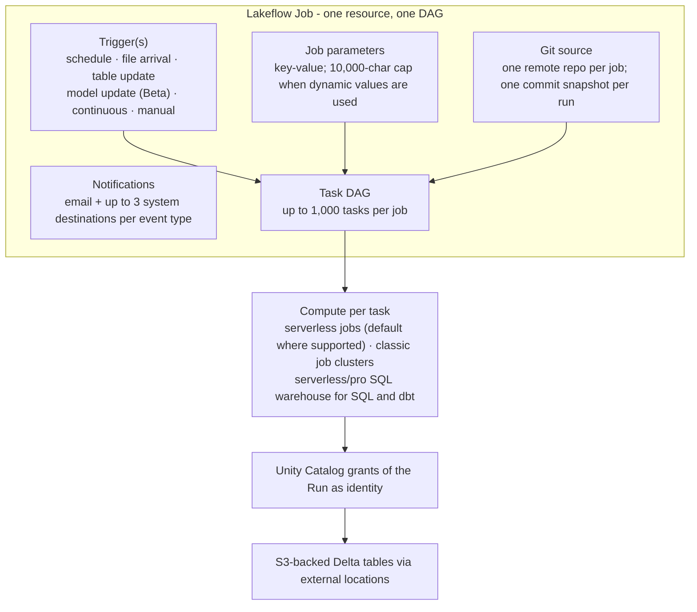
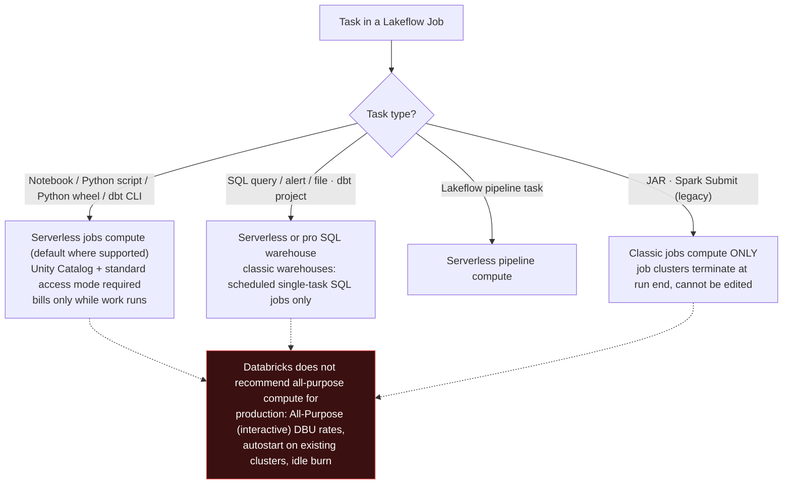
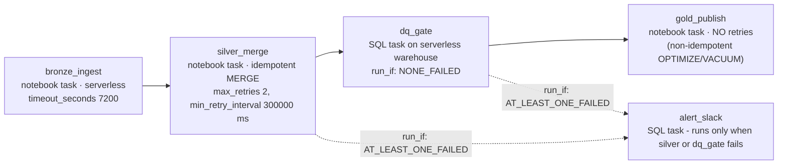
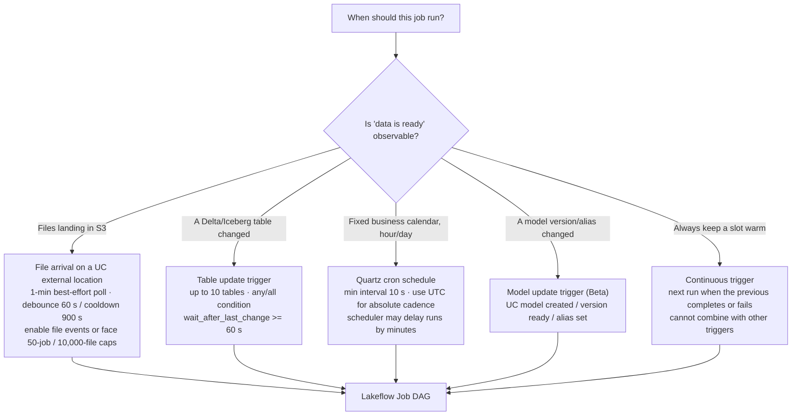
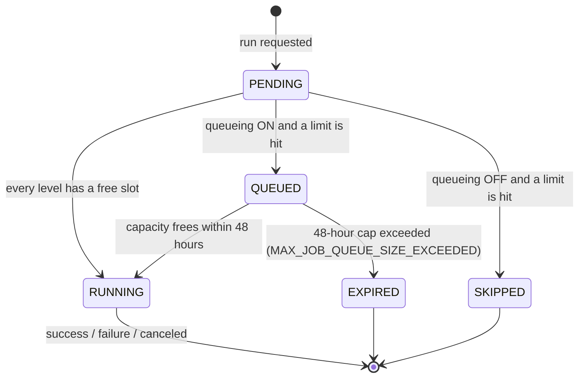
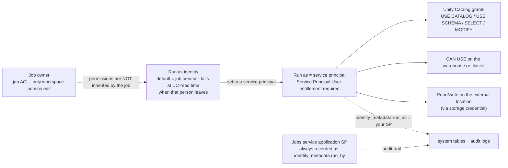

# Lakeflow Jobs (formerly Databricks Workflows): Multi-Task Jobs as Code, Triggers, Retries and the Scheduler Decision Matrix

Every lakehouse eventually fails the same way: the data was fine, the cluster was fine, and nobody pressed the button, or three buttons, in the wrong order, twice. Orchestration is the difference between a lakehouse demo and a lakehouse, and on Databricks on AWS the native orchestrator is **Lakeflow Jobs**. If that name is new to you, that is the first lesson: "Databricks Workflows" was renamed **Lakeflow Jobs** inside the Lakeflow family: "**Lakeflow Jobs (formerly known as Databricks Workflows)**" (Databricks blog, **2025-07-24**); while the REST paths, API objects and system tables keep saying `jobs`. Three names, one product, and a docs page updated **October 9, 2026** that now opens with "Lakeflow Jobs is workflow automation for Databricks, providing orchestration for data processing workloads" (docs.databricks.com/aws/en/jobs/).

This lesson is the operations manual: how a job is built (tasks, DAG, compute), when it fires (six trigger types), what happens when capacity runs out (queue vs skip), how it recovers (retries, repairs, notifications), who it runs as (service principals), how it ships (Declarative Automation Bundles YAML, formerly Databricks Asset Bundles), and when you should *not* use it at all (Amazon MWAA/Airflow, AWS Step Functions). Every limit and price below is stamped with its source and dated to **October 2026**; anything Databricks does not publish is left out rather than guessed.

```text
 =============================================================
  LESSON 09 MAP - Lakeflow Jobs on AWS, as of Oct 2026
 ------------------------------------------------------------
  Model     job -> tasks (<= 1,000) rendered as a DAG
            + triggers + parameters + notifications + Git
  Triggers  scheduled (Quartz, >= 10 s interval) |
            file arrival (best-effort 1/min, UC location) |
            table update (<= 10 tables, >= 60 s debounce) |
            model update (Beta) | continuous | manual
  Capacity  2,000 concurrent task runs/workspace (429)
            12,000 saved jobs | 12,000 active triggers
            10,000 job creations/hour
            max_concurrent_runs: default 1, max 1,000,
            0 = skip everything; queue cap 48 hours
  Reliab.   classic default = NO retries; serverless
            auto-optimizes retries; timeout 0 = none;
            repair / partial runs; webhook event codes
  Identity  Run as = service principal (recommended);
            OAuth M2M tokens live 1 hour
  As code   Declarative Automation Bundles (DABs,
            formerly Databricks Asset Bundles):
            databricks.yml + resources/*.job.yml,
            dev target pauses schedules + prefixes names
  Money     Lakeflow Jobs floor $0.15/DBU vs all-purpose
            $0.40/DBU floor; MWAA large env $0.99/h =
            $736.56/month even with one DAG; Step
            Functions Standard $0.025 per 1,000 transitions
 -------------------------------------------------------------
  Rule of the lesson: cron is a guess, triggers are a
  fact - and the scheduler is NOT for low-latency work.
 =============================================================
```

In this lesson you will:

- reconstruct the **Workflows → Lakeflow Jobs rename** and the job/tasks/triggers anatomy against the published **scale envelope** (tasks, jobs, triggers, concurrency, creations per hour);
- choose **task types and compute** from the serverless-first matrix, and price the same job at the **$0.15 vs $0.40 per-DBU** floors;
- wire the DAG: **`depends_on` + the six `run_if` conditions**, condition/for-each/Run Job control flow, and the **Excluded-counts-as-success** semantics that decide whether your alert task ever runs;
- configure all six **trigger families**: Quartz schedules with the **10-second floor** and the **DST → UTC fix**, file-arrival triggers with **900 s cooldown / 60 s debounce**, table-update triggers with their **60-second** debounce floor;
- separate **queueing** (48-hour cap, default ON for UI jobs since 2024-04-15) from **skipping**, and forensically diagnose both in the **jobs system tables**;
- set **retries, timeouts, repairs, partial runs** and **webhook notifications**, knowing that classic tasks default to *no* retries and that job-level alerts stay silent while retries remain;
- run production jobs as **service principals** with OAuth M2M, not as the human who clicked Create;
- write the estate as **Declarative Automation Bundles** YAML with **dev/prod targets** and **remote-Git task sources**, and bridge enterprise calendars through **Amazon MWAA** with `DatabricksRunNowOperator`;
- pick **Workflows vs Airflow/MWAA vs Step Functions** from a priced decision matrix, study **NAB and Asurion** on AWS, read the **2026 update box**, and practise with **fourteen questions** plus four interactive checks.

---

## 1. Anatomy: one job, one DAG, three concepts

The docs are terse on purpose: a job holds **tasks**, tasks are visually represented by a **DAG**, and **triggers** decide when the job fires. Job-level settings carry the rest: **Trigger, Parameters, Notifications (emails or webhooks), Git** (docs.../jobs/, **Oct 9, 2026**). Everything else in this lesson is a detail of one of those four surfaces.



### 1.1 The scale envelope (all accessed Oct 2026)

| Limit | Value | Behaviour when hit | Source |
|---|---|---|---|
| Tasks per job | **1,000** (write endpoints) | request rejected | jobs overview (Oct 9, 2026); Jobs API 2.2 |
| Saved jobs per workspace | **12,000** | create rejected | jobs overview |
| Job creations per workspace per hour | **10,000** (includes `runs submit`) | throttled | jobs overview |
| Concurrent task runs per workspace | **2,000** | HTTP **429 Too Many Requests** | jobs overview |
| Active triggers per workspace | **12,000** (paused excluded) | create rejected | triggers (Oct 6, 2026) |
| Triggers per job (Multiple Triggers Beta) | **5**; continuous cannot combine with others | rejected | triggers (Oct 6, 2026) |
| `max_concurrent_runs` | default **1**, max **1,000**, **0 = skip all new runs** | skip or reject | Jobs API 2.0; configure-job (Jul 7, 2026) |
| Queue duration | **48 hours** | run dies with `MAX_JOB_QUEUE_SIZE_EXCEEDED` | configure-job |

Two numbers do most of the operational damage. First, **`max_concurrent_runs` defaults to 1**: "By default, the maximum concurrent runs for all new jobs is 1" and a run that would exceed the cap is **skipped** unless queueing catches it (configure-job). Second, the **workspace ceiling of 2,000 concurrent task runs** is global: a fleet of fan-out jobs can starve each other, and the error surfaces as a 429 or as `WORKSPACE_RUN_LIMIT_EXCEEDED` in the system tables (jobs overview; system-tables/jobs, **May 21, 2026**).

- **📚 Did you know?** The legacy Jobs API 2.0 reference (last updated Aug 3, 2026) still says "A job can contain up to **100 tasks**" while the current overview and the 2024-08-22 *"What's new in Workflows?"* blog both say **1,000**. The 1,000-task figure is the current product limit (the write endpoints enforce it); the 100 is a stale legacy page, and read endpoints simply return 100 per page with pagination. Always date-stamp the limit you quote.

---

## 2. Task types and compute: serverless-first, never all-purpose

### 2.1 The task-type palette

The current UI palette (configure-task page) reads: **Notebook · Visual data prep · Clean Room notebook · Python script · Python wheel · SQL (query/alert/file) · Pipeline (Lakeflow) · Database Table Sync pipeline · Ingestion pipeline · SQL Alert (Public Preview) · Dashboards · Power BI · dbt · dbt platform (Public Preview) · JAR · Spark Submit · Run Job · Genie Code (Beta) · If/else · For each**. The REST mapping (Jobs API 2.2) is what your YAML actually writes: `notebook_task`, `spark_jar_task`, `spark_python_task`, `python_wheel_task`, `sql_task`, `dbt_task`, `run_job_task`, `condition_task`, `foreach_task`, `pipeline_task`: with `spark_submit_task` marked "**Deprecated (Legacy)** … Databricks recommends using the spark_jar_task instead".

Three entries deserve commentary before the compute matrix:

- **dbt is first-class**: a dbt task is "one or more dbt commands" plus a `project_directory`, and "The dbt task requires both Databricks SQL and the ability to use a **serverless or a pro SQL warehouse**": classic SQL warehouses are limited to scheduled single-task SQL jobs (Jobs API 2.2). Databricks injects `DBT_ACCESS_TOKEN` for the Run-as identity, which is why the run-as service principal needs warehouse access *and* UC grants.
- **Condition (if/else) tasks "do not require a cluster to execute and do not support retries or notifications"** (Jobs API 2.2; bundles docs, Aug 21, 2026). You cannot "retry a branch": retry the data task the branch guards.
- **Run Job tasks** trigger "other jobs configured in your Databricks workspace", same workspace only, with job parameters pushed down, and are hard-capped: "Databricks does not support jobs with circular dependencies or that nest more than three Run Job tasks" (docs.../jobs/tasks/run-job, **Sep 11, 2026**).

### 2.2 The compute decision tree

The compute-matrix page (last updated **Sep 15, 2026**) is explicit: "**Serverless compute for workflows… is the default** for all tasks that support it", and "**All-purpose compute | You can optionally configure tasks using classic all-purpose compute. Databricks does not recommend this configuration for production jobs.**"



Billing follows the cluster choice, and this single rule anchors every cost lesson in the course: "When you run a job on a new jobs cluster, the job is treated as a **Jobs Compute (automated) workload subject to Jobs Compute pricing**. When you run a job on an existing all-purpose cluster, it is treated as an **All-Purpose Compute (interactive) workload subject to All-Purpose Compute pricing**" (Jobs API 2.0 reference, Aug 3, 2026). Job clusters also behave differently on the way out: compute "terminates and is unavailable for restarting when the job is complete", while a scheduled job pointed at a *terminated* all-purpose cluster **autostarts** it (docs.../compute/clusters-manage); which is how a "cheap" reused cluster quietly becomes a 24×7 line item.

### 2.3 Worked example E1: the same job, two SKUs

**As of Oct 2026.** A medallion job runs 2 hours a day and consumes **12 DBU/h** (a modest multi-task fan-out on classic jobs compute). Monthly DBU cost at the official floors from the Databricks pricing page (snapshot **2026-10**):

```text
Worked example E1 - jobs vs all-purpose DBU cost, as of Oct 2026
Workload ............... 12 DBU/h x 2 h/day x 30 days = 720 DBU/month

Path A - job clusters (Jobs Compute floor "from $0.15 / DBU")
  720 DBU x $0.15 ................................... = $108.00 / month DBU
  (+ EC2 instances billed separately by AWS on classic)

Path B - existing all-purpose cluster (All-Purpose floor "from $0.40 / DBU")
  720 DBU x $0.40 ................................... = $288.00 / month DBU
  (+ idle burn whenever the cluster is up between runs)

Delta ................. $180.00 / month - the same notebooks,
                        the same data, a 2.7x DBU multiplier
```

Serverless jobs are the third path: they "bill only when a command or query runs (plus a small session fee for the REPL VM); charges stop automatically after a few minutes of idle time" (Databricks Answers, **2026-08-27**), and the serverless best-practices page adds that "**Standard mode can reduce costs by up to 70% compared to performance-optimized mode**": at the price of "**4 to 6 minutes**" of startup latency (run-serverless-jobs, Oct 9, 2026). Serverless jobs require a **Unity Catalog-enabled workspace** and **standard access mode**; auto-optimization (including retries, section 6) is on by default.

```plot
{
  "type": "bar",
  "title": "Monthly USD floor for one 720-DBU job plus orchestration floors (worked example E1 + MWAA, as of Oct 2026)",
  "xLabel": "Design",
  "yLabel": "USD per month (published floors)",
  "xKey": "design",
  "dataKeys": ["usd_per_month"],
  "data": [
    {"design": "Job clusters: 720 DBU x $0.15/DBU", "usd_per_month": 108.0},
    {"design": "All-purpose: 720 DBU x $0.40/DBU", "usd_per_month": 288.0},
    {"design": "MWAA large env floor only: 744 h x $0.99/h (before any Databricks DBUs)", "usd_per_month": 736.56}
  ]
}
```

> [!WARNING]
> ⚠️ **Two compute traps break production budgets and parallel jobs.** (1) **Never point production tasks at existing all-purpose clusters**, you pay interactive DBU rates *and* inherit autostart, idle time, and the documented caveat that "you may need to manually restart the cluster if it stops responding" (Jobs API 2.0). The production cheat sheet says it in one line: "Use serverless compute for jobs… **Use service principals instead of user accounts**… **For classic compute: use jobs clusters for automated workflows**" (docs.../cheat-sheet/jobs, Apr 4, 2026). (2) **Shared job clusters leak state**: they are scoped to a single run and cut startup latency, but "Libraries cannot be declared in a shared job cluster configuration" (declare them per task), the cluster idles while other tasks run, and "Scala singletons and companion objects are shared across tasks… If parallel tasks read from or write to the same companion-object variable, one task's value can overwrite another's" (compute page, Sep 15, 2026). Parallel, isolation-sensitive tasks get separate compute or serverless, full stop.

- **📚 Did you know?** Serverless jobs carry automated **rate-limit objects** that cap execution at roughly **60 / 120 / 240 / 480 / 960 DBU per hour** for Small through 2X-Large, and "Within a single job, the cap is shared across all the job's tasks" (docs.../compute/serverless/manage-serverless-compute, accessed Oct 2026). Rate limits apply only to automated workloads, interactive notebooks and Databricks Connect are exempt, and enforcing them requires Databricks Runtime **17.3.1 or above**. A "why did my fan-out stall?" ticket often has this as the answer.

---

## 3. Dependencies and control flow: the DAG you actually get

Tasks after the first declare `depends_on: [{task_key: …}]`, which draws the edges. What those edges *mean* is decided by **Run if**, and this is where production DAGs go wrong. The six conditions (configure run-if docs, **Jun 25, 2026**): **All succeeded (default) · At least one succeeded · None failed · All done · At least one failed · All failed**.

Three documented semantics are exam-grade and incident-grade at once:

1. "Upstream tasks with the **Excluded** result state are treated as **successful** when evaluating Run if conditions."
2. "Upstream tasks marked **Upstream failed** or **Upstream canceled** are treated as **failed**, not as skipped."
3. "If all of a task's dependencies are excluded, the task itself is also excluded… exclusion cascades along a linear dependency chain": regardless of that task's own Run if. Cancellation likewise "propagates through downstream tasks, and tasks with a Run if condition that handles failure are run".



Read the diagram as a policy, not a shape. `dq_gate` uses **NONE_FAILED** because the gold publish must not run on corrupt silver, but a *canceled* upstream counts as failed, so a human cancel still skips gold, which is what you want. The alert task uses **AT_LEAST_ONE_FAILED** so it survives silver's failure; because "Upstream failed" counts as failed, the alert fires on exactly the incidents you care about. Control-flow companions complete the toolbox: **If/else condition tasks** compare operands (EQUAL_TO, GREATER_THAN, …) against dynamic values such as `{{job.repair_count}}` or `{{tasks.task_key.values.output}}` (bundles job-task-types docs, Aug 21, 2026); **For each** loops over a JSON array, manual or produced upstream via `dbutils.jobs.taskValues.set`; **Run Job** composes whole jobs, same-workspace, no cycles, ≤3 levels of nesting.

- **📚 Did you know?** Parameter propagation has a direction and a winner: job parameters "are pushed down automatically, and if a job parameter and a task parameter share a key, the **job parameter takes precedence**", but "Tasks that take **JSON-array parameters don't receive job parameters automatically**; reference them explicitly with `{{job.parameters.<name>}}`" (docs.../jobs/parameters, Jun 26, 2026). JSON-array tasks are Python script, positional wheel, JAR, Spark Submit and For each. Miss that and your Python-script task silently runs with empty argv.

---

## 4. Triggers: cron is a guess, data arrival is a fact

Six trigger behaviors ship today (triggers docs, **Oct 6, 2026**): **Scheduled**, **Table update**, **File arrival**, **Model update (Beta)**, **Continuous** ("trigger another job run whenever a job run completes or fails"), and **None (manual)**. Multiple triggers per job are **Beta**: up to **five**, each independently pausable, and "A continuous trigger cannot be combined with any other trigger". The API carries them in a `triggers` array; do not mix that array with the legacy `schedule` / `trigger` / `continuous` fields in one request.

### 4.1 Scheduled: Quartz cron, the 10-second floor, and DST

Schedules use **Quartz cron syntax** in a **Java timezone id**, with `pause_status` UNPAUSED/PAUSED (Run object schema, Jobs API 2.2: example `"quartz_cron_expression": "20 30 * * * ?", "timezone_id": "Europe/London"`). Three rules from the schedules page (last updated **Jun 26, 2026**):

- "Databricks enforces a **minimum interval of 10 seconds** between subsequent runs triggered by the schedule of a job regardless of the configuration in the cron expression."
- DST-observing timezones: "an **hourly job is skipped or might appear to be delayed by an hour or two when daylight saving time begins or ends**. To run at every hour (absolute time), choose UTC."
- "**The job scheduler is not intended for low-latency jobs.** Due to network or cloud issues, job runs might occasionally be delayed up to several minutes."

### 4.2 Worked example E2: the cron bug and the event-driven fix

```text
Worked example E2 - schedule design, as of Oct 2026
BUG - nightly job, DST zone, local midnight:
  quartz_cron_expression: "0 0 0 * * ?"
  timezone_id: "Europe/London"
  -> around the October change the local wall clock has no
     00:00, so that night's run is skipped; around March the
     00:00 fires twice in local terms. Two missed loads a year
     in a compliance pipeline is an audit finding.

FIX 1 - absolute hourly cadence:
  quartz_cron_expression: "0 0 * * * ?"
  timezone_id: "UTC"          <- DST-proof by construction

FIX 2 - stop guessing when data is ready (file arrival):
  triggers:
    - file_arrival:
        url: "s3://acme-landing/orders/"     # UC external location
        min_time_between_triggers_seconds: 900   # cooldown
        wait_after_last_change_seconds: 60       # debounce
  -> 3 files landing 30 s apart = ONE run (debounce).
     A second batch 5 min later WAITS until the 900 s
     cooldown window elapses. Values are the documented
     example pair (file-arrival docs, Oct 7, 2026).

IMPOSSIBLE - sub-10-second cron:
  "0/5 * * * * ?"   fine (5 s >= 10 s floor? NO - 5 < 10,
                    platform still enforces >= 10 s between runs)
```

File-arrival triggers "make a best effort to **check for new files every minute**", monitor "the root of a Unity Catalog external location or volume, or a subpath" recursively, and "**do not incur additional costs other than cloud provider costs associated with listing files**" (file-arrival docs, Oct 7, 2026). The sharp edges: **only new files trigger**: "Overwriting an existing file with a file of the same name does not trigger a run"; no wildcards; and "When the configured directory does not exist or is deleted from Amazon S3…, file arrival triggers continue to be evaluated with **no error**". Without **file events** enabled on the external location, the workspace caps you at "**A maximum of 50 jobs**" with file-arrival triggers on such locations and "**10,000 files**" in the watched path. The recommended pairing is Auto Loader with `cloudFiles.useManagedFileEvents=true` and `trigger(availableNow=True)`: a foreachBatch variant "provides only **at-least-once** processing guarantees": with the checkpoint kept *outside* the watched path.

### 4.3 Table update triggers

A table-update trigger "checks for table updates, and when a table is updated, the job is run", monitoring up to **10** Unity Catalog Delta/Iceberg managed tables, Delta-backed external tables, materialized views, streaming tables and dependent views: detecting "updates, merges, and deletes" (table-update docs, Jun 26, 2026). `wait_after_last_change_seconds` has a **60-second floor**: it is a debounce, not a sub-minute SLA. Like file arrival, it "do[es] not incur additional costs other than cloud provider costs", and "For best performance and scalability, **enable file events** on the external location."



```matching
{
  "question": "Match each trigger-related number to what it actually controls (all as of October 2026):",
  "pairs": [
    {"left": "10 seconds", "right": "Minimum interval between subsequent runs of a job's schedule, enforced regardless of the cron expression"},
    {"left": "900 s / 60 s", "right": "The documented file-arrival example pair: minimum time between triggers (cooldown) and wait after last change (debounce)"},
    {"left": "60 seconds", "right": "Floor for wait_after_last_change_seconds on a table-update trigger: a debounce, not a sub-minute SLA"},
    {"left": "5 triggers", "right": "Maximum triggers per job during the Multiple Triggers Beta; a continuous trigger cannot be combined with any other"},
    {"left": "12,000 active triggers", "right": "Workspace-wide cap across all jobs and trigger types: paused triggers do not count toward it"},
    {"left": "50 jobs / 10,000 files", "right": "File-arrival caps on a location WITHOUT file events: max trigger jobs per workspace and max files in the watched path"}
  ],
  "explanation": "Every number in this lesson belongs to a specific control surface, and mis-assigning them is how teams ship the wrong fix: raising max_concurrent_runs does not fix a DST skip (that is the 10-second/UTC schedule surface); enabling file events lifts the 50-job/10,000-file caps but does nothing for the 60-second table debounce; and the 900/60 pair is a rate-control example from the file-arrival docs, not a platform minimum: the only hard floors are the 10-second schedule interval and the 60-second table wait."
}
```

- **📚 Did you know?** A workspace can hold up to **12,000 active triggers** across all jobs and trigger types, and **paused triggers don't count** toward that limit (triggers docs, Oct 6, 2026). That makes pause-status hygiene a capacity tool: a fleet of dormant backfill jobs should ship with `pause_status: PAUSED`; which is exactly what Declarative Automation Bundles' development mode does for you (section 8).

---

## 5. Queueing, concurrency and the skip trap

When a run cannot start, two different machines catch it, and only one is on by default. **Queueing** (default ON for jobs created through the UI after **April 15, 2024**) holds the run "for up to **48 hours** if resources are unavailable", triggered when any of three limits is reached: the workspace's maximum concurrent active runs, the workspace's maximum concurrent Run Job task runs, or the job's own `max_concurrent_runs` (configure-job, Jul 7, 2026). Without queueing, a limit hit means the run is **skipped**, and a skipped scheduled run is a silent data gap.



Knobs and ceilings to keep straight: `max_concurrent_runs` default **1**, hard max **1,000**, **0 skips everything**; lowering it never kills active runs; the workspace-wide **2,000 concurrent task runs** returns 429 or `WORKSPACE_RUN_LIMIT_EXCEEDED` even when queueing is on (jobs overview; system tables). Queue depth beyond the documented 48-hour cap is not published: treat "how deep is the internal queue, and in what order does it dequeue?" as unknown, and design for the cap, not for fairness.

### 5.1 Worked example E3: queue forensics in the system tables

```text
Worked example E3 - capacity incident, as of Oct 2026
Symptom ... a 20-task fan-out job with max_concurrent_runs: 10
            shows runs stuck PENDING; downstream alerting fires
Fact ...... workspace already at 1,990 concurrent task runs
Action .... the new job's first runs QUEUE (queueing default ON);
            at the 2,000th task run the API answers 429 and the
            system table records WORKSPACE_RUN_LIMIT_EXCEEDED
Contrast .. same job with queueing OFF: limit hit -> SKIPPED with
            MAX_CONCURRENT_RUNS_REACHED - a silent missed load
```

```sql
-- jobs system tables (docs .../admin/system-tables/jobs, last updated May 21, 2026)
SELECT
  job_run_id,
  job_name,
  run_state,
  queue_duration_seconds,
  setup_duration_seconds
FROM system.lakeflow.job_run_timeline
WHERE queue_duration_seconds > 300
ORDER BY queue_duration_seconds DESC;
```

The same reference lists the failure states worth alerting on: `WORKSPACE_RUN_LIMIT_EXCEEDED` ("The workspace has reached the quota for the maximum number of concurrent active runs"), `MAX_CONCURRENT_RUNS_EXCEEDED`, `MAX_JOB_QUEUE_SIZE_EXCEEDED`, `CLUSTER_REQUEST_LIMIT_EXCEEDED` and `REPOSITORY_CHECKOUT_FAILED`: plus the honest footnote that `creator_user_name` and `paused` are "Not populated for rows emitted before **early December 2025**", so historical hygiene queries need a date floor.

```fillblank
{
  "question": "Fill in the published Lakeflow Jobs limits and floors (all as of October 2026):",
  "template": "A workspace runs at most {{1}} concurrent task runs (HTTP 429 beyond that) and can hold {{2}} saved jobs and {{3}} active triggers, with at most {{4}} job creations per hour. A single job holds at most {{5}} tasks. max_concurrent_runs defaults to {{6}}, cannot exceed 1,000, and 0 skips every new run. Queueing (default ON for UI jobs since 2024-04-15) holds a run for at most {{7}} hours. Scheduled runs are at least {{8}} seconds apart, table-update debounce is at least {{9}} seconds, and each job or task may notify at most {{10}} system destinations per event type.",
  "answers": {
    "1": "2000",
    "2": "12000",
    "3": "12000",
    "4": "10000",
    "5": "1000",
    "6": "1",
    "7": "48",
    "8": "10",
    "9": "60",
    "10": "3"
  },
  "distractors": ["100", "500", "5000", "100000", "5", "10", "0", "24", "72", "1", "5", "10", "30", "600"],
  "explanation": "Every number is lifted from the jobs overview (Oct 9, 2026), the triggers page (Oct 6, 2026), configure-job (Jul 7, 2026), the schedules page (Jun 26, 2026), the table-update page (Jun 26, 2026) and the notifications page (Oct 9, 2026). The distractors are the plausible neighbours: 100 is the stale legacy per-page/task figure, 5 is the Multiple Triggers Beta per-job cap, 24 and 72 invite the 'one day / one weekend' guess on the queue cap, and 600/30 invite confusion with the debounce seconds and the streaming-backlog re-notify throttle."
}
```

---

## 6. Reliability: retries, timeouts, repairs, notifications

### 6.1 Retries differ by compute: the default is silence

"The default setting for task retries depends on the job configuration. For most configurations, the default setting **does not retry any tasks** on task failure" (configure-task). Against that: "**Serverless jobs auto-optimize retries by default**" (opt out via the "Enable serverless auto-optimization" checkbox, and *do* opt out for non-idempotent sinks), and "**Continuous jobs use an exponential backoff retry policy**" (same page). The knobs per task: `max_retries`, `min_retry_interval_millis`, `retry_on_timeout`; `timeout_seconds` is per task with "**A value of 0 means no timeout**" (Jobs API 2.2), and a timeout is *not* retried unless `retry_on_timeout` is set.

### 6.2 Worked example E4: retry policy as a design document

```text
Worked example E4 - retry policy per task, as of Oct 2026
silver_merge     idempotent MERGE into Delta
  max_retries: 2
  min_retry_interval_millis: 300000     # 5 minutes between attempts
  timeout_seconds: 10800                # 3 h ceiling
  -> transient EMR/HTTP hiccups self-heal; MERGE is safe to re-run

gold_publish     OPTIMIZE + VACUUM + grant cascade - NOT idempotent
  max_retries: 0                        # explicit: classic default anyway
  timeout_seconds: 3600
  -> a partial OPTIMIZE re-run wastes DBUs; a partial VACUUM is
     harmless but noisy. Fail loud, alert, repair by hand.

dq_gate          SQL task on a serverless warehouse
  serverless auto-optimization LEFT ON (read-only query)
  timeout_seconds: 900

alert_slack      run_if: AT_LEAST_ONE_FAILED
  max_retries: 1                        # alerts may flake; one retry
```

Recovery surfaces beyond retries: **repair** re-runs "the subset of unsuccessful tasks" in a multi-task run; **partial runs** (Lakeflow Jobs blog, **2025-07-24**) "allow users to select which tasks to execute without affecting others": the operational answer to "re-run just the broken gold task"; and SQL query outputs can feed later tasks as parameters (same blog). Notebook tasks also carry hard output caps: combined cell output **30 MB**, individual cell **8 MB**: beyond which the run fails (docs.../jobs/tasks/notebook, Sep 11, 2026); chatty tasks need to write to Delta, not to stdout.

### 6.3 Notifications: three destinations, silent retries

Notification events (notifications docs, **Oct 9, 2026**): **Start · Successful completion · Failure · duration threshold exceeded · streaming backlog threshold exceeded · maintenance start/complete (continuous jobs)**. Destinations are "email addresses or third-party destinations such as **Slack, Microsoft Teams, PagerDuty, or any webhook-based service**", where "An administrator must configure **system destinations**", and "For each job or task, you can configure a maximum of **three system destinations** for each notification event type". Webhook `event_type` codes are stable: `jobs.on_start`, `jobs.on_success`, `jobs.on_failure`, `jobs.on_duration_warning_threshold_exceeded`.

> [!IMPORTANT]
> 🔔 **"Job-level notifications aren't sent when failed tasks are retried."** That single line (notifications docs, Oct 9, 2026) is why on-call keeps missing incidents on flappy jobs: a silver task that fails twice and then succeeds fires *nothing* at the job level. The documented pattern is **task-level alerts** plus the UI's "Mute notifications until the last retry" option: alert on the *final* failure, not the first. Two adjacent semantics complete the picture: "**Succeeded with failures**" counts as success (select the Success event if you want those), and streaming-backlog alerts evaluate "average backlog over a **10-minute period**" with a **30-minute** re-notify throttle. Canceled and skipped runs can be muted per event.

### 6.4 Worked example E5: the webhook payload and the run-now call

```text
Worked example E5 - failure webhook + REST trigger, as of Oct 2026
What Databricks POSTs to your system destination
(docs .../jobs/notifications, Oct 9, 2026):

{
  "event_type": "jobs.on_failure",
  "workspace_id": "1234567890123456",
  "run":  { "run_id": "678901234567890" },
  "job":  { "job_id": "42", "name": "medallion_daily" }
}

What your platform team calls from the enterprise calendar
(Jobs API 2.2, /api/2.1/jobs/run-now):

curl -X POST "https://<workspace-url>/api/2.1/jobs/run-now" \
  -H "Authorization: Bearer $DATABRICKS_OAUTH_TOKEN" \
  -H "Content-Type: application/json" \
  -d '{
    "job_id": 42,
    "job_parameters": { "env": "prod", "dt": "2026-10-11" }
  }'

Repair only the failed subset of that run:

curl -X POST "https://<workspace-url>/api/2.1/jobs/runs/repair" \
  -H "Authorization: Bearer $DATABRICKS_OAUTH_TOKEN" \
  -H "Content-Type: application/json" \
  -d '{
    "run_id": 678901234567890,
    "rerun_tasks": [ { "task_key": "silver_merge" } ]
  }'
```

Use **OAuth M2M** tokens (client id + OAuth secret; access tokens valid **1 hour**, secrets scopable to `jobs`) rather than personal access tokens; if a legacy integration forces a PAT, use a **service-principal PAT**, never a human's (section 7 and the Airflow seam in section 9).

---

## 7. Identity: owner, Run as, and the departure that breaks 3 a.m.

A job has two identities: the **owner** (job ACL; "Only workspace admins can edit the job owner") and the **Run as** identity whose permissions execute every task. Default Run as = the job creator, and the docs' recommendation is unambiguous: "**Databricks recommends changing the Run as user to a service principal**, so that privileges can be controlled separately from the owner's privileges, and so that jobs do not break when the owner leaves or has changed privileges" (docs.../jobs/privileges, accessed Oct 2026). Changing Run as needs **CAN MANAGE or IS OWNER** on the job, the service principal needs the **Service Principal User** entitlement, and "Run as a group" is **Public Preview**.



The audit nuance matters during incident review: `identity_metadata.run_as` records *your configured* identity (the group, in the group Run-as preview), while `identity_metadata.run_by` "always records" the Jobs service's application service principal (same page). The failure mode this prevents is the course's most common production breaker: the scheduled job keeps looking healthy at schedule time and dies at first UC read after the creator's access is revoked. Machine-to-machine auth for orchestration is OAuth M2M (1-hour tokens) or, for Airflow on AWS, the provider's **AWS IAM OIDC token federation**: "exchange for a Databricks OAuth token. Stores no secrets" (apache-airflow-providers-databricks 7.19.0 docs, accessed Oct 2026).

---

## 8. Jobs as code: Declarative Automation Bundles

Clicking jobs together does not survive a second engineer. The as-code surface is **Declarative Automation Bundles**, "formerly known as Databricks Asset Bundles" (docs.../dev-tools/bundles, accessed Oct 2026), which package "Source files… Definitions and settings for Databricks resources, such as **Lakeflow Jobs**, Lakeflow Spark Declarative Pipelines, Dashboards, Model Serving endpoints, MLflow Experiments". The loop: write `databricks.yml` + `resources/*.job.yml`, then `databricks bundle validate` → `databricks bundle deploy --target dev` → `databricks bundle run --target dev <job>`.

### 8.1 Worked example E6: a production multi-task job, full YAML

```yaml
# resources/medallion_daily.job.yml  (Declarative Automation Bundles)
resources:
  jobs:
    medallion_daily:
      name: "medallion_daily"
      max_concurrent_runs: 1
      queue:
        enabled: true
      run_as:
        service_principal_name: "0000aaaa-1111-bbbb-2222-cccc3333dddd"
      tags:
        cost-center: "data-engineering"
        team: "lakehouse"
      schedule:
        quartz_cron_expression: "0 0 2 * * ?"   # 02:00 daily, Quartz
        timezone_id: "UTC"                       # DST-proof cadence
        pause_status: PAUSED                     # dev target unpauses
      parameters:
        env: "prod"
        dt: "{{job.parameters.env}}"             # override on run-now
      tasks:
        - task_key: bronze_ingest
          description: "Auto Loader bronze from the S3 landing zone"
          timeout_seconds: 7200
          notebook_task:
            notebook_path: "/Repos/lakehouse/bronze_ingest"
            base_parameters: { env: "{{job.parameters.env}}" }
          new_cluster:
            spark_version: "15.4.x-scala2.12"
            node_type_id: "m6i.xlarge"
            num_workers: 4
        - task_key: silver_merge
          timeout_seconds: 10800
          max_retries: 2
          min_retry_interval_millis: 300000
          depends_on: [ { task_key: bronze_ingest } ]
          notebook_task:
            notebook_path: "/Repos/lakehouse/silver_merge"
        - task_key: dq_gate
          run_if: "NONE_FAILED"
          depends_on: [ { task_key: silver_merge } ]
          sql_task:
            query:
              query_id: 1140225567890123
            warehouse_id: "abc123def456abcd"
        - task_key: gold_publish
          depends_on: [ { task_key: dq_gate } ]
          timeout_seconds: 3600
          max_retries: 0                # non-idempotent OPTIMIZE/VACUUM
          notebook_task:
            notebook_path: "/Repos/lakehouse/gold_publish"
        - task_key: alert_slack
          run_if: "AT_LEAST_ONE_FAILED"
          depends_on:
            - { task_key: silver_merge }
            - { task_key: dq_gate }
          sql_task:
            query:
              query_id: 2255678901234567
            warehouse_id: "abc123def456abcd"
      notification_settings:
        alert_on_last_retry_only: true
        no_alert_for_skipped_runs: true
```

Everything in that file maps to a documented field: `run_as.service_principal_name` accepts "the email of an active workspace user or the **application ID of a service principal**" (Jobs API 2.2); `queue.enabled` mirrors the 48-hour queueing behavior (section 5); the retry block is E4; `run_if` is section 3; `schedule` is the verified API shape from the Jobs API job-settings example (accessed Oct 2026). Existing UI-built jobs can be reverse-engineered into this shape with `databricks bundle generate job` (bundles job-task-types docs, Aug 21, 2026): the fastest migration path from click-ops.

### 8.2 Dev/prod targets are the safety rail

Development mode presets (bundles deployment-modes docs): "**Pauses all schedules and triggers** on deployed resources such as jobs" (override with `schedule.pause_status: UNPAUSED`), prepends a `[dev ${workspace.current_user.short_name}]` name prefix, and "**Enables concurrent runs on all deployed jobs**". Production mode applies none of that; which is why the same YAML is safe to deploy from a laptop and terrifying to deploy from a laptop *without* targets. Promotion is `databricks bundle deploy --target prod` from CI, with the run-as service principal and secrets resolved per target.

### 8.3 Git sources: one repo, one commit, one snapshot

Notebook, Python-script, SQL-file and dbt tasks may source a **remote Git repository** (docs.../jobs/git, Sep 11, 2026): "**All tasks in a job must reference the same commit**… Databricks takes a **snapshot** of the specified branch or commit" when the run begins; "**Only one remote Git repository can be used for all tasks in a job**"; and "Tasks configured to use a remote Git repository **cannot write to workspace files**". **Git folders** (workspace-repo sync) work but must be synced manually and are recommended "only for rapid iteration and testing during development": staging and production tasks reference the remote repo with a pinned branch/tag/commit, and the run history shows the commit SHA.

```dragdrop
{
  "question": "Order the jobs-as-code promotion loop for a new multi-task job, from first artifact to production schedule (Declarative Automation Bundles, as of Oct 2026):",
  "items": [
    "Model the job once in the UI (visual DAG) or write resources/medallion_daily.job.yml by hand",
    "Reverse-engineer or snapshot it: databricks bundle generate job (optional but recommended for legacy jobs)",
    "Commit the YAML and databricks.yml into the Git repo CI will deploy from",
    "databricks bundle validate, then databricks bundle deploy --target dev, schedules and triggers arrive PAUSED, names carry the [dev user] prefix",
    "Unpause in dev, run, kill a task on purpose, then repair or partial-run it to prove recovery works",
    "databricks bundle deploy --target prod from CI with the run-as service principal: live schedule, no dev prefix, concurrency presets off"
  ],
  "correctOrder": [
    "Model the job once in the UI (visual DAG) or write resources/medallion_daily.job.yml by hand",
    "Reverse-engineer or snapshot it: databricks bundle generate job (optional but recommended for legacy jobs)",
    "Commit the YAML and databricks.yml into the Git repo CI will deploy from",
    "databricks bundle validate, then databricks bundle deploy --target dev, schedules and triggers arrive PAUSED, names carry the [dev user] prefix",
    "Unpause in dev, run, kill a task on purpose, then repair or partial-run it to prove recovery works",
    "databricks bundle deploy --target prod from CI with the run-as service principal: live schedule, no dev prefix, concurrency presets off"
  ],
  "explanation": "The loop is the documented bundle tutorial flow (validate -> deploy -> run, per target) wrapped around two production habits the docs push: reverse-engineering click-built jobs with bundle generate job, and testing recovery (repair/partial run) BEFORE the schedule is live. The dev target's auto-paused triggers are the built-in guardrail against a laptop deploy firing the prod calendar; production mode removes the dev name prefix and the concurrent-runs preset, so the same YAML means something different on each side of the promotion."
}
```

---

## 9. The external seam: Airflow and Amazon MWAA

Some calendars are enterprise-owned: SAP windows, Redshift maintenance, third-party API SLAs. Databricks' own page documents the seam, "you can also schedule your jobs using tools such as Apache Airflow", with the caveat that the open-source packages "are **not directly supported by Databricks**" (docs.../jobs/how-to/use-airflow-with-jobs, Sep 11, 2026). The operator map:

| Operator | API call | Use it when |
|---|---|---|
| **`DatabricksRunNowOperator`** | `POST /api/2.1/jobs/run-now` on an **existing job** | Default. "Databricks recommends using the DatabricksRunNowOperator because it reduces duplication of job definitions, and job runs triggered with this operator can be found in the Jobs UI" |
| `DatabricksSubmitRunOperator` | `POST /api/2.1/jobs/runs/submit` | Ephemeral runs with no saved job: invisible to job-level monitoring |
| `DatabricksCreateJobsOperator` | `jobs/create` + `jobs/reset` | Pushing job definitions from Airflow (overlaps DABs: pick one owner) |

Production hardening from the provider docs (7.19.0 / module 7.20.0, accessed Oct 2026): **durable mode** persists "the Databricks run id… to task state store before polling begins, so if the worker crashes… the operator reconnects to the run… instead of triggering a duplicate run"; deferrable variants exist; the connection should carry **SP OAuth** or **AWS IAM OIDC federation**, not a human PAT; and the operator "write[s] the job run page URL to the Airflow logs every **polling_period_seconds** (the default is **30 seconds**)" (Databricks tutorial). Version hygiene: Databricks' tutorial still says "Airflow version **2.5.0 and later**… tested with Airflow version **2.6.1**", while provider 7.19.0 requires "**Apache Airflow version supported by this provider distribution is 2.11.0**": pin and test on MWAA rather than trusting either number alone.

### 9.1 Worked example E7: the MWAA-to-Databricks DAG, priced

```text
Worked example E7 - hybrid DAG + the MWAA floor, as of Oct 2026
from airflow.providers.databricks.operators.databricks import (
    DatabricksRunNowOperator,
)

with DAG(
    dag_id="enterprise_calendar_to_lakehouse",
    schedule="0 2 * * *",          # Airflow cron - the BUSINESS calendar
    catchup=False,
    default_args={"retries": 1},   # do NOT double-retry: Databricks
) as dag:                          # silver_merge already retries twice
    prep = PythonOperator(...)     # local Airflow work, if any
    medallion = DatabricksRunNowOperator(
        task_id="run_medallion_daily",
        databricks_conn_id="databricks_sp_oauth",  # SP OAuth or IAM OIDC
        job_id=42,
        job_parameters={"env": "prod"},
        deferrable=True,
    )
    prep >> medallion

MWAA cost floor (AWS MWAA pricing page, accessed Oct 2026, us-east-1):
  large environment ... 744 h x $0.99/h  = $736.56 / month
  small environment ... 744 h x $0.49/h  = $364.56 / month
  extra large workers . $0.22/h each     (small workers $0.055/h)
  meta database ....... $0.10 per GB-month (RDS metadata)
  capacity rule ....... mw1.medium defaults to 10 tasks per worker;
                        required workers = peak concurrent tasks
                        / 10 x safety buffer (AWS Big Data Blog,
                        2026-05-01); watch CloudWatch RunningTasks
                        and QueuedTasks

Databricks side bills ONLY while tasks run (serverless/jobs DBUs).
The $736.56 is the orchestration floor you pay whether one DAG or
one hundred exist in that environment.
```

The design rule that falls out of E7: **one layer owns the DAG edges, the other owns the compute.** Airflow's retries mirror, but must not multiply, Databricks' task retries (set Airflow retries 0 to 1 when the job already retries 2 to 3); the `DatabricksRunNowOperator` URL in the Airflow log is your cross-system breadcrumb; and multi-workspace estates hold one MWAA connection (or one set of OIDC credentials) **per workspace**, because the Run Job task and run-now are same-workspace primitives.

---

## 10. The scheduler decision matrix: Workflows vs Airflow vs Step Functions

Three orchestrators touch a Databricks-on-AWS estate, and each has a documented price shape.

| Dimension | **Lakeflow Jobs (Workflows)** | **Amazon MWAA / Apache Airflow** | **AWS Step Functions** |
|---|---|---|---|
| Native Databricks awareness | Full: task values, repairs, partial runs, jobs UI, UC run-as, system tables | Via provider operators (`RunNow` preferred); runs invisible to job UI if `SubmitRun` | API-level only; Databricks calls are just task integrations |
| Data-aware triggers | File arrival + table update + model (Beta) on UC objects; "no orchestration surcharge": pay only for task compute (vendor claim, blog 2025-01-12) | Sensors/custom operators; EventBridge→DAG patterns; AWS-native fan-out | EventBridge-native; per-state-transition pricing |
| Idle cost | $0 when idle (no scheduler DBU; compute bills only while tasks run) | **$0.99/h large environment = $736.56/month floor** (AWS pricing page example, us-east-1) + workers + RDS metadata | Standard **$0.025 per 1,000 state transitions** (AWS Compute Blog, 2022-08-30); Express **$0.00001667 per GB-second** (+ per-request price not quoted here) |
| Best fit | DAG is 90%+ Databricks tasks; event-driven medallion; repairs/partial runs; UC-governed identities | Fan-out to many non-Databricks systems; org-wide Airflow standards and backfills; vendor-neutral DAG layer | AWS-native serverless coordination of Lambda/ECS/Batch/Glue *plus* Databricks API calls |
| Limits to respect | 2,000 concurrent task runs; 1,000 tasks/job; 12,000 triggers; queue 48 h | mw1.medium ≈ 10 tasks/worker; capacity is your sizing job | Standard: pay per transition; Express: duration metering |

The hybrid that most AWS shops land on: **a single Databricks "ingest" job with a file-arrival trigger owns data readiness; MWAA owns the enterprise calendar and calls that job with `DatabricksRunNowOperator`; Step Functions coordinates the AWS-side steps around the Databricks call.** Managed-Airflow-family alternatives (Prefect, Astronomer) integrate through the same REST/SDK seam: same architecture, different bill, so keep the comparison qualitative until you have their live quotes.

> **Comparative Verdict: Lakeflow Jobs vs Amazon MWAA/Airflow vs AWS Step Functions (AWS, as of Oct 2026)**
> - **Lakeflow Jobs: the default for Databricks-native DAGs.** No idle scheduler charge (vendor: "no orchestration surcharge; You pay only for compute used by your tasks", blog 2025-01-12), data-aware triggers on S3-backed external locations and UC tables, repairs/partial runs, run-as service principals, and job observability in system tables. DBU floor **$0.15/DBU** (Data Engineering, pricing page snapshot 2026-10) on classic job compute, or serverless that "bill[s] only when a command or query runs". Weakness: orchestration *out* of Databricks is still young (the June 2026 Lakeflow blog announces External Orchestration for Snowflake/REST/Slack/PagerDuty without stating its maturity), and Run Job chaining is same-workspace only, ≤3 levels, no cycles.
> - **Amazon MWAA/Airflow, the enterprise-calendar owner.** Vendor-neutral DAGs, custom operators/sensors, mature backfill semantics, and the only comfortable home for fan-out that spends most of its steps outside Databricks. The honest cost: a **$0.99/h large environment ≈ $736.56/month** floor (AWS pricing page example) plus workers at $0.22/h and RDS metadata at $0.10/GB-month, orchestration with its own bill *and* its own on-call. Call Databricks through `DatabricksRunNowOperator` (SP OAuth or IAM OIDC, deferrable, durable) so runs stay visible in the jobs UI.
> - **AWS Step Functions: the AWS-glue orchestrator.** Best when the workflow's centre of gravity is Lambda/ECS/Batch/Glue and Databricks is one API call among many; Standard pricing is per state transition (**$0.025 per 1,000**, AWS Compute Blog 2022-08-30: re-check the live table), Express meters GB-seconds ($0.00001667/GB-s, pricing page accessed Oct 2026). You give up task values, repairs and the jobs UI: Databricks-aware features live outside the console.
> - **Verdict in one line:** *Lakeflow Jobs for the Databricks-internal DAG → MWAA where the calendar or the fan-out is non-Databricks → Step Functions where AWS services are the workflow and Databricks is a callee*, and in every hybrid, exactly one layer owns the DAG edges, run-now owns the seam, and the run-as identity is a service principal.

---

### 2026 Updates (as of October 2026)

> [!NOTE]
> **What changed in the Databricks orchestration layer that this lesson depends on: each line checked against a primary source:**
> - **2025-07-24: the rename and partial runs.** "**Lakeflow Jobs (formerly known as Databricks Workflows)**"; "**Partial runs** allow users to select which tasks to execute without affecting others"; SQL query outputs usable as job parameters (Databricks blog, *What's New: Lakeflow Jobs Provides More Efficient Data Orchestration*, 2025-07-24).
> - **2025-06 → 2026-06, Lakeflow family consolidation.** Lakeflow GA (2025-06) put Jobs beside Pipelines and Connect; the 2026-06-16 *Lakeflow: A new era of agentic data engineering* blog reports "**50+ integrations**" and announces **External Orchestration** (trigger Snowflake jobs, fire custom REST APIs, Slack/PagerDuty), the page does not state GA/preview status, so treat maturity as unverified and keep cross-system calls on the Airflow/Step-Functions seam until it is.
> - **2026-10-06/07/09: docs refresh restates the limits.** Triggers page: Multiple Triggers **Beta ≤5**, continuous cannot combine, **12,000 active triggers** (paused excluded); file-arrival page: 1-minute best-effort poll, no-file-event caps **50 jobs / 10,000 files**, 900 s/60 s example; configure-job: **48-hour** queue cap, default concurrency **1**; notifications page: **3 system destinations** per event type, retried failures stay silent at job level; jobs overview: 1,000 tasks, 12,000 jobs, 10,000 creations/hour, 2,000 concurrent task runs.
> - **2026-09-11 → 2026-10-09: serverless and identity pages move.** Serverless compute for workflows is the documented default where supported (UC + standard access mode; Standard vs Performance-optimized modes, "up to 70%" cheaper in Standard); run-as guidance restated: service principal for production, group Run-as still **Public Preview**; Run Job page warns against >3 nested levels and circular chains.
> - **2026-08 → 2026-10, the Airflow provider floor moved.** apache-airflow-providers-databricks **7.19.0** requires **Airflow ≥ 2.11.0**, while Databricks' tutorial text still says 2.5.0+ (tested on 2.6.1), pin the pair explicitly on MWAA; durable-mode run-id persistence and deferrable operators are the documented double-run guards.
> - **2025-01-12 (still cited in 2026), the consolidation thesis.** Databricks' *From Apache Airflow to Lakeflow Jobs* post argues teams are "consolidating legacy orchestrators… onto a single, unified platform", citing a **99.95% uptime SLA** and no orchestration surcharge, vendor claims; pair them with section 9's MWAA counter-case whenever they appear in a business case.

---

## Real-World Case Studies

> **📋 Case A: NAB (National Australia Bank, banking, Cloud: AWS)**
> **Challenge.** A **26-year-old Teradata warehouse** carrying ~1,000 use cases and ~140 reporting suites, plus hand-written Spark ETL with 5,000 to 8,000-line DML and up to 64 `union-all` per pipeline, maintained by 300 to 400 engineers with inconsistent practice.
> **Stack on AWS.** Databricks SQL, Auto Loader, **Spark Declarative Pipelines on Lakeflow** (the pipeline sibling of this lesson's Jobs), Unity Catalog, and **asset bundles for CI/CD**: `Cloud: AWS` on the story page.
> **Reported outcome.** "**1,800 Spark Declarative Pipelines running on Databricks Lakeflow · 99.6% Job success rate · 80% Less transformation complexity**"; end-to-end latency "under 15 minutes"; data quality "+38%" (https://www.databricks.com/customers/national-australian-bank-nab, undated page, accessed 2026-10).
> **Quote.** "The migration wouldn't have been possible without Databricks SQL": Gurry (https://www.databricks.com/customers/nab/dbsql, undated page, accessed 2026-10).
> **Maps to this lesson.** Sections 6 and 8: a **99.6% job success rate** across 1,800 pipelines is a *reliability* metric: retries, repairs, run-as service principals and bundle-deployed definitions are what turn orchestration from heroics into a number an auditor can track.
> ⏳ *Temporal note: undated page, accessed Oct 2026: a reported customer outcome, not a 2026 guarantee.*

> **📋 Case B: Asurion (insurance / device protection, Cloud: AWS)**
> **Challenge.** 8,000 tables, 10,000 views and ~600 data marts with per-table ETL mappings, plus batch/speed-layer duplication across thousands of jobs that would not fit a one-cluster-per-job scheduling model.
> **Stack on AWS.** Spark Structured Streaming, **Auto Loader**, `foreachBatch` into Delta; sources Kinesis, Kafka, SNS, SQS, CDC, APIs and flat files; Databricks SQL for the mart layer: the production data lake explicitly **on AWS**.
> **Reported outcome.** "The Asurion data lake executes **4,000+ streaming jobs** and hosts over 4,000 tables in a production data lake **on AWS**" (https://www.databricks.com/blog/2021/05/10/aws-guide-to-data-ai-summit-featuring-disney-comcast-capital-one-and-mcdonalds.html, **2021-05-10**); "unified approach to data movement from traditional ETL to streaming data pipelines between Delta tables" (https://www.databricks.com/blog/2021/09/16/large-scale-etl-and-lakehouse-implementation-at-asurion.html, **2021-09-16**).
> **Maps to this lesson.** Sections 1 and 2: at 4,000+ streaming jobs, *job design* is the architecture: one parameterized framework with shared conventions (task keys, timeouts, run-as identity, compute choices) beats 4,000 bespoke ETLs, and the workspace-scale limits in section 1.1 are exactly the envelope such an estate must be designed against.
> ⏳ *Temporal note: 2021 figures; treat as a reported scale milestone, and re-check any concurrency limit quoted in the blog against current docs before reusing it.*

---

> [!SUCCESS]
> **Key Takeaways:**
> 1. **One product, three names:** Databricks Workflows → **Lakeflow Jobs** (blog, 2025-07-24); REST paths, APIs and system tables still say `jobs`. The model is job → tasks (≤**1,000**) as a DAG → triggers, with job-level parameters, notifications and Git.
> 2. **Scale envelope (Oct 2026):** 2,000 concurrent task runs/workspace (429), 12,000 saved jobs, 10,000 job creations/hour, 12,000 active triggers (paused excluded), Multiple Triggers Beta ≤5, `max_concurrent_runs` default **1** / max 1,000 / **0 = skip all**, queue cap **48 hours**.
> 3. **Compute rule:** serverless jobs are the default where supported (UC + standard access mode); classic **job clusters** bill Jobs Compute and terminate at run end; **all-purpose is not recommended for production**: same code on all-purpose bills the $0.40/DBU floor vs $0.15/DBU for jobs (pricing page, snapshot 2026-10): E1's 720-DBU job = **$108 vs $288/month**.
> 4. **Control flow:** `run_if` has six conditions (default ALL_SUCCESS); **Excluded counts as success**, **Upstream failed/canceled counts as failed**, full exclusion cascades; condition tasks need no cluster and support no retries/notifications; Run Job is same-workspace, no cycles, ≤3 nested.
> 5. **Triggers:** Quartz cron with a **10-second minimum interval** and **UTC for absolute cadence** (DST skips/delays hourly jobs); file arrival polls best-effort every minute on UC locations with cooldown/debounce (900 s/60 s example), fires only on *new* files, and without file events caps at 50 jobs/10,000 files; table update monitors ≤10 tables with ≥60 s debounce; model update is **Beta**; continuous cannot combine with other triggers.
> 6. **Queue vs skip:** queueing (default ON for UI jobs since 2024-04-15) holds runs up to 48 h; without it, limit hits **skip** runs; diagnose with `queue_reason` and `queue_duration_seconds` in `system.lakeflow.job_run_timeline`; watch the states `WORKSPACE_RUN_LIMIT_EXCEEDED`, `MAX_CONCURRENT_RUNS_REACHED`, `MAX_JOB_QUEUE_SIZE_EXCEEDED`.
> 7. **Reliability:** classic tasks default to **no retries**; serverless auto-optimizes retries (disable for non-idempotent sinks); continuous uses exponential backoff; timeouts default 0 (none) and don't retry unless `retry_on_timeout`; repairs and **partial runs** re-run subsets; **job-level failure alerts don't fire while retries remain**: use task-level alerts / mute-until-last-retry; ≤**3** system destinations per event type; "Succeeded with failures" counts as success.
> 8. **Identity:** default Run as = job creator (breaks when they leave); set a **service principal** (CAN MANAGE or IS OWNER to change; SP needs the Service Principal User entitlement); `identity_metadata.run_as` vs `run_by` (always the Jobs service SP); OAuth M2M tokens live **1 hour**.
> 9. **Jobs as code:** Declarative Automation Bundles (formerly Databricks Asset Bundles) = `databricks.yml` + `resources/*.job.yml`, `bundle validate|deploy|run -t <target>`; **dev mode pauses schedules/triggers, prefixes names, enables concurrent runs**; `bundle generate job` reverse-engineers UI jobs; remote-Git task sources pin one repo and one commit snapshot per run and cannot write workspace files.
> 10. **Hybrid seam:** prefer `DatabricksRunNowOperator` over `SubmitRun` (runs stay in the jobs UI); durable mode + deferrable guards double-runs; SP OAuth or AWS IAM OIDC, never a human PAT; MWAA large environment floor **$0.99/h = $736.56/month** plus workers ($0.22/h) and RDS metadata ($0.10/GB-month); capacity ≈ peak concurrent tasks ÷ 10 (mw1.medium) × buffer.
> 11. **Decision line:** Lakeflow Jobs for Databricks-internal DAGs and data-aware triggers → MWAA for enterprise calendars and non-Databricks fan-out → Step Functions for AWS-native coordination (Standard $0.025/1,000 transitions; Express $0.00001667/GB-second): one layer owns the edges, run-now owns the seam, a service principal owns the identity.

---

## Practice Questions

```question
{
  "id": "dbl-09-q1",
  "type": "multiple-choice",
  "question": "A colleague insists your team still uses 'Databricks Workflows' and that nothing has been renamed. As of October 2026, which statement is correct?",
  "options": [
    "The product was renamed Lakeflow Jobs inside the Lakeflow family; docs URLs and the UI say Lakeflow Jobs / Jobs & Pipelines, while REST paths, API objects and system tables still use 'jobs'",
    "Workflows was retired in 2025 and replaced by AWS Step Functions integration; no native orchestrator remains",
    "The rename applies only to Azure workspaces; AWS workspaces still brand the feature Workflows",
    "Lakeflow Jobs is a separate paid product that does not share the Jobs REST API with Workflows"
  ],
  "correct": 0,
  "explanation": "Databricks' own blog states 'Lakeflow Jobs (formerly known as Databricks Workflows)' (2025-07-24), and the jobs overview page (last updated Oct 9, 2026) is titled for Lakeflow Jobs: while the API stays /api/2.1/jobs/... and system tables keep job in their names. Option B invents a retirement that never happened; C contradicts the AWS-scoped docs; D invents a second product: it is one product with a rename, which is why your runbooks, cost queries and audit filters must all be updated together."
}
```

```question
{
  "id": "dbl-09-q2",
  "type": "multiple-choice",
  "question": "A scheduled job has max_concurrent_runs: 0 and queueing enabled. What happens when the schedule fires?",
  "options": [
    "The run queues for up to 48 hours and then starts",
    "All new runs are skipped: setting max_concurrent_runs to 0 causes all new runs to be skipped",
    "The job definition is rejected at save time because 0 is below the minimum of 1",
    "The workspace returns HTTP 429 because the concurrency limit was exceeded"
  ],
  "correct": 1,
  "explanation": "Jobs API 2.0 documents it exactly: 'This value cannot exceed 1000. Setting this value to 0 causes all new runs to be skipped. The default behavior is to allow only 1 concurrent run.' Queueing does not override 0: the 48-hour queue applies when capacity is temporarily unavailable, not when concurrency is deliberately set to skip everything. HTTP 429 is the workspace-wide 2,000-concurrent-task-run response, a different ceiling entirely."
}
```

```question
{
  "id": "dbl-09-q3",
  "type": "true-false",
  "question": "Databricks enforces a minimum interval of 10 seconds between subsequent runs triggered by a job's schedule, regardless of what the cron expression says.",
  "options": ["True", "False"],
  "correct": 0,
  "explanation": "True: the schedules page (last updated Jun 26, 2026) states: 'Databricks enforces a minimum interval of 10 seconds between subsequent runs triggered by the schedule of a job regardless of the configuration in the cron expression.' A Quartz expression that looks like it fires every 5 seconds still yields 10-second spacing, and the same page warns the scheduler 'is not intended for low-latency jobs': runs can slip by minutes. Sub-second or few-second cadences belong to streaming or continuous triggers, not cron."
}
```

```question
{
  "id": "dbl-09-q4",
  "type": "multiple-choice",
  "question": "A job runs hourly via Quartz cron with timezone_id Europe/London and has silently missed loads twice a year. What is the documented fix?",
  "options": [
    "Raise max_concurrent_runs so the skipped hour queues instead",
    "Set the timezone to UTC for absolute-time cadence: DST-observing zones cause hourly jobs to be skipped or delayed by an hour or two when clocks change",
    "Switch the cron to Quartz's special DST field 'D' in position 7",
    "Enable file-arrival triggers on the same job so the missed hour is replayed from S3 listing"
  ],
  "correct": 1,
  "explanation": "The schedules page says it directly: 'If you select a time zone that observes daylight saving time, an hourly job is skipped or might appear to be delayed by an hour or two when daylight saving time begins or ends. To run at every hour (absolute time), choose UTC.' Concurrency cannot recover a schedule that never fired; Quartz has no DST field to bolt on; file-arrival triggers are a different trigger family (and during Multiple Triggers Beta a job cannot mix trigger types freely) - the fix for a calendar bug is the calendar: UTC."
}
```

```question
{
  "id": "dbl-09-q5",
  "type": "multiple-choice",
  "question": "In a multi-task job, task C depends on tasks A and B with run_if: AT_LEAST_ONE_SUCCESS. Task A finishes with result state Excluded and task B fails. What happens to C?",
  "options": [
    "C runs, because Excluded upstream tasks are treated as successful when evaluating Run if conditions: but here B failed and A counts as success, so at least one success exists",
    "C is skipped, because Excluded is neither success nor failure and therefore cannot satisfy AT_LEAST_ONE_SUCCESS",
    "C is excluded, because any Excluded dependency cascades exclusion regardless of the run_if condition",
    "C runs only if B is retried and succeeds; Excluded upstream always forces ALL_SUCCESS semantics"
  ],
  "correct": 0,
  "explanation": "The run-if docs (Jun 25, 2026) state: 'Upstream tasks with the Excluded result state are treated as successful when evaluating Run if conditions.' So A contributes a success and AT_LEAST_ONE_SUCCESS is satisfied even though B failed. The traps: exclusion cascade only fires when ALL of a task's dependencies are excluded (option C describes that partial truth); Upstream failed/canceled counts as failed, not skipped: which is why failure-handling tasks must be written deliberately (section 3)."
}
```

```question
{
  "id": "dbl-09-q6",
  "type": "multiple-choice",
  "question": "You configure a file-arrival trigger on s3://acme-landing/orders/ (a Unity Catalog external location WITHOUT file events) and the trigger never fires. Which documented cause is NOT valid?",
  "options": [
    "The watched directory was deleted from Amazon S3: file arrival triggers continue to be evaluated with no error when the directory does not exist",
    "An existing file was overwritten with a file of the same name: only NEW files trigger runs",
    "The trigger is throttled because the location exceeds the documented no-file-event caps of a maximum of 50 trigger jobs per workspace and 10,000 files in the watched path",
    "The trigger is throttled because file-arrival triggers require more than one trigger per job during the Multiple Triggers Beta"
  ],
  "correct": 3,
  "explanation": "The file-arrival docs (Oct 7, 2026) list the real gotchas: deleted/non-existent S3 paths evaluate silently with no error; only new files fire (overwrites do not); and without file events you are capped at 50 jobs and 10,000 files. Requiring multiple triggers per job is backwards: Multiple Triggers Beta allows UP TO five triggers per job, and a continuous trigger cannot even be combined with others. One file-arrival trigger on one location is fully supported."
}
```

```question
{
  "id": "dbl-09-q7",
  "type": "multiple-choice",
  "question": "A classic-compute notebook task fails with a transient network error. With no retry settings configured, what does Databricks do by default?",
  "options": [
    "Retries the task three times with exponential backoff, because three retries is the platform default for all tasks",
    "Does not retry: for most configurations the default setting does not retry any tasks on task failure; serverless jobs are the ones that auto-optimize retries by default",
    "Retries until the 48-hour queue cap expires, then marks the run failed",
    "Automatically falls back to serverless compute and retries there"
  ],
  "correct": 1,
  "explanation": "The configure-task page: 'The default setting for task retries depends on the job configuration. For most configurations, the default setting does not retry any tasks on task failure': and separately, 'Serverless jobs auto-optimize retries by default' and 'Continuous jobs use an exponential backoff retry policy.' Option A is the most expensive myth in job operations; the queue cap governs pending runs, not retries; and there is no automatic compute fallback."
}
```

```question
{
  "id": "dbl-09-q8",
  "type": "multiple-choice",
  "question": "On a job owned by a user who just left the company, scheduled runs begin failing at first Unity Catalog read even though the schedule itself is fine. What is the root cause and the documented fix?",
  "options": [
    "The job owner's departure deleted the job's Git snapshot; re-point the tasks at a remote Git repository with a pinned commit",
    "Jobs run as their creator by default; set Run as to a service principal with its own UC grants (requires CAN MANAGE or IS OWNER, and the SP needs the Service Principal User entitlement)",
    "The workspace hit the 12,000 saved-jobs limit; archive old jobs to free capacity",
    "The run-as group Public Preview feature revoked the creator's group membership; disable group Run as"
  ],
  "correct": 1,
  "explanation": "Privileges docs: 'Jobs Run as the job creator by default. If the Run as user leaves your organization, the job might fail': hence 'Databricks recommends changing the Run as user to a service principal'. Changing Run as requires CAN MANAGE or IS OWNER on the job, and the service principal needs the Service Principal User entitlement. Git snapshots, saved-job quotas and group Run-as (still Public Preview) are unrelated to the permission failure described."
}
```

```question
{
  "id": "dbl-09-q9",
  "type": "multiple-choice",
  "question": "Your MWAA DAG must trigger an existing Databricks job and keep the run visible in the Databricks Jobs UI. Which operator should you use?",
  "options": [
    "DatabricksSubmitRunOperator: ephemeral submits are faster and therefore always preferable in production",
    "DatabricksRunNowOperator: it calls run-now on an existing job; Databricks recommends it because it reduces duplication of job definitions and runs appear in the Jobs UI",
    "DatabricksCreateJobsOperator: it creates the job at DAG-parse time so the definition always matches the code",
    "A plain HttpOperator against /api/2.1/jobs/runs/submit: any REST call is equivalent for UI visibility"
  ],
  "correct": 1,
  "explanation": "Databricks' Airflow page: 'The DatabricksRunNowOperator requires an existing Databricks job and uses the POST /api/2.1/jobs/run-now API request... Databricks recommends using the DatabricksRunNowOperator because it reduces duplication of job definitions, and job runs triggered with this operator can be found in the Jobs UI.' SubmitRun uses runs/submit with no saved job: the run is invisible to job-level monitoring; CreateJobsOperator is for pushing definitions, which overlaps your DABs pipeline; a raw submit call inherits the same invisibility."
}
```

```question
{
  "id": "dbl-09-q10",
  "type": "multiple-choice",
  "question": "Using published floors as of October 2026, what does it cost per month to run a 720-DBU job on classic job clusters versus the same job on an existing all-purpose cluster: before any EC2 charges?",
  "options": [
    "$108 on job clusters (720 x $0.15/DBU) versus $288 on all-purpose (720 x $0.40/DBU)",
    "$288 on job clusters versus $108 on all-purpose: jobs compute is the premium SKU",
    "$720 on both: DBUs are flat-priced regardless of compute type",
    "$108 on job clusters versus $736.56 on all-purpose: the $0.99/h MWAA rate applies to interactive clusters"
  ],
  "correct": 0,
  "explanation": "The pricing page (snapshot 2026-10) shows Data Engineering starting at $0.15/DBU and Interactive workloads starting at $0.40/DBU, and the Jobs API 2.0 reference ties the SKU to the cluster: new job clusters bill Jobs Compute, existing all-purpose clusters bill All-Purpose Compute. 720 x 0.15 = $108; 720 x 0.40 = $288: a 2.7x multiplier for identical code. $736.56 is the MWAA large-environment floor (744 h x $0.99), a different bill entirely (worked examples E1 and E7)."
}
```

```question
{
  "id": "dbl-09-q11",
  "type": "true-false",
  "question": "A silver task fails on attempt 1, succeeds on attempt 2 of 2, and the job has a job-level on-failure notification configured. The on-failure webhook fires as soon as attempt 1 fails.",
  "options": ["True", "False"],
  "correct": 1,
  "explanation": "False: the notifications page (Oct 9, 2026) states: 'Job-level notifications aren't sent when failed tasks are retried.' The documented pattern is task-level notifications plus 'Mute notifications until the last retry' so on-call is alerted on the FINAL failure, not every transient blip. This is why flappy jobs with retries look quiet in Slack and loud in the run history: and why duration-threshold and streaming-backlog events (10-minute average, 30-minute re-notify) exist as separate signals."
}
```

```matching
{
  "id": "dbl-09-q12",
  "type": "matching",
  "question": "Match each trigger family to its documented behaviour and limits (all as of October 2026):",
  "pairs": [
    {"left": "Scheduled (Quartz cron)", "right": "Minimum 10 seconds between scheduled runs; DST-observing timezones skip or delay hourly jobs: choose UTC for absolute cadence; scheduler may delay runs by minutes"},
    {"left": "File arrival", "right": "Best-effort check every minute on a Unity Catalog external location or volume; only NEW files fire, overwrites do not; without file events: max 50 trigger jobs per workspace and 10,000 files in the path"},
    {"left": "Table update", "right": "Monitors up to 10 UC tables (updates, merges, deletes); wait_after_last_change_seconds has a 60-second floor; no Databricks cost beyond listing"},
    {"left": "Continuous", "right": "Starts another run whenever the previous completes or fails; cannot be combined with any other trigger; continuous jobs use exponential backoff retries"},
    {"left": "Model update", "right": "Beta as of the Oct 6, 2026 triggers page: fires when a Unity Catalog model is created, a version is ready, or an alias is set"},
    {"left": "Multiple Triggers (Beta)", "right": "A job can have up to five triggers, each independently pausable; a workspace holds at most 12,000 active triggers (paused excluded)"}
  ],
  "explanation": "Each pair is a direct lift from the triggers overview (Oct 6, 2026), schedules (Jun 26, 2026), file-arrival (Oct 7, 2026) and table-update (Jun 26, 2026) pages. The traps: confusing the 60-second table debounce with a sub-minute SLA; assuming overwrites re-trigger file arrival; forgetting that continuous cannot mix with other triggers; and quoting model update as GA when the page still marks it Beta."
}
```

```question
{
  "id": "dbl-09-q13",
  "type": "multiple-choice",
  "question": "A team deploys jobs with databricks bundle deploy --target dev from their laptops. What does development mode do to the deployed resources by default?",
  "options": [
    "Deletes all schedules and triggers so dev jobs can only be run manually forever",
    "Pauses all schedules and triggers, prefixes resource names with [dev <user>], and enables concurrent runs on deployed jobs",
    "Deploys directly to production resources because dev and prod share a metastore",
    "Rewrites run_as to the deploying user's personal access token for the duration of the session"
  ],
  "correct": 1,
  "explanation": "Bundle deployment modes: development mode 'Pauses all schedules and triggers on deployed resources such as jobs' (override with schedule.pause_status: UNPAUSED), prepends the [dev <user>] prefix, and 'Enables concurrent runs on all deployed jobs'; production mode applies none of those presets. That is the built-in safety rail against a laptop deploy firing the prod calendar. Nothing is deleted (A), dev and prod are separate targets (C), and run_as comes from the YAML's service principal, not a session PAT (D)."
}
```

```dragdrop
{
  "id": "dbl-09-q14",
  "type": "dragdrop",
  "question": "Order the capacity states a scheduled run can enter, from request to terminal outcome, when the workspace or job limits are involved (queueing ON vs OFF, as of Oct 2026):",
  "items": [
    "PENDING: the run is accepted and waiting for capacity at every level (workspace 2,000 task runs, job max_concurrent_runs)",
    "RUNNING: a free slot exists at every level; the run executes its task DAG",
    "QUEUED: queueing is ON (default for UI jobs since 2024-04-15) and a limit is hit; the run waits up to 48 hours",
    "EXPIRED / skipped with MAX_JOB_QUEUE_SIZE_EXCEEDED: the 48-hour queue cap was exceeded before capacity freed",
    "SKIPPED: queueing is OFF (or concurrency is 0) and a limit is hit; the run never executes and the load is silently missing"
  ],
  "correctOrder": [
    "PENDING: the run is accepted and waiting for capacity at every level (workspace 2,000 task runs, job max_concurrent_runs)",
    "RUNNING: a free slot exists at every level; the run executes its task DAG",
    "QUEUED: queueing is ON (default for UI jobs since 2024-04-15) and a limit is hit; the run waits up to 48 hours",
    "EXPIRED / skipped with MAX_JOB_QUEUE_SIZE_EXCEEDED: the 48-hour queue cap was exceeded before capacity freed",
    "SKIPPED: queueing is OFF (or concurrency is 0) and a limit is hit; the run never executes and the load is silently missing"
  ],
  "explanation": "Configure-job (Jul 7, 2026): a run queues 'for up to 48 hours if resources are unavailable' when the workspace max concurrent runs, workspace Run-Job-task limit, or the job's max_concurrent_runs is hit; without queueing, Databricks 'skips the run if the job has already reached its maximum number of active runs'. The workspace ceiling of 2,000 concurrent task runs returns 429 / WORKSPACE_RUN_LIMIT_EXCEEDED regardless. The operational lesson: queueing converts a silent data gap into a visible delay: so leave it on, and alert on queue_duration_seconds, not just on failure."
}
```
