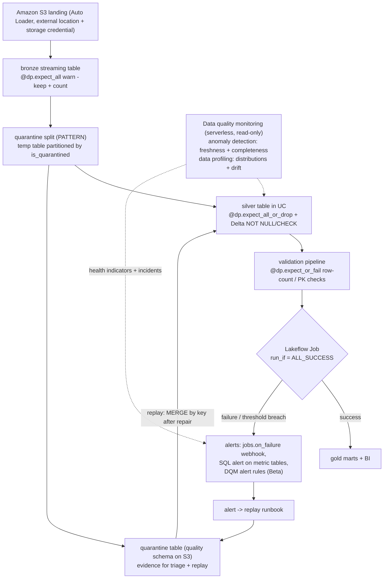
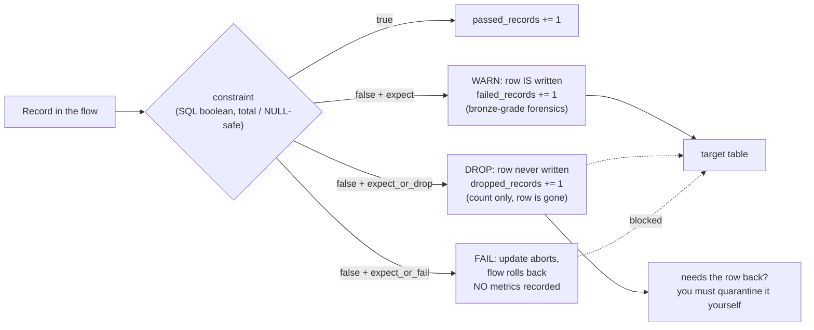
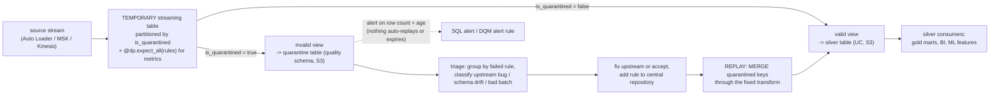
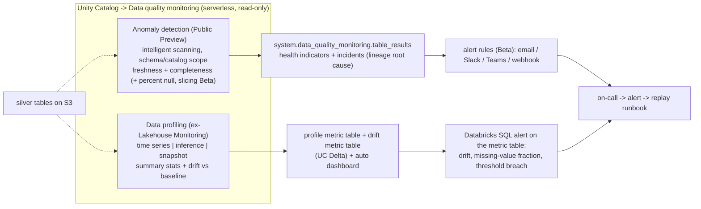
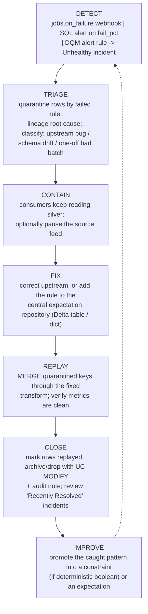

# Data Quality in the Databricks Lakehouse: Constraints, Expectations, Quarantine and Monitoring

Every lakehouse eventually meets the same unpleasant morning: a downstream dashboard shows revenue that is 4% too low, and nobody can say whether the business shrank or the pipeline lied. Data quality on Databricks on AWS is the discipline that makes that morning *answerable*, and as of October 2026 it is five distinct mechanisms with five distinct jobs, not one feature. **Constraints** are always-on write gates enforced by Delta on every transaction. **Expectations** are per-record SQL checks inside Lakeflow pipelines with three graded actions and machine-readable metrics. **Quarantine** is a documented *pattern*: not a decorator; that keeps failing rows in a Unity Catalog table on S3 for triage and replay. **Data quality monitoring** is the detection plane (schema-wide **anomaly detection** plus per-table **data profiling**, the feature "formerly known as Lakehouse Monitoring"). **Alerting and quality gates** live in Lakeflow Jobs. Prevention, evidence, detection, orchestration: mix them up and you either lose rows silently or drown in a quarantine table nobody empties.

The rule that keeps the whole lesson straight comes straight from the docs: "**Expectations enforce data quality, not orchestration**" (docs .../ldp/expectation-patterns, dated **2026-07-14**). Constraints and expectations *prevent*; monitoring *detects*; jobs *gate*; quarantine *remembers*. A mature estate needs all four verbs.

```text
 =============================================================
  LESSON 10 MAP - the data-quality stack on AWS, as of Oct 2026
 ------------------------------------------------------------
  L1 CONSTRAINTS   Delta NOT NULL + CHECK, enforced on WRITE
                   violation -> transaction fails with an error
                   ADD CONSTRAINT validates EXISTING rows
                   may bump writer protocol to >= 3
                   no UDF / aggregate / window / subquery
  L2 EXPECTATIONS  6 decorators, 3 actions, SQL booleans only
                   warn  -> row kept + passed/failed metrics
                   drop  -> row removed + dropped_records count
                   fail  -> update aborts, NO metrics recorded
                   needs the ADVANCED pipeline edition
                   no expect_all_or_quarantine - never existed
  L3 QUARANTINE    a PATTERN: temp streaming table partitioned
                   by is_quarantined + valid/invalid views ->
                   silver table + UC quarantine table on S3
  L4 MONITORING    anomaly detection (Public Preview): freshness
                     + completeness, health indicators
                     -> system.data_quality_monitoring.table_results
                   data profiling (ex-Lakehouse Monitoring):
                     time series / inference / snapshot profiles,
                     2 metric tables + dashboard, drift vs baseline
                   serverless, billed DATA_QUALITY_MONITORING
  L5 ALERT+GATES   job/task notifications + webhooks
                   (jobs.on_failure ...), Databricks SQL alerts
                   on metric tables, DQM alert rules (Beta),
                   run_if gates (6 conditions, default ALL_SUCCESS)
  -------------------------------------------------------------
  Evidence lives in: flow_progress event payloads, event log,
  pipeline_events (Beta), quarantine table, metric Delta tables
  Never: _expectation_* columns on target tables (stale myth)
 =============================================================
```

In this lesson you will:

- place all five layers on one architecture diagram and say precisely which layer **prevents**, which **detects**, and which **gates**;
- write the constraint ladder, `NOT NULL`, `CHECK` range and regex, with the pre-flight query that satisfies add-time history validation, and explain the **writer-protocol ≥3** side effect;
- apply all **six expectation decorators** with the legacy `@dlt.expect*` aliases still running, and prove why `fail` leaves an empty dashboard;
- query expectation metrics from `flow_progress` payloads, the event log and the Beta **`system.lakeflow_pipeline_events_preview.pipeline_events`** table;
- build the **quarantine pattern** exactly as documented (temporary table, `is_quarantined` partition, valid/invalid views) with NULL-safe rules, then **replay** quarantined keys idempotently with `MERGE`;
- configure the **alert → replay** loop: job notifications, webhook event codes, and the six `run_if` conditions that branch a job into replay and notify tasks;
- read **data quality monitoring** under its current verified name pair, **anomaly detection + data profiling**, with its health indicators, metric tables and `DATA_QUALITY_MONITORING` billing product;
- weigh the three planes against each other in a **Comparative Verdict**, triage **twelve traps**, study **NAB and Burberry** on AWS, read the **2026 update box**, and practise with **twelve questions** plus four interactive checks.

---

## 1. The five-layer stack: prevention, evidence, detection, orchestration

### 1.1 One mental model, four verbs

| Layer | Mechanism | Verb | Fires when | Needs orchestration? |
|---|---|---|---|---|
| **1. Delta constraints** | `NOT NULL`, `CHECK`, enforced by the Delta writer | **prevent** | any write to the table, any engine (Spark batch, Structured Streaming sink, Lakeflow pipeline, JDBC) | No, zero plumbing |
| **2. Pipeline expectations** | six `dp.expect*` decorators / `CONSTRAINT... EXPECT` | **prevent** (drop) or **measure** (warn) or **stop** (fail) | each record passing through a pipeline query | No, but needs the **Advanced** edition |
| **3. Quarantine** | documented pattern: temp table + `is_quarantined` + views | **remember** | every update, as a partition of the stream | Partly; you build and empty it |
| **4. Data quality monitoring** | anomaly detection + data profiling | **detect** | background serverless scans | No: "does not modify any tables it monitors, nor does it add overhead to any jobs" (docs, **2026-09-11**) |
| **5. Alerting + gates** | job notifications, webhooks, SQL alerts, DQM alert rules, `run_if` | **notify + gate** | failures, thresholds, unhealthy tables | Yes; this *is* orchestration |

Two consequences fall out of the table immediately. First, layers 1 to 2 are **write-time**: they cannot protect a table nobody writes to (a legacy table gets no protection until an owner adds constraints or expectations upstream). Second, layer 4 is **pure detection**: it never blocks anything, so a health indicator that says "Unhealthy" is a phone call, not a firewall.



### 1.2 What each layer can *not* do (the negative space)

- **Constraints** cannot check uniqueness or referential integrity: `CHECK` bans "User-defined functions. Aggregate functions. Window functions. Functions returning multiple rows" (docs.../tables/constraints, **2026-09-11**), and primary-key, foreign-key and `UNIQUE` declarations are "informational only and aren't enforced" (same page).
- **Expectations** cannot call Python, external services or subqueries (docs.../ldp/expectations, **2026-09-11**): cross-table checks belong in a validation pipeline or a notebook.
- **Quarantine** has no platform automation: "nothing in the platform auto-replays or auto-expires quarantine tables": your runbook owns that (course practice; consistent with the documented pattern).
- **Monitoring** cannot enforce: it "does not modify any tables it monitors" (docs, **2026-09-11**).
- **Jobs** cannot see rows: they see *task states* and *metrics you publish to them*.

- **📚 Did you know?** The whole detection plane is billed under one named product: data quality monitoring "runs on serverless compute and is billed as serverless DBUs under the `DATA_QUALITY_MONITORING` billing product" (docs.../data-quality-monitoring, **2026-09-11**). For results created **starting February 2026** you find those rows with `billing_origin_product = 'DATA_QUALITY_MONITORING'`; older profiling rows are still tagged `custom_tags['LakehouseMonitoring'] = 'true'`: the old product name survives *inside the billing data*, which is exactly why this lesson teaches both names.

---

## 2. Layer 1, Delta constraints: the cheap, always-on write gate

### 2.1 The two enforced types, and what "enforced" costs

"Enforced constraints verify data integrity before adding rows to a table" and "When a constraint is violated, the transaction fails with an error" (docs.../tables/constraints, **2026-09-11**). Only two types are enforced: **`NOT NULL`** and **`CHECK`**. Everything else, `PRIMARY KEY`, `FOREIGN KEY`, `UNIQUE`, is metadata for the optimizer ("aren't enforced"; PK/FK available in DBR **13.3 LTS+** for Unity Catalog and Delta tables, **GA in DBR 15.2+**; `UNIQUE` is **Public Preview** in Databricks SQL and DBR **18.2+**).

Three operational facts decide how you roll constraints out:

1. **Add-time validation is real.** "Databricks verifies that all existing rows satisfy the constraint before adding a `NOT NULL` constraint to a table", and `ALTER TABLE ADD CONSTRAINT` "verifies that all existing rows satisfy the constraint before adding the constraint to the table." You cannot bolt a constraint onto a dirty table: repair or quarantine history first.
2. **The writer protocol moves.** "Adding a constraint upgrades the table writer protocol if the current writer version is less than 3": older external Delta clients can break. Verify your consumers before the DQ rollout.
3. **Removal is deliberate.** On DBR **15.4 LTS+** you remove a check constraint with `DROP FEATURE`: not a casual `ALTER`.

Constraints are engine-agnostic: they apply "to any Delta write path", Spark batch, Structured Streaming sinks, Lakeflow pipelines, JDBC ingest, so they are the one layer that protects tables written *outside* your pipelines.

### 2.2 Worked example E1: the constraint ladder with its pre-flight guard

**As of Oct 2026, Unity Catalog silver table on S3.** The documented ladder shape (`people_demo` in the constraints docs), annotated with the guard that makes add-time validation succeed:

```sql
-- (0) PRE-FLIGHT: run BEFORE ALTER TABLE. Expect 0 rows, otherwise repair first.
--     The predicate is written NULL-safe: NULL must count as a violation.
SELECT count(*) AS rows_that_would_block_the_constraint
FROM lake.silver.people_demo
WHERE NOT (birthDate > DATE '1900-01-01')
   OR (birthDate > DATE '1900-01-01') IS NULL;

-- (1) Table declared with NOT NULL on the columns that must always be present
CREATE TABLE lake.silver.people_demo (
  id         INT    NOT NULL,
  middleName STRING,
  ssn        STRING,
  birthDate  DATE
);

-- (2) Relax what the business really tolerates
ALTER TABLE lake.silver.people_demo ALTER COLUMN middleName DROP NOT NULL;

-- (3) Tighten what must be present - verifies EVERY existing row first
ALTER TABLE lake.silver.people_demo ALTER COLUMN ssn SET NOT NULL;

-- (4) Range check - also verifies every existing row first
ALTER TABLE lake.silver.people_demo
  ADD CONSTRAINT dateWithinRange CHECK (birthDate > DATE '1900-01-01');

-- (5) Regex idiom from the validate docs (docs .../transform/validate, 2026-09-11)
ALTER TABLE lake.silver.orders
  ADD CONSTRAINT sku_format CHECK (sku REGEXP '^[A-Za-z0-9]+$');

-- (6) Range idiom, the documented two-sided form
ALTER TABLE lake.silver.orders
  ADD CONSTRAINT pct_within_range CHECK (pct_complete >= 0 AND pct_complete <= 100);

-- (7) Audit what is actually enforced today
SHOW TBLPROPERTIES lake.silver.people_demo;
-- (8) Removal, DBR 15.4 LTS+ only
-- ALTER TABLE lake.silver.people_demo DROP FEATURE 'dateWithinRange' CASCADE;
```

If step (0) returns non-zero, the later `ALTER TABLE` fails with an error and nothing changes, which is the correct outcome and the reason the guard is step 0, not an afterthought. Note what the ladder can *not* contain: `CHECK (count(distinct id) = count(*))` (aggregate banned), `CHECK` calling a UDF (banned), any subquery. **Uniqueness and referential integrity are out of reach of `CHECK` by design**, use a validation pipeline with `expect_or_fail` on `count(*) = count(distinct pk)`, dbt's `unique`/`relationships` tests, or monitoring (section 6).

> [!IMPORTANT]
> ⚠️ **Constraints protect writers, not readers, and never retro-fix history.** Adding a constraint validates existing rows but *fixes nothing*: dirty history must be repaired or quarantined first. Conversely, an unconstrained legacy table keeps serving bad rows to every consumer until an owner acts; readers get no error at all. Constraints are a **write-time** gate for **every** writer, that is their power and their blind spot.

---

## 3. Layer 2, Lakeflow expectations: six decorators, three actions

### 3.1 The verified inventory

"Expectations are optional clauses in pipeline materialized view, streaming table, or view creation statements that apply data quality checks on each record passing through a query. Expectations use standard SQL Boolean statements" (docs .../ldp/expectations, footer **Sep 11, 2026**). "The `dp` module includes **six decorators** to control expectations behavior" (Python reference, page dated **2026-09-11**), stacked **after** the dataset decorator and **before** the function:

| Decorator | Takes | Action on violation |
|---|---|---|
| `@dp.expect(description, constraint)` | one rule | **warn** (default): "Invalid records are written to the target" + passed/failed counts |
| `@dp.expect_or_drop(...)` | one rule | **drop**: "Invalid records are dropped before data is written to the target. The count of dropped records is logged" |
| `@dp.expect_or_fail(...)` | one rule | **fail**: "Invalid records prevent the update from succeeding. Manual intervention is required before reprocessing" |
| `@dp.expect_all({desc: sql, ...})` | **Python dict** | warn on any failing rule |
| `@dp.expect_all_or_drop({...})` | dict | drop on any failing rule |
| `@dp.expect_all_or_fail({...})` | dict | fail the update on any failing rule |

SQL twin for SQL-authored datasets: `CONSTRAINT name EXPECT (expr)` with optional `ON VIOLATION DROP ROW` or `ON VIOLATION FAIL UPDATE`. Four clauses decide production design:

1. "**Because `fail` causes the update to fail when an invalid record is detected, metrics are not recorded.**" Fail is a stop sign, not a measuring instrument.
2. "An expectation **name must be unique for a given dataset**" (reusable across datasets).
3. Constraints are pure SQL: no "Custom Python functions, External service calls, Subqueries referencing other tables."
4. Edition gate: "Core … doesn't require advanced features such as change data capture (CDC) or expectations. Pro … plus … CDC. Advanced … and includes **data quality constraints with expectations**" (docs .../ldp/configure-pipeline, **2026-10-01**).

**There is no `expect_all_or_quarantine` decorator**, not under `dp`, not under `dlt`. Exactly six exist; quarantine is built by hand in section 5. Expectations attach to streaming tables, materialized views and temporary views (view metrics are unreliable, "views are only calculated when queried"); sinks and `AUTO CDC FROM SNAPSHOT` flows cannot carry them.



### 3.2 Worked example E2: a worked DQ suite on a silver table (both API styles)

**As of Oct 2026, serverless, Advanced edition, Unity Catalog targets.** The left column is the legacy alias style that still runs; the right column is current `dp` style. Same six decorators, same three actions.

```python
# --- LEGACY STYLE (2022-2024 tutorials) - still functional, Databricks recommends dp
import dlt

@dlt.table
@dlt.expect("order_id_not_null", "order_id IS NOT NULL")                    # warn
@dlt.expect_or_drop("valid_amount", "amount IS NOT NULL AND amount >= 0")   # drop
def bronze_orders():
    return spark.readStream.format("cloudFiles").json("/Volumes/lake/landing/orders/")

# --- CURRENT STYLE (docs .../ldp/developer/*, 2026-09-11 / 2026-08-06)
from pyspark import pipelines as dp

bronze_rules = {
    "order_id_not_null": "order_id IS NOT NULL",
    "event_ts_not_null": "event_ts IS NOT NULL",
}
silver_rules = {
    "valid_order_id":   "order_id IS NOT NULL",                       # total (NULL-safe)
    "valid_amount":     "amount IS NOT NULL AND amount >= 0",
    "valid_currency":   "currency IN ('USD','EUR','GBP')",
}

@dp.table(name="bronze_orders", table_properties={"quality": "bronze"})
@dp.expect_all(bronze_rules)                    # WARN: keep rows, emit metrics
def bronze_orders():
    return (spark.readStream.format("cloudFiles")
                 .option("cloudFiles.format", "json")
                 .load("/Volumes/lake/landing/orders/"))

@dp.table(name="silver_orders")
@dp.expect_all_or_drop(silver_rules)            # DROP: bad rows excluded, counts logged
def silver_orders():
    return spark.readStream.table("bronze_orders").filter("event_type = 'ORDER'")

@dp.materialized_view(name="gold_daily_revenue")
@dp.expect_or_fail("revenue_sane", "total_revenue >= 0")   # FAIL: abort this flow only
def gold_daily_revenue():
    return (spark.read.table("silver_orders")
                 .groupBy("order_date", "currency")
                 .agg({"amount": "sum"}))
```

Narrate the suite before running it: **bronze warns** (forensics layer, bad rows are evidence, not noise), **silver drops** (consumers never see invalid rows; only counts survive, section 5 shows what to do when a count is not enough), **gold fails** (a negative revenue total is impossible, so abort rather than publish). Every rule above is written **total**, `amount IS NOT NULL AND amount >= 0`, never bare `amount >= 0`, because the docs require each predicate to be a boolean per record, and a rule that can evaluate to NULL on NULL inputs will not behave as the author intended in a hand-rolled split (docs.../ldp/expectation-patterns, **2026-07-14**; NULL verdict semantics are not spelled out, so make rules total and stop guessing).

### 3.3 Worked example E2b: the SQL twin

```sql
CREATE OR REFRESH STREAMING TABLE lake.silver.orders AS
SELECT * FROM STREAM lake.bronze.orders_raw
CONSTRAINT order_id_not_null EXPECT (order_id IS NOT NULL)                       -- warn
CONSTRAINT valid_amount         EXPECT (amount IS NOT NULL AND amount >= 0)
  ON VIOLATION DROP ROW;                                                        -- drop
```

Both naming strategies appear in the docs: one merged expectation, or separate clauses "resulting in multiple entries under different names" in the event log: pick one convention per dataset so your metrics queries group correctly.

- **📚 Did you know?** A fail-mode expectation produces the single most *useful* error message in this course's quality stack. The documented example prints flow name, expectation name, input record and output record in one string: `[EXPECTATION_VIOLATION.VERBOSITY_ALL] Flow 'sensor-pipeline' failed to meet the expectation. Violated expectations: 'temperature_in_valid_range'. Input data: '{"id":"TEMP_001",…}'` (docs.../ldp/expectations, **2026-09-11**). In a triggered pipeline only that flow's update rolls back, other parallel flows keep updating, so treat the message as a *precise* bug report, not a pipeline-wide alarm.

---

## 4. Where expectation metrics live (and where they don't)

### 4.1 The contract is an event payload, not a column

Current docs define metrics purely as **`flow_progress` event payloads**: "the metrics for the number of records that passed and failed an expectation are stored in the `details:flow_progress.data_quality.expectations` object. The metric for the number of dropped records is stored in the `details:flow_progress.data_quality` object" (docs .../ldp/monitor-event-logs, **2026-10-09**). The array schema is published: `array<struct<name: string, dataset: string, passed_records: int, failed_records: int>>`, where `dropped_records` counts rows that "failed one or more expectations".

Three read surfaces, one contract:

1. **Pipeline UI → dataset → Data quality tab**: warn/drop only, human-scale, per-pipeline.
2. **The event log**: a hidden Delta table, `SELECT * FROM event_log(<pipelineId>)`, publishable to a named UC table. Pipelines retain **60 days** of past updates in the UI/API; older detail lives only in the event log (docs.../ldp/configure-pipeline, **2026-10-01**).
3. **`system.lakeflow_pipeline_events_preview.pipeline_events` (Beta)**: the recommended cross-pipeline surface with published "failed expectations by dataset" queries and a ready-to-import Lakeview dashboard; needs metastore/account admin or `USE`+`SELECT` on the system schemas (docs.../ldp/monitor-and-query-events, **2026-10-09**).

> ⚠️ **WARNING, the stale-column myth.** If your monitoring SQL selects `_expectation_name` or `_expectation_type` from a pipeline target table, you are running someone's 2023 blog post: current docs define the payload above and nothing else (expectations doc **2026-09-11**; event-log doc **2026-10-09**). And if a fail-mode expectation shows *no* metrics, that is not a bug, "metrics are not recorded" by design.

### 4.2 Worked example E3, the metrics suite: event log, system table, bill

```sql
-- (a) Pass/fail rate per expectation from the per-pipeline event log
WITH exploded AS (
  SELECT explode(from_json(
           details:flow_progress:data_quality:expectations,
           "array<struct<name: string, dataset: string, passed_records: int, failed_records: int>>"
         )) AS e
  FROM event_log(<pipeline_id>)
  WHERE event_type = 'flow_progress'
)
SELECT e.dataset AS dataset, e.name AS expectation,
       SUM(e.passed_records) AS passing, SUM(e.failed_records) AS failing,
       ROUND(100 * SUM(e.failed_records)
             / NULLIF(SUM(e.passed_records) + SUM(e.failed_records), 0), 3) AS fail_pct
FROM exploded GROUP BY 1, 2 ORDER BY failing DESC;

-- (b) Region-wide, across every pipeline in the account (Beta system table)
SELECT expectation.dataset, expectation.name,
       SUM(expectation.failed_records) AS failed
FROM system.lakeflow_pipeline_events_preview.pipeline_events
LATERAL VIEW explode(variant_get(details,
  '$.flow_progress.data_quality.expectations',
  'ARRAY<STRUCT<name:STRING,dataset:STRING,passed_records:BIGINT,failed_records:BIGINT>>')) AS expectation
WHERE event_type = 'flow_progress'
GROUP BY 1, 2
HAVING SUM(expectation.failed_records) > 0;

-- (c) What does the detection plane cost? (DBU QUANTITY only - see note below)
SELECT billing_origin_product,
       CASE WHEN usage_metadata.schema_id IS NOT NULL THEN 'anomaly detection'
            WHEN usage_metadata.table_id  IS NOT NULL THEN 'data profiling' END AS capability,
       sku_name, SUM(usage_quantity) AS dbus
FROM system.billing.usage
WHERE billing_origin_product = 'DATA_QUALITY_MONITORING'
  AND usage_date >= current_date() - 30
GROUP BY 1, 2, 3;
```

Query (c) deliberately sums **DBUs, not dollars**: the billing-product name and the `schema_id`/`table_id` split are documented (docs.../data-quality-monitoring/expense, **2026-09-11**), but no list rate for `DATA_QUALITY_MONITORING` is published in the pages this course verified, so price it from *your* account's serverless rate and label it an assumption.

---

## 5. Layer 3, quarantine: a pattern, not a decorator

When drop-mode expectations are too destructive (regulated data, replay requirements, "we need to see what we rejected") you need the bad rows *kept*. Databricks documents the recipe: a **temporary streaming table partitioned by a computed `is_quarantined` flag**, annotated with `@dp.expect_all(rules)` so metrics still flow, then two views that split the stream (docs .../ldp/expectation-patterns, **2026-07-14**).

### 5.1 Worked example E4: the documented quarantine shape

```python
from pyspark import pipelines as dp
from pyspark.sql.functions import expr

rules = {
    "valid_pickup_zip":  "(pickup_zip IS NOT NULL)",          # total rules only
    "valid_dropoff_zip": "(dropoff_zip IS NOT NULL)",
}
# NOT(rule1 AND rule2 ...) -> TRUE means "at least one rule failed"
quarantine_expr = "NOT({0})".format(" AND ".join(rules.values()))

@dp.view
def raw_trips_data():
    return spark.readStream.table("samples.nyctaxi.trips")

@dp.table(temporary=True, partition_cols=["is_quarantined"])
@dp.expect_all(rules)                      # metrics still recorded per rule
def trips_data_quarantine():
    return (spark.readStream.table("raw_trips_data")
                 .withColumn("is_quarantined", expr(quarantine_expr)))

@dp.view
def valid_trips_data():     # -> materialize as silver
    return spark.read.table("trips_data_quarantine").filter("is_quarantined = false")

@dp.view
def invalid_trips_data():   # -> materialize as the UC quarantine table
    return spark.read.table("trips_data_quarantine").filter("is_quarantined = true")
```

In production, promote `invalid_trips_data` to a real `@dp.table(name="orders_quarantine")` in a dedicated `quality` schema. For Unity Catalog pipelines both tables physically land in the **schema's managed storage on S3** (fallback: catalog location, then metastore root, docs.../ldp/unity-catalog, **2026-10-09**), or on your own S3 prefix behind an external location; same KMS keys, same lifecycle rules (e.g., transition quarantine prefixes to cheaper storage after N days, AWS-side recommendation).



### 5.2 Worked example E5, replay SQL: triage, repair, MERGE back, close

**Course practice, consistent with the documented pattern (digest 10 §B6).** Delta ACID plus pipeline state make replays idempotent **as long as you replay by key**, never by blind append.

```sql
-- (1) TRIAGE: what is in there, by failed rule and age?
SELECT quarantine_reason, min(quarantine_date) AS oldest, count(*) AS rows
FROM lake.quality.orders_quarantine
WHERE replayed_at IS NULL
GROUP BY 1 ORDER BY rows DESC;

-- (2) CONTAIN: consumers keep reading silver - bad rows never landed there.
-- (3) FIX upstream (bad file format, enum drift, late schema change) or accept the rows.

-- (4) REPLAY: reprocess quarantined keys through the FIXED transform, idempotently
MERGE INTO lake.silver.orders AS t
USING (
  SELECT order_id, order_ts, amount, currency, customer_id
  FROM lake.quality.orders_quarantine
  WHERE replayed_at IS NULL AND quarantine_date >= current_date() - 7
) AS s
ON t.order_id = s.order_id
WHEN MATCHED AND s.repaired THEN UPDATE SET *
WHEN NOT MATCHED THEN INSERT *;

-- (5) CLOSE: mark the evidence, don't destroy it silently
UPDATE lake.quality.orders_quarantine
SET replayed_at = current_timestamp()
WHERE replayed_at IS NULL AND quarantine_date >= current_date() - 7;

-- (6) GUARD the silver table with the always-on layer (after history is clean)
ALTER TABLE lake.silver.orders
  ADD CONSTRAINT amount_sane CHECK (amount IS NOT NULL AND amount >= 0);
```

Two discipline points. **Containment is free**: silver consumers never saw the rows, so replay is a *repair*, not an incident rollback. **Closure is governed**: marking rows replayed, archiving or dropping them needs UC `MODIFY` on the quarantine table and should leave an audit trail: quality evidence is itself governed data, and data stewards typically get `SELECT` on quarantine only, narrowly granted.

> ⚠️ **WARNING: expectations abused as filters.** `expect` (warn) **keeps** invalid rows in the target: fine on bronze, dangerous on a silver/gold serving path where "the check exists" feels like protection. `expect_or_drop` silently discards rows: only a count remains, and a count cannot be replayed. `expect_or_fail` is the only action that stops data, and it records **no metrics**. Choose per layer: **warn on bronze, drop-or-quarantine on silver, fail in validation gates**, and never write an `expect` rule on a serving table and call it a quality strategy (docs.../ldp/expectations, **2026-09-11**; expectation-patterns, **2026-07-14**).

> [!WARNING]
> **The quarantine table is a liability that grows by itself.** Nothing in the platform auto-replays or auto-expires it. Add your own controls: SQL alerts or DQM alert rules on quarantine row counts and row age, an S3 lifecycle rule on the prefix, a replay runbook with an SLA per breach, and UC grants narrow enough that only the on-call role can `MODIFY` it. A quarantine table nobody empties is a silent data-loss incident in slow motion.

---

## 6. Layer 4, data quality monitoring: anomaly detection + data profiling

### 6.1 The verified naming (this is what October 2026 actually says)

Under Unity Catalog → **Data quality monitoring**, docs "**Sep 11, 2026**" list two capabilities: **Anomaly detection** (Public Preview) and **Data profiling**, and the same page states "**Data profiling was formerly known as Lakehouse Monitoring.**" Memorise the mapping:

| Old vocabulary (tutorials ≤2025) | Current Oct 2026 vocabulary | What it actually does |
|---|---|---|
| "Lakehouse Monitoring" | **Data profiling** | per-table profiles: summary statistics, drift vs time windows or a **baseline table**, custom SQL metrics: two metric Delta tables + an auto dashboard in a UC schema you choose |
| "freshness / volume monitors" | **Anomaly detection** | schema- or catalog-wide "intelligent scanning"; learned per-table models for **freshness** (unusually late commit → *stale*) and **completeness** (24-hour row count below the predicted lower bound → *incomplete*) |
| "monitor JSON / CLI setup" | UI + `MANAGE` grants | enable on up to **50 schemas at a time** from a catalog; needs `MANAGE` on the schema or parent catalog |

Any course material saying "three monitor types under Lakehouse Monitoring" is stale on two axes: the **name** and the **split** between detection and profiling.

### 6.2 What each capability ships

- **Anomaly detection** (docs **2026-10-09**, Public Preview): background job per schema; results in **`system.data_quality_monitoring.table_results`**; health indicators (*Healthy / Unhealthy / Training / Error / Excluded / Not enabled*) in Catalog Explorer and on lineage nodes; "Smart scanning might delay the population of health indicators for some tables by up to **two weeks**"; Beta extras **percent null** and **completeness slicing** (up to **3** slice columns, only where a column has **≤ 50 distinct values**); root-cause analysis "uses Unity Catalog data lineage"; incidents support "Assign to me" and "Not an issue" with assignment persisting **7 days**. Limitations: no views or foreign tables; **disabling deletes the job and all result tables: irreversible**.
- **Data profiling** (docs **2026-09-11**): three profile types: **Time series** (metrics across time windows), **Inference** (model request logs), **Snapshot** ("The complete table is processed with every refresh. The maximum table size for a snapshot profile is **4TB**"). Output: "The profile metric table contains summary statistics … The drift metrics table contains statistics related to the data's drift over time", both ordinary UC Delta tables plus an auto dashboard. Time series and inference profiles "only compute metrics over the last **30 days**". Requirements: `USE CATALOG`, `USE SCHEMA`, `SELECT`, `MANAGE`; serverless compute for jobs. The 2024 GA blog recommends enabling **CDF** for incremental profiling on time series/inference profiles.
- **Read-only by contract**: monitoring "does not modify any tables it monitors, nor does it add overhead to any jobs that populate these tables" (docs, **2026-09-11**). Detection is not enforcement.



- **📚 Did you know?** The **snapshot** profile type has a hard ceiling, "**The maximum table size for a snapshot profile is 4TB**", while time series and inference profiles only "compute metrics over the last 30 days" (docs.../data-profiling, **2026-09-11**). Long-horizon audits therefore need either an exported baseline table for drift comparison or event-log history outside the profile window; the docs' answer to "I need more than 30 days" is literally "contact your Databricks account team."

---

## 7. Layer 5, alert → replay: notifications, gates and the runbook

### 7.1 The three alert planes

| Plane | What it watches | Configuration facts (docs, 2026) |
|---|---|---|
| **Lakeflow Jobs notifications** | task/job lifecycle: start, success, failure, duration threshold, streaming backlog, maintenance | email or admin-configured **system destinations** (Slack, Teams, PagerDuty, webhooks); "**max 3 system destinations per each notification event type**" per job/task; webhook codes `jobs.on_start`, `jobs.on_success`, `jobs.on_failure`, `jobs.on_duration_warning_threshold_exceeded`; "Job-level notifications aren't sent when failed tasks are retried" → use task notifications + "Mute until the last retry"; streaming-backlog alerts "aren't supported for pipeline tasks" (docs .../jobs/notifications, **2026-10-09**) |
| **Databricks SQL alerts** | your SQL over the profile/drift metric tables or event metrics | "create a Databricks SQL query on the profile metrics table or drift metrics table. You then create a Databricks SQL alert for this query"; email default, webhook/Slack/PagerDuty available (docs .../monitor-alerts, **2025-01-21**) |
| **DQM alert rules (Beta)** | tables becoming **Unhealthy** in a catalog or schema | "Each alert rule is scoped to a catalog or a specific schema"; destinations "email … Slack, Microsoft Teams, or webhook"; requires `MANAGE` on the schema/catalog (docs .../anomaly-detection/alerts, **2026-10-01**) |

Machine consumers should use **user-defined webhooks**: "If you require a specific schema or formatting for notifications, Databricks recommends configuring a user-defined webhook": Slack message bodies are not a stable contract (same page).

### 7.2 Quality gates: `run_if`, six conditions

"Configure task dependencies (Run if)" (docs **2026-06-25**) offers exactly six conditions: `ALL_SUCCESS` (default), `AT_LEAST_ONE_SUCCESS`, `NONE_FAILED`, `ALL_DONE`, `AT_LEAST_ONE_FAILED`, `ALL_FAILED`. Semantics to know cold: with a success-oriented condition an unmet task is marked **`Upstream failed`**; with a fail-oriented condition it is marked **`Excluded`**; and "Upstream tasks with the `Excluded` result state are treated as successful when evaluating `Run if` conditions."

### 7.3 Worked example E6: the alert → replay job (asset-bundle YAML)

```yaml
# databricks.yml - quality gate + alert -> replay branches (as of Oct 2026)
resources:
  jobs:
    silver_quality_gate:
      name: silver-quality-gate
      max_concurrent_runs: 1
      tasks:
        - task_key: validate_pipeline            # expect_or_fail checks live HERE
          pipeline_task: { pipeline_key: validate_pipeline }
        - task_key: build_silver
          pipeline_task: { pipeline_key: orders_pipeline }
          depends_on: [{ task_key: validate_pipeline }]   # default run_if = ALL_SUCCESS
        - task_key: notify_quarantine            # runs only when validation failed
          notebook_task: { notebook_path: ../notebooks/summarize_quarantine.py }
          depends_on: [{ task_key: validate_pipeline }]
          run_if: AT_LEAST_ONE_FAILED            # unmet -> task Excluded, not failed
        - task_key: post_check                   # ALWAYS runs, even after failures
          sql_task:
            query: { query_id: 1234567890 }      # failed-records ratio > threshold
          depends_on: [{ task_key: build_silver }]
          run_if: ALL_DONE
      email_notifications:
        on_failure: ["oncall-data@example.com"]
      webhook_notifications:
        - id: ops-webhook                        # user-defined: schema-stable payload
          url: "{{secrets/lake/ops_webhook_url}}"
          events: ["on_failure"]                 # jobs.on_failure JSON payload
      # job-level: at most 3 system destinations per event type;
      # retries: default 3 - pair task notifications with "mute until last retry"
```

The default dependency (`ALL_SUCCESS`) is what turns a fail-mode expectation into a real gate: "Because a pipeline task fails when its update fails, the downstream task doesn't run unless the validation pipeline succeeds" (expectation-patterns, **2026-07-14**). Remember the in-pipeline limit: `expect_or_fail` inside one triggered pipeline fails only that flow, so **the gate is the job, not the decorator**.

### 7.4 The runbook, as a state machine



The 2026-02-04 blog's roadmap line, "**Filter and quarantine bad data**: Proactively identify bad data and prevent it from reaching consumers", is a *roadmap item*, not a shipped platform capability. Today the loop is yours to run.

- **📚 Did you know?** Anomaly detection incidents are a workflow with an expiry date: assignments persist **7 days**, "Recently Resolved Incidents" is Beta, and smart scanning "might delay the population of health indicators for some tables by up to **two weeks**" (docs.../anomaly-detection, **2026-10-09**), so a brand-new schema showing no indicators is *Training*, not *Healthy*. And the flip side: "When you disable anomaly detection, the anomaly detection job and all anomaly detection tables and information are deleted. This action cannot be undone."

### 7.5 Worked example E7: third-party checks on the officially documented paths only

**Great Expectations** is documented by GX itself for Databricks: `%pip install` in a notebook, Data Context / Expectation Suite / Checkpoint / Data Docs, metadata stores on DBFS or UC Volumes (vendor docs, accessed 2026-10): no first-party `docs.databricks.com` integration page exists, so teach it as "install the OSS library on a job cluster and run validations as a job task", never as a platform feature. **dbt tests** have an official Databricks path: the Databricks-maintained **`dbt-databricks`** adapter compiles `data_tests: [unique, not_null, accepted_values, relationships]` into failing-row-count SQL against Unity Catalog, and "when you run `dbt test`, dbt iterates through your YAML files … If this number is 0, then the test is successful" (dbt quickstart, **2026-10-07**): useful when the transformation layer is dbt, redundant with constraints/expectations when it is Lakeflow. **Deequ** had no officially documented Databricks integration path in Oct 2026: community pattern only.

---

## 8. Comparative Verdict: expectations vs constraints vs monitoring

> **Comparative Verdict: expectations vs constraints vs data quality monitoring (as of Oct 2026)**
> - **Delta constraints (`NOT NULL` / `CHECK`)**: the **always-on, engine-agnostic** gate. Zero orchestration, enforced on every write to the table from any engine, fails the transaction on violation. Weaknesses: no aggregates/UDFs/subqueries (so no uniqueness or referential integrity), add-time history validation means you must clean first, possible writer-protocol ≥3 bump, and it protects **writers, not readers**. *Choose constraints for invariants that are true of every row, always.*
> - **Lakeflow expectations (six decorators)**, the **in-pipeline, per-record** layer with the only graded actions (warn keep / drop remove / fail abort) and the only *metrics* contract (`flow_progress` payloads → event log → `pipeline_events`). Weaknesses: Lakeflow-only, **Advanced edition**, SQL booleans only, fail records **no metrics**, they enforce data quality *not* orchestration, and quarantine is a pattern you build. *Choose expectations for business rules that vary by medallion layer, where you need counts per rule.*
> - **Data quality monitoring (anomaly detection + data profiling)**: the **detective**: schema-wide learned freshness/completeness with health indicators and lineage-based root cause, plus per-table distribution/drift profiling with baseline comparison. Weaknesses: read-only (it never blocks anything), serverless-metered under `DATA_QUALITY_MONITORING`, 30-day profile window / 4TB snapshot cap, health-indicator lag up to two weeks, irreversible disable. *Choose monitoring for the questions nobody can write a row-level rule for: is this table late, thin, drifting?*
> - **Verdict in one line:** *constraints on every invariant, expectations on every serving path (warn bronze, drop-or-quarantine silver, fail in a separate validation pipeline), monitoring on every schema that consumers trust, then wire detection to a job with `run_if` branches so alert → replay is an operating procedure, not a hope. Prevention without detection is blind; detection without gates is decoration.*

---

## 9. Twelve traps this lesson will not let you keep

1. **Asking for `expect_all_or_quarantine`.** It does not exist: six decorators only; quarantine is the documented pattern (section 5).
2. **Hunting for `_expectation_name` / `_expectation_type` columns.** The contract is `details:flow_progress.data_quality.expectations` + `dropped_records`. Stale blogs wrote columns; current docs don't.
3. **Expectations abused as ETL filters.** warn keeps bad rows, drop leaves only a count, fail stops data but records nothing. Pick per layer.
4. **"`expect_or_fail` gates my pipeline."** In a triggered pipeline it fails only the offending flow; downstream datasets don't wait for a validation table. Gate with a job.
5. **"Constraints aren't retroactive."** Half-right and dangerous: `ADD CONSTRAINT` **does** validate all existing rows; you can't apply it to a dirty table, and nothing auto-fixes history.
6. **Writing `CHECK` for uniqueness or FK integrity.** Impossible by design (aggregates banned; PK/FK/`UNIQUE` are informational). Use `expect_or_fail` count checks or dbt tests.
7. **Protocol bump surprise.** The first constraint can raise the writer protocol to ≥3 and break older external Delta clients: verify consumers first.
8. **Non-total rules.** `amount >= 0` does not reject NULL, and `NOT(...)` on a NULL is not a verdict you can branch on. Make rules total or branch on one explicit flag.
9. **Quarantine silently growing.** No auto-replay, no auto-expiry. Alert on count + age, lifecycle the S3 prefix, run the runbook.
10. **Monitoring product-name drift.** Lakehouse Monitoring = **data profiling**; freshness/volume checks = **anomaly detection** with learned thresholds. The 2025-10-07 UI cutover and the 2025-07-21 config freeze for new customers are the tells.
11. **Believing monitoring enforces anything.** It "does not modify any tables it monitors": detection + alerting only.
12. **Notification blind spots.** Job-level alerts skip retried tasks (use task notifications + mute-until-last-retry); streaming-backlog alerts don't cover pipeline tasks; Slack bodies aren't schema-stable: use user-defined webhooks.

### 2026 Updates (as of October 2026)

> [!NOTE]
> **What changed in the data-quality layer this lesson depends on:**
> - **2026-10-09: anomaly detection docs refreshed (Public Preview):** results land in `system.data_quality_monitoring.table_results`; Beta **percent null** and **completeness slicing** (≤3 columns, ≤50 distinct values); health indicators, lineage-based root cause, incidents with 7-day assignment; disabling deletes everything irreversibly; enablement up to **50 schemas at a time** (docs.../data-quality-monitoring/anomaly-detection).
> - **2026-10-01: DQM alert rules (Beta):** catalog/schema-scoped alert rules notifying users and destinations (email, Slack, Teams, webhook) when a table becomes **Unhealthy**; `MANAGE` required (docs.../anomaly-detection/alerts).
> - **2026-09-11: the naming source of truth:** "Data profiling was formerly known as Lakehouse Monitoring"; monitoring is read-only; billing under **`DATA_QUALITY_MONITORING`** (docs.../data-quality-monitoring,.../data-profiling); expectations, constraints and the validate pages carry the same footer date.
> - **2026-02-04, agentic Data Quality Monitoring announced (Public Preview on AWS, Azure, GCP):** learned baselines, lineage-prioritised issues, root cause "surfaced directly in upstream Lakeflow jobs and pipelines"; roadmap items include uniqueness/validity rules and "**Filter and quarantine bad data**" (blog, **2026-02-04**), still roadmap, not shipped.
> - **2025-06-12 → 2025-10-07 → Feb 2026 billing cutover:** schema-level data quality monitoring entered beta at Data + AI Summit 2025; the new DQM UI shipped **2025-10-07**; results created from **February 2026** bill under `billing_origin_product = 'DATA_QUALITY_MONITORING'` (older rows keep the `LakehouseMonitoring` tag).
> - **Product timeline to quote:** Lakehouse Monitoring launched **2023-12-12**, went GA **2024-08-01** with profile + drift metric tables and CDF-incremental profiling: two renames and one capability split later, the Oct 2026 vocabulary is **anomaly detection + data profiling**.

---

## Real-World Case Studies

> **📋 Case A: National Australia Bank (NAB) (banking, Cloud: AWS)**
> **Challenge.** A 26-year-old Teradata warehouse, hand-written Spark/legacy-SQL ETL with 5,000 to 8,000-line DML, and inconsistent engineering practice across 300 to 400 engineers: quality was a code-review hope, not a measurable property.
> **Stack on AWS.** Databricks SQL, Auto Loader, **Spark Declarative Pipelines on Lakeflow**, Unity Catalog (lineage, masking, access control) and asset bundles: `Cloud: AWS` on the story page (https://www.databricks.com/customers/national-australian-bank-nab, undated page, accessed 2026-10).
> **Reported outcome.** "**1,800 Spark Declarative Pipelines running on Databricks Lakeflow** · **99.6% job success rate** · **80% less transformation complexity**"; end-to-end latency "under 15 minutes"; and **data quality improved 38%** (same URL, undated, accessed 2026-10).
> **Maps to this lesson.** Sections 3, 6 and 7: 1,800 pipelines is exactly the scale at which per-pipeline eyeballing stops working: expectations give per-rule counts, `pipeline_events` gives the fleet-wide view, and the 38% quality improvement is what a *measured* quality loop (detect → triage → fix → replay) produces at bank scale.
> ⏳ *Temporal note: undated page, accessed Oct 2026: treat every figure as what NAB reported, not a platform guarantee.*

> **📋 Case B: Burberry (luxury retail, Cloud: AWS)**
> **Challenge.** Daily customer clickstream batches arriving "anywhere between 2:00 and 7:00 PM GMT": a freshness problem before it was a modelling problem.
> **Stack on AWS.** Databricks Data Intelligence Platform with Snowplow Behavioral Data Platform for real-time Customer 360: `Cloud: AWS` on the story page (https://www.databricks.com/customers/burberry, undated page, accessed 2026-10).
> **Reported outcome.** "**99% reduction in latency for customer clickstream data** · 52x increase in cookie duration" (same URL, undated, accessed 2026-10; story origin 2023).
> **Maps to this lesson.** Section 6: "Freshness refers to how recently a table has been updated … If a commit is unusually late, the table is marked as stale" (docs, **2026-09-11**). Burberry's 2 to 7 PM delivery window is precisely the pattern anomaly detection's learned freshness model is built to flag; the lesson is that a latency SLA you can *state* is a threshold you can *monitor*.
> ⏳ *Temporal note: reported figures date from the 2023-era story: what Burberry measured then, not a current platform capability.*

---

> [!SUCCESS]
> **Key Takeaways:**
> 1. **Five layers, four verbs.** Constraints and expectations **prevent**; quarantine **remembers**; data quality monitoring **detects**; jobs **notify and gate**. Expectations "enforce data quality, not orchestration": the gate is always the job.
> 2. **Constraints are cheap and absolute.** `NOT NULL` + `CHECK` fail the transaction on violation on *every* write path; `ADD CONSTRAINT` validates **existing** rows; no aggregates/UDFs/subqueries (so no uniqueness/FK checks); first constraint may bump writer protocol ≥3; removal needs `DROP FEATURE` on DBR 15.4 LTS+.
> 3. **Six decorators, three actions.** `expect`/`expect_all` (warn: keep + metrics), `*_or_drop` (drop + count), `*_or_fail` (abort, **no metrics recorded**). SQL-only, names unique per dataset, **Advanced edition** required, `expect_all*` takes a dict. **No `expect_all_or_quarantine`**, quarantine is a pattern.
> 4. **Metrics are events, not columns.** `flow_progress` payloads carry `name`, `dataset`, `passed_records`, `failed_records`, `dropped_records`; read them from the Data quality tab, `event_log(<id>)`, or the Beta `system.lakeflow_pipeline_events_preview.pipeline_events`; UI/API history is **60 days**.
> 5. **Quarantine then replay.** Temp streaming table partitioned by `is_quarantined` + valid/invalid views → UC quarantine table on S3 (schema managed storage); replay by key with `MERGE`, mark rows closed, grant narrowly, alert on count and age: nothing auto-replays or expires.
> 6. **Monitoring's current name is a pair.** **Anomaly detection** (freshness, completeness, percent null, slicing, health indicators → `system.data_quality_monitoring.table_results`) + **data profiling** (the renamed **Lakehouse Monitoring**: time series / inference / snapshot, 4TB cap, 30-day window, two metric tables). Read-only, serverless, billed `DATA_QUALITY_MONITORING`.
> 7. **Alert → replay is an operating procedure.** Three planes (job notifications/webhooks, SQL alerts on metric tables, DQM alert rules), six `run_if` conditions (default `ALL_SUCCESS`), at most 3 system destinations per event type, then the runbook: detect, triage, contain, fix, replay, close, improve.

---

## Practice Questions

```question
{
  "id": "dbl-10-q1",
  "type": "multiple-choice",
  "question": "A new silver table on S3 must reject negative amounts regardless of which pipeline, notebook or JDBC loader writes to it, with no orchestration to configure. Which layer fits?",
  "options": [
    "A Delta CHECK constraint: it is enforced by the Delta writer on every write path, so the transaction fails with an error on violation: no job, no pipeline, no edition requirement",
    "An @dp.expect_or_fail expectation in the Lakeflow pipeline, because expectations are the only enforced data-quality mechanism",
    "A DQM alert rule, because alerting is what prevents bad rows from being written",
    "A primary key constraint, because keys are enforced alongside NOT NULL"
  ],
  "correct": 0,
  "explanation": "Constraints are 'enforced... before adding rows to a table' and 'When a constraint is violated, the transaction fails with an error' (docs.../tables/constraints, 2026-09-11), on any Delta write path: Spark batch, streaming sinks, pipelines, JDBC. Option B traps people: expectations only exist inside Lakeflow pipeline queries and need the Advanced edition; C inverts detection with prevention; D is wrong because PK/FK/UNIQUE are 'informational only and aren't enforced'."
}
```

```question
{
  "id": "dbl-10-q2",
  "type": "true-false",
  "question": "A gold dataset carrying @dp.expect_or_fail('revenue_sane', 'total_revenue >= 0') aborts on bad input, and the pipeline's Data quality tab shows no metrics for that expectation. This is a platform bug.",
  "options": ["True", "False"],
  "correct": 1,
  "explanation": "False: it is documented behaviour: 'Because fail causes the update to fail when an invalid record is detected, metrics are not recorded' (docs.../ldp/expectations, 2026-09-11). Fail is a stop sign, not a measurement instrument; if you want metrics you must use warn or drop. That is also why fail belongs in an orchestrated validation gate, not on a monitored serving table."
}
```

```question
{
  "id": "dbl-10-q3",
  "type": "multiple-choice",
  "question": "A design review proposes @dp.expect_all_or_quarantine(rules) on the silver table. What is the correct verdict as of Oct 2026?",
  "options": [
    "Reject it: the dp module has exactly six expectation decorators and none of them is quarantine: quarantine is a documented pattern (temporary streaming table partitioned by is_quarantined plus valid/invalid views)",
    "Accept it: quarantine became a seventh decorator when data quality monitoring went public preview",
    "Accept it, but only in SQL via ON VIOLATION QUARANTINE",
    "Reject it only because quarantine rules must be Python functions"
  ],
  "correct": 0,
  "explanation": "'The dp module includes six decorators to control expectations behavior': expect, expect_or_drop, expect_or_fail, expect_all, expect_all_or_drop, expect_all_or_fail (Python reference, 2026-09-11). The documented quarantine recipe (expectation-patterns, 2026-07-14) is hand-built. B invents a feature; C confuses the SQL twin, whose only clauses are ON VIOLATION DROP ROW and ON VIOLATION FAIL UPDATE; D inverts the real rule: expectation constraints are SQL only, never Python."
}
```

```fillblank
{
  "question": "Fill in the metric and number exactly as the October 2026 documentation defines them:",
  "template": "Expectation pass/fail counts are stored in the details:flow_progress.data_quality.expectations object as an array of structs with fields name, dataset, {{1}} and {{2}}; the separate dropped_records metric counts rows that failed one or more expectations. A snapshot profile processes the whole table on every refresh, with a documented maximum table size of {{3}}.",
  "answers": {
    "1": "passed_records",
    "2": "failed_records",
    "3": "4TB"
  },
  "distractors": ["failed_rows", "quality_score", "violation_count", "record_status", "error_records", "row_count", "2TB", "1TB", "8TB", "500GB"],
  "explanation": "The event-log page (2026-10-09) publishes the schema array<struct<name: string, dataset: string, passed_records: int, failed_records: int>> plus a separate dropped_records count; there are no _expectation_* metadata columns on target tables. The snapshot-profile 4TB maximum is quoted verbatim from the data profiling page (2026-09-11). The distractors are plausible metric names and rounder storage caps that no doc states."
}
```

```question
{
  "id": "dbl-10-q4",
  "type": "multiple-choice",
  "question": "You run ALTER TABLE lake.silver.orders ADD CONSTRAINT amount_sane CHECK (amount >= 0) against a table that already contains negative amounts. What happens?",
  "options": [
    "The statement fails: ADD CONSTRAINT verifies that all existing rows satisfy the constraint before adding it: you must repair or quarantine the history first",
    "The constraint is added and silently deletes the violating rows during the next OPTIMIZE",
    "The constraint is added as informational-only until you run ALTER TABLE ... VALIDATE",
    "The constraint applies only to rows written after a subsequent pipeline update, with no check on history"
  ],
  "correct": 0,
  "explanation": "'ALTER TABLE ADD CONSTRAINT verifies that all existing rows satisfy the constraint before adding the constraint to the table' (docs .../tables/constraints, 2026-09-11). B invents a deletion side effect (constraints never modify data); C misapplies the 'informational' label, which belongs to PK/FK/UNIQUE, not CHECK; D describes retroactive-in-time behaviour, the opposite of the documented add-time validation."
}
```

```question
{
  "id": "dbl-10-q5",
  "type": "multiple-choice",
  "question": "Which statement about the monitoring plane's current naming and behaviour is correct as of Oct 2026?",
  "options": [
    "Data profiling was formerly known as Lakehouse Monitoring; the sibling capability anomaly detection scans schemas for freshness and completeness, writes to system.data_quality_monitoring.table_results, and the whole plane is read-only: it does not modify the tables it monitors",
    "Lakehouse Monitoring still exists as a third monitor type alongside anomaly detection and data profiling",
    "Monitoring blocks writes when a table is marked Unhealthy, because health indicators are enforced at commit time",
    "Anomaly detection stores its results in the profile metric table that data profiling creates"
  ],
  "correct": 0,
  "explanation": "The data quality monitoring page (2026-09-11) states 'Data profiling was formerly known as Lakehouse Monitoring' and that monitoring 'does not modify any tables it monitors, nor does it add overhead to any jobs'; the anomaly detection page (2026-10-09, Public Preview) puts results in system.data_quality_monitoring.table_results. B is the stale 'three monitor types' mental model; C contradicts the read-only contract; D mixes two distinct outputs (table_results vs the profiling metric/drift tables)."
}
```

```dragdrop
{
  "question": "Order the quarantine flow exactly as the documented pattern executes it, from arrival to replay:",
  "items": [
    "Source stream lands records and the transform computes NOT(rule1 AND rule2 ...) as is_quarantined, with every rule written NULL-safe (total)",
    "A temporary streaming table partitioned by is_quarantined carries @dp.expect_all(rules) so per-rule metrics still flow to flow_progress",
    "Two views split the flag: valid view (is_quarantined = false) materializes the silver table, invalid view (is_quarantined = true) materializes the UC quarantine table on S3",
    "Alerts fire on quarantine row count and age: SQL alert or DQM alert rule: because nothing in the platform auto-replays or auto-expires",
    "Triage by failed rule and classify: upstream bug, schema drift, or one-off bad batch; fix upstream or accept and mark the rows",
    "Replay quarantined keys through the fixed transform with MERGE (idempotent, by key), then mark rows replayed with UC MODIFY and an audit note"
  ],
  "correctOrder": [
    "Source stream lands records and the transform computes NOT(rule1 AND rule2 ...) as is_quarantined, with every rule written NULL-safe (total)",
    "A temporary streaming table partitioned by is_quarantined carries @dp.expect_all(rules) so per-rule metrics still flow to flow_progress",
    "Two views split the flag: valid view (is_quarantined = false) materializes the silver table, invalid view (is_quarantined = true) materializes the UC quarantine table on S3",
    "Alerts fire on quarantine row count and age: SQL alert or DQM alert rule: because nothing in the platform auto-replays or auto-expires",
    "Triage by failed rule and classify: upstream bug, schema drift, or one-off bad batch; fix upstream or accept and mark the rows",
    "Replay quarantined keys through the fixed transform with MERGE (idempotent, by key), then mark rows replayed with UC MODIFY and an audit note"
  ],
  "explanation": "The documented shape (expectation-patterns, 2026-07-14) is: compute the flag -> temporary table with expect_all -> two views -> real silver + quarantine tables; detection (step 4) must exist because replay is manual; then triage, fix, replay by key, close the evidence. Skipping the NULL-safe step 1 puts rows in neither branch; skipping step 4 is how quarantine tables grow silently; replaying by blind append instead of MERGE-by-key is how you duplicate silver rows."
}
```

```question
{
  "id": "dbl-10-q6",
  "type": "multiple-choice",
  "question": "In a multi-task job, which run_if condition should the quarantine-summary notebook carry so it executes only when the validation pipeline failed, and what state does it get when validation succeeded?",
  "options": [
    "AT_LEAST_ONE_FAILED: and when validation succeeded the task is marked Excluded (fail-oriented conditions mark an unmet task Excluded, and Excluded upstream tasks count as successful for other conditions)",
    "ALL_FAILED: and when validation succeeded the task is marked Upstream failed",
    "ALL_SUCCESS: and when validation succeeded the task runs normally alongside downstream tasks",
    "NONE_FAILED: and when validation succeeded the task is marked Upstream failed"
  ],
  "correct": 0,
  "explanation": "The run-if page (2026-06-25) documents six conditions; a fail-oriented one (AT_LEAST_ONE_FAILED / ALL_FAILED) marks an unmet task 'Excluded', while success-oriented conditions mark it 'Upstream failed': and 'Upstream tasks with the Excluded result state are treated as successful when evaluating Run if conditions'. ALL_SUCCESS is the default gate for build_silver, not the notify branch; NONE_FAILED/ALL_FAILED here would not express 'only when validation failed'."
}
```

```question
{
  "id": "dbl-10-q7",
  "type": "true-false",
  "question": "Enabling anomaly detection on a schema adds a validation column or trigger to the monitored tables, so consumers of those tables see write overhead while it is on.",
  "options": ["True", "False"],
  "correct": 1,
  "explanation": "False. 'Data quality monitoring does not modify any tables it monitors, nor does it add overhead to any jobs that populate these tables' (docs.../data-quality-monitoring, 2026-09-11). It runs as a separate background job on serverless compute, writes results to system.data_quality_monitoring.table_results, and is billed under DATA_QUALITY_MONITORING: detection only, never enforcement."
}
```

```question
{
  "id": "dbl-10-q8",
  "type": "multiple-choice",
  "question": "A serving-path silver table currently uses @dp.expect('valid_amount', 'amount >= 0') (warn). A reviewer is satisfied because 'the check is in place'. What is the real exposure?",
  "options": [
    "Warn keeps invalid rows: they are written to the target and only counted, NULL and negative amounts still reach consumers, so a warn-mode rule on a serving table is measurement, not protection",
    "Warn records metrics only for streaming tables, so the rule may not run at all on a materialized view",
    "Warn deletes the rows but retains them in the Delta transaction log until VACUUM",
    "Warn blocks the update when the failure ratio exceeds 5%"
  ],
  "correct": 0,
  "explanation": "Per the expectations doc (2026-09-11), warn means 'Invalid records are written to the target': this is the expectations-abused-as-filters trap. Correct layering: warn on bronze, drop-or-quarantine on silver (retaining the rows), fail in a separate validation pipeline. B is wrong (expectations attach to MVs too, though view metrics are unreliable); C describes neither warn nor drop; D invents a threshold behaviour that belongs to alerts, not expectations."
}
```

```matching
{
  "question": "Match each layer of the October 2026 quality stack to what it actually gives you:",
  "pairs": [
    {"left": "Delta CHECK / NOT NULL constraint", "right": "Enforcement on every write path: the transaction fails with an error; add-time validation of existing rows; possible writer-protocol bump to >= 3"},
    {"left": "@dp.expect_or_drop / expect_all_or_drop", "right": "Row removed before the write, only dropped_records counted: safe for serving paths, unreplayable without quarantine"},
    {"left": "@dp.expect_or_fail in a validation pipeline", "right": "Update aborts with a record-level error and NO metrics; gates the rest of the job only when a job dependency follows it (ALL_SUCCESS)"},
    {"left": "Quarantine table (is_quarantined partition)", "right": "Evidence store on S3 in a UC schema: bad rows retained for triage and MERGE-by-key replay, governed by narrow UC grants"},
    {"left": "Anomaly detection + data profiling", "right": "Read-only detection on serverless: freshness/completeness health indicators in system.data_quality_monitoring.table_results, plus drift and summary metric tables"}
  ],
  "explanation": "Prevention (constraints), graded in-pipeline action (drop), stop-without-measurement (fail), evidence (quarantine), detection (monitoring). Traps: assuming fail measures (it does not), assuming warn protects (it does not), assuming monitoring blocks writes (it does not), and assuming quarantine is a decorator (it is a pattern)."
}
```

```question
{
  "id": "dbl-10-q9",
  "type": "multiple-choice",
  "question": "Your team needs a uniqueness check on orders.order_id inside a Lakeflow pipeline. Which approach is supported as of Oct 2026?",
  "options": [
    "A validation dataset using expect_or_fail on a count-based rule (for example a per-update aggregate expressed in SQL the platform accepts) or an equivalent notebook/SQL check: CHECK constraints cannot express uniqueness because aggregates are banned and UNIQUE/PK are not enforced",
    "ALTER TABLE ... ADD CONSTRAINT uniq_order CHECK (count(distinct order_id) = count(*))",
    "PRIMARY KEY (order_id), because primary keys are enforced on Delta tables",
    "@dp.expect('unique', 'order_id IS UNIQUE') using the SQL UNIQUE predicate"
  ],
  "correct": 0,
  "explanation": "CHECK bans 'User-defined functions. Aggregate functions. Window functions. Functions returning multiple rows' (2026-09-11), and PK/FK/UNIQUE are 'informational only and aren't enforced': so uniqueness needs an expectation/notebook/dbt-style count check (dbt's generic 'unique' test compiles to failing-row-count SQL). B violates the CHECK ban on aggregates; C relies on an informational-only feature (UNIQUE itself is only Public Preview on DBS/DBR 18.2+); D invents a SQL predicate."
}
```

```question
{
  "id": "dbl-10-q10",
  "type": "multiple-choice",
  "question": "Using the alerting matrix in section 7, which configuration correctly routes a failed pipeline task to an on-call Slack channel as a machine-readable event?",
  "options": [
    "A user-defined webhook notification on the task with events: [\"on_failure\"], because the docs recommend a user-defined webhook when you need a specific schema or formatting, and the payload carries jobs.on_failure with run_id, job_id and task_key",
    "A job-level email notification, because job-level alerts are sent even when failed tasks are retried",
    "A streaming-backlog notification on the pipeline task, because pipeline tasks support backlog alerts",
    "A DQM alert rule, because alert rules fire on task failures as well as unhealthy tables"
  ],
  "correct": 0,
  "explanation": "The notifications doc (2026-10-09) documents webhook event codes (jobs.on_failure etc.) with JSON payloads and explicitly recommends user-defined webhooks for schema stability; max 3 system destinations per event type apply. B is wrong: 'Job-level notifications aren't sent when failed tasks are retried': use task notifications plus mute-until-last-retry; C is wrong: 'Streaming backlog notifications aren't supported for pipeline tasks'; D is wrong: DQM alert rules fire on unhealthy tables, not task lifecycle."
}
```

```plot
{
  "type": "bar",
  "title": "Failed-record ratio per expectation from one flow_progress window (worked example E3, synthetic teaching data)",
  "data": [
    {"expectation": "order_id_not_null (bronze, warn)", "fail_pct": 0.02},
    {"expectation": "valid_amount (silver, drop)", "fail_pct": 0.31},
    {"expectation": "valid_currency (silver, drop)", "fail_pct": 1.45},
    {"expectation": "quarantine_flag (split, expect_all)", "fail_pct": 2.10},
    {"expectation": "revenue_sane (gold, fail)", "fail_pct": 0.0}
  ],
  "xKey": "expectation",
  "dataKeys": ["fail_pct"],
  "xLabel": "Expectation name (dataset, action)",
  "yLabel": "Failed records as % of records in the update"
}
```

```question
{
  "id": "dbl-10-q11",
  "type": "multiple-choice",
  "question": "valid_currency (silver, drop) shows a 1.45% fail ratio in the metrics query. Replaying quarantined rows after fixing upstream, what is the correct close-out sequence?",
  "options": [
    "MERGE the quarantined keys through the fixed transform into silver (idempotent by key), verify the next update's failed_records ratio is clean, then mark the rows replayed: and archive or drop them only with UC MODIFY rights and an audit trail",
    "INSERT OVERWRITE the entire silver table from the quarantine table, then truncate quarantine to free S3 space",
    "Delete the quarantine partitions first to stop storage growth, then investigate from the event log",
    "Re-run the pipeline in continuous mode; duplicates are impossible because expectations deduplicate on replay"
  ],
  "correct": 0,
  "explanation": "Replay must be keyed (MERGE) to stay idempotent, verified through metrics (flow_progress / pipeline_events), and closed under governance: quality evidence is itself governed data. OVERWRITE (B) risks data loss beyond the quarantined keys; C destroys the evidence needed for triage and compliance; D is doubly wrong: quarantine rows never landed in silver (no dedup needed), and continuous mode is a cost/latency choice unrelated to replay safety."
}
```

```question
{
  "id": "dbl-10-q12",
  "type": "multiple-choice",
  "question": "NAB (Cloud: AWS) runs 1,800 Spark Declarative Pipelines on Lakeflow. According to the customer page (undated, accessed 2026-10), which figure reports their data-quality outcome?",
  "options": [
    "Data quality improved 38% - alongside a 99.6% job success rate and 80% less transformation complexity",
    "Data quality improved 95%, matching their critical-workload migration rate",
    "Quarantine volume reduced by 50%, matching their reported audit-effort reduction",
    "Data quality improved 12%, matching a reported customer-satisfaction increase"
  ],
  "correct": 0,
  "explanation": "The NAB Lakeflow story page publishes '99.6% job success rate', '80% less transformation complexity' and data quality '+38%' (https://www.databricks.com/customers/national-australian-bank-nab, undated, accessed 2026-10). The 95% figure belongs to the NAB Databricks SQL page's critical-workload migration; 50% audit-effort reduction is Amgen's Unity Catalog story; 12% is Punchh's customer-satisfaction metric: always pin a case-study number to its own page."
}
```
