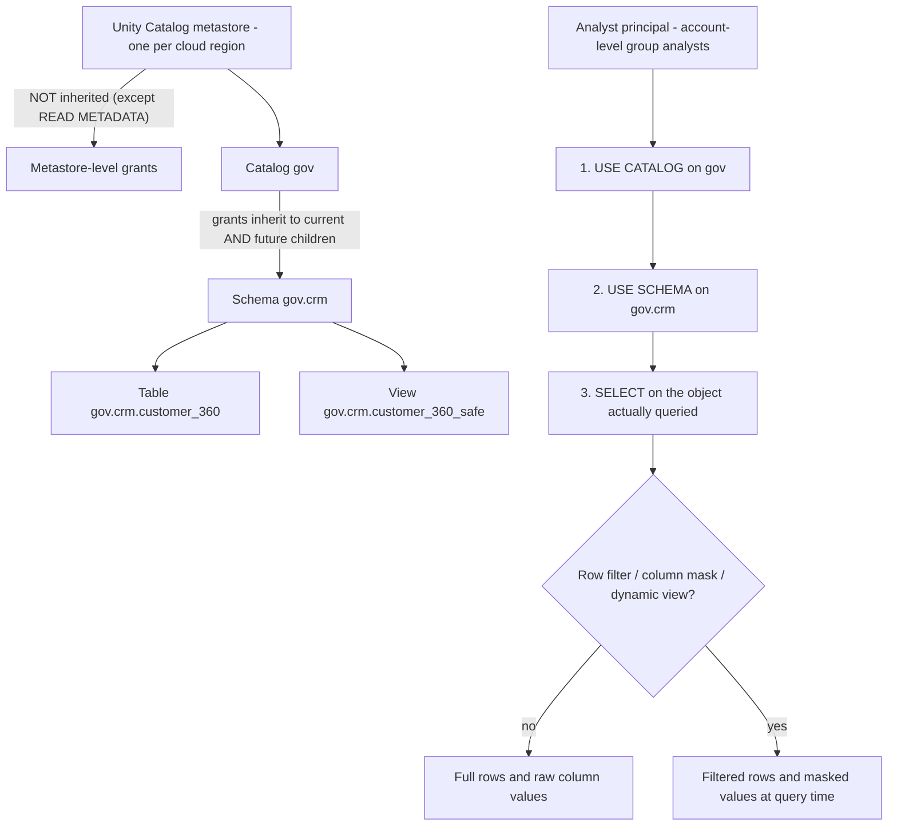
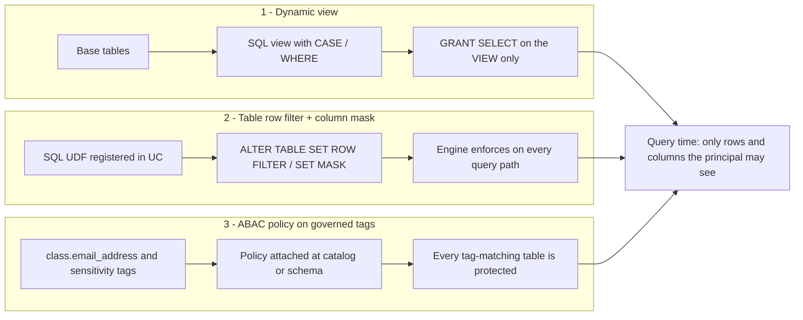
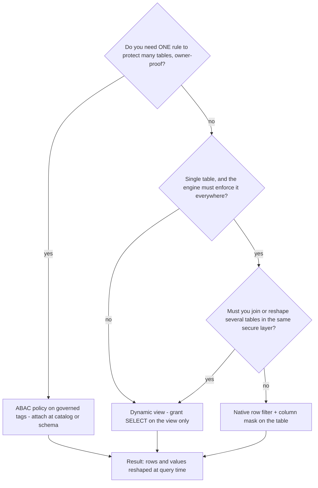
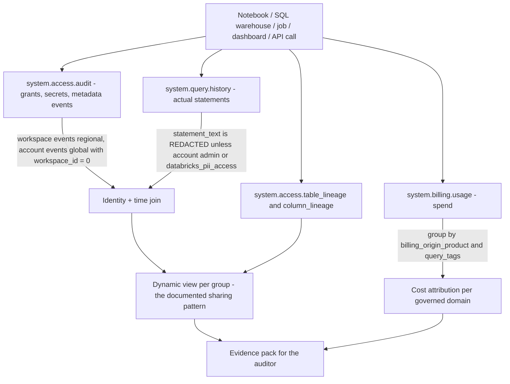
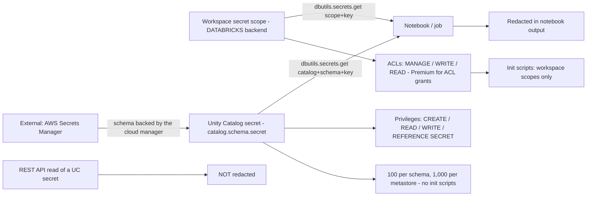
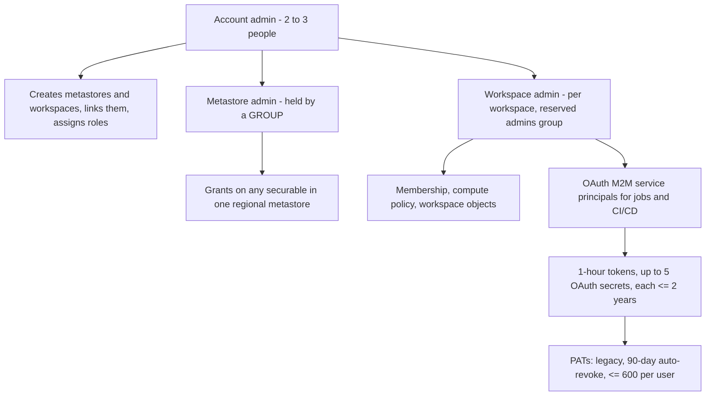

# Unity Catalog Security: Row and Column Controls, Tags, Auditing, Lineage and Secrets

Lessons 01–10 gave you the machine: a VPC, an S3-backed Delta lakehouse, a metastore with catalogs, and pipelines that never stop writing. That is exactly the moment governance stops being paperwork and becomes an engineering problem, because every new table multiplies the number of answers you owe an auditor. Unity Catalog answers them with one deny-by-default grant model — "**Initially, users have no access to data in a metastore**" (docs .../manage-privileges, accessed 2026-10) — and then a second, separate layer of controls that can only ever *subtract* from access you already hold: **row filters, column masks, dynamic views and ABAC policies**. Those controls never grant anything; they reshape what a legitimate query returns.

Three claims hold this lesson together. First, **privileges and row/column controls are different layers** — you need `USE CATALOG` + `USE SCHEMA` + `SELECT` *and then* the filter or mask decides what your `SELECT` returns. Second, **evidence is a product surface**: `system.access.audit`, `system.query.history`, the lineage pair and `system.billing.usage` are queryable tables with documented retention and latency, not log files you beg the platform team for. Third, **secrets, tokens and network edges are part of the same governance story** — a perfect grant model leaks through a personal access token pasted into a notebook.

```text
 =============================================================
  LESSON 11 MAP - Unity Catalog security on AWS, as of Oct 2026
 ------------------------------------------------------------
  GRANTS        deny by default; inheritance flows DOWN from the
                catalog; metastore grants are NOT inherited
                read chain: USE CATALOG + USE SCHEMA + SELECT
                owners hold every privilege on their object
  ROW / COLUMN  3 mechanisms (they only subtract):
                  1 dynamic views     portable, grant on the VIEW
                  2 table row filter  ALTER TABLE SET ROW FILTER
                    + column mask     ALTER COLUMN SET MASK,
                                      one mask per column, SQL UDF
                  3 ABAC policies     governed-tag driven, attached
                                      at catalog/schema/table
  IDENTITY      session_user()          current (email)
                current_user()          DEPRECATED alias
                is_account_group_member account-level groups
                is_member()             workspace/Hive era - avoid
  TAGS          governed: 1,000/account, 500 values, policy-bound
                Data Classification -> class.* auto-tags
                limits: 50 tags/object, 1,000 column tags/table
  EVIDENCE      system.access.audit      365d, updated thru day
                system.query.history     365d, ~1 hour
                system.billing.usage     365d, ~12 hours
                table_lineage/column_lineage 365d, 1y rolling
  SECRETS       workspace scopes (init scripts) ->
                UC secrets (catalog.schema.secret) ->
                external: AWS Secrets Manager backing
  EDGE          IP access lists (Enterprise) AND context-based
                ingress; PrivateLink private IPs -> AWS Network
                Firewall; FedRAMP Moderate on 4 AWS regions
  TRAPS         grant SELECT on the base table, is_member(),
                DBR < 12.2 LTS silent zero rows, real-time myth
 =============================================================
```

In this lesson you will:

- read a permission failure correctly with the **three-privilege chain** and the inheritance rules that stop at the catalog;
- choose between the **three row/column mechanisms** and say precisely when each one wins;
- write the **worked dynamic-view policy** on `gov.crm.customer_360` with `session_user()` and `is_account_group_member()`, then grant it safely;
- bind **native row filters and column masks** with SQL UDFs, and predict what an old runtime returns instead of an error;
- apply **tag DDL** (`SET TAGS` / `SET TAG`) and wire **Data Classification** `class.*` tags into the classify → tag → policy loop;
- run the **audit SQL pack** across `system.access.audit`, `system.query.history` and the lineage tables, with the retention and latency numbers that make the query honest;
- pick the right **secret generation** for each job on AWS, from init-script scopes to AWS Secrets Manager-backed external secrets;
- weigh **legacy `hive_metastore` TACL against Unity Catalog** in a Comparative Verdict, study **Block, Amgen and nCino** on AWS, read the **October 2026 update box**, and practise with **twelve questions** plus four interactive checks.

---

## 1. The grant model this lesson builds on

Unity Catalog is a hierarchy of **securables** — metastore → catalog → schema → table/view/volume/function/secret — and access is granted as **privileges on securables** to **principals** (users, account-level groups, service principals). Four rules decide almost every support ticket:

1. **Inheritance flows downward, and stops at the catalog.** "Privileges granted on a catalog automatically apply to all current and future schemas, tables, views, volumes, and functions within it" (docs .../securable-objects, 2026-10-08), while "privileges granted at the metastore level do not inherit to child objects in the hierarchy" (same page). `READ METADATA` is the one metastore-level exception that does inherit.
2. **Usage privileges are separate from data privileges.** "To read from a table, a user needs `SELECT` on the table, `USE CATALOG` on the parent catalog, and `USE SCHEMA` on the parent schema" (privileges reference, 2026-09-25), and `USE CATALOG` "does not grant access to the catalog itself or any specific objects within it".
3. **Owners are all-powerful on their own object.** "Object owners have all privileges on that object, including the ability to grant privileges to other principals" (docs .../manage-privileges, accessed 2026-10) — ownership does *not* inherit downward, and `SHOW GRANTS` renders ownership as a single row rather than a list of implied privileges.
4. **Row/column controls only subtract.** Filters, masks, dynamic views and ABAC policies reshape results for principals who already hold the privileges; none of them can be used to *grant* access.



Worked example **E0** is the diagnosis you will reuse all lesson: a user reports `SELECT * FROM gov.crm.customer_360` fails, and `SHOW GRANTS ON TABLE gov.crm.customer_360` shows `SELECT` for their group. The grant is real and irrelevant — check the chain in order: `SHOW GRANTS ON CATALOG gov`, then `SHOW GRANTS ON SCHEMA gov.crm`. A missing `USE CATALOG` surfaces as an opaque failure *before* the table is even resolved, which is why it is the first pitfall in Databricks' permissions documentation (docs .../access-control, accessed 2026-10).

One control sits *above* privileges and beats them: **workspace-catalog binding**. "By default, a catalog is accessible from all workspaces attached to the same metastore. You can restrict this by binding the catalog to specific workspaces, optionally as read-only" — and "Workspace binding supersedes individual privilege grants. Even a user with an explicit `SELECT` grant cannot access an object in a catalog that is not bound to their workspace" (docs .../securable-objects, 2026-10-08). The same binding exists for storage credentials and external locations, which is how a production workspace is prevented from using the raw-zone credential at all. Sequence your mental model as: **binding decides *where* a grant counts, privileges decide *what* it permits, filters/masks decide *what rows and values* come back.**

> **📚 Did you know?** The word `USAGE` is a trap for anyone coming from AWS Lake Formation or Hive: Unity Catalog's privileges are `USE CATALOG` and `USE SCHEMA`. `GRANT USAGE ON CATALOG gov TO analysts` is not Unity Catalog syntax — it belongs to the legacy vocabulary, and it is the single most common copy-paste error in migration scripts (docs .../access-control/privileges-reference, 2026-09-25).

---

## 2. Three mechanisms that subtract: views, table controls, ABAC

As of October 2026 the documentation places **three** row/column mechanisms side by side, and the honest way to teach them is as a ladder — each rung trades portability for centralisation:

| Mechanism | What you bind it to | Best for | Hard limits |
|---|---|---|---|
| **Dynamic view** | A SQL view whose `WHERE` / `CASE` logic calls identity functions | Curating a slice, combining several tables, mixing regex + joins into "a single secure layer" | Every new base table needs a new view; protection is the *withheld* `SELECT` on the base table |
| **Table row filter + column mask** | The table/column itself, via SQL UDFs (`ALTER TABLE … SET ROW FILTER`, `ALTER COLUMN … SET MASK`) | One table, precise, engine-enforced across SQL, notebooks, jobs and BI tools | One mask per column; **cannot be applied to a view**; DBR floors; owner-managed |
| **ABAC policy** | Governed tags, attached at catalog / schema / table (metastore level is Beta) | Consistency across many tables — "table owners can't override or remove" the policy | Exact `CREATE POLICY` grammar must be read from docs, never invented (docs .../abac, 2026-09-29) |

Databricks' own recommendation is explicit: "Databricks recommends ABAC policies when you need consistent row filtering and column masking across many tables" (docs .../filters-and-masks, 2026-09-24). The dynamic-view page states the corollary just as plainly: "Databricks recommends that you not grant users the ability to read the tables and views referenced in the view" (docs .../views/dynamic, 2025-02-14).



Choosing between them is a three-question decision, and the order matters because the last option is the most expensive to unwind:



Two invariants travel with all three. **Enforcement is engine-side at query time**: on a filter or mask, "the user cannot view base table values before filtering or masking is applied" — and when the optimizer has to choose between speed and non-leakage, "it always makes the secure choice, which can affect query performance" (docs .../filters-and-masks, 2026-09-24). **And none of them fixes a wrong grant**: a dynamic view is defeated by one careless `GRANT SELECT` on the base table, which is why the next section writes the grants before it writes the SQL.

---

## 3. Worked example E1 — the dynamic-view policy

The running example for this lesson is `gov.crm.customer_360` on S3 (managed behind a storage credential and external location per Lesson 03), with three audience groups: `pii-analysts`, `finance`, and everyone else. Requirements verified in the docs: a SQL warehouse or standard access mode (dedicated access mode needs DBR 15.4 LTS+), serverless compute enabled for the advanced filtering path on DBR 15.4 LTS and above, and grants placed on the view (docs .../views/dynamic, 2025-02-14).

```sql
CREATE OR REPLACE VIEW gov.crm.customer_360_safe
COMMENT 'Row-filtered + masked projection; base-table SELECT deliberately not granted'
AS
SELECT
  customer_id,
  region,
  -- identity hook: session_user() returns the current user's email address
  CASE WHEN session_user() LIKE '%@acme-corp.com'
       THEN customer_id ELSE -1 END AS customer_id_visible_to_internal,
  CASE
    WHEN is_account_group_member('pii-analysts') THEN email
    ELSE concat(substr(email, 1, 2), '***@', split_part(email, '@', 2))
  END AS email,
  CASE
    WHEN is_account_group_member('pii-analysts')
      OR is_account_group_member('finance') THEN ssn
    ELSE '***-**-****'
  END AS ssn,
  CASE
    WHEN is_account_group_member('finance') THEN lifetime_value
    ELSE CAST(ROUND(lifetime_value, -3) AS DECIMAL(12,2))   -- coarse bucket for everyone else
  END AS lifetime_value
FROM gov.crm.customer_360
WHERE region = 'EU'
   OR is_account_group_member('global-analysts');           -- row filter by account group
```

Then the grants — the part that actually secures the design:

```sql
GRANT USE CATALOG ON CATALOG gov     TO `analysts`;
GRANT USE SCHEMA  ON SCHEMA gov.crm  TO `analysts`;
GRANT SELECT      ON VIEW gov.crm.customer_360_safe TO `analysts`;
-- deliberately NO: GRANT SELECT ON TABLE gov.crm.customer_360 TO `analysts`;
SHOW GRANTS ON VIEW gov.crm.customer_360_safe;
```

Three identity facts to teach alongside this SQL:

- `session_user()` "Returns the current user's email address" — the function to use in new policies (docs .../views/dynamic, 2025-02-14).
- `current_user()` is a **deprecated** alias: "This function is deprecated. The SQL standard reserves `CURRENT_USER` for the authorized user, but in Databricks it returns the session user, which can be misleading. Use `session_user` instead." (docs .../functions/current_user, 2026-09-11.) Old notebooks still run on it.
- `is_account_group_member('<group>')` returns true when the session user is "a direct or indirect member of the specified group at the account level" and is page-flagged "Unity Catalog only" (docs .../functions/is_account_group_member, 2026-09-11). Its sibling `is_member()` is workspace-scoped and Hive-metastore-era: "Avoid using it with views against Unity Catalog data, because it does not evaluate account-level group membership" (docs .../views/dynamic, 2025-02-14).

> ⚠️ **WARNING — three ways this policy quietly widens back to full access.** (1) Someone runs `GRANT SELECT ON TABLE gov.crm.customer_360 TO analysts` "just to unblock a deadline": the view becomes decoration. (2) A new base table arrives and nobody creates the view, so the team grants on the table instead — the view pattern does not scale by itself, which is exactly the gap ABAC fills. (3) `CASE` logic written against `is_member()` instead of `is_account_group_member()` evaluates workspace-level groups, so IdP-synced account groups silently fall into the `ELSE` branch — or worse, the permissive one.

Verification is a three-principal diff: run the same `SELECT` from the warehouse as a `pii-analysts` member, a `finance` member and a plain analyst, and compare row counts *and* column values. A working policy produces three visibly different result sets; a broken one produces identical output for everyone.

---

## 4. Worked example E2 — native row filters and column masks

The view pattern has a native twin: register a SQL UDF in Unity Catalog, then bind it to the table or column. "Table-level column masks are bound to a column using `ALTER TABLE ... ALTER COLUMN ... SET MASK` and managed by the table owner" (docs .../filters-and-masks, 2026-09-24).

```sql
-- 1) The UDFs (registered in Unity Catalog, DETERMINISTIC where possible)
CREATE FUNCTION gov.crm.mask_email(s STRING) RETURNS STRING
DETERMINISTIC
RETURN CASE WHEN is_account_group_member('pii-analysts') THEN s
            ELSE concat(substr(s, 1, 2), '***@', split_part(s, '@', 2)) END;

CREATE FUNCTION gov.crm.eu_only(region STRING) RETURNS BOOLEAN
DETERMINISTIC
RETURN region = 'EU' OR is_account_group_member('global-analysts');

-- 2) Bind them (documented DDL forms, docs .../filters-and-masks/manually-apply)
ALTER TABLE gov.crm.customer_360 ALTER COLUMN email SET MASK gov.crm.mask_email;
ALTER TABLE gov.crm.customer_360 SET ROW FILTER gov.crm.eu_only ON (region);

-- 3) Inspect and reverse
DESCRIBE TABLE gov.crm.customer_360;
ALTER TABLE gov.crm.customer_360 DROP ROW FILTER;
```

You may also declare the filter at creation: `CREATE TABLE sales (region STRING, id INT) WITH ROW FILTER us_filter ON (region);`. To assign a function you need `EXECUTE` on the function plus `USE SCHEMA` and `USE CATALOG` on its parents (docs .../manually-apply, accessed 2026-10). Two structural rules: **each column can have one mask** — a second, overlapping mask fails with `COLUMN_MASKS_FEATURE_NOT_SUPPORTED.MULTIPLE_MASKS` — and "You cannot apply row-level security or column masks to a view"; mask a view from *inside* its definition instead (docs .../filters-and-masks, 2026-09-24).

> [!IMPORTANT]
> ⚠️ **Old runtimes fail silently, not loudly.** "Databricks Runtime versions below 12.2 LTS do not support row filters or column masks. These runtimes fail securely" — which in practice means zero rows, no error (docs .../filters-and-masks, 2026-09-24). The documented compute floors: standard access mode and SQL warehouses on **DBR 12.2 LTS+**, dedicated access mode on **DBR 15.4 LTS+** — and dedicated compute on 15.3 LTS or below cannot read filters/masks at all. Compounding it, "With ANSI mode disabled, values that can't be cast are silently converted to NULL, which can cause the filter to produce incorrect results without raising an error" (same page). When a filtered table returns nothing, check access mode and DBR version *before* you debug the SQL.

---

## 5. Tags, Data Classification, and the ABAC loop

Tags are the attribute layer that ABAC policies evaluate. Two populations matter: **governed tags** — "account-level tags with built-in rules for consistency and control. When you create a governed tag, you also define a tag policy" (docs .../admin/governed-tags, 2026-09-11) — and plain tags. Applying them is plain DDL (DBR 13.3 LTS+ for `SET TAGS`, DBR 16.1+ for `SET TAG`), and it needs `APPLY TAG` on the object plus `USE SCHEMA` and `USE CATALOG`; governed tags additionally require `ASSIGN` on the tag (docs .../database-objects/tags, 2026-10-08).

```sql
-- Worked example E3 - tag DDL, then the classify -> tag -> policy loop
-- 3a) manual tagging: table level, then column level (one column per statement)
ALTER TABLE gov.crm.customer_360
  SET TAGS ('sensitivity' = 'restricted', 'domain' = 'crm');
ALTER TABLE gov.crm.customer_360
  ALTER COLUMN ssn SET TAGS ('pii' = 'ssn');
ALTER TABLE gov.crm.customer_360
  ALTER COLUMN email SET TAGS ('pii' = 'email');
-- DBR 16.1+ equivalent forms
SET TAG ON TABLE gov.crm.customer_360 cost_center = `crm`;
SET TAG ON COLUMN gov.crm.customer_360.ssn pii;

-- 3b) read the tags back from the per-catalog information schema
--     (view names per the tags page; inspect the column list before narrowing)
SELECT * FROM gov.information_schema.column_tags
WHERE table_name = 'customer_360'
LIMIT 100;

-- 3c) read the governed-tag definitions (Beta system table)
SELECT * FROM system.tags.governed_tags;
```

**Data Classification** closes the loop without a human tagging every column: "Databricks Data Classification uses an agent to automatically classify and tag tables in your catalog", writing detections such as `class.email_address`, `class.credit_card` and `class.us_ssn` onto matching columns, with results in `system.data_classification.results` (docs .../data-classification, accessed 2026-10; blog **2025-10-27**). The frameworks it maps to are published as a list: "PII, PCI DSS, GDPR, HIPAA, GLBA, FCRA, India DPDPA, Canada PIPEDA, Mexico LFPDPPP, Swiss FADP, Israel PPL, UAE PDPL" (docs .../data-classification-tags, 2026-09-18). The payoff is one sentence long: **classify → tag → policy** — the `class.*` tag becomes the `WHEN` condition of an ABAC row-filter or column-mask policy, so a new PII column is protected without anyone writing a view.

Documented limits worth quoting verbatim when you design a tagging standard: **1,000 governed tags per account**, **500 allowed values per tag**, keys/values max **256 characters**, case-sensitive, with `* . / < > % & ? \ =` disallowed (governed tags, 2026-09-11); plain tags allow **50 tags per securable object** and **1,000 column tags per table**, with `. , - = / :` banned from keys (tags page, 2026-10-08). Inheritance has one sharp edge: governed tags on a catalog or schema are inherited by everything beneath "except individual table columns" — and implicit inheritance is applied "when evaluating ABAC policies only" (tags page, 2026-10-08).

> **📚 Did you know?** Tag metadata is not secret metadata. "Tag data is stored as plain text and may be replicated globally. Do not use tag names, values, or descriptors that could compromise the security of your resources" (governed-tags, 2026-09-11). Relatedly, dropping a column that carries governed tags *fails* until you `UNSET` them first — a deliberate anti-data-leak ordering rule in the tags documentation (tags page, 2026-10-08).

---

## 6. System tables: the audit pack

System tables live in the `system` catalog and are "a Databricks-hosted analytical store of your account's operational data" (docs .../admin/system-tables, 2026-10-08). The four you need for security work, with the numbers that decide what your queries can honestly claim:

| Table | Answers | Free retention | Freshness |
|---|---|---|---|
| `system.access.audit` (Public Preview) | Who touched which securable via API/UI — grants, secrets, policy changes | 365 days | "updated throughout the day"; **no real-time monitoring** |
| `system.query.history` | Who ran which SQL: `executed_by`, `statement_type`, `client_application`, `query_tags` | 365 days | typically within **one hour** |
| `system.billing.usage` | Spend by `billing_origin_product`, `usage_type`, per governed domain | 365 days | `record_type = 'ORIGINAL'` typically within **12 hours** |
| `system.access.table_lineage` + `column_lineage` | Blast radius: what read or wrote this table/column | 365 days (1-year rolling window) | streaming-capable; DBR 16.4+ to stream |

Access is itself governed: admins hold it by default, everyone else needs `USE CATALOG` on `system` plus `USE SCHEMA` and `SELECT` on the relevant system schemas. And "System tables are free to use. You are only charged for the compute used to query them" (same page, 2026-10-08).



### Worked example E4 — "who queried the PII table this week?"

```sql
-- (a) Control-plane: permission and secret events. ALWAYS filter event_date.
SELECT event_time, user_identity.email AS who, service_name, action_name,
       request_params['full_name_arg'] AS securable, source_ip_address, audit_level
FROM system.access.audit
WHERE event_date BETWEEN DATE '2026-10-01' AND DATE '2026-10-07'
  AND service_name = 'unityCatalog'
  AND action_name LIKE '%Permission%'
ORDER BY event_time DESC;

-- (b) Query-plane: the SELECTs themselves
--     compute = WAREHOUSE | SERVERLESS_COMPUTE | CLASSIC_COMPUTE
--     query_source = notebook / job / dashboard / alert / Genie ids
SELECT executed_by, executed_as, start_time, statement_type, client_application,
       compute, query_source
FROM system.query.history
WHERE start_time >= TIMESTAMP '2026-10-01 00:00:00'
  AND statement_type = 'SELECT'
ORDER BY start_time DESC;

-- (c) Blast radius: downstream consumers of the table
SELECT source_table_full_name, target_table_full_name, entity_type, created_by, event_time
FROM system.access.table_lineage
WHERE source_table_full_name = 'gov.crm.customer_360';

-- (d) Cost evidence: governed-domain spend for September
SELECT billing_origin_product, usage_type,
       SUM(usage_quantity) AS dbus, COUNT(*) AS records
FROM system.billing.usage
WHERE ingestion_date BETWEEN DATE '2026-09-01' AND DATE '2026-09-30'
GROUP BY billing_origin_product, usage_type
ORDER BY dbus DESC;
```

Tagging the queries themselves makes (d) attributable to a governed domain rather than to a warehouse: `SET QUERY_TAGS = '{"team":"crm","cost_center":"701","env":"prod"}';` at session start, or via session configuration parameters, then group `system.query.history` by its `query_tags` map (query-history reference, 2026-10-06). Pair that with `system.billing.usage` grouped by `billing_origin_product` and you can answer the auditor's follow-up question — *which governed domain is spending what* — in the same lesson's SQL vocabulary.

Teaching notes that make this pack correct rather than merely runnable: `event_date` is the documented performance partition — "To improve query performance, filter on `event_date` rather than `event_time`" (audit-logs, 2026-07-01); `statement_text` is `<REDACTED>` unless you are an account admin or a member of `databricks_pii_access` (query history, 2026-10-06); a query that is not sufficiently selective is rejected outright with "`System Table query returned too much data. Please repeat query with more selective predicates.`" (system tables, 2026-10-08); and the documented way to share any of this with an analyst group is, once again, a **dynamic view per user or group** — the query-history page says so directly.

> ⚠️ **WARNING — the real-time myth.** System tables are an evidence store, not a SIEM: "No support for real-time monitoring. Data is updated throughout the day. If you don't see a log for a recent event, check back later" (system tables, 2026-10-08). Latency floors are ~1 hour (query history), ~12 hours (billing), "throughout the day" (audit). Also mind the geography: audit rows are regional for workspace events and global for account events (`workspace_id = 0`), billing is global, and lineage/query history are regional — a multi-region account must query per region.

---

## 7. Lineage: column-level, with named gaps

"Unity Catalog captures lineage automatically for queries run on Databricks, **down to the column level**, and aggregates it across all workspaces attached to the metastore" (docs .../data-governance/unity-catalog/data-lineage, 2026-08-06). The entry ticket to *view* lineage is `BROWSE` on the parent catalog — "BROWSE allows users to view metadata … It does not grant access to data" (best practices, 2026-07-27) — which makes it the ideal discoverability grant for a deny-by-default estate.

The honest version of "column-level" includes its documented gaps:

- **Path-based reads lose column lineage:** `select * from delta."s3://<bucket>/<path>"` is not captured at column level.
- **UDF lineage is table-level only:** "Column-level UDF lineage is not captured", and SQL UDFs are invisible in `INSERT`, `UPDATE` and `MERGE`.
- **Columns with no source never appear:** an `INSERT` with explicit literal values is not recorded on the column table — reads are captured whether or not you write the output.
- **Renames lose lineage**, and nothing at all exists for events captured before **2024-09-01**.
- **Two different clocks:** system-table lineage is a rolling **1-year** window, while Catalog Explorer and the lineage API "indefinitely retain lineage captured after September 1, 2024".
- `statement_id` in `table_lineage` joins to `system.query.history`, but "is only set when the query is run from a SQL warehouse".

Reading it is a two-table exercise — first the table-level blast radius, then the column-level detail, then (optionally) the statement behind it:

```sql
-- who reads or writes the table, across every workspace on the metastore
SELECT event_time, target_table_full_name, created_by, entity_type, statement_id
FROM system.access.table_lineage
WHERE source_table_full_name = 'gov.crm.customer_360'
ORDER BY event_time DESC;

-- column-level detail: read the column list from the lineage system-table
-- reference first (schema headers verified, source/target column-name fields
-- not quoted here), then narrow it the same way
SELECT *
FROM system.access.column_lineage
WHERE source_table_full_name = 'gov.crm.customer_360'
ORDER BY event_time DESC
LIMIT 100;

-- the statement behind a lineage row, when it came from a SQL warehouse
SELECT executed_by, statement_type, start_time, client_application
FROM system.query.history
WHERE statement_id = '<statement_id from the lineage row>';
```

That is the compliance story the docs sell — "For compliance audits, see where regulated data originates, how it is transformed, and which downstream assets consume it" (lineage docs, 2026-08-06) — paired with the boundaries an auditor should hear out loud.

---

## 8. Worked example E5 — secrets, three generations

Secrets are where governance either holds or leaks, and AWS gives you three documented generations to choose between:

| Generation | Shape on AWS | Privileges / ACLs | Use it for | Limits |
|---|---|---|---|---|
| **Workspace secret scopes** | `DATABRICKS` backend, `dbutils.secrets.get(scope=…, key=…)` | Scope ACLs: `MANAGE` / `WRITE` / `READ` (ACL grants need Premium plan) | JDBC passwords, and **the only path that works in init scripts** | Scope name readable by all users; ≤1,000 secrets per scope; values ≤128 KB |
| **Unity Catalog secrets** | `catalog.schema.secret` securable, cross-workspace | `CREATE` / `READ` / `WRITE` / `REFERENCE SECRET` | Governed, auditable, CMK-encryptable material | ≤100 secrets per schema, ≤1,000 per metastore; **no init scripts**; serverless env 4+ or DBR 17.3 LTS+ |
| **External secrets** | A UC schema backed by **AWS Secrets Manager** | Same UC privileges, values stay in your AWS account | Long-lived credentials you refuse to store in Databricks | Reads over REST are not redacted |

```sql
-- (i) workspace scope - CLI + notebook
--   databricks secrets create-scope jdbc
--   databricks secrets put-secret jdbc password
--   databricks secrets put-acl jdbc datascience READ      (Premium plan or above)
--   notebook: dbutils.secrets.get(scope="jdbc", key="password")   -> output redacted

-- (ii) Unity Catalog secret (docs .../security/secrets/unity-catalog-secrets, 2026-10-06)
GRANT CREATE SECRET, USE SCHEMA ON SCHEMA gov.ops TO `etl-sp`;
CREATE SECRET gov.ops.api_key;                    -- value written with WRITE SECRET / API
GRANT READ SECRET ON SECRET gov.ops.api_key TO `etl-sp`;
--   notebook: dbutils.secrets.get(catalog="gov", schema="ops", key="api_key")

-- (iii) audit every secret event
SELECT event_time, user_identity.email AS who, action_name, request_params
FROM system.access.audit
WHERE event_date = DATE '2026-10-20'
  AND service_name = 'unityCatalog'
  AND action_name LIKE '%Secret%';
```

The honest caveat, straight from the docs: administrators, secret creators and permissioned users *can* read secret values — "it is not possible to prevent such users from reading secrets" — so the real controls are narrow privileges, rotation, and the audit query above. `REFERENCE SECRET` exists precisely so a pipeline can reference a secret without holding access to its value (privileges reference, 2026-09-25).



A secret-hygiene checklist that fits on one page, each line traceable to a documented fact:

1. **Classify the secret before choosing a generation** — init script ⇒ workspace scope (UC secrets are barred); cross-workspace governed value ⇒ UC secret; value you refuse to store in Databricks ⇒ external schema backed by **AWS Secrets Manager**.
2. **Grant narrow and grant to service principals, not people** — `REFERENCE SECRET` lets a pipeline name a secret without holding its value (privileges reference, 2026-09-25).
3. **Read through `dbutils.secrets.get`** — "Databricks recommends `dbutils` to read secrets, because it applies secret redaction" (UC secrets, 2026-10-06); REST reads of UC secrets are not redacted.
4. **Rotate on a schedule you can prove** — OAuth secrets last at most two years; PATs die after 90 days unused; secret *scope names* are readable by everyone in the workspace, so never encode sensitivity in a name.
5. **Audit the blast radius monthly** — the `action_name LIKE '%Secret%'` query in E5 is the documented starting point, and remember it lands in `system.access.audit`, which updates "throughout the day".

> **📚 Did you know?** Token lifetimes are numbers you can design around: OAuth M2M access tokens are valid for **one hour**, a service principal holds at most **five OAuth secrets**, each valid up to **two years** (docs .../oauth-m2m, 2026-09-11). Personal access tokens are labelled **(legacy)** in the documentation title itself, are automatically revoked after **90 days** unused, and are capped at **600 per user per workspace** — and they cannot automate account-level operations at all (docs .../auth/pat, 2026-09-11).

---

## 9. Identity, service principals, and who administers what

### 9.1 The four identity functions, decided

| Function | Returns | Status |
|---|---|---|
| `session_user()` | Current user's email address | **Current** — use in new views, filters and masks |
| `current_user()` | Alias of `session_user()`; service principals return a **UUID** | **Deprecated** (2026-09-11) — still runs |
| `is_account_group_member('g')` | TRUE for direct or indirect **account-level** group membership | **Current**, "Unity Catalog only" |
| `is_member('g')` | Workspace-level membership (Hive-metastore compatibility) | **Avoid on UC data** |

The service-principal UUID is the trap that breaks identity `CASE` expressions: a job running as a service principal matches no email branch, so every identity policy must decide explicitly what it does for non-human sessions.

The groups themselves come from your identity provider: account-level users, groups and service principals are federated into the Databricks account (SCIM at account level), which is what makes `is_account_group_member()` a *policy input* rather than a hand-maintained list — add someone to `pii-analysts` in the IdP and the membership check follows, with no Databricks-side grant edit. Service principals participate in governance like users: they can own securables, hold Unity Catalog privileges, and run jobs "as" a principal — and every one of their actions lands in the same audit pack as a human's.

### 9.2 Worked example E6 — the three-principal verification matrix

Run one query, three principals, four assertions:

| Principal | Rows expected | `email` | `ssn` | `lifetime_value` |
|---|---|---|---|---|
| `pii-analysts` member | EU rows + `global-analysts` | raw | raw | raw (finance only buckets it) |
| `finance` member | EU rows + `global-analysts` | masked | raw | raw |
| plain analyst | EU rows only | masked | `***-**-****` | rounded to nearest 1,000 |

Anything else means the *grants* are wrong (identical output for all three ⇒ someone holds `SELECT` on the base table) or the *functions* are wrong (`is_member()` against account groups).

### 9.3 Admin scopes

"From a Unity Catalog permissions perspective, the three most important are **account admins, workspace admins, and metastore admins**. Account admins and workspace admins are required for all deployments, and the metastore admin role is optional" (docs .../admin-privileges, accessed 2026-10). Account admin creates and links metastores and workspaces; workspace admin runs inside one workspace via the reserved `admins` group (assignable to users and service principals, **not** to a group); metastore admin governs catalogs, connections and external locations for one metastore per cloud region. Feature admins — Marketplace admin, billing admin — round it out. The recommended shape: **account admin held by two or three people, metastore admin held by a group.**



---

## 10. The network edge and the compliance surface

Perimeter controls on AWS stack rather than replace each other:

- **IP access lists** (Enterprise pricing tier, block list evaluated before allow list, ≤**1,000** IP/CIDR values combined) gate the web app and REST endpoints — but "If you use PrivateLink, IP access lists apply only to requests over the internet"; private traffic must be controlled with **AWS Network Firewall** (docs .../ip-access-list, accessed 2026-10).
- **Context-based ingress controls** are the newer account-level mechanism that combines identity, request type and network source into allow/deny rules: "Databricks recommends using context-based ingress controls as your primary method for managing access", and "A request must be allowed by both controls to succeed" (same source).
- **Inbound denials are observable** in `system.access.inbound_network` (30 days free retention).
- **Compliance scope, stated the way the trust pages state it:** FedRAMP **Moderate** on AWS Commercial regions us-east-1, us-east-2, us-west-1, us-west-2; FedRAMP **High** on AWS GovCloud us-gov-west-1; HIPAA options on AWS multi-tenant "Available in all regions", with the SOC 2 Type II + HIPAA report from your account team (databricks.com/trust pages, accessed 2026-10). Certifications are platform attestations — your BAA, IAM, KMS key policies and network design remain your own choices.

Encryption is the last perimeter, and on AWS it has three touchpoints you own: the **KMS key policy** must allow use of the key via S3 (`kms:ViaService: s3.<region>.amazonaws.com`), the **storage credential's IAM policy** must carry `kms:Decrypt` / `kms:Encrypt` / `kms:GenerateDataKey*` on that key, and the **external location** must declare its encryption algorithm (SSE-S3 or SSE-KMS) when the bucket policy demands encryption headers (docs .../security/keys/kms-s3 and .../cloud-storage/s3, accessed 2026-10). Databricks-managed keys are the default; **customer-managed keys for Unity Catalog** — which protect the default/Databricks-provided managed storage per catalog — "requires the **Enterprise tier**" and a grant to the Databricks root ARN on your KMS key (docs .../keys/cmek-unity-catalog, accessed 2026-10). The rule that keeps auditors calm: *grants decide who may ask, keys decide whether the bytes are readable if they are taken, and both are documented separately.*

---

## 11. Comparative Verdict: legacy `hive_metastore` TACL vs Unity Catalog

> **Comparative Verdict — legacy `hive_metastore` table access control vs Unity Catalog (as of Oct 2026)**
> - **Identity scope.** TACL permissions "defined within the `hive_metastore` catalog always refer to the local identities in the workspace"; Unity Catalog "permissions always refer to account-level identities" (Databricks blog, *Data Privilege Model in Unity Catalog*, 2023-05-05). One metastore, one region, every attached workspace sees the same grants.
> - **Inheritance.** UC grants inherit downward from the catalog to "all current and future" children, and the exception is stated up front: metastore-level grants do not inherit (except `READ METADATA`). That gives you a rule you can audit with `SHOW GRANTS` — the legacy side of this course's sources documents no comparable stated hierarchy.
> - **Row/column controls.** UC has the three documented mechanisms of sections 2–5 (dynamic views, table row filters + column masks, tag-driven ABAC). For the legacy model, Databricks' own admin documentation simply states "Hive metastore table access control is a legacy data governance model. Databricks recommends that you use Unity Catalog instead for its simplicity and account-centered governance model" (docs .../manage-instance-profiles, 2026-04-22).
> - **Evidence.** UC gives you `system.access.audit`, `system.query.history`, table/column lineage aggregated across the metastore, and governed-tag/classification tables — queryable, with published retention. The legacy side of this course's sources offers no equivalent queryable evidence store.
> - **Cloud identity.** UC attaches AWS identity to *securables* (storage credentials + external locations + grants); the legacy pattern attaches an IAM **instance profile** to *compute*, so everyone on the cluster inherits it — which is why the docs call service credentials "the Unity Catalog alternative to instance profiles" (docs .../service-credentials, accessed 2026-10).
> - **Destructive operations.** Hive managed-table `DROP` deletes underlying files immediately; Unity Catalog supports `UNDROP` for 7 days with permanent deletion within 30 days (docs .../database-objects/hive-metastore, accessed 2026-10).
> - **Verdict in one line:** *keep `hive_metastore` only as the additive compatibility catalog it is declared to be ("The Unity Catalog metastore is additive"), migrate identities to account level first, then move tables with federate-then-upgrade or UCX — and never design a new row/column policy against TACL, because the policy engine you want lives in the catalog you have not migrated to yet.*

---

## 12. Twelve traps this lesson will not let you keep

1. **`GRANT USAGE ON CATALOG`** — not UC syntax. It is `USE CATALOG` / `USE SCHEMA`.
2. **"I granted `SELECT` on the catalog, so they can query."** Usage privileges are separate; the chain is `USE CATALOG` → `USE SCHEMA` → `SELECT`.
3. **"Metastore grants cover everything."** They do not inherit — only `READ METADATA` does.
4. **`is_member()` in a UC dynamic view.** Workspace-scoped, Hive-era; use `is_account_group_member()`.
5. **`current_user()` in new policies.** Deprecated since 2026-09-11; use `session_user()` — and handle the service-principal UUID.
6. **Granting `SELECT` on the base table** under a dynamic view. The view stops protecting anything.
7. **Applying a row filter to a view.** "You cannot apply row-level security or column masks to a view."
8. **Second mask on a column.** One mask per column; overlapping ABAC masks fail with `COLUMN_MASKS_FEATURE_NOT_SUPPORTED.MULTIPLE_MASKS`.
9. **DBR below 12.2 LTS.** Filtered/masked tables "fail securely" — zero rows, no error.
10. **Expecting real-time audit.** Audit updates "throughout the day", query history ~1 hour, billing ~12 hours; always partition on `event_date`.
11. **Assuming column lineage is complete.** Path-based reads, literal inserts, UDF internals, renames and pre-2024-09-01 history are all out of scope.
12. **Treating tags as secret storage.** Tag data "is stored as plain text and may be replicated globally".

### 2026 Updates (as of October 2026)

> [!NOTE]
> **What moved in the governance layer this lesson depends on:**
> - **2026-10-09 — auth and ingress guidance refreshed:** OAuth M2M with client id + secret is the stated path "for unattended, automated, and CI/CD workflows"; context-based ingress is recommended as the *primary* access method, evaluated alongside IP access lists (docs .../dev-tools/auth; .../security/network).
> - **2026-10-08 — system tables reference:** retention table (365 days for audit, billing, lineage and query history; 13 months for `system.data_classification.results`; 30 days for `system.access.inbound_network`), the "no support for real-time monitoring" statement, and streaming floors DBR 16.4+ (docs .../admin/system-tables).
> - **2026-10-06 — Unity Catalog secrets page:** `catalog.schema.secret` securables with `CREATE/READ/WRITE/REFERENCE SECRET`, quotas of 100 per schema and 1,000 per metastore, and **external secrets backed by AWS Secrets Manager** on AWS (docs .../security/secrets/unity-catalog-secrets).
> - **2026-09-29 — ABAC page:** tag-driven row-filter, column-mask, GRANT and DENY (Beta) policies attached at metastore (Beta), catalog, schema or table — the recommended answer for consistent controls across many tables (docs .../unity-catalog/abac).
> - **2026-09-24 / 2026-09-11 — filters, masks and identity:** row filters and column masks documented as table-level controls with one mask per column and DBR 12.2 LTS / 15.4 LTS floors; `current_user` formally deprecated in favour of `session_user` (docs .../filters-and-masks; .../functions/current_user).
> - **2025-10-27 — Data Classification Public Preview on AWS, Azure and GCP:** "up to 60% higher accuracy than regex-only tools" and scanning costs reduced "up to 75%" since Beta, with full results stored in system tables (Databricks blog, 2025-10-27).

---

## Real-World Case Studies

> **📋 Case A — Block (Square, Cash App, TIDAL) (financial services, Cloud: AWS)**
> **Challenge.** 12PB of graph and analytics data fragmented across business units, GDPR/CCPA PII obligations, and a painful two-step flow of attaching IAM policies to roles and then to S3 buckets.
> **Stack on AWS.** Databricks, Delta Lake, **Unity Catalog**, Spark Declarative Pipelines and Delta Sharing, with S3 as co-located storage — `Cloud: AWS` on the story page (https://www.databricks.com/customers/block/unity-catalog, undated page, accessed 2026-10).
> **Reported outcome.** "**12X Reduction in compute cost · 20% Reduction in data egress cost · 12PB Of data managed and governed**", data-sharing permission time cut "from days to seconds", roughly 70 teams and 500 active power users (same URL, undated, accessed 2026-10).
> **Quote.** "Introduction to Databricks coincided with the launch of Unity Catalog, eliminating the need for evaluating alternative data governance tools." — Joseph Kesting (same URL).
> **Maps to this lesson.** Sections 2, 5 and 6: one governance layer replacing both a separate tool *and* part of the IAM/S3 plumbing, which is the AWS-specific version of the "governance pays for itself" argument.
> ⏳ *Temporal note: undated page, accessed Oct 2026 — treat every figure as what Block reported, not a platform guarantee.*

> **📋 Case B — Amgen (biopharma, AWS estate)**
> **Challenge.** AWS Glue as enterprise catalog plus AWS IAM role-per-use-case sprawl — auditing meant parsing IAM policies.
> **Stack on AWS.** Unity Catalog over an AWS estate: the story names **AWS Glue** as the prior catalog and **AWS IAM** as the prior RBAC layer (Databricks blog, **May 2023**, https://www.databricks.com/blog/how-databricks-unity-catalog-helped-amgen-enable-data-governance-enterprise-scale).
> **Reported outcome.** "we didn't have to create or manage at least 120+ IAM roles … we went from hundreds of IAM roles to just one or two principal IAM role"; "This reduces the audit effort for the function by 50%"; "around ~500 objects mapped in Unity Catalog"; "90 percent of our use cases are on Databricks" (same URL, May 2023).
> **Maps to this lesson.** Sections 1, 6 and 9 — role count *is* the metric auditors understand, and the audit pack in E4 is what replaces policy-document archaeology.
> ⏳ *Temporal note: May 2023 figures from a dated blog — what Amgen reported then, not a current platform claim.*

> **📋 Case C — nCino (banking software, Cloud: AWS)**
> **Challenge.** Consolidating 13 years of banking data and "trillions in loan history" while keeping sensitive financial information under full control.
> **Stack on AWS.** Databricks on AWS with **Unity Catalog** governing access and **AI/BI Genie** for insight delivery — `Cloud: AWS`, use cases listing "Analytics and BI, AI, Data Warehousing, Governance and Security" (https://www.databricks.com/customers/ncino, undated page, accessed 2026-10).
> **Quote.** "Keeping data within a single AWS ecosystem reduces complexity, strengthens compliance and gives teams full control over sensitive financial information." (same URL.)
> **Maps to this lesson.** Sections 10 and 11 — the "one AWS account boundary" argument is the compliance framing you can reuse verbatim when justifying metastore-per-region and PrivateLink designs.
> ⏳ *Temporal note: undated page, accessed Oct 2026.*

---

> [!SUCCESS]
> **Key Takeaways:**
> 1. **Deny by default, inherit from the catalog.** "Initially, users have no access to data in a metastore"; grants inherit downward from the catalog to current *and future* children; metastore-level grants do not inherit (except `READ METADATA`); every read needs `USE CATALOG` + `USE SCHEMA` + `SELECT`.
> 2. **Three subtractive mechanisms, one ladder.** Dynamic views (grant on the view, never the base table) → native row filters + column masks (SQL UDFs, one mask per column, DBR 12.2 LTS standard / 15.4 LTS dedicated, never on a view) → ABAC policies on governed tags (the docs' recommendation when consistency across many tables matters). None of them grants access.
> 3. **Identity functions have a current set.** `session_user()` and `is_account_group_member()` are the ones to write; `current_user()` is deprecated (2026-09-11) and `is_member()` is workspace/Hive-era; service principals come back as UUIDs.
> 4. **Tags are policy inputs, not notes.** Governed tags: 1,000/account, 500 values, policy-bound, ASSIGN required, inheritance skips columns; Data Classification auto-tags `class.*` across PII/PCI/GDPR/HIPAA frameworks; the winning loop is classify → tag → policy.
> 5. **Evidence is a set of tables.** `system.access.audit` (365 days, updated throughout the day), `system.query.history` (~1 hour, `statement_text` redacted to `databricks_pii_access`), `system.billing.usage` (~12 hours), lineage pair (365 days / 1-year rolling), all free to store and billed only as compute — and shared through a dynamic view per group.
> 6. **Lineage is column-level with named gaps.** Path-based reads, literal inserts, UDF internals, renames and pre-2024-09-01 history are missing; `statement_id` only populates for SQL warehouse queries; `BROWSE` is the safe discoverability grant.
> 7. **Secrets come in three generations and the edge still matters.** Workspace scopes (the only init-script path), UC secrets (`catalog.schema.secret`, 100/schema), external secrets backed by AWS Secrets Manager; OAuth M2M for machines (1-hour tokens, ≤5 secrets), PATs legacy with 90-day auto-revoke; IP lists and context-based ingress both have to allow a request, and PrivateLink private IPs need AWS Network Firewall.

---

## Practice Questions

```question
{
  "id": "dbl-11-q1",
  "type": "multiple-choice",
  "question": "An analyst has SELECT on table gov.crm.customer_360 but every query fails during analysis, before the table is read. Which chain is missing?",
  "options": [
    "USE CATALOG on gov plus USE SCHEMA on gov.crm - reading a table needs all three privileges, and USE CATALOG 'does not grant access to the catalog itself or any specific objects within it'",
    "MODIFY on the schema, because SELECT is a child of MODIFY",
    "BROWSE on the metastore, because discovery always precedes analysis",
    "MANAGE on the table, because only managers may resolve table metadata"
  ],
  "correct": 0,
  "explanation": "The documented read chain is USE CATALOG + USE SCHEMA + SELECT (privileges reference, 2026-09-25); a missing usage privilege fails before table resolution, which is why it reads as an opaque analysis error. B inverts the hierarchy: SELECT is not a child of MODIFY (INSERT/UPDATE/DELETE are). C confuses discovery with access - BROWSE never grants data access. D invents a requirement: MANAGE is the delegation privilege, not a read prerequisite."
}
```

```question
{
  "id": "dbl-11-q2",
  "type": "true-false",
  "question": "Privileges granted on the Unity Catalog metastore are inherited by every catalog, schema and table beneath it, so a single metastore-level GRANT can open the whole estate.",
  "options": ["True", "False"],
  "correct": 1,
  "explanation": "False - 'privileges granted at the metastore level do not inherit to child objects in the hierarchy. Metastore-level grants are scoped to metastore-level operations only' (securable-objects page, 2026-10-08), with READ METADATA the documented exception. Inheritance starts at the catalog. The trap is the phrase 'grant at the top and it flows down', which is true for catalogs and false for the metastore."
}
```

```question
{
  "id": "dbl-11-q3",
  "type": "multiple-choice",
  "question": "Forty tables carry PII and the team wants one control that keeps masking consistent and stops individual table owners from relaxing it. Which mechanism do the docs recommend?",
  "options": [
    "An ABAC policy driven by governed tags, attached at catalog or schema level - Databricks recommends ABAC 'when you need consistent row filtering and column masking across many tables', and the policy cannot be overridden by table owners",
    "One dynamic view per table, because views are the only documented mechanism",
    "A column mask applied to the catalog, since masks cascade from containers",
    "REVOKE SELECT on every table, because denying everything is equivalent to masking"
  ],
  "correct": 0,
  "explanation": "The filters-and-masks page (2026-09-24) states the ABAC recommendation verbatim and positions attached policies so table owners can't override them; policies attach at metastore (Beta), catalog, schema or table (ABAC page, 2026-09-29). B scales badly - a new table needs a new view. C is wrong: a mask binds to a column of a table, not to a catalog, and cannot be applied to a view. D removes access instead of reshaping it, so it fails the requirement (querying must still work)."
}
```

```question
{
  "id": "dbl-11-q4",
  "type": "multiple-choice",
  "question": "Which pair of identity functions should a new Unity Catalog dynamic view use in October 2026?",
  "options": [
    "session_user() for the caller's email and is_account_group_member() for account-level group membership",
    "current_user() for the caller's email and is_member() for group membership, because both are older and therefore more stable",
    "session_user() with is_member(), since workspace groups are what SCIM provisions",
    "current_user() with is_account_group_member(), because current_user() is the SQL standard name"
  ],
  "correct": 0,
  "explanation": "session_user() 'Returns the current user's email address' and is_account_group_member() evaluates direct or indirect account-level membership and is flagged 'Unity Catalog only' (dynamic-view and function pages, 2025-02-14 / 2026-09-11). B traps on two deprecated-or-wrong functions: current_user() is deprecated and is_member() is explicitly to be avoided against UC data. C is half wrong - SCIM here syncs account-level groups. D has the reasoning backwards: CURRENT_USER is the SQL standard name that Databricks' own docs say is misleading here, which is why it was deprecated."
}
```

```matching
{
  "question": "Match each identity or discovery primitive to its verified October 2026 status:",
  "pairs": [
    {"left": "session_user()", "right": "Current - returns the calling user's email address; the identity hook for new dynamic views and row filters"},
    {"left": "current_user()", "right": "Deprecated alias of session_user(); returns a service principal's UUID instead of a readable name"},
    {"left": "is_account_group_member('pii-analysts')", "right": "Current, Unity Catalog only - direct or indirect membership in an account-level group"},
    {"left": "is_member('pii-analysts')", "right": "Workspace-level, Hive-metastore compatibility - documented as 'avoid' against Unity Catalog data"},
    {"left": "BROWSE on a catalog", "right": "Discoverability without access - search, Catalog Explorer, information_schema and the lineage graph, but no data"}
  ],
  "explanation": "Four function statuses come from the dynamic-view page (2025-02-14), the current_user page (2026-09-11) and the is_account_group_member page (2026-09-11); BROWSE is described in Unity Catalog best practices (2026-07-27) as metadata-only visibility. The two traps are assuming current_user() is fine because it still runs, and assuming is_member() works with the account-level groups your identity provider syncs."
}
```

```question
{
  "id": "dbl-11-q5",
  "type": "multiple-choice",
  "question": "Your dynamic view gov.crm.customer_360_safe is deployed with SELECT granted only on the view. Which change most directly defeats it?",
  "options": [
    "GRANT SELECT ON TABLE gov.crm.customer_360 TO analysts - the view only protects data because the base-table read was withheld, and the docs recommend not granting read on the referenced tables",
    "Granting USE CATALOG on gov to all account users, which the docs forbid",
    "Running the view on a SQL warehouse instead of a notebook cluster",
    "Adding a second CASE branch that masks lifetime_value for finance"
  ],
  "correct": 0,
  "explanation": "The dynamic-view page (2025-02-14) says Databricks recommends you 'not grant users the ability to read the tables and views referenced in the view' - the protection is the withheld grant, not the SQL. B is wrong: all users receiving USE CATALOG (on main, or the workspace catalog by default) grants navigation, not data. C is the opposite of a problem - SQL warehouses are the supported compute. D is a tightening change, not a bypass."
}
```

```question
{
  "id": "dbl-11-q6",
  "type": "true-false",
  "question": "A row filter or column mask can be attached to a view so that the view itself enforces the restriction, in addition to the WHERE clause inside its definition.",
  "options": ["True", "False"],
  "correct": 1,
  "explanation": "False - 'You cannot apply row-level security or column masks to a view' (filters-and-masks, 2026-09-24). Masking a view is done inside the view definition (section 3), or on the underlying table with native filters/masks (section 4). The confusion is natural because the mechanisms look interchangeable; the docs draw the line at views for both."
}
```

```fillblank
{
  "question": "Fill in the documented numbers exactly as October 2026 publishes them:",
  "template": "Free retention is {{1}} days for system.access.audit, system.query.history and the lineage tables; billable-usage rows with record_type ORIGINAL typically appear within {{2}} hours; query-history rows are typically available within about {{3}} hour; and Unity Catalog secrets are capped at {{4}} secrets per schema.",
  "answers": {
    "1": "365",
    "2": "12",
    "3": "1",
    "4": "100"
  },
  "distractors": ["30", "90", "395", "730", "6", "24", "48", "168", "500", "1000"],
  "explanation": "System tables reference (2026-10-08) gives 365-day free retention for audit, billing, lineage and query history plus the 'no real-time' caveat; the billing page (2026-09-15) says records are 'typically available within 12 hours'; the query-history page (2026-10-06) says 'typically available within one hour'; UC secrets (2026-10-06) allow 'Up to 100 secrets per schema and 1,000 per metastore'. Distractors are the neighbouring retention numbers (30 days inbound network, 90 days endpoint usage, 395-day configurable default, 730-day token ceiling) and other plausible round values."
}
```

```question
{
  "id": "dbl-11-q7",
  "type": "multiple-choice",
  "question": "An auditor asks for 'every permission change in the last week, in real time'. What is the correct engineering answer as of Oct 2026?",
  "options": [
    "System tables are not real-time: audit data is 'updated throughout the day', so query system.access.audit partitioned on event_date and state the latency - then keep the SIEM export as a separate, honest conversation",
    "Stream system.access.audit with Trigger.Continuous, because audit rows are pushed as they occur",
    "Use system.query.history alone, since it captures every control-plane change with sub-minute delay",
    "Export audit rows to S3 hourly with VACUUM, because system tables cannot be queried by non-admins at all"
  ],
  "correct": 0,
  "explanation": "The system tables page (2026-10-08) states 'No support for real-time monitoring. Data is updated throughout the day' and also rejects non-selective queries with 'System Table query returned too much data' - so event_date filtering plus a stated latency is the professional answer. B over-claims: streaming system tables needs DBR 16.4+ and still does not make them real-time. C is wrong on both counts - query history covers SQL, not grant events, and arrives within about an hour. D is wrong: admins have access by default and others can be granted USE CATALOG/USE SCHEMA/SELECT, though Databricks does discourage exporting this data."
}
```

```dragdrop
{
  "question": "Order the PII audit workflow exactly as the documented tables and latencies require it:",
  "items": [
    "Filter on event_date with a narrow window so the query clears the 'too much data' selectivity guard",
    "Query system.access.audit for control-plane events: permission changes, secret events, policy changes",
    "Query system.query.history for the SELECTs - executed_by, statement_type, client_application - remembering statement_text is REDACTED unless you are an account admin or in databricks_pii_access",
    "Join the two tables on identity and time to answer 'who queried what, when'",
    "Query system.access.table_lineage and column_lineage for downstream blast radius",
    "Wrap the result in a dynamic view per group before sharing it - the documented pattern for opening system tables to non-admins"
  ],
  "correctOrder": [
    "Filter on event_date with a narrow window so the query clears the 'too much data' selectivity guard",
    "Query system.access.audit for control-plane events: permission changes, secret events, policy changes",
    "Query system.query.history for the SELECTs - executed_by, statement_type, client_application - remembering statement_text is REDACTED unless you are an account admin or in databricks_pii_access",
    "Join the two tables on identity and time to answer 'who queried what, when'",
    "Query system.access.table_lineage and column_lineage for downstream blast radius",
    "Wrap the result in a dynamic view per group before sharing it - the documented pattern for opening system tables to non-admins"
  ],
  "explanation": "Order matters: the selectivity guard comes first (system tables, 2026-10-08), then control-plane evidence (audit, 2026-07-01), then query-plane evidence (query history, 2026-10-06), then the join, then blast radius (lineage, 2026-08-06), and finally the sharing pattern the query-history page explicitly recommends - a dynamic view per user or group. Reversing steps 2 and 3 loses the grant context behind a suspicious SELECT; skipping step 1 gets the query rejected; sharing raw rows skips the redaction boundary."
}
```

```question
{
  "id": "dbl-11-q8",
  "type": "multiple-choice",
  "question": "A Lakeflow job on AWS must read a JDBC password from an init script, and a second job needs an API key governed by Unity Catalog privileges and audited across workspaces. What is the correct pairing?",
  "options": [
    "Init script: a workspace secret scope with dbutils.secrets.get(scope=..., key=...) - UC secrets cannot be used in init scripts. API key: a UC secret at catalog.schema.secret with READ SECRET granted to the job's service principal",
    "Init script: a Unity Catalog secret, because UC secrets are cross-workspace. API key: a workspace scope ACL'd to the team",
    "Both: an external AWS Secrets Manager key read directly by the init script and by a notebook, bypassing Databricks entirely",
    "Both: personal access tokens stored in notebooks, since PATs are the documented default"
  ],
  "correct": 0,
  "explanation": "The UC secrets page (2026-10-06) states 'No init scripts. You cannot use Unity Catalog secrets in global or cluster init scripts', which leaves workspace scopes as the only init-script path - while UC secrets are the governed, cross-workspace securable with CREATE/READ/WRITE/REFERENCE SECRET privileges, quotas of 100 per schema, and audit via system.access.audit. B inverts the two. C skips the governance layer (UC privileges and audit) that the scenario requires. D is wrong twice: PATs are labelled legacy and secrets should never live in notebook source."
}
```

```question
{
  "id": "dbl-11-q9",
  "type": "multiple-choice",
  "question": "A CI pipeline authenticates with a service principal. Which configuration matches the documented OAuth M2M and PAT stance in Oct 2026?",
  "options": [
    "OAuth M2M client id + secret, tokens valid for one hour, up to five OAuth secrets per service principal each valid up to two years - the stated path for unattended and CI/CD workflows",
    "A personal access token per developer, because PATs are recommended over OAuth for automation",
    "A single long-lived token minted once at account level, since account operations accept PATs",
    "OAuth M2M with a 24-hour access token, so pipelines never refresh"
  ],
  "correct": 0,
  "explanation": "Auth docs (2026-10-09) say 'For unattended, automated, and CI/CD workflows, use the M2M flow with a client ID and secret', and the OAuth M2M page (2026-09-11) gives the one-hour token, five-secret and two-year limits. B reverses the guidance: PATs are titled '(legacy)' and the docs recommend OAuth instead. C is wrong: 'You can't use personal access tokens to automate Databricks account-level functionality'. D invents a 24-hour lifetime - the documented lifetime is one hour, refreshed automatically."
}
```

```question
{
  "id": "dbl-11-q10",
  "type": "multiple-choice",
  "question": "Which statement correctly contrasts legacy hive_metastore table access control with Unity Catalog?",
  "options": [
    "TACL grants refer to workspace-local identities, while Unity Catalog permissions refer to account-level identities effective in every workspace attached to the metastore",
    "TACL grants are account-level and Unity Catalog grants are workspace-local, because the metastore is per-workspace",
    "Both models inherit grants from the metastore downward to every table",
    "Both models attach cloud identity to compute, so instance profiles are how Unity Catalog reaches S3"
  ],
  "correct": 0,
  "explanation": "Databricks' privilege-model blog (2023-05-05) states it directly: 'Unity Catalog permissions always refer to account-level identities, while TACL permissions defined within the hive_metastore catalog always refer to the local identities in the workspace'. B inverts it. C is false for both framings of UC: metastore grants do not inherit, and inheritance begins at the catalog. D is wrong on the UC side - storage credentials attach an IAM role to a securable governed by grants, and service credentials are described as 'the Unity Catalog alternative to instance profiles'."
}
```

```question
{
  "id": "dbl-11-q11",
  "type": "multiple-choice",
  "question": "Block's Unity Catalog story page (Cloud: AWS, undated, accessed 2026-10) publishes which pairing of governance outcomes?",
  "options": [
    "12x reduction in compute cost, 20% reduction in data egress cost, 12PB of data managed and governed, and data-sharing permission time cut from days to seconds",
    "Audit effort reduced 50% after collapsing 120+ IAM roles to one or two",
    "456 use cases migrated and 1,200+ users enabled on Databricks SQL",
    "A 10x reduction in overall compute costs alongside replacing 640 machines with 64"
  ],
  "correct": 0,
  "explanation": "Those four figures are the Block page's own headline block (https://www.databricks.com/customers/block/unity-catalog, undated, accessed 2026-10). B is Amgen's Unity Catalog blog (May 2023); C is NAB's Databricks SQL page; D is Comcast's story page (2019-era). Evidence literacy - metric to source to date - is the habit this course's case studies exist to build."
}
```

```plot
{
  "type": "bar",
  "title": "Documented tag ceilings as of October 2026 (counts, not characters)",
  "data": [
    {"limit": "Governed tags per account", "max_count": 1000},
    {"limit": "Allowed values per governed tag", "max_count": 500},
    {"limit": "Tags per securable object", "max_count": 50},
    {"limit": "Column tags per table", "max_count": 1000}
  ],
  "xKey": "limit",
  "dataKeys": ["max_count"],
  "xLabel": "Documented tag limit",
  "yLabel": "Maximum count"
}
```

```question
{
  "id": "dbl-11-q12",
  "type": "multiple-choice",
  "question": "A compliance query reports 'no column lineage' for a table that is clearly used downstream. Which documented gap most likely explains it?",
  "options": [
    "The downstream reads reference the table by path - column lineage cannot be captured when the source or target is referenced as delta.\"s3://...\", so table-level lineage exists but column-level does not",
    "Column lineage only exists for tables tagged with class.email_address",
    "Lineage is computed nightly, so anything newer than seven days is missing",
    "Column lineage requires SELECT WITH GRANT OPTION on both tables"
  ],
  "correct": 0,
  "explanation": "The lineage limitations are explicit: 'Column lineage cannot be captured if the source or the target is referenced as path' (data-lineage, 2026-08-06), alongside renames, pre-2024-09-01 history, UDF column-level gaps and literal inserts with no source. B invents a tag dependency - classification tags do not gate lineage. C confuses the 1-year system-table rolling window with capture itself. D confuses lineage with grants: lineage needs BROWSE to view, never grant-option."
}
```
