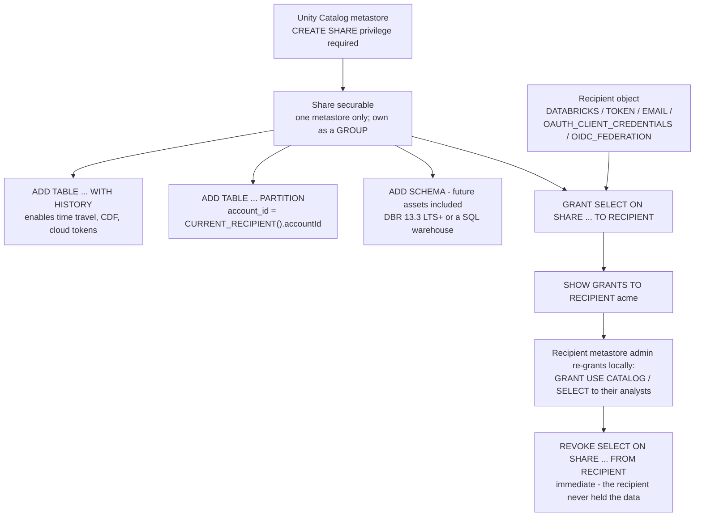
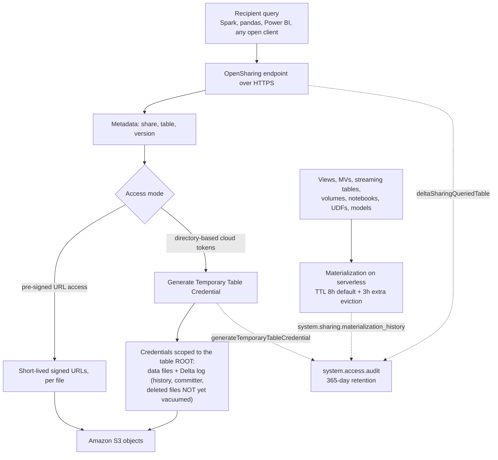
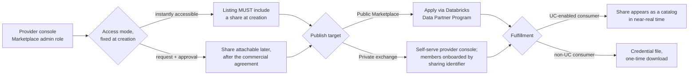
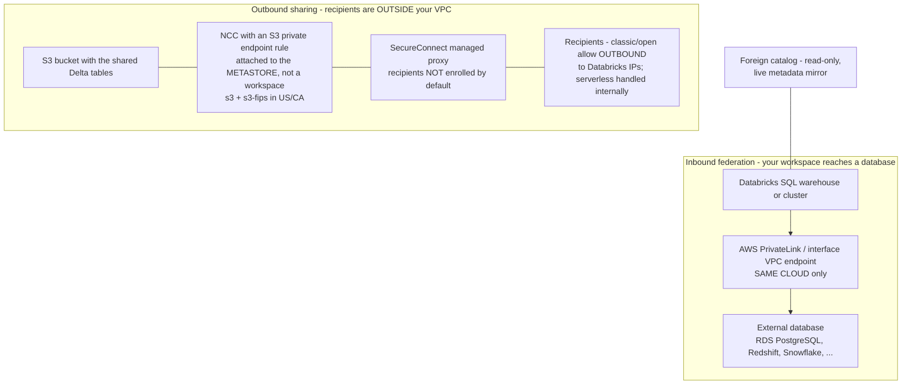

# Data Sharing on Databricks on AWS: OpenSharing, Marketplace, and Lakehouse Federation

Lessons 01 to 11 built and governed a lakehouse that holds *your* data. The moment a second organization needs to read that data, a partner, a customer, a subsidiary, a regulator, a paying subscriber, three different platform surfaces offer to help, and they are routinely confused with each other. **OpenSharing** (the product; the open protocol was called Delta Sharing until June 2026) hands a *live view* of selected tables to someone who is not you. **Databricks Marketplace** is a storefront that sits on top of that hand-off and adds discovery, approval and procurement. **Lakehouse Federation** does the opposite thing in the same vocabulary: it lets *your* SQL reach into somebody else's live database or catalog without copying a byte. Each is governed through Unity Catalog securables, each has its own AWS networking story, and each fails in a characteristic way.

The teaching rule for this lesson, and the sentence to keep when the syntax blurs: **a share is a live pointer, a foreign catalog is a live dependency, a Marketplace listing is a storefront on the pointer, and only an ETL copy is a thing you own.** Get that ordering right and every feature below lands in its place.

```text
=====================================================================
 LESSON 12 MAP - collaboration surfaces on AWS, as of October 2026
---------------------------------------------------------------------
 SURFACE 1 - OpenSharing (protocol: Linux Foundation; product: DBX)
   models ...... Databricks-to-Databricks  (sharing identifier,
                                            no credential file,
                                            richest asset set)
                 Databricks-to-Open        (token or OIDC federation,
                                            tabular assets, no UC
                                            needed on the recipient)
                 Open-to-Databricks        (OSS server -> DBX recipient)
   securables .. share (one metastore), recipient, grants ON SHARE
   bytes ....... pre-signed URLs  OR  directory-based cloud tokens
                 (eligible: WITH HISTORY, no partition filter;
                  D2O also managed/external Delta only)
   audit ....... system.access.audit (365 days) + materialization
                 history (365 days)
   cliff ....... bearer tokens max 1 year; tokens minted before
                 2025-12-08 with long/no expiry auto-expire
                 2026-12-08
 SURFACE 2 - Marketplace (built ON OpenSharing)
   listing ..... instant (share required at creation) vs
                 request (share attachable later)
   target ...... Public Marketplace (Data Partner Program) vs
                 private exchange (self-serve, sharing identifiers)
   money ....... no listing fee, no revenue cut; Universal Commit
                 drawdown <= 10%, contract after 2026-06-15
 SURFACE 3 - Lakehouse Federation (inbound, read-only)
   securables .. connection -> foreign catalog -> ordinary grants
   flavors ..... query federation (JDBC pushdown, 11 sources)
                 catalog federation (metadata crawl, 7 sources)
   creds ....... secret() scope/keys, or UC service credential +
                 AWS IAM role (RDS Postgres IAM, DBR 18 LTS+)
   network ..... PrivateLink / interface endpoint, SAME CLOUD only
 AWS NETWORK - two different problems, do not solve one twice
   outbound .... SecureConnect proxy + NCC private endpoint rule
                 attached to the METASTORE (not a workspace)
   inbound ..... PrivateLink between workspace VPC and database VPC
 TRAP OF THE LESSON - a share is a LIVE POINTER:
   provider DELETE propagates on next recipient read;
   VACUUM (7-day file retention default) breaks recipient
   time travel and streaming on WITH HISTORY shares;
   directory tokens expose the Delta log, un-vacuumed past included
=====================================================================
```

In this lesson you will:

- separate the **three surfaces**, OpenSharing, Marketplace, Lakehouse Federation, and route six realistic collaboration requests to the right one (and know when the right answer is a deliberate copy);
- apply the **June 2026 rename** correctly: product and docs say **OpenSharing**, the SQL surface still says `CREATE SHARE` / `GRANT ... ON SHARE`, the OSS client is still `delta_sharing`, and audit events still start `deltaSharing*`;
- build a share the way the October 2026 docs specify it: `CREATE SHARE` on the metastore, `ALTER SHARE ... ADD TABLE ... WITH HISTORY`, partition-parameterized with `CURRENT_RECIPIENT()`, `CREATE RECIPIENT`, `GRANT SELECT ON SHARE`, verified with `SHOW GRANTS TO RECIPIENT`;
- choose an authentication story on evidence, **Databricks-to-Databricks** (no artifact at all), **OIDC federation** (no Databricks-issued secret), or **bearer token** (one-time credential file, IP ACL, scheduled rotation), and explain the **2026-12-08 token cliff** to whoever still depends on one;
- read the wire: **pre-signed URL access** versus **directory-based cloud tokens**, which assets are eligible for which, and why directory credentials hand a recipient the **Delta log including not-yet-vacuumed deleted data**;
- govern shares like any other Unity Catalog securable: who may create them, what `SHOW GRANTS TO RECIPIENT` answers, how **immediate revocation** works, and how to run a **quarterly access review** against `system.access.audit`;
- publish through **Databricks Marketplace**: instant vs request listings, Public Marketplace vs private exchange, the **no-fee / no-cut** provider economics, and the **10% Universal Commit Drawdown** arithmetic;
- stand up **Lakehouse Federation** with `CREATE CONNECTION` and `CREATE FOREIGN CATALOG`, using `secret()` (or a UC service credential plus an AWS IAM role on RDS PostgreSQL), and say exactly what **join pushdown** pushes where;
- keep the two network problems apart: **outbound sharing** (SecureConnect, NCC private endpoints on the metastore, recipient IP ACLs) versus **inbound federation** (PrivateLink, same cloud only);
- place **clean rooms**, a **Delta Sharing vs S3 cross-account Lake Formation vs ETL copies comparative verdict**, three named AWS case studies, a sourced **October 2026 update box**, **eight worked examples**, **five diagrams**, **four interactive checks** and **twelve practice questions**.

---

## 1. Three surfaces, one question: how does data leave, or arrive, without moving?

### 1.1 The surface map

| Surface | Direction | Core object | What the other side needs | Failure mode you inherit |
|---|---|---|---|---|
| **OpenSharing** (formerly Delta Sharing) | **out** | `share` + `recipient` + `GRANT ... ON SHARE` | Databricks UC workspace (D2D), or any open client / Power BI / Tableau (D2O) | provider outage, accidental delete and aggressive VACUUM propagate to the recipient |
| **Databricks Marketplace** | **out + commerce** | `listing` → points at a `share` | Databricks customer for a private exchange; anyone for a public listing | a listing without a correctly governed share is a storefront with no stock |
| **Lakehouse Federation** | **in** | `connection` + `foreign catalog` | a Databricks SQL warehouse or cluster | a **live dependency**: the source's latency and downtime are now yours |
| **ETL copy** (files, `COPY INTO`, vendor extract) | out | files in the consumer's account | absolutely anyone, offline | staleness, no revocation, no idea who still holds a copy |

"OpenSharing is the secure data sharing platform in Databricks that lets you share data and AI assets with users outside your organization, regardless of whether they use Databricks. OpenSharing is also the basis for Databricks Marketplace, an open forum for exchanging data products, and Clean Rooms" (docs, *What is OpenSharing?*, AWS, accessed 2026-10). That sentence is the architecture in miniature: **Marketplace and Clean Rooms are built on the sharing layer**, which is why a lesson that covers all three starts with the share object and not the storefront.

Two boundaries worth fixing before any syntax appears:

- Workspaces on the **same Unity Catalog metastore** do not use OpenSharing at all: Unity Catalog already governs access across them. "Databricks-to-Databricks sharing between Unity Catalog metastores in the same account is always enabled"; sharing **outside** the account needs an account or metastore admin to tick "Allow OpenSharing with parties outside your organization" and set the default recipient token lifetime (same docs page).
- Federation is not sharing. Federation is *your* compute querying *their* database over JDBC (or scanning *their* object storage after a metadata crawl); nothing is granted to an external party, and nothing is shared out.

### 1.2 Worked example E1: routing six collaboration requests

```text
REQUESTS ON THE PLATFORM TEAM'S DESK (as of Oct 2026)
 1. "Our partner bank runs Databricks in another AWS account and
     needs yesterday's gold revenue."
    -> Databricks-to-Databricks share. They send you their
       metastore sharing identifier ::aws:us-east-1:<uuid>;
       no credential file exists anywhere in the flow.

 2. "Our hedge-fund client has no Databricks at all. Their analysts
     live in Power BI."
    -> Databricks-to-Open. OIDC federation if their IdP can mint
       tokens (recommended); bearer token + IP ACL + rotation if
       it cannot. Asset set narrows to tabular Delta / Iceberg.

 3. "Subsidiary acquired last quarter; separate Databricks account,
     UC on both sides; executives want one dashboard."
    -> Databricks-to-Databricks again - cross-ACCOUNT this time.
       Same mechanics as (1); the sharing identifier is the only
       new input.

 4. "Analysts need RDS PostgreSQL orders JOINED to gold.customers
     in one query."
    -> Lakehouse Federation. CREATE CONNECTION + CREATE FOREIGN
       CATALOG; read-only; pushdown does the joining on the source.

 5. "The regulator wants a fixed file at quarter end, air-gapped."
    -> Deliberate ETL copy. A share is the wrong tool: it is live,
       it is revocable, and the regulator wants an immutable
       artifact with an expiry date.

 6. "Product wants to SELL a foot-traffic data product publicly."
    -> Databricks Marketplace listing (instant if free of charge,
       by-request if commercial), pointing at a governed share;
       Public Marketplace requires the Data Partner Program.
```

**Reading:** four of six requests are sharing, one is federation, one is a copy. The most expensive mistake on that list is answering (4) with a share or (5) with a share: both "work" in a demo and both fail the actual requirement (a live dependency where a snapshot was wanted; a revocable pointer where an immutable artifact was wanted).

- **📚 Did you know?** Databricks reports the protocol's adoption five years after its 2021 launch as "**28,000+ data recipients and 33% of shares flowing across platforms** via open connectors" (Databricks blog, *Introducing OpenSharing: the Next Evolution of Delta Sharing for the Agentic Era*, **2026-06-16**). The cross-platform third is the number that matters for this course: a third of shares are consumed by something that is not Databricks, which is exactly why the open protocol, not a platform API, is the thing the Linux Foundation now hosts.

---

## 2. OpenSharing: the protocol, the product, and the June 2026 rename

### 2.1 Two layers, one name each

Delta Sharing launched in 2021 as a Delta Lake sub-project. On **2026-06-10** Databricks announced **OpenSharing**, "Hosted by the Linux Foundation … the next evolution of Delta Sharing" (Databricks press release, 2026-06-10), and the 2026-06-16 technical blog drew the layer cake explicitly: "OpenSharing exists at two layers. The open-source protocol, now hosted by the Linux Foundation, is the published spec… Databricks OpenSharing is the enterprise implementation of the open protocol, built on top of other Databricks features such as Unity Catalog for governance and audit logging, Marketplace for discoverability, and more."

| Layer | What it is | Who runs it |
|---|---|---|
| **OpenSharing protocol** (open source, Linux Foundation) | the published spec; any vendor can implement the server and the clients; the spec site carries the tag "Formerly Delta Sharing" | anyone: including a non-Databricks provider |
| **Databricks OpenSharing** (product) | the enterprise implementation on Unity Catalog: shares and recipients as securables, audit logging, Marketplace, Clean Rooms, SecureConnect | Databricks, on your AWS account's metastore |

Scope grew with the rename: from tabular data to **Agent Skills, AI models and unstructured data**, plus **Iceberg REST catalog (IRC) clients** and on-premises storage partners, so "customers can now connect their on-premises assets directly to cloud platforms with no data movement" (press release, 2026-06-10).

### 2.2 Half-stale, half-live: the vocabulary table you will actually need

| Concept | Current name (docs, Oct 2026) | Legacy surface that still ships |
|---|---|---|
| Product / docs | **OpenSharing**: every page under `/aws/en/opensharing/` | old tutorials' "Delta Sharing Console → Shares tab" is wrong; it's **Catalog → gear → OpenSharing** |
| SQL surface | unchanged | `CREATE SHARE`, `ALTER SHARE ... ADD TABLE`, `GRANT ... ON SHARE`, `SHOW GRANTS TO RECIPIENT` |
| OSS client libraries | unchanged | Python `delta_sharing`, Spark connector `delta-sharing-spark` **3.1+** |
| Audit events | unchanged | `deltaSharingQueriedTable`, `deltaSharingQueriedTableChanges`, `generateTemporaryTableCredential`, `generateTemporaryVolumeCredential` |
| Protocol spec site | opensharing.io | branded "Formerly Delta Sharing" |

For this course: say **OpenSharing** for the product, **Delta Sharing** only when you mean the protocol lineage, the client libraries or the audit event names, and never trust an old tutorial's UI path.

### 2.3 The three sharing models

| Model | Recipient side | Authentication | Asset set | Credential artifact |
|---|---|---|---|---|
| **Databricks-to-Databricks** | UC-enabled workspace, *different* metastore (other account, cloud or region) | the recipient's metastore **sharing identifier** `:<cloud>:<region>:<uuid>` | richest, tables, views, volumes, models, notebooks, agents | **none**, "no credential file is required… the shared data is automatically discoverable in your Databricks workspace" (docs, 2026-07-13) |
| **Databricks-to-Open** | anything: Spark, pandas, Power BI, Tableau, any open client | **bearer token** (credential file) or **OIDC federation** to the recipient's IdP | tabular: Delta and managed Iceberg data | token: one-time credential file; OIDC: none from Databricks |
| **Open-to-Databricks** | UC-enabled workspace | credential file from the *non-Databricks* provider's OSS OpenSharing server | whatever the OSS server implements | credential file uploaded by the recipient |

### 2.4 Unity Catalog: required, and not required: the verified nuance

The docs answer this as a FAQ, verbatim: "**No, you do not need Unity Catalog to share (as a provider) or consume shared data (as a recipient). However, Unity Catalog provides benefits such as support for non-tabular and AI asset sharing, out-of-the-box governance, simplicity, and query performance**" (docs, *What is OpenSharing?*, accessed 2026-10). Decomposed, because both extremes are exam-wrong:

1. **Databricks-hosted sharing requires UC in practice**: a share *is* a UC securable, recipients are UC securables, and setup means "Enable OpenSharing on a Unity Catalog metastore".
2. **The OSS OpenSharing server can be run by anyone, on any platform, without Databricks**; that is the customer-managed implementation path, and it is what makes "you don't need UC" true in the general.
3. **Recipients never need UC** in Databricks-to-Open.
4. **Databricks-to-Databricks needs a UC metastore on both sides.**
5. **Workspaces on the same UC metastore don't use OpenSharing at all.**

---

## 3. A share is a Unity Catalog securable

### 3.1 The object and its privileges

"A share is a **securable object in Unity Catalog** that represents a collection of data and AI assets you want to share with one or more recipients" (docs, *Create shares for OpenSharing*, footer **2026-10-09**). Three rules follow, and each one has broken a live integration:

- **Creating** a share needs `CREATE SHARE` on the metastore. The docs recommend owning shares as a **group**, not a person: people leave, groups don't.
- **Adding assets** requires share ownership *plus* `USE CATALOG` + `USE SCHEMA` + `SELECT` on each asset. The docs' warning is explicit: "**You must keep that privilege in order for the asset to continue to be shared. If you lose it, the recipient cannot access the asset through the share.**" Ownership transfers, group restructures and grant clean-ups all break live shares this way.
- **Delegating** uses `USE SHARE` + `SET SHARE PERMISSION` on the share; the recipient side needs `USE RECIPIENT` (or recipient ownership), and Marketplace approval flows additionally need `CREATE RECIPIENT` / `USE RECIPIENT`. One share can contain assets from **only one Unity Catalog metastore**.

### 3.2 What can go in a share (verified Oct 2026 list)

Tables **and table partitions** (yes, `PARTITION(...)` and `CURRENT_RECIPIENT()` property-based partitions), whole **schemas** (`ADD SCHEMA`, which grants future assets too), **views including dynamic views** (the row/column restriction mechanism for open recipients), **materialized views**, **metric views**, **streaming tables**, **managed Iceberg tables**, **foreign Iceberg tables**, **foreign Delta tables**, **foreign schemas and tables**, **volumes**, **Python UDFs**, **notebooks**, **AI models**, **Genie Agents**, and **`FeatureSpecs`**, the shareable-asset list on the create-share page (docs, 2026-10-09). What does *not* ride along for free: table/column comments and primary-key constraints only flow for Databricks-to-Databricks shares shared on or after **2024-07-25**; older grants must be revoked and re-granted.

### 3.3 The history flags decide what recipients can do

| Flag / feature | Requirement (docs, 2026-10-09) | What you lose without it |
|---|---|---|
| `WITH HISTORY` / `WITHOUT HISTORY` | DBR **12.2 LTS+** |: |
| Default flag | `WITH HISTORY` on DBR **16.2+**; `WITHOUT HISTORY` earlier |: |
| `ADD SCHEMA` | DBR **13.3 LTS+** or a SQL warehouse | per-table adds only |
| Share creation from a notebook | DBR **11.3 LTS+** | use SQL/CLI instead |
| Recipient-property partitions | DBR **12.2+** | no multi-tenant partition split |
| Deletion-vector / column-mapped tables readable by recipient | DBR **14.1+** (batch), **14.2+** (CDF, streaming) or `delta-sharing-spark` **3.1+** | recipient cannot read those tables |
| Change data feed to recipients | **CDF enabled on the table before** sharing `WITH HISTORY` | no CDF reads, ever, until re-shared |
| Directory-based (cloud-token) access | `WITH HISTORY` + no partition filter (D2D); D2O additionally managed/external Delta, not CCv2, not default storage | recipient falls back to pre-signed URLs |

The trap in the last two rows: the "cheapest" configuration (`WITHOUT HISTORY`, or a partition-filtered share) silently disables recipient **time travel, streaming and CDF**, and *also* disqualifies the fast cloud-token path. "WITHOUT HISTORY is fine" is a decision to re-make every time the recipient's requirements change.

### 3.4 Worked example E2: the provider builds a share (real SQL, as of Oct 2026)

```sql
-- Provider metastore M1 on AWS (S3-backed Delta tables), us-west-2
-- Requires: CREATE SHARE on the metastore; ownership of the assets
--           plus USE CATALOG / USE SCHEMA / SELECT on each asset added.

CREATE SHARE IF NOT EXISTS finance_q3
  COMMENT 'Q3 revenue for Acme - WITH HISTORY so they can time travel';

-- One metastore per share. WITH HISTORY (default on DBR 16.2+) is
-- what makes recipient time travel, CDF and cloud-token access possible.
ALTER SHARE finance_q3 ADD TABLE corp.gold.revenue WITH HISTORY;

-- Multi-tenant variant: ONE share, N recipients, each pinned to the
-- partition matching a recipient property. Default properties:
-- databricks.accountId, databricks.metastoreId, databricks.name.
ALTER SHARE finance_q3 ADD TABLE corp.raw.events
  PARTITION (account_id = CURRENT_RECIPIENT().accountId);

-- Whole schema, future assets included (DBR 13.3 LTS+ or a warehouse).
-- Tables carrying UC row filters / column masks / ABAC are EXCLUDED
-- when you share an entire schema - design row policy INTO the
-- shared object (dynamic views + CURRENT_RECIPIENT()), not around it.
ALTER SHARE finance_q3 ADD SCHEMA corp.silver;

-- Recipient object: the recipient's metastore sends its sharing
-- identifier ::aws:us-east-1:<uuid>; DATABRICKS type, no token exists.
CREATE RECIPIENT IF NOT EXISTS acme DATABRICKS SYNCED
  COMMENT 'Acme bank - cross-account, Databricks-to-Databricks';

-- Open the tap. This is the grant the recipient's reads ride on.
GRANT SELECT ON SHARE finance_q3 TO RECIPIENT acme;

-- Verify what a recipient can actually read (docs-verified command).
SHOW GRANTS TO RECIPIENT acme;
```

**Numbers as of Oct 2026:** `WITH HISTORY` default requires **DBR 16.2+**; both history flags need **12.2 LTS+**; `ADD SCHEMA` needs **13.3 LTS+** or a SQL warehouse; the share contains assets from **one** metastore; revocation later is a single `REVOKE` because the recipient never held the data.



---

## 4. Recipients: five authentication types, three stories

### 4.1 The `authentication_type` enum

`CREATE RECIPIENT` yields an object whose `authentication_type` is one of **`DATABRICKS`**, **`TOKEN`**, **`EMAIL`** (Beta; wraps a `DATABRICKS` or `TOKEN` child and requires an account admin to enable OpenSharing-by-email from the account console Previews page), **`OAUTH_CLIENT_CREDENTIALS`**, or **`OIDC_FEDERATION`** (docs, *Manage data recipients*, 2026-06-23). Recipients also carry **IP access lists**, activation status, token lifetime, and, for OIDC, the IdP endpoint plus mTLS endpoint. `SHOW GRANTS TO RECIPIENT` lists the shares a recipient can read.

### 4.2 Worked example E3: Databricks-to-Databricks, the zero-artifact flow

```text
PROVIDER (metastore M1, AWS us-west-2)     RECIPIENT (metastore M2, us-east-1)
-----------------------------------------  ------------------------------------
CREATE RECIPIENT acme DATABRICKS SYNCED;   -> sends you their sharing
GRANT SELECT ON SHARE finance_q3             identifier ::aws:us-east-1:
           TO RECIPIENT acme;                 b0c978c8-...
SHOW GRANTS TO RECIPIENT acme;               (no token, no credential file,
                                              nothing to rotate or leak)
                                            catalog finance_q3 appears as a
                                              catalog in near-real time
                                            their metastore admin:
                                              GRANT USE CATALOG ON CATALOG
                                                finance_q3 TO analysts;
                                              GRANT SELECT ON SCHEMA
                                                finance_q3.default TO analysts;
                                            SELECT region, sum(amount)
                                              FROM finance_q3.default.revenue
                                              GROUP BY region;
```

Access persists "as long as the underlying token is valid **and the provider continues to share the data**" (docs, 2026-07-13): in this model there is no token, so it persists exactly as long as you keep the grant. Recipients "can read and make copies of the shared data, but… can't modify the source data."

### 4.3 Worked example E4, Databricks-to-Open: bearer token, then the client side

```text
PROVIDER RUNBOOK (docs-derived shape, Oct 2026)
 1. CREATE RECIPIENT partner_bearer ...  -- authentication_type = TOKEN
    token lifetime: 90 days (provider-configured; the metastore's
    DEFAULT recipient token lifetime is set when OpenSharing is
    enabled - "Databricks recommends that you configure tokens to
    expire")
 2. Copy the activation URL ONCE; hand it over out of band
    (email sharing is Beta - do not build on it yet)
 3. Recipient downloads partner.share - the credential file "can be
    downloaded only one time"; tokens "are valid for a maximum of
    one year after creation"
 4. Recipient-side client (open protocol, no Databricks needed):
```

```python
import delta_sharing

client = delta_sharing.SharingClient("partner.share")
print(client.list_all_tables())
# "partner.share#finance_q3.default.revenue" is the
# profile#share.schema.table address form every open client uses
df = delta_sharing.load_as_pandas(
    "partner.share#finance_q3.default.revenue", limit=1000
)
```

```text
 5. OPERATIONS
    - because the table is WITH HISTORY with no partition filter, the
      responses use DIRECTORY-BASED cloud tokens (Section 5) and the
      provider's audit shows generateTemporaryTableCredential rows
    - put an IP ACL on the recipient object: 198.51.100.0/24
    - rotate on day 80; track both activation URLs; REVOKE the old
      recipient object when the new credential file is confirmed live
 6. THE CLIFF - quote this to anyone still on long-lived tokens:
    "All Databricks-to-Open sharing recipient tokens issued before
     December 8, 2025, with expiration dates after December 8, 2026,
     or with no expiration date, automatically expire on
     December 8, 2026." (docs, accessed 2026-10)
```

### 4.4 OIDC federation: the flow where Databricks issues no secret at all

"This authentication flow uses OIDC federation, allowing JSON Web Tokens (JWTs) issued by the recipient's IdP as short-lived OAuth tokens authenticated by Databricks… **Databricks does not generate or manage any tokens or credentials.** Instead, the recipient's IdP generates a JWT containing identity claims" (docs, *Enable OIDC federation for OpenSharing recipients*, accessed 2026-10). The provider writes a **federation policy** against the *recipient's* IdP, policy name, issuer URL, subject claim (`oid` / `groups` / `azp` in Entra ID), subject, audiences, and Databricks returns a **portal URL**. The recipient downloads an `oauth_config.share` profile and feeds it to the open client:

```json
{
  "shareCredentialsVersion": 2,
  "endpoint": "https://sharing.cloud.databricks.com/api/2.0/delta-sharing/open-sharing/1",
  "tokenEndpoint": "https://login.microsoftonline.com/<tenant>/oauth2/v2.0/token",
  "type": "oauth_client_credentials",
  "clientId": "<recipient-owned client id>",
  "clientSecret": "<recipient-owned secret - never leaves the recipient>",
  "scope": "<api-scope>"
}
```

Two documented flows: **U2M** (Power BI / Tableau via the OAuth Authorization Code Grant against Databricks' multi-tenant Entra app `64978f70-f6a6-4204-a29e-87d74bfea138`, one-time tenant-admin consent) and **M2M** (OAuth Client Credentials with a service principal registered in the recipient's IdP: the Python/Spark path). "No secrets or credentials are exchanged between Databricks, the provider, or the recipient. All secret management remains internal to each organization." Grants still use the same `GRANT... ON SHARE` SQL.

**The posture ladder, in order:** Databricks recipient → **Databricks-to-Databricks** (no artifact); non-Databricks partner → **OIDC federation** (no Databricks-issued secret); only when the recipient has no usable IdP → **token + IP ACL + scheduled rotation**, and check the 2026-12-08 cliff before you build on any token minted before 2025-12-08.

- **📚 Did you know?** Three facts about bearer credentials that surprise people: the credential file "can be downloaded only **one time**", lose it and you re-issue the recipient object, not the file; the provider must "configure the default recipient token lifetime when they enable OpenSharing for your Unity Catalog metastore", so an org-wide default exists before any individual recipient does; and there is also **OIDC federation for Iceberg REST recipients**, delivered through a profile-generation portal link, the same no-Databricks-issued-secret posture, pointed at an Iceberg REST client instead of the tabular client (docs, accessed 2026-10).

---

## 5. How the bytes actually move: pre-signed URLs vs cloud tokens

### 5.1 Two access modes on the wire

| Mode | What the recipient gets | Audit event | Eligibility |
|---|---|---|---|
| **Pre-signed URL access** | short-lived signed URLs per file, returned by the sharing server | `deltaSharingQueriedTable` (also `deltaSharingQueriedTableChanges` for CDF) | everything eligible |
| **Directory-based access (cloud tokens)** | "the table's cloud storage location alongside temporary cloud credentials (cloud tokens)"; the recipient calls *Generate Temporary Table Credential* and reads storage directly, `accessModes: ["url","dir"]` | `generateTemporaryTableCredential` | D2D: `WITH HISTORY` + no partition filter; D2O additionally managed/external Delta, not CCv2, not default storage |

Views, materialized views, streaming tables, volumes, notebooks, UDFs and models are **explicitly not cloud-token eligible**, so they are delivered by **materialization**: the provider setup page documents the TTL of data materialization, "By default, the TTL is **eight hours**. The cache itself will be evicted by materialization after an additional **three hours**", and every materialization lands in the **`system.sharing.materialization_history`** table (365-day retention). Materializations occur "when a recipient queries shared dynamic views, materialized views, streaming tables, and foreign tables."

### 5.2 The Delta-log exposure: the privacy surprise in directory mode

The create-share docs state that cloud-token credentials are scoped to the **table's root directory**: data files *and the Delta log*, which "contains the commit history for each table version, information about the committer, and **deleted data that has not been vacuumed**." Two consequences you must design around:

1. A recipient with directory access can see more than "the current rows"; they can see the provider's **un-vacuumed past**, up to the VACUUM retention window (data files: **7 days** by default; the log itself: **30 days** via `delta.logRetentionDuration`, docs.delta.io, accessed 2026-10).
2. If your privacy story assumed "they only see what the view shows", use **pre-signed URL access**, share a **dynamic view** instead of the base table, or clean up with VACUUM *before* the share goes out: not after.

### 5.3 Worked example E5: reading the wire from the audit trail

```sql
-- Prerequisite: an account admin has ENABLED SYSTEM TABLES.
-- Retention: system.access.audit keeps 365 days of rows.
SELECT event_time, user_identity.email, action_name, request_params
FROM system.access.audit
WHERE action_name IN (
  'deltaSharingQueriedTable',            -- pre-signed URL path
  'deltaSharingQueriedTableChanges',     -- CDF, pre-signed path
  'generateTemporaryTableCredential',    -- directory/cloud-token path
  'generateTemporaryVolumeCredential'    -- volumes (STS)
)
ORDER BY event_time DESC
LIMIT 100;

-- What each row tells you:
--   deltaSharingQueriedTable          -> response.result shows what was
--                                        returned on the URL path
--   generateTemporaryTableCredential  -> request_params shows the table
--                                        and the STS-scoped credential
-- Provider audit logs "record actions taken by the provider and
-- actions taken by recipients on the provider's shared data" (docs,
-- 2026-06-23). The error string to grep runbooks for:
--   DatabricksServiceException: FEATURE_DISABLED:Delta Sharing is not
--   enabled   (sharing not enabled on the metastore)
```

**Reading:** the mode mix in this query is itself a security signal. A recipient you intended to be on pre-signed URLs suddenly appearing in `generateTemporaryTableCredential` means their share's eligibility changed (history flag added, partition filter removed); which may be exactly what you configured, or exactly what you didn't.



---

## 6. Governing shares: grants, audit, revocation, and the live-pointer trap

### 6.1 The privilege model, compressed

| Action | Privilege needed |
|---|---|
| Create a share | `CREATE SHARE` on the metastore |
| Add assets to a share | share ownership **and** `USE CATALOG` + `USE SCHEMA` + `SELECT` on the asset, and you must **keep** `SELECT` |
| Delegate granting | `USE SHARE` + `SET SHARE PERMISSION` on the share |
| Touch the recipient object | `USE RECIPIENT` or recipient ownership; `CREATE RECIPIENT` for Marketplace approval flows |
| See what a recipient reads | `SHOW GRANTS TO RECIPIENT <name>` |
| Close the tap | `REVOKE SELECT ON SHARE <name> FROM RECIPIENT <name>` |

Revocation is instant and total because of the sentence that underpins the whole model: the recipient never held the data, only the right to read it. That is the property ETL copies cannot offer, and the reason a share beats a bucket policy whenever "we may need to take this back" is a real requirement.

### 6.2 Worked example E6: the quarterly access review

```text
INPUTS (all Databricks-native, as of Oct 2026)
  a. SHOW GRANTS TO RECIPIENT partner;      -- for each recipient
  b. system.access.audit where action_name in the four sharing events
  c. the contract's entitled tables (a register you maintain)

METHOD
  1. List every recipient object and its shares (a)
  2. LEFT JOIN against audit activity in the last 90 days (b)
  3. Diff share membership against the contract's entitled tables (c)
  4. Anything shared but never queried  -> review for revoke
  5. Anything queried but not entitled  -> incident
  6. Revoke stale grants:
       REVOKE SELECT ON SHARE finance_q3 FROM RECIPIENT old_partner;
  7. Rotate any TOKEN recipient near its lifetime; confirm OIDC
     policies still point at a live IdP
```

```sql
-- Step 2's core query (365-day retention on system.access.audit)
SELECT
  request_params AS what_was_shared,
  count(*)       AS reads,
  max(event_time) AS last_read
FROM system.access.audit
WHERE action_name IN ('deltaSharingQueriedTable',
                      'generateTemporaryTableCredential')
  AND event_time >= current_date() - INTERVAL 90 DAYS
GROUP BY 1, 3
ORDER BY last_read DESC;
```

### 6.3 ⚠️ WARNING: a share is a LIVE POINTER, and VACUUM is pointed at your recipients

> [!WARNING]
> ⚠️ **"Access persists as long as… the provider continues to share the data", and everything the provider does to the table propagates.** Four documented (and one contractual) ways this bites:
> - **Deletes and updates propagate on the recipient's next read.** An accidental `DELETE` or `UPDATE` on the provider table is visible to every recipient immediately; there is no staging area and no approval gate.
> - **`VACUUM` breaks recipient time travel and streaming.** A share `WITH HISTORY` promises recipients time travel, CDF and streaming reads, all of which need old files. VACUUM's default data-file retention is **7 days** (`delta.logRetentionDuration` defaults to **30 days** for the log); run VACUUM aggressively and "the ability to time travel back to a version older than the retention period is lost", for you *and* for every recipient mid-stream. Coordinate the retention window with the slowest recipient's recovery objective, or share a **dynamic view** with its own materialization TTL instead of the base table.
> - **In directory-based mode the recipient's temporary credentials expose the whole Delta log**, including "deleted data that has not been vacuumed" (Section 5.2): a privacy surprise if the share was justified as "current rows only".
> - **Schema changes flow with no review gate.** A new column, a widened type, a dropped column lands in recipients' next query plan. Use `ADD SCHEMA` deliberately, and tell recipients, or share a view you control.
> - **Losing `SELECT` on the source kills the share**: "If you lose it, the recipient cannot access the asset through the share." Ownership transfers and grant clean-ups have ended integrations that way.

**Design rules that fall out:** (1) never point a `WITH HISTORY` share at a table anyone VACUUMs on a short timer without agreeing the retention window; (2) prefer sharing **views** (including dynamic views with `CURRENT_RECIPIENT()` row logic) when the recipient's contract is narrower than the base table; (3) treat the recipient's read path as a **production dependency of your table's lifecycle operations**: the same discipline you would apply to a downstream job you don't control, because that is exactly what it is.

---

## 7. Databricks Marketplace: the storefront on top of the share

### 7.1 Listing anatomy

A **listing** points at a **share**. Two access choices, **fixed at creation**: "Data assets are instantly accessible" versus "Consumers must request access to the listing". Two publish targets: **Public Marketplace** or a **Private exchange**. Asset types: **tables · files (Volumes) · models · notebooks · MCP servers**: plus **apps** since June 2026 (Public Preview). The wizard lets you attach up to **10 sample notebooks** per listing.

| Listing type | Share requirement | Commercial shape | Who can see it |
|---|---|---|---|
| **Instant** | "An instant listing must include a share when it is created" | free of charge, ToS acceptance only | whoever the publish target exposes it to |
| **By-request** | "A by-request listing can leave the share out and add it later": attach it after the commercial agreement | approval-required; may involve a transaction | same |
| **Public Marketplace** | as above | transactions between consumer and provider directly | the public; requires the **Databricks Data Partner Program** |
| **Private exchange** | as above | member-gated storefront | "Private exchange listings do not appear in the public marketplace"; members "must be Databricks customers and must have access to a workspace that is attached to a Unity Catalog metastore", onboarded by entering "their metastore's **sharing identifier**" |

Fulfillment is the sharing layer doing what it already does: "If the consumer is on a Unity-Catalog-enabled Databricks workspace, they gain access to that share as a catalog in their Databricks workspace **in near-real time**. If the consumer is not on a Unity-Catalog-enabled Databricks workspace, a **credential file** is generated and made available for them to download" (docs, 2026-06-23).

### 7.2 Becoming a provider, and the policies that gate you

"To be a **private-exchange-only provider**, you can sign up using the provider console. **To create public listings, you apply through the Databricks Data Partner Program**" (docs, 2026-04-09). After approval you "must grant at least one user the **Marketplace admin role**", a Databricks account admin grants it, and approval-required listings additionally need `CREATE RECIPIENT` / `USE RECIPIENT`. The provider policies page (2023-10-10) is short and absolute: every listing must state update frequency and provider/consumer terms of use, and "if your Product includes Personal Data, you must be legally authorized to share such Personal Data. However, **a Product must never include Sensitive Personal Data.**"

### 7.3 The money: no cut, and a 10% commit drawdown

- **Listing economics:** "There is no fee for providers to list their assets on Databricks Marketplace. We host both free and paid listings, but **we don't take a cut of the revenue that providers receive**. Transactions for paid listings happen between consumers and providers directly" (Databricks blog, *Top 10 Marketplace Questions, Answered*, **2024-11-11**).
- **Procurement economics (new, June 2026):** the **Universal Commit Drawdown** program lets consumers use "up to **10%** of their Universal Commits to purchase eligible third-party partner products through the Databricks Marketplace" (docs, accessed 2026-10). Conditions: the contract "must be signed after **June 15, 2026**"; the invoice is "no more than **45 days** old" and "denominated in USD"; the partner "validates the transaction within **10 business days**"; and "There are **no transaction fees**" on this path. The docs' own arithmetic: "$50M Universal Commit = up to $5M in Marketplace drawdown."
- **Still roadmap, not GA:** in-platform **transactability**, pre-paid spend as checkout, "minus a small (industry-standard) fee", was announced for "later in 2026" (blog, **2026-06-17**). No percentage is published; do not model a fee you cannot cite.

### 7.4 Worked example E7: listing runbook and the drawdown arithmetic

```text
PROVIDER RUNBOOK - commercial listing, by-request (Oct 2026)
 1. Provider console -> Create listing
 2. Access = "Consumers must request access to the listing"
    Publish target = Public Marketplace (apply via the Data Partner
    Program first) OR a private exchange (self-serve)
 3. Assets = tables + volumes + up to 10 sample notebooks; state
    update frequency and ToS; NEVER include Sensitive Personal Data
 4. Do NOT attach the share yet - by-request allows attaching after
    the commercial agreement; an INSTANT listing would have forced
    the share at creation
 5. Consumer requests -> pending; you approve (needs CREATE RECIPIENT
    / USE RECIPIENT); status is irreversible once fulfilled/denied
 6. On Fulfill: UC consumer gets the share as a catalog in near-real
    time; non-UC consumer gets a one-time credential file
 7. Provider analytics: Marketplace system tables (Public Preview)
    + the Provider Analytics Dashboard for views/requests/installs

CONSUMER SIDE - commit drawdown math (docs example, as of Oct 2026)
  Universal Commit ................. $50,000,000
  Drawdown cap (10%) .............. $ 5,000,000   <- hard ceiling
  Contract signed ................. must be AFTER 2026-06-15
  Invoice age ..................... <= 45 days, USD only
  Partner validation window ....... 10 business days
  Transaction fee on this path .... $0
  Anything ABOVE the 10% cap ...... not "Eligible Databricks
                                    Marketplace Purchases" under the
                                    published legal terms
```



```plot
{
  "type": "bar",
  "title": "Universal Commit drawdown cap as a function of commit size (10% rule, docs example, as of Oct 2026)",
  "data": [
    {"Universal Commit": "$10M", "Maximum Marketplace drawdown": 1},
    {"Universal Commit": "$25M", "Maximum Marketplace drawdown": 2.5},
    {"Universal Commit": "$50M", "Maximum Marketplace drawdown": 5},
    {"Universal Commit": "$100M", "Maximum Marketplace drawdown": 10}
  ],
  "xKey": "Universal Commit",
  "dataKeys": ["Maximum Marketplace drawdown"],
  "xLabel": "Universal Commit size (USD, millions)",
  "yLabel": "Eligible Marketplace spend cap (USD, millions)"
}
```

Hover a bar: the cap is **linear and hard**: 10% of the Universal Commit, the full 10% available from day one of the commit, contract signed after **2026-06-15**, invoice ≤ **45 days** old, partner validates in **10 business days**, no transaction fees on the invoice path. The docs' own worked figure is the third bar: a **$50M** Universal Commit equals up to **$5M** in Marketplace drawdown.

- **📚 Did you know?** Marketplace has two procurement stories that people conflate. The **drawdown** path is invoice-based and fee-free today; the **transactability** path (in-platform checkout against pre-paid spend, "minus a small industry-standard fee") was announced 2026-06-17 for "later in 2026" and is a roadmap item: model the first, do not budget the second. Meanwhile **Apps on Databricks Marketplace** are **Public Preview** (2026-06-16): provider apps ship as closed-source containers, consumer-controlled egress is governed by the workspace's **Serverless Egress Gateway** policy, and each app runs on dedicated serverless compute.

---

## 8. Lakehouse Federation: querying in without moving

### 8.1 Two flavors, three securables

Lakehouse Federation is **read-only queries** over a live external system, expressed through three Unity Catalog objects: a **connection** ("a securable object in Unity Catalog that specifies a path and credentials for accessing an external database system"), a **foreign catalog** ("a securable object in Unity Catalog that mirrors a database in an external data system, enabling you to perform read-only queries"), and ordinary **grants** on that foreign catalog "at the catalog, schema, or table level as you would do with regular securables" (docs, accessed 2026-06-16 / 2026-06-29).

| Flavor | What federates | Who executes the scan | Cost centre |
|---|---|---|---|
| **Query federation** | JDBC into a live DBMS; predicates, projections, joins and aggregates pushed down | mostly the external database; a Databricks SQL warehouse or cluster drives it | the external database's own capacity, plus your warehouse DBUs |
| **Catalog federation** | an external *catalog platform's* metadata (Glue, external/legacy Hive metastore, Snowflake Horizon, Palantir Foundry, Workday Data Connect, Salesforce Data 360) | **Databricks compute scanning object storage directly**: "more cost-effective and performance-optimized" because only metadata is federated | your Databricks compute, always |

"Databricks keeps the definition of the catalog's schemas and their relations **in sync** with the foreign source": a foreign catalog is a **live, read-only mirror of metadata**, not a snapshot. Every query hits the source; there is no caching layer unless you build one (`CREATE TABLE AS SELECT` into a Delta table).

### 8.2 The verified October 2026 source lists: teach them as lists

**Query federation (11):** MySQL · PostgreSQL · Teradata · Oracle · **Amazon Redshift** · Salesforce Data 360 · Snowflake · Microsoft SQL Server · Azure Synapse (SQL Data Warehouse) · Google BigQuery · Databricks.

**Catalog federation (7):** Legacy Databricks Hive metastore · External Hive metastore · **AWS Glue metastore** · Salesforce Data 360 · Snowflake · Palantir Foundry · Workday Data Connect.

Three exam-grade observations, each from the lists themselves: **Amazon Athena appears in neither**: do not teach Athena federation; **AWS Glue is a catalog-federation source, not a query-federation source**; and **Amazon Redshift is in query federation** while the Redshift page carries its own restriction that "You cannot run federated queries on Amazon Redshift external data." `CREATE CONNECTION` supports exactly **8** `TYPE` values: `DATABRICKS`, `HTTP`, `MYSQL`, `POSTGRESQL`, `REDSHIFT`, `SNOWFLAKE`, `SQLDW`, `SQLSERVER`.

### 8.3 Worked example E8: federated PostgreSQL catalog (real DDL, AWS)

```sql
-- Prerequisites: metastore admin OR CREATE CONNECTION; CREATE CATALOG
-- on the metastore + connection owner OR CREATE FOREIGN CATALOG.
-- Docs recommend Databricks secrets instead of plaintext strings.

CREATE CONNECTION pg_conn TYPE POSTGRESQL OPTIONS (
  host     'postgres-demo.lb123.us-west-2.rds.amazonaws.com',
  port     '5432',
  user     secret('secrets.r.us', 'pgUser'),
  password secret('secrets.r.us', 'pgPassword'),
  userProvidedServerCertificate '<pem>'   -- vs trustServerCertificate;
                                         -- sslmode=verify-full checks hostname
);

CREATE FOREIGN CATALOG IF NOT EXISTS pg_catalog
  USING CONNECTION pg_conn
  OPTIONS (database 'postgresdb');

-- Delegation surface, exactly like any other securable:
GRANT CREATE FOREIGN CATALOG ON CONNECTION pg_conn TO data_engineer;
GRANT USE CONNECTION ON CONNECTION pg_conn TO pipeline_svc;
GRANT SELECT ON CATALOG pg_catalog TO analysts;

-- The query. Predicates, the join and the aggregation are pushed to
-- Postgres where the connector supports it; only needed rows return.
SELECT p.category, count(*)
FROM pg_catalog.public.products p
JOIN corp.gold.orders o ON o.product_id = p.id
WHERE o.dt >= current_date() - INTERVAL 7 DAYS
GROUP BY 1;
```

**AWS-native variant (verified):** "Run federated queries on Amazon RDS for PostgreSQL (IAM authentication)" is "available on **Databricks on AWS only**, because it relies on an AWS IAM role referenced by a **service credential**"; it requires **DBR 18 LTS or above** and Standard or Dedicated access mode, one IAM role in the RDS account with a self-assuming trust policy carrying the service credential's external ID, and the connection adds `aws_region '<region>'` plus `credential '<service-credential-name>'` instead of a password (docs, 2026-08-19). Snowflake additionally supports **OAuth** (`client_id`, `client_secret`).

### 8.4 Pushdown semantics: what actually happens to your SQL

Queries run on Databricks compute (SQL warehouse or cluster). Predicates, projections, joins and aggregates are pushed down to the foreign source where the connector supports it, and only the needed rows come back. **Join pushdown** is supported by "Oracle, PostgreSQL, MySQL, SQL Server, Teradata, Redshift, Snowflake, BigQuery", and "This feature is **Generally Available and enabled by default for Redshift, Snowflake, and BigQuery**" (docs, 2026-03-26). Catalog federation pushes nothing of the sort: the scan happens in Databricks against S3. Consequences: federation latency = source-side query latency + transfer; a slow or down source means slow or down queries in Databricks; and a federated catalog is a **live dependency**, not a snapshot.

### 8.5 Networking: two problems that look alike and are not

> "**Private Link (only when the external database is on the same cloud as Databricks compute)**" (docs, *Networking recommendations for Lakehouse Federation*, accessed 2026-10).

| | **Inbound: federation** | **Outbound: sharing** |
|---|---|---|
| Direction | your workspace VPC → the external database | external recipients → your storage |
| Mechanism | AWS PrivateLink / interface VPC endpoint between the two VPCs; Glue federation "can traverse the public internet, but private connectivity is recommended"; Snowflake PrivateLink egress is a **preview** feature on AWS | **SecureConnect**: "SecureConnect simplifies networking for data sharing, allowing data providers to share to different recipients **without allowlisting each recipient** in their storage networking rules… Databricks then routes recipient requests through a **managed proxy**" |
| AWS specifics | same cloud only | for storage behind a private endpoint, attach an **NCC with an S3 private endpoint rule to the metastore (not a workspace)**; create rules for both `s3` and `s3-fips` in US/CA regions |
| Defaults | you build the endpoint | "By default, new and existing recipients are **not enrolled** in SecureConnect" |
| Recipient duties | n/a | classic-compute and open recipients "must allow outbound connections to Databricks IP addresses"; SecureConnect never initiates inbound; serverless recipients are routed internally |
| Residual gaps |, | recipient **IP access lists** exist only for Databricks-to-Open recipients and, without SecureConnect, cover only the endpoint, storage URLs stay reachable from any client IP; at most **five providers** use SecureConnect with private connectivity for same-region serverless reads |

Solving one does not solve the other. A PrivateLink between your workspace and RDS does nothing for a recipient hitting your S3 bucket firewall; a SecureConnect proxy does nothing for your federated Postgres connection.



- **📚 Did you know?** Federation credentials have exactly three documented homes, and only one of them is AWS-idiomatic: the `secret('<scope>','<key>')` function inside `CREATE CONNECTION` ("We recommend that you use Databricks secrets instead of plaintext strings for sensitive values"); a **Unity Catalog service credential** pointing at an AWS IAM role for RDS PostgreSQL IAM auth (DBR **18 LTS+**, Standard/Dedicated, AWS-only); and: for Snowflake: **OAuth** with `client_id` / `client_secret`. Never a literal password in a notebook, a query history entry, `system.access.audit.request_params` or Terraform state. Also worth knowing: `CREATE CONNECTION` is the Lakehouse Federation API; **ingestion connections are a different API** (`databricks connections create`, the Lakeflow Connect family): same word, different product.

---

## 9. Clean rooms in one page

Databricks Clean Rooms is "a Databricks feature that uses **OpenSharing and serverless compute** to provide a secure and privacy-protecting environment where multiple parties can work together on sensitive enterprise data **without direct access to each other's data**" (docs, 2026-10-08): a *consumer of the sharing layer*, not a separate protocol. Each party holds a clean room securable in their own UC metastore, plus a Databricks-managed **central** ephemeral environment where the computation runs; assets arrive via OpenSharing under aliases; collaborators see column names and types but not each other's rows.

| Property | Verified limit (docs, 2026-10-08 / 2026-07-13) |
|---|---|
| Collaboration models | **Approval-based** (default: all collaborators review and approve analyses before they can run) · **Packaged** (one collaborator supplies hidden code and assets for the other to run) |
| Collaborators | **≤ 10 per room** |
| Name | immutable once saved; no spaces, periods or forward slashes; unique across all collaborators' metastores |
| Membership | "After a clean room is created, it is **locked down** to prevent new collaborators from joining" |
| Deletion | any collaborator deleting the room voids the central room for everyone |
| Permissions | `CREATE CLEAN ROOM` or metastore admin |
| Observability | a **clean room events system table** records runs |
| Materialization | same 8-hour TTL + 3-hour eviction window as other materialized share assets |

The honest teaching point: the privacy guarantee rests on **human notebook approval**, not a mathematical bound. Approving code you have not read is the failure mode, and it is the only one the platform cannot catch for you.

---

## 10. The traps this lesson will not let you keep

1. **"Delta Sharing" as if nothing changed.** June 2026: product and docs are **OpenSharing**; the SQL, the OSS client and the audit events keep the old names. Old tutorials also have the UI path wrong.
2. **Believing a share is a copy.** It is a live pointer (Section 6.3): deletes propagate, VACUUM breaks recipients, schema changes arrive ungated, directory tokens expose the un-vacuumed Delta log.
3. **Assuming `WITHOUT HISTORY` is "fine".** No time travel, no streaming, no CDF, no cloud-token fast path: the cheapest share configuration silently disables most recipient features.
4. **Sharing a whole schema and expecting UC row/column filters to hold.** Recipient-side restriction is **dynamic views + `CURRENT_RECIPIENT()`** or partition filters; tables carrying UC row filters, column masks or ABAC are **excluded** from schema shares.
5. **Losing `SELECT` on the source.** "You must keep that privilege": grant clean-ups, ownership transfers and team re-orgs all break live shares this way.
6. **Treating a bearer credential file as a casual attachment.** One-time download, bearer secret, IP-ACL-able, rotatable, and if it leaks, the holder reads everything the share grants until you revoke. Prefer D2D > OIDC > token.
7. **Missing the 2026-12-08 token cliff.** Tokens minted before 2025-12-08 with long or no expiry stop working that day.
8. **Expecting federation to be a copy or a cache.** A foreign catalog is a live read-only metadata mirror; latency is source latency; build a Delta table if you need a snapshot.
9. **Putting federation passwords in the connection SQL as literals.** They end up in query history, audit `request_params` and Terraform state. Use `secret()` or a UC service credential + IAM role.
10. **Assuming Athena can be federated because it is AWS.** The Oct 2026 lists contain **no Athena entry**; Glue is catalog federation; Redshift is query federation with its own external-data restriction.
11. **Confusing federation networking with sharing networking.** Inbound PrivateLink (same cloud) vs outbound SecureConnect/NCC/IP ACLs: solving one does not solve the other.
12. **Thinking Marketplace takes a revenue cut.** It doesn't for listings or paid-listing transactions, and the drawdown path carries no transaction fees; the announced "small fee" belongs to a future transactability feature.
13. **Confusing a private listing with a private exchange.** A private listing is invisible outside its exchange; a private exchange is a member-gated storefront whose members are Databricks customers with UC metastores. Neither replaces OpenSharing to a non-Databricks partner.
14. **Over-trusting clean rooms.** ≤10 collaborators, immutable names, locked membership, any deletion voids the room, and the privacy guarantee is human notebook approval.

---

> **Comparative Verdict: OpenSharing (Delta Sharing) vs S3 cross-account + Lake Formation vs ETL copies (AWS, as of Oct 2026)**
> - **OpenSharing / Delta Sharing: the open, zero-copy, revocable pointer.** The only option here that is an **open protocol** (Linux Foundation since 2026-06-10) with clients that work off-platform: 33% of shares already flow across platforms (blog, 2026-06-16). Zero copy, immediate revocation (the recipient never held the data, only the right to read it), the richest asset set on Databricks-to-Databricks (views, volumes, models, notebooks), and no egress cost for same-region reads. The price of that power is the live-pointer contract of Section 6: your VACUUM policy, your deletes and your schema changes are now somebody else's incident. Choose it when the recipient must not be on your platform, when revocability beats a guaranteed offline snapshot, and when "one grant, no delivery job to fail" beats a landing zone.
> - **S3 cross-account + AWS Lake Formation, the AWS-native grant, inside the AWS bubble.** Lake Formation "uses the AWS Resource Access Manager (AWS RAM) to share the resource"; same-organization shares apply immediately, out-of-organization shares need an invitation; **LF-TBAC is the recommended** grant method; and "Integrated services such as Athena and Amazon Redshift Spectrum require resource links" (AWS docs, accessed 2026-10). You get row/column/cell granularity, LF-Tag attribute scaling and $0 permissions, but the consumer needs an **AWS account**, the catalog is **Glue**, and nothing here reaches a Power BI shop that has never heard of IAM. Choose it inside the AWS perimeter, when the consumers are your own accounts or partners who live in AWS anyway.
> - **ETL copies, the thing you own, and the thing you lose track of.** Extracts work with absolutely everyone (including the air-gapped regulator in E1-5), give the consumer a stable ownable snapshot, and survive your outages. But the extract cannot be revoked, nobody knows who still holds it, you pay twice (build + reconcile), and staleness is baked in. Choose it deliberately, with an expiry date and an owner, never by default.
> - **Side note: Snowflake Secure Data Sharing** is equally zero-copy and equally closed: "Data sharing is only supported between Snowflake accounts"; anything else means the provider owns a **reader account** (≤ **75** by default, dropped ones count for 7 days) and pays its warehouse credits (Snowflake docs, accessed 2026-10).
> - **Verdict in one line:** *Databricks recipient → Databricks-to-Databricks; non-Databricks partner → OpenSharing with OIDC (token only if forced); same-AWS-estate consumers → Lake Formation cross-account; nobody online and a regulator wants a file → an ETL copy, deliberately, with an expiry date.*

---

### 2026 Updates (as of October 2026)

> [!NOTE]
> **What changed in the sharing / Marketplace / federation stack this lesson depends on: each line checked against a primary source:**
> - **2026-06-10: Delta Sharing became OpenSharing, under the Linux Foundation.** "Hosted by the Linux Foundation, OpenSharing is the next evolution of Delta Sharing… used by Amadeus, Atlassian, LSEG, SAP, Stripe, TheTradeDesk"; new support for **Iceberg REST catalog clients** and on-premises storage partners that "connect their on-premises assets directly to cloud platforms with no data movement" (Databricks press release, 2026-06-10).
> - **2026-06-15/16: the platform announcements land together.** Marketplace **Commit Drawdown** ("use their existing Databricks universal commits"); **Apps on Databricks Marketplace** in Public Preview (closed-source containers, consumer-controlled egress via the Serverless Egress Gateway); and the OpenSharing blog reporting "**28,000+ data recipients and 33% of shares flowing across platforms**" (Databricks blogs, 2026-06-15 and 2026-06-16).
> - **2026-06-17, invoice drawdown is live; transactability is not.** Customers "with a Universal Commit can submit invoices for eligible partner solutions"; in-platform transactability with "a small (industry-standard) fee" is announced for "later in 2026", still roadmap as of Oct 2026, and **no percentage is published** (Databricks blog, 2026-06-17).
> - **2026-08-13 / 2026-08-31: SecureConnect is now a documented networking primitive for sharing.** Recipient and provider pages: managed proxy, no per-recipient allowlisting, NCC with an S3 private endpoint rule attached to the **metastore** (`s3` + `s3-fips` in US/CA), recipients **not enrolled by default**, classic/open recipients allow outbound to Databricks IPs, and "Databricks is expanding SecureConnect networking billing to include charges for recipients accessing shared data across regions or clouds" (docs, 2026-08-13 / 2026-08-31).
> - **2026-10-08 / 2026-10-09: the current pages of record.** Clean Rooms (10-collaborator cap, approval-based vs packaged, locked membership) and Create Shares (full asset list, `WITH HISTORY` default on DBR 16.2+, `CURRENT_RECIPIENT()` partitions) carry these footer dates; the bearer-token page still carries the cliff: tokens issued before **2025-12-08** with long or no expiry "**automatically expire on December 8, 2026.**"
> - **2026-10-12, the certification weighting that pays for this lesson.** The Data Engineer Professional exam guide lists **Data Sharing & Federation at 5%** of the score, the smallest domain, and the one this lesson's worked examples are designed to cover (Databricks certification pages and exam guide, verified 2026-10-12).

---

## Real-World Case Studies

> **📋 Case A: Block (Square, Cash App, TIDAL) (financial services, Cloud: AWS)**
> **Challenge.** 12PB of graph and analytics data fragmented across business units, plus a painful two-step IAM flow, attach IAM policies to roles, then to S3 buckets, that made cross-team access a ticket queue.
> **Stack on AWS.** Databricks, Delta Lake, **Unity Catalog**, Spark Declarative Pipelines, **Delta Sharing** (with clean rooms planned), S3 as co-located storage: `Cloud: AWS` on the story page (https://www.databricks.com/customers/block/unity-catalog, undated page, accessed 2026-10).
> **Reported outcome.** "**12X Reduction in compute cost · 20% Reduction in data egress cost · 12PB Of data managed and governed**", ~70 teams, 500 active power users, and data-sharing permission time cut "**from days to seconds**" (same URL, undated, accessed 2026-10).
> **Quote.** "Introduction to Databricks coincided with the launch of Unity Catalog, eliminating the need for evaluating alternative data governance tools.": Joseph Kesting (same URL).
> **Maps to this lesson.** Sections 6 and 9: "days to seconds" is precisely the delta between an IAM/S3 permission queue and a `GRANT... ON SHARE` on a UC securable, and the planned clean rooms are Section 9's notebook-approval model at a scale where 12PB cannot physically move.
> ⏳ *Temporal note: undated page, accessed Oct 2026: treat every figure as what Block reported, not a platform guarantee.*

> **📋 Case B: nCino (banking software, Cloud: AWS)**
> **Challenge.** Consolidating 13 years of banking data and "trillions in loan history" while keeping compliance posture tight and sensitive financial information under full control.
> **Stack on AWS.** Databricks on AWS, **Unity Catalog**, **AI/BI Genie**: `Cloud: AWS` on the story page; use cases explicitly list Analytics and BI, AI, Data Warehousing, Governance and Security (https://www.databricks.com/customers/ncino, undated page, accessed 2026-10).
> **Quote.** "Keeping data within a single AWS ecosystem reduces complexity, strengthens compliance and gives teams full control over sensitive financial information." (same URL).
> **Maps to this lesson.** Section 1: nCino is the counter-case that makes the surface map honest: when the compliance argument is "stay inside one AWS account boundary", the answer is Lakehouse Federation (Section 8) for outside databases and Lake Formation-style grants for inside accounts, **not** an external share. Knowing when *not* to share is part of the design.
> ⏳ *Temporal note: undated page, accessed Oct 2026.*

> **📋 Case C: Atlassian, and the protocol's named adopters (software, multi-industry)**
> **Challenge.** Unlocking access to critical cloud data for customers who are not all on one platform: the exact cross-platform problem an open protocol exists to solve.
> **Evidence.** Databricks' OpenSharing press release (**2026-06-10**) names **Amadeus, Atlassian, LSEG, SAP, Stripe and The Trade Desk** as users of the standard (https://www.databricks.com/company/newsroom/press-releases/databricks-announces-opensharing, 2026-06-10); the product page (accessed 2026-10) additionally names Shell, Nasdaq, Deutsche Börse, SafeGraph and YipitData. Atlassian: "Atlassian Analytics launched data shares, leveraging OpenSharing from Databricks, to unlock access to critical cloud data for our customers at scale" (opensharing.io, accessed 2026-10).
> **Maps to this lesson.** Section 2; these are the names attached to the "33% of shares flowing across platforms" statistic, and they are why the protocol (Linux Foundation) rather than the product API is the durable thing to design against.
> ⏳ *Temporal note: adoption claims are vendor-reported as of the 2026-06 announcements.*

---

> [!SUCCESS]
> **Key Takeaways:**
> 1. **Three surfaces, three directions.** OpenSharing sends a *live pointer* out; Marketplace is a storefront on that pointer; Lakehouse Federation pulls *live queries* in over JDBC or a metadata crawl. An ETL copy is the only thing the consumer owns, and the only thing you cannot revoke.
> 2. **The rename is half-live.** Product and docs say **OpenSharing** (Linux Foundation-hosted protocol since **2026-06-10**); SQL still says `CREATE SHARE` / `GRANT ... ON SHARE`; the client is still `delta_sharing`; audit events still start `deltaSharing*`; the UI path is Catalog → gear → OpenSharing.
> 3. **A share is a UC securable, one metastore per share.** `CREATE SHARE` on the metastore; ownership (own as a group) plus `USE CATALOG` / `USE SCHEMA` / `SELECT` to add assets, and you **must keep `SELECT`** or the recipient loses the asset. `SHOW GRANTS TO RECIPIENT` verifies; `REVOKE... ON SHARE` is immediate because the recipient never held the data.
> 4. **`WITH HISTORY` is the feature switch.** Default `WITH HISTORY` on **DBR 16.2+**; both flags need **12.2 LTS+**; `ADD SCHEMA` needs **13.3 LTS+** or a warehouse; CDF must be enabled *before* sharing `WITH HISTORY`; DV/column-mapped tables need **14.1+/14.2+** or connector **3.1+**; cloud-token access needs `WITH HISTORY` with no partition filter.
> 5. **Authentication ladder:** Databricks recipient → **Databricks-to-Databricks** (sharing identifier, no artifact); non-Databricks with an IdP → **OIDC federation** ("Databricks does not generate or manage any tokens or credentials"); otherwise **TOKEN**, credential file downloaded **once**, lifetime max **1 year**, IP ACL, rotate on a schedule, and every token minted before **2025-12-08** with long/no expiry dies on **2026-12-08**.
> 6. **The byte path decides the privacy story.** Pre-signed URLs (`deltaSharingQueriedTable`) vs directory-based cloud tokens (`generateTemporaryTableCredential`): the latter is scoped to the table **root**, so it exposes the Delta log including **deleted data not yet vacuumed**. Views/MVs/streaming/volumes/models are never cloud-token eligible; they **materialize** (TTL **8h** + **3h** eviction, logged in `system.sharing.materialization_history`).
> 7. **⚠️ A share is a live pointer.** Provider deletes propagate on the next read; **VACUUM** (7-day file retention, 30-day log retention by default) breaks recipient time travel and streaming; schema changes arrive ungated; losing source `SELECT` kills the share. Share views when the contract is narrower than the table, and agree retention windows with recipients.
> 8. **Marketplace money is simple today.** No listing fee, no revenue cut, transactions between consumer and provider; the **Universal Commit Drawdown** lets consumers spend **≤10%** of a commit (contract after **2026-06-15**, invoice ≤45 days, USD, 10-business-day validation, no transaction fees): "$50M Universal Commit = up to $5M". In-platform transactability is still roadmap.
> 9. **Federation = connection + foreign catalog + grants, read-only.** Query federation has **11** verified sources (Redshift in, **Athena out**); catalog federation has **7** (AWS Glue in, as a catalog source); `CREATE CONNECTION` has **8** TYPE values; use `secret()` or a UC service credential + IAM role (RDS Postgres IAM: **DBR 18 LTS+**, AWS-only); join pushdown is GA and default-on for **Redshift, Snowflake, BigQuery**.
> 10. **Two network problems.** Inbound federation: PrivateLink / interface endpoint, **same cloud only**. Outbound sharing: **SecureConnect** proxy + NCC private endpoint rule on the **metastore** (`s3` + `s3-fips` in US/CA), recipients not enrolled by default, classic/open recipients allow outbound to Databricks IPs. Solving one does not solve the other.
> 11. **Clean rooms rest on human approval.** OpenSharing + serverless compute, ≤**10** collaborators, approval-based (default) or packaged, locked membership, immutable name, any deletion voids the room, and the privacy guarantee is a person reading a notebook before approving it.
> 12. **Case anchors on AWS:** **Block**, "12X compute cost · 20% egress · 12PB governed", sharing permissions "from days to seconds" (undated, accessed 2026-10); **nCino**, "Keeping data within a single AWS ecosystem" as the reason *not* to share out (undated, accessed 2026-10); **Atlassian** among the OpenSharing adopters named in the **2026-06-10** press release.

---

## Practice Questions

```question
{
  "id": "dbl-12-q1",
  "type": "multiple-choice",
  "question": "After the June 2026 rebrand, which statement about naming is correct?",
  "options": [
    "The product and docs are OpenSharing and the open protocol is hosted by the Linux Foundation, while the SQL surface (CREATE SHARE, GRANT ... ON SHARE), the OSS client (delta_sharing) and the audit events (deltaSharingQueriedTable, ...) keep the Delta Sharing names",
    "Delta Sharing was retired entirely; every SQL statement, client library and audit event was renamed to opensharing* in the same release",
    "The rename applies only to Azure; AWS workspaces still brand the feature Delta Sharing everywhere including SQL",
    "OpenSharing is a separate paid product with its own protocol, unrelated to the Delta Sharing specification"
  ],
  "correct": 0,
  "explanation": "The 2026-06-16 blog and the docs FAQ state OpenSharing is the next evolution of Delta Sharing, with the open-source protocol now hosted by the Linux Foundation and Databricks OpenSharing as the enterprise implementation: while the fetched create-share, recipient and audit pages still show CREATE SHARE, GRANT... ON SHARE and deltaSharing* events. Option B invents a full rename of the SQL/telemetry surface; C contradicts the AWS-scoped docs; D splits the protocol from the product, which the blog explicitly does not do."
}
```

```question
{
  "id": "dbl-12-q2",
  "type": "true-false",
  "question": "A recipient organization with no Databricks workspace at all can consume an OpenSharing share using the open protocol clients (Spark, pandas, Power BI) - Unity Catalog is not required on the recipient side.",
  "options": ["True", "False"],
  "correct": 0,
  "explanation": "True. The docs FAQ answers verbatim: 'No, you do not need Unity Catalog to share (as a provider) or consume shared data (as a recipient). However, Unity Catalog provides benefits such as support for non-tabular and AI asset sharing, out-of-the-box governance, simplicity, and query performance.' In Databricks-to-Open sharing the recipient authenticates with a bearer token or OIDC federation and reads with any open client: UC is a provider-side (and D2D recipient-side) requirement, not a protocol requirement."
}
```

```question
{
  "id": "dbl-12-q3",
  "type": "multiple-choice",
  "question": "A quarterly grant clean-up removes SELECT on corp.gold.revenue from the platform team's service principal. Recipients of the share containing that table immediately report access errors. What happened?",
  "options": [
    "Adding an asset to a share requires USE CATALOG + USE SCHEMA + SELECT, and 'You must keep that privilege in order for the asset to continue to be shared. If you lose it, the recipient cannot access the asset through the share'",
    "Shares snapshot the grant at ADD TABLE time, so the revocation should not have mattered: this is a platform bug",
    "Recipients only lose access when the SHARE object itself is dropped, not when a source-table privilege is revoked",
    "The recipients' sharing identifiers expired and must be re-issued after any provider-side grant change"
  ],
  "correct": 0,
  "explanation": "The create-share page (footer 2026-10-09) states the privilege must be kept for the asset to continue being shared. B is the copy-illusion trap: a share is a live pointer, and eligibility is re-evaluated, not snapshotted. C confuses share-level with asset-level privileges. D invents an identifier TTL: the sharing identifier is the metastore's identity, not a credential."
}
```

```question
{
  "id": "dbl-12-q4",
  "type": "multiple-choice",
  "question": "A provider shares a table WITHOUT HISTORY to a Databricks recipient to 'keep things minimal'. Which recipient capabilities are lost?",
  "options": [
    "Time travel, streaming reads and CDF: and the table also becomes ineligible for directory-based cloud-token access, so the recipient is limited to pre-signed URLs",
    "Only CDF is lost; time travel still works for 30 days via the Delta log",
    "Nothing is lost; WITHOUT HISTORY only affects provider-side billing",
    "Only streaming is lost; batch time travel and CDF continue to work"
  ],
  "correct": 0,
  "explanation": "The docs feature matrix ties recipient time travel, Delta Lake time travel queries, CDF and streaming to history sharing, and cloud-token (directory-based) eligibility explicitly requires WITH HISTORY plus no partition filter. C invents a billing effect. B and D each keep half the features alive; the documented position is that WITHOUT HISTORY disables the whole history-dependent feature set: which is why the 'cheapest' share configuration is the one that silently breaks recipients."
}
```

```question
{
  "id": "dbl-12-q5",
  "type": "true-false",
  "question": "In directory-based (cloud-token) access mode, a recipient's temporary credentials are scoped to individual data files only, so they can never see deleted rows: even rows deleted but not yet vacuumed.",
  "options": ["True", "False"],
  "correct": 1,
  "explanation": "False. The create-share docs state the cloud-token credentials are scoped to the TABLE'S ROOT DIRECTORY: data files plus the Delta log, which 'contains the commit history for each table version, information about the committer, and deleted data that has not been vacuumed'. That is the privacy surprise of directory mode: a share justified as 'current rows only' still exposes the un-vacuumed past. Pre-signed URL access, a shared dynamic view, or a deliberate VACUUM-before-share are the documented mitigations."
}
```

```question
{
  "id": "dbl-12-q6",
  "type": "multiple-choice",
  "question": "A recipient streams a WITH HISTORY share. The provider's ops run VACUUM with the documented defaults (7-day data-file retention, 30-day log retention). What is the documented risk?",
  "options": [
    "Recipients' time travel and streaming reads to versions older than the retention window break - 'The ability to time travel back to a version older than the retention period is lost after running vacuum': and concurrent readers can fail or tables can be corrupted if retention is too aggressive",
    "VACUUM has no effect on recipients because shares pin the version they first read",
    "Recipients are automatically switched to materialized copies when VACUUM runs",
    "VACUUM only affects the provider; recipients read from an AWS snapshot restore"
  ],
  "correct": 0,
  "explanation": "Delta's utility-commands page (accessed 2026-10) documents the 7-day data-file retention default, the 30-day log retention default, and exactly that loss-of-time-travel consequence, warning that too-short retention can fail concurrent readers or corrupt tables. B is the copy illusion again. C and D invent platform behaviours (auto-materialization, snapshot restore) that no fetched page describes."
}
```

```question
{
  "id": "dbl-12-q7",
  "type": "multiple-choice",
  "question": "You are creating an INSTANT Marketplace listing (instantly accessible, free of charge). What does the documentation require at creation time?",
  "options": [
    "An instant listing must include a share when it is created; a by-request listing can leave the share out and attach it later after the commercial agreement",
    "Both listing types may be created without a share and backfilled at any time",
    "An instant listing requires a signed marketplace contract before any share is attached",
    "An instant listing is limited to files (Volumes) and cannot include tables"
  ],
  "correct": 0,
  "explanation": "The create-listing page (2026-09-28) fixes the access choice at creation and states the instant listing must include a share at creation, while a by-request listing can attach the share later. B erases the documented asymmetry; C confuses the commercial path (by-request/approval) with the instant path; D contradicts the verified asset-type list (tables, files, models, notebooks, MCP servers)."
}
```

```question
{
  "id": "dbl-12-q8",
  "type": "multiple-choice",
  "question": "Which statement about Marketplace economics is correct as of Oct 2026?",
  "options": [
    "There is no fee to list and no cut of provider revenue; paid-listing transactions happen between consumer and provider directly: and the Universal Commit Drawdown lets consumers spend up to 10% of a Universal Commit on eligible partner products, with no transaction fees on that invoice path",
    "Marketplace retains 15% of paid-listing revenue, and the drawdown cap is 25% of the Universal Commit",
    "Drawdown applies to contracts signed before June 15, 2026, and invoices may be any age",
    "In-platform transactability with a small fee is generally available and replaces the invoice drawdown path"
  ],
  "correct": 0,
  "explanation": "The Top-10 FAQ (2024-11-11) states no listing fee and 'we don't take a cut of the revenue that providers receive'; the invoice guide and legal terms (accessed 2026-10) set the 10% cap, the after-2026-06-15 contract rule, the 45-day/USD invoice rules, 10-business-day partner validation and no transaction fees. B invents both percentages; C inverts the date rule; D promotes a roadmap item: transactability was announced 2026-06-17 for 'later in 2026' and is not GA."
}
```

```question
{
  "id": "dbl-12-q9",
  "type": "multiple-choice",
  "question": "Using the verified October 2026 lists, which pairing is correct?",
  "options": [
    "Query federation includes Amazon Redshift; catalog federation includes AWS Glue; Amazon Athena appears in NEITHER list",
    "Amazon Athena is a query-federation source, and AWS Glue is a query-federation source",
    "AWS Glue is a query-federation source and Amazon Redshift is a catalog-federation source",
    "Amazon Athena is a catalog-federation source and Redshift cannot be used with federation at all"
  ],
  "correct": 0,
  "explanation": "The docs pages fetched 2026-10 list 11 query-federation sources (including Amazon Redshift) and 7 catalog-federation sources (including AWS Glue); Athena is absent from both: teach the list as a list. B, C and D all reshuffle the verified membership. The Redshift page does add its own restriction - 'You cannot run federated queries on Amazon Redshift external data': but Redshift itself is in the query-federation list."
}
```

```question
{
  "id": "dbl-12-q10",
  "type": "multiple-choice",
  "question": "For which connectors is join pushdown Generally Available and enabled by default in Lakehouse Federation?",
  "options": [
    "Redshift, Snowflake and BigQuery: eight connectors support join pushdown in total (adding Oracle, PostgreSQL, MySQL, SQL Server and Teradata) with extra limitations on those five",
    "All eleven query-federation sources, uniformly and by default",
    "Only PostgreSQL and MySQL, because join pushdown is still in preview elsewhere",
    "Join pushdown applies only to catalog federation, not query federation"
  ],
  "correct": 0,
  "explanation": "The performance-recommendations page (2026-03-26) names the eight supporting connectors and states the feature 'is Generally Available and enabled by default for Redshift, Snowflake, and BigQuery'. B over-generalises to the whole list; C invents a preview status and drops the documented set; D confuses the two flavours: catalog federation pushes no JDBC work because Databricks itself scans object storage."
}
```

```question
{
  "id": "dbl-12-q11",
  "type": "multiple-choice",
  "question": "A team wants both: (a) their SQL warehouse to query RDS PostgreSQL privately, and (b) external recipients to read S3-backed shares without allowlisting each recipient's IPs. Which pairing is correct?",
  "options": [
    "(a) AWS PrivateLink / an interface VPC endpoint between the workspace VPC and the database VPC: same cloud only; (b) SecureConnect, with an NCC carrying an S3 private endpoint rule attached to the METASTORE (not a workspace), recipients not enrolled by default",
    "(a) SecureConnect for the inbound database path; (b) PrivateLink for outbound recipient access",
    "(a) and (b) are both solved by one PrivateLink between the workspace and the recipient's VPC",
    "(a) requires public internet with no PrivateLink option; (b) requires manually allowlisting every recipient IP with no proxy available"
  ],
  "correct": 0,
  "explanation": "The networking pages separate the two problems: federation recommends 'Private Link (only when the external database is on the same cloud as Databricks compute)'; sharing outbound uses SecureConnect's managed proxy plus an NCC private-endpoint rule on the metastore (s3 and s3-fips in US/CA), with recipients not enrolled by default and classic/open recipients allowing outbound to Databricks IPs. B swaps the directions; C collapses two distinct mechanisms; D contradicts both documented paths."
}
```

```question
{
  "id": "dbl-12-q12",
  "type": "multiple-choice",
  "question": "Which set of Databricks Clean Rooms properties is correct as of the 2026-10-08 docs?",
  "options": [
    "At most ten collaborators; approval-based (default) or packaged models; the room is locked down after creation; the name is immutable; any collaborator deleting the room voids it for everyone: and analyses run in notebooks that must be reviewed and approved before execution",
    "Unlimited collaborators with a paid tier; rooms can be renamed; deletion only affects the deleting party's copy",
    "Clean rooms use a separate protocol from OpenSharing and do not involve serverless compute",
    "The privacy guarantee is enforced mathematically, so notebook approval is optional"
  ],
  "correct": 0,
  "explanation": "The clean-rooms pages (2026-10-08, 2026-07-13) state the ten-collaborator cap, the two collaboration models with approval-based as default, locked membership, immutable names, and that deletion by any party voids the central room; the feature 'uses OpenSharing and serverless compute', and work happens in notebooks that collaborators must approve: human approval IS the privacy mechanism, which is why over-trusting clean rooms is listed as a trap in section 10."
}
```

```fillblank
{
  "question": "Fill in the four governance numbers that an OpenSharing operations runbook must carry, exactly as the October 2026 docs define them:",
  "template": "Bearer tokens are valid for a maximum of {{1}} after creation, and every Databricks-to-Open recipient token issued before December 8, 2025 with an expiry after December 8, 2026: or with no expiry at all: automatically expires on {{2}}. Shared views, materialized views and streaming tables are delivered by materialization with a default TTL of {{3}} hours plus a three-hour eviction window, and the sharing audit trail in system.access.audit is retained for {{4}} days.",
  "answers": {
    "1": "one year",
    "2": "December 8, 2026",
    "3": "8",
    "4": "365"
  },
  "distractors": [
    "90 days",
    "two years",
    "six months",
    "January 8, 2027",
    "December 8, 2025",
    "June 15, 2026",
    "4",
    "24",
    "72",
    "30",
    "180",
    "730"
  ],
  "explanation": "The recipient-token page states tokens 'are valid for a maximum of one year after creation' and carries the December 8, 2026 auto-expiry cliff verbatim; the provider setup page documents the materialization TTL: 'By default, the TTL is eight hours. The cache itself will be evicted by materialization after an additional three hours'; the system-tables and audit-logs pages give 365-day retention for system.access.audit and system.sharing.materialization_history. The distractors are plausible adjacent numbers - 90 days is the worked example's chosen lifetime, 30 days is the Delta log retention default, and 730 days is double the token maximum."
}
```

```matching
{
  "question": "Match each collaboration securable to what it actually is in the October 2026 platform:",
  "pairs": [
    {"left": "Share", "right": "A Unity Catalog securable holding a collection of data and AI assets from ONE metastore; assets are added with ALTER SHARE ... ADD TABLE/SCHEMA, with or without HISTORY, optionally PARTITIONed by CURRENT_RECIPIENT() properties"},
    {"left": "Recipient", "right": "A UC securable whose authentication_type is DATABRICKS, TOKEN, EMAIL, OAUTH_CLIENT_CREDENTIALS or OIDC_FEDERATION; carries IP access lists and token lifetime; grants ON SHARE are made to it and verified with SHOW GRANTS TO RECIPIENT"},
    {"left": "Listing", "right": "A Marketplace storefront object pointing at a share; access mode (instant vs request) fixed at creation; instant listings must include the share at creation; publish target is Public Marketplace or a private exchange"},
    {"left": "Connection", "right": "A UC securable specifying a path and credentials for an external database system; created with CREATE CONNECTION (8 TYPE values); secrets go through secret() or a UC service credential, never literals"},
    {"left": "Foreign catalog", "right": "A UC securable that mirrors a database in an external data system for read-only queries, kept in sync with the source; created with CREATE FOREIGN CATALOG ... USING CONNECTION; a live dependency, not a snapshot"},
    {"left": "Clean room", "right": "A securable plus a Databricks-managed central ephemeral environment built on OpenSharing and serverless compute; max ten collaborators; notebook approval is the privacy mechanism"}
  ],
  "explanation": "All six are UC securables with distinct jobs: the share is the asset bundle, the recipient is the identity the grant lands on, the listing is commerce, the connection is the credential path, the foreign catalog is the read-only live mirror, and the clean room is the multi-party computation boundary. The traps are treating a listing as a share (an instant listing must INCLUDE one), treating a foreign catalog as a copy (it stays in sync: every query hits the source), and assuming a clean room's privacy is mathematical rather than a human notebook approval."
}
```

```dragdrop
{
  "question": "Order the Databricks-to-Databricks flow from a cold metastore to a recipient analyst's first query, ending with the audit step:",
  "items": [
    "Account admin enables OpenSharing for sharing outside the organization and sets the default recipient token lifetime: metastore-to-metastore sharing INSIDE one account is already enabled",
    "Provider runs CREATE SHARE finance_q3, then ALTER SHARE finance_q3 ADD TABLE corp.gold.revenue WITH HISTORY",
    "Recipient sends their metastore sharing identifier ::aws:us-east-1:<uuid> to the provider out of band",
    "Provider runs CREATE RECIPIENT acme DATABRICKS SYNCED and then GRANT SELECT ON SHARE finance_q3 TO RECIPIENT acme",
    "Provider verifies with SHOW GRANTS TO RECIPIENT acme",
    "Catalog finance_q3 appears in the recipient workspace in near-real time; their metastore admin grants USE CATALOG and SELECT to their analysts",
    "Recipient analyst queries finance_q3.default.revenue: no credential file exists anywhere in the flow",
    "Provider audits recipient activity in system.access.audit, filtering the sharing action names"
  ],
  "correctOrder": [
    "Account admin enables OpenSharing for sharing outside the organization and sets the default recipient token lifetime: metastore-to-metastore sharing INSIDE one account is already enabled",
    "Provider runs CREATE SHARE finance_q3, then ALTER SHARE finance_q3 ADD TABLE corp.gold.revenue WITH HISTORY",
    "Recipient sends their metastore sharing identifier ::aws:us-east-1:<uuid> to the provider out of band",
    "Provider runs CREATE RECIPIENT acme DATABRICKS SYNCED and then GRANT SELECT ON SHARE finance_q3 TO RECIPIENT acme",
    "Provider verifies with SHOW GRANTS TO RECIPIENT acme",
    "Catalog finance_q3 appears in the recipient workspace in near-real time; their metastore admin grants USE CATALOG and SELECT to their analysts",
    "Recipient analyst queries finance_q3.default.revenue: no credential file exists anywhere in the flow",
    "Provider audits recipient activity in system.access.audit, filtering the sharing action names"
  ],
  "explanation": "The documented order is: enable sharing externally (skip if same account) -> build the share with the history flag -> receive the sharing identifier -> create the DATABRICKS recipient -> grant SELECT ON SHARE -> verify -> recipient-side internal grants -> query -> audit. The steps people skip are the verification (SHOW GRANTS TO RECIPIENT is the only ground truth for what a recipient can read) and the recipient-side re-grant: the share arriving as a catalog grants nothing to their analysts until their admin does it. Note also that WITH HISTORY on DBR 16.2+ is the default that makes time travel, CDF and cloud-token access possible for the recipient."
}
```

```plot
{
  "type": "bar",
  "title": "Recipient capability ceiling by share configuration (docs-derived teaching model, as of Oct 2026)",
  "data": [
    {"Configuration": "WITHOUT HISTORY", "Capabilities unlocked": 1},
    {"Configuration": "WITH HISTORY + partition filter", "Capabilities unlocked": 2},
    {"Configuration": "WITH HISTORY, no filter (pre-signed URLs)", "Capabilities unlocked": 4},
    {"Configuration": "WITH HISTORY, no filter (directory cloud tokens)", "Capabilities unlocked": 5}
  ],
  "xKey": "Configuration",
  "dataKeys": ["Capabilities unlocked"],
  "xLabel": "Share configuration",
  "yLabel": "Relative recipient capability ceiling (teaching scale)"
}
```

Hover a bar: `WITHOUT HISTORY` leaves only basic batch reads (1); adding history but a partition filter recovers time travel but still blocks cloud-token access (2); full `WITH HISTORY` with no partition filter unlocks pre-signed-URL reads plus time travel, CDF and streaming (4); the same share additionally becomes **directory-based cloud-token** eligible (5): with the Delta-log exposure that Section 5.2 and the ⚠️ WARNING attach to that mode. The scale is a teaching model of the documented feature matrix, not a platform metric.
