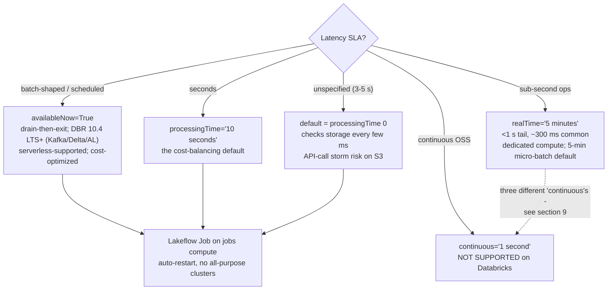
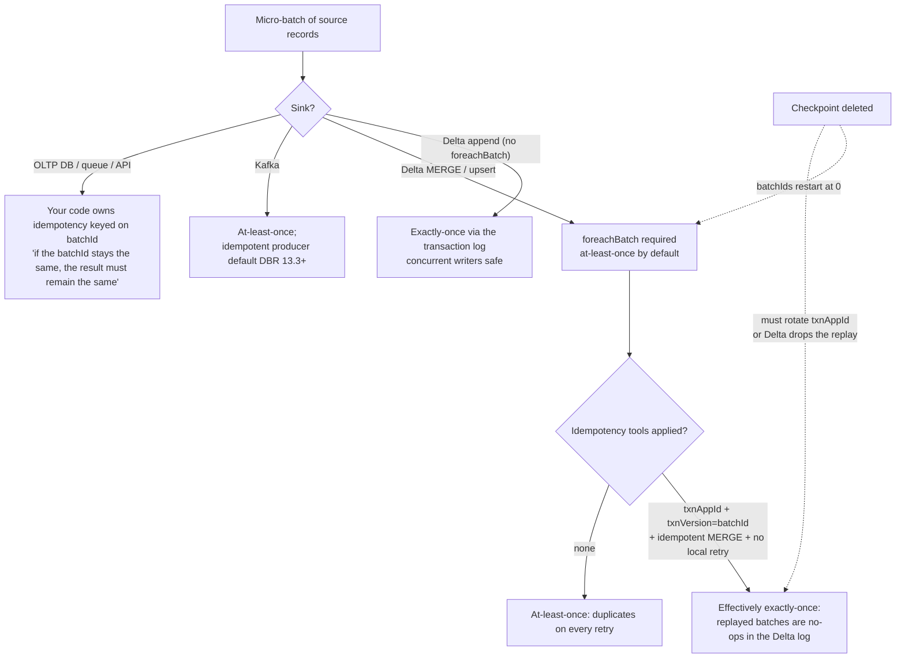
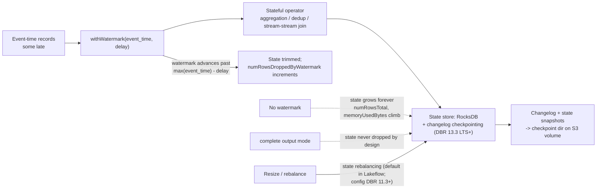

# Structured Streaming on the AWS Lakehouse: Triggers, Checkpoints, foreachBatch and Exactly-Once

A streaming query on Databricks is an unbounded table and a batch-style plan that the engine re-runs over the next slice of input. That model is why "converting existing batch jobs into streaming jobs requires minimal code changes" (Databricks blog, 2026-04-20) — and it is also why every production incident in this space comes back to four objects: the **trigger** that decides when a micro-batch runs, the **checkpoint** that remembers what was read and what was committed, the **sink contract** that decides whether a replayed batch duplicates rows, and the **watermark** that decides when state may be dropped. Get those four right and the lakehouse fills itself in near-real-time; get one wrong and you reprocess a week, duplicate a silver table, or watch state grow until the cluster dies.

This lesson is the streaming half of the course. Lesson 05 taught you how data *arrives* (Auto Loader, MSK auth, file events); this lesson teaches how it *keeps arriving correctly* — triggers and their AWS cost physics, checkpoint hygiene on S3-backed volumes, `foreachBatch` MERGE with `txnAppId`/`txnVersion`, change-data-feed fan-out, watermark-bounded state, exactly-once end to end, and the production posture (Lakeflow Jobs, not all-purpose clusters) that Databricks documents today.

Every fact below comes from Databricks' AWS documentation — the triggers (footer **2026-10-08**), checkpoints (**2026-09-11**), foreach, Delta streaming (both **2026-08-24**), CDF, Kafka (**2026-09-11**), api-options (**2026-10-05**), stream-monitoring (**2026-09-23**), watermarks (**2026-09-11**), stateful-streaming (**2026-10-09**), production, schema-evolution (**2026-08-05**) and Databricks SQL streaming/dashboards pages — plus dated Databricks blogs — all accessed or dated **October 2026**. Platform scope is **Databricks on AWS**: Amazon MSK, S3, Kinesis and Unity Catalog volumes are the substrate; Azure Event Hubs does not exist here and is out of scope.

```text
 =============================================================
  STRUCTURED STREAMING ON DATABRIKS/AWS - SHAPE (Oct 2026)
 -------------------------------------------------------------
  Triggers (docs .../triggers, footer 2026-10-08)
    default            ~3-5 s latency; processingTime 0;
                       checks storage every few ms (API cost!)
    processingTime='10 seconds'   the cost-balancing default
    availableNow=True  drains everything available, then exits;
                       replaces deprecated Trigger.Once (11.3+);
                       only trigger supported on serverless
                       (with deprecated Once); min DBRs: files
                       9.1 LTS, Delta/AL/Kafka 10.4 LTS,
                       Kinesis 13.1
    realTime='5 minutes'  sub-second mode; string = micro-batch
                       length (default 5 min); <1 s at tail,
                       ~300 ms common, as low as 5 ms E2E
    continuous='1 second'  NOT SUPPORTED (OSS experimental);
                       use real-time mode instead
  Checkpoint (one per query, S3 via UC volume, no lifecycle)
    offsets | commits | state | metadata
  Guarantees
    Delta sink  -> exactly-once (transaction log)
    foreachBatch -> at-least-once; exactly-once via
                    txnAppId + txnVersion (= batchId)
    Kafka sink  -> at-least-once; idempotent producer DBR 13.3+
  State
    watermark bounds state; dropDuplicatesWithinWatermark
    (DBR 13.3 LTS+, needs watermark); RocksDB + changelog
    checkpointing DBR 13.3+ recommended for ALL stateful
    queries; transformWithState DBR 16.2+
 =============================================================
```

In this lesson you will:

- configure **every supported trigger** and defend the choice against latency, cost and serverless constraints — including why the OSS `continuous` trigger is dead on Databricks and which of the three different "continuous" features people confuse;
- dissect a **checkpoint** (offsets, commits, state, metadata), place it on a Unity Catalog volume path on S3, and recite the restart-change matrix — what you may alter on a live query versus what silently forces a fresh start;
- write the **headline streaming job**: Amazon MSK → parse → watermark + `dropDuplicatesWithinWatermark` → `foreachBatch` **MERGE** into a Delta silver table with `txnAppId`/`txnVersion`, plus a dead-letter path;
- stream **change data feed** into gold — `readChangeFeed=true`, `_change_type` semantics, `startingVersion`, and the `table_changes()` batch replay for backfill and audit;
- bound **stateful aggregation** with watermarks: append vs update vs complete, the mandatory watermark on outer joins, the global-min multiple-watermark policy, and the state-bloat failure mode with its RocksDB remedy;
- watch a stream like an operator: progress fields (`numInputRows`, `batchDuration`, `stateOperators`), the Spark UI Streaming tab, `StreamingQueryListener`, and `df.observe`;
- build the **near-real-time dashboard stack** honestly — DBSQL streaming tables on serverless pipelines, and why a Lakeview cache up to 24 hours old is not "real-time";
- study **three named AWS customer streaming stories** (Burberry, Shell, Asurion), read the **2026 update box**, and practise with **14 exam-style questions** plus four interactive checks.

---

## 1. The micro-batch model and the trigger menu

Structured Streaming plans your DataFrame transformations once and executes them incrementally. In the default **micro-batch** engine, the driver repeatedly asks the source "what is new since the last offset?", plans a batch, runs it on the cluster, commits the offset and the sink write, and checkpoints progress. **Real-time mode** is Databricks' separate, supported low-latency execution path — not the OSS continuous-processing experiment. Batch and streaming share one API surface; only the reader, the trigger and the checkpoint differ. That is the unification lesson 05 used to run the same bronze code as a nightly job and as a low-latency stream.

### 1.1 The verified trigger table (docs, footer 2026-10-08)

| Trigger | How to set it | Documented behaviour | Use when |
|---|---|---|---|
| **Unspecified default** | omit `.trigger(...)` | "General-purpose streaming with **3–5 second** latency. Equivalent to processingTime trigger with **0 ms** intervals." Checks for data every few milliseconds — "can generate a high volume of cloud storage API calls per day and result in unexpected charges" | Prototyping only; never a cost-conscious production default |
| **Fixed interval** | `.trigger(processingTime='10 seconds')` | A micro-batch per interval; latency bounded by the interval | The cost-balancing default for near-real-time ETL on classic compute |
| **Available-now** | `.trigger(availableNow=True)` | "Processes as much data as is available at the time the streaming job is triggered", across as many micro-batches as rate limits require, then exits. Replaces `Trigger.Once`, **deprecated in DBR 11.3 LTS+**. Minimum DBRs: file sources **9.1 LTS**; Delta / Auto Loader / Kafka **10.4 LTS**; Kinesis **13.1** | Scheduled near-real-time ingestion (hourly/daily jobs); the **only** trigger story on serverless besides deprecated `Once` ("On serverless compute, only `Trigger.AvailableNow()` and `Trigger.Once()` are supported. Databricks recommends `Trigger.AvailableNow()`") |
| **Real-time mode** | `.trigger(realTime='5 minutes')` | "Ultra-low latency operational workloads requiring sub-second processing"; "'5 minutes' indicates the length of a micro-batch". Latency "as low as **five milliseconds**" end-to-end (concepts page, 2026-09-11); "under 1 second at the tail, and in common cases around 300 ms" (triggers, 2026-10-08). Needs dedicated compute | Fraud blocking, real-time personalization — the page's own examples |
| **Continuous processing** | `.trigger(continuous='1 second')` | "**Not supported.** This is an experimental feature included in Spark OSS. Use real-time mode instead." "Databricks doesn't support or recommend this mode." | Never, on Databricks |



### 1.2 Worked example E1 — choosing a trigger, with the AWS bill attached

Scenario: an S3 landing zone drops files in bursts; the product spec says "near-real-time, minutes OK". Three candidate configurations, priced on two axes: **compute** (jobs cluster) and **S3 request cost** (the default trigger's hidden multiplier).

```python
# E1 - three ways to run the same bronze Auto Loader query
# (checkpoint and schema paths on UC volumes; S3-backed, no lifecycle policy)

# A. Default trigger - fastest to write, most expensive to operate
(brz.writeStream.format("delta")
   .option("checkpointLocation", "/Volumes/lake/ops/ckpt/orders_bronze")
   .toTable("lake.bronze.orders"))          # implicit processingTime = 0

# B. Fixed interval - the cost-balancing production default
(brz.writeStream.format("delta")
   .option("checkpointLocation", "/Volumes/lake/ops/ckpt/orders_bronze")
   .trigger(processingTime="10 seconds")
   .toTable("lake.bronze.orders"))

# C. Available-now as a scheduled job - cheapest shape for hourly arrival
(brz.writeStream.format("delta")
   .option("checkpointLocation", "/Volumes/lake/ops/ckpt/orders_bronze")
   .trigger(availableNow=True)              # DBR 10.4 LTS+; serverless-recommended
   .toTable("lake.bronze.orders"))
```

Compute sketch (ours on documented semantics): the hourly `availableNow` run drains in **20 minutes** on a 4-node jobs cluster — **12 DBU/h × 0.33 h = 4 DBU/run**; at **Jobs Compute $0.15/DBU** (AWS Premium list shape as of Oct 2026, same documentary basis as lesson 05's E7 — always re-check `system.billing.list_prices` in your account) that is **$0.60/run → $14.40/month**. A `processingTime='10 seconds'` stream on the same cluster runs continuously: 720 h/month × 12 DBU = **8,640 DBU ≈ $1,296/month**, whether or not data arrives. The default trigger (checks "every few milliseconds") multiplies S3 `LIST`/`GET` API volume against the same $0.005-per-1,000-`LIST` rate lesson 05 computed — on a 2M-file prefix, directory-listing mode at second-level triggers cost **$2,592–$25,920/month** in `LIST` alone versus **$28.80** at a 15-minute `availableNow`. The trigger is a cost decision, not a latency preference.

- **📚 Did you know?** `Trigger.Once` is deprecated since **DBR 11.3 LTS** — "Use `Trigger.AvailableNow` for all incremental batch processing workloads" (triggers, 2026-10-08) — but `Once` still appears in the serverless support sentence because old notebooks still call it. `AvailableNow` is the strict upgrade: same drain-then-exit semantics, plus **rate limiting** across micro-batches (`maxFilesPerTrigger`, `maxOffsetsPerTrigger`), which `Once` lacked. Any tutorial that teaches `Once` as current is teaching a 2022 API.

---

## 2. Checkpoints: the query's memory, on S3

### 2.1 Anatomy

"A checkpoint directory contains **Offsets**, **Commits**, **State**, and **Metadata**" (checkpoints, 2026-09-11):

| Entry | What it stores | Why it matters |
|---|---|---|
| **Offsets** | Source offsets processed in each micro-batch | Resume point after failure; the replay boundary |
| **Commits** | Which micro-batches have committed to the sink | The exactly-once ledger — a batch is "done" only when both sink commit and commit-log entry land |
| **State** | Stateful-operator metadata, state schema, state-store contents | Watermark windows, dedup keys, aggregation state; RocksDB-backed on modern DBRs |
| **Metadata** | Unique query ID and configuration | Identity of the query for the UI and restart checks |

On AWS the checkpoint lives on durable storage — the documented example writes `checkpointLocation` under a **Unity Catalog volume** path (`/Volumes/catalog/schema/volume/path`), which lands on S3 through your storage credential. "Give each query its own checkpoint directory in durable cloud storage" (production page). Never local DBFS `/tmp`, never the landing prefix, never a lifecycle-policy path.

```mermaid
sequenceDiagram
  participant LB as Lakeflow Job (auto-restart)
  participant Q as Streaming query
  participant CP as Checkpoint on S3 (/Volumes/.../ckpt)
  participant S as Source (MSK / S3 files / Delta CDF)
  participant D as Delta sink (silver)
  LB->>Q: start(query config)
  Q->>CP: read offsets + state + metadata
  Q->>S: fetch records after last offset
  Note over Q: plan micro-batch N (deterministic)
  Q->>D: write batch N (append or foreachBatch MERGE)
  D-->>Q: commit (Delta txn N)
  Q->>CP: write commit entry N + new offsets (+ state changelog)
  Note over Q,D: failure AFTER sink commit, BEFORE commit-log write?<br/>restart replays batch N; Delta txnAppId/txnVersion makes it a no-op
  Note over Q,D: failure BEFORE sink commit?<br/>restart replays batch N; MERGE re-runs (idempotent by key)
  Q-->>LB: query terminated / crashed
  LB->>Q: auto-restart with backoff (same checkpoint)
  Note over CP: delete or lifecycle-expire this directory<br/>= query begins FRESH (full reprocess, state rebuilt)
```

### 2.2 The restart-change matrix

Not every code change is restart-safe on an existing checkpoint. The checkpoints page's rules, compressed:

| Change across restart | Allowed? |
|---|---|
| Filters, projections, trigger-interval changes, rate limits (`maxFilesPerTrigger`, `maxOffsetsPerTrigger`) | Generally safe |
| Adding/removing/reordering **sources**, changing source count or type | **No** — new checkpoint required (DBR **18.2+** allows named-source evolution via `.name()` + `spark.sql.streaming.queryEvolution.enableSourceEvolution`, irreversible per checkpoint) |
| Changing the **state schema** (different aggregation keys, different watermark column type) | **No** — new checkpoint |
| Changing **sink type** (e.g. Kafka sink → file sink not allowed; file → Kafka allowed) | Matrix-dependent; many sink swaps are one-way |
| Changing the **state-store backend** (HDFS ↔ RocksDB) | **No** — cannot be swapped between restarts |
| Changing shuffle partition count on a stateful query | **No** on older DBRs (frozen at checkpoint creation); **DBR 18 LTS+** can repartition via on-demand state repartitioning without a new checkpoint |
| Changing compute **access mode** with `dropDuplicates`/`dropDuplicatesWithinWatermark` present | Can fail a **state-schema compatibility check** — pin the access mode for the life of the query |

> [!WARNING]
> **⚠️ Deleting a checkpoint is a one-way door — and state bloat is the slow-motion version of the same disaster.** "When you delete the files in a checkpoint directory or change to a new checkpoint location, the next run of the query begins fresh" (checkpoints doc): Kafka replays per `startingOffsets` (default **latest** — the backlog you accumulated may be skipped), Auto Loader re-lists the prefix, the watermark resets, and every dedup/aggregation key is rebuilt from zero. Worse, if the query writes Delta with idempotency markers, a fresh checkpoint restarts batch IDs at **0** — and Delta will **silently drop** the replayed batches unless you also change `txnAppId` (docs .../structured-streaming/delta-lake, 2026-08-24). The opposite failure is state bloat: no watermark on a dedup or aggregation means `stateOperators.numRowsTotal` and `memoryUsedBytes` climb forever until the executor dies — and in `complete` output mode "aggregation state isn't dropped" by design. Checkpoints also must never sit under a cloud object lifecycle policy: Auto Loader's production page is blunt — if lifecycle rules clean the checkpoint, "the stream state is corrupted", and you restart from scratch. Treat `/_checkpoints` (the underscore survives `VACUUM`) and UC volume paths as production data with an owner, an access policy and a no-delete IAM statement.

---

## 3. Sources on AWS: Kafka/MSK deep, Delta CDF in

Lesson 05 covered Auto Loader end to end; this section adds what a streaming *operator* needs: Kafka rate controls, the Delta table as a source, and CDF as the recommended change path.

### 3.1 Kafka / Amazon MSK: the four options that decide your week

Minimal read is `spark.readStream.format("kafka")` with `kafka.bootstrap.servers` and `subscribe` — and then the options that matter (api-options, 2026-10-05; Kafka doc, 2026-09-11):

| Option | Default | Behaviour |
|---|---|---|
| `startingOffsets` | **`latest`** (streaming) / `earliest` (batch) | Applies **only to a fresh query**; "Resumed queries always use the checkpoint." A silent-backlog-loss footgun on first run |
| `maxOffsetsPerTrigger` | none | Max records per micro-batch, "distributed proportionally across topic partitions" — the catch-up rate limiter |
| `minOffsetsPerTrigger` + `maxTriggerDelay` | none / **`15m`** | Batch up small traffic; when `maxTriggerDelay` is reached the micro-batch runs regardless |
| `failOnDataLoss` | **`true`** | Fails on deleted topics or truncated offsets instead of silently skipping; "Databricks estimates conservatively… this might cause false alarms" |

The reader returns `key` and `value` as **binary** — always `cast`/`from_json`/`from_avro` explicitly. Auth on AWS, in Databricks' recommended order: **Unity Catalog service credentials** (`databricks.serviceCredential`, **DBR 16.1+**, preferred for shared clusters and serverless — do *not* also set `sasl.*` yourself), then instance-profile **MSK IAM** (`AWS_MSK_IAM` + shaded `shadedmskiam.*` classes, `SASL_SSL`, port **9098**), then role-based JAAS (`awsRoleArn=`), then SASL/PLAIN/SCRAM, then mTLS with material in a UC volume and passwords in a secret scope. MSK security groups must allow the Databricks compute SG on **9092** (PLAINTEXT) / **9094** (SASL/SSL) / **9098** (IAM); VPC peering or PrivateLink bridges the two VPCs.

### 3.2 Worked example E2 — MSK → Delta bronze, rate-limited and deduplicated

```python
# E2 - Amazon MSK (IAM via UC service credential) -> Delta bronze
# DBR 15.4 LTS jobs cluster; checkpoint on a UC volume (S3-backed)

from pyspark.sql.functions import from_json, col, expr
from pyspark.sql.types import StructType, StructField, StringType, DoubleType, TimestampType

schema = StructType([
    StructField("event_id", StringType()),
    StructField("order_ts", TimestampType()),
    StructField("customer_id", StringType()),
    StructField("amount", DoubleType()),
])

raw = (spark.readStream.format("kafka")
       .option("kafka.bootstrap.servers", "b-1.msk.acme.amazonaws.com:9098")
       .option("subscribe", "orders")
       .option("databricks.serviceCredential", "msk-orders-cred")   # DBR 16.1+; no sasl.* below
       .option("startingOffsets", "earliest")   # FIRST run only; checkpoint wins after
       .option("maxOffsetsPerTrigger", 500_000) # ~16,600 msg/s at a 30 s interval
       .option("failOnDataLoss", "true")
       .load())

parsed = (raw.select(col("value").cast("string").alias("json"), col("timestamp").alias("ingest_ts"))
          .select(from_json(col("json"), schema).alias("e"), col("ingest_ts"))
          .select("e.*", "ingest_ts"))

deduped = (parsed
           .withWatermark("order_ts", "1 hour")                       # lateness bound
           .dropDuplicatesWithinWatermark(["event_id"]))              # DBR 13.3 LTS+

(deduped.writeStream.format("delta")
   .option("checkpointLocation", "/Volumes/lake/ops/ckpt/orders_bronze")
   .trigger(processingTime="30 seconds")
   .toTable("lake.bronze.orders"))
```

Two documented traps live in those twenty lines. `startingOffsets=latest` is the streaming default — on a brand-new checkpoint the query silently skips everything already in the topic; set `earliest` for the first run, then trust the checkpoint forever. And on **DBR 17.1+** the latest Kafka offsets are fetched *after* each micro-batch completes, so backlog metrics (`avgOffsetsBehindLatest` etc.) "may show small, persistent non-zero values. This is expected behavior" — do not page someone at 03:00 for a 12-offset "lag".

### 3.3 Delta as a source, and CDF as the recommended change path

"Structured Streaming only accepts **append** inputs and throws an exception if any modifications occur on the source Delta Lake table" (docs .../structured-streaming/delta-lake, 2026-08-24) — which is why "Databricks recommends streaming from the CDC feed of a Delta Lake table rather than directly from the table whenever possible." Automatic change data feed "uses the same `table_changes()` and `readChangeFeed` APIs as legacy change data feed and works with batch queries, Structured Streaming…" (CDF page). Enable it **at table creation** (`delta.enableChangeDataFeed=true`) — nothing is captured before that moment. Section 5 builds the full fan-out.

- **📚 Did you know?** The DStreams-era "Spark Streaming" project "is now a legacy project and new streaming applications should use Structured Streaming instead" (Databricks blog, 2026-04-20). If your resume or runbook still says "Spark Streaming" or `Dstream`, you are advertising a technology its own creator retired. The Structured Streaming blog of the same date notes the API "became production-ready in Spark 2.2" — the model you are learning here has been the default for the better part of a decade.

---

## 4. foreachBatch and the exactly-once story

### 4.1 The contract

"**You must use `foreachBatch` for Delta Lake merge operations in Structured Streaming**" — MERGE is a batch operation, so an upsert from a stream can only happen inside the micro-batch callback (docs .../structured-streaming/foreach, 2026-08-24). The same page fixes the guarantee: "`foreachBatch()` provides only **at-least-once** write guarantees. However, you can use the `batchId` provided to the function as way to deduplicate the output and get an exactly-once guarantee." On **DBR 14.0+** the Delta path requires the explicit idempotency API: "**You must use the `txnAppId` and `txnVersion` write options, binding `txnVersion` to `batchId`**" — and "Do not catch and retry exceptions locally"; let errors propagate so the orchestrator retries the whole micro-batch cleanly. For custom/external destinations (OLTP DB, queue, HTTP API): "Implement your own idempotency" — if the `batchId` is the same, your side effect must be the same.

Three corollaries the docs state and junior engineers violate constantly:

1. **New checkpoint ⇒ new `txnAppId`.** "If you delete the streaming checkpoint and restart the query with a new checkpoint, you must provide a different `txnAppId`." New checkpoints start at batch ID 0; with the old appId, Delta treats the replay as a duplicate and drops it.
2. **One streaming write per sink.** "Databricks recommends configuring a separate streaming write for each sink you want to update instead of using `foreachBatch`. Writes to multiple sinks in foreachBatch reduces parallelization and increases overall latency because writes to multiple tables are serialized."
3. **Idempotent MERGE.** "Verify that your `merge` statement inside `foreachBatch` is **idempotent**. Otherwise, restarts of the streaming query can apply the operation on the same batch of data multiple times." Narrow the `ON` clause to the batch's keys.

### 4.2 Worked example E3 — the headline job: MSK → silver MERGE with a dead-letter path

```python
# E3 - foreachBatch MERGE into Delta silver, idempotent, with DLQ
# At-least-once callback + txnAppId/txnVersion = effectively exactly-once

from delta.tables import DeltaTable

APP_ID = "orders-silver-msk"   # change IFF you intentionally start a NEW checkpoint

def upsert_to_silver(batch_df, batch_id):
    if batch_df.isEmpty():
        return
    # batch_df is consumed twice (valid + rejects): persist, or you re-read the source
    batch_df.persist()

    valid = batch_df.filter("order_id IS NOT NULL AND amount >= 0")
    rejects = batch_df.filter("order_id IS NULL OR amount < 0")

    (DeltaTable.forName(spark, "lake.silver_orders")
       .merge(valid.alias("s"), "s.order_id = t.order_id")     # pruned ON clause
       .whenMatchedUpdateAll(condition="s.order_ts > t.order_ts")
       .whenNotMatchedInsertAll()
       .execute())                                             # must be idempotent

    (rejects.write.format("delta").mode("append")
       .option("txnAppId", f"{APP_ID}-dlq").option("txnVersion", batch_id)
       .saveAsTable("lake.quarantine.orders_rejects"))

    # if you also plain-append rows from foreachBatch, stamp them:
    # valid.write.format("delta").mode("append") \
    #   .option("txnAppId", APP_ID).option("txnVersion", batch_id)...

    batch_df.unpersist()   # never catch/retry inside this function - let the job retry the batch

(deduped.writeStream.format("delta")
   .option("checkpointLocation", "/Volumes/lake/ops/ckpt/orders_silver")
   .outputMode("update")            # accepted by foreachBatch; the table itself gets append/complete
   .foreachBatch(upsert_to_silver)
   .trigger(processingTime="30 seconds")
   .start())
```

### 4.3 The exactly-once decision tree



---

## 5. Change data feed out: the gold fan-out

### 5.1 The pattern

Create the silver table with CDF on; every downstream consumer that needs *changes* streams the CDC feed instead of re-reading the table. Each CDF record carries `_change_type` ∈ `insert` / `update_preimage` / `update_postimage` / `delete`. Batch replay uses `table_changes('tbl', v1, v2)` for backfill and audit — the same mechanics Databricks' own CDF blog (2021-06-09) used to build the medallion CDC pattern.

### 5.2 Worked example E4 — CDF stream to gold plus a batch replay

```python
# E4a - silver created with CDF enabled (forward-looking only)
spark.sql("""
  CREATE TABLE lake.silver_orders (
    order_id STRING, order_ts TIMESTAMP, customer_id STRING,
    amount DOUBLE, updated_at TIMESTAMP
  ) USING DELTA
  TBLPROPERTIES (delta.enableChangeDataFeed = true)
""")

# E4b - gold consumer streams the change feed (serverless-friendly: availableNow)
changes = (spark.readStream.format("delta")
           .option("readChangeFeed", "true")
           .option("startingVersion", 70)      # skip history you already backfilled
           .table("lake.silver_orders"))

(gold_df.writeStream.format("delta")
   .option("checkpointLocation", "/Volumes/lake/ops/ckpt/orders_gold")
   .trigger(availableNow=True)                 # deterministic nightly replay
   .toTable("lake.gold.orders_daily"))
```

```python
# E4c - batch replay / audit via table_changes (mirrors the docs' recovery example)
replay = spark.read.format("delta")
  .option("readChangeFeed", "true")
  .option("startingVersion", 70)
  .option("endingVersion", 75)
  .table("lake.silver_orders")
# or the SQL form: SELECT * FROM table_changes('silver_orders', 70, 75)
```

"You must use Structured Streaming for Databricks to automatically track versions for your table's change data feed" — version tracking is a streaming-consumer behaviour, which is why pairing CDF with `availableNow` on a schedule is the documented deterministic-replay pattern. Lakeflow pipelines add **AUTO CDC** (the Applier) for DB→Delta and Delta→Delta without hand-written MERGE — covered in lesson 07; this section is the raw-notebook version you now understand from the inside.

---

## 6. Watermarks, state and the bloat failure mode

### 6.1 What a watermark is for

"Watermarks automatically remove old state data to prevent memory errors and increased processing latency" (watermarks, 2026-09-11). You assert a maximum lateness — `withWatermark("event_time", "10 minutes")` — and the engine advances a global watermark past `max(event_time) − delay`. "Queries always process records that arrive within the threshold. Queries might still process records that arrive outside the threshold, but this isn't guaranteed." Output mode changes what you see:

| Output mode | Emissions | State | Delta sink? |
|---|---|---|---|
| **append** (default) | Only finalized rows, after the watermark passes | Bounded by watermark | Supported |
| **update** | Rows changed in each trigger | Trimmed by watermark when it advances | **Not supported by Delta** — use MERGE in `foreachBatch` |
| **complete** | Every row the operator ever produced | "Aggregation state isn't dropped" — unbounded by design | Supported, but "can perform poorly as data scales" |

Stream-stream joins "only support append mode"; "For outer joins, watermarking is mandatory"; for inner joins it is strongly recommended. With multiple watermarks "Structured Streaming uses the minimum as the global watermark" by default; `spark.sql.streaming.multipleWatermarkPolicy=max` lowers latency but "drops data from the slowest streams… apply with caution." Window durations run "from microseconds up to days. Month durations and longer are not supported."



### 6.2 Worked example E5 — windowed aggregation with the state math visible

```python
# E5 - 5-minute tumbling windows per ad, append mode, watermark 10 minutes
clicks = spark.readStream.format("kafka") \
  .option("kafka.bootstrap.servers", "...").option("subscribe", "clicks") \
  .option("maxOffsetsPerTrigger", 200_000).load()

parsed = clicks.select(from_json(col("value").cast("string"), click_schema).alias("e")).select("e.*")

windowed = (parsed
  .withWatermark("event_time", "10 minutes")
  .groupBy(window(col("event_time"), "5 minutes"), col("ad_id"))
  .count())

query = (windowed.writeStream.format("delta")
  .outputMode("append")                                   # finalized windows only
  .option("checkpointLocation", "/Volumes/lake/ops/ckpt/clicks_5m")
  .trigger(processingTime="1 minute")
  .toTable("lake.silver.clicks_5m"))

# Inspect the state after a few batches:
# query.lastProgress["stateOperators"][0]["numRowsTotal"]
# query.lastProgress["stateOperators"][0]["numRowsDroppedByWatermark"]
# query.lastProgress["eventTime"]["watermark"]
```

Sizing logic (ours on documented semantics): live keys ≈ ads × windows-within-watermark = 5,000 ads × 3 windows (10 min watermark ÷ 5 min window) ≈ **15,000 state rows** — trivial. Remove the watermark and state retains every `(window, ad_id)` forever; add `complete` mode and every historical row is re-emitted each trigger. The dedup variant matters as much: plain `dropDuplicates(["event_id"])` holds state for **every key forever**; `dropDuplicatesWithinWatermark(["event_id"])` (DBR **13.3 LTS+**, **requires a watermark**) only holds keys within the lateness window — "the correct default for idempotent event ingestion when duplicates arrive close in event time."

### 6.3 Worked example E6 — production state defaults and custom state

For all stateful queries on current DBRs, Databricks' documented posture is: **RocksDB state store + changelog checkpointing** (DBR 13.3 LTS+) — "Databricks recommends enabling changelog checkpointing for all Structured Streaming stateful queries"; async state checkpointing and async progress tracking on the production page; **no autoscaling** for raw Structured Streaming job clusters ("Compute auto-scaling has limitations scaling down"); and state rebalancing on resize (default-on in Lakeflow pipelines; config `spark.sql.streaming.statefulOperator.stateRebalancing.enabled` since DBR 11.3+). Custom keyed state beyond aggregation/dedup/joins: `transformWithState` (**DBR 16.2+**) supersedes the legacy `mapGroupsWithState`/`flatMapGroupsWithState` for new code. Shuffle partition count is frozen at checkpoint creation for stateful operators (on-demand repartitioning arrives in **DBR 18 LTS+**) — a silent footgun when someone "just bumps parallelism" on an existing query.

- **📚 Did you know?** `VACUUM` "skips any directories that begin with `_`", which is why the Delta streaming docs suggest storing checkpoints "using a directory structure such as `/_checkpoints`". A one-character naming convention is the difference between a routine maintenance command and a wiped streaming state — pair it with a UC volume path and an IAM policy that forbids `s3:DeleteObject` on the checkpoint prefix, and checkpoint deletion stops being a 3 a.m. possibility.

---

## 7. Schema evolution on streams: locked plans, additive sinks

"A streaming query's schema is **locked in during the planning phase**… If the source schema changes mid-execution, the query fails, and the user must restart the streaming query" (schema-evolution, 2026-08-05) — which is why production streams must run under a job with auto-restart. On the sink side, Delta accepts additive change only: `.option("mergeSchema", "true")` on the streaming write "only supports adding new columns". Prefer the per-write option (or SQL `WITH SCHEMA EVOLUTION`) over the session-wide `spark.databricks.delta.schema.autoMerge.enabled`, which is legacy. On the source side: new columns flow with `mergeSchema`; renames and drops need `spark.databricks.delta.streaming.allowSourceColumnRename` / `…allowSourceColumnDrop`; type widening is **DBR 16.4 LTS+**; "Other type changes: Not supported." And the nuclear fact — "Updating a table schema terminates any streams reading from that table" (update-schema, 2026-08-19). Auto Loader's own evolution loop (fail-with-`UnknownFieldException`-then-restart, `schemaEvolutionMode=addNewColumns` / `rescue`) was lesson 05's E-series; the Delta-source story here is the same restart-driven discipline at a different layer.

---

## 8. Observability and the near-real-time dashboard

### 8.1 Three layers of stream monitoring (stream-monitoring, 2026-09-23)

1. **Query progress** — the notebook's returned `StreamingQuery`, the Spark UI **Streaming** tab (`.queryName()` to disambiguate), and the progress JSON. Key fields: `numInputRows`, `inputRowsPerSecond`, `processedRowsPerSecond`, `batchId`, `batchDuration`, the `durationMs` breakdown (`getBatch`, `addBatch`, `commitOffsets`, `walCommit`), `eventTime.watermark`, and `stateOperators` (`numRowsTotal`, `memoryUsedBytes`, `numRowsDroppedByWatermark`, RocksDB `customMetrics`). Source metrics include Delta/Auto Loader `numBytesOutstanding` / `numFilesOutstanding`; `reservoirId` maps to `DESCRIBE DETAIL <table>` `id`.
2. **`StreamingQueryListener`** (Python and Scala, **DBR 11.3 LTS+**; UC access-mode floors **15.1+** dedicated, **16.1+** standard Scala) — push to Prometheus/Grafana/Kafka. Keep callbacks tiny: "Processing latency with listeners can significantly affect query processing speeds."
3. **`df.observe(name, agg…)`** — arbitrary per-epoch aggregates emitted into `observedMetrics` (e.g. a malformed-row ratio that alerts before downstream freshness does).

### 8.2 Dashboards: pull-based, cached, honest

DBSQL/Lakeview dashboards are **pull-based**: datasets run on a SQL warehouse and results land in a cache that "can return results that are up to 24 hours old even when the underlying data has changed" — only an explicit schedule (or a cache miss) refreshes it, and "Serving results from the dashboard cache does not start the SQL warehouse" (dashboards caching, 2026-07-16). The supported near-real-time shape on AWS is therefore: stream writes Delta in seconds; a **standalone streaming table** in Databricks SQL (`CREATE OR REFRESH STREAMING TABLE … SCHEDULE EVERY …` / `TRIGGER ON UPDATE AT MOST EVERY INTERVAL 5 MINUTES`, minimum `TRIGGER ON UPDATE` interval **1 minute**, running on an automatically created serverless pipeline) keeps the table fresh; the dashboard queries that table on its own cron. Sub-minute dashboard *push* is not a documented DBSQL feature — do not promise it in a design review.

```sql
-- Worked example E7 - SQL-native streaming table feeding a scheduled dashboard
CREATE OR REFRESH STREAMING TABLE orders_5m
TRIGGER ON UPDATE AT MOST EVERY INTERVAL 5 MINUTES AS
SELECT window(event_time, '5 minutes') AS w, count(*) AS orders, sum(amount) AS revenue
FROM STREAM(main.bronze.orders)
GROUP BY window(event_time, '5 minutes');
```

---

## 9. Production posture: Lakeflow Jobs, and the three "continuous"s

Databricks' production page is unusually direct: "Run production Structured Streaming workloads as scheduled Lakeflow Jobs on Databricks"; "Don't run Structured Streaming workloads using all-purpose compute"; "Schedule Lakeflow Jobs using Continuous mode. This refers to the Databricks Jobs scheduling feature, not the Structured Streaming trigger interval"; "Don't enable autoscaling for compute for Structured Streaming jobs" (compensated by RocksDB state, async state checkpointing and async progress tracking). And the platform recommendation: "Databricks recommends using Lakeflow pipelines for new Structured Streaming pipelines."

The naming trap that breaks architecture reviews — three different things called "continuous":

| Name | What it actually is | Status (Oct 2026) |
|---|---|---|
| OSS `Trigger.Continuous` | Spark continuous processing trigger | "**Not supported**… experimental… Use real-time mode instead" |
| Lakeflow pipelines **continuous mode** | Databricks' managed continuous refresh of declarative pipelines | Supported; the recommended continuous *streaming* path (lesson 07) |
| Jobs **continuous** scheduling | A Workflows scheduling mode preventing concurrent runs and auto-restarting the task | Unrelated to any trigger; the production page's recommended *execution vehicle* for streams |

Two more incompatibilities from the same pages: async progress tracking "isn't compatible with the `AvailableNow` or `Once` triggers" — you cannot combine the cost-optimized trigger with that latency optimization; and "If you try to recover from a query failure with an incremental batch, a trigger interval change doesn't solve the problem" — a stuck failed micro-batch must still complete; scale up or start a new checkpoint instead.

---

## 10. The traps: fourteen confusions this lesson will not let you keep

1. **Default trigger as a production default.** 3–5 s latency with per-few-millisecond storage checks — the documented "unexpected charges" scenario. Set an explicit trigger; prefer `availableNow` for scheduled ingestion.
2. **Deleting a checkpoint to "fix lag".** Fresh start, full replay, watermark reset — and Delta silently drops the replay unless `txnAppId` rotates.
3. **Sharing one checkpoint across queries.** Explicitly forbidden: "Each query must have a different checkpoint location."
4. **Same `txnAppId` after a new checkpoint.** Batch IDs restart at 0; Delta ignores the writes. Document the appId per stream; rotate it deliberately.
5. **Catching exceptions inside `foreachBatch`.** Breaks at-least-once accounting; let the orchestrator retry the whole batch.
6. **Fan-out inside `foreachBatch`.** Multiple sinks serialize; prefer one streaming write per sink.
7. **Missing `persist()` in `foreachBatch`.** Read the micro-batch DataFrame twice without it and you re-read the source.
8. **`dropDuplicates` without a bound.** State for every key forever; use `dropDuplicatesWithinWatermark` (DBR 13.3 LTS+) with a watermark.
9. **`complete` mode on a growing aggregation.** State is never dropped by design; "can perform poorly as data scales."
10. **Kafka first run on default `startingOffsets`.** `latest` silently skips the backlog; set `earliest` once, then trust the checkpoint.
11. **Treating small Kafka backlog metrics (DBR 17.1+) as an incident.** Persistent non-zero `*OffsetsBehindLatest` is expected by design.
12. **The three "continuous"s.** Unsupported OSS trigger ≠ Lakeflow continuous mode ≠ Jobs continuous scheduling.
13. **Serverless + non-`availableNow` trigger.** Only `AvailableNow`/`Once` start on serverless — plan compute per trigger.
14. **"The dashboard is real-time because the stream is."** The cache is up to 24 hours stale; the schedule — or a DBSQL streaming table underneath — is what makes it fresh.

> **Comparative Verdict — raw Structured Streaming notebooks vs Lakeflow Declarative Pipelines (as of Oct 2026)**
> - **Raw `writeStream` notebooks (this lesson's code) — the transparent option.** Full control over triggers, checkpoints, `foreachBatch` MERGE, `txnAppId` discipline and rate limits; the right teaching tool and the right choice for one-off jobs, bespoke sinks (OLTP upserts, queues, APIs) and maximum customization. Databricks still fully supports them — *when* they run as "scheduled Lakeflow Jobs on Databricks" with auto-restart, on jobs compute, without autoscaling. The cost of that control is yours: you own checkpoint placement, state-store configuration (RocksDB + changelog), restart-on-schema-change wiring, and every line of idempotency code.
> - **Lakeflow Declarative Pipelines (formerly Delta Live Tables; lesson 07) — the recommended production path.** "Databricks recommends using Lakeflow pipelines for new Structured Streaming pipelines" (production page). You declare sources, sinks and expectations; Databricks manages checkpoints and state, runs continuous mode for true continuous streaming (including serverless), applies **AUTO CDC** instead of hand-written MERGE, rebalances state by default on resize, and offers enhanced autoscaling that raw streaming jobs should not use. The trade-off: less fine-grained control of the micro-batch loop, a pipeline (not notebook) development model, and another concept to govern.
> - **Auto Loader ingestion (lesson 05) splits the same way:** "Lakeflow Spark Declarative Pipelines is the recommended way to run Auto Loader for most production ingestion… If your workload doesn't have low-latency requirements and your priority is minimizing compute cost, you can instead schedule Auto Loader as a triggered batch job that uses `Trigger.AvailableNow`."
> - **Verdict in one line:** *new streaming pipelines → Lakeflow; bespoke sinks, teaching labs and tightly cost-tuned `availableNow` batch jobs → raw Structured Streaming on Lakeflow Jobs with the hygiene of this lesson — and never an all-purpose cluster either way.*

---

### 2026 Updates (as of October 2026)

> [!NOTE]
> **What changed in the streaming platform this lesson depends on — each line checked against a primary source:**
> - **2026-10-08 — the triggers page, current wording.** Default ≈ **3–5 s** latency; `realTime` documented with "under 1 second at the tail, and in common cases around 300 ms"; `continuous` "**Not supported**… Use real-time mode instead"; on serverless only `AvailableNow`/`Once` are supported; `Trigger.Once` deprecated since **11.3 LTS**; availableNow floors: files **9.1 LTS**, Delta/Auto Loader/Kafka **10.4 LTS**, Kinesis **13.1** (docs .../structured-streaming/triggers, footer 2026-10-08).
> - **2026-10-09 — stateful streaming page.** RocksDB + changelog checkpointing "recommended for all Structured Streaming stateful queries" (DBR 13.3 LTS+); `transformWithState` **DBR 16.2+**; state rebalancing default in Lakeflow pipelines; on-demand state repartitioning **DBR 18 LTS+**; shuffle partitions otherwise frozen at checkpoint creation (docs .../structured-streaming/stateful-streaming, footer 2026-10-09).
> - **2026-10-05 — rate-limit options page.** `maxFilesPerTrigger` default **1000** for Delta/Auto Loader; `maxBytesPerTrigger` soft, files never split; Kafka `maxTriggerDelay` default **15m**; `failOnDataLoss` default **true**; Auto Loader rate limits dynamically configured on **DBR 18.0+** (docs .../spark/api-options, page date 2026-10-05).
> - **2026-09-23 — monitoring page.** Spark UI Streaming tab, `StreamingQueryListener` floors (Python/Scala **11.3 LTS+**; UC dedicated **15.1+**, standard Scala **16.1+**), progress fields including `stateOperators` and `durationMs` breakdown, `df.observe` as the third layer (docs .../structured-streaming/stream-monitoring, footer 2026-09-23).
> - **2026-09-11 — checkpoints and watermarks pages.** "Each query must have a different checkpoint location"; source-evolution (named sources) **DBR 18.2+** and irreversible per checkpoint; `dropDuplicatesWithinWatermark` **DBR 13.3 LTS+** requiring a watermark; window durations microseconds→days, no months (docs, footers 2026-09-11).
> - **2026-08-24 — foreach and Delta streaming pages.** `foreachBatch` at-least-once; DBR 14.0+ requires `txnAppId`/`txnVersion` for Delta targets; "Do not catch and retry exceptions locally"; separate streaming write per sink preferred; new-checkpoint restarts demand a new `txnAppId` (docs, dated 2026-08-24).
> - **2026-10-12 — the certification weighting that pays for this lesson.** The Data Engineer Associate blueprint (exam guide live May 4, 2026) lists **Data Ingestion and Loading at 21%** — the second-heaviest domain, and the one this lesson's triggers, checkpoints and exactly-once worked examples are built to cover (Databricks certification pages, verified 2026-10-12).

---

## Real-World Case Studies

> **📋 Case A — Burberry (luxury retail, Cloud: AWS)**
> **Challenge.** Daily clickstream batches arriving "anywhere between **2:00 and 7:00 PM GMT**", and a cloud warehouse that pre-aggregated away the detail needed for Customer 360.
> **Stack on AWS.** Databricks Data Intelligence Platform with Snowplow Behavioral Data Platform for real-time Customer 360 — the story page carries Databricks' own `Cloud: AWS` tag (https://www.databricks.com/customers/burberry, undated page, accessed **2026-10**).
> **Reported outcome.** "**99% Reduction in latency** for customer clickstream data · **52x Increase in cookie duration**"; "we've broken free from daily data batches and formed an accurate real-time view of our customers' digital activity" (same URL, accessed 2026-10; story origin 2023).
> **Maps to this lesson.** Sections 1 and 9 — a clickstream latency SLA is a *business* requirement; Burberry's fix was an event-driven lakehouse path, not a bigger nightly window. The trigger choice (`availableNow` on file arrivals, or a seconds-interval stream from a bus) is exactly the E1 decision, and the dashboard freshness promise belongs to section 8's cache honesty.
> ⏳ *Temporal note: a 2023-origin figure still displayed in 2026 — quote it as what Burberry reported at the time, not a platform guarantee.*

> **📋 Case B — Shell (energy, Cloud: AWS, Azure — dual-cloud story)**
> **Challenge.** Millions of industrial time-series tags, legacy infrastructure, exponential data growth and a shortage of data-engineering skills — ETL at IoT scale.
> **Stack.** Shell.ai's platform on Databricks: "**Delta Live Tables**" (now *Lakeflow / Spark Declarative Pipelines*), Delta Lake, and structured streaming ingestion via the open-source **RTDIP** framework; the story page lists **AWS and Azure**, so we teach the AWS half as S3-backed Delta plus streaming ingestion (https://www.databricks.com/customers/shell, undated, accessed 2026-10).
> **Reported outcome.** "**1.3 trillion rows of sensor data processed** with Delta Live Tables · Millions of dollars saved with data-driven operations" (Shell DLT PDF, **August 2021**); "Real-time data consumption has increased **15-fold** over the last 5 years at Shell"; RTDIP "downloaded 25,000+ times/month" (https://www.databricks.com/blog/developing-time-series-lakehouse-shell, **2023-10-09**).
> **Maps to this lesson.** Sections 6 and 9 — a trillion-row sensor estate survives only with watermark-bounded state and declarative continuous pipelines; the raw-notebook skills in this lesson are what let you debug the managed pipeline when it misbehaves.
> ⏳ *Temporal note: DLT PDF figures are 2021-vintage under the historic product name; the RTDIP numbers are 2023. The story spans AWS and Azure — only the streaming pattern is cloud-portable.*

> **📋 Case C — Asurion (insurance & device protection, Cloud: AWS)**
> **Challenge.** 8,000 tables, 10,000 views and ~600 data marts with per-table ETL mappings and a duplicated batch/speed layer that could not absorb new sources cheaply.
> **Stack on AWS.** Spark **Structured Streaming**, **Auto Loader** and **`foreachBatch`** into Delta, ingesting "database CDC feeds, APIs and flat files to streams from Kinesis, Kafka, SNS and SQS" — a production data lake explicitly "on AWS" (https://www.databricks.com/blog/2021/09/16/large-scale-etl-and-lakehouse-implementation-at-asurion.html, **2021-09-16**).
> **Reported outcome.** "The Asurion data lake executes **4,000+ streaming jobs** and hosts over 4,000 tables in a production data lake on AWS" (https://www.databricks.com/blog/2021/05/10/aws-guide-to-data-ai-summit-featuring-disney-comcast-capital-one-and-mcdonalds.html, **2021-05-10**).
> **Maps to this lesson.** Sections 4 and 10 — at 4,000+ streaming jobs, the architecture *is* a parameterised `foreachBatch`/checkpoint framework (one idempotent pattern, many feeds), and the AWS-native source list (Kinesis, SNS, SQS, MSK) is why this course teaches MSK IAM auth and S3 checkpoint hygiene as first-class skills.
> ⏳ *Temporal note: 2021 figures reported at the time; re-check any workspace concurrency statement from that blog against current docs before reusing it.*

---

> [!SUCCESS]
> **Key Takeaways:**
> 1. **Five triggers, four real choices.** Default ≈ **3–5 s** (processingTime 0 — an API-call storm on S3); `processingTime='10 seconds'` the cost-balancing default; `availableNow=True` drain-then-exit (DBR 10.4 LTS+ for Kafka/Delta/Auto Loader; the serverless-recommended trigger; replaces deprecated `Once`); `realTime='5 minutes'` for sub-second ops (<1 s tail, ~300 ms common, dedicated compute); `continuous` is **not supported** — "use real-time mode instead."
> 2. **The checkpoint is the query.** Offsets + commits + state + metadata on a UC volume path (S3); one per query; no lifecycle policies; safe to change on restart = filters/rate limits/triggers; unsafe = source set, state schema, backend, sink type — and deletion means fresh start, full replay, and a required `txnAppId` rotation or Delta drops the writes.
> 3. **Exactly-once is a chain:** checkpointed offsets → deterministic replay → idempotent sink. Delta appends give it via the transaction log; `foreachBatch` gives only at-least-once until you bind `txnAppId`/`txnVersion=batchId`, keep the MERGE idempotent, never retry locally, and prefer one streaming write per sink.
> 4. **CDF is the change path.** `delta.enableChangeDataFeed=true` at creation; `readChangeFeed=true` streaming with `startingVersion`; `_change_type` rows; `table_changes()` for batch replay; "Databricks recommends streaming from the CDC feed… rather than directly from the table."
> 5. **Watermarks bound state; their absence is state bloat.** Append waits out the watermark; update emits deltas; complete never drops state. Outer joins require watermarks; multiple watermarks combine via **min** by default; `dropDuplicatesWithinWatermark` (DBR 13.3 LTS+) is the bounded dedup default; RocksDB + changelog checkpointing is recommended for **all** stateful queries (DBR 13.3 LTS+).
> 6. **⚠️ Watch `stateOperators`.** `numRowsTotal` and `memoryUsedBytes` climbing with a flat `numRowsDroppedByWatermark` means the watermark is wrong or missing — fix the watermark, do not delete the checkpoint.
> 7. **Streams lock their schema.** Plan-time lock; source changes fail the query (auto-restart job required); sinks accept new columns only via `mergeSchema=true`; ALTER TABLE on a source terminates its readers; type widening is DBR 16.4 LTS+.
> 8. **Operate from the progress JSON.** `numInputRows`, `batchDuration`, `durationMs` breakdown, `eventTime.watermark`, `stateOperators`; Spark UI Streaming tab; `StreamingQueryListener` to Prometheus (keep callbacks tiny); `df.observe` for per-epoch custom metrics.
> 9. **Dashboards are pull-based.** Cache up to **24 hours**, refreshed only by schedule or miss; DBSQL streaming tables on serverless pipelines (`TRIGGER ON UPDATE` minimum **1 minute**) are the documented near-real-time substrate — sub-minute push is not a DBSQL feature.
> 10. **Production posture:** Lakeflow Jobs with continuous *scheduling* and auto-restart, jobs compute (never all-purpose), no autoscaling on raw streaming, RocksDB state, async progress tracking (not compatible with `availableNow`), and — Databricks' own words for new pipelines — "Databricks recommends using Lakeflow pipelines for new Structured Streaming pipelines."
> 11. **Case anchors on AWS:** **Burberry** — 99% clickstream latency reduction, 52x cookie duration (undated, accessed 2026-10); **Shell** — 1.3 trillion sensor rows via DLT/RTDIP (2021/2023, dual-cloud); **Asurion** — 4,000+ streaming jobs on a lake "on AWS" with `foreachBatch` (2021-05-10 / 2021-09-16).

---

## Practice Questions

```question
{
  "id": "dbl-13-q1",
  "type": "multiple-choice",
  "question": "A notebook stream on classic compute omits .trigger(...). According to the October 2026 triggers page, what is the documented behaviour?",
  "options": [
    "General-purpose streaming with 3-5 second latency, equivalent to a processingTime trigger with 0 ms intervals, checking for new data every few milliseconds - which can generate a high volume of cloud storage API calls and unexpected cloud charges",
    "The stream waits for an explicit .awaitTermination() call before planning the first micro-batch, with 30 minute default latency",
    "The default is availableNow semantics: everything available is drained once and the query exits",
    "On classic compute the default is realTime mode with sub-second latency at no extra cost"
  ],
  "correct": 0,
  "explanation": "The triggers doc (footer 2026-10-08) documents the unspecified default as 'General-purpose streaming with 3-5 second latency. Equivalent to processingTime trigger with 0 ms intervals' and warns it 'checks for new data every few milliseconds. This can generate a high volume of cloud storage API calls per day and result in unexpected charges from your cloud provider.' Option B invents a 30-minute default; option C describes availableNow, which you must set explicitly; option D confuses the default with realTime mode, which requires .trigger(realTime=...) and dedicated compute."
}
```

```question
{
  "id": "dbl-13-q2",
  "type": "true-false",
  "question": "Setting .trigger(continuous='1 second') on a Databricks streaming query enables OSS continuous processing for lower latency than micro-batches.",
  "options": ["True", "False"],
  "correct": 1,
  "explanation": "False. The triggers page marks continuous as '**Not supported.** This is an experimental feature included in Spark OSS. Use real-time mode instead,' and adds: 'Databricks doesn't support or recommend this mode.' The supported low-latency path on Databricks is realTime mode (e.g. .trigger(realTime='5 minutes')), whose string parameter is the micro-batch length, not a continuous-execution switch. The trap is the word 'continuous' itself - see the three-way disambiguation in section 9."
}
```

```question
{
  "id": "dbl-13-q3",
  "type": "multiple-choice",
  "question": "Which statement about the four things inside a Structured Streaming checkpoint directory is correct as of October 2026?",
  "options": [
    "It contains offsets (what was read), commits (which micro-batches committed to the sink - the exactly-once ledger), state (stateful operator data and schema), and metadata (query ID/config); each query must have a different checkpoint location, and lifecycle policies must never clean it",
    "It contains only the source offsets; commits and state are rebuilt from the Delta table's _delta_log on every restart",
    "It is safe to share one checkpoint directory across all streaming queries in a workspace to save S3 space",
    "It may live under a 30-day lifecycle rule as long as the state store is RocksDB, because RocksDB replays from S3"
  ],
  "correct": 0,
  "explanation": "The checkpoints page (2026-09-11) lists exactly: Offsets, Commits, State, Metadata, and states 'Each query must have a different checkpoint location. Multiple queries should never share the same location.' Auto Loader's production page adds that lifecycle cleaning corrupts stream state. Option B inverts the design: the checkpoint, not the table, is the resume point. Option C violates the explicit one-location rule. Option D invents a RocksDB-lifecycle exemption that appears in no doc - changelog checkpointing stores MORE state on S3, it does not make lifecycle rules safe."
}
```

```question
{
  "id": "dbl-13-q4",
  "type": "multiple-choice",
  "question": "A team deletes the checkpoint of a foreachBatch query that writes Delta with txnAppId/txnVersion and restarts it without changing anything. What happens?",
  "options": [
    "The new checkpoint restarts batch IDs at 0, and Delta identifies the replayed writes as duplicates of the old appId and silently drops them - the silver table loses the replayed data until the team provides a different txnAppId",
    "The query fails at startup because txnAppId cannot be reused with any checkpoint",
    "Delta automatically suffixes the appId with the new checkpoint path so the writes land normally",
    "The stream reprocesses everything but foreachBatch skips MERGE for any batchId below the previous maximum, which it reads from the Delta table"
  ],
  "correct": 0,
  "explanation": "Docs .../structured-streaming/delta-lake (2026-08-24): 'If you delete the streaming checkpoint and restart the query with a new checkpoint, you must provide a different txnAppId. New checkpoints start with a batch ID of 0.' Delta records (txnAppId, txnVersion) in the table log and ignores replayed duplicates - so the same appId with restarted batchIds turns your 'idempotent' writes into dropped data. Option B is backwards (reuse is the bug, not the failure); C and D invent behaviours found in no Databricks page."
}
```

```fillblank
{
  "question": "Fill in the trigger and state facts exactly as the October 2026 docs define them:",
  "template": "Trigger.Once is deprecated since Databricks Runtime {{1}} LTS in favour of availableNow; on serverless compute only Trigger.AvailableNow and the deprecated Trigger.{{2}} are supported; realTime mode's parameter (for example realTime='5 minutes') is the length of a micro-batch, with documented end-to-end latency under 1 second at the tail, around {{3}} ms in common cases and as low as 5 ms; dropDuplicatesWithinWatermark requires DBR {{4}} LTS or above and an existing watermark; and OSS continuous processing is {{5}} on Databricks.",
  "answers": {
    "1": "11.3",
    "2": "Once",
    "3": "300",
    "4": "13.3",
    "5": "not supported"
  },
  "distractors": [
    "10.4",
    "13.3",
    "14.0",
    "15.4",
    "16.2",
    "18.2",
    "AvailableNow",
    "RealTime",
    "ProcessingTime",
    "50",
    "3000",
    "1000",
    "5",
    "1",
    "supported",
    "experimental but supported on jobs compute",
    "deprecated"
  ],
  "explanation": "All five values come straight from the docs: Once deprecated in DBR 11.3 LTS with 'Use Trigger.AvailableNow'; serverless supports only AvailableNow and Once; realTime '~300 ms common case' and 'under 1 second at the tail' (triggers, 2026-10-08; concepts, 2026-09-11); dropDuplicatesWithinWatermark DBR 13.3 LTS+ requiring a watermark (watermarks, 2026-09-11); continuous 'Not supported.' The distractors are adjacent DBR numbers from elsewhere in this course (10.4 = availableNow floor for Kafka/Delta, 14.0 = foreachBatch txn options, 16.2 = transformWithState, 18.2 = source evolution) and plausible latency digits - the trap is quoting a DBR floor from the wrong feature."
}
```

```question
{
  "id": "dbl-13-q5",
  "type": "multiple-choice",
  "question": "A stream-stream join between an orders stream and a payments stream must emit a row for every order within 30 minutes even if its payment never arrives. What do the October 2026 watermark docs require?",
  "options": [
    "Watermarking is mandatory for outer joins, and joins only support append output mode - so you watermark both streams on event time and accept that unmatched orders finalize only after the watermark passes the lateness bound",
    "Outer joins forbid watermarks; use complete mode instead so nothing is dropped",
    "A single watermark on either stream is always enough because the engine takes the max of all watermarks by default",
    "Set the multipleWatermarkPolicy to max so the slowest stream never drops data"
  ],
  "correct": 0,
  "explanation": "The watermarks page (2026-09-11): 'Joins between multiple streams only support append mode' and 'For outer joins, watermarking is mandatory.' By default the global watermark is the MINIMUM of per-stream watermarks; the max policy 'drops data from the slowest streams... apply with caution' - the opposite of option D's claim. Option B invents a complete-mode join path; option C reverses the default min/max policy."
}
```

```question
{
  "id": "dbl-13-q6",
  "type": "multiple-choice",
  "question": "An ingestion pipeline deduplicates on event_id because upstream Kafka producers retry. Which configuration is the documented, state-bounded default as of Oct 2026?",
  "options": [
    "withWatermark('event_time', '1 hour').dropDuplicatesWithinWatermark(['event_id']) - DBR 13.3 LTS+; state stays proportional to the watermark window instead of every key forever",
    "dropDuplicates(['event_id']) alone - dedup state is always bounded by the engine regardless of watermarks",
    "dropDuplicatesWithinWatermark without a watermark - the watermark requirement was removed in DBR 15 LTS",
    "complete output mode with dropDuplicates so the full key history is re-emitted each batch for audit purposes"
  ],
  "correct": 0,
  "explanation": "The watermarks page documents dropDuplicatesWithinWatermark (DBR 13.3 LTS+, watermark required) as dedup on a key within the watermark window with much smaller state; plain dropDuplicates keeps state for keys until a watermark on event time can retire them - with no watermark, forever. Complete mode re-emits all rows and never drops state, which is the bloat failure mode, not an audit feature. Option C removes exactly the precondition the docs impose."
}
```

```matching
{
  "question": "Match each trigger or execution concept to its verified October 2026 property:",
  "pairs": [
    {"left": "Unspecified default trigger", "right": "3-5 second latency, equivalent to processingTime 0 ms, checks storage every few milliseconds - API-call cost risk on S3, prototype-only"},
    {"left": "Trigger.AvailableNow", "right": "Drains everything available at start (rate-limited across micro-batches), then exits; replaces deprecated Once; only trigger (with Once) supported on serverless; DBR 10.4 LTS+ for Kafka/Delta/Auto Loader"},
    {"left": "Trigger.realTime='5 minutes'", "right": "Sub-second operational mode: under 1 s at the tail, ~300 ms common, as low as 5 ms; the string is the micro-batch length (default recommendation 5 minutes); needs dedicated compute"},
    {"left": "Trigger.Continuous (OSS)", "right": "Not supported on Databricks; experimental in Spark since 2.3; docs say use real-time mode instead"},
    {"left": "Jobs 'continuous' scheduling", "right": "A Workflows feature - no concurrent runs, auto-restart - unrelated to any Structured Streaming trigger; the recommended execution vehicle for production streams"},
    {"left": "Lakeflow pipelines continuous mode", "right": "Databricks' supported managed continuous streaming path (with state rebalancing by default); the recommended home for NEW streaming pipelines"}
  ],
  "explanation": "Six concepts, three of which are called 'continuous' in casual speech - and only two of those are supported anything (Lakeflow continuous mode, Jobs continuous scheduling). The OSS continuous TRIGGER is unsupported; realTime is the low-latency trigger; availableNow is the cost-optimized scheduled shape; the default is the silent S3-bill trap. Architecture reviews fail candidates who merge Jobs continuous scheduling with trigger semantics - the production page explicitly separates them."
}
```

```question
{
  "id": "dbl-13-q7",
  "type": "multiple-choice",
  "question": "Which statement about streaming change data feed is correct per the October 2026 docs?",
  "options": [
    "Enable delta.enableChangeDataFeed at table creation (nothing is captured before), then consume with readChangeFeed=true and _change_type in (insert, update_preimage, update_postimage, delete); Databricks recommends streaming from the CDC feed rather than directly from the table, and version tracking works automatically when you use Structured Streaming",
    "CDF captures all historical versions automatically once you query table_changes in a notebook, with no table property required",
    "Streaming reads of a Delta table with CDF enabled see the change rows merged into the main table automatically, so readChangeFeed is unnecessary",
    "You must use foreachBatch to read CDF, because table_changes is a batch-only API"
  ],
  "correct": 0,
  "explanation": "The CDF page: enable the property at creation (forward-looking only), same table_changes()/readChangeFeed APIs for batch and streaming, records carry _change_type; the Delta streaming page adds 'Databricks recommends streaming from the CDC feed of a Delta Lake table rather than directly from the table whenever possible,' and 'You must use Structured Streaming for Databricks to automatically track versions for your table's change data feed.' Options B-D each contradict one of those sentences - CDF is opt-in at creation, opt-in at read, and usable from plain readStream."
}
```

```question
{
  "id": "dbl-13-q8",
  "type": "multiple-choice",
  "question": "A brand-new Kafka streaming query is started with all defaults to backfill a topic. What is the documented risk?",
  "options": [
    "startingOffsets defaults to 'latest' for streaming, so the query silently skips the backlog already in the topic; set 'earliest' (or a timestamp) for the first run - resumed queries then always use the checkpoint",
    "startingOffsets defaults to 'earliest', replaying the entire topic and doubling data already in the Delta table",
    "The query fails until failOnDataLoss is explicitly set to false, because the default true fails on any pre-existing offset",
    "New Kafka partitions are read from the latest offset on every trigger, continuously skipping data forever"
  ],
  "correct": 0,
  "explanation": "Kafka options (api-options 2026-10-05; Kafka doc 2026-09-11): startingOffsets default 'latest (streaming), earliest (batch)', applying 'only when a new query starts. Resumed queries always use the checkpoint.' failOnDataLoss=true fails on deleted topics/truncated offsets - it does not fail merely because data exists. New partitions DO start at earliest during a query (option D half-wrong). The first-run 'latest' footgun is the single most common silent data-loss story in Kafka ingestion."
}
```

```question
{
  "id": "dbl-13-q9",
  "type": "multiple-choice",
  "question": "On Amazon MSK with IAM authentication and no Unity Catalog service credential, which client configuration is correct per the October 2026 Kafka authentication page?",
  "options": [
    "kafka.security.protocol=SASL_SSL, kafka.sasl.mechanism=AWS_MSK_IAM, kafka.sasl.jaas.config=shadedmskiam.software.amazon.msk.auth.iam.IAMLoginModule required, kafka.sasl.client.callback.handler.class=shadedmskiam.software.amazon.msk.auth.iam.IAMClientCallbackHandler, bootstrap port 9098; IAM policy needs kafka-cluster:Connect and kafka-cluster:ReadData",
    "security.protocol=SASL_SSL without the kafka. prefix, mechanism AWS_MSK_IAM, unshaded software.amazon.msk.auth.iam.IAMLoginModule, port 9092",
    "kafka.security.protocol=SSL with a certificates-only truststore on port 9098 - IAM does not use SASL",
    "kafka.sasl.mechanism=AWS_MSK_IAM with PLAIN credentials from dbutils.secrets on port 9094"
  ],
  "correct": 0,
  "explanation": "The authentication doc (2026-09-11) specifies the shaded class names, the kafka. prefix on every client property, SASL_SSL + AWS_MSK_IAM, port 9098 for IAM (9092 PLAINTEXT, 9094 SASL/SSL), and the kafka-cluster:Connect/ReadData permissions; unshaded classes throw RESTRICTED_STREAMING_OPTION_PERMISSION_ENFORCED. Option B fails on both the prefix and the shading; option C conflates mTLS SSL with IAM; option D mixes IAM with PLAIN - and when a UC service credential IS used (DBR 16.1+), you must NOT set these sasl options at all."
}
```

```dragdrop
{
  "question": "Order the incident response after a streaming silver MERGE query is found to be silently dropping replayed batches (as of Oct 2026):",
  "items": [
    "Symptom: silver row counts lag the bronze replay audit; Delta log shows SetTransaction entries ignoring the new writes",
    "Root cause: someone deleted the checkpoint to fix lag; batchIds restarted at 0 while the old txnAppId stayed in the code",
    "Immediate fix: stop the query; assign a NEW unique txnAppId (and document it in the stream's runbook) before restarting",
    "Data repair: reconcile the gap with a batch backfill (table_changes replay or a batch MERGE from bronze) - the dropped batches will not appear by themselves",
    "Preventive: move the checkpoint to a UC volume path with no lifecycle policy and an IAM deny on DeleteObject; enable job auto-restart so schema/failure restarts are routine",
    "Preventive: switch the dedup to dropDuplicatesWithinWatermark with a watermark and enable RocksDB changelog checkpointing (DBR 13.3 LTS+) so state stays bounded",
    "Verify: compare stateOperators.numRowsTotal and numRowsDroppedByWatermark across batches, then spot-check DESCRIBE HISTORY on silver"
  ],
  "correctOrder": [
    "Symptom: silver row counts lag the bronze replay audit; Delta log shows SetTransaction entries ignoring the new writes",
    "Root cause: someone deleted the checkpoint to fix lag; batchIds restarted at 0 while the old txnAppId stayed in the code",
    "Immediate fix: stop the query; assign a NEW unique txnAppId (and document it in the stream's runbook) before restarting",
    "Data repair: reconcile the gap with a batch backfill (table_changes replay or a batch MERGE from bronze) - the dropped batches will not appear by themselves",
    "Preventive: move the checkpoint to a UC volume path with no lifecycle policy and an IAM deny on DeleteObject; enable job auto-restart so schema/failure restarts are routine",
    "Preventive: switch the dedup to dropDuplicatesWithinWatermark with a watermark and enable RocksDB changelog checkpointing (DBR 13.3 LTS+) so state stays bounded",
    "Verify: compare stateOperators.numRowsTotal and numRowsDroppedByWatermark across batches, then spot-check DESCRIBE HISTORY on silver"
  ],
  "explanation": "The documented failure chain is: checkpoint deleted -> batchIds restart at 0 -> same txnAppId -> Delta drops writes as duplicates. Repair is a batch backfill, not a restart. The two preventive moves are checkpoint hygiene (volume path, no lifecycle, no delete) and bounded state (watermark + dropDuplicatesWithinWatermark + RocksDB changelog). The steps people skip are the data repair - dropped batches never reappear on their own - and rotating the appId, which silently re-triggers the same loss if forgotten."
}
```

```question
{
  "id": "dbl-13-q10",
  "type": "multiple-choice",
  "question": "Which production posture do the Databricks production considerations page recommend for Structured Streaming as of October 2026?",
  "options": [
    "Run streams as scheduled Lakeflow Jobs on jobs compute with continuous job scheduling and auto-restart; do not use all-purpose compute; do not enable autoscaling for streaming jobs; configure RocksDB state, async state checkpointing and async progress tracking instead",
    "Run streams on all-purpose clusters so engineers can attach them interactively; enable autoscaling to minimize cost; use AvailableNow with async progress tracking together",
    "Schedule every stream with Continuous job scheduling AND the OSS continuous trigger for maximum throughput",
    "Enable autoscaling on streaming jobs and compensate by pinning shuffle partitions higher after each restart"
  ],
  "correct": 0,
  "explanation": "The production page states each element: Lakeflow Jobs (not all-purpose), continuous mode as a JOBS scheduling feature (not a trigger), no autoscaling for streaming jobs, with RocksDB/async state checkpointing/async progress tracking as the recommended compensations - and separately, async progress tracking 'isn't compatible with the AvailableNow or Once triggers,' killing option B's combination. Option C conflates Jobs continuous scheduling with the unsupported OSS continuous trigger. Option D repeats the autoscaling advice the page rejects, plus the shuffle-partition-repin trap (partitions are frozen at checkpoint creation for stateful queries unless DBR 18 LTS+ on-demand repartitioning)."
}
```

```question
{
  "id": "dbl-13-q11",
  "type": "multiple-choice",
  "question": "What is the documented freshness model for a Databricks SQL / Lakeview dashboard sitting on top of a streaming-written Delta table?",
  "options": [
    "Dashboards are pull-based: results are served from a cache that can be up to 24 hours old; only an explicit schedule (or a cache miss) refreshes it; cache hits do not start the warehouse - so near-real-time UX needs a fine dashboard schedule, a DBSQL streaming table underneath, or a different serving path",
    "Dashboards automatically invalidate their cache whenever the underlying Delta table receives a streaming commit, giving sub-second freshness",
    "Dashboard datasets run continuously in the background like a streaming query with the default trigger",
    "Streaming writes to Delta update Lakeview tiles via push notifications - no warehouse is ever needed"
  ],
  "correct": 0,
  "explanation": "Dashboards caching (2026-07-16): 'The dashboard cache can return results that are up to 24 hours old even when the underlying data has changed... To reliably refresh the dashboard cache, configure a dashboard schedule,' and 'Serving results from the dashboard cache does not start the SQL warehouse.' The supported near-real-time pattern is a DBSQL streaming table (TRIGGER ON UPDATE minimum 1 minute, serverless pipeline) plus a scheduled dashboard - not push freshness. Options B-D are the 'dashboard is real-time because the stream is' illusion this lesson's section 8 exists to kill."
}
```

```plot
{
  "type": "bar",
  "title": "Latency vs operational cost posture by trigger (teaching model from docs semantics, as of Oct 2026)",
  "data": [
    {"Trigger": "availableNow (hourly job, 20 min run)", "Relative cost": 1},
    {"Trigger": "processingTime 10 s (continuous while data arrives)", "Relative cost": 36},
    {"Trigger": "default processingTime 0 (3-5 s, storage polled every few ms)", "Relative cost": 60},
    {"Trigger": "realTime 5-min micro-batch (dedicated compute)", "Relative cost": 80},
    {"Trigger": "continuous OSS (NOT SUPPORTED on Databricks)", "Relative cost": 0}
  ],
  "xKey": "Trigger",
  "dataKeys": ["Relative cost"],
  "xLabel": "Trigger (same pipeline, same cluster shape)",
  "yLabel": "Relative cost - hours of compute x storage API intensity (teaching scale)"
}
```

Hover a bar: `availableNow` runs ~20 minutes per hourly schedule (**1** on the scale — it turns itself off); a `processingTime='10 seconds'` stream is up whenever data flows (**36** — roughly a full month of uptime against a 20-minute job); the unspecified default adds a per-few-millisecond storage poll on top of continuous compute (**60** — the documented API-call multiplier, which lesson 05 priced at **$2,592–$25,920/month** in `LIST` alone on a 2M-file prefix versus **$28.80** at a 15-minute `availableNow`); real-time mode requires dedicated compute and less frequent checkpoints (**80** — the price of sub-second latency, and the reason it is reserved for fraud and personalization); the OSS continuous trigger is free because you cannot run it (**0** — "Not supported"). The scale is a teaching model of documented semantics, not a platform metric — do the DBU arithmetic with your own cluster shape and `system.billing.list_prices`.
