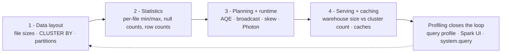
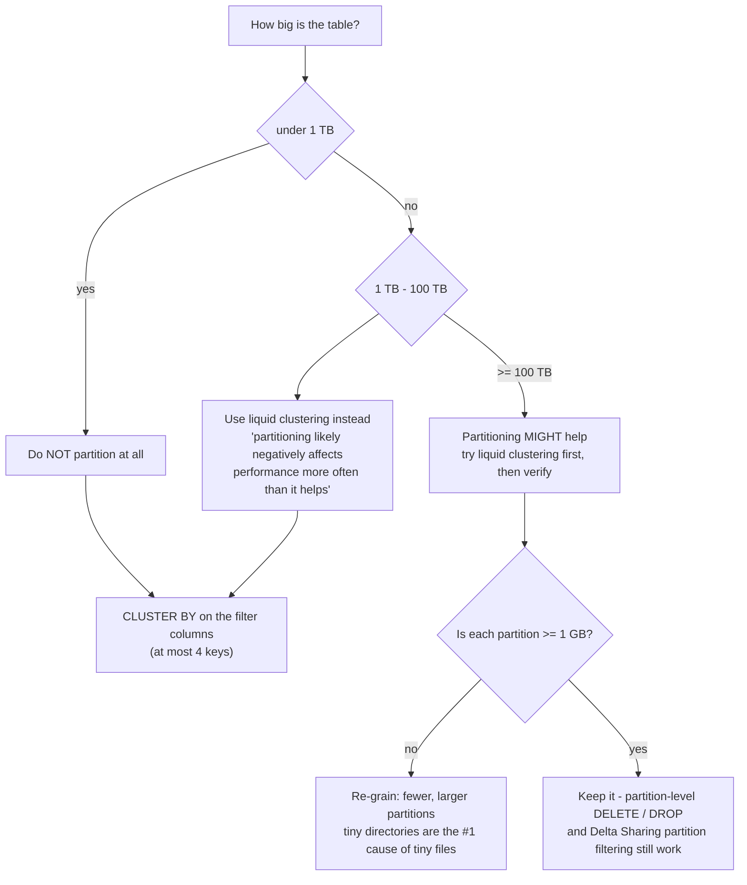
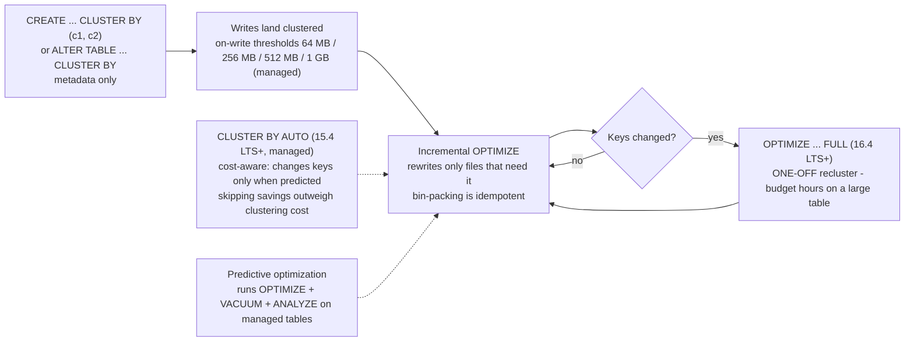
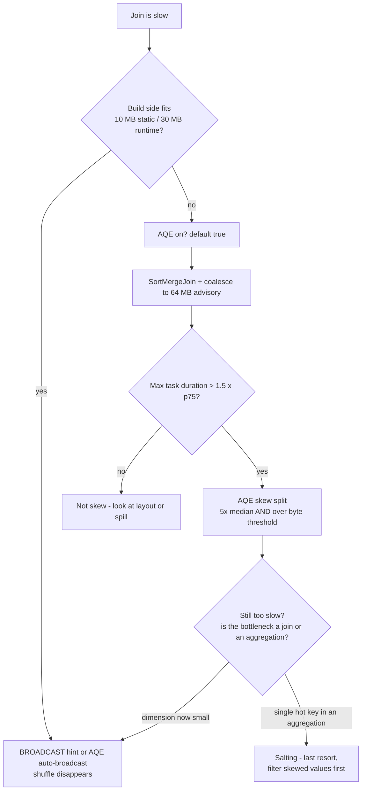
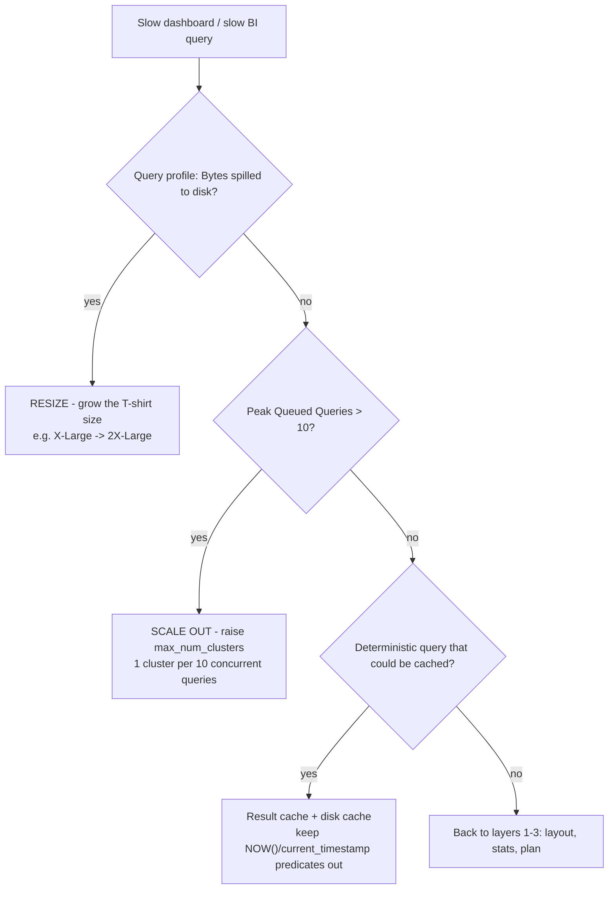
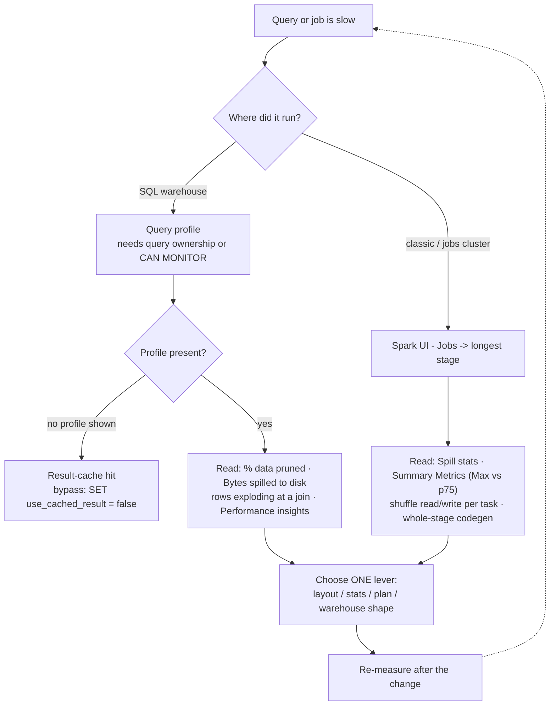

# Performance Optimization on Databricks/AWS: Liquid Clustering, File Layout, Skew and Warehouse Tuning

Slow lakehouse queries are almost never "Spark is slow". They are a specific layer misbehaving: too many small files on S3, a filter column whose min/max ranges overlap in every file, a single hot join key carrying 38% of the rows, or a warehouse that is the right *size* and the wrong *count*. This lesson teaches the stack in the order you should fix it, **layout → statistics → planning/runtime → serving**, and it teaches the 2026 version of that stack, not the 2019 one.

That distinction matters more than any single knob. Databricks' current documentation is blunt: "Databricks recommends using liquid clustering instead of partitions, `ZORDER`, or other data layout approaches" (docs .../tables/operations/optimize, last updated **2026-03-31**, mirror **2026-09-11**), and "Manual tuning recommendations don't apply to Unity Catalog managed tables, which use automatic file size tuning" (docs .../tables/tune-file-size, **2026-09-11**). Meanwhile the engine layer keeps self-tuning: AQE has been on by default since DBR 7.3, Photon is the default execution engine in Databricks SQL warehouses, and Databricks reports that "in 2025, Databricks SQL delivered up to 40% faster performance across production workloads, with improvements applied automatically" (blog, **2026-01-28**).

So the honest framing for October 2026 is: **manual tuning is most valuable on external tables, legacy hive-metastore workloads and non-default clusters**, and on understanding *which* layer is broken before you touch anything. Every fact in this lesson comes from the Databricks AWS documentation pages on optimize, file size, partitions, clustering, data skipping, AQE, hints, predictive optimization, caching, warehouse behavior and the query profile (all accessed or dated **October 2026**), plus dated Databricks engineering blogs. No DBU rates appear here, cost is lesson 15's subject.

```text
 =============================================================
  THE PERFORMANCE STACK - fix top-down, measure after each step
 -------------------------------------------------------------
  1. DATA LAYOUT ....... file sizes, CLUSTER BY, partitions
  2. STATISTICS ........ per-file min/max -> data skipping
  3. PLANNING + RUNTIME  AQE, broadcast, skew, Photon
  4. SERVING + CACHING .. warehouse size vs count, caches
  Loop closes with: DBSQL query profile (warehouses)
                    Spark UI (classic / jobs clusters)
  Managed-table reality: predictive optimization runs
  OPTIMIZE + VACUUM + ANALYZE for you; auto file-size tuning
  picks 256 MB / 1 GB bands; layout work is mostly for
  EXTERNAL tables and legacy estates.
  Defaults verified Oct 2026, no prices in this lesson.
 =============================================================
```

In this lesson you will:

- walk the **four-layer stack** and learn which symptom belongs to which layer before touching a single setting;
- size files against the **three official targets**, 128 MB auto-optimize, the 256 MB → 1 GB autotune band, and the 1 GiB manual `OPTIMIZE` ceiling, and hand-compute the file counts;
- apply the **partitioning ladder** (< 1 TB never · 1 to 100 TB clustering · ≥ 100 TB maybe) and the **≥ 1 GB per partition** guard, then watch the high-cardinality anti-pattern fail arithmetic;
- go deep on **liquid clustering**: `CLUSTER BY`, `CLUSTER BY AUTO`, ≤ 4 keys, clustering-on-write thresholds, incremental `OPTIMIZE` vs `OPTIMIZE FULL`, hierarchical keys, bin-packing idempotence and the DBR floors with their dates;
- run a **worked OPTIMIZE vs CLUSTER BY comparison**, the same 8 TB table, the legacy partition+`ZORDER` SQL beside the liquid SQL, and read the before/after latency plot;
- diagnose **join skew** from real profile evidence and climb the documented ladder: broadcast hint → AQE skew split → salting, with the wrong-fixes rail beside it;
- configure **AQE** with its verified defaults (200 shuffle partitions, 30 MB runtime broadcast, 64 MB advisory, 5× skew factor);
- judge **Photon** by workload, where it wins, where Python UDFs defeat it, and size a **Databricks SQL warehouse** with the resize-vs-scale doctrine plus the cache tiers;
- profile like an operator: the **query profile** for warehouses, the **Spark UI** for clusters, and a shuffle-partition calculation you can do on paper;
- study **three named AWS customer performance stories**, read the **2026 update box**, and practise with **twelve exam-style questions** plus four interactive checks.

---

## 1. The four-layer stack, and how to pick a layer

Every query latency in this course is decided in four layers, in this order. Fix them top-down and measure again after each change: never two changes at once, or you cannot attribute the win.



| Layer | The question it answers | The evidence you read | The lever |
|---|---|---|---|
| 1. Data layout | Are the right rows in the same files? | file count, average size, `% < 20 MB`, `DESCRIBE DETAIL` | `OPTIMIZE`, `CLUSTER BY`, compaction cadence |
| 2. Statistics | Can the engine *prove* a file is irrelevant? | "% of data pruned" icon in the query profile | stats columns, clustering keys, sargable predicates |
| 3. Planning + runtime | Is the plan and the shuffle healthy? | Spark UI stage metrics, `SortMergeJoin (isSkew=true)` | AQE, hints, salting, Photon, UDF rewrite |
| 4. Serving + caching | Is the compute the right shape? | "Bytes spilled to disk", Peak Queued Queries | warehouse size, `max_num_clusters`, caches |

Two 2026 realities reshape that table. First, **layers 3 and 4 increasingly self-tune**: AQE is on by default (`spark.databricks.optimizer.adaptive.enabled` = **true**), Photon runs by default in Databricks SQL warehouses, and managed tables get automatic file-size tuning. Second, **layer 2 has no ceiling on managed tables**: for Unity Catalog *external* tables, statistics are collected on the first 32 columns; for UC *managed* tables, "predictive optimization collects file-skipping statistics on the columns most frequently used in your query filters, instead of a fixed set of columns, so these tables **don't have a 32-column limit**" (docs .../tables/data-skipping, **2026-06-18**).

The rest of this lesson is that stack, layer by layer.

---

## 2. Layer 1: file sizing and the small-file problem on S3

Small files hurt because each file costs an S3 `LIST`/GET round-trip, a Spark task, and a Parquet footer parse. As Databricks' own guide puts it, part of the cost is simply "the time spent for just opening and closing those tiny files" (discover guide, **2026-05-06**). On S3 there is no block layer: **the file is the unit of parallelism, the unit of statistics, and the unit `VACUUM` reclaims.**

### 2.1 Three official targets, one healthy band

Three different numbers are all "official", and teaching them as one number is the classic stale-tutorial error:

| Mechanism | Target file size | Source (date) |
|---|---|---|
| Manual `OPTIMIZE` output ceiling | **1,073,741,824 B = 1 GiB** (`spark.databricks.delta.optimize.maxFileSize`) | Delta `OPTIMIZE` language manual; discover guide (**2026-05-06**) |
| Auto-optimize set to `true` (`autoOptimize.optimizeWrite` + `autoCompact`) | **128 MB** | docs .../tables/tune-file-size (**2026-09-11**) |
| Autotuned target (UC managed default behaviour) | **< 2.56 TB → 256 MB** · **2.56 to 10 TB → linear 256 MB → 1 GB** · **> 10 TB → 1 GB** | same (**2026-09-11**) |
| Healthy guidance band | "**between 16MB and 1GB**" | discover guide (**2026-05-06**) |

Two corollaries that prevent the two most common layout mistakes:

1. **1 GiB is a ceiling, not a goal for small tables.** Compacting a 300 GB table into 1 GiB files leaves ~300 files and destroys pruned-scan parallelism.
2. **Raising a target never merges anything by itself.** "When the target file size for a table grows, existing files are not re-optimized into larger files by the `OPTIMIZE` command" (tune-file-size, **2026-09-11**); you must run `OPTIMIZE` afterwards.

### 2.2 Worked example E1: what 8 TB of Auto Loader output looks like

```text
Worked example E1 - file arithmetic for an 8 TB events table on S3 (as of Oct 2026)

BEFORE (24 Auto Loader streams, one per device fleet)
  File count ............... 19,000
  Average .................. 8 TB / 19,000 ~= 440 MB   <- MISLEADING
  Shape .................... 60% of files under 20 MB (streaming micro-batches)
  Serving query ............ 12,000 files scanned after min/max pruning
  p95 ...................... ~9.5 min on an X-Large warehouse, spill visible in profile

THE TARGET (autotune band 2.56 - 10 TB -> linear 256 MB -> 1 GB)
  8 TB interpolates to roughly 768 MB per file
  Manual OPTIMIZE ceiling ................ 1 GiB (1,073,741,824 B)
  Healthy band .......................... 16 MB - 1 GB
  Reference file counts from the docs table:
    1 TB  @ 256 MB ....... 4,096 files
    10 TB @ 1 GB ......... 24,437 files
    100 TB @ 1 GB ........ 114,437 files

AFTER (layout fixed - see worked example E4 for the SQL)
  File count ............... ~10,000 near-target files
  Pruning .................. > 95% of files excluded by customer_id / event_date filters
  p95 ...................... ~25-40 s  (illustrative band, consistent with Databricks'
                             reported 2-12x read gains and a 12x point-query report,
                             blog 2024-05-22 - not a measured benchmark of this table)
```

The lesson of E1 is not the 15 to 25× band; it is that **file count and file *shape* are different numbers**. A 440 MB average with a 20 MB median means the engine still pays task-per-file overhead on most of the table.

### 2.3 Three mechanisms fight small files, in increasing order of authority

1. **Optimized writes** (`autoOptimize.optimizeWrite` / `spark.databricks.delta.optimizeWrite.enabled`) shuffle before writing so each partition emits ~128 MB files. They are on by default for `MERGE`, `UPDATE`/`DELETE` with subqueries, CTAS/INSERT on SQL warehouses, and "In Databricks Runtime 13.3 LTS and above, all tables registered in Unity Catalog have optimized writes enabled for CTAS statements and INSERT operations for partitioned tables". The cost is real: "Writing fewer large files is more efficient … but you might still see an increase in write latency because data is shuffled before being written."
2. **Auto compaction** (`autoOptimize.autoCompact`) "runs **synchronously on the cluster that performs the write, after the write succeeds**, and only compacts files that haven't been compacted previously". In table history it appears as an `OPTIMIZE` operation with `operationParameters.auto` = `true`. For `MERGE`, `UPDATE` and `DELETE` it is mandatory: "You can't turn off this functionality."
3. **Scheduled or predictive `OPTIMIZE`**: "For tables larger than **1 TB**, Databricks recommends running `OPTIMIZE` on a schedule", classically "**daily**, preferably at night when spot prices are low" and on a **separate job cluster**, and for hot liquid-clustered tables, "scheduling an `OPTIMIZE` job **every one or two hours**" (clustering docs, **2026-09-25**), because clustering is incremental and most runs are quick.

Auto compaction and optimized writes "are **not a full replacement** for `OPTIMIZE`" (tune-file-size, **2026-09-11**), and if predictive optimization is enabled, "Databricks recommends disabling any scheduled `OPTIMIZE` jobs" so you stop paying twice (clustering docs).

```fillblank
{
  "question": "Fill in the file-layout and AQE values exactly as the October 2026 documentation states them:",
  "template": "Auto-optimize set to {{1}} targets 128 MB files; the manual OPTIMIZE output ceiling is {{2}} GiB; tables below 2.56 TB are autotuned to a {{3}} MB target; and the default value of spark.sql.shuffle.partitions is {{4}}.",
  "answers": {
    "1": "true",
    "2": "1",
    "3": "256",
    "4": "200"
  },
  "distractors": ["false", "auto", "2", "4", "64", "128", "512", "1000"],
  "explanation": "All four are verbatim from documentation accessed 2026-10: auto-optimize 'true' means 'Use 128 MB as the target file size'; spark.databricks.delta.optimize.maxFileSize defaults to 1,073,741,824 bytes = 1 GiB; autotune gives 256 MB below 2.56 TB; and spark.sql.shuffle.partitions defaults to 200 (the value 'auto' enables auto-optimized shuffle instead: a distractor here because it is a valid setting, not the default). 64 MB is the AQE advisory partition size, 128 MB is the per-task shuffle rule of thumb, and 1,000 is the warehouse queue cap: three different numbers that live in different layers."
}
```

> ⚠️ **WARNING, do not fight the write path with your hands.** "If you use optimized writes, Databricks recommends that you **don't run `coalesce(n)` or `repartition(n)` just before a write** to control the number of files written" (tune-file-size, **2026-09-11**), you pay two shuffles for one job. Equally: never turn auto compaction off at the session level and forget. It cannot be disabled for `MERGE`/`UPDATE`/`DELETE`, but a session-level `false` *does* silently disable it for appends and CTAS in that workload.

- **📚 Did you know?** `OPTIMIZE` is safe by construction: "Bin-packing optimization is *idempotent*, meaning that if it is run twice on the same dataset, the second run has no effect", and "Because `OPTIMIZE` makes no data changes to the table, a read before and after an `OPTIMIZE` has the same results. Performing `OPTIMIZE` on a table that is a streaming source does not affect any current or future streams with this table as a source" (docs.../operations/optimize, **2026-03-31**). ZORDER, by contrast, was never idempotent; it was incremental and needed re-running.

---

## 3. Layer 1, partitioning: the ladder and the ≥ 1 GB guard

The current partitioning guidance is newer than most tutorials and blunter than most teams expect: "Most tables on Databricks with less than **100 TB** of data don't need partitioning" (docs .../tables/partitions, **2026-07-01**).



The second guardrail is per-partition: "verify that each partition contains **at least 1 GB** of data. Tables with fewer, larger partitions tend to outperform tables with many smaller partitions" (same page). Partition count equals directory count in your bucket, so every extra level of cardinality multiplies `LIST` calls, `_delta_log` entries, `OPTIMIZE` planning scans and `MERGE` conflict surface.

**Do not partition when:** the table is under 1 TB; the filter column is high cardinality (`user_id`, `event_id`: cluster instead); access patterns change (partitioning "is static and manifests itself as a filesystem hierarchy. There is no easy way to change partitions", best-practices page); the column is a timestamp that would explode into millions of instants (cluster the raw timestamp instead); or you would partition on a struct field (`PARTITIONED BY` treats a struct as an expression, not a column reference).

### 3.1 Worked example E2: the high-cardinality anti-pattern, in arithmetic

```text
Worked example E2 - partitioning the same 8 TB events table by customer_id

PARTITIONED BY (customer_id) with ~200,000 distinct customers
  Directories ................ 200,000
  Average bytes per partition . 8 TB / 200,000 ~= 40 MB
  Guardrail .................. >= 1 GB per partition  -> VIOLATED by 25x
  Symptom .................... thousands of tiny files per day, compaction never
                               keeps up, _delta_log listing grows, every OPTIMIZE
                               and MERGE pays for 200k directory listings

CLUSTER BY (customer_id, event_date) instead
  Directories ................ none (hidden partitioning, protocol 3/7)
  Rewrite cost ............... metadata-only to declare; OPTIMIZE FULL once
  Pruning .................... file-granularity, driven by per-file min/max stats
  Change of mind ............. ALTER TABLE ... CLUSTER BY (new cols) - no rewrite
```

Partitioning keeps exactly two legitimate roles in 2026: **partition-level lifecycle moves** (`DELETE`/`DROP PARTITION` on a date column at ≥ 100 TB scale) and **Delta Sharing partition filtering** on shared tables; which is also why converting a partitioned shared table to clustering is blocked.

---

## 4. Liquid clustering, deep

"Liquid clustering is a data layout optimization technique that **replaces table partitioning and `ZORDER`**" (docs .../tables/clustering, last updated **2026-09-25**), and "you can redefine clustering keys **without rewriting existing data**". That last clause is the whole design: partitioning bakes a filesystem hierarchy you cannot cheaply change; clustering stores a declared key set in table metadata and lets `OPTIMIZE` physically co-locate ranges incrementally.

### 4.1 The declaration surface and the DBR floors

```sql
-- Declare at CREATE time (metadata only - no data is touched)
CREATE TABLE main.silver.events (
  customer_id STRING,
  event_date  DATE,
  event_type  STRING,
  payload     STRING
) USING DELTA
CLUSTER BY (customer_id, event_date);

-- Or attach clustering to an existing table
ALTER TABLE main.silver.events CLUSTER BY (customer_id, event_date);

-- Let the platform pick and evolve keys (15.4 LTS+, UC managed + predictive optimization)
ALTER TABLE main.silver.events CLUSTER BY AUTO;

-- Remove clustering
ALTER TABLE main.silver.events CLUSTER BY NONE;
```

Carry these version numbers **with their dates**; they are the numbers exams and architecture reviews ask for:

| Fact | Value | Source (date) |
|---|---|---|
| Trigger / write clustering | DBR **13.3 LTS+** | clustering docs (**2026-09-25**) |
| GA announcement | "generally available in Databricks from DBR **15.2**" | blog (**2024-05-22**) |
| Current GA statement | "GA for Delta Lake tables with **DBR 15.4 LTS and above**"; Iceberg in Public Preview on **16.4 LTS+** | clustering docs (**2026-09-25**) |
| Recommended for large-table `OPTIMIZE` | **DBR 17.3 LTS+** | clustering docs (**2026-09-25**) |
| `OPTIMIZE … FULL` (force recluster) | **DBR 16.4 LTS+** | clustering docs (**2026-09-25**) |
| `OPTIMIZE … FULL WHERE …` (partial recluster) | **DBR 18.1+** | clustering docs (**2026-09-25**) |
| `CLUSTER BY AUTO` | **DBR 15.4 LTS+**, UC managed + predictive optimization | clustering docs (**2026-09-25**) |
| Hierarchical clustering | **DBR 17.1+** (`delta.liquid.hierarchicalClusteringColumns`) | clustering docs (**2026-09-25**) |
| `REPLACE PARTITIONED BY WITH CLUSTER BY` | **DBR 18.1+** (reads from 13.3 LTS+) | clustering docs (**2026-09-25**) |
| Max clustering keys | **4**: below 10 TB, more keys "can degrade performance when filtering on a single column" | clustering docs (**2026-09-25**) |
| Stats required on keys | yes: first **32 columns** by default | clustering + data-skipping docs (**2026**) |
| Table protocol | reader **3** / writer **7** ("hidden partitioning") | feature-compatibility docs (**2026-09-11**) |
| Compatible with partitioning or `ZORDER`? | **No**: "Clustering is not compatible with partitioning or `ZORDER`" | clustering docs (**2026-09-25**) |

### 4.2 Clustering on write: how streaming lands pre-clustered

You do not have to wait for a nightly job. When a write is large enough, clustering runs **during the write**, per key count (UC managed / other Delta tables):

| Clustering keys | UC managed threshold | Other Delta tables |
|---|---|---|
| 1 | **64 MB** | 256 MB |
| 2 | **256 MB** | 1 GB |
| 3 | **512 MB** | 2 GB |
| 4 | **1 GB** | 4 GB |

This is why a CTAS or a streaming micro-batch can land physically clustered without any scheduled maintenance, and why `OPTIMIZE` on a clustered table is usually fast: it only rewrites what still needs clustering.

### 4.3 The lifecycle, including the two expensive moments



Two moments in that diagram cost real money and real calendar time:

> ⚠️ **WARNING: declaring keys is free; making old data match them is not.** "The default behavior does not apply clustering to previously written data"; you must run `OPTIMIZE <table> FULL`, which "might take hours" on a large unclustered table (clustering docs, **2026-09-25**). Budget it as a one-off migration job on its own cluster (compute-optimized instances, spot at night), not as a step in a release pipeline. And never claim "enabling clustering rewrote my table": `ALTER TABLE … CLUSTER BY` is metadata; `OPTIMIZE FULL` is the rewrite.

> ⚠️ **IMPORTANT: `OPTIMIZE` rewrites files, so it feeds `VACUUM`.** Every recluster deletes-and-adds files; the old versions survive only for `delta.deletedFileRetentionDuration` (default **7 days**). Set that property **before** you enable predictive optimization: "If you set `delta.deletedFileRetentionDuration` to less than 7 days, predictive optimization still retains data files for a **minimum of 7 days** when it runs `VACUUM FULL`" (predictive-optimization docs, **2026-09-11**), and never run `VACUUM` in the same job step as long-running readers or streams.

### 4.4 Worked example E3: adopting clustering on a live table

```sql
-- Worked example E3 - adopt liquid clustering on main.silver.events (8 TB, external on S3)
-- Step 1 - declare the keys your filters actually use (metadata only)
ALTER TABLE main.silver.events CLUSTER BY (customer_id, event_date);
-- correlated columns? one is enough: "If two columns are highly correlated,
-- you only need to include one of them in the clustering columns"

-- Step 2 - one-off full recluster, on its own job cluster, at night (DBR 16.4 LTS+)
OPTIMIZE main.silver.events FULL;

-- Step 3 - verify what actually ran (history disambiguates the operation type)
DESCRIBE HISTORY main.silver.events LIMIT 5;
--   operationParameters.clusterBy  -> liquid clustering
--   operationParameters.zOrderBy   -> legacy ZORDER
--   operationParameters.auto       -> auto compaction
SHOW TBLPROPERTIES main.silver.events;
--   delta.clusteringColumns -> [customer_id, event_date]

-- Step 4 - incremental maintenance: hot table, every one or two hours
OPTIMIZE main.silver.events WHERE event_date >= current_date() - 2;

-- Step 5 - per-quarter deep maintenance on older data, still incremental
OPTIMIZE main.silver.events WHERE event_date < current_date() - 90;
```

Why a predicate in step 4/5? `OPTIMIZE <table> WHERE <predicate>` scopes the compaction/recluster to a subset: cheaper, and it shrinks the conflict window with concurrent writers, the same reason best practices push pruning predicates into `MERGE... ON`.

- **📚 Did you know?** `DESCRIBE HISTORY` is also your **maintenance audit trail**: auto compaction, liquid clustering and Z-ordering "all appear in table history as `OPTIMIZE` operations", and you tell them apart only through `operationParameters.{auto, clusterBy, zOrderBy, predicate}` (docs.../tables/history, **2026-09-11**). A dashboard that counts "`OPTIMIZE` runs" therefore over-counts auto compaction by a wide margin: filter on `auto = 'false'` for manual runs.

---

## 5. Worked example E4: OPTIMIZE vs CLUSTER BY, side by side

Same table, same 8 TB, two generations of layout doctrine. This is the comparison the course exists to make.

```sql
-- ============================================================
-- PATH A - legacy: Hive partitioning + ZORDER (pre-2024)
-- ============================================================
CREATE TABLE main.silver.events (
  customer_id STRING, event_date DATE, event_type STRING, payload STRING
) USING DELTA
PARTITIONED BY (event_date);              -- date cardinality "seems" safe

-- props you had to remember to set yourself
ALTER TABLE main.silver.events SET TBLPROPERTIES (
  'autoOptimize.optimizeWrite' = 'true',
  'autoOptimize.autoCompact'    = 'true',
  'delta.targetFileSize'        = '536870912'   -- 512 MB, manual guess
);

-- ZORDER the column your dashboards filter on (non-partitioned, stats required)
OPTIMIZE main.silver.events
  WHERE event_date >= DATE'2026-10-01'
  ZORDER BY (customer_id);

-- and because ZORDER "is not idempotent but is incremental", and because MERGE
-- rewrites blunt it (low shuffle merge helps but does not remove the need),
-- you re-run it on a schedule, forever, inside the date partition.

-- ============================================================
-- PATH B - liquid clustering (Oct 2026 recommendation)
-- ============================================================
CREATE TABLE main.silver.events (
  customer_id STRING, event_date DATE, event_type STRING, payload STRING
) USING DELTA
CLUSTER BY (customer_id, event_date);     -- no PARTITIONED BY, no ZORDER

-- one-off, after keys are first set or changed (DBR 16.4 LTS+)
OPTIMIZE main.silver.events FULL;

-- incremental maintenance from then on; bin packing happens in the same command
OPTIMIZE main.silver.events WHERE event_date >= current_date() - 2;

-- managed tables: skip the cron job entirely and let predictive optimization
-- run OPTIMIZE/VACUUM/ANALYZE for you (serverless-billed), then delete yours.
```

What changed between the two paths:

| Dimension | Path A: partition + `ZORDER` | Path B: `CLUSTER BY` |
|---|---|---|
| Declared in | filesystem hierarchy + a rewrite command | table metadata (protocol 3/7) |
| Change the key | effectively a table rebuild; "no easy way to change partitions" | `ALTER TABLE … CLUSTER BY`, no rewrite |
| Maintenance | re-run `ZORDER` (not idempotent), inside partitions | incremental `OPTIMIZE`, idempotent bin packing |
| Predictive optimization | "does not run `ZORDER` … ignores Z-ordered files" | fully supported: `CLUSTERING` operations appear in history |
| High-cardinality column | forbidden as a partition key | the *best* clustering key candidate |
| Benchmark (1 TB warehouse workload) | Hive-style partitioning ~an **order of magnitude slower** than liquid; Z-order in the middle | **2.5× faster clustering than Z-order** (blog, **2023-06-29**) |
| Field results |: | point queries up to **12×** at a manufacturing firm; read performance **2 to 12×** reported at GA (blog, **2024-05-22**) |

```plot
{
  "type": "bar",
  "title": "p95 serving-query latency across four layout states, 8 TB events table (worked example E1/E4: illustrative reference-architecture band, not a measured benchmark)",
  "xLabel": "Table layout state",
  "yLabel": "p95 query latency (seconds)",
  "xKey": "layout_state",
  "dataKeys": ["p95_seconds"],
  "data": [
    {"layout_state": "Raw: 19k files, 60% under 20 MB, no clustering", "p95_seconds": 570},
    {"layout_state": "Optimized writes only (~128 MB files)", "p95_seconds": 420},
    {"layout_state": "+ OPTIMIZE bin packing (fewer, larger files)", "p95_seconds": 180},
    {"layout_state": "+ CLUSTER BY (customer_id, event_date) + FULL", "p95_seconds": 32}
  ]
}
```

Read that plot as a *causal ladder*: optimized writes and bin packing (layer 1, file size) buy you a solid but bounded gain because pruning still cannot prove anything; `CLUSTER BY` (layer 1 + layer 2 together) is what makes the `customer_id` filter exclude >95% of files. The final bar is labelled illustrative because it is a reference-architecture sketch constrained by Databricks' published 2 to 12× read band, not a number from your table: measure yours in the query profile.

### 5.1 Layer 2: why clustering is what makes skipping work

Delta writes per-file statistics at commit time: "minimum and maximum values, null counts, and total records" (data-skipping docs, **2026-06-18**), and at query time the engine skips any file whose stats prove the predicate cannot match. Clustering does not change what *can* be skipped, "the engine prunes at file granularity. There is no directory-level shortcut to lose" (Databricks blog, **2026-01-06**), it changes how *much* is skipped, by making ranges of the key physically contiguous.

Skipping silently fails when: the predicate is non-sargable (`WHERE lower(col) = …`, `WHERE date_add(col, 1) = …`); the filter column has no statistics; values are uniformly distributed across all files; or you combine columns in a way min/max cannot prove. Stats knobs: `delta.dataSkippingNumIndexedCols` (positional) and `delta.dataSkippingStatsColumns` (DBR 13.3 LTS+, explicit list, supersedes the numeric one), and "Updating these properties does not automatically recompute statistics for existing data". Finally: "Databricks recommends that you don't use `ZORDER BY` on columns that don't have statistics collected because it is ineffective and uses unnecessary compute resources."

---

## 6. Layer 3, joins: AQE, broadcast, skew and salting

### 6.1 The AQE defaults you are actually running with

AQE is on by default and does four things: convert sort-merge join into broadcast at runtime, coalesce post-shuffle partitions, split (and if needed replicate) skewed partitions, and propagate empty relations (AQE docs, page dated **2023-10-12**, still current in Oct 2026).

| Setting | Default | Meaning |
|---|---|---|
| `spark.databricks.optimizer.adaptive.enabled` | **true** | AQE master switch |
| `spark.sql.shuffle.partitions` | **200** (value `auto` = auto-optimized shuffle) | initial shuffle partition count |
| `spark.databricks.adaptive.autoBroadcastJoinThreshold` | **30 MB** | runtime switch to broadcast join |
| `spark.sql.autoBroadcastJoinThreshold` | **10 MB** | static planning threshold (Spark upstream) |
| `spark.sql.adaptive.advisoryPartitionSizeInBytes` | **64 MB** | coalescing target after shuffle |
| `spark.sql.adaptive.skewJoin.enabled` | **true** | automatic skew split |
| `spark.sql.adaptive.skewJoin.skewedPartitionFactor` | **5** | skewed if > 5× median **and** over the byte threshold |
| Skew byte threshold | **256 MB** (Spark default: verify on your DBR) | second condition of the skew test |
| `spark.sql.broadcastTimeout` | **300 s** | broadcast build timeout |

Rule of thumb for shuffle sizing: "each task should approximately be processing **128MB to 200MB** of data" (discover guide, **2026-05-06**). And keep AQE on: "It is recommended to **keep AQE enabled**" (best-practices, **2026-09-11**).

### 6.2 Worked example E5: a 52-minute nightly join, diagnosed

```text
Worked example E5 - join skew, four moves, from evidence to fix
Setup ........ orders 400 GB, customers 2 GB, join on cust_id
               one key (cust_id = 'ANON') holds 38% of all rows
Evidence ..... Spark UI longest stage: 200 tasks, median 12 s, Max 41 min
               "If the Max duration is 50% more than the 75th percentile duration,
                you may be suffering from skew"  -> 41 min >> 1.5 x p75  => SKEW
               one task reads 180 GB of shuffle; median task reads 0.4 GB
               plan: two Exchange nodes + SortMergeJoin (AQE did not broadcast:
               filtered customers = 40 MB, above the 30 MB runtime threshold)
```

```sql
-- Move 1 - REMOVE the shuffle (always the best outcome if it fits)
SELECT /*+ BROADCAST(customers) */ c.region, SUM(o.amount) AS revenue
FROM main.silver.orders o
JOIN main.gold.customers c ON o.cust_id = c.cust_id
GROUP BY c.region;
-- hint priority: BROADCAST > MERGE > SHUFFLE_HASH > SHUFFLE_REPLICATE_NL
-- aliases: MAPJOIN, BROADCASTJOIN for BROADCAST; result: job 52 min -> ~6 min

-- Move 2 - dimension too big to broadcast (4 GB): let AQE split the hot partition
--   plan marker: SortMergeJoin (isSkew=true)  ->  job 52 min -> ~18 min
SET spark.sql.adaptive.skewJoin.enabled = true;                 -- default true
SET spark.sql.adaptive.skewJoin.skewedPartitionFactor = 5;      -- default 5
-- Databricks' own recommendation: "rely on AQE skew join handling rather than
-- use the skew join hint ... completely automatic and in general performs better"

-- Move 3 - the documented DataFrame escape hatch when AQE cannot see it
--   df_orders.hint("skew", "cust_id", "ANON")
--   df_orders.hint("skew", ["cust_id", "store_region_id"])

-- Move 4 - LAST RESORT: salting (hand-rolled, maintenance cost, query rewrite)
--   fact side : cust_id || '_' || CAST(FLOOR(RAND() * 16) AS INT)  for the hot key
--   dim side  : replicate the 'ANON' dimension row 16 times, one per salt value
--   join on the salted key, then GROUP BY partials and collapse
```

The **wrong-fixes rail**: all three of these appear in production code and none of them helps:

- `SET spark.sql.shuffle.partitions = 2000`: splits *nothing*; the hot key still lands in exactly one partition.
- `.repartition("cust_id")`: same failure, plus an extra shuffle.
- A skew hint when AQE already fired: overhead for a fix that already happened; "Skew join optimization has some overhead so it is better to use it only when needed" (retired skew-join docs, page updated **2024-05-13**).



- **📚 Did you know?** You can read AQE's decisions straight out of the physical plan: `CustomShuffleReader` with property `Coalesced` means partitions were merged after shuffle, `SortMergeJoin` with `isSkew=true` means AQE split a hot partition, and a `LocalTableScan` means AQE proved a side of the join empty and short-circuited it (AQE docs, **2023-10-12**). Three strings worth grepping in any slow query's plan before you change a single config.

---

## 7. Photon: judge it by workload, not by slogan

Photon is the vectorized C++ engine that processes data in columnar batches, and "Photon is used by **default in Databricks SQL warehouses**" (best-practices, **2026-09-11**). The published evidence, with its caveats attached:

| Claim | Number | Source (date) |
|---|---|---|
| Customer SQL speedups | average **3×**, maximum **over 10×** | Photon SIGMOD 2022 paper |
| TPC-DS / ETL vs non-Photon baseline | up to **5.3×** analytical, **4.4×** ETL | blog (**2025-10-16**): *Azure instances, DBR 11.2-era benchmark: evidence of Photon's effect, not an AWS price claim* |
| Databricks SQL, 5 years of engine work | **5×** since 2022, **+25%** in the 2025 release (Photon Vectorized Shuffle = **1.5×** shuffle throughput) | blog (**2025-06-17**) |
| 2025 production workloads | up to **40% faster** overall: exploratory ~**40%**, BI ~**20%**, ETL ~**10%**, spatial up to **17×** | blog (**2026-01-28**) |
| ML feature engineering (ML Runtime 15.2+) | **~2×**; point-in-time joins **2.0 to 2.4×** on AWS `r6id.xlarge` | blog (**2026-02-13**) |

The per-workload verdicts:

- **SQL-heavy / BI / dashboards**: biggest wins (vectorized scans, joins, aggregations). Already on by default in SQL warehouses.
- **ETL / batch Spark**: solid but smaller; MERGE-heavy paths are dominated instead by **low shuffle merge** (GA since DBR 10.4 LTS, "up to 5x … average on the order of 2-3x").
- **Python-heavy code with UDFs**: Photon cannot accelerate Python UDF execution: "Serialization is required to transfer data between Python and Spark. This significantly slows down queries" (best-practices). The winning move is rewrite-to-native-SQL (or pandas UDFs if a UDF is unavoidable) *first*, Photon second. (This is reasoning from the documented UDF guidance, not a published Python benchmark.)
- **ML training loops built on RDDs/graph/custom code**: Photon is mostly irrelevant there.

---

## 8. Layer 4: warehouse sizing and the cache tiers

### 8.1 Resize vs scale out: two symptoms, two knobs

Databricks' sizing doctrine (warehouse-behavior docs, accessed **2026-10**; high-concurrency blog, **2025-02-09**): **resize** when queries need more memory per query (aggregations, multi-table joins: watch disk spill); **scale out** when queries wait (watch queuing). "If queries are spilling to disk, increase the cluster size. Check for spills in the query profile." Classic and pro warehouses have "a fixed limit of **one cluster per 10 concurrent queries**", the queue depth is hard-capped at **1,000** queries for every warehouse type, and a practical alert threshold is **peak queued queries > 10** that does not resolve when autoscaling fires.



### 8.2 Worked example E6: sizing a 60-analyst warehouse

```text
Worked example E6 - 60 concurrent analysts on a dashboard warehouse (as of Oct 2026)
Evidence ..... query profile: "Bytes spilled to disk" on the top aggregation
               warehouse monitoring: Peak Queued Queries = 27

Step 1 SIZE ......... spill => increase cluster size: X-Large -> 2X-Large
                      (spill is a per-query memory/disk problem, not a count problem)
Step 2 COUNT ........ 60 concurrent / 10 per cluster = 6 clusters
                      27 queued >> 10 alert heuristic => max_num_clusters >= 6
                      hard cap reminder: queue holds at most 1,000 queries
Step 3 IDLE ......... auto-stop: serverless default 10 min (UI min 5, API min 1);
                      pro/classic default 45 min (min 10) - set it deliberately
Step 4 COLD START ... serverless restarts in 2-6 s; pro/classic ~4 min;
                      clusters are recycled after 24 h regardless
Step 5 RE-OPEN ...... profile again: spill gone? queue empty? If not, the
                      bottleneck was never serving - it is layers 1-3
```

For most workloads "Databricks recommends using a **serverless** SQL warehouse", and its sizing advice is counter-intuitive but correct: "Start with a single larger warehouse and let serverless features manage concurrency and performance. It is usually more efficient to **size down** if necessary than to start small and scale up."

### 8.3 Four caches, four lifetimes

| Cache | What it stores | Lifetime / invalidation |
|---|---|---|
| **Local result cache** | query results, in memory | cluster lifetime or until full; cleared on stop/restart |
| **Remote result cache** | query results, persisted as workspace system data (serverless-only) | survives warehouse stop/restart, shared across warehouses; invalidated when underlying tables update |
| **Disk cache** (formerly "Delta cache") | copies of remote data files on local SSD | auto-managed, "at most half" of worker SSD; invalidated when files change; lost on worker decommission |
| **Spark cache** (`df.cache()`/`persist()`) | arbitrary DataFrames | manual lifecycle; goes stale across commits |

Rules that prevent the classic cache bugs: result caching needs **deterministic** queries, a `NOW()`-style predicate never hits it; `SET use_cached_result = false` bypasses it (testing/benchmarking only); disk caching "works by default with all instance types that have **local SSDs**", and on classic compute that means choosing SSD-bearing workers; "In SQL warehouses and Databricks Runtime 14.2 and above, the `CACHE SELECT` command is ignored", the enhanced disk cache is used instead.

> ⚠️ **WARNING, Spark caching is the trap, not the default.** "using incorrect locations in a query can consume all available memory and significantly slow down queries. **As a rule of thumb, avoid Spark caching**" (best-practices, **2026-09-11**), and the Delta best-practices page says flatly "**Do not use Spark caching with Delta Lake**" (updated **2026-09-11**). Cached DataFrames eat executor memory that shuffles and joins then spill to disk, the telltale signature is *spill rising while the Storage tab shows large cached blocks*. Legitimate uses are narrow: a truly immutable, repeatedly-scanned non-Delta dataset inside one session, always paired with `unpersist()`; plus **prewarming** a cold cluster before the morning rush.

- **📚 Did you know?** The disk cache is the renamed Delta cache: "The disk cache (**formerly known as 'Delta cache'**) stores copies of remote data on the local disks (for example, SSD) of the virtual machines… The recommended (and easiest) way to use disk caching is to choose a worker type with SSD volumes" (best-practices, **2026-09-11**). And because autoscaling decommissions workers, "if **autoscaling is enabled, there is some instability with the cache**": cache-sensitive job clusters want conservative scale-down or pools.

---

## 9. Profiling: the query profile and the Spark UI

Profiling is what makes the stack a loop instead of a checklist. Pick the tool by compute type: **query profile** for SQL warehouses and serverless, **Spark UI** for classic and job clusters.



What each signal tells you, and the single documented response:

| Signal | Where | Layer | Response |
|---|---|---|---|
| Low "% of data pruned" | query profile scan node | 1 to 2 | clustering keys / stats columns / sargable predicate |
| "Bytes spilled to disk" | query profile shuffle/sort | 4 | increase warehouse cluster size |
| Max task ≫ 1.5× p75 | Spark UI Summary Metrics | 3 | broadcast → AQE skew split → salting |
| One task reading 10× median shuffle bytes | Spark UI per-task metrics | 3 | hot key: skew ladder |
| Peak Queued Queries > 10 | warehouse monitoring | 4 | raise `max_num_clusters` |
| "Query profile is not available" | query profile |: | result-cache hit, not a bug |

Two access details that save a support ticket: profile access requires ownership of the query "or at least **CAN MONITOR** permission on the SQL warehouse", and "A query profile is **not available for queries that run from the query cache**. To circumvent the query cache, make a trivial change to the query, such as changing or removing the `LIMIT`."

### 9.1 Worked example E7: sizing `spark.sql.shuffle.partitions` on paper

```text
Worked example E7 - how many shuffle partitions for a 400 GB shuffle on 16 cores?
Rule ......... 128 - 200 MB per task (discover guide, 2026-05-06)
Volume ....... 400 GB = 409,600 MB ; cores = 16
Upper bound .. 409,600 / (128 MB x 16) = 200 partitions   <- 128 MB per task
Lower bound .. 409,600 / (200 MB x 16) = 128 partitions   <- 200 MB per task
Decision ..... keep 200 (the default), or SET spark.sql.shuffle.partitions = 'auto'
               and let AQE coalesce toward the 64 MB advisory target
Bad move ..... 2000 partitions => ~2 MB per task => scheduling overhead wins
Also bad ..... coalesce/repartition right before a write while optimized writes
               are on - two shuffles, one job (tune-file-size, 2026-09-11)
Read rate note: Spark reads ~128 MB per task per core from Parquet/Delta, which is
               why 128 MB is the floor of the band and not an arbitrary number
```

One streaming caveat: `spark.sql.shuffle.partitions` "cannot be changed between query restarts from the same checkpoint location" (AQE docs): pick it before the first start of a streaming query.

- **📚 Did you know?** A query served from the result cache has **no query profile at all**: "Query profile is not available" in the UI usually means *your query was fast because it was cached*, not that profiling is broken. During benchmarks, `SET use_cached_result = false` (docs.../query-caching, accessed **2026-10**), and keep `NOW()`-style non-determinism out of BI queries you want cached in production.

---

## 10. The automation layer: predictive optimization and materialized views

Two 2026 features remove work from your runbook, but only if you know what they replace.

**Predictive optimization** "automatically runs `OPTIMIZE`, `VACUUM`, and `ANALYZE` on Unity Catalog managed tables (Delta Lake and Iceberg)", is "enabled by default for accounts created on or after **November 11, 2024**" with the gradual rollout of existing accounts "expected to complete by **August 2026**", runs on **serverless** compute billed as a serverless jobs SKU, and, the gotcha, "**`OPTIMIZE` does not run `ZORDER` when executed by predictive optimization. On tables that use Z-order, predictive optimization ignores Z-ordered files.**" It applies to **managed tables only**; external tables keep you on the manual ladder in sections 2 to 4. Observe it with `DESCRIBE TABLE EXTENDED … AS JSON` → `predictive_optimization_evaluations`, the Catalog Explorer History "Automatic runs" filter, or `system.storage.predictive_optimization_operations_history`.

**Materialized views** are the serving-layer counterpart: "a view where precomputed results are available for query and can be updated to reflect changes in the input. **All materialized views are backed by an ETL pipeline**", created "using a **Pro or Serverless SQL warehouse**, or within a pipeline", refreshed by **serverless Lakeflow pipelines**, with the cached output materialized in cloud storage. Eligibility for *incremental* refresh is checkable before you commit: `EXPLAIN CREATE MATERIALIZED VIEW …` (DBR 17.3+) reports "The Materialized View can be incrementally refreshed" or not: a filter/projection/aggregate over Delta qualifies, `LIMIT` and non-Delta sources (`INPUT_NOT_IN_DELTA`) do not, and an expectation inside the definition forces a **full** refresh. Both materialized views and streaming tables accept liquid clustering: "Liquid clustering applies to both streaming tables and materialized views."

---

## 11. The traps: sixteen confusions this lesson will not let you keep

1. **"Target file size is 1 GiB."** Manual `OPTIMIZE` caps at 1 GiB; auto-optimize targets 128 MB; autotune picks 256 MB under 2.56 TB. Compacting a 300 GB table to 1 GiB files *hurts* pruned-scan parallelism.
2. **Assuming managed tables need manual `OPTIMIZE` rituals.** Autotune + predictive optimization own them; a nightly cron job double-pays.
3. **Partitioning a 50 GB table "for performance."** Under 1 TB you should not partition at all, and every partition needs ≥ 1 GB.
4. **`ZORDER` on a column without statistics**, or expecting ZORDERed tables to stay maintained under predictive optimization ("ignores Z-ordered files").
5. **Changing clustering keys and expecting instant results.** You need `OPTIMIZE FULL`, and it "might take hours" on a large unclustered table.
6. **Too many / too-high-cardinality clustering keys.** Max **4**; below 10 TB extra keys degrade single-column filters; hierarchical keys should be low-cardinality.
7. **`VACUUM` ↔ clustering interplay.** Every recluster deletes-and-adds; set `delta.deletedFileRetentionDuration` **before** enabling predictive optimization (7-day floor), and never vacuum alongside long-running readers.
8. **`coalesce(n)`/`repartition(n)` right before a write** while optimized writes are on: two shuffles, one job.
9. **A session-level `autoOptimize.autoCompact = false`** you forgot about: mandatory for `MERGE`/`UPDATE`/`DELETE`, silently off for your appends.
10. **`spark.sql.shuffle.partitions = 2000` "because the default is too low."** The rule is 128 to 200 MB per task; with AQE prefer `auto` or start high and let coalescing merge.
11. **Reaching for a skew hint when AQE already handles it, or salting before trying broadcast.** If one side fits in 10/30 MB, a `BROADCAST` hint deletes the shuffle: strictly better than splitting it.
12. **Spark cache abuse.** "As a rule of thumb, avoid Spark caching"; "Do not use Spark caching with Delta Lake".
13. **Result-cache confusion during debugging.** A cached query has no profile; dashboard latency may be cache latency.
14. **Reading skew from wall-clock alone.** The test is Max > 1.5× p75 in Summary Metrics, not "the job felt slow".
15. **Assuming Photon fixes Python UDF pipelines.** Serialization dominates; rewrite to native SQL first.
16. **Running `OPTIMIZE … ZORDER BY` on twelve columns, mid-day, on the interactive cluster.** Legacy technique, wrong time, wrong cluster: use clustering, a separate spot job cluster, and a schedule.

---

> **Comparative Verdict: traditional partitioning + ZORDER vs liquid clustering (AWS, as of Oct 2026)**
> - **Traditional partitioning + ZORDER: the 2019 to 2023 playbook, now legacy.** You declare a Hive-style directory hierarchy (`PARTITIONED BY (event_date)`) for pruning, then periodically `OPTIMIZE … ZORDER BY (hot_col)` to co-locate a non-partitioned column across files. It works, and at ≥ 100 TB with a genuinely low-cardinality date key, partitioning can still earn its keep for partition-level `DELETE`/`DROP` and Delta Sharing partition filtering. The costs: the hierarchy is "static … no easy way to change partitions"; ZORDER is a rewrite that "is not idempotent but is incremental" and is broken up by `MERGE` (low shuffle merge blunts but does not remove this); ZORDER needs statistics or it is "ineffective and a waste of resources"; high-cardinality columns cannot be partition keys at all; and: the operational nail: **predictive optimization never runs `ZORDER` and "ignores Z-ordered files"**, so legacy ZORDERed tables silently stop being maintained.
> - **Liquid clustering: the documented default for all new tables.** `CLUSTER BY` (up to 4 keys, statistics required, protocol 3/7) is metadata-only to declare or change; clustering-on-write lands CTAS and streaming traffic pre-clustered at 64 MB/256 MB/512 MB/1 GB thresholds (managed); `OPTIMIZE` then does clustering *and* bin packing together, incrementally, idempotently, on a 1 to 2 hour cadence for hot tables; `CLUSTER BY AUTO` lets the platform pick keys cost-aware; and predictive optimization maintains it for you. Evidence: **2.5× faster clustering than Z-order** on a 1 TB warehouse workload with Hive partitioning "an order of magnitude slower" (blog, 2023-06-29), point queries up to **12×** and reads **2 to 12×** at GA (blog, 2024-05-22). The costs: a one-off `OPTIMIZE FULL` when keys are first set or changed (hours on a large table), incompatibility with existing partitioning/ZORDER, and a 4-key ceiling.
> - **Verdict in one line:** *new table → `CLUSTER BY` (or `CLUSTER BY AUTO` on a managed table) with predictive optimization on; existing partitioned/ZORDERed table → migrate with `ALTER TABLE … REPLACE PARTITIONED BY WITH CLUSTER BY` (18.1+) plus one `OPTIMIZE FULL`, keeping partitioning only where a ≥ 100 TB table genuinely needs partition-level lifecycle moves or partition-filtered sharing.* Every version number in that sentence is dated in section 4.1; carry the dates, not just the numbers.

---

### 2026 Updates (as of October 2026)

> [!NOTE]
> **What changed in the performance stack this lesson depends on: each line checked against a primary source:**
> - **2026-09-25: the clustering page is the current rulebook.** "Liquid clustering is a data layout optimization technique that replaces table partitioning and `ZORDER`"; GA "for Delta Lake tables with Databricks Runtime **15.4 LTS and above**"; up to four keys; `CLUSTER BY AUTO` (15.4 LTS+); hierarchical clustering (17.1+); `OPTIMIZE FULL` (16.4 LTS+) and `OPTIMIZE FULL WHERE` (18.1+); `REPLACE PARTITIONED BY WITH CLUSTER BY` (18.1+); clustering-on-write thresholds 64 MB/256 MB/512 MB/1 GB for managed tables (docs.../aws/en/tables/clustering, updated **2026-09-25**).
> - **2026-09-11: file-size autotune and predictive optimization pages refreshed together.** Autotune bands **< 2.56 TB → 256 MB**, **2.56 to 10 TB → linear 256 MB → 1 GB**, **> 10 TB → 1 GB**; auto compaction and optimized writes "always enabled for `MERGE`, `UPDATE`, and `DELETE`"; predictive optimization default-on for accounts created **on/after 2024-11-11** with rollout "expected to complete by **August 2026**", serverless-billed, and explicitly not running `ZORDER` (docs.../tables/tune-file-size and.../optimizations/predictive-optimization, updated **2026-09-11**).
> - **2026-07-01: the partitioning ladder became explicit.** "Most tables on Databricks with less than **100 TB** … don't need partitioning"; < 1 TB don't partition, 1 to 100 TB use liquid clustering, ≥ 100 TB "partitioning might improve performance, but Databricks recommends using liquid clustering first"; **≥ 1 GB per partition** (docs.../tables/partitions, dated **2026-07-01**).
> - **2026-06-18: data skipping and hints pages carry the current wording.** Per-file stats are "minimum and maximum values, null counts, and total records"; UC managed tables have **no 32-column stats cap**; `delta.dataSkippingStatsColumns` supersedes `dataSkippingNumIndexedCols`; hint grammar covers `BROADCAST`/`MERGE`/`SHUFFLE_HASH`/`SHUFFLE_REPLICATE_NL` plus `REBALANCE` (ignored if AQE is off) (docs.../tables/data-skipping and.../sql-ref-syntax-qry-select-hints, dated **2026-06-18**).
> - **2026-05-06: the tuning guide was re-dated with the per-task rule intact.** Healthy file size "between 16MB and 1GB"; shuffle tuning "each task should approximately be processing **128MB to 200MB**"; "Always run OPTIMIZE command on a separate job cluster"; compute-optimized instances recommended for `OPTIMIZE` (databricks.com/discover/pages/optimize-data-workloads-guide, dated **2026-05-06**).
> - **2026-01-28, engine-side gains landed without tuning.** "In 2025, Databricks SQL delivered **up to 40% faster** performance across production workloads, with improvements applied automatically", exploratory ~40%, BI ~20%, ETL ~10%, spatial up to 17×, from Predictive Query Execution and Photon Vectorized Shuffle (blog, **2026-01-28**; companion 5×/25% blog, **2025-06-17**).

---

## Real-World Case Studies

> **📋 Case A: Comcast (communications & media, Cloud: AWS)**
> **Challenge.** Petabytes of telemetry and billions of voice interactions from 20M+ voice remotes, with fragile pipelines, small-file ingestion pain, and hundreds of models to deploy across cloud, on-prem and edge.
> **Stack on AWS.** Databricks, Delta Lake for ingest/enrich/**optimize small files**, managed MLflow, autoscaling + **spot instances**, notebooks, Tableau downstream: `Cloud: AWS` on the story page.
> **Reported outcome.** "**10x Reduction in overall compute costs to process data · 90% Reduction in required DevOps resources**"; "Delta Lake has enabled Comcast to optimize data ingestion, **replacing 640 machines with 64 while improving performance**"; model deployment "weeks to minutes" (https://www.databricks.com/customers/comcast, undated page, accessed 2026-10). Comcast is also named among customers "already leveraging Databricks on AWS" in Databricks' AWS Marketplace press release (2022-05-10), and its RDK telemetry is described as "petabytes of data, collected every 15 minutes from 70 million devices" (databricks.com/blog, 2021-05-10).
> **Maps to this lesson.** Sections 2 and 8: the headline is a *structural* win: Delta's file handling collapsed 640 machines to 64 **before** any query tuning, which is exactly the layer-1-first ordering this lesson teaches, plus spot instances for the compaction window.
> ⏳ *Temporal note: story origin 2019, undated page accessed Oct 2026: a reported customer outcome, not a 2026 guarantee.*

> **📋 Case B: Rivian (electric vehicles, Cloud: AWS)**
> **Challenge.** More than 70,000 vehicles on the road "generating terabytes of data every day", with legacy tooling that "struggled to scale pipelines cost-effectively", feeding predictive-maintenance and charge-prediction ML.
> **Stack on AWS.** Databricks SQL, Delta Lake, Unity Catalog, and, explicitly, "**Liquid Clustering for data layout**" alongside "Unity Catalog for data governance, Delta Tables for storage" for real-time charge-prediction ML (databricks.com/blog, **2025-07-09**); `Cloud: AWS` on the story page.
> **Reported outcome.** "**50% better runtime performance**" (https://www.databricks.com/your-ai/customers/rivian, **2024-05-30**); "1,000+ platform users, a 75% increase from a year ago" (https://www.databricks.com/customers/rivian, undated, accessed 2026-10).
> **Maps to this lesson.** Sections 4 and 5: Rivian is the named AWS example of the exact lever this lesson's worked example E4 exercises: vehicle telemetry is high-cardinality, fast-growing and queried by filter columns, which is the documented best-fit list for clustering ("Queries that filter on high cardinality columns", "Fast growing tables", "Tables with varied or changing access patterns").
> ⏳ *Temporal note: the 50% figure is from 2024-05-30; the liquid-clustering stack mention is from 2025-07-09.*

> **📋 Case C: Punchh (retail loyalty / restaurant tech, Cloud: AWS)**
> **Challenge.** Outgrown AWS MySQL, a warehouse too costly to keep, and Tableau reporting slowed by joins executed fresh for every report: "When you're joining 12 tables on the fly every time a report is run by a customer, the cost to generate the report can be high."
> **Stack on AWS.** Databricks SQL, Delta Lake bronze/silver/gold, notebooks, Tableau on top: `Cloud: AWS` on the story page.
> **Reported outcome.** "**10x Faster time-to-insight · 30% Lower operational costs · 12% Increase in customer satisfaction**" (https://www.databricks.com/customers/punchh, undated page, accessed 2026-10; story origin 2021).
> **Maps to this lesson.** Sections 8 and 10: the cheapest join is the one you do not run: a pre-joined gold table (or a materialized view with incremental refresh) beats both a 12-way join at report time and any warehouse resize that would have brute-forced it.
> ⏳ *Temporal note: 2021-origin story still displayed in 2026: teach the mechanism, date the metrics.*

---

> [!SUCCESS]
> **Key Takeaways:**
> 1. **Fix top-down, measure after every change:** layout → statistics → planning/runtime → serving. The query profile tells you which layer: low "% data pruned" = layers 1 to 2, skew/spill in the plan = layer 3, "Bytes spilled to disk" or queueing = layer 4.
> 2. **Three file-size numbers, three jobs:** auto-optimize `true` = **128 MB**; autotune = **256 MB below 2.56 TB → 1 GB above 10 TB**; manual `OPTIMIZE` ceiling = **1 GiB** (1,073,741,824 B). Healthy band **16 MB, 1 GB**; 1 GiB is a ceiling, not a small-table goal; growing a target never merges existing files, run `OPTIMIZE` after.
> 3. **Partitioning is now the exception:** < 1 TB → never; 1 to 100 TB → liquid clustering ("partitioning likely negatively affects performance more often than it helps"); ≥ 100 TB → maybe, verify; and never below **1 GB per partition**.
> 4. **Liquid clustering replaces both partitioning and `ZORDER`:** `CLUSTER BY` at create or `ALTER TABLE`, ≤ **4** keys, statistics required, protocol **3/7**, incompatible with partitions/ZORDER, GA on **DBR 15.4 LTS+** (trigger **13.3 LTS+**, `FULL` **16.4 LTS+**, `AUTO` **15.4 LTS+**). Declaring keys is metadata; `OPTIMIZE FULL` is the one-off rewrite: budget hours.
> 5. **`OPTIMIZE` is incremental and idempotent:** bin packing has no second-run effect, reads before/after are identical, streaming sources are unaffected; hot clustered tables want a run **every 1 to 2 hours**, tables > 1 TB a schedule, and predictive optimization should replace your cron (disable the duplicate).
> 6. **Skew ladder:** detect with **Max > 1.5× p75**, then `BROADCAST` (10 MB static / 30 MB runtime), then AQE's automatic split (5× median **and** over the byte threshold, Spark default 256 MB), then, only then, DataFrame `.hint("skew")` or salting. Never fix skew with `shuffle.partitions`.
> 7. **Photon wins by workload:** SQL/BI/ETL yes (5× since 2022, +25% in 2025, up to 40% faster across 2025 production workloads); Python UDF-heavy code no: rewrite to native SQL first. AQE stays on; shuffle partitions target **128 to 200 MB per task**.
> 8. **Warehouse sizing is two knobs:** spill → grow the size; queuing (peak queued **> 10**) → grow `max_num_clusters` at **1 cluster per 10 concurrent queries** (queue cap **1,000**). Cache deterministically: a cached query has no profile, disk cache needs local SSDs, and Spark caching on Delta is explicitly discouraged.

---

## Practice Questions

```question
{
  "id": "dbl-14-q1",
  "type": "multiple-choice",
  "question": "An 8 TB table serves a dashboard whose query profile shows 94% of data pruned but 'Bytes spilled to disk' on the top aggregation, and warehouse monitoring shows no queuing. Which layer is the bottleneck and what is the documented first move?",
  "options": [
    "Serving layer: increase the warehouse cluster size: 'If queries are spilling to disk, increase the cluster size'",
    "Layout layer: add two more clustering keys so more files get pruned",
    "Statistics layer: set delta.dataSkippingStatsColumns to every column in the table",
    "Runtime layer: disable AQE so shuffle partitions stop being coalesced"
  ],
  "correct": 0,
  "explanation": "Pruning at 94% means layers 1 and 2 are already doing their job; spill is per-query memory/disk pressure, and the warehouse-behavior page (Oct 2026) answers it with 'increase the cluster size. Check for spills in the query profile.' Option B misreads a layer-4 symptom as a layer-1 problem (and clustering maxes at 4 keys anyway); C would not fix spill and 'Updating these properties does not automatically recompute statistics for existing data'; D is backwards: the docs recommend keeping AQE enabled, and coalescing is not what spills."
}
```

```question
{
  "id": "dbl-14-q2",
  "type": "multiple-choice",
  "question": "Which set of file-size values is correct as of the October 2026 documentation?",
  "options": [
    "Auto-optimize set to true targets 128 MB; autotune targets 256 MB below 2.56 TB, rising linearly to 1 GB above 10 TB; manual OPTIMIZE output is capped at 1 GiB (1,073,741,824 bytes)",
    "Every Delta table on Databricks should be compacted to exactly 1 GiB files, regardless of table size",
    "Auto-optimize targets 1 GiB, while manual OPTIMIZE targets 128 MB; autotune is only for Iceberg tables",
    "Autotune targets 512 MB for every table size, and the manual OPTIMIZE cap is configurable with no upper bound"
  ],
  "correct": 0,
  "explanation": "All three values are verbatim from tune-file-size (2026-09-11) and the OPTIMIZE language manual: 'true Use 128 MB as the target file size', '<2.56 TB → 256 MB; 2.56 to 10 TB linear 256 MB → 1 GB; >10 TB → 1 GB', and spark.databricks.delta.optimize.maxFileSize defaulting to 1,073,741,824 bytes. Option B is the single most damaging stale-tutorial rule: 1 GiB on a small table destroys pruned-scan parallelism; C inverts the two mechanisms; D invents a flat band and a cap that does not exist (only OPTIMIZE respects targetFileSize on managed tables)."
}
```

```question
{
  "id": "dbl-14-q3",
  "type": "true-false",
  "question": "A table may declare clustering keys with CLUSTER BY while also keeping its PARTITIONED BY clause and an existing ZORDER: the three techniques stack.",
  "options": ["True", "False"],
  "correct": 1,
  "explanation": "False. The clustering page (2026-09-25) states flatly: 'Clustering is not compatible with partitioning or ZORDER'; it is an error, not a bonus optimization, and liquid clustering exists precisely to replace both. Clustering implements hidden partitioning at protocol reader 3 / writer 7, so a physical partition hierarchy and a ZORDER rewrite would be two competing layouts for the same files."
}
```

```question
{
  "id": "dbl-14-q4",
  "type": "multiple-choice",
  "question": "A liquid-clustered table receives heavy concurrent writes. What maintenance cadence do the Databricks docs recommend, and why is it cheap?",
  "options": [
    "Every one or two hours, because liquid clustering is incremental and most OPTIMIZE jobs on clustered tables run quickly",
    "Once a week, because clustering only takes effect at month boundaries",
    "After every single write, because clustering is never incremental",
    "Daily only: hourly runs are unsupported on tables larger than 10 TB"
  ],
  "correct": 0,
  "explanation": "Clustering docs (2026-09-25): 'For tables experiencing many updates or inserts, Databricks recommends scheduling an OPTIMIZE job every one or two hours. Because liquid clustering is incremental, most OPTIMIZE jobs for clustered tables run quickly.' Option B invents a calendar rule; C contradicts the incremental design ('OPTIMIZE only rewrites data as necessary'); D reverses the guidance: hot tables get the 1 to 2 hour cadence, while the classic advice for ordinary tables is daily at night, and the 10 TB figure belongs to the key-count guidance, not a run cap."
}
```

```question
{
  "id": "dbl-14-q5",
  "type": "multiple-choice",
  "question": "In the Spark UI Summary Metrics for a long stage, the 75th-percentile task duration is 12 s. Which reading triggers the documented skew suspicion?",
  "options": [
    "Max duration of 41 minutes: well over 1.5× the 75th percentile",
    "Max duration of 14 s: just above the median",
    "Median duration of 12 s with no Max reported",
    "Shuffle write of 400 GB spread evenly across 200 tasks"
  ],
  "correct": 0,
  "explanation": "The skew-and-spill guide (2026-09-11): 'If the Max duration is 50% more than the 75th percentile duration, you may be suffering from skew'; i.e. Max > 1.5× p75. 41 min vs 12 s clears that bar by three orders of magnitude; 14 s is only 1.17× and below the threshold; a uniform 400 GB across 200 tasks (~2 GB each) is healthy shuffle volume, which is a sizing question (128 to 200 MB per task applies per core, not to the total) rather than a skew question."
}
```

```question
{
  "id": "dbl-14-q6",
  "type": "multiple-choice",
  "question": "AQE converts a sort-merge join to a broadcast join at runtime when a side falls below which documented threshold?",
  "options": [
    "10 MB: spark.sql.autoBroadcastJoinThreshold, which is also the runtime threshold",
    "64 MB: spark.sql.adaptive.advisoryPartitionSizeInBytes",
    "30 MB: spark.databricks.adaptive.autoBroadcastJoinThreshold (the runtime switch), while the static planning threshold stays at 10 MB",
    "256 MB: the skew byte threshold"
  ],
  "correct": 2,
  "explanation": "The AQE page (2023-10-12, current in Oct 2026) documents spark.databricks.adaptive.autoBroadcastJoinThreshold default 30MB as 'The threshold to trigger switching to broadcast join at runtime'; spark.sql.autoBroadcastJoinThreshold stays at Spark's 10 MB for static planning. Option A collapses the two; B is the post-shuffle coalescing target; D is the skew byte threshold (Spark default 256 MB): a different layer entirely. Also remember AQE may still refuse to broadcast if empty partitions dilute the estimate (nonEmptyPartitionRatioForBroadcastJoin)."
}
```

```question
{
  "id": "dbl-14-q7",
  "type": "true-false",
  "question": "Running OPTIMIZE twice in a row on the same dataset doubles the compaction benefit, and OPTIMIZE changes query results because it rewrites files.",
  "options": ["True", "False"],
  "correct": 1,
  "explanation": "False on both counts. The optimize page (2026-03-31) says bin-packing 'optimization is idempotent, meaning that if it is run twice on the same dataset, the second run has no effect', and 'Because OPTIMIZE makes no data changes to the table, a read before and after an OPTIMIZE has the same results'; it also does not affect current or future streams using the table as a source. Rewriting files is not changing data: the transaction log records the layout change, and readers still see identical rows."
}
```

```question
{
  "id": "dbl-14-q8",
  "type": "multiple-choice",
  "question": "A Python-heavy pipeline with several Python UDFs runs on a Photon-enabled cluster and is still slow. What does the October 2026 guidance say to do first?",
  "options": [
    "Raise spark.sql.shuffle.partitions, because UDF slowness is always a shuffle problem",
    "Rewrite the UDFs to native SQL functions (or pandas UDFs if unavoidable): serialization between Python and Spark dominates, and Photon accelerates Spark operators, not Python code",
    "Disable Photon, since Photon slows Python workloads down",
    "Cache every input DataFrame with df.cache() so the UDFs see warm data"
  ],
  "correct": 1,
  "explanation": "Best-practices (2026-09-11): 'Don't use Python or Scala UDFs if a native function exists: Serialization is required to transfer data between Python and Spark. This significantly slows down queries': with pandas UDFs the fallback if a UDF is unavoidable. Photon's published wins are SQL/ETL/BI shaped; this is reasoning from the documented UDF guidance rather than a published Python benchmark. A does nothing for a serialization boundary; C is wrong (Photon is on by default in SQL warehouses and does not make Python slower); D conflicts with 'Do not use Spark caching with Delta Lake'."
}
```

```question
{
  "id": "dbl-14-q9",
  "type": "multiple-choice",
  "question": "A dashboard warehouse shows Peak Queued Queries = 27 that does not clear when autoscaling fires, and the query profiles show no disk spill. What is the documented response?",
  "options": [
    "Increase max_num_clusters: queuing is a cluster-count problem, and classic/pro are limited to one cluster per 10 concurrent queries",
    "Increase the warehouse cluster size, because larger T-shirt sizes clear queues",
    "Enable auto-stop, since an idle warehouse is what causes queuing",
    "Raise spark.sql.shuffle.partitions to 2,000 so queries finish faster"
  ],
  "correct": 0,
  "explanation": "Two symptoms, two knobs (warehouse-behavior, Oct 2026; sizing blog, 2025-02-09): resize for spill, scale out for queueing: the blog flags 'peak queued queries are >10' as the alert, and the docs give 'a fixed limit of one cluster per 10 concurrent queries' with a 1,000-query queue cap. Option B is the right answer to the wrong symptom (spill is what says 'increase size'); auto-stop has no causal link to a live queue; D is a query-level setting with no effect on warehouse-level concurrency."
}
```

```question
{
  "id": "dbl-14-q10",
  "type": "multiple-choice",
  "question": "A team proposes PARTITIONED BY (user_id) on a 300 GB Delta table in S3 to speed up per-user dashboards. What does the current guidance say?",
  "options": [
    "Do not partition at all: the table is under 1 TB, and high-cardinality columns should be clustering keys instead",
    "Partition immediately, since every Delta table under 100 TB benefits from partition pruning",
    "Partition only if each partition would hold at least 1 MB, which 300 GB guarantees",
    "ZORDER BY (user_id) first, then add PARTITIONED BY (user_id) in the same statement"
  ],
  "correct": 0,
  "explanation": "Partitioning docs (2026-07-01): 'For tables: With less than 1 TB of data, don't partition'; 1 to 100 TB → use liquid clustering instead; and each partition must hold 'at least 1 GB' of data: not 1 MB. user_id is exactly the high-cardinality case clustering was designed for ('Queries that filter on high cardinality columns'). Option D fails twice: ZORDER and partitioning cannot coexist with clustering, and ZORDER on a stats-less column is called out as ineffective."
}
```

```question
{
  "id": "dbl-14-q11",
  "type": "true-false",
  "question": "On a Unity Catalog managed table, predictive optimization will keep a legacy ZORDERed table maintained by running ZORDER for you.",
  "options": ["True", "False"],
  "correct": 1,
  "explanation": "False. The predictive-optimization page (2026-09-11) is explicit: 'OPTIMIZE does not run ZORDER when executed by predictive optimization. On tables that use Z-order, predictive optimization ignores Z-ordered files.' Predictive optimization runs OPTIMIZE, VACUUM and ANALYZE (serverless-billed) on managed tables, and on clustered tables it runs CLUSTERING operations. Legacy ZORDERed tables therefore silently stop being maintained, which is the operational reason to migrate ZORDER columns to clustering keys."
}
```

```question
{
  "id": "dbl-14-q12",
  "type": "multiple-choice",
  "question": "Which predicate most reliably defeats Delta data skipping, even though the column has per-file statistics?",
  "options": [
    "WHERE event_date >= DATE'2026-10-01'",
    "WHERE customer_id = 'C-4821'",
    "WHERE lower(event_type) = 'click'",
    "WHERE amount BETWEEN 10 AND 50"
  ],
  "correct": 2,
  "explanation": "Skipping works on min/max per file, so it needs a sargable comparison the stats can disprove. Wrapping the column in lower() makes the predicate non-sargable, the engine cannot compare 'click' against stored min/max of event_type, which is the classic way skipping silently fails. A, B and D are all range/equality predicates over columns with statistics, which is exactly the case clustering is designed to exploit by co-locating ranges (and, for managed tables, stats are collected with no 32-column cap)."
}
```

```matching
{
  "question": "Match each symptom to the layer it belongs to and the documented lever:",
  "pairs": [
    {"left": "Thousands of tiny files, average well under 20 MB", "right": "Layer 1 (layout): optimized writes at 128 MB, auto compaction after the write, then scheduled OPTIMIZE on a separate job cluster"},
    {"left": "Query profile shows a low percentage of data pruned", "right": "Layer 2 (statistics): CLUSTER BY on the filter columns, check delta.dataSkippingStatsColumns, and make the predicate sargable"},
    {"left": "One task runs 41 minutes while the median task runs 12 seconds", "right": "Layer 3 (runtime): broadcast hint first, then AQE skew split (5x median), salting only as a last resort"},
    {"left": "Bytes spilled to disk on a warehouse aggregation", "right": "Layer 4 (serving): increase the warehouse cluster size, not the cluster count"},
    {"left": "Peak Queued Queries = 27 and no spill anywhere", "right": "Layer 4 (serving): raise max_num_clusters at one cluster per 10 concurrent queries (queue cap 1,000)"}
  ],
  "explanation": "The four-layer stack (section 1) exists so you stop guessing: each symptom has exactly one layer and one documented first response. The traps are cross-layer guesses: adding clustering keys to fix spill, resizing a warehouse to fix pruning, or raising shuffle partitions to fix skew. Two numbers to keep apart: 10 concurrent queries per cluster (capacity) versus the >10 peak-queued heuristic (alerting); and note that a cached query shows no profile at all, so 'profile missing' is a cache signal, not a tooling failure."
}
```

```dragdrop
{
  "question": "Order the join-skew debugging sequence exactly as this lesson builds it (evidence first, cheapest fix first, rewrite last):",
  "items": [
    "Read the evidence: Spark UI Summary Metrics where Max duration is more than 1.5x the 75th percentile, plus one task reading far more shuffle bytes than the median",
    "Check the plan and thresholds: AQE did not broadcast because the filtered dimension exceeded the 30 MB runtime auto-broadcast threshold",
    "Try the shuffle-removing fix: SELECT /*+ BROADCAST(customers) */...: if a side fits, deleting the shuffle beats splitting it",
    "Let AQE handle it: skewJoin.enabled defaults to true, splitting partitions above 5x median and over the byte threshold (SortMergeJoin isSkew=true in the plan)",
    "If AQE cannot see it: DataFrame .hint('skew', 'cust_id', 'ANON') as the documented escape hatch",
    "Last resort only: salt the hot key, replicate the dimension row across salt values, join on the salted key, then collapse the partial aggregates",
    "Re-measure in the profile and never 'fix' skew with spark.sql.shuffle.partitions or repartition(): the hot key still lands in one partition"
  ],
  "correctOrder": [
    "Read the evidence: Spark UI Summary Metrics where Max duration is more than 1.5x the 75th percentile, plus one task reading far more shuffle bytes than the median",
    "Check the plan and thresholds: AQE did not broadcast because the filtered dimension exceeded the 30 MB runtime auto-broadcast threshold",
    "Try the shuffle-removing fix: SELECT /*+ BROADCAST(customers) */...: if a side fits, deleting the shuffle beats splitting it",
    "Let AQE handle it: skewJoin.enabled defaults to true, splitting partitions above 5x median and over the byte threshold (SortMergeJoin isSkew=true in the plan)",
    "If AQE cannot see it: DataFrame .hint('skew', 'cust_id', 'ANON') as the documented escape hatch",
    "Last resort only: salt the hot key, replicate the dimension row across salt values, join on the salted key, then collapse the partial aggregates",
    "Re-measure in the profile and never 'fix' skew with spark.sql.shuffle.partitions or repartition(): the hot key still lands in one partition"
  ],
  "explanation": "The order is evidence -> thresholds -> remove the shuffle -> automatic fix -> explicit hint -> hand-rolled rewrite -> re-measure, which mirrors the documented remediation menu (filter/inspect, skew hints, AQE skew optimization, salting) while front-loading Databricks' own preference: 'rely on AQE skew join handling rather than use the skew join hint, because AQE skew join is completely automatic and in general performs better than the hint counterpart.' The two most common ordering mistakes are salting before trying broadcast (a 10/30 MB side makes the shuffle disappear entirely) and tuning shuffle partitions to fix skew; that changes task count, never which partition a hot key lands in."
}
```
