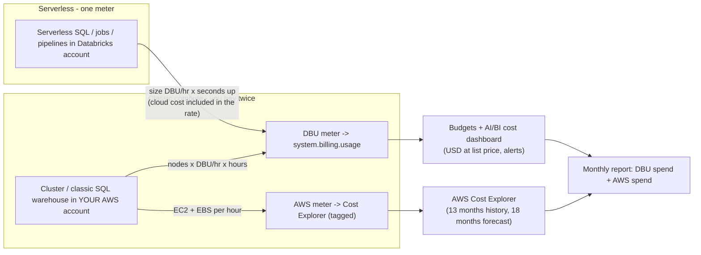
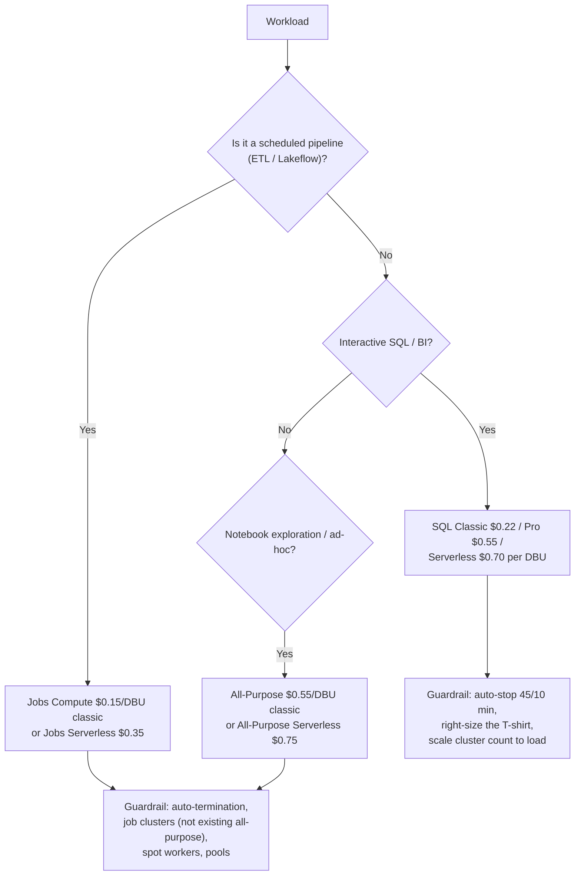
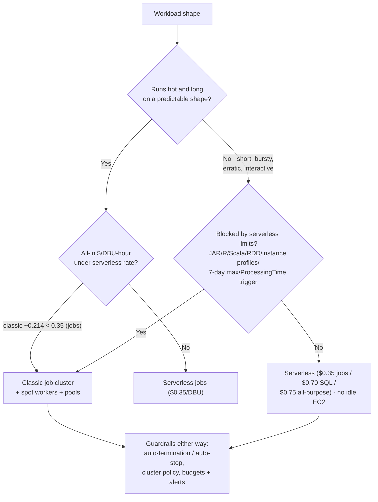
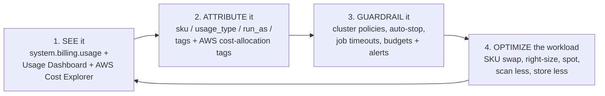

# Cost Optimization and DBU Economics on AWS

Every other lesson in this course builds something; this lesson keeps the invoice honest. A Databricks lakehouse on AWS generates **two independent bills**: Databricks bills you in **DBUs** (Databricks Units, the platform license, metered per second) and AWS bills you for the EC2, EBS, S3, NAT and CloudWatch underneath. Forget either meter and your "cost optimization" is fiction: the DBU half can be perfectly tuned while a NAT Gateway quietly adds $0.045 per GB of S3 traffic, and the AWS half can be all-spot while an all-purpose cluster idles at $0.55/DBU all weekend.

The good news is that Databricks cost is *arithmetic*, not vibes. Every rate in this lesson is date-stamped to **October 2026** and traced to a primary or documentary source: the Databricks pricing pages and page-data files (read 2026-10), the UK G-Cloud 15 supplier record for Jobs/All-Purpose list rates (captured 2026-09-25), the Databricks docs for billing tables and auto-stop (updated 2026-09-11 / 2026-10-08), the AWS Price List for EC2/S3 (read 2026-10-12) and the AWS pricing pages for NAT, Spot and CloudWatch (read 2026-10). Do the math yourself; it is the only way to run a lakehouse that is still affordable in year three.

In this lesson you will:

- read the **Oct-2026 DBU rate card by compute SKU**, jobs, all-purpose, SQL Classic/Pro/Serverless, Lakeflow pipelines, with the provenance of every number spelled out;
- apply the **two equations** (clusters: nodes × emission × rate × hours; warehouses: size rate × up-time) in five hand-computed worked examples;
- make the **serverless-vs-classic break-even** decision with arithmetic instead of doctrine;
- configure **auto-stop, auto-termination, spot workers, instance pools and cluster policies** as cost controls, with the documented defaults and their minimums;
- attribute every dollar with **`system.billing.usage`**, budgets and tags, and know exactly which costs *never* appear there;
- run the **worked monthly TCO case** for a five-person team (three pipelines, a BI warehouse, S3/NAT/logs) and cut it **34.1%** with three levers;
- weigh the **Comparative Verdict**: DBUs vs Snowflake credits vs Athena's $5/TB scanned;
- study **named AWS customer cost stories** (Addepar, Nubank, Comcast), read the **2026 update box**, and practise with **twelve questions** plus five interactive checks.

---

## 1. Two bills, not one: the Databricks cost model on AWS

### 1.1 What a DBU is

Databricks' own definition: *"Databricks bills based on Databricks units (DBUs), which are units of processing capability per hour based on VM instance type"* (docs.databricks.com/aws/en/getting-started/concepts, doc date 2026-09-25). The pricing page puts it the other way round: *"A Databricks Unit (DBU) is a normalized unit of processing power on the Databricks Lakehouse Platform used for measurement and pricing purposes"* and *"Only pay for the products you use at per second granularity"* (databricks.com/product/pricing, read 2026-10).

Three consequences decide everything that follows:

1. **For cluster compute, DBU consumption = (nodes) × (DBU/hr of that node type) × hours**: the 2022 cost-management blog states it plainly: *"With the exception of a SQL Warehouse, the amount of DBUs consumed is based on the number of nodes and the computational power of the underlying VM instance types"* (databricks.com/blog/best-practices-cost-management-databricks, 2022-10-18; the arithmetic still holds at Oct-2026 rates).
2. **For SQL warehouses, DBU consumption = (the size's fixed DBU/hr) × hours the warehouse is up**: running or not, the meter turns while the warehouse is up (pricing docs, read 2026-10).
3. **The meter is per second, and it does not know whether you are working.** An idle all-purpose cluster and a crunching one emit DBUs at the same rate. That is why *idle time*, not *query speed*, is the core cost-optimization problem on classic compute.

### 1.2 The two meters



**Serverless folds the machine cost into a higher DBU rate.** SQL Serverless at **$0.70/DBU** versus SQL Classic at **$0.22/DBU** (databricks.com/product/pricing/databricks-sql, page snapshot 2026-10) is a **$0.48 per-DBU-hour** premium that pays for the fleet, the ops and the idle time you no longer own. Jobs Serverless **$0.35** minus Jobs Classic **$0.15** is the same picture at **$0.20 per DBU-hour**. Classic is not free; it just moves half the bill to AWS, where you can attack it with spot and right-sizing.

> ⚠️ **`system.billing.usage` is not your total bill.** Databricks is explicit: *"The `system.billing.usage` only contains Databricks costs. This means that in any instance where non-serverless compute is being used, cloud infrastructure spend is not included and would need to be reviewed via the relevant cloud console (compute, networking, storage, etc.)"* (databricks.com/blog/top-5-system-table-queries-understanding-your-databricks-costs, 2026-09-22). A Databricks-only budget under-counts the real number by the entire AWS column.

- **📚 Did you know?** Databricks meters DBUs **per second** (pricing FAQ, read 2026-10), while Snowflake bills credits *"per second with a 60-second minimum"* (Snowflake warehouse overview + service consumption table, read 2026-10). On short, frequent jobs that 55-second difference is a real line item: one of the quiet reasons bursty workloads favour serverless Databricks jobs over an always-resumed classic fleet.

### 1.3 The Oct-2026 rate card (AWS, US regions, Premium tier, list)

| Compute SKU | Classic $/DBU | Serverless $/DBU | Notes | Source (date) |
|---|---|---|---|---|
| **Jobs Compute** (Lakeflow Jobs) | **0.15** | **0.35** | Enterprise tier: 0.20 / 0.45 | UK G-Cloud 15 supplier record (Databricks Inc., captured 2026-09-25); corroborated by six independent reads (Flexera, licenseware 2026-10-06, costanalist, lakesentry, agentsql, hejlsvig) |
| **All-Purpose Compute** | **0.55** | **0.75** | Enterprise tier: 0.65 / 0.95 | same documentary set as above (2026-09-25 / 2026-10) |
| **SQL Classic / Pro / Serverless** | **0.22 / 0.55** | **0.70** | Serverless footnote: "Includes cloud instance cost" | databricks.com/product/pricing/databricks-sql page snapshot, 2026-10 (corroborated by the L08 digest snapshot) |
| **Lakeflow Pipelines (DLT), legacy Standard tier** | **0.20 Core / 0.25 Pro / 0.36 Advanced** |, | legacy tier, still on the page | pricing page-data JSON (HTTP 200, 2026-10-12) |
| **DLT serverless** |: | **0.35** | | licenseware + Flexera reads, 2026-10 |
| **Jobs "Standard" (retired)** | ~~0.10~~ |: | Standard tier EOL: AWS/GCP **2025-10-01**, Azure **2026-10-01** | databricks.com/product/pricing/lakeflow-jobs, read 2026-10 |

**Read the provenance column before you quote a rate.** The SQL and Lakeflow-Pipelines figures come from Databricks' own pricing surfaces (page snapshots and the pricing site's page-data file). The Jobs and All-Purpose figures are *documentary and corroborated*, the UK G-Cloud 15 public supplier record (a legal filing by Databricks Inc.) plus six independent 2026 reads that all agree, because databricks.com renders those cards client-side. Treat every figure as **US list, Premium tier**: the pricing FAQ states *"Databricks prices and Cloud Infrastructure prices may vary based on geographic region and cloud service provider"* (read 2026-10), and in-account truth lives in `system.billing.list_prices` (your contract's price).

Two rules of thumb with official backing:

- **Same pipeline, all-purpose vs jobs = 3.7× the per-DBU rate** ($0.55 ÷ $0.15 ≈ 3.7): before you count a single idle minute.
- **Serverless costs ~1.3×: 2.3× more per DBU than classic** for the same SKU family, and removes the EC2 bill, the pool management and the idle time with it.

**Region effect:** classic rates are flat across AWS regions *because you pay the local EC2 price separately*; **serverless rates track regional infrastructure**: SQL Serverless **$0.70** in us-east-1 versus **$0.91** in eu-central-1 (hejlsvigconsulting.com read of the pricing page data file, 2026-08-07). A US quote never transfers to Frankfurt.

### 1.4 Worked example E1: the basic equation and a combined bill

The 2022 cost-management blog's own worked pattern, re-priced at today's Premium Jobs rate (blog, 2022-10-18; EC2 price list, us-east-1, read 2026-10-12):

```text
Worked example E1 - one 4-node jobs cluster, one hour (as of Oct 2026)
  nodes .................... 4
  emission (illustrative) .. 3 DBU/hr per node  (the blog's example node type)
  DBU/hr ................... 4 x 3 = 12 DBU/hr
  DBU cost, Premium Jobs ... 12 x $0.15/DBU = $1.80 / h
  DBU cost, Enterprise ..... 12 x $0.20/DBU = $2.40 / h  (the blog's own figure)
  AWS cost ................. 4 x m5.xlarge @ $0.192/h = $0.768 / h
  combined classic total ... $1.80 + $0.768 = $2.568 / h  (Premium)
  all-in per emitted DBU ... $2.568 / 12 = $0.214 per DBU-hour
```

That last line is the number you will reuse all lesson: **$0.214 all-in per DBU-hour on classic jobs** versus **$0.35** for jobs serverless, which is why classic wins on hot, long, predictable shapes and serverless wins on short, bursty or erratic ones (section 3). The caveat the blog itself implies: pair the emission rate of *your* node type with *that node type's* EC2 price, and read both from the pricing calculator or `system.billing.list_prices`, the 3 DBU/hr + m5.xlarge pair above is illustrative, not a matched shape.

---

## 2. The SKU ladder: your most powerful pricing lever

Before tuning a single query, check that the workload sits on the right SKU. SKU selection is free, instant, and, per Databricks' own field reports, worth more than most performance work.



### 2.1 The three ladder crimes

1. **A pipeline on all-purpose compute.** A job pointed at an *existing* all-purpose cluster is billed at **All-Purpose** rates and flagged as an **interactive** workload (Jobs API 2.0; digest 06, read 2026-10). Databricks *"does not recommend this configuration for production jobs."* The rate difference alone is **$0.55 → $0.15** per DBU.
2. **The retired Standard tier in your runbook.** Jobs at $0.10/DBU was Standard; AWS/GCP Standard workspaces were upgraded to Premium on **2025-10-01** (Azure **2026-10-01**) per the pricing page (read 2026-10). Any pre-2025 rate table you copy is stale by 50%.
3. **Premium-vs-Enterprise confusion across clouds.** AWS/GCP "Premium" is Azure's "Enterprise" card: AWS Jobs is **$0.15 Premium / $0.20 Enterprise** (a 33% difference) and every serverless SKU moves with it (G-Cloud record 2026-09-25; licenseware 2026-10-06). Always label the cloud *and* the tier.

### 2.2 Worked example E2: one pipeline, one month, all-purpose vs jobs

The same 12 DBU/hr pipeline, 400 cluster-hours per month, same 4 × m5.xlarge on the AWS side (rates as of Oct 2026):

```text
Worked example E2 - pipeline cost by SKU, one month (as of Oct 2026)
  All-Purpose Compute:
    DBU .... 12 DBU/hr x 400 h x $0.55 ....... = $2,640.00
    AWS .... 4 x $0.192/h x 400 h ............ = $  307.20
    total .................................... = $2,947.20
  Jobs Compute (new job cluster):
    DBU .... 12 DBU/hr x 400 h x $0.15 ....... = $  720.00
    AWS .... 4 x $0.192/h x 400 h ............ = $  307.20
    total .................................... = $1,027.20
  SAVING ................................. = $1,920.00 / month
       (65% of the combined bill, 73% of the DBU half)
```

One pipeline. One dropdown in the job definition. Databricks' own summary of the estate-wide version: *"We've seen customers who have saved tens of thousands of dollars by simply moving just ten percent of their workloads from all-purpose clusters to jobs clusters"* (cost-management blog, 2022-10-18: aged source, unchanged arithmetic).

```matching
{
  "question": "Match each compute SKU or billing rule to its Oct-2026 list economics on AWS (Premium tier):",
  "pairs": [
    {"left": "Jobs Compute, classic (new job cluster)", "right": "$0.15 per DBU: the cheapest SKU on the ladder; job clusters terminate automatically when the run completes"},
    {"left": "All-Purpose Compute, classic", "right": "$0.55 per DBU: about 3.7x Jobs for identical work; the rate a job pays when it runs on an existing all-purpose cluster"},
    {"left": "SQL Classic / Pro / Serverless", "right": "$0.22 / $0.55 / $0.70 per DBU: serverless includes the cloud instance cost in the rate, classic does not"},
    {"left": "Jobs Serverless / All-Purpose Serverless", "right": "$0.35 / $0.75 per DBU: roughly $0.20 / $0.20 per DBU-hour of machine+ops absorbed versus classic"},
    {"left": "Lakeflow Pipelines on the legacy Standard tier", "right": "$0.20 Core / $0.25 Pro / $0.36 Advanced per DBU: a retired tier that still appears on the pricing page-data file (2026-10-12)"},
    {"left": "Jobs Compute 'Standard' at $0.10 per DBU", "right": "Gone: Standard tier workspaces upgraded to Premium on 2025-10-01 (AWS/GCP) and 2026-10-01 (Azure)"},
    {"left": "Instance pool nodes sitting idle in the pool", "right": "$0 DBUs from Databricks: but AWS instance and EBS charges continue while the node exists"}
  ],
  "explanation": "The ladder runs Jobs 0.15 -> SQL Classic 0.22 -> SQL Pro / all-purpose anchor 0.55 -> Jobs Serverless 0.35 (bundled) -> SQL Serverless 0.70 (bundled) -> All-Purpose Serverless 0.75 (bundled), with the legacy DLT Standard tiers between jobs and SQL Classic. The traps: treating $0.15 vs $0.70 as a 4.7x total-cost gap (it is not: classic carries a second EC2 bill); trusting a pre-2025 table that still shows $0.10 Standard; and believing pools are free (they are free of DBUs only: the AWS meter keeps running)."
}
```

- **📚 Did you know?** Materialized-view refreshes are billed as **serverless pipeline** usage, not warehouse usage, so a 'warehouse' cost tab will not show them (Databricks blog, 2026-10-07). Predictive optimization has been **on by default for accounts created on or after 2024-11-11**, and it also bills under serverless usage records. If your attribution queries only group by warehouse, these two SKUs are invisible leaks.

---

## 3. Serverless vs classic: the break-even arithmetic

"Serverless is 4× dearer" is the most expensive sentence in Databricks cost discussions, because it compares DBU rates while ignoring the AWS column on the classic side. The honest comparison is all-in per emitted DBU-hour.

```text
Worked example E3 - where the classic/serverless line sits (as of Oct 2026)
  Premium deltas (machine + ops absorbed by serverless):
    SQL ....... $0.70 - $0.22 = $0.48 per DBU-hour
    Jobs ...... $0.35 - $0.15 = $0.20 per DBU-hour
  Classic jobs cluster, all-in (from E1):
    ($1.80 DBU + $0.768 AWS) / 12 DBU = $0.214 per DBU-hour
  Decision:
    $0.214 (classic, hot and long)  <  $0.35 (jobs serverless)  -> classic wins
    bursty / short / erratic / interactive -> serverless wins
      (no idle EC2, no pool admin, no 4-minute classic warehouse start)
  Break-even test you can run on any shape:
    (EC2 $/h + DBU $/h) / emission  vs  serverless $/DBU
```



Three practical readings:

- **Classic wins** when the cluster runs hot and long on a predictable shape: batch ETL windows, big nightly backfills, ML training on a known node count. You are already paying roughly $0.192/h for an m5.xlarge (EC2 price list, read 2026-10-12); classic folds that into a $0.15/DBU license instead of a $0.35/DBU bundle.
- **Serverless wins** on short, bursty, interactive or unpredictable work, dashboards with gaps between refreshes, ad-hoc notebooks, event-driven jobs, because *"you are not charged while it is idle"* (Databricks Answers, 2026-08-27) and the fleet, patching and capacity planning disappear.
- **The operational constraints matter as much as the price.** Serverless jobs have a documented **7-day maximum runtime**, no JAR/Spark-Submit tasks, no R/Scala notebooks, no RDD APIs, no instance profiles, and Structured Streaming triggers limited to `Trigger.AvailableNow()` (recommended); while classic exists precisely where those constraints bind (digest 06, docs read 2026-10). Migrate the *pattern* (volumes instead of DBFS, DataFrame API instead of RDDs) before you flip the SKU.

```fillblank
{
  "question": "Complete the serverless-versus-classic arithmetic with the Oct-2026 numbers (AWS, Premium tier list):",
  "template": "SQL Serverless minus SQL Classic equals {{1}} per DBU-hour of machine and operations absorbed, and Jobs Serverless minus Jobs Classic equals {{2}} per DBU-hour. A 4-node classic jobs cluster emitting 12 DBU/hour at $0.15/DBU plus 4 x m5.xlarge at $0.192/hour costs ${{3}} per hour all-in, i.e. about ${{4}} per emitted DBU-hour: under the $0.35 jobs-serverless rate, which is why hot, long-running, predictable shapes stay on classic. Serverless SQL rates also vary by region: $0.70 in us-east-1 versus ${{5}} in eu-central-1.",
  "answers": {
    "1": "0.48",
    "2": "0.20",
    "3": "2.568",
    "4": "0.214",
    "5": "0.91"
  },
  "distractors": ["0.35", "0.55", "0.22", "2.40", "2.400", "0.2140", "0.70", "0.81", "0.45"],
  "explanation": "The deltas are $0.70-$0.22=$0.48 and $0.35-$0.15=$0.20 per DBU-hour (pricing pages, read 2026-10). E1's classic cluster is 12 x 0.15 = $1.80 DBU plus 4 x 0.192 = $0.768 AWS = $2.568/h, i.e. $2.568/12 = $0.214 per emitted DBU-hour. SQL Serverless is $0.70 in us-east-1 and $0.91 in eu-central-1 (pricing page data file read 2026-08-07) because serverless rates track regional infrastructure while classic rates are flat (you pay local EC2 separately). The distractors are the neighbouring rung of the ladder ($0.22/$0.35/$0.45/$0.55), the blog's Enterprise-hour figure ($2.40) and a decimal-shifted version of the break-even number."
}
```

---

## 4. Idle time: auto-stop, auto-termination, and the billed-while-up rule

Databricks' own sentence about warehouses: *"Idle SQL warehouses continue to accumulate DBU and cloud instance charges until they are stopped"* (docs.databricks.com/aws/en/compute/sql-warehouse/create, last updated 2026-09-11). There is no softer way to say it: **a warehouse that is up is a warehouse that is billed.** Ten hours left up for forty minutes of dashboards bills ten hours.

### 4.1 The documented defaults (as of Oct 2026)

| Resource | Auto-stop / auto-termination default | Minimum | Source (date) |
|---|---|---|---|
| SQL warehouse, **Pro / Classic** | **45 minutes** of inactivity | **10 minutes** | blog 2026-10-07; create-warehouse doc 2026-09-11 |
| SQL warehouse, **Serverless** | **10 minutes** | **5 minutes** (UI) / **1 minute** (API) | same two sources |
| **All-purpose cluster** | an inactivity window you set (`autotermination_minutes`; API range 10 to 10,000, **0 = disabled**) | 10 minutes | bundle-schema / policy reference, read 2026-10; historic norm around one hour (blog 2022-10-18) |
| **Job clusters / DLT clusters** | terminate **on completion** of the run |: | blog 2022-10-18; Jobs docs |

Two subtleties. First, the auto-stop defaults differ by a factor of 4.5 between classic/Pro (45 min) and serverless (10 min): if your dashboards refresh every 20 minutes, the classic default *guarantees* you pay for 25 idle minutes after every session. Second, `autotermination_minutes = 0` (disabled) is a legal API value and the single most common source of weekend runaway spend; an enforced policy beats a weekly manual sweep (section 6.3).

### 4.2 Worked example E4: auto-stop arithmetic on the BI warehouse

From the monthly TCO case in section 9: a serverless SQL warehouse serving BI is up **10 hours a day** for 21 working days (210 hours, 2,520 DBU at an assumed 12 DBU/h T-shirt emission). Measured usage shows dashboards actually query in a **6-hour** window:

```text
Worked example E4 - tightening BI auto-stop from 10 h to 6 h/day (as of Oct 2026)
  hours removed ....... (10 - 6) h/day x 21 days = 84 h/month
  DBU removed ......... 84 h x 12 DBU/h ......... = 1,008 DBU
  saving .............. 1,008 x $0.70/DBU ....... = $705.60 / month
  remaining BI cost ... (2,520 - 1,008) x $0.70 . = $1,058.40 / month
  -> a 40% cut on the BI line from one warehouse setting
```

No query was rewritten. No data was moved. The warehouse was simply not left on. (The 12 DBU/h figure is the Small T-shirt emission assumed by this case: meter sizes per warehouse T-shirt are not published as an official table, so read yours from `system.billing.list_prices` in your account before reusing the arithmetic.)

### 4.3 Worked example E5: an enforced auto-stop / auto-termination policy

Cluster policies are admin-managed JSON rule sets over Clusters-API attributes whose benefits include *"cost control via price-driving attributes"* (docs, read 2026-10). The policy reference (read Oct 2026) documents the `autotermination_minutes` attribute path and a virtual `dbus_per_hour` range that acts as a hard DBU ceiling; node-type restriction is likewise a policy capability. A minimal cost-guardrail policy for a team workspace:

```json
{
  "name": "team-analytics-cost-guardrail",
  "description": "Enforced idle kill + node allowlist + DBU ceiling (verify keys in your workspace)",
  "spark_version": {
    "type": "fixed",
    "value": "auto:latest-lts"
  },
  "autotermination_minutes": {
    "type": "fixed",
    "value": 60
  },
  "node_type_id": {
    "type": "allowlist",
    "defaultValue": "m5.xlarge",
    "values": ["m5.xlarge", "m5.2xlarge", "r5.xlarge"]
  },
  "num_workers": {
    "type": "range",
    "min": 1,
    "max": 10,
    "defaultValue": 2
  },
  "dbus_per_hour": {
    "type": "range",
    "min": 0,
    "max": 24
  }
}
```

The mechanics that make this a *guardrail* rather than a suggestion: one limitation per attribute; API-created compute **ignores policy defaults unless `apply_policy_default_values: true`** is set; `spark_version: auto:latest-lts` resolves only when compute is *edited*, not continuously; and the **Unrestricted** entitlement bypasses everything, so it *"should be suppressed for non-admin users"* (policy onboarding guidance, blog 2025-04-17). Attribute-key spellings vary across API surfaces: confirm them in your workspace's policy editor before relying on this JSON verbatim.

> ⚠️ **Budgets and policies monitor and constrain; they do not stop a determined spender.** Budgets are *"monitoring and alerts, not a hard cap"* (budgets doc, updated 2026-10-07): a user with sufficient permissions can still create a warehouse that runs long or stays scaled beyond expectations. Databricks' own framing: *"Good controls via compute policies, job timeout settings, and budgets help Databricks platform administrators keep spend within spending limits but there is always the possibility of a user with sufficient permissions creating a job or warehouse that runs long or stays scaled beyond expectations and causes an unexpected spike in spending"* (top-5 system-table queries blog, 2026-09-22). Guardrails are layered or they are theatre.

```dragdrop
{
  "question": "Order the idle-time control ladder from the cheapest, most automated lever to the most manual: the order this lesson builds it:",
  "items": [
    "Job clusters: created per run, terminated on completion: idle time is structurally zero",
    "Auto-stop on SQL warehouses: default 45 min Pro/Classic, 10 min serverless; tighten to your true refresh gap (minimum 10 / 5 min UI, 1 min API)",
    "Auto-termination on all-purpose clusters: autotermination_minutes 10-10,000; 0 disables it and is the classic weekend runaway",
    "Enforced cluster policies: fixed auto-termination, node-type allowlist, num_workers ceiling, dbus_per_hour range: plus apply_policy_default_values true from the API",
    "Instance pools: warm nodes cut startup, $0 DBUs while pooled: but AWS instance and EBS billing continues on idle pool nodes",
    "Weekly human sweep of the workspace: still needed as a backstop, never as the primary control"
  ],
  "correctOrder": [
    "Job clusters: created per run, terminated on completion: idle time is structurally zero",
    "Auto-stop on SQL warehouses: default 45 min Pro/Classic, 10 min serverless; tighten to your true refresh gap (minimum 10 / 5 min UI, 1 min API)",
    "Auto-termination on all-purpose clusters: autotermination_minutes 10-10,000; 0 disables it and is the classic weekend runaway",
    "Enforced cluster policies: fixed auto-termination, node-type allowlist, num_workers ceiling, dbus_per_hour range: plus apply_policy_default_values true from the API",
    "Instance pools: warm nodes cut startup, $0 DBUs while pooled: but AWS instance and EBS billing continues on idle pool nodes",
    "Weekly human sweep of the workspace: still needed as a backstop, never as the primary control"
  ],
  "explanation": "The ladder is automation-first because automation cannot forget: job clusters make idle structurally impossible; auto-stop and auto-termination kill the residual idle on shared compute; policies make those settings non-optional; pools trade a small always-on AWS cost for zero DBU idle and faster starts; and the human sweep is the layer you add last, not first. The two mistakes this ordering prevents: relying on sweeps (they stop happening in crunch weeks) and treating pools as free (they shift cost from the DBU column to the AWS column: digests 06 and 15, read 2026-10)."
}
```

---

## 5. Spot on AWS: what it saves and what it never touches

AWS Spot Instances *"save up-to 90% on On-Demand prices"* (aws.amazon.com/ec2/spot, read 2026-10), and AWS issues a **two-minute interruption notice** before stopping or terminating a Spot instance (AWS EC2 docs, read 2026-10). On Databricks the topology rule is fixed: when you tick spot, *"driver node is always on-demand, subsequent instances will be spot"* (compute configuration doc, updated 2026-10-06).

### 5.1 Worked example E6: spot arithmetic, and the column it never touches

Five m5.xlarge workers for 200 hours a month (EC2 list, us-east-1, read 2026-10-12):

```text
Worked example E6 - spot on 5 workers, 200 h/month (as of Oct 2026)
  On-demand AWS column .. 5 x $0.192/h x 200 h = $192.00
  Spot at -60% .......... 5 x $0.0768/h x 200 h = $ 76.80   -> save $115.20/month
  Spot at -90% (max) .... 5 x $0.0192/h x 200 h = $ 19.20   -> save $172.80/month
  DBU column ............ UNCHANGED
    ($/DBU and the node's DBU emission are identical on spot and on-demand)
  -> spot is an AWS-side lever, full stop
```

Four operational facts to price into the design: the driver stays on-demand (compute docs 2026-10-06); the two-minute eviction arrives mid-task, so pipelines need restartable, idempotent stages (AWS docs 2026-10), the `AVAILABLE_NOW` trigger and checkpointed Structured Streaming from lessons 05 and 13 are the compatible patterns; **pools are all-spot or all-on-demand** (API adds `SPOT_WITH_FALLBACK`), and Databricks' guidance is *"Do not use a pool with spot instances as your driver type"*; and spot saves **nothing on serverless**, serverless is bundled, and no source states EC2 spot discounts flow through to serverless DBU rates.

- **📚 Did you know?** Spot can save up to 90% and *still* be the wrong call for a 20-minute strict-SLA job: Databricks' current guidance pairs **spot pools for cost-tolerant workloads** with **on-demand pools for short, strict-SLA jobs**, and recommends **serverless instead of pools** wherever the workload supports it (docs, read 2026-10). Spot is a *workload* decision, not an account-wide savings toggle.

---

## 6. Right-sizing, autoscaling, pools, and performance-as-cost

### 6.1 Right-sizing the warehouse (the proportional lever)

For a warehouse, DBU cost is **size rate × up-time**, so **one T-shirt size down is a proportional DBU cut for every hour the warehouse is up**: the cleanest linear saving on the platform. The classic/Pro ladder is built on i3.2xlarge workers (2X-Small = 1 worker, doubling to X-Large = 32, up to 4X-Large = 256) with *"a cluster for every 10 concurrent queries"* as the concurrency rule (docs, read 2026-10). Size to the concurrency you serve, not the peak you once saw; add clusters (warehouse-level autoscaling) rather than inflating the T-shirt for a queue that clears in minutes.

### 6.2 Autoscaling, pools, and `AVAILABLE_NOW`

- **Autoscaling shrinks the peak.** Optimized autoscaling (Premium+) goes min→max in **≤2 resize events**, scales down on a **40-second** underutilization window for job compute and **150 seconds** for all-purpose (docs, updated 2026-10-06). Never combine it with `spark.dynamicAllocation.enabled`: the docs warn of executor churn and `NODES_LOST`.
- **Pools cost zero DBUs while idle, and full AWS while idle.** *"Databricks does not charge DBUs while instances are idle in the pool. Instance provider billing does apply"* (cost best-practices, 2026-09-11). Size `min_idle_instances` and `idle_instance_autotermination_minutes` deliberately; keep max cluster size ≤ pool `max_capacity` or scale-out fails with `INSTANCE_POOL_MAX_CAPACITY_FAILURE`.
- **`AVAILABLE_NOW` shapes the pipeline.** Run a triggered (`Trigger.AvailableNow()`) pipeline on a job cluster that terminates at completion instead of a continuous cluster that idles between micro-batches: the official lever list recommends it (best-practices, 2026-09-11).

### 6.3 Photon as a cost lever (carefully)

Photon is the vectorized C++ engine that *"replaces the JVM-based Spark SQL execution engine"* while Catalyst still plans the query (Photon docs, updated 2026-09-11). Its cost story is **billable seconds, not discount**: finishing sooner means fewer per-second-metered seconds, but Photon also *"consume[s] DBUs at a different rate than the same instance type running the non-Photon runtime"*, so *"Photon is faster"* never implies *"Photon is cheaper"* (docs; benchmark your own workload). It accelerates SQL, DataFrame ETL and **stateless** streaming, and does **not** accelerate Python UDF bodies, RDDs, Datasets or stateful streaming, queries under ~2 seconds see no meaningful gain (docs, 2026-09-11). Photon is on by default on serverless, SQL warehouses and the UI; **API-created clusters must set `runtime_engine: "PHOTON"` explicitly** (lesson 06).

### 6.4 The four-stage loop

Databricks' own frame for controlling spend (Databricks Answers, read 2026-10):



Most teams reverse this order and start at stage 4: rewriting queries while an idle all-purpose cluster bills $0.55/DBU in the corner. Stage 1 and 2 are cheap (the meter data is already in your account); stage 3 is configuration; only stage 4 is engineering.

---

## 7. Cost attribution: system tables, budgets, and the AWS console

### 7.1 `system.billing.usage`: every DBU has an address

The billing system table (docs, updated 2026-10-08) carries, among others: `account_id`, `workspace_id`, `workspace_name`, `region`, `billable_usage_timestamp`, `billing_origin_time`, `billing_month`, `cloud`, `sku`, `usage_type`, `product_feature`, `record_type`, `run_as`, `metered_quantity`, `list_price`, `unblended_cost`, `databricks_contract_quantity`, `aws_public_list_price` and `tags`. The three that do the work in every attribution query:

- **`sku` / `usage_type` / `product_feature`**: *what kind* of compute (jobs vs all-purpose vs SQL vs serverless pipelines);
- **`run_as`**: *whether the run was interactive, a job, serverless*, and so on;
- **`tags` / `workspace_name`**; *whose* it is.

`record_type` separates usage rows from price rows, and Databricks ships ready-made joins to `system.billing.list_prices` and `system.compute.clusters`, plus instructions to publish the result to an AI/BI dashboard and raise an alert (docs, 2026-09-11). A prebuilt **Usage Dashboard** exists too (blog, 2026-09-22): start there before writing SQL.

### 7.2 Worked example E7: the "cut the bill" audit in SQL

```sql
-- Worked example E7a - what did we spend, by SKU, this month?
-- (system.billing.usage, docs updated 2026-10-08)
SELECT  sku,
        usage_type,
        product_feature,
        SUM(metered_quantity) AS dbus,
        SUM(unblended_cost)   AS cost_usd
FROM    system.billing.usage
WHERE   billing_month = DATE_FORMAT(CURRENT_DATE, 'yyyy-MM')
  AND   record_type = 'USAGE'
GROUP BY 1, 2, 3
ORDER BY cost_usd DESC;
```

```sql
-- Worked example E7b - which clusters are the whales?
-- join the usage meter to the cluster dimension (sample queries, docs 2026-09-11)
SELECT  u.tags['cluster_id']        AS cluster_id,
        c.cluster_name,
        c.owner_id,
        SUM(u.unblended_cost)       AS cost_usd,
        SUM(u.metered_quantity)     AS dbus
FROM    system.billing.usage u
JOIN    system.compute.clusters c
  ON    u.tags['cluster_id'] = c.cluster_id
WHERE   u.billing_month = DATE_FORMAT(CURRENT_DATE, 'yyyy-MM')
GROUP BY 1, 2, 3
ORDER BY cost_usd DESC
LIMIT 20;
```

Rank the output and work **top-down** through the lever list: (1) idle all-purpose clusters and their auto-termination setting → (2) warehouses with auto-stop "never" or 45 minutes serving 20-minute dashboards → (3) workloads sitting on All-Purpose that are really jobs → (4) one-size-down / autoscaling → (5) spot for workers → (6) pool the warm nodes → (7) S3 lifecycle + a gateway endpoint → (8) budgets + alerts so it does not regrow. Two supporting tables close the loop: `system.billing.list_prices` (your contract's prices: the in-account replacement for any public rate table) and `system.compute.warehouse_events` for warehouse lifecycle forensics.

### 7.3 Budgets, tags, and the AWS half

Budgets (doc, updated 2026-10-07): up to **1,000 budgets per account**, each with up to **4 thresholds (%)**, expressed in **USD at list price including add-ons** (no discounts/credits applied), scoped by team/project/workspace with filters, created by account admins (workspace admins for UC-scoped budgets). Again: budgets **monitor, they do not cap**.

Tags are the joint between the two bills, with a catch. Databricks tags and *custom tags enforced via compute policies and serverless usage policies* land in `system.billing.usage` (blog, 2026-09-22), and tag propagation to cloud resources is the documented path to AWS-side attribution (best-practices, 2026-09-11). But a `team` tag set only on a Databricks cluster does **not** by itself become an AWS cost-allocation tag; and **tags do not backfill**, the AWS bill's `CostCenter` dimension exists only from the day you create it. On the AWS side, **Cost Explorer** keeps *"up to the last 13 months"* of history and forecasts *"the next 18 months"* (AWS docs, read 2026-10).

```fillblank
{
  "question": "Complete the cost-attribution facts with the documented Oct-2026 values:",
  "template": "The Databricks meter table is {{1}}; its {{2}} column tells you whether a run was interactive, job or serverless, and metered_quantity x list_price equals {{3}}. Budgets allow up to {{4}} per account with up to {{5}} thresholds each, denominated in USD at list price, and they {{6}} hard-cap usage. AWS Cost Explorer retains {{7}} months of history and forecasts {{8}} months. By contrast, S3, NAT, EBS and CloudWatch charges appear only in {{9}}.",
  "answers": {
    "1": "system.billing.usage",
    "2": "run_as",
    "3": "unblended_cost",
    "4": "1000",
    "5": "4",
    "6": "do not",
    "7": "13",
    "8": "18",
    "9": "AWS Cost Explorer"
  },
  "distractors": ["system.billing.list_prices", "sku", "metered_cost", "100", "10", "12", "24", "the Databricks console", "system.query.history"],
  "explanation": "system.billing.usage is the meter (docs, updated 2026-10-08); run_as carries the interactive/job/serverless distinction; metered_quantity x list_price = unblended_cost. Budgets: 1,000 per account, 4 thresholds, USD at list, monitoring not caps (budgets doc 2026-10-07). Cost Explorer: 13 months history / 18 months forecast (AWS docs 2026-10). The AWS column of the bill: S3, NAT, EBS, CloudWatch: never appears in system.billing.usage (blog 2026-09-22). Distractors are the neighbouring system tables and plausible-looking wrong numbers."
}
```

- **📚 Did you know?** New **query tags (Public Preview)** land in `system.query.history`, `dbt-databricks` 1.11.0 adds auto-tagging, and a **Governance Hub Cost page (Beta)** aggregates the spend surface (Databricks blog, 2026-10-07). RBI rebuilt cost monitoring and forecasting on the system tables and reported it running **3 to 4× faster** than their previous process (same blog): the meter data is already in your account; the dashboard is the cheap part.

---

## 8. The AWS side of the bill: EC2, EBS, S3, NAT, CloudWatch

The AWS Price List offers (us-east-1; EC2 read 2026-10-12, S3 offer published 2026-09-28) and the AWS pricing pages (read 2026-10):

| Item | Price | Source (date) |
|---|---|---|
| m5.xlarge / m6i.xlarge on-demand | **$0.192/h** | EC2 price list JSON (2026-10-12) |
| m5.2xlarge / r5.xlarge / c6i.xlarge | $0.384 / $0.252 / $0.170 per h | EC2 price list JSON (2026-10-12) |
| i3.2xlarge / i3.4xlarge (classic SQL warehouse nodes) | $0.624 / $1.248 per h | EC2 price list JSON (2026-10-12) |
| Spot workers | **up to 90% off** on-demand; 2-minute notice | aws.amazon.com/ec2/spot; AWS docs (2026-10) |
| EBS | billed while the cluster exists (GP3; workspace default capacity 50 TiB) | Databricks compute docs (2026-10-06) |
| S3 Standard | **$0.023/GB-month** (first 50 TB; then 0.022, 0.021) | S3 price list (pub. 2026-09-28) |
| NAT Gateway | **$0.045/h + $0.045/GB processed** | aws.amazon.com/vpc/pricing (2026-10) |
| S3 / DynamoDB **gateway endpoint** | **$0** | AWS VPC docs (2026-10) |
| Public IPv4 | $0.005/h per address | aws.amazon.com/vpc/pricing (2026-10) |
| CloudWatch Logs ingestion | **$0.50/GB** (first 10 TB tier) | aws.amazon.com/cloudwatch/pricing (2026-10) |
| Athena (AWS-native comparator) | **$5/TB scanned** in official worked examples | aws.amazon.com/athena/pricing (2026-10) |

Three quiet leaks live in this table. **NAT data processing on S3 traffic**: every S3 list/get through a NAT Gateway costs $0.045/GB plus $0.045/h, while an S3 **gateway endpoint is free**, the single cheapest networking fix on AWS (section 9 uses it). **CloudWatch at $0.50/GB ingested** is the price of letting driver and cluster logs run unmanaged. And **storage waste compounds silently**: Databricks' own cost guidance cites a customer bucket of 2.5 PB where only 800 TB was real data and **1.7 PB was old object versions**, at $0.023/GB-month that is roughly **$39,000 per month of pure waste**, deletable by an S3 lifecycle rule without touching a single DBU (cost-management blog, 2022-10-18; S3 rate from the 2026-09-28 offer).

---

## 9. The monthly TCO case: $3,011 → $1,985 in three levers

### 9.1 Declared assumptions (AWS us-east-1, list, Oct 2026)

A five-person data team: **21 working days**; a shared **all-purpose dev cluster** (4 × m5.xlarge, emission 12 DBU/h: the illustrative node arithmetic from E1: up 6 h/day); **3 pipelines on jobs compute** (4 nodes, 0.5 h/day each, 30 days); **BI on a serverless SQL warehouse** measured at **2,520 DBU** for the month (10 h/day × 21 days at an assumed 12 DBU/h T-shirt emission: confirm the size rate in `system.billing.list_prices`); **5 TB in S3**; **500 GB of NAT processing**; **60 GB of logs** to CloudWatch.

### 9.2 The before picture

```text
Worked example E8 - monthly TCO before optimization (list, us-east-1, Oct 2026)
  Dev/interactive (DBU) .. All-Purpose 1,512 DBU x $0.55 ........ $  831.60
  Dev/interactive (AWS) .. 4 x m5.xlarge x 126 h x $0.192 ....... $   96.77
  3 pipelines (DBU) ...... Jobs 540 DBU x $0.15 .................. $   81.00
  3 pipelines (AWS) ...... 4 x m5.xlarge x 45 h x $0.192 ........ $   34.56
  BI (DBU) ............... SQL Serverless 2,520 DBU x $0.70 ..... $1,764.00
  Storage ................ S3 5,120 GB x $0.023/GB-mo ........... $  117.76
  NAT fixed .............. 730 h x $0.045/h ..................... $   32.85
  NAT processing ......... 500 GB x $0.045/GB ................... $   22.50
  Logs ................... CloudWatch 60 GB x $0.50/GB .......... $   30.00
  ------------------------------------------------------------------------
  TOTAL .................. DBU $2,676.60 + AWS $334.44 ......... $3,011.04
  DBU share of the bill ........................................ 88.9%
```

### 9.3 Three sourced levers

| Lever | Mechanism | Monthly saving |
|---|---|---|
| **BI auto-stop 10 h → 6 h/day** | 84 h × 12 DBU/h × $0.70 (E4) | **$705.60** |
| **Dev auto-termination: only 4 h/day genuinely used** | 504 DBU × $0.55 + 42 h × 4 × $0.192 | **$309.46** |
| **S3 gateway endpoint instead of NAT for S3 egress** | halves the NAT processing line ($0.045/GB) | **$11.25** |
| *(already applied)* jobs SKU for pipelines, warehouse not left up 24/7 | sections 2 and 4 |: |
| **New total** | **DBU $1,693.80 + AWS $290.93** | **$1,984.73** |

```text
Worked example E8 (continued) - the cut (as of Oct 2026)
  before .......... $3,011.04 / month
  after ........... $1,984.73 / month
  CUT ............. $1,026.31 / month  =  34.1%
  -> produced entirely from (a) time-abandoned compute and (b) an
     S3 gateway endpoint - no discount, no contract, no rewrite
  -> squarely inside the 20-40% 'quick wins' band that practitioners
     report on unaudited bills (consultant claims: DataLane 25-40% in
     two weeks, 2026-04-08; SELECT 20-40% quick wins, 2026-07-16;
     Cyfra Dane 15-40% in 30 days, 2026-07-15 - vendor claims, not
     independent measurements; documented customer results are the
     Lumen 30-40% and GetYourGuide ~20% figures in section 11)
```

```plot
{
  "type": "bar",
  "title": "Monthly cost by segment before and after optimization (worked example E8, AWS us-east-1 list, as of Oct 2026)",
  "xLabel": "Cost segment",
  "yLabel": "Monthly cost (USD)",
  "xKey": "segment",
  "dataKeys": ["before_usd", "after_usd"],
  "data": [
    {"segment": "Dev / interactive (DBU + EC2)", "before_usd": 928.37, "after_usd": 618.91},
    {"segment": "3 pipelines on jobs compute", "before_usd": 115.56, "after_usd": 115.56},
    {"segment": "BI on serverless SQL", "before_usd": 1764.0, "after_usd": 1058.4},
    {"segment": "S3 + NAT + CloudWatch", "before_usd": 203.11, "after_usd": 191.86},
    {"segment": "TOTAL", "before_usd": 3011.04, "after_usd": 1984.73}
  ]
}
```

Read the chart top-down and the strategy appears: the **BI line** is the whale (59% of the original bill) and falls 40% from one auto-stop setting; the **dev cluster** falls 33% from auto-termination; the **pipelines** barely move because they were *already* on the cheapest SKU (jobs) with structural zero idle. Every account's chart looks different; which is exactly why section 7's attribution step comes before any optimization.

---

## 10. Storage, layout, and scan: the levers that touch no DBU rate

- **S3 lifecycle and versioning hygiene**: the $39,000/month version-waste example in section 8 is the template: lifecycle rules delete or tier old object versions at S3 rates ($0.023/GB-month, offer 2026-09-28) and never touch a DBU.
- **`OPTIMIZE`, liquid clustering and partitioning** (lessons 04 and 14): fewer bytes scanned per query means fewer billable seconds on a per-second meter, and load-based autoscaling sees fewer peaks.
- **Tag propagation to cloud resources** (best-practices, 2026-09-11): without it, the AWS half of the bill cannot be split by team at all.
- **NAT → gateway endpoint for S3** (section 9) and right-sizing CloudWatch log retention, at $0.50/GB ingested.
- **The BI anti-pattern:** per-TB intuition does not apply on Databricks: the warehouse bills *time × shape*, so `SELECT *` re-scanning 400 GB a hundred times a day bills the same DBUs per scan-window… until the extra work lengthens runtime, trips load-based autoscaling into more clusters, and tips the warehouse into a bigger T-shirt. The cost shows up as *shape*, not as bytes.

---

## 11. Real-world proof: what the levers delivered for customers

Documented customer results (all from the Databricks budget/alerts blog, **2026-10-07**, unless noted):

- **Lumen** moved Looker-backed reporting to **serverless SQL warehouses** and reported compute costs down **30 to 40%** with queries **~90% faster** against ~7 GB scanned every 10 minutes: the saving came from eliminating idle classic warehouse time and the EC2 bill, not from a discount.
- **GetYourGuide** ran the same migration pattern on BI serving and reported costs down **~20%** with queries **~35% faster**.
- **RBI** rebuilt cost monitoring and forecasting on the system tables and reported **3 to 4× faster** than their previous process.

The practitioner bands around these numbers are consistent: quick configuration wins (job-compute migration, auto-termination, spot workers, turning off idle warehouses) are reported in the **20 to 40%** range within weeks (DataLane, 2026-04-08; SELECT, 2026-07-16; Cyfra Dane, 2026-07-15: consultant-authored posts, i.e. vendor claims). Everything past that band is workload redesign, not configuration.

> **Comparative Verdict: Databricks (DBU) vs Snowflake (credits) vs AWS-native (Athena, $/TB scanned)**
> - **Meters.** Databricks bills **DBU/h of shape plus, on classic, the EC2 bill**, two meters, most exposed levers (jobs 0.15 · all-purpose 0.55 · SQL 0.22/0.55/0.70 per DBU, Oct 2026 list). Snowflake bills **credits with the machine bundled**, X-Small = 1 credit/hour, doubling by size (Small 2, Medium 4, Large 8, X-Large 16), per-second with a 60-second minimum, at **$2.00 Standard / $3.00 Enterprise / $4.00 Business Critical per credit** on AWS US East (Snowflake service-consumption table + calculator FAQ, read 2026-10). AWS-native, represented by **Athena**, bills **dollars per TB scanned**, the official worked examples price queries at **$5/TB** with a 10 MB minimum per query (aws.amazon.com/athena/pricing, 2026-10), zero idle cost, but orchestration, state and governance are yours.
> - **Idle.** Databricks classic bills EC2 (and DBUs) while up: auto-stop 45/10 min, auto-termination and pools are the defense. Snowflake auto-suspends to zero. Athena has no idle at all. *If you leave Databricks compute up, it is the most expensive of the three; if you watch it, job compute is the cheapest long-running engineering meter.*
> - **Illustration (168 h = 8 h × 21 d; meter sizes assumed T-shirts, confirm in-account):** SQL Serverless Small 12 × 168 × $0.70 = **$1,411.20**; SQL Classic 2X-Small 4 × 168 × $0.22 = **$147.84 + machine**; Snowflake X-Small 168 × $2 = **$336** (Standard) and Large 168 × 8 × $2 = **$2,688**; Athena 1 TB/day × 30 = 30 TB × $5 = **$150**. Same team, same data, three meters: the number depends on which meter you forget to watch.
> - **Verdict.** **Athena** wins rare, scan-light, serverless-shaped workloads and loses the moment you need ETL state, streaming or ML. **Snowflake** has the simplest bill (one meter, self-stopping) and is hard to beat for elastic BI at X-Small: Large sizes. **Databricks** is the most expensive *if left idle* and the most economical for long-running engineering + ML on job compute, because the levers: SKU choice, auto-termination, spot, pools, system-table attribution: are exposed at the workload level. Choose the meter you are willing to operate.

### 2026 Updates (as of October 2026)

> [!NOTE]
> **What changed in Databricks cost management that this lesson depends on:**
> - **2026-10-07: cost controls became platform surface.** Auto-stop defaults restated (45 min Pro/Classic, 10 min Serverless, down to 5 in the UI and 1 via API); materialized-view refreshes confirmed as **serverless pipeline** usage rather than warehouse usage; **query tags (Public Preview)** land in `system.query.history`; **Governance Hub Cost page (Beta)**; `dbt-databricks` 1.11.0 auto-tagging; predictive optimization on by default for accounts created on/after **2024-11-11**; the Lumen 30 to 40%, GetYourGuide ~20% and RBI 3 to 4× results published (Databricks blog, *Set budgets and alerts for cloud data warehouse costs*, 2026-10-07).
> - **2026-10-08: the billing table docs are current**: `system.billing.usage` column list including `record_type`, `run_as`, `unblended_cost`, `aws_public_list_price` and `tags` (docs.../admin/system-tables/billing, updated 2026-10-08).
> - **2026-10-07: budgets semantics unchanged but restated**: up to 1,000 budgets per account, 4 thresholds each, USD at list price including add-ons, monitoring **not** a hard cap (budgets doc, updated 2026-10-07).
> - **2026-09-22: the five-query attribution playbook published**: daily spend by product, warehouse cost trends, tag-based attribution, a rolling 14-day anomaly band and an `AI_FORECAST` 30-day projection; plus the reminder that custom tags can be **enforced via compute policies and serverless usage policies** (Databricks blog, 2026-09-22).
> - **2025-10-01: the Standard tier ended on AWS/GCP** (Azure 2026-10-01): every $0.10/DBU Jobs figure in older tutorials is stale; Premium is the floor card now (pricing page, read 2026-10).
> - **2026-10-06: spot topology pinned in the docs**: driver always on-demand, subsequent instances spot; workspace EBS default capacity 50 TiB GP3 (compute configuration doc, updated 2026-10-06).

---

## Real-World Case Studies

> **📋 Case A: Addepar (wealth management, Cloud: AWS): $2 million off infrastructure, 5× faster delivery**
> **Challenge.** Engineering and data teams siloed; slow pipeline delivery; rising infrastructure cost on a platform modelling over $8 trillion in investments.
> **Stack on AWS.** Databricks running on AWS, Unity Catalog, shared notebooks, Databricks SQL: `Cloud: AWS` on the story page.
> **Reported outcome.** *"Addepar models over $8 trillion in investments on Databricks running on AWS. Shared notebooks, Unity Catalog and collaborative data access bring engineering and data teams together in one place, accelerating pipeline delivery by 5x and cutting infrastructure costs by $2 million."* (https://www.databricks.com/customers/addepar/aws, undated page, accessed 2026-10).
> **Lesson angle.** The classic "unification is the cost strategy" story: one shared platform on one SKU ladder replaced duplicate stacks, and the collaboration metric and the spend metric moved together. Primary lesson mapping: this one (L15), secondary L11.

> **📋 Case B: Nubank (LATAM fintech, storage on AWS S3): +40% annual cost savings while query volume doubled**
> **Challenge.** A highly regulated, fast-growing estate (100MM+ customers) needing cost efficiency and continuity through a 12-month warehouse-platform migration.
> **Stack.** Databricks SQL and Unity Catalog; the storage layer *"mostly is based on AWS in S3"* (Databricks Answers transcript, 2026-08-27).
> **Reported outcome.** *"Zero-downtime throughout the 12-month migration period … Successfully scaling platform to handle 100% query growth (20MM to 40MM monthly queries) … 17k users globally … +40% annual cost savings … Leverage of UC for centralized data governance in highly regulated FSI industry"* (https://www.databricks.com/dataaisummit/session/how-nubank-migrated-databricks-sql-reducing-costs-40-and-doubling, undated session page, accessed 2026-10).
> **Lesson angle.** **Cost per query, not total spend, is the honest metric**: total spend roughly flat while volume doubled is a 50%-class unit-cost reduction achieved by migrating to the right meter (Databricks SQL) with governance (UC) attached. Primary mapping: L15; secondary L08 and L11.

> **📋 Case C: Comcast (communications & media, Cloud: AWS): 10× compute-cost reduction, 640 machines → 64**
> **Challenge.** Petabytes of telemetry and billions of voice interactions from 20M+ voice remotes; fragile pipelines; small-file ingestion pain; hundreds of models deployed across cloud, on-prem and edge.
> **Stack on AWS.** Databricks, Delta Lake (ingest/enrich/optimize small files), managed MLflow, autoscaling + **spot instances**, notebooks; Tableau downstream: `Cloud: AWS` on the story page; listed among customers *"already leveraging Databricks on AWS"* (press release, 2022-05-10).
> **Reported outcome.** *"10x Reduction in overall compute costs to process data · 90% Reduction in required DevOps resources"*; *"Delta Lake has enabled Comcast to optimize data ingestion, replacing 640 machines with 64 while improving performance"*; model deployment *"weeks to minutes"* (https://www.databricks.com/customers/comcast, undated page, story origin 2019, accessed 2026-10).
> **Lesson angle.** The cheapest optimization is **structural**: Delta's file handling collapsed the fleet 10× *before* any rate or idle-time tuning, and spot instances then attacked the remaining AWS column. Teach the metrics as *what Comcast reported at the time* (2019-era story), not as current platform capability. Primary mapping: L14; secondary this lesson.

> **📋 Case D: Lumen and GetYourGuide (from section 11): serverless SQL as a cost cut**
> Lumen's Looker-to-serverless move cut SQL compute **30 to 40%** with ~90% faster queries; GetYourGuide cut BI serving **~20%** with ~35% faster queries (Databricks blog, 2026-10-07). Both savings are *idle-time and fleet-elimination* stories: the same arithmetic as worked example E4, at enterprise scale.

> [!WARNING]
> ⚠️ **Cost traps for this lesson: check each one against your workspace this week:**
> - **Comparing DBU rates as if they were total cost.** $0.15 Jobs vs $0.70 SQL Serverless is meaningless without the EC2 column on the classic side: classic is DBU *plus* machine; serverless is machine *inside* the DBU.
> - **A warehouse that is up is a warehouse that is billed.** Auto-stop defaults are 45 min (Pro/Classic) and 10 min (Serverless); 10 hours left up for 40 minutes of querying bills 10 hours.
> - **`autotermination_minutes = 0` is legal and lethal.** The API accepts 10 to 10,000, and 0 disables the idle kill: the classic weekend GPU runaway.
> - **All-purpose for pipelines.** Same workload, ~3.7× the per-DBU rate, plus you own the idle time; a job on an *existing* all-purpose cluster is billed and flagged as interactive.
> - **Spot saves the AWS side only**: the DBU column is identical; the driver is always on-demand; a 2-minute eviction lands mid-task.
> - **Pools are not free.** $0 DBUs while pooled, but AWS instance and EBS charges continue: pools shift the bill between columns, they do not delete it.
> - **`system.billing.usage` ≠ total bill** (no S3/NAT/EBS/CloudWatch), and MV refreshes + predictive optimization bill under serverless *pipeline* SKUs your warehouse tab will not show.
> - **Budgets are not caps**: monitoring and alerts at list price (no discounts/credits), up to 1,000 budgets and 4 thresholds each.
> - **Tags don't backfill, and Databricks tags ≠ AWS cost-allocation tags** unless propagation is configured.
> - **Premium vs Enterprise naming differs by cloud** (AWS Jobs $0.15 Premium vs $0.20 Enterprise), and the **$0.10 Standard tier is retired** (AWS/GCP 2025-10-01).
> - **Serverless rates are regional** ($0.70 us-east-1 vs $0.91 eu-central-1 for SQL Serverless); classic rates are flat because you pay local EC2 separately.
> - **Rate tables age fast**: re-read the pricing page or, better, your in-account `system.billing.list_prices` before quoting a figure to anyone.

---

## Practice Questions

```question
{
  "id": "dbl-15-q1",
  "type": "multiple-choice",
  "question": "As of October 2026, what is the US list (Premium tier) DBU rate for Jobs Compute, classic, on AWS, and what is the All-Purpose Compute rate for the identical workload?",
  "options": [
    "Jobs $0.15/DBU vs All-Purpose $0.55/DBU: about 3.7× for the same work",
    "Jobs $0.10/DBU vs All-Purpose $0.45/DBU: about 4.5× for the same work",
    "Jobs $0.22/DBU vs All-Purpose $0.70/DBU: about 3.2× for the same work",
    "Both $0.55/DBU: DBU rates do not vary by compute type"
  ],
  "correct": 0,
  "explanation": "Jobs Compute is $0.15/DBU and All-Purpose $0.55/DBU on AWS Premium (UK G-Cloud 15 supplier record captured 2026-09-25, corroborated by six independent 2026 reads), so the same pipeline costs ~3.7× more per DBU on all-purpose before counting idle time. Option B quotes the retired Standard tier ($0.10, EOL 2025-10-01 on AWS/GCP); option C quotes the SQL Classic/Serverless pair; option D is the most common beginner belief and would make every SKU choice irrelevant."
}
```

```question
{
  "id": "dbl-15-q2",
  "type": "multiple-choice",
  "question": "A 4-node jobs cluster runs 400 hours in a month, each node emitting 3 DBU/hour (the illustrative emission from Databricks' cost-management blog). Using Oct-2026 AWS Premium rates ($0.15/DBU jobs, m5.xlarge $0.192/h), what is the monthly combined bill?",
  "options": [
    "$1,027.20: DBU $720.00 + AWS $307.20",
    "$2,947.20: DBU $2,640.00 + AWS $307.20",
    "$1,027.20: DBU $192.00 + AWS $835.20",
    "$720.00: DBUs only; AWS costs are included in the DBU rate on classic compute"
  ],
  "correct": 0,
  "explanation": "Emission 4 x 3 = 12 DBU/h; DBU = 12 x 400 x $0.15 = $720; AWS = 4 x $0.192 x 400 = $307.20; total $1,027.20 (worked example E2). Option B is the all-purpose SKU ($0.55) figure: the exact counterfactual that makes SKU choice the cheapest lever ($1,920/month saved). Option C scrambles the two halves. Option D describes serverless billing, not classic: on classic you always pay the EC2 column separately (EC2 price list, read 2026-10-12)."
}
```

```question
{
  "id": "dbl-15-q3",
  "type": "multiple-choice",
  "question": "Using Oct-2026 rates, SQL Serverless costs $0.70/DBU and SQL Classic $0.22/DBU on AWS. What does the $0.48 per-DBU-hour difference represent?",
  "options": [
    "The machine and operations cost that serverless absorbs into the rate: compare all-in $/DBU-hour, not list rates, before judging",
    "A pure Databricks markup with no workload behind it: classic is always cheaper",
    "The AWS Spot discount applied to serverless compute",
    "The regional surcharge that applies to all classic warehouses"
  ],
  "correct": 0,
  "explanation": "The delta ($0.70 − $0.22 = $0.48 for SQL; $0.35 − $0.15 = $0.20 for jobs) is the machine + ops bundle serverless carries: the SQL Serverless card even footnotes 'Includes cloud instance cost' (pricing page, 2026-10). Classic moves that cost to the AWS EC2/EBS bill, where spot and right-sizing can attack it. Option B is the trap E3 exists to kill (a hot classic cluster can land around $0.214 all-in per DBU-hour, under the $0.35 jobs-serverless rate). Option C is wrong: no source states EC2 spot pricing flows through to serverless DBU rates. Option D confuses serverless regional variation ($0.70 us-east-1 vs $0.91 eu-central-1) with classic rates, which are flat across AWS regions."
}
```

```question
{
  "id": "dbl-15-q4",
  "type": "true-false",
  "question": "A Pro SQL warehouse with auto-stop left at its 45-minute default serves dashboards that run for 20 minutes, four times a day. Because the meter bills while the warehouse is up, tightening auto-stop to ~25 minutes or less removes up to three idle tails per day from the DBU bill.",
  "options": ["True", "False"],
  "correct": 0,
  "explanation": "True. 'Idle SQL warehouses continue to accumulate DBU and cloud instance charges until they are stopped' (create-warehouse doc, 2026-09-11), and the Pro/Classic default auto-stop is 45 minutes (minimum 10): a 20-minute dashboard session therefore pays for 25+ idle minutes after every use unless the window is tightened (blog, 2026-10-07). The False trap is believing the meter only counts query time: warehouse DBUs are billed on up-time, not on rows or seconds of query execution."
}
```

```question
{
  "id": "dbl-15-q5",
  "type": "multiple-choice",
  "question": "Five m5.xlarge spot workers run 200 hours in a month at 60% off on-demand ($0.192/h). How much does spot save, and on which bill?",
  "options": [
    "$115.20/month, on the AWS EC2 column only; the DBU column is unchanged",
    "$115.20/month, on the DBU column; Databricks discounts DBUs for spot",
    "$172.80/month on the AWS column, guaranteed at the 90% maximum",
    "$307.20/month, split evenly across both columns"
  ],
  "correct": 0,
  "explanation": "On-demand 5 x $0.192 x 200 = $192; spot at −60% = $76.80; saving $115.20 (worked example E6). Spot changes the price of the instance, never the DBU emission: the per-DBU rate and the node's DBU/hour are identical on spot and on-demand (aws.amazon.com/ec2/spot 'up to 90%', 2026-10; the 90% is an upside, not a guarantee). Option B is the classic confusion; C treats the marketing maximum as a floor; D invents a DBU discount that does not exist."
}
```

```question
{
  "id": "dbl-15-q6",
  "type": "multiple-choice",
  "question": "Your team keeps an all-purpose dev cluster up between sessions and one analyst spins personal clusters for notebooks. Which control set addresses this class of waste, in the order this lesson teaches it?",
  "options": [
    "auto-termination (autotermination_minutes) enforced by cluster policy, plus job clusters for scheduled work: job clusters terminate on completion",
    "Raise the warehouse size and enable Photon: speed removes idle cost",
    "Buy a larger committed-use discount: idleness is a pricing problem",
    "Enable dynamic allocation alongside Databricks autoscaling: more executors shrink the idle window"
  ],
  "correct": 0,
  "explanation": "Idle all-purpose compute is killed by auto-termination (API range 10 to 10,000 minutes; 0 disables it) made non-optional by a policy, and scheduled work moves to job clusters that terminate when the run completes (docs, read 2026-10). Option B mistakes performance for idleness: a faster engine still bills every idle second. Option C negotiates the rate while the meter spins. Option D is explicitly warned against in the compute docs: dynamic allocation plus Databricks autoscaling causes executor churn and NODES_LOST errors, and neither setting turns idle clusters off."
}
```

```question
{
  "id": "dbl-15-q7",
  "type": "multiple-choice",
  "question": "You query system.billing.usage to build a team cost report. Which statement about its coverage is correct as of the Oct-2026 docs?",
  "options": [
    "It contains only Databricks costs: S3, NAT, EBS and CloudWatch charges must be read from AWS Cost Explorer",
    "It contains the full bill, including EC2 and S3, because tags propagate automatically",
    "It contains Databricks costs plus AWS costs for serverless only",
    "It contains only SQL warehouse usage; job and all-purpose costs are excluded"
  ],
  "correct": 0,
  "explanation": "Databricks is explicit: 'The system.billing.usage only contains Databricks costs… cloud infrastructure spend is not included and would need to be reviewed via the relevant cloud console' (blog, 2026-09-22; column list docs updated 2026-10-08). Option B is the tag-propagation trap: a Databricks tag does not become an AWS cost-allocation tag unless you configure propagation, and even then the AWS spend stays in AWS. Option C confuses serverless bundling (no EC2 line for that compute) with full-bill coverage. Option D contradicts the table's sku/usage_type/product_feature dimensions, which include jobs, all-purpose and serverless SKUs."
}
```

```question
{
  "id": "dbl-15-q8",
  "type": "multiple-choice",
  "question": "In the worked monthly TCO case (E8), the team cuts $3,011.04 to $1,984.73, 34.1%, with three levers. Which set is it?",
  "options": [
    "BI auto-stop 10 h → 6 h/day, dev auto-termination to genuine usage, and an S3 gateway endpoint replacing NAT for S3 egress",
    "A 50% committed-use discount, migrating all jobs to spot, and deleting half the tables",
    "Downsizing the BI warehouse T-shirt, enabling Photon on all clusters, and moving S3 to Deep Archive",
    "Converting every pipeline to serverless, buying Savings Plans, and cutting log retention to zero"
  ],
  "correct": 0,
  "explanation": "The three levers are idle-time (BI $705.60 + dev $309.46) and the free S3 gateway endpoint ($11.25 on the NAT processing line): all configuration, no discount, no rewrite (worked examples E4 and E8). Option B assumes discounts that are contract-negotiated and unverifiable, and spot never touches DBUs. Option C's Photon lever is real as billable-seconds but is not what produced this cut, and Deep Archive violates query-access requirements for BI data. Option D inverts the serverless decision (this case's pipelines were correctly left on $0.15 jobs classic) and log-retention-to-zero is not a documented lever."
}
```

```question
{
  "id": "dbl-15-q9",
  "type": "multiple-choice",
  "question": "Which statement about Databricks budgets (docs, updated 2026-10-07) is correct?",
  "options": [
    "Up to 1,000 budgets per account, 4 thresholds each, denominated in USD at list price: monitoring and alerts, not a hard cap",
    "Unlimited budgets that hard-stop all compute when a threshold is breached",
    "Budgets are measured in DBUs only and cannot use USD",
    "Budgets apply AWS credits first, then list price"
  ],
  "correct": 0,
  "explanation": "The budgets page states: up to 1,000 budgets per account, up to 4 thresholds (%) each, USD at list price including add-ons (no discounts/credits applied), created by account admins (workspace admins for UC-scoped budgets), and explicitly monitoring, not a cap. Option B is the expectation that causes outages-when-it-doesn't-happen and overspend-when-nobody-watched; option C confuses budgets with the DBU meter itself; option D contradicts the 'no discounts/credits applied' basis."
}
```

```question
{
  "id": "dbl-15-q10",
  "type": "true-false",
  "question": "On Databricks on AWS, classic rates are flat across regions while serverless rates vary by region: SQL Serverless lists at $0.70/DBU in us-east-1 and $0.91/DBU in eu-central-1 as of the 2026 pricing-page reads.",
  "options": ["True", "False"],
  "correct": 0,
  "explanation": "True. Classic DBU rates are flat because you pay the local EC2 price separately; serverless folds regional infrastructure into the rate, so it tracks the region ($0.70 vs $0.91, pricing page data file read 2026-08-07; pricing FAQ 'prices and Cloud Infrastructure prices may vary based on geographic region', read 2026-10). The False trap is applying a US serverless quote to a Frankfurt business case: the single most common cross-region costing error."
}
```

```question
{
  "id": "dbl-15-q11",
  "type": "multiple-choice",
  "question": "Which pairing of AWS-native cost facts (all as of Oct 2026) is correct?",
  "options": [
    "NAT Gateway $0.045/h + $0.045/GB processed; S3/DynamoDB gateway endpoint $0; S3 Standard $0.023/GB-month; CloudWatch Logs ingestion $0.50/GB",
    "NAT Gateway $0.045/h with free data processing; S3 Standard $0.046/GB-month",
    "S3 gateway endpoints bill $0.045/GB; CloudWatch Logs ingestion is free for the first 10 TB",
    "Public IPv4 addresses are free; NAT processing is charged only by the hour"
  ],
  "correct": 0,
  "explanation": "All four figures are the AWS list prices used throughout this lesson (aws.amazon.com/vpc/pricing and cloudwatch/pricing read 2026-10; S3 offer published 2026-09-28): NAT $0.045/h + $0.045/GB, free gateway endpoints, S3 Standard $0.023/GB-month, CloudWatch $0.50/GB ingested. Option B doubles the S3 rate and frees NAT processing (the leak worked example E8 removes with a gateway endpoint); option C inverts both the endpoint and the log-ingestion pricing; option D forgets public IPv4 at $0.005/h and NAT's per-GB charge."
}
```

```question
{
  "id": "dbl-15-q12",
  "type": "multiple-choice",
  "question": "Addepar's AWS customer story reports what cost outcome alongside its delivery-speed gain (databricks.com/customers/addepar/aws, undated page, accessed 2026-10)?",
  "options": [
    "Infrastructure costs cut by $2 million, with pipeline delivery accelerated 5×",
    "DBU spend reduced 40% while query volume doubled",
    "Compute costs reduced 10× by replacing 640 machines with 64",
    "SQL compute costs reduced 30 to 40% with 90% faster queries after moving BI to serverless"
  ],
  "correct": 0,
  "explanation": "Addepar's page states $8 trillion in investments modelled on Databricks on AWS, 'accelerating pipeline delivery by 5x and cutting infrastructure costs by $2 million' (accessed 2026-10). Option B is Nubank's (+40% annual savings while queries went 20MM→40MM); option C is Comcast's 2019-era story (640 → 64 machines, 10× compute-cost reduction); option D is Lumen's 2026-10-07 serverless-SQL result. All four are real lesson facts: the exam skill is attaching the number to the right company."
}
```

> [!SUCCESS]
> **Key Takeaways:**
> 1. **Two bills, always.** Classic compute = DBU license **plus** AWS EC2/EBS (and the account's S3/NAT/CloudWatch); serverless folds the machine into a higher DBU rate. `system.billing.usage` covers the Databricks half only (blog, 2026-09-22); AWS Cost Explorer (13 months history, 18 months forecast) covers the other.
> 2. **The Oct-2026 rate card (AWS, US, Premium list):** Jobs **$0.15** classic / **$0.35** serverless · All-Purpose **$0.55** / **$0.75** · SQL Classic **$0.22** / Pro **$0.55** / Serverless **$0.70** · legacy DLT Standard **$0.20/$0.25/$0.36** · retired Jobs Standard $0.10 (EOL AWS/GCP 2025-10-01). SQL rates from Databricks' pricing page (2026-10); Jobs/All-Purpose from the G-Cloud 15 record (2026-09-25) plus six corroborating 2026 reads. Re-verify in `system.billing.list_prices`.
> 3. **SKU choice is the free lever:** the same pipeline on all-purpose costs ~**3.7×** per DBU versus jobs; worked example E2 turns that into **$1,920/month** on one 400-hour pipeline. A job on an *existing* all-purpose cluster bills at all-purpose rates and is flagged interactive.
> 4. **Serverless premium = absorbed machine:** SQL **$0.48**/DBU-hour, Jobs **$0.20**/DBU-hour. E1's classic jobs cluster is **$2.568/h** all-in ≈ **$0.214 per emitted DBU-hour**: under jobs serverless ($0.35), so hot/long/predictable stays classic; short/bursty/erratic goes serverless. Serverless rates are regional ($0.70 us-east-1 vs $0.91 eu-central-1); classic rates are flat.
> 5. **Idle time is the enemy:** warehouse auto-stop defaults **45 min** (Pro/Classic, min 10) and **10 min** (Serverless, min 5 UI / 1 API); all-purpose `autotermination_minutes` range **10 to 10,000** (**0 = disabled**); job/DLT clusters terminate on completion. E4: tightening BI from 10 h to 6 h/day saves **$705.60/month** at $0.70/DBU.
> 6. **Spot saves the AWS column only** (up to 90% off, 2-minute notice; driver always on-demand; E6: **$115.20/month** at −60% on five workers). **Pools charge $0 DBUs while idle but AWS still bills.** Never pair dynamic allocation with Databricks autoscaling.
> 7. **Guardrails, not good intentions:** cluster policies can enforce auto-termination, node-type allowlists, worker ceilings and a `dbus_per_hour` range (confirm keys in-account); remember `apply_policy_default_values: true` from the API and suppress the Unrestricted bypass for non-admins. Budgets: **1,000 per account, 4 thresholds, USD at list: monitoring, never a cap.**
> 8. **The headline TCO case (E8):** $3,011.04 → **$1,984.73**/month (**−34.1%**) from auto-stop, auto-termination and a free S3 gateway endpoint: inside the 20 to 40% practitioner quick-win band, with documented customer results of Lumen **30 to 40%**, GetYourGuide **~20%** (blog, 2026-10-07), Addepar **$2M** infra cut (page accessed 2026-10) and Nubank **+40%** annual savings at double the query volume (session page accessed 2026-10).
> 9. **The AWS-side leaks:** NAT **$0.045/h + $0.045/GB** vs free gateway endpoints; CloudWatch **$0.50/GB** ingested; S3 **$0.023/GB-month** with version waste (the 1.7 PB example ≈ **$39,000/month**); EBS billed while clusters exist (50 TiB GP3 workspace default).
> 10. **Comparative Verdict in one line:** Snowflake is the simplest bill (one self-stopping credit meter, X-Small 1 credit/h at $2 to $4/credit on AWS US), Athena is the cheapest for rare scan-light work ($5/TB, zero idle, you own the ETL), and Databricks is the most expensive if left idle but the most economical for long-running engineering + ML on job compute; because every lever is exposed at the workload level.
