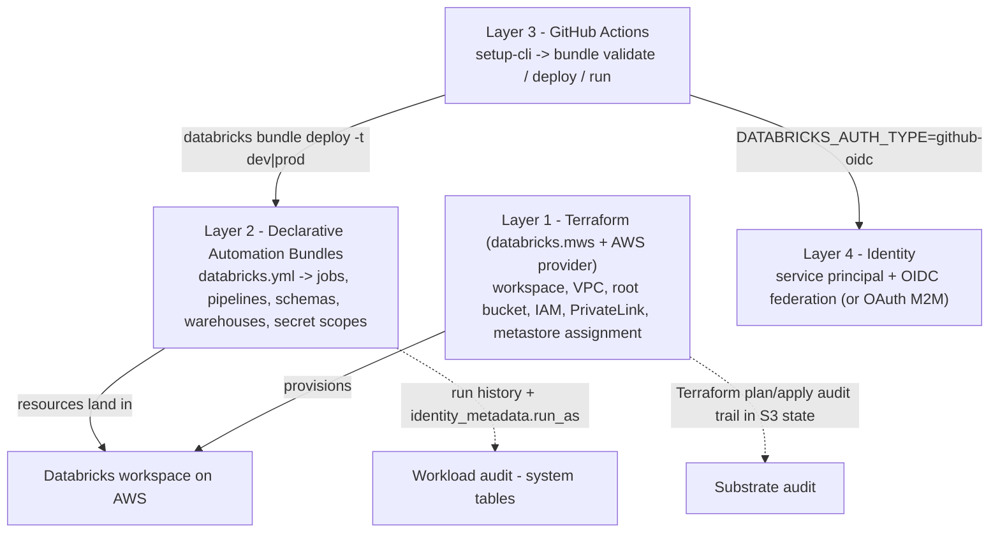
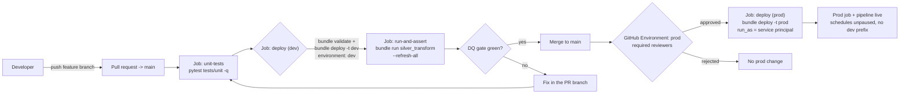
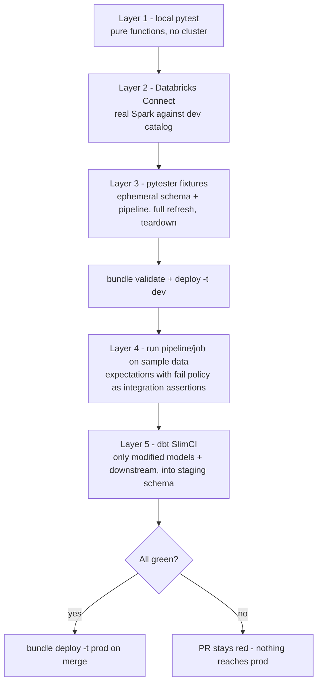
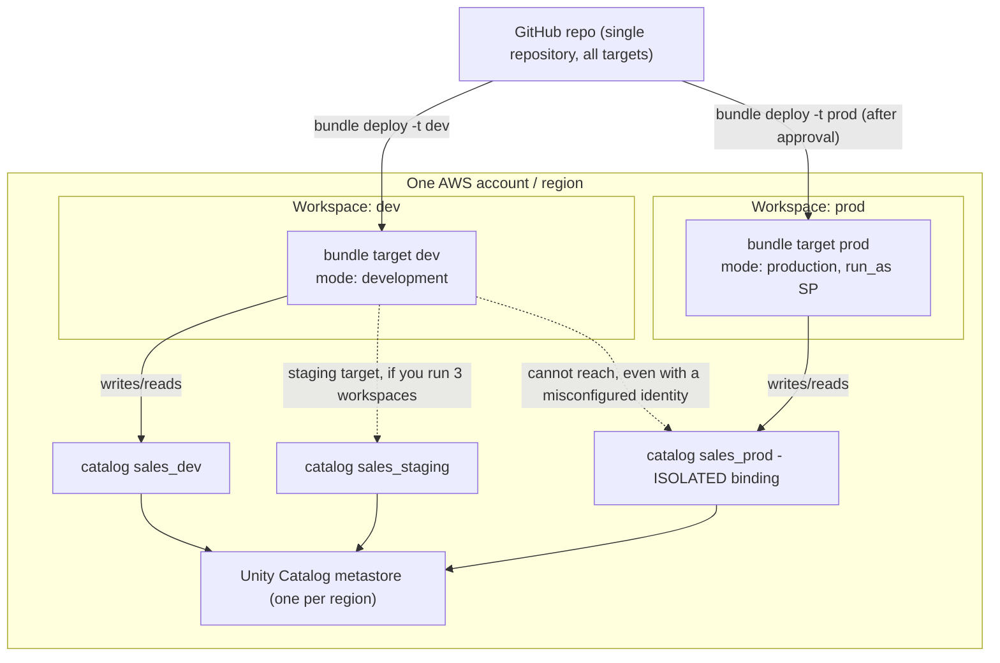
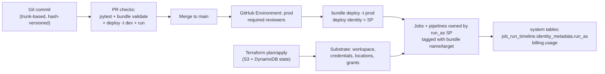

# CI/CD for the Databricks Lakehouse on AWS: Declarative Automation Bundles, Terraform and GitHub Actions

Every lakehouse in this course eventually meets the same cliff: the notebooks work, the pipelines are green, and then someone hand-clicks a job into the production workspace on a Friday afternoon, or worse, someone's departure from the company takes the 3 a.m. schedule with them. The cliff is the **deployment seam**, and the fix is boring on purpose: everything that lives in the workspace is declared in Git, reviewed in a pull request, validated by CI, and deployed by a service principal that is not any human being.

This is now the documented position, not folklore. "Declarative Automation Bundles are the **recommended approach to CI/CD on Databricks**" (docs.databricks.com/aws/en/dev-tools/ci-cd, **2026-07-10**), and the same page's cloud-specific flow for **AWS** reads "**GitHub Actions and Declarative Automation Bundles or Terraform**". Note the name you must learn: the product formerly called **Databricks Asset Bundles** is documented since 2026 as **Declarative Automation Bundles** (bundles overview page, last updated **2026-09-11**): same CLI verbs, same `databricks.yml`, new name. And the filename matters more than you think: "A bundle must contain **one (and only one)** configuration file named **`databricks.yml`** at the root of the bundle project folder" (bundles settings, **2026-03-16**). There is no `bundle.yaml`. Ever.

Every fact in this lesson is stamped with its Databricks or AWS source and dated to **October 2026**; anything the docs do not say is left out rather than guessed.

```text
 =============================================================
  LESSON 16 MAP - CI/CD + IaC for Databricks on AWS, Oct 2026
 ------------------------------------------------------------
  Layer 1  substrate IaC - Terraform, provider alias databricks.mws
           databricks_mws_credentials | _networks |
           _storage_configurations | _vpc_endpoint |
           _private_access_settings | _workspaces
           + AWS provider: VPC, endpoints, root S3 bucket, IAM
  Layer 2  workload as code - Declarative Automation Bundles
           (formerly Databricks Asset Bundles)
           exactly ONE databricks.yml + include globs ->
           jobs, pipelines, schemas, sql_warehouses, dashboards,
           secret_scopes, catalogs ... targets dev / staging / prod
  Layer 3  CI orchestration - GitHub Actions
           databricks/setup-cli -> bundle validate|deploy|run
           pull_request -> dev target ; push to main -> prod
           (+ GitHub Environment required reviewers as a gate)
  Layer 4  identity - service principals, never a human PAT
           workload identity federation (OIDC) preferred
           OAuth M2M (1-hour tokens) second ; SP token last
           run_as SP decouples deploy identity from run identity
  Numbers  OAuth access token 1 h | <= 5 secrets per SP
           secret validity <= 730 days | CLI 0.218.0 = DABs GA
           engine key CLI 0.295.0, default direct
           provider v1.137.0 (2026-10-06), ~ several releases/mo
           jobs classic from $0.15/DBU (pricing page, 2026-10)
 =============================================================
```

In this lesson you will:

- separate the **four layers** of the Databricks-on-AWS delivery stack and assign exactly one owner to every resource class (no job defined twice);
- read a full **`databricks.yml`**, bundle name, `include`, `artifacts`, `variables`, `workspace`, `run_as`, `permissions`, `resources`, `targets`, and deploy it through the **validate → deploy → run** loop;
- apply **development mode** vs **production mode** semantics, the **presets** that override them, the substitution vocabulary, and the exact **five-step variable-resolution precedence**;
- split **deploy identity** from **run identity** with `run_as` service principals, including the "only jobs and pipelines are supported" rule when the two identities differ;
- provision the AWS substrate with **Terraform**: the `databricks.mws` alias module (credentials, networks, storage configuration, PrivateLink objects, workspace) kept in a **separate module** from the workspace-level resources (storage credentials, external locations, grants), with S3 + DynamoDB remote state;
- build the **PR pipeline in GitHub Actions** with `databricks/setup-cli`, `bundle validate` (validation runs as part of every deploy), and **workload identity federation (OIDC)** so no personal access token ever enters CI;
- test at five layers: local pytest, Databricks Connect, `databricks-labs-pytester` fixtures, the **DBR 18.1+** in-pipeline test framework, and **dbt SlimCI**;
- design the environment topology, **one metastore per region, 3 to 10 catalogs, `ISOLATED` production binding, 2 to 3 workspaces**, and hand-compute a monthly CI DBU sketch at the published Oct 2026 floors;
- study **three named AWS cases** (NAB, Addepar, Mastercard), read the **2026 update box**, and answer **twelve exam-style questions** plus four interactive checks.

---

## 1. The four-layer stack: one owner per resource class

The single most expensive CI/CD mistake on Databricks is not a missing test; it is defining the same job in two systems and letting them fight. Before any YAML, fix the ownership model. Databricks' documented stack has four layers that must stay distinct:

| Layer | Tool | Owns | Cadence |
|---|---|---|---|
| **1. Cloud substrate** | Terraform (`databricks.mws` alias + AWS provider) | Workspace, VPC, subnets, security groups, VPC endpoints, root S3 bucket, cross-account IAM role, PrivateLink objects, metastore assignment | Changes weekly/monthly; reviewed as plan/apply |
| **2. Workspace config & workloads** | **Declarative Automation Bundles** (`databricks.yml`) | Jobs, Lakeflow pipelines, schemas, catalogs, SQL warehouses, dashboards, secret scopes, alerts, model serving endpoints, permissions, `run_as` | Changes daily; reviewed as PR on YAML |
| **3. CI orchestration** | GitHub Actions (+ official `databricks/setup-cli` action) | The pipeline: unit tests, `bundle validate`, `bundle deploy`, `bundle run`, approvals | Every PR and every merge |
| **4. Identity & secrets** | Account console + GitHub Environments | Service principals, federation policies, OAuth M2M secrets, GitHub encrypted secrets, Databricks secret scopes | Rotated by policy, never by hand in YAML |



Two rules make the diagram hold. First, **one owner per resource class**: jobs, pipelines and dashboards belong to bundles; the workspace, storage credentials, external locations and metastore grants belong to Terraform. Defining a `databricks_job` in Terraform *and* the same job in a bundle creates import/ownership fights that surface as mysterious diffs, not as clean errors. Second, **bundles are the recommendation for everything inside the workspace**, while Terraform is the documented instrument for provisioning: "You use the Databricks Terraform provider to provision Databricks workspaces as well as the AWS Provider to provision required AWS resources for these workspaces" (Terraform provider docs, **2026-09-11**).

> **📚 Did you know?** The bundle's own config can declare `bundle.engine: terraform | direct`, and "**The default value is `direct`**" (configuration reference, **2026-08-18**, added in CLI **0.295.0**), with release notes confirming "**Direct deployment engine is GA**" and "**Deploy without Terraform**". That internal engine is plumbing for *bundle deploys only*; it is emphatically not your infrastructure Terraform state, and confusing the two is a documented team antipattern (pitfall 5 in the CI/CD digest). Older CLIs used the Terraform engine by default; current CLIs do not.

---

## 2. Bundle anatomy: the one file, its keys, and the resources map

### 2.1 The filename is a validation gate

Copy this sentence onto your team wiki: **a bundle root contains exactly one `databricks.yml`** (bundles settings, **2026-03-16**). Additional configuration is pulled in via the `include` array of globs, and "`include` globs are relative to the `databricks.yml` that declares them". `bundle validate` fails immediately on the classic copy-paste from other tools that assumes `bundle.yaml`; there is no documented alias, now or historically.

### 2.2 Top-level keys (the whole surface, as of Oct 2026)

| Key | Role |
|---|---|
| `bundle` | Required; carries `bundle.name`, the logical name used in paths and substitutions |
| `include` | Glob list of extra YAML files (e.g. `resources/*.yml`): the only way to split config across files |
| `sync` | `include`/`exclude`/`paths`: extra files synced into the workspace; "especially useful when you have a single repository that hosts multiple bundles" |
| `artifacts` | Built binaries: `type: whl|jar|maven|...`, `build` command (e.g. `poetry build`), `path`, `files[].source`, `dynamic_version` |
| `variables` | Custom variables with `description`, `default`, `lookup`, `type: complex` |
| `workspace` | `host`, `root_path`, `state_path`, `artifact_path`, `resource_path`, `profile`: "Databricks recommends that you use the `host` mapping instead of the `default` mapping wherever possible, as this makes your bundle configuration files more portable" |
| `permissions` | Per-resource or bundle-level ACL entries (level + user/group/SP) |
| `run_as` | Bundle/target-level run identity: `user_name` **or** `service_principal_name` |
| `resources` | Typed map of everything the bundle owns: **jobs, pipelines, dashboards, sql_warehouses, catalogs, schemas, secret_scopes, model_serving_endpoints, apps, alerts, quality_monitors, registered_models, volumes, clusters** and more |
| `targets` | One collection per environment (`dev`, `staging`, `prod`), exactly one `default: true`; each target may override `artifacts`, `bundle`, `git`, `mode`, `permissions`, `presets`, `resources`, `sync`, `variables`, `workspace`, `run_as` |
| `scripts` | Lifecycle hooks run by the CLI around operations |

The supported `lookup` object types (fetch an existing workspace object by name instead of declaring it) are: alert, cluster_policy, cluster, dashboard, instance_pool, job, metastore, notification_destination, pipeline, query, service_principal, warehouse (variables docs, **2026-03-16**).

A healthy project layout for one repository hosting one project (Databricks developer best practices, **2026-06-11**: "use a **single repository for all of your code**… If you have multiple bundles for separate deployment lifecycles, keep them in a single repository"):

```text
sales-lakehouse/                      # one Git repo
├── databricks.yml                    # the ONLY bundle root file
├── resources/
│   ├── silver_transform.job.yml      # jobs live here
│   ├── medallion_pipeline.pipeline.yml
│   └── schemas.yml
├── src/
│   ├── build_silver.py               # synced to the workspace
│   └── my_lib/                       # wheel source, built by artifacts
├── tests/
│   ├── unit/                         # local pytest, no Databricks needed
│   └── integration/                  # pytester + Databricks Connect
└── .github/workflows/
    └── lakehouse-cicd.yml            # Layer 3
```

### 2.3 Worked example E1: the minimal production-shaped bundle

This is the skeleton from the Databricks bundles docs pattern (settings + deployment-modes + run-as pages, all accessed Oct 2026): one job, one schema, two targets, an SP run identity in prod.

```yaml
# databricks.yml - the ONLY valid bundle root filename
bundle:
  name: sales_lakehouse

include:
  - resources/*.yml

variables:
  catalog:
    description: Target catalog for this environment
  schema:
    description: Schema (database) name
    default: silver

workspace:
  root_path: /Workspace/Users/${workspace.current_user.userName}/.bundle/${bundle.name}/${bundle.target}

resources:
  jobs:
    silver_transform:
      name: "Silver transform (${bundle.target})"
      schedule:
        quartz_cron_expression: "0 0 3 * * ?"
        timezone_id: UTC
        pause_status: PAUSED          # dev mode pauses anyway; explicit is safer
      email_notifications:
        on_failure: ["data-eng@example.com"]
      tasks:
        - task_key: build_silver
          job_cluster_key: default
          notebook_task:
            notebook_path: ./src/build_silver.py
          libraries:
            - whl: ./dist/my_lib-*.whl
      job_clusters:
        - job_cluster_key: default
          new_cluster:
            spark_version: 15.4.x-scala2.12
            node_type_id: m5.xlarge
            num_workers: 2
  schemas:
    silver_schema:
      name: ${var.schema}
      catalog_name: ${var.catalog}
      comment: "Silver tables (managed by bundle ${bundle.name})"

targets:
  dev:
    default: true
    mode: development
    variables:
      catalog: sales_dev
      schema: ${workspace.current_user.short_name}
  prod:
    mode: production
    git:
      branch: main
    workspace:
      host: https://dbc-a1b2345c-d6e7.cloud.databricks.com   # prod workspace
      root_path: /Workspace/Users/ci-deployer/.bundle/${bundle.name}/${bundle.target}
    run_as:
      service_principal_name: 68ed9cd5-8923-4851-a0c1-c7536c67ff99
    permissions:
      - level: CAN_MANAGE
        service_principal_name: 68ed9cd5-8923-4851-a0c1-c7536c67ff99
    variables:
      catalog: sales_prod
```

The local loop is three commands, and it is the same loop CI runs:

```bash
databricks bundle validate -t dev          # schema/syntax gate (also runs inside deploy)
databricks bundle deploy  -t dev           # sync files + create/update resources
databricks bundle run silver_transform -t dev --refresh-all
```

Three details in E1 that exam questions love: `notebook_path` is **relative to the bundle** (never hard-code `/Workspace/Users/...` paths from your laptop, they break under a different `root_path`); the wheel is declared where the job consumes it (`libraries: - whl:`) while the `build` command lives under `artifacts:`; and the prod `schema` variable is deliberately *not* set per user, prod schemas come from the target's `variables`, not from whoever deployed.

> **📚 Did you know?** `databricks bundle init` scaffolds a project from a template, and the release notes record that "The default-python template now uses **uv**" and "The default-python template defaults to use **serverless**" (bundles release notes, **2026-04-29**). Two companion verbs save days of migration: `bundle generate` reverse-engineers YAML from resources that already exist in the UI ("bundle generate job --as-code" against a click-built job), and `bundle deployment bind` links your config to a pre-existing workspace object when names collide. `bundle schema` (CLI ≥ **0.218.0**) emits the JSON schema your IDE uses for completion and inline validation.

---

## 3. Targets, modes, presets, variables: the safety rails

### 3.1 Development mode vs production mode

Every practical bundle declares `targets.dev` and `targets.prod` (optionally `staging`), exactly one marked `default: true`. The `mode:` on each target is not decoration: the two modes have opposite safety semantics (deployment-modes docs, last updated **2026-09-11**):

| Behavior | `mode: development` | `mode: production` |
|---|---|---|
| Resource names | Prefixed `[dev ${workspace.current_user.short_name}]` | Unprefixed: the declared names |
| Job/pipeline tags | `dev` Databricks tag added | No dev tag |
| Lakeflow pipelines | Marked `development: true` | Validated to be `development: false` |
| Schedules & triggers | "**Pauses all schedules and triggers** on deployed resources" | Live as declared |
| Concurrent runs | "**Enables concurrent runs on all deployed jobs**" | Default (`max_concurrent_runs` as set) |
| Cluster overrides | `--cluster-id`-style overrides allowed | **Not allowed**: no overriding existing cluster definitions |
| Deployment lock | "**Disables the deployment lock** for faster iteration" | Lock enforced |
| Git branch check | none | If `git.branch` is set on the target, current branch must match (override: `--force`, itself an audit red flag) |
| Paths & identity | User-scoped paths fine | Validates that `artifact_path`/`file_path`/`root_path`/`state_path` are **not** overridden to a specific user; `run_as` and `permissions` must be specified unless deploying as an SP |

Production mode also "recommends that you deploy your bundle to an **immutable, read-only folder**" (the `immutable_folder` setting). Promotion, in one sentence: **the same immutable Git commit is redeployed to the next target**: nothing is rebuilt, and data promotion happens by running the job against that target's catalog.

### 3.2 Presets tune the mode; resources override the presets

Presets customize the mode defaults: `name_prefix`, `pipelines_development`, `trigger_pause_status`, `jobs_max_concurrent_runs`, `tags`, and (release notes, **2026-04-29**) `artifacts_dynamic_version`. The precedence inside the platform is one sentence: "**if both `mode` and `presets` are set, presets override the default mode behavior, and settings of individual resources override the presets**" (deployment-modes, **2026-09-11**).

### 3.3 Substitutions, variables, and the resolution order

Built-in substitutions resolve at deploy time: `${bundle.name}`, `${bundle.target}` (use this, not the older `${bundle.environment}`), `${workspace.host}`, `${workspace.current_user.userName}`, `${workspace.current_user.short_name}`, `${workspace.file_path}`, `${workspace.root_path}`, and even `${resources.jobs.<key>.id}` for cross-references. Custom variables are `${var.<name>}` and resolve by walking this list, **stopping at the first hit** (variables docs, **2026-03-16**):

1. `--var="name=value"` on the CLI
2. Environment variables starting with **`BUNDLE_VAR_`** (e.g. `BUNDLE_VAR_catalog=sales_prod`)
3. `variable-overrides.json` under `.databricks/bundle/<target>/`
4. `targets.<name>.variables`
5. Top-level `variables.<name>.default`

```fillblank
{
  "question": "Bundle variable resolution walks five sources and stops at the first hit. Fill the two missing steps: --var CLI options, then {{1}}, then variable-overrides.json under .databricks/bundle/<target>/, then target-level variables, then the top-level {{2}}.",
  "template": "Bundle variable resolution walks five sources and stops at the first hit. Fill the two missing steps: --var CLI options, then {{1}}, then variable-overrides.json under .databricks/bundle/<target>/, then target-level variables, then the top-level {{2}}.",
  "answers": {
    "1": "BUNDLE_VAR_* environment variables",
    "2": "default"
  },
  "distractors": [
    "TF_VAR_* environment variables",
    "the workspace profile in .databrickscfg",
    "targets.prod.variables only",
    "the Git commit message"
  ],
  "explanation": "The documented order (variables page, 2026-03-16) is --var > BUNDLE_VAR_* env vars > variable-overrides.json > targets.*.variables > top-level default. TF_VAR_* is Terraform's mechanism and belongs to a different layer entirely; .databrickscfg profiles supply auth/host, not variable values; target variables are step 4 of 5, not a special case; and Git metadata never enters bundle resolution."
}
```

### 3.4 Worked example E2: overrides in practice

Same bundle as E1, three different promotion moments:

```bash
# Laptop: Alice iterates on her own schema, no schedule, no prod risk
databricks bundle deploy -t dev
databricks bundle run silver_transform -t dev --refresh-all

# CI: a one-off override without editing YAML (highest-precedence source)
BUNDLE_VAR_catalog=sales_staging databricks bundle deploy -t staging

# Prod pipeline: the target's own variables + run_as SP do the work
databricks bundle deploy -t prod
# equivalent one-shot: databricks bundle deploy -t prod --var="catalog=sales_prod"
```

> ⚠️ **WARNING: dev-mode side effects cut both ways.** Forgetting `mode: development` on the dev target means a PR-triggered deploy can unpause real schedules against shared resources; expecting a dev-deployed job's *exact* name to still exist in prod fails, because dev renamed everything `[dev <user>]`. And remember what dev mode buys you: paused schedules, `development: true` pipelines and concurrent runs exist so that twenty pull requests can deploy to one shared dev workspace without firing each other's calendars (deployment-modes, **2026-09-11**). If parallel PRs collide on the same resource keys, give each PR its own `root_path`/variables or serialize with a GitHub `concurrency:` group.

---

## 4. Identity: deploy as one thing, run as another

### 4.1 The `run_as` rules that decide what your pipeline may do

`run_as` can be set to a `user_name` or a `service_principal_name`, and "Non-admins can only set this field to their own email" (run-as docs, last updated **2026-10-07**). Four rules matter in production:

1. "**Setting a `run_as` identity to a service principal for production targets is the most secure way of running a production workflow**"; it "decouples the permission to run the production workflow from the identity that created or deployed the bundle".
2. If the deploy identity differs from `run_as`, "**only jobs and pipelines are supported**": any other resource type in the bundle then fails to deploy cleanly.
3. Job-level `run_as` may accept a `group_name`; bundle/target-level `run_as` may **not**.
4. Model serving endpoints do not support `run_as` at all.

### 4.2 Worked example E3: the identity split

```yaml
# Top-level default for everyone on the team (dev loop)
run_as:
  user_name: ${workspace.current_user.userName}

targets:
  prod:
    mode: production
    run_as:
      service_principal_name: 68ed9cd5-8923-4851-a0c1-c7536c67ff99   # SP application ID
    permissions:
      - level: CAN_MANAGE
        service_principal_name: 68ed9cd5-8923-4851-a0c1-c7536c67ff99
      - level: CAN_VIEW
        group: data-analysts
```

What happens at 3 a.m. when the on-call engineer is asleep: the prod job still runs, because its identity is the service principal, and the run is auditable as that SP in `system.lakeflow.job_run_timeline` (CI/CD digest, lineage section; cross-ref lesson 09). What happens when Alice leaves the company: nothing in prod breaks, because Alice was never prod's identity: only dev's.

```mermaid
flowchart LR
    GH["GitHub Actions workflow<br/>environment: prod"] -->|"OIDC token<br/>(id-token: write)"| OIDC["Databricks federation policy<br/>issuer token.actions.githubusercontent.com<br/>sub repo:org/repo:environment:prod"]
    OIDC -->|"OAuth token, 1 hour"| CLI["databricks CLI via setup-cli"]
    CLI -->|"bundle deploy -t prod"| DEP["Deploy identity<br/>(the SP, or a human with CAN_USE)"]
    DEP --> RUN["run_as SP identity<br/>executes jobs + pipelines"]
    RUN --> T1["Job runs in prod workspace"]
    RUN --> T2["Lakeflow pipeline update"]
    T1 --> ST["system tables:<br/>job_run_timeline, billing.usage<br/>identity_metadata.run_as"]
    T2 --> ST
```



> **📚 Did you know?** OAuth machine-to-machine tokens are short by design: "Each access token is valid for **one hour**, after which a new token is automatically requested", a service principal may hold **up to five OAuth secrets**, and each secret is valid "up to two years (maximum **730 days**)", and secrets can be **scoped** to APIs such as `sql` or `jobs` rather than `all-apis` (OAuth M2M docs, accessed Oct 2026). Scope your CI secret to the APIs the pipeline touches; a scoped secret that leaks is a smaller incident than an `all-apis` one.

---

## 5. Terraform for the substrate: two providers, two modules, separate state

### 5.1 Worked example E4: the workspace-provisioning module (`provider = databricks.mws`)

Workspace creation on AWS uses **account-level** resources under a dedicated provider alias. The official guide is unambiguous about the shape: "Initialize provider with `alias = \"mws\"` and use `provider = databricks.mws` for all `databricks_mws_*` resources. We require all `databricks_mws_*` resources to be created within a dedicated terraform module of your environment. Usually, this module creates VPC and IAM roles as well" (AWS workspace guide, accessed Oct 2026).

```hcl
# modules/account/main.tf  - creates the workspace (Layer 1, phase A)
terraform {
  required_providers {
    databricks = { source = "databricks/databricks", version = "~> 1.137" }
    aws        = { source = "hashicorp/aws",         version = "~> 5.0" }
  }
  backend "s3" {
    bucket         = "acme-tfstate-prod"
    key            = "databricks/account/terraform.tfstate"
    region         = "us-east-1"
    dynamodb_table = "terraform-locks"
    encrypt        = true
  }
}

provider "databricks" {
  alias      = "mws"
  host       = "https://accounts.cloud.databricks.com"
  account_id = var.databricks_account_id
  # auth via OAuth M2M env vars in CI; username/password acceptable for bootstrap
}

resource "databricks_mws_credentials" "this" {
  provider         = databricks.mws
  account_id       = var.databricks_account_id
  credentials_name = "acme-crossaccount"
  role_arn         = aws_iam_role.crossaccount.arn      # AWS provider creates the role
}

resource "databricks_mws_networks" "this" {
  provider            = databricks.mws
  account_id          = var.databricks_account_id
  network_name        = "acme-vpc"
  vpc_id              = module.vpc.vpc_id                # terraform-aws-modules/vpc/aws
  subnet_ids          = module.vpc.private_subnets
  security_group_ids  = [aws_security_group.databricks.id]
}

resource "databricks_mws_storage_configurations" "this" {
  provider              = databricks.mws
  account_id            = var.databricks_account_id
  storage_configuration_name = "acme-root"
  storage_root_url     = "s3://${aws_s3_bucket.root.id}"  # the workspace root bucket
}

resource "databricks_mws_workspaces" "this" {
  provider           = databricks.mws
  account_id         = var.databricks_account_id
  workspace_name     = "acme-prod"
  credentials_id     = databricks_mws_credentials.this.credentials_id
  network_id         = databricks_mws_networks.this.network_id
  storage_configuration_id = databricks_mws_storage_configurations.this.storage_configuration_id
  # PrivateLink variant adds: private_access_settings_id + pricing_tier = "ENTERPRISE"
}
```

The VPC itself, private/public subnets, NAT, the **S3 gateway endpoint**, and **STS/Kinesis interface endpoints**, comes from the **AWS provider** (the guide uses `terraform-aws-modules/vpc/aws` plus its endpoints module). For PrivateLink, the verified example set (`aws-databricks-modular-privatelink` in `databricks/terraform-databricks-examples`, accessed Oct 2026) adds `aws_vpc_endpoint` for backend REST + relay, then `databricks_mws_vpc_endpoint`, `databricks_mws_private_access_settings` (with `public_access_enabled`), and wires `private_access_settings_id` into `databricks_mws_workspaces` with `pricing_tier = "ENTERPRISE"`.

### 5.2 Worked example E5: the workspace-management module (workspace-level provider)

The hard rule from the same guide: "**Code that creates workspaces and code that manages workspaces must be in separate terraform modules**": separate state, separate provider aliases (`databricks.mws` vs a workspace-level provider that, in CI, authenticates with OAuth M2M env vars `DATABRICKS_HOST` + `DATABRICKS_CLIENT_ID` + `DATABRICKS_CLIENT_SECRET`). Mixing them means an apply can authenticate against the wrong endpoint.

```hcl
# modules/workspace/main.tf  - manages resources INSIDE an existing workspace
resource "databricks_storage_credential" "ext" {
  name    = aws_iam_role.external_data_access.name
  aws_iam_role {
    role_arn = aws_iam_role.external_data_access.arn
  }
  comment = "Managed by TF"
}

resource "databricks_external_location" "silver" {
  name            = "silver-external"
  url             = "s3://${aws_s3_bucket.silver.id}/silver"   # s3://[bucket]/[dir] on AWS
  credential_name = databricks_storage_credential.ext.id
  # workspace-level only! also: skip_validation, fallback, read_only,
  # access_point (S3 access point ARN), isolation_mode
}

resource "databricks_grants" "silver_eng" {
  external_location = databricks_external_location.silver.id
  grant {
    principal  = "data-engineers"
    privileges = ["CREATE_EXTERNAL_TABLE", "READ_FILES", "WRITE_FILES"]
  }
}
```

Facts you must carry out of that block: `databricks_external_location` "**can only be used with a workspace-level provider**" and "requires databricks_storage_credential"; `databricks_storage_credential` on AWS is the `aws_iam_role { role_arn = ... }` form, importable by name at workspace level or `<metastore_id>|<name>` at account level; and credentials/locations carry an `isolation_mode` (`ISOLATION_MODE_ISOLATED` / `OPEN`) that interacts with workspace binding (lessons 02 and 03).

> ⚠️ **WARNING, `databricks_grants` is authoritative and will silently strip other people's grants.** "This resource is **authoritative** for grants on securables. Configuring this resource for a securable will **OVERWRITE any existing grants** and changes made outside of Terraform will be reset" (Terraform Registry, resources/grants, published **2026-10-06**). If anyone has granted access through the UI or through Unity Catalog SQL since the last apply, the next apply removes it. Use the singular `databricks_grant` for incremental management when other actors share ownership, and remember the account-level companion resources `databricks_metastore` + `databricks_metastore_assignment` (one metastore per region) belong to the account module, not the workspace module.

### 5.3 Versions and state: two hygiene rules with receipts

The provider moves fast: "several releases per month" (Registry releases page, accessed Oct 2026): **v1.137.0 (2026-10-06)**, v1.136.0 (2026-10-05), v1.135.0 (2026-09-28), v1.134.0 (2026-09-23), v1.128.0 (2026-08-19), with v1.65.0 (2025-02-04) a useful yardstick of how far the surface has moved in 20 months. Pin with a pessimistic constraint (`version = "~> 1.137"`); never float to `latest`. State hygiene, from Databricks' own examples repo: "**We recommend using remote storage, like S3, for state storage, instead of using default local backend**" with `backend "s3"` { bucket, key, region, `dynamodb_table` for locks, `encrypt = true` }, and "You should create the infra for remote backend in **another Terraform Project**" (`aws-remote-backend-infra`). A laptop-local `terraform.tfstate` is unrecoverable drift *and* a secret leak, because state stores resource attributes.

---

## 6. GitHub Actions: the PR pipeline and the federation that secures it

### 6.1 The documented pattern

The official GitHub Actions page (dated **2026-03-16**) lists exactly one official action: **`databricks/setup-cli`**, "A composite action that sets up the Databricks CLI in a GitHub Actions workflow", followed by raw CLI verbs. The flow it documents: PR against main → "Deploy bundle" job runs `databricks bundle deploy` with `DATABRICKS_BUNDLE_TARGET: dev` → "Run pipeline update" job runs the job/pipeline. "**Bundle validation is automatically performed as part of this deployment. If validation fails, this workflow fails.**" Production is the same shape on `push` to main with target `prod`, serialized with `concurrency: 1`. Trunk-based branching plus commit-hash versioning is the recommended Git posture (CI/CD flows page, **2026-07-10**).



### 6.2 Worked example E6: the full PR + prod workflow with OIDC

```yaml
# .github/workflows/lakehouse-cicd.yml
name: lakehouse-cicd
concurrency: ${{ github.ref }}
on:
  pull_request: { branches: [main] }
  push: { branches: [main] }
permissions:
  id-token: write        # REQUIRED for workload identity federation
  contents: read
jobs:
  unit-tests:
    runs-on: ubuntu-latest
    steps:
      - uses: actions/checkout@v4
      - uses: actions/setup-python@v5
        with: { python-version: "3.11" }
      - run: pip install pytest "pyspark>=4.0.0,<5.0.0" && pytest tests/unit -q
  deploy:
    needs: unit-tests
    runs-on: ubuntu-latest
    environment: ${{ github.event_name == 'push' && 'prod' || 'dev' }}
    env:
      DATABRICKS_AUTH_TYPE: github-oidc
      DATABRICKS_HOST: ${{ vars.DATABRICKS_HOST }}
      DATABRICKS_CLIENT_ID: ${{ vars.DATABRICKS_CLIENT_ID }}
      DATABRICKS_BUNDLE_TARGET: ${{ github.event_name == 'push' && 'prod' || 'dev' }}
    steps:
      - uses: actions/checkout@v4
      - uses: databricks/setup-cli@main       # pin to a tag in regulated environments
      - run: databricks bundle validate        # explicit gate (deploy also validates)
      - run: databricks bundle deploy
  run-and-assert:
    needs: deploy
    runs-on: ubuntu-latest
    environment: ${{ github.event_name == 'push' && 'prod' || 'dev' }}
    env:
      DATABRICKS_AUTH_TYPE: github-oidc
      DATABRICKS_HOST: ${{ vars.DATABRICKS_HOST }}
      DATABRICKS_CLIENT_ID: ${{ vars.DATABRICKS_CLIENT_ID }}
      DATABRICKS_BUNDLE_TARGET: ${{ github.event_name == 'push' && 'prod' || 'dev' }}
    steps:
      - uses: actions/checkout@v4
      - uses: databricks/setup-cli@main
      - run: databricks bundle run silver_transform --refresh-all
      # CLI non-zero exit fails the job; add a DQ gate notebook or dbt test step after
```

Java/Scala estates swap one step for a versioned artifact upload to a **Unity Catalog Volume** before deploy: the documented shape: `mvn clean verify` → `databricks fs cp target/my-app-1.0.jar dbfs:/Volumes/artifacts/my-app-${{ github.sha }}.jar --overwrite` → `bundle validate` → `bundle deploy --target prod`, with the deploy gated by `if: github.event_name == 'push' && github.ref == 'refs/heads/main'` (GitHub Actions docs, **2026-03-16**). Volumes, not legacy `dbfs:/mnt` mounts, are the governed artifact store (lesson 12).

### 6.3 Workload identity federation: no secret in the vault at all

"Databricks OAuth token federation, also known as OpenID Connect (OIDC), allows your automated workloads running outside of Databricks to securely access Databricks **without Databricks secrets**" (provider-github docs, **2026-10-02**), and "Databricks strongly recommends using workload identity federation to authenticate to Databricks from automated workloads whenever possible" (oauth-federation-provider, **2026-06-16**). Supported IdPs beyond GitHub Actions: Azure DevOps, GitLab CI/CD, CircleCI, **AWS IAM workloads**, Jenkins, Terraform Cloud, Bitbucket Pipelines.

The verified wiring: an SP **federation policy** with issuer `https://token.actions.githubusercontent.com` and a subject Databricks "recommends using **Environment**", e.g. `repo:my-github-org-or-user/my-repo:environment:Prod` (reusable workflows use `subject_claim: job_workflow_ref`); the workflow then needs only three env vars: `DATABRICKS_AUTH_TYPE: github-oidc`, `DATABRICKS_HOST`, `DATABRICKS_CLIENT_ID` (the SP application ID): plus `permissions: id-token: write`. And the docs call out the trap explicitly: "Set `permissions: id-token: write` on the **calling** workflow, not the reusable workflow." The SDKs and CLI exchange the OIDC token for a Databricks OAuth token automatically: nothing to rotate, nothing in the repo's secret store, and a federation subject that must match the token's `sub` claim *exactly* (a policy written for `environment:Prod` rejects tokens from workflows lacking `environment: Prod`).

> ⚠️ **WARNING: never put a personal access token in CI, and never paste any token into workflow YAML.** A PAT couples production deployments to one employee's account lifecycle and over-privileges the pipeline; when that person leaves, the pipeline dies with their account, and the audit trail points at a human instead of a service. Databricks' own guidance: "As a security best practice, Databricks recommends that you do not enter a Databricks access token directly into the body of a GitHub Actions file. You should register the Databricks access token with GitHub Actions by using **GitHub encrypted secrets**" (service-principals docs, **2026-01-24**), and that is the *floor* of the ladder (SP token as `DATABRICKS_TOKEN`), not the ceiling. Prefer OIDC federation; fall back to OAuth M2M (`DATABRICKS_CLIENT_ID`/`DATABRICKS_CLIENT_SECRET` in GitHub encrypted secrets); treat an SP access token as a last resort. And debug auth failures before rewriting YAML: "No conflicting variables set such as `DATABRICKS_TOKEN`, `DATABRICKS_USERNAME`. Run `env | grep DATABRICKS` and unset conflicts" (OAuth M2M docs): a stale token env var on a self-hosted runner shadows OIDC/M2M every time.

The legacy documented variant of E6 swaps the `env:` federation block for `DATABRICKS_TOKEN: ${{ secrets.SP_TOKEN }}` (an SP-generated access token in a GitHub encrypted secret): still in the docs, still a long-lived secret, and the wrong default for a 2026 design review. For the human approval gate, GitHub **Environments** carry the vars and "lets you **require manual approval before deployments run**": configure the `prod` environment with required reviewers (Deployment protection rules), and pin the workflow's `environment:` key per target, exactly as E6 does (Databricks Apps CI page, accessed Oct 2026, same pattern).

> **📚 Did you know?** `databricks bundle deploy` performs validation for you, "Bundle validation is automatically performed as part of this deployment. If validation fails, this workflow fails" (GitHub Actions docs, **2026-03-16**), which is why E6's explicit `bundle validate` step is belt-and-braces rather than load-bearing. Keep it anyway: it fails faster, before any sync begins, and it gives reviewers a named gate in the checks UI.

---

## 7. Testing: five layers, one pyramid, all in the pipeline

CI/CD on a lakehouse is only as good as what it can prove. The verified stack (CI/CD digest section 9, sources dated 2023 to 2026):

| Layer | Tooling | Where it runs | Verified pins / constraints |
|---|---|---|---|
| 1. Local unit tests | plain `pytest` + local PySpark | CI runner, no Databricks | `pytest>=8.3.4`, `pyspark>=4.0.0,<5.0.0` (community blog, **2026-07-28**) |
| 2. Remote integration | `databricks-connect` replaces the local pyspark group | CI runner → workspace | example pin `databricks-connect==17.1.0` |
| 3. Ephemeral fixtures | `databricks-labs-pytester` (`make_schema`, `make_pipeline`, `make_job`, `env_or_skip`, `ws`) | CI → workspace, auto-teardown | README pin `~=0.7.5` + `databricks-sdk~=0.30`; fixtures "incubated within the Unity Catalog Automated Migrations project" |
| 4. In-pipeline unit tests | `from pyspark.pipelines.testing import TestPipeline, test_spark` | Lakeflow Pipelines web editor | **triggered (non-continuous) mode + DBR 18.1+**, Python only, editor-only |
| 5. SQL/dbt tests | `dbt build --select state:modified+` (SlimCI) + `dbt lint` | CI, staging schema, `dbt_test_sp` identity | dbt CI docs **2026-10-06**; status posts back to the PR |



Two constraints stop teams from mis-using layer 4 as a CI hook. The in-pipeline test framework "must run on **Databricks Runtime 18.1 or above**", only in **triggered** mode, "Editor-only execution", "Python tests only": CI cannot call it headlessly today, so CI uses the external pytester pattern instead (unit-testing docs, accessed Oct 2026; community blog **2026-07-28** notes the framework "is currently in preview and heading into beta": check current status before betting prod CI on it). And its isolation has holes worth knowing before you trust a green run: `test_spark` "redirects table operations to a temporary test schema" **by name**: "reads or writes by path or connector… act on production data", the `event_log()` table-valued function is off-limits from tests, and "Mock data does not inherit row filters or column masks", so green tests do not prove governed behavior.

The older but still-canonical integration pattern for Delta Live Tables/Lakeflow is different: add extra **expectations with `fail`** so the pipeline itself is the assertion: "recommended approach… no additional compute resources" (DevOps for DLT blog, **2023-04-28**). dbt teams get the SQL-side equivalent in SlimCI: "dbt tracks the state of what's running in your production environment… only the modified data assets in your pull request and their downstream dependencies are built and tested in a **staging schema**", with a dedicated test catalog and a `dbt_test_sp` service principal (dbt docs, **2026-08-19** and **2026-10-06**).

### 7.1 Worked example E7: what a month of CI compute costs

Databricks publishes no surcharge line item for bundle deploys or GitHub Actions usage; what the pipeline *triggers* is regular DBU-metered compute. At the published floors (databricks.com/pricing, snapshot **2026-10**: jobs classic **from $0.15/DBU**, DBSQL **from $0.22/DBU**):

```text
 =============================================================
  CI COMPUTE SKETCH - one month, illustrative arithmetic
 ------------------------------------------------------------
  40 PR validation runs x 1.5 DBU each  =   60 DBU  x $0.15
                                          = $  9.00
  30 prod nightly runs x 30 DBU each    =  900 DBU  x $0.15
                                          = $135.00
  DQ-gate DBSQL (small warehouse)        =   25 DBU  x $0.22
                                          = $  5.50
                                          -------------
  Monthly CI-triggered compute                       $149.50
  + interactive dev smoke sessions (DBU floor $0.40, lesson 15)
  Note: arithmetic from published floors as of Oct 2026 -
  your DBU/run depends on data volume. Treat the PR run as
  the cost you pay to NOT find the bug in prod.
 =============================================================
```

Two cost levers belong to the pipeline design itself: dev-mode's paused schedules mean a PR deploy never doubles a prod calendar, and dbt SlimCI's "running and testing only modified models… reduces compute spend" (dbt docs, **2026-08-19**) keeps PR runs proportional to the diff, not the estate.

```plot
{
  "type": "bar",
  "title": "Illustrative monthly CI-triggered DBU spend by pipeline stage (worked example E7 arithmetic at published Oct 2026 floors: not a measured bill)",
  "xLabel": "Pipeline stage",
  "yLabel": "DBUs per month",
  "xKey": "stage",
  "dataKeys": ["dbu_per_month"],
  "data": [
    {"stage": "PR validation runs (40 x 1.5 DBU)", "dbu_per_month": 60},
    {"stage": "Prod nightly job (30 x 30 DBU)", "dbu_per_month": 900},
    {"stage": "DBSQL data-quality gate", "dbu_per_month": 25},
    {"stage": "dbt SlimCI (modified models only)", "dbu_per_month": 40}
  ]
}
```

Read the bar heights as a design argument, not a quote: the prod nightly dwarfs PR runs by an order of magnitude, which is why auto-stop, scaling policy and right-sizing (lesson 15) matter far more to the bill than shaving minutes off PR validation; while the PR runs are what keep the nightly from shipping a regression.

---

## 8. Environments: one metastore, ISOLATED catalogs, 2 to 3 workspaces

Bundles give you targets; Unity Catalog gives those targets something to point at. The documented guidance (UC best practices **2026-06-03**, developer best practices **2026-06-11**, lakehouse deployment guide **2026-06-26**):

- "**You can have only one metastore per region.** All workspaces in that region share that metastore", and "Metastores provide regional isolation but are not intended as default units of data isolation. **Data isolation typically begins at the catalog level.**"
- Use separate **catalogs** per SDLC scope (`dev` / `staging` / `prod`, or hybrid `sales_dev`/`sales_prod`), keeping "typically **3 to 10 per metastore**"; "Use your single-region metastore for **all software development lifecycle scopes**."
- "**Bind the production catalog in `ISOLATED` mode** to the production workspace only… ensures that production data is unreachable from development or staging environments, even if an identity is misconfigured."
- "Always assign ownership of production catalogs and schemas to **groups, not individual users**."
- "Each bundle should cover **all environments** for a given project… rather than using separate bundles per environment."
- Workspace topology scales with team size: ≤5 data engineers → **2 workspaces** (dev, prod); 5+ → **3** (add staging); regulated industries → "Physically isolate workspaces and cloud accounts". "One metastore per environment" exists but is "less common".



The bundle-to-catalog seam is a pair of variables: `catalog: sales_dev` on the dev target, `catalog: sales_prod` on prod, referenced everywhere as `${var.catalog}`: the same YAML, the same code, two governed destinations. Promotion is then literally a redeploy: same commit, next target, different catalog.

---

## 9. Lineage of code → jobs: the audit chain you can query

The chain auditors should be able to walk, end to end (CI/CD digest section 12):

1. **Git commit** (trunk-based, commit-hash versioned artifacts).
2. **PR checks**: unit tests, `bundle validate`, dev deploy, `bundle run` on sample data; status posted back to the PR (dbt posts its own status the same way).
3. **Merge** → optional GitHub Environment approval (required reviewers on `prod`).
4. **`bundle deploy -t prod`** as the deploy identity, with `run_as` set to the prod service principal.
5. **Job/pipeline objects** in the prod workspace, owned by that SP, tagged with bundle name/target via presets, their runs recorded with `identity_metadata.run_as` in **`system.lakeflow.job_run_timeline`**, and their compute metered in **`system.billing.usage`**.
6. **Terraform plan/apply history** in the S3+DynamoDB backend covering the slower-moving substrate: workspace, storage credentials, external locations, grants.



If any link is missing, a job with no bundle tag, a run whose identity is a departed human, a grant change with no Terraform plan, the fix is process, not tooling: add the missing layer, do not add a second owner.

---

## 10. The traps: thirteen confusions this lesson will not let you keep

1. **`bundle.yaml` does not exist.** Exactly one `databricks.yml` at the bundle root; `include` globs are relative to it.
2. **A personal access token in CI.** Never; at best an SP token in an encrypted secret; prefer OIDC federation.
3. **Stale auth env vars.** A leftover `DATABRICKS_TOKEN` on a self-hosted runner shadows OIDC/M2M: `env | grep DATABRICKS` before you debug anything else.
4. **Dev-mode amnesia.** No `mode: development` on dev → PR deploys can unpause prod schedules; expecting prod to keep dev's `[dev user]` names → broken references.
5. **Two different "Terraforms."** The bundle's internal engine (default `direct`) is not your infra state; and one job defined in *both* Terraform and a bundle is an ownership fight, not redundancy.
6. **Laptop Terraform state.** Remote S3 backend + DynamoDB lock + `encrypt = true`, backend infra in its own project.
7. **`databricks_grants` clobber.** Authoritative overwrite of every grant on the securable; use `databricks_grant` for incremental ownership.
8. **Host/subject mismatches.** Workspace URL (no `/api`) for workspace APIs, `https://accounts.cloud.databricks.com` for account APIs; federation `sub` must match the token claim exactly.
9. **External location scope.** Workspace-level only; create storage credentials and locations only after metastore assignment, and mind `isolation_mode`.
10. **`dbfs:` paths for artifacts.** Docs CI examples upload to **UC Volumes** (`/Volumes/...`); legacy mounts are not governed the same way, and absolute dev `notebook_path`s break under prod `root_path`.
11. **Pipeline test-mode illusions.** Name-based redirection only; path/connector reads and `event_log()` still hit production; editor-only, so CI uses pytester.
12. **PR-to-shared-dev concurrency.** Dev mode drops the deployment lock and enables concurrent runs for iteration speed: parallel PRs on the same bundle/target need per-PR paths or a `concurrency:` group.
13. **`run_as` gaps.** Deploy-as-Alice/run-as-SP works for jobs and pipelines only; other resource types fail; non-admins can set `run_as` only to themselves.

---

> **Comparative Verdict: Declarative Automation Bundles vs Terraform-only vs Git-folder-only (AWS, as of Oct 2026)**
> - **Declarative Automation Bundles, the documented recommendation for everything inside the workspace.** "Declarative Automation Bundles are the recommended approach to CI/CD on Databricks" (docs, **2026-07-10**). One `databricks.yml` plus `include` globs declares jobs, Lakeflow pipelines, SQL warehouses, schemas, catalogs, secret scopes, dashboards, alerts and permissions, things a Git folder structurally *cannot* declare, with dev/prod targets, `mode` guardrails, `run_as` identities, preset-based tagging, variable substitution, artifact builds and validation baked into every deploy. The direct deployment engine (default since CLI **0.295.0**, GA per release notes **2026-04-29**) removed the old Terraform-engine friction. Weakness: it does not provision workspaces, VPCs, root buckets or metastore assignments, Layer 1 is simply out of its scope.
> - **Terraform-only: the substrate king, the workload laggard.** The `databricks.mws` module plus the AWS provider is the verified way to create credentials, networks, storage configurations, PrivateLink objects and the workspace itself, with plan/apply history in encrypted S3 state; the workspace-level resources (`databricks_storage_credential`, `databricks_external_location`, `databricks_grant(s)`, cluster policies) are equally first-class. Weakness for workloads: every notebook edit becomes a Terraform cycle, notebook paths and artifacts are clumsier, dev-mode conveniences (paused schedules, `[dev]` prefixes, per-user schemas) do not exist, and an authoritative `databricks_grants` block will strip grants other teams made in the UI. Use it where audit and idempotent infra matter most; do not use it as your inner loop.
> - **Git-folder-only, the documented fallback, and a fallback only.** "Use this approach when you don't have access to external CI/CD pipelines" (docs, **2026-07-10**): a workspace-mirrored repo plus `databricks repos update /Workspace/<path> --branch <branch>` on push (WIF-authenticated). Excellent for interactive development with the IDE/Databricks extension. It versions *files*, not *resources*, no warehouse, no cluster policy, no secret scope, no permissions, no `run_as`, no multi-environment promotion. Databricks' own hybrid advice: Git folders for rapid iteration, bundles for anything that reaches staging or prod, in "**a single repository**" hosting all your bundles.
> - **Verdict in one line:** *Terraform owns the substrate (workspace, credentials, external locations, grants) → Declarative Automation Bundles own everything declared inside the workspace (jobs, pipelines, schemas, warehouses) → Git folders are the dev-loop fallback*, with exactly one owner per resource class, service-principal identities throughout, and OIDC federation so no long-lived secret exists in CI at all.

---

### 2026 Updates (as of October 2026)

> [!NOTE]
> **What changed in the CI/CD and IaC layer this lesson depends on: each line checked against a primary source:**
> - **2026-10-07: run-as page restates the identity split.** `run_as` accepts `user_name` or `service_principal_name`; non-admins only themselves; when deploy identity ≠ run identity "only jobs and pipelines are supported"; job-level `run_as` may use `group_name` but bundle/target level may not; "setting a `run_as` identity to a service principal for production targets is the most secure way of running a production workflow" (docs.../dev-tools/bundles/run-as).
> - **2026-10-02, GitHub Actions OIDC federation documented end to end.** Issuer `https://token.actions.githubusercontent.com`; Databricks "recommends using Environment" subjects (`repo:<org>/<repo>:environment:<env>`); reusable workflows use `subject_claim: job_workflow_ref`; workflow needs `DATABRICKS_AUTH_TYPE: github-oidc`, `DATABRICKS_HOST`, `DATABRICKS_CLIENT_ID` plus `permissions: id-token: write`, "on the calling workflow, not the reusable workflow" (docs.../dev-tools/auth/provider-github).
> - **2026-09-11: bundles overview, deployment modes and the Terraform provider docs refreshed together.** Bundles remain "the recommended approach to CI/CD on Databricks"; development mode still "pauses all schedules and triggers" and "enables concurrent runs"; production mode still validates pipelines `development: false`, branch match, user-scoped paths, explicit `run_as`/`permissions`; provider docs restate the `databricks.mws` + AWS provider split for workspace provisioning.
> - **2026-08-18: configuration reference pins the engine.** `bundle.engine` values `terraform|direct`, "**The default value is `direct`**", added in CLI **0.295.0**; `bundle.uuid` added in **0.236.0**; `sync.paths` confirmed for multi-bundle monorepos; `include` remains mandatory beyond the root file.
> - **2026-10-06: Terraform provider v1.137.0 ships** (Registry, published 2026-10-06), the latest of several releases per month (v1.136.0 on 10-05, v1.135.0 on 09-28, v1.134.0 on 09-23); the `databricks_grants` authoritative-overwrite warning and `databricks_external_location`'s workspace-level-only constraint are carried on the current resource pages. Pin `~> 1.137`, do not float.
> - **2026-07-10: CI/CD landing page fixes the toolchain pairing.** "Declarative Automation Bundles are the recommended approach to CI/CD on Databricks"; AWS flow: "**GitHub Actions and Declarative Automation Bundles or Terraform**"; Git folders remain the documented fallback; trunk-based branching and commit-hash versioning recommended, with workspaces scaled 2 (≤5 engineers) → 3 (5+) → physically isolated (regulated).

---

## Real-World Case Studies

> **📋 Case A: National Australia Bank (banking, Cloud: AWS)**
> **Challenge.** A **26-year-old Teradata warehouse** with ~1,000 use cases and 140 reporting suites, plus hand-written Spark/legacy SQL ETL "5,000 to 8,000-line DML and up to 64 `union-all` per pipeline", maintained inconsistently by 300 to 400 engineers.
> **Stack on AWS.** Databricks SQL, **Auto Loader**, Spark Declarative Pipelines on **Lakeflow**, Unity Catalog (lineage, masking, access control), and, explicitly listed on the story page, **asset bundles for CI/CD**, `Cloud: AWS` on the customer-story page.
> **Reported outcome.** "**26-year-old Teradata warehouse decommissioned · 456 Use cases migrated to Databricks SQL · 1,200+ Users enabled**" (https://www.databricks.com/customers/nab/dbsql, undated, accessed 2026-10); "**1,800 Spark Declarative Pipelines running on Databricks Lakeflow · 99.6% Job success rate · 80% Less transformation complexity**", end-to-end latency "under 15 minutes", data quality "+38%" (https://www.databricks.com/customers/national-australian-bank-nab, undated, accessed 2026-10).
> **Maps to this lesson.** Sections 2 to 4 and 6: NAB is the named AWS example of the whole stack working together: thousands of pipelines can only be operated at a **99.6% success rate** when every one is bundle-declared, PR-reviewed and service-principal-run, not click-ops'd. The 80%-less-complexity number is what standardisation looks like when the deployment unit is a repo, not a notebook.
> ⏳ *Temporal note: undated customer-story pages, accessed Oct 2026: reported outcomes at the time of the story, not a 2026 guarantee.*

> **📋 Case B: Addepar (wealth management, Cloud: AWS)**
> **Challenge.** Engineering and data teams siloed on a platform modelling over $8 trillion in investments, with slow pipeline delivery and rising infrastructure cost, needing a governed AI foundation.
> **Stack on AWS.** Databricks running on AWS, Unity Catalog, shared notebooks, Databricks SQL: `Cloud: AWS` on the story page.
> **Reported outcome.** "Addepar models over **$8 trillion** in investments on Databricks running on AWS… accelerating **pipeline delivery by 5x** and cutting **infrastructure costs by $2 million**" (https://www.databricks.com/customers/addepar/aws, undated, accessed 2026-10).
> **Maps to this lesson.** Sections 6 and 9: a **5x delivery acceleration** is the classic signature of the PR-pipeline loop replacing hand deployment: the pipeline is the delivery mechanism, and the $2M reduction is what unification plus attribution (bundles tagged with cost centers, compute metered in `system.billing.usage`) looks like on a bill.
> ⏳ *Temporal note: undated page, accessed Oct 2026: the delivery and cost figures are the customer's reported outcome, not platform benchmarks.*

> **📋 Case C: Mastercard (financial services, Cloud: AWS)**
> **Challenge.** A governance framework that must prove trust, accessibility and compliance across data systems while generative-AI applications move to production.
> **Stack on AWS.** Databricks Data + AI Platform on AWS with Unity Catalog governance; two AWS re:Invent 2024 breakouts: "Unified and Open Governance for Data and AI" and "Build and Deploy Production-Ready Generative AI Applications".
> **Reported outcome.** "**Databricks was highlighted in 4 of the 5 keynotes**" at re:Invent 2024 (https://www.databricks.com/blog/databricks-and-aws-partnership-took-reinvent-2024-storm, **2024-12-11**). **No numeric customer metric is published on that page: cite the sessions, not invented numbers.**
> **Maps to this lesson.** Sections 4 and 9: governed AI on AWS needs the same identity chain this lesson builds: an SP `run_as`, OIDC-authenticated CI, and an audit trail through system tables. It is also the evidence-literacy case: session titles are qualitative evidence, and a lesson may say what the sessions *covered*, never what they *measured*.
> ⏳ *Temporal note: conference recap dated 2024-12-11: session evidence, not a metrics page.*

---

> [!SUCCESS]
> **Key Takeaways:**
> 1. **One owner per resource class:** Terraform owns the substrate (workspace, VPC, root bucket, credentials, external locations, grants); **Declarative Automation Bundles** own everything inside the workspace (jobs, pipelines, schemas, warehouses, secret scopes); Git folders are the dev-loop fallback. Never define the same job twice.
> 2. **The config file is `databricks.yml`, exactly one, at the bundle root**, there is no `bundle.yaml`, with `include` globs for split files, `resources` as the typed map (jobs, pipelines, schemas, sql_warehouses, secret_scopes…), and every project covering all targets in a single repository.
> 3. **Modes are guardrails:** development mode prefixes `[dev user]`, pauses schedules, enables concurrent runs, drops the lock; production mode validates pipelines `development: false`, branch match, non-user paths, explicit `run_as`/`permissions`. Presets override mode defaults; individual resource settings override presets.
> 4. **Variable resolution stops at the first hit:** `--var` > `BUNDLE_VAR_*` env > `variable-overrides.json` > target `variables` > top-level `default`; substitutions like `${bundle.target}` and `${workspace.current_user.short_name}` resolve at deploy time.
> 5. **Split deploy identity from run identity:** `run_as` a service principal on prod targets (most secure); when the identities differ, "only jobs and pipelines are supported"; non-admins can set `run_as` only to themselves.
> 6. **Terraform hygiene:** `alias = "mws"` for all `databricks_mws_*` provisioning resources in a dedicated module, separate from the workspace-managing module; S3 + DynamoDB remote state with `encrypt = true` in its own project; pin `~> 1.137` (v1.137.0, 2026-10-06); `databricks_grants` is authoritative and overwrites everything: use `databricks_grant` for incremental grants.
> 7. **The PR pipeline is `setup-cli` + `bundle validate|deploy|run`:** PR → dev target, push to main → prod target behind a GitHub Environment with required reviewers; validation runs as part of every deploy; artifacts go to UC Volumes, versioned by commit hash.
> 8. **No PAT in CI, ever.** Prefer workload identity federation (OIDC, `DATABRICKS_AUTH_TYPE=github-oidc`, `id-token: write` on the *calling* workflow); fall back to OAuth M2M (1-hour tokens, ≤5 secrets per SP, ≤730-day secrets, scoped APIs); treat SP access tokens as a last resort and debug with `env | grep DATABRICKS`.

---

## Practice Questions

```question
{
  "id": "dbl-16-q1",
  "type": "multiple-choice",
  "question": "A teammate adds a second configuration file named `bundle.yaml` at the repo root and runs `databricks bundle validate`. What does the October 2026 documentation say happens, and why?",
  "options": [
    "Validation fails: a bundle must contain one (and only one) configuration file named databricks.yml at the root of the bundle project folder",
    "Validation succeeds: bundle.yaml is a documented alias accepted for backward compatibility",
    "Validation succeeds only if the CLI version is at or above 0.295.0, when the direct engine became the default",
    "Validation fails only on Azure; on AWS any *.yml root file is accepted"
  ],
  "correct": 0,
  "explanation": "The bundles settings page (2026-03-16) states the filename requirement verbatim, and no alias exists historically or currently - 'bundle.yaml' is a trap imported from other tools. Option B invents a compatibility alias that was never documented; C conflates the engine-key introduction (CLI 0.295.0, config reference 2026-08-18) with the filename gate, which has nothing to do with CLI versions; D is false: the filename rule is cloud-independent, and the docs page used here is the AWS one."
}
```

```question
{
  "id": "dbl-16-q2",
  "type": "multiple-choice",
  "question": "Which set of behaviors does `mode: development` apply to every deployed resource?",
  "options": [
    "Prepends [dev <short_name>] name prefixes, tags jobs/pipelines with a dev tag, marks pipelines development: true, pauses all schedules and triggers, enables concurrent runs, and disables the deployment lock",
    "Pauses schedules only on jobs, leaves pipelines live, and requires a matching git.branch",
    "Renames resources with a UUID suffix, enables cluster-id overrides, and enforces an immutable read-only folder",
    "Marks pipelines development: false, validates the Git branch, and unpauses all triggers for faster testing"
  ],
  "correct": 0,
  "explanation": "All six behaviors are listed together on the deployment-modes page (last updated 2026-09-11). Option B wrongly exempts pipelines (they are marked development: true, not left live) and imports the production-mode branch check; C invents a UUID scheme and moves the immutable-folder recommendation (a production-mode tip) into dev; D is a mirror image of production mode: production validates pipelines as development: false and checks the branch."
}
```

```question
{
  "id": "dbl-16-q3",
  "type": "multiple-choice",
  "question": "A production job must keep running when its deploying engineer leaves the company. Which configuration achieves this, and what is the documented constraint?",
  "options": [
    "run_as.service_principal_name set on the prod target, run as the most secure option for production workflows; when deploy identity differs from run_as, only jobs and pipelines are supported",
    "run_as.user_name set to the on-call engineer's email, because non-admins may only set run_as to themselves, which is required for jobs",
    "A personal access token stored in a GitHub encrypted secret, so the job inherits the deployer's permissions",
    "run_as.group_name set at bundle level, because target-level run_as accepts groups everywhere"
  ],
  "correct": 0,
  "explanation": "The run-as page (2026-10-07) calls a service-principal run_as 'the most secure way of running a production workflow' and states the identity-gap rule: 'only jobs and pipelines are supported' when deploy and run identities differ. Option B inverts the non-admin restriction (it is a limitation, not a requirement, and it couples prod to a human lifecycle); C is the anti-pattern this lesson bans outright: PATs die with the employee; D is wrong twice: job-level run_as may use group_name, but bundle/target-level run_as may not."
}
```

```question
{
  "id": "dbl-16-q4",
  "type": "true-false",
  "question": "A Terraform `databricks_grants` block on an external location merges additively with grants that engineers have issued through the Unity Catalog UI since the last apply.",
  "options": ["True", "False"],
  "correct": 1,
  "explanation": "False. The Terraform Registry page (published 2026-10-06) is explicit: databricks_grants 'is authoritative for grants on securables. Configuring this resource for a securable will OVERWRITE any existing grants and changes made outside of Terraform will be reset.' Incremental co-management: the case where humans or other tools also grant access: is exactly what the singular databricks_grant resource exists for. Treating the plural resource as additive is a silent access-removal bug that shows up as an outage, not a plan error."
}
```

```question
{
  "id": "dbl-16-q5",
  "type": "multiple-choice",
  "question": "Which workflow configuration satisfies Databricks' documented GitHub Actions OIDC federation requirements?",
  "options": [
    "permissions: id-token: write and contents: read on the calling workflow, plus env DATABRICKS_AUTH_TYPE=github-oidc, DATABRICKS_HOST, and DATABRICKS_CLIENT_ID (the service principal application ID)",
    "permissions: id-token: write set only on the reusable workflow, plus DATABRICKS_TOKEN from a repository secret",
    "A DATABRICKS_CLIENT_SECRET stored in the repository's Actions secrets with DATABRICKS_AUTH_TYPE=oauth-m2m, no id-token permission",
    "DATABRICKS_USERNAME and DATABRICKS_PASSWORD as repository variables, with the federation policy scoped to the default branch claim only"
  ],
  "correct": 0,
  "explanation": "The provider-github page (2026-10-02) documents exactly those three env vars plus id-token: write: and warns 'Set permissions: id-token: write on the calling workflow, not the reusable workflow' (option B's failure mode). Option C describes OAuth M2M, a valid fallback but not federation, and M2M conflicts with a stale DATABRICKS_TOKEN; D uses interactive-user auth, which is never a CI identity, and the docs specifically recommend environment-based subjects over the default branch entity."
}
```

```question
{
  "id": "dbl-16-q6",
  "type": "multiple-choice",
  "question": "Why does Databricks require that workspace-creating code and workspace-managing code live in separate Terraform modules?",
  "options": [
    "Because all databricks_mws_* resources must use the databricks.mws provider alias while in-workspace resources use a workspace-level provider: mixing them in one module makes applies authenticate against the wrong endpoint",
    "Because Terraform Cloud cannot run more than one resource type per state file",
    "Because the AWS provider cannot be used in the same module as the Databricks provider",
    "Because workspace creation must always run in a different AWS account than workspace management"
  ],
  "correct": 0,
  "explanation": "The AWS workspace guide requires provider alias = 'mws' for all databricks_mws_* resources and states that creating vs managing workspaces 'must be in separate terraform modules' to avoid confusion between the two provider configurations: the failure mode is an apply talking to the accounts endpoint when it meant a workspace endpoint (or vice versa). Options B, C and D invent constraints: multi-provider modules are normal Terraform, and the guide does not mandate separate AWS accounts (it physically isolates only for regulated-industry designs)."
}
```

```question
{
  "id": "dbl-16-q7",
  "type": "multiple-choice",
  "question": "A bundle's variable `catalog` has a top-level default, a target-level value, and the pipeline exports BUNDLE_VAR_catalog=sales_staging while a developer also passes --var=\"catalog=sales_ci\". Which value wins, and in what order are the sources consulted?",
  "options": [
    "sales_ci: --var beats BUNDLE_VAR_* env, which beats variable-overrides.json, which beats target variables, which beats the top-level default",
    "sales_staging: BUNDLE_VAR_* env is the highest-precedence source",
    "sales_ci only if the target is prod; on dev the target-level value wins",
    "The top-level default always wins once declared, because defaults are immutable"
  ],
  "correct": 0,
  "explanation": "The variables page (2026-03-16) documents the order: --var options, then BUNDLE_VAR_* env vars, then variable-overrides.json, then targets.*.variables, then top-level default: stopping at the first hit, so --var='catalog=sales_ci' wins here. Option B promotes the env var one rank too high; C invents a mode-dependent precedence (targets set values, they do not reorder the ladder); D is backwards: defaults are the lowest-priority fallback by design."
}
```

```question
{
  "id": "dbl-16-q8",
  "type": "multiple-choice",
  "question": "Which resource class belongs to which tool, given the ownership rule this lesson teaches?",
  "options": [
    "SQL warehouses, Lakeflow pipelines and secret scopes -> Declarative Automation Bundles; workspace, storage credentials, external locations and metastore assignment -> Terraform",
    "All jobs and warehouses -> Terraform databricks_job and databricks_sql_warehouse resources; all notebooks -> Git folders only",
    "Everything -> bundles, including VPC creation and root bucket policies",
    "Everything -> Git folders, with Terraform used only for the DynamoDB lock table"
  ],
  "correct": 0,
  "explanation": "Bundles' documented resources map includes jobs, pipelines, sql_warehouses, schemas, secret_scopes and more (settings page, 2026-03-16), while the Terraform provider docs (2026-09-11) reserve workspace provisioning: mws credentials/networks/storage configs/workspaces, metastore assignment: and substrate objects for Terraform. Option B creates the classic ownership fight (the same job in two systems); C puts Layer-1 VPC work inside a tool that does not touch AWS networking; D collapses the entire stack into a file-sync mechanism that cannot declare a warehouse or a grant."
}
```

```question
{
  "id": "dbl-16-q9",
  "type": "true-false",
  "question": "Production-mode deploys fail when the checked-out Git branch does not match the target's configured git.branch, unless --force is supplied: and using --force is itself a red flag in an audit.",
  "options": ["True", "False"],
  "correct": 0,
  "explanation": "True on both counts. The deployment-modes page (2026-09-11) says production mode 'validates that the current Git branch is equal to the Git branch that is specified in the target... can be overridden by specifying --force'. The audit reading is the lesson's: the check exists so prod only ever receives what main contains; --force is precisely the bypass an auditor should question, which is why trunk-based branching with commit-hash versioning (CI/CD flows page, 2026-07-10) is the recommended posture instead."
}
```

```question
{
  "id": "dbl-16-q10",
  "type": "multiple-choice",
  "question": "What are the verified OAuth M2M limits for a CI service principal, per the Databricks docs (accessed Oct 2026)?",
  "options": [
    "Access tokens valid 1 hour; up to 5 OAuth secrets per service principal; each secret valid up to 730 days; secrets may be scoped to APIs such as jobs or sql",
    "Access tokens valid 24 hours; unlimited secrets; secrets valid 10 years; no scoping available",
    "Access tokens valid 12 hours; up to 2 secrets per SP; secrets valid 90 days",
    "Access tokens never expire when issued to a service principal; 1 secret per SP"
  ],
  "correct": 0,
  "explanation": "The OAuth M2M page states each access token 'is valid for one hour', a SP 'can have up to five OAuth secrets', each 'valid for up to two years (maximum 730 days)', and that secrets can be scoped to selected APIs: with the docs discouraging all-apis scope for routine automation. Every alternative here contradicts at least one of those four numbers, and the 1-hour lifetime is exactly why the SDKs/CLI auto-refresh and why OIDC federation (which removes stored secrets entirely) is the preferred CI mode."
}
```

```question
{
  "id": "dbl-16-q11",
  "type": "multiple-choice",
  "question": "CI must run unit tests against a Lakeflow pipeline's table logic, but the in-pipeline test framework cannot be called headlessly. What does the verified guidance prescribe?",
  "options": [
    "Use the external pytester pattern: deploy the bundle to dev, then use databricks-labs-pytester fixtures to create an ephemeral UC schema and pipeline from the deployed spec, run a full refresh, assert via Databricks Connect, and tear down",
    "Call TestPipeline.active() from the GitHub Actions runner: the framework is fully CI-callable on DBR 18.1+",
    "Skip integration tests entirely; DLT/Lakeflow expectations make testing redundant",
    "Install the official Databricks pytest-databricks plugin, which ships with CI runners"
  ],
  "correct": 0,
  "explanation": "The pipeline unit-testing framework requires triggered mode, DBR 18.1+, Python only, and 'Editor-only execution' (unit-testing docs, accessed Oct 2026), so CI uses the documented external pattern from the 2026-07-28 community blog: pytester's make_schema/make_pipeline fixtures create ephemeral resources from the already-deployed spec, Databricks Connect reads outputs, everything is torn down. Option B contradicts editor-only execution; C is wrong: expectations are a useful additional gate, not a replacement for unit tests; D names a third-party package that is not Databricks-official (the official Labs package is databricks-labs-pytester)."
}
```

```question
{
  "id": "dbl-16-q12",
  "type": "multiple-choice",
  "question": "Which environment topology do the Databricks docs recommend for a growing (5+ engineers) team on AWS, and why one metastore?",
  "options": [
    "Three workspaces (dev, staging, prod) in one region attached to the single regional metastore, with separate dev/staging/prod catalogs and the prod catalog bound ISOLATED; because there is only one metastore per region and data isolation begins at the catalog",
    "One metastore per environment (dev, staging, prod) for maximum isolation, because metastores are the unit of data isolation",
    "One shared catalog with table-level grants as the only separation, because catalog sprawl is always preferable",
    "Four workspaces minimum, because every bundle target requires its own metastore"
  ],
  "correct": 0,
  "explanation": "UC best practices (2026-06-03) state 'You can have only one metastore per region' and that 'Data isolation typically begins at the catalog level'; developer best practices (2026-06-11) prescribe 2 workspaces for <=5 engineers, 3 for 5+, and ISOLATED binding of the production catalog; the deployment guide (2026-06-26) calls per-environment metastores 'less common' and caps catalogs at roughly 3-10 per metastore. Option B inverts the isolation unit (metastores are regional, catalogs are the boundary); C skips the environment split the docs treat as default; D is physically impossible in one region and contradicts the one-metastore-per-region rule."
}
```

```matching
{
  "question": "Match each CI/CD artifact to its single owner under the ownership rule (one owner per resource class):",
  "pairs": [
    {"left": "databricks_mws_workspaces + mws_networks + root S3 bucket", "right": "Terraform account module (provider alias databricks.mws + AWS provider), state in S3 with DynamoDB lock"},
    {"left": "databricks_external_location + databricks_storage_credential + grants", "right": "Terraform workspace module (workspace-level provider) - external locations are workspace-level only"},
    {"left": "Multi-task job with schedule, retries, run_as SP", "right": "Declarative Automation Bundles: resources.jobs in databricks.yml or an include file"},
    {"left": "SQL warehouse, secret scope, dev/prod schema per target", "right": "Declarative Automation Bundles: resources.sql_warehouses, resources.secret_scopes, resources.schemas with ${var.catalog}"},
    {"left": "Notebook iteration loop while writing code", "right": "Git folder (workspace repo sync) - the documented fallback and dev accelerator, versions files not resources"},
    {"left": "The deploy itself: validate, deploy -t dev/prod, run, approvals", "right": "GitHub Actions with databricks/setup-cli, OIDC federation, and a prod Environment with required reviewers"}
  ],
  "explanation": "The rule that makes all six rows true is 'one owner per resource class': substrate objects to Terraform, workspace-declared resources to bundles, interactive iteration to Git folders, and the orchestration of deploys to GitHub Actions. The two most common violations are defining the same job in both Terraform and a bundle (import/ownership fights) and declaring warehouses or secret scopes in a Git folder (impossible: folders sync files, not resources). Remember also that databricks_grants is authoritative: if Terraform owns an external location's grants, a UI grant will be reset on the next apply."
}
```

```dragdrop
{
  "question": "Order the pull-request pipeline exactly as this lesson builds it (evidence and tests first, dev deploy next, gated prod last):",
  "items": [
    "Developer pushes a feature branch and opens a PR against main (trunk-based, commit-hash versioned)",
    "Job 1: unit-tests: local pytest with pinned pyspark on the runner, no Databricks resources touched",
    "Job 2: deploy to dev: actions/checkout, databricks/setup-cli, then bundle validate + bundle deploy with DATABRICKS_BUNDLE_TARGET=dev via OIDC (environment: dev)",
    "Dev-mode side effects land: [dev user] name prefixes, schedules paused, pipelines marked development: true, concurrent runs enabled",
    "Job 3: run-and-assert: bundle run <job> --refresh-all; CLI non-zero exit fails the PR; optionally a DQ gate or dbt test step",
    "Merge to main after green checks",
    "Job 4: deploy to prod: environment prod with required reviewers, same OIDC identity pattern, bundle deploy -t prod as the run_as service principal",
    "Prod-mode validations fire: pipelines development: false, branch match on main, non-user root_path, explicit run_as and permissions"
  ],
  "correctOrder": [
    "Developer pushes a feature branch and opens a PR against main (trunk-based, commit-hash versioned)",
    "Job 1: unit-tests: local pytest with pinned pyspark on the runner, no Databricks resources touched",
    "Job 2: deploy to dev: actions/checkout, databricks/setup-cli, then bundle validate + bundle deploy with DATABRICKS_BUNDLE_TARGET=dev via OIDC (environment: dev)",
    "Dev-mode side effects land: [dev user] name prefixes, schedules paused, pipelines marked development: true, concurrent runs enabled",
    "Job 3: run-and-assert: bundle run <job> --refresh-all; CLI non-zero exit fails the PR; optionally a DQ gate or dbt test step",
    "Merge to main after green checks",
    "Job 4: deploy to prod: environment prod with required reviewers, same OIDC identity pattern, bundle deploy -t prod as the run_as service principal",
    "Prod-mode validations fire: pipelines development: false, branch match on main, non-user root_path, explicit run_as and permissions"
  ],
  "explanation": "The order mirrors the documented GitHub Actions flow (2026-03-16): PR-triggered deploy to the dev target, then run-and-assert, then push-to-main prod deploys behind a gate: with dev mode's paused schedules guaranteeing the PR deploy cannot double-fire a production calendar. The two classic sequencing mistakes are running the prod deploy in the same PR job (defeating the environment gate) and treating validation as a separate system from deploy (it is built into deploy, but keeping the explicit validate step fails faster and shows a named check to reviewers). The last step is a property of the target, not a separate pipeline: production mode re-validates identity, branch and paths on every prod deploy."
}
```
