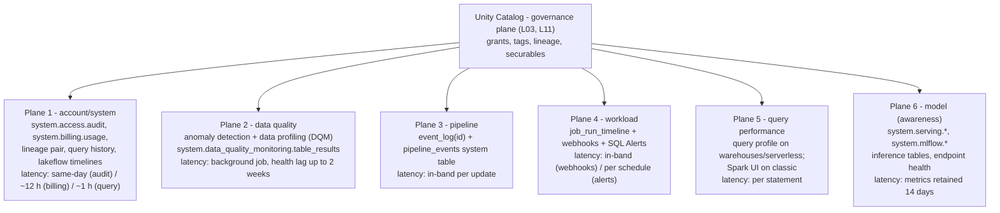
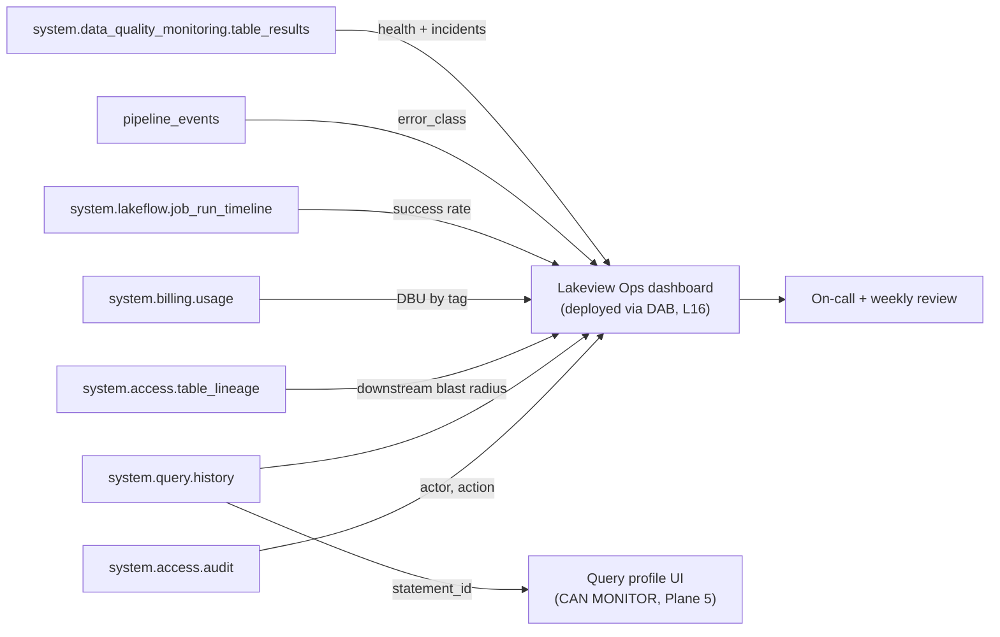
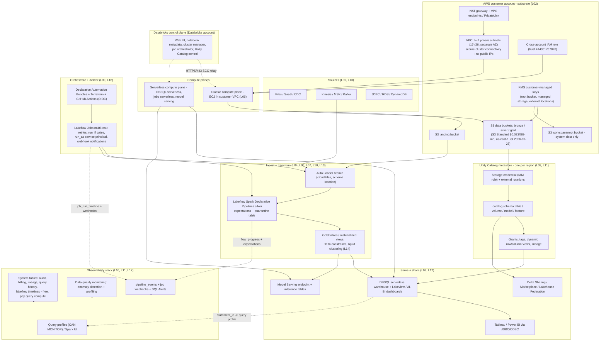
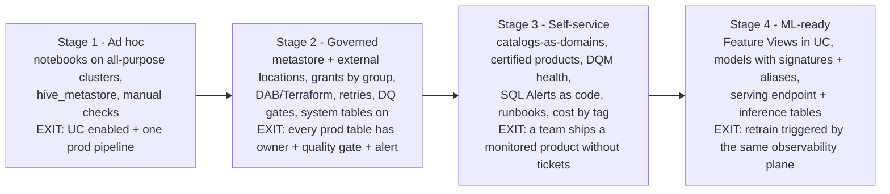
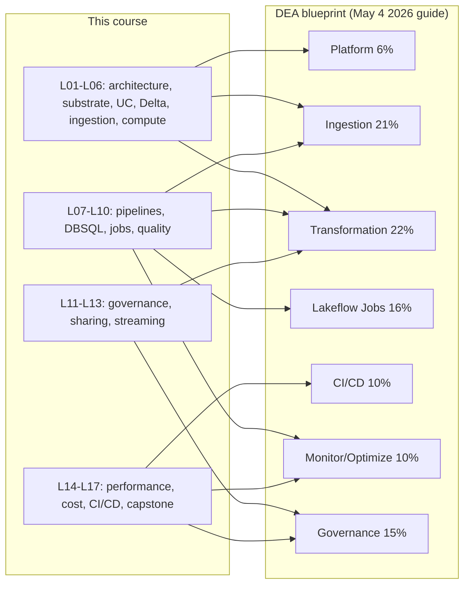

# Capstone Reference Architecture: Observability, ML Activation and the 90-Day Plan for Databricks on AWS

Sixteen lessons built the machine. Lesson 01 gave you the lakehouse concept and the control/compute plane split on AWS; lesson 02 the VPC, root bucket, KMS and PrivateLink substrate; lesson 03 the Unity Catalog metastore and external locations; lesson 04 the Delta transaction log and liquid clustering; lesson 05 Auto Loader; lesson 06 DBR, Photon and cluster economics; lesson 07 Lakeflow declarative pipelines with expectations; lesson 08 Databricks SQL warehouses and Lakeview; lesson 09 Lakeflow Jobs; lesson 10 data quality gates and quarantine; lesson 11 grants, dynamic views and audit; lesson 12 Delta Sharing and Marketplace; lesson 13 Structured Streaming; lesson 14 performance; lesson 15 DBU cost; lesson 16 Declarative Automation Bundles and Terraform. This capstone does one thing: **it assembles those sixteen layers into a single reference architecture, then adds the two layers the earlier lessons only sketched, the observability stack and a governed ML slice, and hands you a sequenced plan to actually build it.**

The observability layer deserves special care, because it is where production lakehouses quietly fail. "System tables provide a Databricks-hosted analytical store of your account's operational data found in the `system` catalog", and "System tables are free to use. You are only charged for the compute used to query them" (docs.databricks.com/aws/en/admin/system-tables, footer **Oct 8, 2026**). Free is not the same as automatic: retention accrues from enablement, history is never backfilled, and the docs are blunt that there is "**No support for real-time monitoring. Data is updated throughout the day.**" Every fact in this lesson carries its Databricks or AWS source and an October 2026 date; anything the docs do not confirm is left out or explicitly flagged as course-authored.

```text
 =============================================================
  LESSON 17 MAP - Capstone on AWS, as of Oct 2026
 ------------------------------------------------------------
  Plane 1  account/system  - system catalog: audit, billing,
           lineage, query history, lakeflow timelines,
           pipeline_events, table_results, alert.*, mlflow.*,
           serving.*   (free tables, you pay query compute)
  Plane 2  data quality    - DQM = anomaly detection (Public
           Preview, schema-scoped) + data profiling (formerly
           Lakehouse Monitoring)
  Plane 3  pipeline        - event_log(<id>) + system.
           lakeflow_pipeline_events_preview.pipeline_events
  Plane 4  workload        - job_run_timeline + notifications
           (email/Slack/Teams/PagerDuty/webhook, max 3 per
           event type) + SQL Alerts (GA, 2026-05-19)
  Plane 5  query perf      - query profile (CAN MONITOR) vs
           Spark UI on classic
  Plane 6  model (aware)   - models in UC, aliases, serving
           endpoint, inference tables, system.serving.*
  Plan     30/60/90 days (course-authored) over Databricks'
           10 production-planning phases; Phase 9 =
           Observability lands in days 61-90
  Numbers  system tables free | query history ~1 h | billing
           ~12 h | 365 d free retention (most tables) |
           3 destinations/job event | snapshot profile 4 TB |
           serving >25K QPS, <50 ms overhead | DEA 45 Q /
           90 min / $200 / 2 years
 =============================================================
```

In this lesson you will:

- model **observability as five distinct planes that all sit on Unity Catalog**, plus a sixth model-awareness plane, and learn exactly which latency each plane carries;
- inventory the **current system-table names** (Oct 8, 2026 reference), their free retentions and their per-table latencies, and run a **six-query audit dashboard** against them;
- use **data quality monitoring**, anomaly detection plus data profiling, the product family that absorbed "Lakehouse Monitoring", with its health indicators, incidents and alert rules;
- close the loop with an **alert → incident → replay runbook**, wired through job webhooks, DQM alert rules and SQL Alerts-as-code;
- draw the **full end-to-end capstone diagram**: AWS VPC/S3/KMS, both Databricks planes, Unity Catalog, Lakeflow pipelines, DBSQL serving, Delta Sharing and the observability stack on one page;
- sequence a **course-authored 30/60/90-day roadmap** against Databricks' 10 production-planning phases, with a milestone scorecard that names the system table proving each milestone;
- place your team on a **four-stage maturity model** (ad hoc → governed → self-service → ML-ready) with exit criteria;
- activate a **governed ML slice**, MLflow models in Unity Catalog, signatures, aliases, serving and inference-table observability, while respecting the boundary between this course and a dedicated ML course;
- study **Rivian, Block and NAB on AWS**, read the **October 2026 update box**, map the course onto the **Data Engineer Associate blueprint**, and answer **twelve exam-style questions** plus four interactive checks.

---

## 1. Five observability planes, one governance plane

The most common architectural mistake in this layer is treating observability as one product you "turn on". It is not: it is five planes with different owners, different privileges and, critically, **different latencies**. All five sit on Unity Catalog, and system tables themselves are UC-governed securables: "Users with both the account admin and metastore admin roles have access to system tables by default… `USE CATALOG` on the system catalog, `USE SCHEMA` on the system schemas, and `SELECT` on the system schemas" (system tables reference, **2026-10-08**). Everyone else needs those grants explicitly, or a dynamic view. **Observability is granted, not ambient.**



Three consequences follow, and each one has bitten production teams:

1. **The planes do not substitute for each other.** Expectations and Delta constraints *prevent* bad writes at write time (lesson 10); anomaly detection *detects* drift across a schema; profiling *measures* and stores drift metrics; SQL and job alerts *notify*. Different privileges too: `MANAGE` on a schema to enable anomaly detection, `SELECT` on metric tables to build alerts, `CAN MONITOR` on a warehouse to open someone else's query profile. Mixing them into "we have DQ" hides which layer is missing.
2. **Minutes-level reaction must be in-band.** System tables are updated "throughout the day": anything that must fire in minutes is an expectation `fail` policy, a job webhook, a DQM alert rule or a SQL Alert inside a job, not a scan of `system.access.audit`.
3. **Latency is a design input, not trivia.** Query history records are "typically available within one hour" (query-history reference, **2026-10-06**); billable usage "typically available within 12 hours" for `record_type = 'ORIGINAL'` (billing reference, **2026-09-15**). An "hourly cost anomaly" dashboard on `system.billing.usage` is a category error: the table cannot support it.

> **📚 Did you know?** The older schemas `system.operational_data` and `system.lineage` are "deprecated and will contain empty tables" (system tables reference, 2026-10-08). Any runbook, notebook or vendor dashboard still pointing at them is silently reading nothing. The current homes are `system.lakeflow.*` for job/pipeline timelines and `system.access.table_lineage` / `system.access.column_lineage` for lineage.

```fillblank
{
  "question": "System tables are free to use: you only pay for the {{1}} used to query them. Query history records are typically available within about {{2}} hour(s), and billable usage records within about {{3}} hours.",
  "template": "System tables are free to use: you only pay for the {{1}} used to query them. Query history records are typically available within about {{2}} hour(s), and billable usage records within about {{3}} hours.",
  "answers": {
    "1": "compute",
    "2": "one",
    "3": "12"
  },
  "distractors": [
    "storage",
    "memory",
    "24",
    "5 minutes",
    "real-time",
    "48"
  ],
  "explanation": "The system tables reference (2026-10-08) says the tables themselves are free and 'You are only charged for the compute used to query them'; the query-history page (2026-10-06) says records are 'typically available within one hour'; the billing page (2026-09-15) says 'typically available within 12 hours' for ORIGINAL records. Traps: 'storage' inverts the billing model (the analytical store is free); 24 and 48 invent round numbers; 'real-time' is explicitly denied by the docs' own 'No support for real-time monitoring' banner; '5 minutes' confuses system tables with in-band signals like webhooks."
}
```

---

## 2. Plane 1: system tables as the account plane

### 2.1 The inventory that matters (verified Oct 8, 2026)

You do not need every table in the `system` catalog on day one; you need these, with their retentions, so your dashboards and retention policies match reality:

| Table | Free retention | Scope | Latency / notes |
|---|---|---|---|
| `system.access.audit` | 365 days | Regional (workspace) + global (account; `workspace_id` = 0) | "updated throughout the day"; Public Preview |
| `system.billing.usage` | 365 days | **Global** | ~12 h for `record_type = 'ORIGINAL'` |
| `system.billing.list_prices` | Indefinite | Global | price lookup for cost math |
| `system.access.table_lineage` + `column_lineage` | 365 days | Regional | rolling 1-year window; deeper history via Catalog Explorer / lineage API |
| `system.query.history` | 365 days | Regional | ~1 h; `statement_text` is `<REDACTED>` for non-admins |
| `system.lakeflow.jobs`, `job_tasks`, `job_run_timeline`, `job_task_run_timeline` | 365 days | Regional | streams; current names (not `system.workflow.*`) |
| `system.lakeflow.pipelines`, `pipeline_update_timeline` | 365 days | Regional | streams |
| `system.lakeflow_pipeline_events_preview.pipeline_events` | 365 days | Regional | **Beta**; "the recommended way to query events" |
| `system.data_quality_monitoring.table_results` | 13 months | Regional | Public Preview; anomaly scan results |
| `system.alert.alerts`, `alert_evaluation_history` | 365 days | Regional | preview: status differs between the May 2026 blog and the Oct 2026 reference; check current docs |
| `system.compute.warehouses`, `warehouse_events` | 365 days | Regional | streams; `node_timeline` only 90 days |
| `system.mlflow.experiments_latest`, `runs_latest`, `run_metrics_history` | 180 days | Regional | Public Preview |
| `system.serving.served_entities` | 365 days | Regional | `endpoint_usage` only 90 days; usage tracking must be enabled |
| `system.ai_gateway.usage` | 365 days | Regional | token/request governance |

Sources: system tables reference (2026-10-08); audit-logs reference (2026-07-01); query-history reference (2026-10-06); billing reference (2026-09-15); lineage reference (accessed 2026-10). **Configurable retention** exists in Beta, opt-in, default 395 days, configurable 30 to 3,650 days, but it "does not apply to `system.data_classification`, `system.data_quality_monitoring`, `system.lakebase`" (2026-10-08). And note the streaming caveats if you want to *stream* system tables into your own Delta tables: DBR **16.4+** to stream, **17.3+** for CDF, `Trigger.AvailableNow` on **18.0+**, and the system schemas themselves use "the default 7 days retention for `VACUUM`".

### 2.2 Worked example E1: the six-query audit dashboard

This is the lesson's centerpiece: one Lakeview dashboard, six queries, all valid against the schemas above, deployed as code via a bundle (lesson 16). Run it weekly; publish it to a `platform-ops` group granted `USE CATALOG` / `USE SCHEMA` / `SELECT`, or better, a **dynamic view per group** (query-history page's own recommendation).

```sql
-- Q1: Who changed grants / securables in the last 7 days?
--     Always predicate on event_date (audit-logs page, 2026-07-01).
SELECT event_date,
       user_identity.email AS actor,
       service_name,
       action_name,
       request_params['name'] AS target
FROM   system.access.audit
WHERE  event_date >= current_date() - 7
  AND  service_name = 'unityCatalog'
  AND  action_name RLIKE 'Grant|Revoke|Update|Create|Delete'
ORDER  BY event_date DESC, actor;

-- Q2: What did humans and service principals actually run?
--     statement_text is <REDACTED> unless account admin / databricks_pii_access.
SELECT executed_by,
       executed_as,
       statement_type,
       compute.type           AS compute_type,
       client_application,
       count(*)               AS statements,
       round(sum(total_duration_ms)/1000/60, 1) AS total_minutes
FROM   system.query.history
WHERE  start_time >= current_timestamp() - INTERVAL 7 DAYS
GROUP  BY 1,2,3,4,5
ORDER  BY total_minutes DESC
LIMIT  25;

-- Q3: Expensive / queue-bound warehouse statements (the FLEET view).
SELECT statement_id,
       executed_by,
       round(total_duration_ms/1000,1)               AS total_s,
       round(waiting_for_compute_duration_ms/1000,1) AS wait_compute_s,
       round(waiting_at_capacity_duration_ms/1000,1) AS wait_queue_s,
       read_bytes, written_rows,
       query_tags['team']                            AS team
FROM   system.query.history
WHERE  start_time >= current_timestamp() - INTERVAL 1 DAY
  AND  compute.type = 'WAREHOUSE'
ORDER  BY total_duration_ms DESC
LIMIT  20;   -- statement_id -> "See query profile" in Query History UI

-- Q4: Blast radius - who reads the sensitive gold table?
SELECT source_table_full_name, created_by, event_time, statement_id
FROM   system.access.table_lineage
WHERE  event_time >= current_timestamp() - INTERVAL 30 DAYS
  AND  source_table_full_name = 'acme.sales.orders_daily'
ORDER  BY event_time DESC;

-- Q5: Cost attribution by domain/team (DBUs only; AWS spend is elsewhere).
SELECT billing_origin_product,
       coalesce(tags['team'],'(untagged)') AS team,
       coalesce(workspace_name,'-')        AS workspace,
       round(sum(metered_quantity),1)      AS dbus,
       round(sum(unblended_cost),2)        AS usd
FROM   system.billing.usage
WHERE  billing_month = date_format(current_date(), 'yyyy-MM')
  AND  record_type   = 'ORIGINAL'
GROUP  BY 1,2,3
ORDER  BY usd DESC;

-- Q6: Job reliability - success rate per production job, last 14 days.
SELECT j.name AS job_name,
       count(*)                                             AS runs,
       sum(CASE WHEN r.state = 'SUCCESS' THEN 1 ELSE 0 END) AS ok,
       round(100.0*sum(CASE WHEN r.state='SUCCESS' THEN 1 ELSE 0 END)/count(*),1) AS pct_ok,
       round(avg(r.duration)/1000/60,1)                     AS avg_min
FROM   system.lakeflow.job_run_timeline r
JOIN   system.lakeflow.jobs j ON j.job_id = r.job_id
WHERE  r.start_time >= current_timestamp() - INTERVAL 14 DAYS
GROUP  BY 1
ORDER  BY pct_ok ASC, avg_min DESC;
```

Teaching notes, each one earned from a documented trap. **Q1** is your compliance-evidence query: always `event_date`-predicated, because the audit page says "To improve query performance, filter on `event_date` rather than `event_time`". **Q3** is the bridge from the *fleet* view to the *one-query* view: click any `statement_id` in the Query History UI and you land on that statement's **query profile**. **Q5** must be paired with an AWS Cost Explorer tile, because `system.billing.usage` contains **zero** AWS spend: no EC2, no S3, no NAT (lesson 15). Unfiltered scans of any of these tables can hit the documented guard: "System Table query returned too much data. Please repeat query with more selective predicates." And Databricks "highly discourages" exporting system tables off-platform: the data "can expose sensitive data and put your deployment at risk".



> **⚠️ WARNING, observability bolted on last is observability that starts empty.** Retention accrues **from enablement**, and history is never backfilled: a dashboard built on day 200 has 200 days of data; built on day 400 it still has 200 days. The system-tables page's own best practice (carried into the deployment guide's Phase 9, **2026-09-11**) is to "Enable system tables for all metastores to capture comprehensive usage data" during foundation, which is exactly why the 30/60/90 roadmap in section 8 puts enablement in **days 1 to 30**, not day 89.

---

## 3. Plane 2: data quality monitoring (the product that ate "Lakehouse Monitoring")

### 3.1 The names, once and for all

If a 2024 tutorial, a vendor deck or even a September 2026 Databricks blog post says **Lakehouse Monitoring**, the October 2026 answer is: that capability is now **data profiling**, one of two capabilities under **data quality monitoring** in Unity Catalog, the other being **anomaly detection** (data-quality-monitoring page, **2026-09-11**: "Data profiling was formerly known as Lakehouse Monitoring"; product page, accessed 2026-10). Teach the new name, recognize the old one, and know that even current Databricks material drifts: the deployment guide still heads a section "**Lakehouse Monitoring** capabilities" (2026-09-11).

### 3.2 Anomaly detection: schema-scoped, learned, and patient

Anomaly detection is enabled on a **schema or catalog**: "up to 50 schemas at a time" via the catalog UI, requiring `MANAGE`, and "Databricks creates a background job that monitors tables for *freshness* and *completeness*" (anomaly-detection page, **2026-10-09**, Public Preview). Freshness: "If a commit is unusually late, the table is marked as stale." Completeness: "If the number of rows committed over the last 24 hours is less than the lower bound of this range, a table is marked as incomplete." Results land in `system.data_quality_monitoring.table_results`; health indicators (Healthy / Unhealthy / Training / Error / Excluded / Not enabled) appear on table pages and lineage nodes; and "Intelligent scanning prioritizes high-impact tables as determined by popularity and downstream usage": leaning on UC lineage and certification, so **an org that never certifies anything gets weaker monitoring**. Expect "Smart scanning might delay the population of health indicators for some tables by up to two weeks", incidents that can be assigned ("Assign to me" persists 7 days) or dismissed ("Not an issue"), and the irreversible foot-gun: "When you disable anomaly detection, the anomaly detection job and all anomaly detection tables and information are deleted. This action cannot be undone."

### 3.3 Data profiling: two metric tables, three profile types

Profiling is per-table and produces exactly what a drift dashboard needs: "Profiling creates two metric tables and a dashboard… The profile metric table contains summary statistics… The drift metrics table contains statistics related to the data's drift over time" (data-profiling page, **2026-09-11**). The metric tables are Delta tables in a UC schema you choose. Three profile types: **time series** (metrics across time-based windows), **inference** (model request logs) and **snapshot** ("The complete table is processed with every refresh. The maximum table size for a snapshot profile is **4 TB**"). Time-series and inference profiles "only compute metrics over the last 30 days". Profiling runs on serverless compute "but does not require that your account be enabled for serverless compute", bills as serverless DBUs under `billing_origin_product = 'DATA_QUALITY_MONITORING'` (results from February 2026 onward), and, a comfort for regulated estates, "Data quality monitoring **does not** modify any tables it monitors, nor does it add overhead to any jobs that populate these tables."

### 3.4 Worked example E2: wiring the alerting layer end to end

Three entry planes, one destination vocabulary. (i) **Job webhook**: an admin configures a system destination once (email, Slack, Microsoft Teams, PagerDuty or any webhook); each job then sets `notifications.on_failure`, capped at "a maximum of **three system destinations** for each notification event type" per job or task (jobs notifications page, **2026-10-09**). The payload is stable JSON:

```json
{
  "event_type": "jobs.on_failure",
  "workspace_id": "1234567890123456",
  "run": { "run_id": "987654321" },
  "job": { "job_id": "42", "name": "orders_prod" }
}
```

(ii) **DQM alert rule** (Beta), scoped to `catalog.acme` or `catalog.acme.sales`, requiring `MANAGE`, delivering to the same destination vocabulary when a table goes Unhealthy. (iii) **SQL Alert as code**, "Databricks SQL Alerts is Generally Available (GA), with more than 4,000 customers already using Alerts in production" (Databricks blog, **2026-05-19**); an alert bundles "a SQL query, an evaluation condition, a schedule, and a set of notification destinations", is versionable in Git and deployable through bundles/Terraform, and can run as a **Lakeflow Job SQL Alert task** (Public Preview) whose output `OK` / `TRIGGERED` / `ERROR` gates the next task via `run_if`. A monitoring cost check you will actually run:

```sql
SELECT sku_name, sum(usage_quantity) AS dbus
FROM   system.billing.usage
WHERE  billing_origin_product = 'DATA_QUALITY_MONITORING'
GROUP  BY 1;
```

- **📚 Did you know?** Databricks' own internal reliability stack, **RADAR**, is the four planes of this lesson running in production: reliability metrics → SPOT anomaly detection (an unsupervised streaming model learning "normal" from the past **14 days**) → alerting → root-cause dashboards. Published outcome: "**95% reduction in incident-discovery time, at over 90% precision**" (Databricks blog, **2026-09-19**). The build map in that post, metrics in Delta, an MLflow-trained detector served on a Model Serving endpoint, Workflows recurrence, SQL Alerts, Genie for root cause, all deployed as one DAB, is this capstone, internally.

---

## 4. Planes 3 to 5: pipelines, workloads and query performance

### 4.1 The pipeline event log, and the deletion that breaks Auto Loader

Lakeflow pipelines expose three nested observability surfaces: the UI (monitoring page, graph, dataset metrics, Data quality tab); the **per-pipeline event log**, a hidden Delta table readable via `SELECT * FROM event_log(<pipelineId>)` and publishable to a named UC table; and the region-wide **`system.lakeflow_pipeline_events_preview.pipeline_events`** (Beta), which the docs now call "the recommended way to query events", with a ready-to-import Lakeview dashboard JSON on the monitoring page (dated **2026-10-09**). Expectation outcomes ride the `flow_progress` events: `details:flow_progress.data_quality.expectations` is an `array<struct<name: string, dataset: string, passed_records: int, failed_records: int>>`. Cost attribution for one pipeline: `SELECT sku_name, sum(usage_quantity) FROM system.billing.usage WHERE usage_metadata.dlt_pipeline_id = :pipeline_id GROUP BY 1`.

> **⚠️ IMPORTANT, never delete the pipeline event log.** "The event log location also serves as the schema location for any Auto Loader queries in the pipeline… Do not delete the event log or the parent catalog or schema" (pipeline event log page, 2026-10-09). Deleting it does not merely lose history, it breaks future updates, because Auto Loader's exactly-once state lives there (lesson 05).

One operational nuance worth carrying into your runbooks: UI/API-started triggered updates use "fast-start, debugging-focused behavior", while "Updates started from **Jobs or the Pipelines API, and all updates for continuous pipelines**, use **automatic retry and restart behavior**"; which is precisely why production pipelines must be launched from a job (lesson 09), not the UI.

### 4.2 Job notifications: the paging layer, with two documented traps

Job notifications cover start, successful completion, failure, duration-threshold, streaming-backlog-threshold and continuous-maintenance events, delivered to email or admin-configured system destinations (Slack, Teams, PagerDuty, webhook), maximum **three destinations per event type per job or task**. Webhook `event_type` codes are stable: `jobs.on_start`, `jobs.on_success`, `jobs.on_failure`, `jobs.on_duration_warning_threshold_exceeded`. Streaming-backlog alerts evaluate "average backlog over a **10-minute period**" and re-notify after **30 minutes**. The traps: "**Job-level notifications aren't sent when failed tasks are retried**" (mute-until-last-retry, or use task-level notifications), and "Succeeded with failures" counts as success. For context on scale: a workspace is limited to **2,000 concurrent task runs**, can hold up to **12,000 saved jobs**, create **10,000 jobs per hour**, and a single job can contain up to **1,000 tasks** (Lakeflow Jobs overview, **2026-10-09**).

### 4.3 Query profiles: the per-statement plane

For SQL warehouses and serverless compute, the **query profile** is the per-statement diagnostic: operator DAG with Time spent / Memory peak / Rows, a Top operators panel, Performance insights ranked "by their projected effect on total task duration", and Genie Code-assisted rewrites presented for your approval (query-profile page, **2026-09-11**). Access is a permissions fact with real org consequences: "you must either be the owner of the query or you must have at least **CAN MONITOR** permission on the SQL warehouse that ran the query". Profiles do not exist for cache-hit queries, and profile JSON export/import is not persisted. Classic-cluster workloads use the **Spark UI** instead: the deployment guide's Phase 9 states the split plainly: "For serverless compute and SQL warehouses, use query profile… For classic compute clusters, use the Spark UI". E1's Q3 is the fleet view in `system.query.history`; the profile is the one-query view; `statement_id` joins them.

```mermaid
stateDiagram-v2
    [*] --> Healthy
    Healthy --> Detected: anomaly detection marks table Unhealthy / SQL Alert TRIGGERED / job jobs.on_failure webhook
    Detected --> Triaged: on-call opens incident (DQM incidents UI: "Assign to me")
    Triaged --> RootCaused: UC lineage -> upstream job/pipeline; pipeline_events error.exceptions[0].error_class
    RootCaused --> Repaired: code/config fix merged (DAB PR, dev target first, L16)
    Repaired --> Replayed: job repair run / targeted pipeline replay / idempotent batch re-drive
    Replayed --> Validated: expectations pass + profile/drift back in band + health Healthy
    Validated --> Closed: incident "Not an issue" or auto-resolved; runbook updated
    Detected --> FalsePositive: threshold tuned, alert silenced
    FalsePositive --> Healthy
```



The runbook body, each step naming its tool: **1. Detect** via any of the three planes. **2. Classify** freshness vs completeness vs expectation `failed_records` spike vs compute failure. **3. Scope** with `system.access.table_lineage` / `column_lineage`. **4. Root-cause** in `pipeline_events` (`error.exceptions[0].error_class`) and the expectations array. **5. Repair** in dev via a DAB PR (lesson 16). **6. Replay** idempotently: job **repair** re-runs only failed/skipped subsets; Auto Loader replays from the landing prefix exactly once. **7. Validate and close**, allowing for up to two weeks of health-indicator scanning lag, and write the new threshold back into the runbook (Phase 9: "Document runbooks for common operational scenarios", **2026-09-11**).

---

## 5. Plane 6: the ML slice: governance first, algorithms elsewhere

### 5.1 The boundary line, stated once

This course owns **the lakehouse substrate ML runs on**: UC as the governance plane for models and features (three-level names, grants, aliases, lineage), inference-table and serving-endpoint observability as the same observability pattern applied to models, and where ML artifacts sit in the reference architecture. A dedicated ML course owns algorithms, training and hyperparameter methodology, AutoML, experiment-tracking discipline, feature-engineering design, LLM/agent development, AI Gateway policy authoring and deployment performance tuning. The clean split: **we teach governance and observability of models, not how to build them.**

### 5.2 Models in Unity Catalog: the verified mechanics

"Models in Unity Catalog, which Databricks recommends" (model-lifecycle page, **2026-10-09**) is "a hosted version of MLflow Model Registry in Unity Catalog… including centralized access control, auditing, lineage, and model discovery across workspaces". Mechanics to know cold:

- the default registry URI in MLflow 3 is **`databricks-uc`**; models get three-level names `<catalog>.<schema>.<model>`;
- models are a **subtype of the `FUNCTION` securable**: grant with `GRANT ON FUNCTION`, create with `GRANT CREATE MODEL ON SCHEMA`, use with `EXECUTE`;
- "New ML model versions in UC must have a model **signature**": without one you lose input enforcement, AI-function usage and auto-generated serving input examples;
- **aliases replace stages**: "Stages are not supported for models in Unity Catalog": a mutable named reference like `Champion` is the promotion mechanism;
- promotion across environments is done "by deploying ML pipelines as code" (preferred) or `copy_model_version()` (MLflow 2.8.0+);
- table→model lineage via `mlflow.log_input` (MLflow 2.11.0+) renders on the model version's Lineage tab in Catalog Explorer;
- unsupported on UC models: webhooks, email notifications, comment threads, the activity log: use audit logs and CI gates instead.

MLflow version pairing by runtime (release notes, **2026-09-11**): DBR **19** → MLflow **3.12.0**; **18 LTS** → **3.8.1**; **17.3 LTS** → **3.0.1**; **16.4 LTS** → **2.21.3**.

### 5.3 Worked example E3: the governance-first ML activation slice

Twenty lines that satisfy every UC rule above, then observe the model like data:

```python
import mlflow
mlflow.set_registry_uri("databricks-uc")          # default in MLflow 3 anyway
mlflow.sklearn.log_model(
    sk_model=clf, name="model",
    input_example=X.iloc[[0]],                    # signature inferred -> required in UC
    registered_model_name="acme.ml.churn_model")
# promote by alias, not stage (stages unsupported in UC)
from mlflow import MlflowClient
MlflowClient().set_registered_model_alias(
    "acme.ml.churn_model", "Champion", version=v)
# consume by alias in batch or on a serving endpoint
m = mlflow.pyfunc.load_model("models:/acme.ml.churn_model@Champion")
```

Grants: `GRANT CREATE MODEL ON SCHEMA acme.ml TO` the training principal; `GRANT EXECUTE ON FUNCTION acme.ml.churn_model TO` consumers. Observability: an **inference table** logs predictions for drift analysis; `system.serving.endpoint_usage` (90-day retention, usage tracking must be enabled) and `system.serving.served_entities` give the fleet view; `system.mlflow.runs_latest` / `run_metrics_history` (180 days) carry training telemetry. Model Serving itself is a serverless REST surface that "can support over **25K queries per second** with an overhead latency of **less than 50 ms**" (model-serving page, **2026-10-06**): with two caveats you must design around: metrics data is retained only **14 days** (container build logs 30 days), and "Model Serving does not provide security patches to existing model images because of the risk of destabilization to production deployments". **Feature Store** is current and UC-first: Feature Views (declarative, **Public Preview**, recommended) and feature tables both publish to the Online Feature Store with point-in-time joins that kill training/serving skew; Workspace Feature Store is deprecated.

> **📚 Did you know?** Databricks announced **Genie ZeroOps** on **2026-06-16**: "an autonomous background agent that monitors your data and AI assets… and takes action before or when things go wrong", with shallow-clone validation of proposed fixes against real data without touching production. Its stated availability at announcement was "entering **private preview** in the coming weeks"; this lesson cites it only as an announced direction of travel for the runbook layer, never as a capability you can depend on today.

---

## 6. The full capstone: AWS + Databricks end to end

Here is the whole course on one page. Read it top to bottom: sources on the left of your mind, storage in the customer AWS account, governance in Unity Catalog, medallion pipelines in the middle, serving and sharing on the right, observability wrapping everything, and the two billing meters (AWS invoice vs DBU) that lesson 15 taught you to never conflate.



### 6.1 Worked example E4: the 17-component checklist

Every component below was built in an earlier lesson; the "proof" column names the system table or artifact that demonstrates it exists. This is the table you review at day 90.

| # | Component | Built in | Proof artifact |
|---|---|---|---|
| 1 | Dev/prod workspaces, Premium, SSO | L01, L02 | account console / Terraform `databricks_mws_workspaces` |
| 2 | Customer VPC, SCC, endpoints/PrivateLink | L02 | Terraform plan; no public IPs on compute |
| 3 | Root bucket + external data buckets, KMS | L02, L03 | bucket policies; CMK ARNs |
| 4 | UC metastore per region, workspaces attached | L03 | account console metastore page |
| 5 | Storage credential + external location per prefix | L03 | `CREATE EXTERNAL LOCATION` + grants |
| 6 | Auto Loader bronze with schema location | L05 | bronze table + checkpoint dir |
| 7 | Lakeflow SDP silver, expectations + quarantine | L07, L10 | expectations metrics in `flow_progress` |
| 8 | Gold tables/MVs with Delta constraints | L04, L10 | `DESCRIBE DETAIL`; constraint violations = 0 |
| 9 | Liquid clustering + OPTIMIZE/VACUUM hygiene | L04, L14 | clustering keys; VACUUM retention log |
| 10 | DBSQL serverless warehouses, auto-stop, Lakeview | L08 | `system.compute.warehouses` |
| 11 | Lakeflow Jobs: retries, `run_if`, SP `run_as`, webhooks | L09 | `system.lakeflow.job_run_timeline` |
| 12 | DABs + Terraform + GitHub Actions (OIDC) | L16 | PR checks; bundle deploys |
| 13 | Delta Sharing / Marketplace / Federation | L12 | shares, recipients, federated catalogs |
| 14 | Observability stack (planes 1 to 5) | L11, L17 | this lesson's dashboard |
| 15 | Cost governance: tags, budgets, auto-stop/spot | L15 | `system.billing.usage` by tag |
| 16 | ML layer: models in UC, serving, inference tables | L17 | `system.serving.*`; model Lineage tab |
| 17 | Runbooks + SLAs (alert → incident → replay) | L09, L10, L17 | published runbook doc + game-day evidence |

---

## 7. 30/60/90 days: a course-authored roadmap over Databricks' 10 phases

> **📌 Provenance note.** No Databricks-published "30/60/90-day" adoption schedule exists; the schedule below is a **course synthesis** anchored to the official 10-phase production-planning sequence (deployment-guide page, **2026-09-11**; whose own intro page elsewhere says 9 phases; we teach the 10-phase table, the page that actually lists the phases). The phase *names* are Databricks'; the *days* are ours.

```mermaid
gantt
    title 30/60/90 adoption roadmap (course-authored) over Databricks production-planning phases
    dateFormat  X
    axisFormat %s
    section Days 1-30 Foundation
    Phases 1-5: account, workspace, UC, network, storage :done, a1, 0, 30
    section Days 31-60 Pipeline + quality
    Phases 6-8: Delta, IaC, compute + DQM + CI/CD :active, a2, 30, 30
    section Days 61-90 Operate + extend
    Phase 9 Observability + Phase 10 HA/DR : a3, 60, 30
```

**Days 1 to 30: Foundation (phases 1 to 5: account, workspace strategy, Unity Catalog, network, storage).** Account + metastore live; SSO/SCIM; one metastore per region; root + external S3 buckets with KMS; storage credential + external location for the landing prefix; dev/prod workspaces; a Terraform module for account-level resources; **system tables enabled**; `USE CATALOG` / `USE SCHEMA` / `SELECT` granted to a `platform-ops` group. *Milestone:* a first Auto Loader bronze table lands on S3 through an external location, is queryable in UC, and `system.access.audit` returns rows for it.

**Days 31 to 60: Pipeline + quality (phases 6 to 8: Delta Lake, IaC, compute).** Lakeflow pipeline bronze→silver→gold with expectations and a quarantine table; Delta constraints on silver; multi-task job with `run_if` gates, retries, service-principal `run_as`; DABs deploying `dev`/`prod` targets; cluster policies + instance pools + auto-stop; a DBSQL serverless warehouse with auto-stop; **anomaly detection enabled on the silver schema** and one time-series profile on the gold KPI table; a `jobs.on_failure` webhook to the team channel. *Milestone:* a deliberately corrupted file triggers expectation metrics → quarantine → DQM health flips → webhook fires, end to end, in a game-day drill.

**Days 61 to 90: Operate + extend (phases 9 to 10: observability, HA/DR).** A Lakeview "Ops" dashboard on `system.lakeflow.job_run_timeline`, `system.query.history`, `system.billing.usage` and `pipeline_events`; SQL Alerts for freshness/row-count KPIs with Git/DAB versioning; the audit dashboard from E1 reviewed weekly; runbooks published (section 4.3); backup/time-travel + VACUUM retention policy documented; cost attribution by tag with <5% untagged spend. *Milestone:* on-call resolves a page using only the ops dashboard and a runbook.

### 7.1 Worked example E5: the milestone scorecard

| Gate | Databricks phases | Deliverable | Measurable milestone | System table that proves it |
|---|---|---|---|---|
| Day 30 | 1 to 5 | UC + S3 + Auto Loader bronze | First external-location read succeeds; grant events visible | `system.access.audit` shows the grant/create events |
| Day 60 | 6 to 8 | Pipelines + quality + CI/CD | Game day: corrupted file → quarantine + DQM Unhealthy + webhook received | `table_results` health + webhook delivery log |
| Day 90 | 9 to 10 | Observability + HA/DR | On-call resolves a page from the ops dashboard + runbook alone; <5% untagged DBU spend | `system.billing.usage` by tag; `job_run_timeline` success rate |

```dragdrop
{
  "question": "Order the course-authored 30/60/90-day roadmap for a Databricks-on-AWS lakehouse, foundation first and operate last:",
  "items": [
    "Days 1-30: account + regional metastore live, SSO/SCIM, dev/prod workspaces, Terraform for account-level resources",
    "Days 1-30: root + external S3 buckets with KMS; storage credential + external location for the landing prefix",
    "Days 1-30: system tables enabled for all metastores; platform-ops group granted USE CATALOG / USE SCHEMA / SELECT",
    "Days 31-60: Lakeflow pipeline bronze-silver-gold with expectations + quarantine; Delta constraints on silver",
    "Days 31-60: multi-task job with run_if gates, retries, run_as service principal; DABs dev/prod targets; warehouse auto-stop",
    "Days 31-60: anomaly detection enabled on the silver schema; time-series profile on the gold KPI table; jobs.on_failure webhook",
    "Days 61-90: Lakeview Ops dashboard on job_run_timeline, query history, billing.usage and pipeline_events",
    "Days 61-90: SQL Alerts as code, weekly audit dashboard review, published runbooks, tag-based cost attribution <5% untagged"
  ],
  "correctOrder": [
    "Days 1-30: account + regional metastore live, SSO/SCIM, dev/prod workspaces, Terraform for account-level resources",
    "Days 1-30: root + external S3 buckets with KMS; storage credential + external location for the landing prefix",
    "Days 1-30: system tables enabled for all metastores; platform-ops group granted USE CATALOG / USE SCHEMA / SELECT",
    "Days 31-60: Lakeflow pipeline bronze-silver-gold with expectations + quarantine; Delta constraints on silver",
    "Days 31-60: multi-task job with run_if gates, retries, run_as service principal; DABs dev/prod targets; warehouse auto-stop",
    "Days 31-60: anomaly detection enabled on the silver schema; time-series profile on the gold KPI table; jobs.on_failure webhook",
    "Days 61-90: Lakeview Ops dashboard on job_run_timeline, query history, billing.usage and pipeline_events",
    "Days 61-90: SQL Alerts as code, weekly audit dashboard review, published runbooks, tag-based cost attribution <5% untagged"
  ],
  "explanation": "The order mirrors Databricks' documented 10 production-planning phases (deployment guide, 2026-09-11) compressed by the course into three gates: account/UC/network/storage (phases 1-5) must exist before pipelines can land data through an external location; Delta/IaC/compute (phases 6-8) must exist before quality gates and alerts have something to watch; observability and HA/DR (phases 9-10) come last in construction but depend on system tables having been enabled on day 1: retention accrues from enablement and history is never backfilled. The classic failure the ordering prevents: building the ops dashboard in week 12 and discovering it can only see 12 days of history."
}
```

### 7.2 Worked example E6: a monthly observability cost sketch

System tables are free; the *queries and dashboards* are not. Assume an ops warehouse (serverless, $0.70/DBU list, SQL pricing page accessed 2026-10) running the E1 dashboard plus ad-hoc triage 2 hours/day × 20 days/month at ~4 DBU/hour: **160 DBU × $0.70 = $112/month** Databricks-side, plus zero storage for the tables themselves. Add one snapshot profile on a 500 GB gold table (under the 4 TB cap) and anomaly detection on two schemas, both bill as serverless DBUs under `billing_origin_product = 'DATA_QUALITY_MONITORING'`; the *rate* is not published, so measure quantities in `system.billing.usage` and price them against your enterprise agreement rather than assuming a list rate. On the AWS side, add nothing beyond the S3 storage already counted in lesson 15 ($0.023/GB-month) and the NAT traffic of your VPC. The design lesson: **the observability plane is a rounding error next to the pipeline plane, provided auto-stop is on and the dashboard warehouse is not left at 45-minute defaults with nobody watching.**

---

## 8. The maturity model: ad hoc → governed → self-service → ML-ready

> **📌 Provenance note.** No official Databricks "maturity model" page exists; the four stages are the course's construct mapped onto verified features, with Phase 9's recommendations and the September 2026 data-products post as the closest official supporting language.



Each exit criterion is observable in a system table or a UC object, which is the point. Stage 2→3 is blocked by *org design* (catalog ownership, delegated `MANAGE`, data contracts), not by missing features; teams that install DQM without owners get alerts nobody answers, which is worse than no alerts. Stage 3→4 requires lineage spanning table → feature → model, which only exists if training used `mlflow.log_input` and features are UC-registered. The 2026-09-03 Databricks data-products post prescribes "data contracts upfront that include quality metrics, schema definitions, usage policies and security parameters" plus an "Operate and Govern" phase, the vocabulary of Stage 3, in Databricks' own words.

---

## 9. Course synthesis: lessons 01 to 16 mapped to the Data Engineer Associate blueprint

The capstone's last academic act is connecting this course to the credential it most directly prepares you for. The **Databricks Certified Data Engineer Associate** exam guide of record is dated **May 4, 2026**: **45 scored multiple-choice questions, 90 minutes, $200, valid 2 years**, with the seven-domain blueprint below (cert page and exam-guide PDF, accessed 2026-10-12). Note the rebrand the 2026 guide absorbed: the older "Databricks Workflows" audience wording is now "**Lakeflow Jobs**".

### 9.1 Worked example E7: course → DEA domain mapping

| DEA domain | Weight | Course lessons | Coverage |
|---|---|---|---|
| 1. Databricks Intelligence Platform | 6% | L01 (architecture, planes on AWS), L02 (VPC/S3), L06 (DBR, Photon, compute) | Strong |
| 2. Data Ingestion and Loading | 21% | L05 (Auto Loader), L07 (Lakeflow Connect), L13 (stream sources), L02 (S3) | Strong |
| 3. Data Transformation and Modeling | 22% | L04 (tx log, CDF, constraints, clustering), L05/L07 (medallion), L14 (skew, files), L10 (quality) | Strong |
| 4. Working with Lakeflow Jobs | 16% | L09 (multi-task jobs), L07 (pipelines), L16 (bundle-defined jobs) | Strong: answer with the current name, note the alias |
| 5. Implementing CI/CD | 10% | L16 (DABs, Terraform, PR pipeline), L09 (job-as-code) | Good |
| 6. Troubleshooting, Monitoring, Optimization | 10% | L14 (profiling, Spark UI), L15 (DBU cost), L17 (system tables, DQM), L10 (alert→replay) | Good |
| 7. Governance and Security | 15% | L11 (grants, policies, audit), L03 (metastore, external locations), L12 (sharing), L02 (KMS, PrivateLink) | Strong, and AWS-specific |



Where the course stops and the **Data Engineer Professional** (59 items, 120 min, same $200, ten domains) begins: DEP's heaviest domain, "Developing Code for Data Processing" at 22%, plus systematic failure triage and modelling theory, are awareness-level here, this course demonstrates production *patterns*; DEP assumes production *ownership* (on-call, backfills, schema-break incidents, cost overruns). The free **AWS Platform Architect accreditation** (20 questions, unlimited time, 80% pass, valid 1 year) is the substrate-side counterpart and covers exactly lesson 02's territory: "Customer-managed VPCs · Customer-managed keys · Cloud service integrations". Budget line as of Oct 2026: one certification attempt = **$200**, no free retakes, **14-day** wait between attempts; badges (Fundamentals, accreditations) are free, 10 to 25 questions, **80%** pass, via **Accredible**, not Credly.

---

> **Comparative Verdict: Databricks-on-AWS vs AWS-native vs Snowflake (final, as of Oct 2026)**
> - **Databricks on AWS, convergence.** One storage layer (S3 + Delta, lesson 04), one governance layer (UC, lessons 03/11), one observability layer (system tables + DQM + event logs, this lesson), one orchestration layer (Lakeflow Jobs, lesson 09), one delivery mechanism (DABs/Terraform, lesson 16), one model registry (models in UC). The widest single-pane inventory in this comparison, and the tables are free, you pay only query compute. The honest cost: a second vendor, DBU metering on top of your AWS invoice, and an observability inventory that is only as good as your grants, your tags and your willingness to run the dashboard every week.
> - **AWS-native (S3 + Glue + Athena + Lake Formation + QuickSight + CloudWatch/CloudTrail), assembly.** Every capability above is a separate service you wire together: Glue Catalog and crawlers ($0.44/DPU-hour), Athena serverless SQL ($5.00/TB scanned, 10 MB minimum per query), Lake Formation for grants, CloudTrail as the audit plane. Suits SQL-only, mostly-batch shops that want no platform vendor and per-service billing control. Weaknesses this course kept meeting: no ACID MERGE/CDF story as rich as Delta's, batch and streaming are different toolchains, ML lives in a different product (SageMaker), and the audit plane is CloudTrail, not SQL-queryable governance tables inside the same catalog as your data. AWS itself documents Delta interoperability (Athena reads Glue-registered Delta, read-only, engine v3, no time travel), so the exit door is real.
> - **Snowflake, the warehouse abstraction.** Proprietary storage format, strong SQL/BI concurrency, minimal ops, observability largely through `ACCOUNT_USAGE` plus its native data-quality suite inside one warehouse abstraction. Choose it when the workload is pure SQL/BI with predictable concurrency and you want warehouse simplicity. It is weaker when ML/AI, Python/Spark, streaming ingestion and open-format portability are first-class requirements, and both vendors publish mutually contradictory comparison-page numbers (treat all of them as date-stamped marketing claims, never as facts).
> - **Verdict in one line:** *Databricks-on-AWS is the right call when one governed copy of the data must serve BI, streaming and ML with SQL-queryable observability; AWS-native is the right call when you want per-service billing and will accept assembling the planes yourself; Snowflake is the right call when the workload is SQL-only and you want the simplest possible operational surface*, and the case studies below show real AWS customers landing on the first option for exactly the convergence reason.

---

### 2026 Updates (as of October 2026)

> [!NOTE]
> **What changed in the layers this capstone depends on: each line checked against a primary source:**
> - **2026-10-08: system tables reference refreshed.** Current names confirmed (`system.lakeflow.*` job/pipeline timelines; `system.lakeflow_pipeline_events_preview.pipeline_events`; `system.data_quality_monitoring.table_results` at 13-month retention); configurable retention Beta at 395-day default / 30 to 3,650 range, excluding data_classification, data_quality_monitoring and lakebase; deprecated `system.operational_data` / `system.lineage` empties confirmed.
> - **2026-10-09: anomaly detection page (Public Preview) and pipeline-event pages dated together.** Schema-level enablement (≤50 schemas), freshness + completeness checks, health indicators with up-to-two-week scanning lag, irreversible disable; `pipeline_events` reaffirmed as "the recommended way to query events" with a ready-made Lakeview dashboard JSON.
> - **2026-05-19, SQL Alerts GA.** "More than 4,000 customers" in production; alerts-as-code via Git/DABs/Terraform; the SQL Alert task inside Lakeflow Jobs (Public Preview) exposing `OK`/`TRIGGERED`/`ERROR`; new alert system tables announced in preview, status differs between this blog and the Oct 8 reference, so date-stamp any status claim.
> - **2026-02-04: Data Quality Monitoring Public Preview (agentic).** Learned baselines replace static thresholds; schema-level enablement; lineage- and certification-based prioritization; root cause "surfaced directly in upstream Lakeflow jobs and pipelines" (Databricks blog).
> - **2026-09-19: RADAR internals published.** SPOT anomaly model on a 14-day window; "95% reduction in incident-discovery time, at over 90% precision"; the four-stage build (metrics → detection → alerting → root cause) shipped as a single DAB.
> - **2026-05-04: DEA exam guide of record.** 45 scored items / 90 min / $200 / 2-year validity; audience wording now says "Lakeflow Jobs" (the Jul 30, 2025 guide said "Databricks Workflows"); blueprint weights 6/21/22/16/10/10/15 used in E7.
> - **2026-07-29, Context Engineer Associate** became the newest proctored credential (~45 items, 90 min, English); the free **AI Prep Guide** (June 2026) formalizes AI-assisted study grounded in the exam guide + docs, this course's stance exactly.
> - **2026-06-16: Genie ZeroOps announced** as entering private preview: an autonomous agent (Detect → Assess → Remediate → Verify) with shallow-clone fix validation. Cite as announced direction only; availability not re-verified as of Oct 2026.

---

## Real-World Case Studies

> **📋 Case A: Rivian (electric vehicles, manufacturing, Cloud: AWS)**
> **Challenge.** Terabytes of vehicle and field data per day across 70,000+ vehicles; legacy cloud tooling that "struggled to scale pipelines cost-effectively and spent significant resources on maintenance"; siloed teams blocking predictive-maintenance and battery-efficiency ML.
> **Stack on AWS.** Databricks SQL, Delta Lake, Unity Catalog, Agent Bricks / Mosaic AI, **Liquid Clustering**: `Cloud: AWS` on the customer-story page.
> **Reported outcome.** "1,000+ platform users, a 75% increase from a year ago" and "Unity Catalog gives us a truly centralized data catalog across all of our different teams" (https://www.databricks.com/customers/rivian, undated, accessed 2026-10); "50% better runtime performance"; "More than 70,000 Rivians on the road, generating terabytes of data every day" (https://www.databricks.com/your-ai/customers/rivian, **2024-05-30**); "Unity Catalog for data governance, Delta Tables for storage, and Liquid Clustering for data layout" for real-time charge-prediction ML (https://www.databricks.com/blog/data-intelligence-action-100-data-and-ai-use-cases-databricks-customers, **2025-07-09**).
> **Maps to this lesson.** Sections 5 to 6: Rivian is the capstone's named AWS example: one governed lakehouse feeding dashboards *and* production ML, with liquid clustering (lessons 04/14) under the feature tables and UC (lesson 11) as the single catalog across teams.
> ⏳ *Temporal note: story-page figures accessed Oct 2026; the 2024 and 2025 blog metrics are reported outcomes at the time, not 2026 guarantees.*

> **📋 Case B, Block (Square, Cash App, TIDAL, financial services, Cloud: AWS)**
> **Challenge.** 12PB of graph + analytics data fragmented across business units; painful two-step IAM flow (policies to roles, then to S3 buckets); GDPR/CCPA PII governance.
> **Stack on AWS.** Databricks, Delta Lake, **Unity Catalog**, Spark Declarative Pipelines, Delta Sharing (planned clean rooms); S3 as co-located storage: `Cloud: AWS`.
> **Reported outcome.** "12X Reduction in compute cost · 20% Reduction in data egress cost · 12PB Of data managed and governed"; data-sharing permission time cut "from days to seconds"; "the adoption of Unity Catalog promoted the collection of data into S3 buckets, resulting in improved latency and the co-location of compute and storage" (https://www.databricks.com/customers/block/unity-catalog, undated, accessed 2026-10).
> **Maps to this lesson.** Sections 2 and 6: Block is the governance-and-cost proof point: UC replaced a governance tool *and* chunk of IAM/S3 plumbing, and the E1 audit dashboard is the operational surface that keeps a 12PB estate answerable.
> ⏳ *Temporal note: undated page, accessed Oct 2026: reported customer outcomes, not platform benchmarks.*

> **📋 Case C: National Australia Bank (banking, Cloud: AWS)**
> **Challenge.** A 26-year-old Teradata warehouse with ~1,000 use cases and 140 reporting suites; hand-written ETL with up to 64 `union-all` per pipeline across 300 to 400 engineers.
> **Stack on AWS.** Databricks SQL, **Auto Loader**, Spark Declarative Pipelines on **Lakeflow**, Unity Catalog (lineage, masking, access control), asset bundles for CI/CD: `Cloud: AWS`.
> **Reported outcome.** "26-year-old Teradata warehouse decommissioned · 456 Use cases migrated to Databricks SQL · 1,200+ Users enabled" (https://www.databricks.com/customers/nab/dbsql, undated, accessed 2026-10); "1,800 Spark Declarative Pipelines running on Databricks Lakeflow · 99.6% Job success rate · 80% Less transformation complexity", latency "under 15 minutes", data quality "+38%" (https://www.databricks.com/customers/national-australian-bank-nab, undated, accessed 2026-10).
> **Maps to this lesson.** Sections 6 to 7: a **99.6% job success rate** across 1,800 pipelines is what the workload plane (lesson 09) plus the alert→replay runbook (section 4.3) look like at national-bank scale; it is the day-90 milestone of this roadmap, achieved by a real team.
> ⏳ *Temporal note: undated customer-story pages, accessed Oct 2026: reported outcomes at the time of the story.*

---

> [!SUCCESS]
> **Key Takeaways:**
> 1. **Observability is five planes on one governance plane:** account/system (system tables), data quality (DQM), pipeline (event log + `pipeline_events`), workload (job timelines + webhooks + SQL Alerts) and query performance (profiles / Spark UI): plus a model-awareness plane. Each has different privileges *and different latencies*: audit same-day, billing ~12 h, query history ~1 h, and "No support for real-time monitoring."
> 2. **System tables are free but not automatic.** You pay only query compute; retention accrues from enablement and history is never backfilled: enable them in days 1 to 30. Current names matter: `system.lakeflow.*` (not the deprecated `system.workflow.*` or emptied `system.operational_data` / `system.lineage`); `statement_text` is `<REDACTED>` for non-admins; always predicate audit queries on `event_date`.
> 3. **Data quality monitoring = anomaly detection (schema-scoped, freshness + completeness, health indicators, up-to-2-week scanning lag) + data profiling (formerly Lakehouse Monitoring; time series / inference / snapshot ≤4 TB; two Delta metric tables).** Prevention is still expectations + constraints (lessons 07/10); DQM detects, measures and notifies: do not confuse the layers.
> 4. **Close every alert with a runbook:** detect (DQM rule / SQL Alert / `jobs.on_failure` webhook) → classify → scope blast radius via lineage → root-cause in `pipeline_events` → repair via DAB PR → idempotent replay → validate and document. Never delete a pipeline event log: it doubles as the Auto Loader schema location.
> 5. **ML is governed, not improvised:** models in Unity Catalog with mandatory signatures, `Champion`-style aliases instead of stages, `GRANT ON FUNCTION` mechanics, `mlflow.log_input` lineage, and serving observability through inference tables and `system.serving.*`; while algorithms remain a dedicated ML course's job.
> 6. **The capstone is 17 components you have already built** across lessons 01 to 16, sequenced by a course-authored 30/60/90 roadmap over Databricks' 10 production-planning phases, proven by a milestone scorecard whose every gate names its system table, and mapped onto the official DEA blueprint (45 Q / 90 min / $200 / 2 years) for the credential that screens for exactly these skills.
> 7. **The final verdict:** Databricks-on-AWS wins on convergence (one copy, one governance layer, one SQL-queryable observability inventory); AWS-native wins on per-service billing control for SQL-only shops; Snowflake wins on warehouse simplicity for pure BI, and Rivian, Block and NAB are the named AWS customers who chose convergence and published the numbers.

---

## Practice Questions

```question
{
  "id": "dbl-17-q1",
  "type": "multiple-choice",
  "question": "According to the Databricks system tables reference (footer Oct 8, 2026), what is the cost model for system tables?",
  "options": [
    "The tables are free; you are only charged for the compute used to query them",
    "System tables cost $0.10 per GB-month of retention, capped at 365 days",
    "System tables are included free only on the Enterprise plan; other plans pay per query",
    "System tables are free for the first 30 days, then billed as serverless DBUs"
  ],
  "correct": 0,
  "explanation": "The reference page states verbatim: 'System tables are free to use. You are only charged for the compute used to query them.' Option B invents a storage-style rate; C invents a plan gate (the access rule is role-based: account admin + metastore admin by default, else grants); D invents a trial window: retention tiers (365d, 13 months, 180d, 90d, 30d) are about how long data is kept free, not about when billing starts."
}
```

```question
{
  "id": "dbl-17-q2",
  "type": "multiple-choice",
  "question": "A stakeholder demands a dashboard that reacts to grant changes within 60 seconds using system tables. What do the October 2026 docs allow you to promise?",
  "options": [
    "Nothing minutes-scale: system tables have 'No support for real-time monitoring. Data is updated throughout the day': minute-level reaction must be an in-band signal (expectations, webhooks, DQM alert rules, SQL Alerts in a job)",
    "Yes: audit logs are streamed continuously, so a 60-second SLA is realistic on system.access.audit",
    "Yes, if you enable configurable retention at its 30-day minimum, latency drops to near real time",
    "Yes, but only on serverless compute, which updates system tables every 60 seconds"
  ],
  "correct": 0,
  "explanation": "The system tables reference (2026-10-08) carries the explicit banner 'No support for real-time monitoring. Data is updated throughout the day', and per-table latencies reinforce it (query history ~1 h, billing ~12 h). Option B confuses 'streamable' (DBR 16.4+ can stream system tables into your own tables) with 'real-time source'; C confuses retention (how long data is kept) with latency; D invents a serverless update cadence that no page documents."
}
```

```question
{
  "id": "dbl-17-q3",
  "type": "true-false",
  "question": "Deleting a Lakeflow pipeline's event log only loses historical events; Auto Loader queries in the pipeline keep working because their schema state is stored separately.",
  "options": ["True", "False"],
  "correct": 1,
  "explanation": "False. The pipeline event log page (2026-10-09) states: 'The event log location also serves as the schema location for any Auto Loader queries in the pipeline… Do not delete the event log or the parent catalog or schema.' The deletion breaks future updates, not merely history: Auto Loader's exactly-once schema/state location is the same path (lesson 05's schema-location hygiene)."
}
```

```question
{
  "id": "dbl-17-q4",
  "type": "multiple-choice",
  "question": "A 2024 runbook tells the team to configure 'Lakehouse Monitoring'. What is the correct October 2026 answer?",
  "options": [
    "That capability is now data profiling, one of two capabilities under data quality monitoring in Unity Catalog: the other being anomaly detection",
    "Lakehouse Monitoring was retired with no replacement; use SQL Alerts only",
    "Lakehouse Monitoring is now called Lakeflow Declarative Pipelines observability",
    "Lakehouse Monitoring still exists unchanged; the 2024 runbook is current"
  ],
  "correct": 0,
  "explanation": "The data-quality-monitoring page (2026-09-11) says 'Data profiling was formerly known as Lakehouse Monitoring', and the product page confirms data quality monitoring includes anomaly detection and data profiling. Option B is wrong: the capability set expanded (anomaly detection, health indicators, alert rules); C conflates a different rebrand (DLT -> Lakeflow); D ignores the documented rename: though even current Databricks material sometimes drifts to the old name, which is why the lesson teaches both."
}
```

```question
{
  "id": "dbl-17-q5",
  "type": "multiple-choice",
  "question": "Which statement about anomaly detection (Public Preview, Oct 2026) is correct?",
  "options": [
    "It is enabled on a schema or catalog (MANAGE required, up to 50 schemas at a time), monitors freshness and completeness via a background job, and results land in system.data_quality_monitoring.table_results: with health indicators that smart scanning may delay up to two weeks",
    "It is enabled per table by the table owner, checks only row counts, and updates health indicators in real time",
    "It requires MANAGE on the metastore and writes quarantine rows directly into the monitored tables",
    "Disabling it merely pauses the job; historical results remain queryable indefinitely"
  ],
  "correct": 0,
  "explanation": "All four clauses are from the anomaly-detection page (2026-10-09): schema/catalog scope with MANAGE and the 50-schema cap; freshness ('if a commit is unusually late… stale') and completeness (24-hour row count vs learned range); results in table_results; 'Smart scanning might delay the population of health indicators for some tables by up to two weeks.' Option B inverts the scope; C contradicts the docs' statement that monitoring 'does not modify any tables it monitors'; D contradicts the irreversible-delete warning: disabling 'deletes the anomaly detection job and all anomaly detection tables and information.'"
}
```

```question
{
  "id": "dbl-17-q6",
  "type": "multiple-choice",
  "question": "Per the jobs notifications page (2026-10-09), which configuration and trap pair is correct?",
  "options": [
    "Maximum three system destinations per notification event type per job or task: and job-level failure notifications are NOT sent while failed tasks are still being retried",
    "Unlimited destinations: and failure notifications fire on every retry attempt",
    "Maximum three destinations total per workspace: and 'Succeeded with failures' counts as failure",
    "Destinations limited to email only: and webhook payloads omit the run_id"
  ],
  "correct": 0,
  "explanation": "The page documents the three-destination cap per event type per job or task, the mute-until-last-retry behavior ('Job-level notifications aren't sent when failed tasks are retried'), stable webhook codes (jobs.on_failure etc.) that include run.run_id, and that Slack/Teams/PagerDuty/webhook system destinations all exist. 'Succeeded with failures' counts as SUCCESS (not failure) - option C's second half is the inverse of the documented trap."
}
```

```question
{
  "id": "dbl-17-q7",
  "type": "multiple-choice",
  "question": "Which set of facts about Models in Unity Catalog is correct per the model-lifecycle page (2026-10-09)?",
  "options": [
    "Registry URI databricks-uc is the MLflow 3 default; new model versions must have a signature; models are a FUNCTION securable subtype; aliases replace stages, which are not supported; promotion across catalogs preferably happens by deploying training pipelines as code",
    "Stages remain the recommended promotion mechanism; signatures are optional; models are a SCHEMA subtype",
    "Webhooks and email notifications are supported on UC models; the activity log replaces audit logs",
    "The workspace registry is what Databricks recommends for new models; UC models cannot share lineage to training tables"
  ],
  "correct": 0,
  "explanation": "Every clause in A is a documented fact: 'Models in Unity Catalog, which Databricks recommends'; default registry URI databricks-uc in MLflow 3; 'New ML model versions in UC must have a model signature'; models are a FUNCTION subtype (GRANT ON FUNCTION); 'Stages are not supported for models in UC'; code-first promotion (copy_model_version as fallback). Options C and D are inverted: webhooks, email notifications, comment threads and the activity log are NOT supported (use audit logs); table-to-model lineage exists via mlflow.log_input (MLflow 2.11.0+)."
}
```

```question
{
  "id": "dbl-17-q8",
  "type": "multiple-choice",
  "question": "An analyst needs to open a colleague's query profile from the Query History UI. What do the docs require?",
  "options": [
    "The analyst must own the query or hold at least CAN MONITOR on the SQL warehouse that executed it",
    "Any user with SELECT on the queried table may open any profile on the workspace",
    "Only account admins can view query profiles",
    "Profiles are public to the workspace by default; CAN MONITOR only controls editing"
  ],
  "correct": 0,
  "explanation": "The query-profile page (2026-09-11): 'To view a query profile, you must either be the owner of the query or you must have at least CAN MONITOR permission on the SQL warehouse that executed the query.' This is a real org-design constraint (analysts cannot necessarily see each other's profiles). Option B confuses data access with diagnostic access; C overstates: ownership suffices without admin; D invents an edit permission the page never mentions."
}
```

```question
{
  "id": "dbl-17-q9",
  "type": "multiple-choice",
  "question": "Which system-table pairing is correct for the two most common capstone queries?",
  "options": [
    "Blast radius of a gold table -> system.access.table_lineage; team-attributed DBU spend -> system.billing.usage (tagged, record_type ORIGINAL) - which contains NO AWS EC2/S3/NAT spend",
    "Blast radius -> system.query.history; AWS spend -> system.billing.usage",
    "Blast radius -> system.access.audit; DBU spend -> system.mlflow.runs_latest",
    "Both queries should run against system.operational_data, which remains the recommended schema"
  ],
  "correct": 0,
  "explanation": "table_lineage 'includes a record for each read or write event on a Unity Catalog table or path' (lineage reference); billing.usage is the DBU meter and, per lesson 15's verified scope, contains zero AWS-side spend: the two-plane cost view is mandatory. Option B's query history is for statements, not lineage; C's audit is who-did-what, and mlflow tables are training telemetry; D cites the deprecated, emptied system.operational_data schema."
}
```

```question
{
  "id": "dbl-17-q10",
  "type": "multiple-choice",
  "question": "Per the DEA exam guide of record dated May 4, 2026, which format and blueprint pair is correct?",
  "options": [
    "45 scored multiple-choice questions, 90 minutes, $200, valid 2 years; domains weighted Platform 6% / Ingestion 21% / Transformation 22% / Lakeflow Jobs 16% / CI/CD 10% / Monitor-Optimize 10% / Governance 15%",
    "59 scored questions, 120 minutes, $300; seven domains with Transformation at 30%",
    "45 questions, 90 minutes, but free with one free retake included",
    "45 questions covering six domains with a published passing score of 70%"
  ],
  "correct": 0,
  "explanation": "The cert page and May 4, 2026 exam-guide PDF state 45 scored items, 90 minutes, $200 (+ local tax), 2-year validity, and the 6/21/22/16/10/10/15 domain split (now saying 'Lakeflow Jobs' where the Jul 2025 guide said 'Databricks Workflows'). Option B describes the Data Engineer Professional format with an invented fee (the FAQ says all cert exams cost $200: no $300 tier); C invents free retakes ('no free retakes', 14-day wait); D invents a published passing score: the FAQ says passing scores are 'set through statistical analysis' and are not published."
}
```

```question
{
  "id": "dbl-17-q11",
  "type": "multiple-choice",
  "question": "In the final comparative verdict, what is the honest single-pane advantage of Databricks on AWS over the AWS-native stack, and its honest cost?",
  "options": [
    "Advantage: one converged governance + observability inventory (UC + free SQL-queryable system tables + Delta + Lakeflow) on open formats; cost: a second vendor and DBU metering layered on the AWS invoice, and an inventory only as good as your grants, tags and weekly discipline",
    "Advantage: lower storage prices than S3 Standard; cost: mandatory proprietary storage format",
    "Advantage: no AWS bill at all: everything is included in DBUs; cost: longer vendor lock-in",
    "Advantage: real-time system tables that AWS CloudWatch cannot match; cost: extra KMS charges"
  ],
  "correct": 0,
  "explanation": "The synthesis (digest-grounded, sections 1-6 above): Databricks converges the planes and the tables are free (compute-only billing) on open Parquet/Delta in your S3; the costs are the second vendor, dual billing (DBUs + AWS), and operational discipline. Option B is backwards: storage IS your S3 at AWS list rates ($0.023/GB-month); C is false: EC2/NAT/S3 remain on your AWS invoice (serverless DBUs bundle instance cost, classic do not); D repeats the real-time myth the docs explicitly deny."
}
```

```question
{
  "id": "dbl-17-q12",
  "type": "true-false",
  "question": "Databricks recommends routinely exporting system tables to an external warehouse or BI tool for analysis, because the system catalog is query-only.",
  "options": ["True", "False"],
  "correct": 1,
  "explanation": "False on both counts. The system tables reference says Databricks 'highly discourages you from moving this data outside the platform because it can expose sensitive data and put your deployment at risk': analyze in place, and if export is mandated treat it as its own data-classification project. And the system catalog is fully SQL-queryable (that is the product); Lakeview dashboards, SQL Alerts and dynamic views per group are the documented consumption patterns."
}
```

```matching
{
  "question": "Match each capstone system table to the question it answers:",
  "pairs": [
    {"left": "system.access.audit", "right": "Who changed grants, securables or workspace settings, and when (filter on event_date)"},
    {"left": "system.query.history", "right": "Fleet view of statement duration, queue wait and query_tags; statement_id joins to the query profile UI"},
    {"left": "system.access.table_lineage", "right": "Downstream blast radius of a gold table before you replay or revoke"},
    {"left": "system.billing.usage", "right": "DBU and USD attribution by tag, workspace and billing_origin_product: AWS spend is not here"},
    {"left": "system.data_quality_monitoring.table_results", "right": "Anomaly-detection health status and incident detail per monitored table"},
    {"left": "system.lakeflow_pipeline_events_preview.pipeline_events", "right": "Recommended Beta surface for pipeline errors, flow_progress row counts and failed expectations"}
  ],
  "explanation": "Each right-hand column is the documented purpose per the Oct 2026 reference pages (system tables 2026-10-08, query history 2026-10-06, audit 2026-07-01, billing 2026-09-15, anomaly detection 2026-10-09, pipeline events 2026-10-09). The two most common misassignments: expecting billing.usage to include AWS EC2/S3/NAT (it does not; pair it with Cost Explorer), and querying the deprecated system.operational_data / system.lineage schemas instead of system.lakeflow.* and system.access.*_lineage."
}
```

```plot
{
  "type": "bar",
  "title": "DEA blueprint domain weights: exam guide of record May 4, 2026 (official percentages, sum 100)",
  "xLabel": "DEA domain",
  "yLabel": "Weight (%)",
  "xKey": "domain",
  "dataKeys": ["weight_pct"],
  "data": [
    {"domain": "Intelligence Platform", "weight_pct": 6},
    {"domain": "Ingestion & Loading", "weight_pct": 21},
    {"domain": "Transformation & Modeling", "weight_pct": 22},
    {"domain": "Lakeflow Jobs", "weight_pct": 16},
    {"domain": "CI/CD", "weight_pct": 10},
    {"domain": "Troubleshoot/Monitor/Optimize", "weight_pct": 10},
    {"domain": "Governance & Security", "weight_pct": 15}
  ]
}
```

Read the bars as a study allocation, not trivia: Transformation (22%) plus Ingestion (21%) plus Lakeflow Jobs (16%) is **59% of the exam**, lessons 04, 05, 07, 09, 13 and 14 are your majority path, while Governance (15%) is where this course's AWS-specific depth (storage credentials vs instance profiles, KMS, PrivateLink, UC audit tables) differentiates you from a generic Spark candidate.

```dragdrop
{
  "question": "Order the alert-to-closure runbook this lesson teaches, detection first and documentation last:",
  "items": [
    "Detect - DQM alert rule, SQL Alert TRIGGERED, or job jobs.on_failure webhook arrives",
    "Classify: freshness (stale) vs completeness (24h rows below learned range) vs expectation failed_records spike vs compute failure",
    "Scope: system.access.table_lineage / column_lineage for downstream consumers; DQM incident view traces to upstream Lakeflow jobs",
    "Root-cause: pipeline_events: error.exceptions[0].error_class; explode details:flow_progress.data_quality.expectations by dataset",
    "Repair: fix merged via DAB PR to the dev target first (mode development), then promoted to prod on merge",
    "Replay: job repair run for failed/skipped tasks, or idempotent batch re-drive; Auto Loader replays exactly once from the landing prefix",
    "Validate: expectations passed_records back to baseline; profile/drift in band; health returns Healthy (allow up to 2 weeks scanning lag)",
    "Close: incident marked 'Not an issue' or auto-resolved; runbook updated with the new threshold (Phase 9: document runbooks)"
  ],
  "correctOrder": [
    "Detect - DQM alert rule, SQL Alert TRIGGERED, or job jobs.on_failure webhook arrives",
    "Classify: freshness (stale) vs completeness (24h rows below learned range) vs expectation failed_records spike vs compute failure",
    "Scope: system.access.table_lineage / column_lineage for downstream consumers; DQM incident view traces to upstream Lakeflow jobs",
    "Root-cause: pipeline_events: error.exceptions[0].error_class; explode details:flow_progress.data_quality.expectations by dataset",
    "Repair: fix merged via DAB PR to the dev target first (mode development), then promoted to prod on merge",
    "Replay: job repair run for failed/skipped tasks, or idempotent batch re-drive; Auto Loader replays exactly once from the landing prefix",
    "Validate: expectations passed_records back to baseline; profile/drift in band; health returns Healthy (allow up to 2 weeks scanning lag)",
    "Close: incident marked 'Not an issue' or auto-resolved; runbook updated with the new threshold (Phase 9: document runbooks)"
  ],
  "explanation": "The order is the state machine in section 4.3, each step tool-named: detection planes (DQM rules need MANAGE on the schema; webhooks carry event_type/run_id; SQL Alerts are GA since 2026-05-19), scoping via UC lineage, root-cause in the Beta pipeline_events table, repair through the lesson 16 DAB PR loop, idempotent replay (job repair re-runs only failed/skipped subsets), validation allowing for the documented up-to-two-week health-indicator lag, and closure that writes the new threshold back into the runbook. The two sequencing sins: replaying before root-causing (you re-ingest the same poison file), and closing without validation (the health indicator may still be Training)."
}
```
