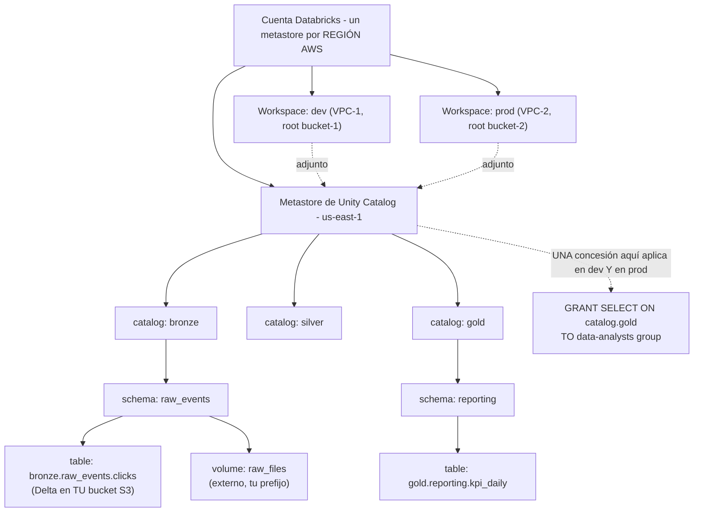
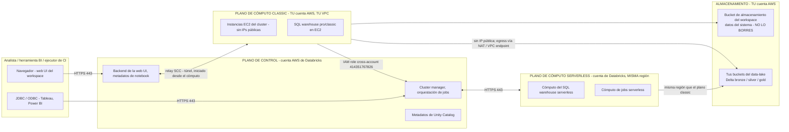
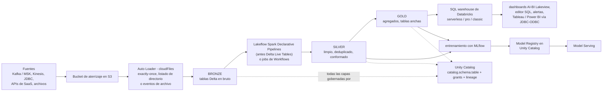
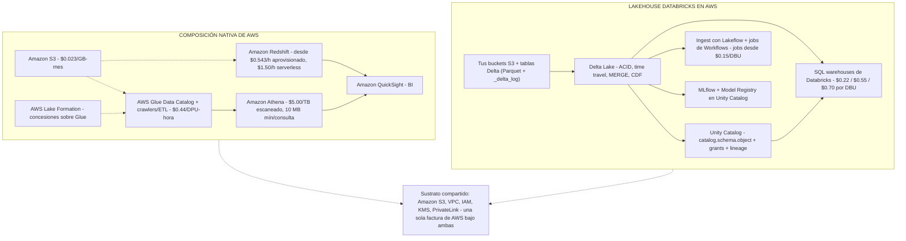
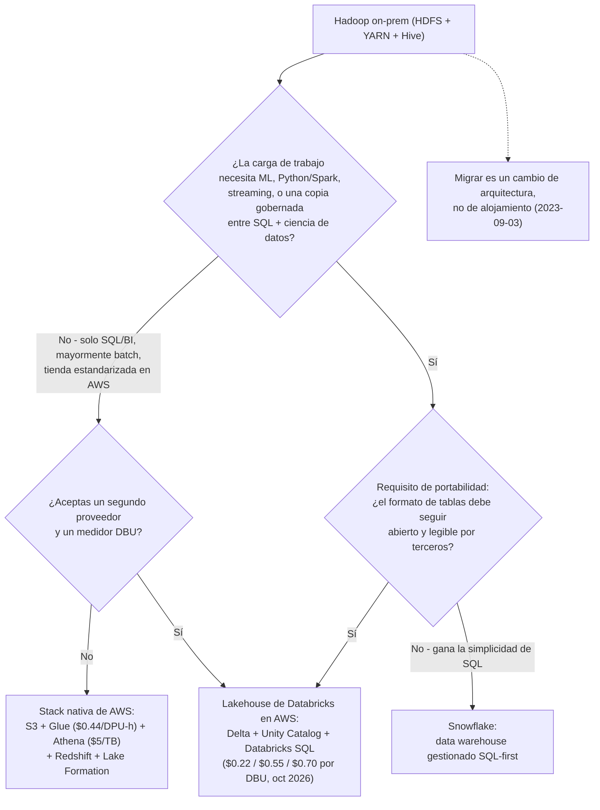

# Arquitectura Lakehouse en Databricks: Planos, Pilares y el Sustrato AWS

Todas las demás lecciones de este curso dan por sentadas tres cosas que todavía no has demostrado a ti mismo: que un lakehouse es una categoría arquitectónica real y no una palabra de marketing, que el software de Databricks se ejecuta en *dos cuentas de la nube a la vez*, y que el dinero llega en *dos facturas separadas*. Si te equivocas en una de esas tres, diseñarás un workspace cuyo data lake está en el bucket equivocado, cuyo modelo de amenazas apunta a la cuenta equivocada y cuyo modelo de costes se queda corto en aproximadamente la mitad.

Esta lección demuestra las tres con fuentes primarias. Cada hecho arquitectónico de esta lección proviene de páginas de `docs.databricks.com` fechadas entre 2026-07-28 y 2026-09-25, de los propios blogs de despliegue de Databricks en AWS (2022-09-30, 2023-01-27) y de las páginas de precios de AWS consultadas en **octubre de 2026**. Todos los precios son de lista en USD, sellados con la fecha en que se leyeron, porque las tarifas de DBU y las de AWS se mueven.

```text
 =============================================================
  DATABRICKS LAKEHOUSE ON AWS - el mapa completo, en oct 2026
 -------------------------------------------------------------
  PLANO DE CONTROL  (cuenta AWS de Databricks, no la tuya)
    web UI - metadatos de notebook y job - cluster manager -
    orquestación de jobs - metadatos de Unity Catalog
        ^  tráfico siempre iniciado DESDE el plano de datos
        |  por el puerto HTTPS 443, vía el relay SCC
        v
  PLANO DE CÓMPUTO
    classic   - instancias EC2 en TU VPC, SIN IPs públicas,
                creadas mediante una IAM role cross-account
    serverless- en la cuenta de Databricks, misma región AWS
                que tu plano classic
        |
        v
  ALMACENAMIENTO  (TU cuenta AWS)
    workspace storage bucket - solo datos del sistema: logs de
      cluster, revisiones de notebook, resultados de job, planes
      de consulta. NO LO BORRES.
    buckets del data-lake    - tablas DELTA bronze/silver/gold,
      gobernadas por storage credentials de Unity Catalog
  -------------------------------------------------------------
  DOS MEDIDORES, SIEMPRE
    AWS te factura ........ EC2, S3, NAT gateway, transferencia de datos
    Databricks te factura  DBU por SKU de cómputo:
      jobs desde $0.15/DBU - SQL classic $0.22 - SQL pro $0.55
      - SQL serverless $0.70 (coste de instancia INCLUIDO)
      (tarifas de lista, consultadas 2026-10; varían por región y plan)
 =============================================================
```

En esta lección vas a:

- definir el **lakehouse** frente al data lake y al data warehouse, usando las tres propiedades que Databricks publicó en 2020 y el patrón medallion (bronze → silver → gold);
- separar los **dos pilares**, Delta Lake para la fiabilidad y el formato, Unity Catalog para la gobernanza, y asociar cada uno al objeto de AWS que toca (tu bucket S3, tu IAM role);
- dibujar la división **plano de control / plano de cómputo**, incluyendo secure cluster connectivity, la IAM role cross-account y la regla de región del plano serverless;
- deducir **dónde viven realmente los datos**, y por qué el bucket de almacenamiento del workspace no es, ni de lejos, tu data lake;
- construir el **mapa de cargas de trabajo** (ingest → curate → serve → ML) y hacer corresponder cada carga de trabajo con el cómputo que la ejecuta;
- leer la **tabla de tarifas DBU a oct 2026** y calcular a mano seis ejemplos resueltos con cifras reales;
- comparar la plataforma **con la stack nativa de AWS, con Snowflake y con Hadoop on-prem** sin repetir el marketing del proveedor como si fuera un hecho;
- estudiar **tres casos de estudio de AWS con nombre propio**, leer el **recuadro de actualizaciones de 2026** y responder **doce preguntas tipo examen**.

---

## 1. Qué es un lakehouse: una arquitectura, tres propiedades

La definición actual de Databricks (databricks.com/blog/what-is-data-lakehouse-article, 2026-06-23) es la que hay que memorizar:

> “Un lakehouse de datos es una nueva arquitectura abierta de gestión de datos que combina la flexibilidad, la eficiencia de costes y la escala de los data lakes con la gestión de datos y las transacciones ACID de los data warehouses, permitiendo la inteligencia empresarial (BI) y el machine learning (ML) sobre todos los datos.”

El post canónico de 2020 que nombró el patrón enumera exactamente tres propiedades definitorias (databricks.com/blog/2020/01/30/what-is-a-data-lakehouse.html, 2020-01-30):

1. **Soporte de transacciones**: transacciones ACID sobre almacenamiento de objetos, de modo que escritores concurrentes y jobs fallidos no pueden corromper una tabla.
2. **Imposición de esquema y gobernanza**: la capa de almacenamiento rechaza los datos que violan el esquema declarado en vez de aceptarlos en silencio.
3. **Apertura**: los formatos de almacenamiento son “abiertos y estandarizados, como Parquet”, de modo que motores distintos del que escribió los datos puedan leerlos.

Compara esas tres propiedades con las dos arquitecturas entre las que se sitúa el lakehouse:

| Propiedad | Lago de datos (S3 + archivos) | Data warehouse (Redshift, Snowflake, Teradata) | **Lakehouse** |
|---|---|---|---|
| Coste y elasticidad del almacenamiento | Excelente (S3 Standard $0.023/GB-mes, consultado 2026-10) | Premium (Redshift aprovisionado desde $0.543/hora, serverless desde $1.50/hora, consultado 2026-10) | **Coste de lago: formatos abiertos en tu S3** |
| Transacciones ACID | Ninguna sin una capa de tablas | Nativas | **Nativas, vía Delta Lake** |
| Imposición de esquema | Ad hoc, muchas veces en tiempo de lectura | Nativa | **Nativa, en tiempo de escritura** |
| BI sobre datos estructurados | Débil | Fuerte | **Fuerte (Databricks SQL, ANSI SQL con extensiones de Delta)** |
| ML / Python / Spark sobre todos los datos | Fuerte pero sin gobernar | Débil, requiere exportación | **Fuerte y gobernado (Unity Catalog)** |
| Dependencia del formato | Baja (Parquet) | Alta (propietario) | **Baja (Parquet + registro de Delta en tu bucket)** |

La frase “permitir BI y ML sobre todos los datos” es todo el caso de negocio: los data warehouse obligan a elegir entre SQL gobernado y ML utilizable, y los lagos obligan a elegir entre almacenamiento barato y datos de confianza. El lakehouse elimina ambas elecciones al poner una gestión de tablas de nivel data warehouse directamente sobre el almacenamiento de lago.

### 1.1 El patrón medallion

Databricks documenta el diseño lógico estándar como la **arquitectura medallion**, “un patrón de diseño de datos usado para organizar lógicamente los datos en un lakehouse ... (desde las tablas de la capa Bronze ⇒ Silver ⇒ Gold)” (databricks.com/blog/what-is-medallion-architecture, 2022-03-09):

- **Bronze**: en bruto, solo inserciones, todo lo que llegó, con los metadatos de origen intactos.
- **Silver**: limpiado, deduplicado, conformado, una fila por entidad del mundo real.
- **Gold**: agregados de nivel de negocio y tablas anchas listas para BI, dashboards y feature stores.

Las capas son *lógicas*. Físicamente son tablas Delta corrientes en buckets S3 corrientes, separadas por nombres de catálogo o de esquema: por eso la lección 03 (Unity Catalog) y la lección 04 (transacciones de Delta) arrancan desde este diagrama.

- **📚 ¿Sabías que…?** “Lakehouse” es una arquitectura, no un producto de Databricks. El propio post de nombramiento de Databricks de 2020 lo admite: “otros servicios gestionados como BigQuery y Redshift Spectrum tienen algunas de las funciones de lakehouse listadas arriba” (2020-01-30). Snowflake, Amazon Redshift, Microsoft Fabric y otros reivindican hoy funciones de lakehouse. El discriminador en este curso nunca es la palabra: es la combinación de un formato de tablas abierto en *tu* almacenamiento más una capa de gobernanza que abarca todos los motores.

---

## 2. Los dos pilares: Delta Lake y Unity Catalog

Todo lo que Databricks vende en AWS se apoya en dos proyectos de código abierto. El propio encuadre de Databricks de 2024 los empareja explícitamente: “fiabilidad de los datos ... Databricks proporciona Delta Lake” y “gobernanza simplificada ... con la ayuda de Unity Catalog” (databricks.com/blog/lakehouse-common-language-across-enterprise, 2024-06-21).

### 2.1 Pilar uno, Delta Lake: la capa de fiabilidad y formato

Delta Lake es la capa de almacenamiento de código abierto que añade transacciones ACID, imposición de esquema, time travel y gestión escalable de metadatos al almacenamiento de objetos, y es el **formato de tablas por defecto en Databricks**: “el cimiento del lakehouse” (databricks.com/blog/what-is-data-lakehouse, 2020-02-11). Físicamente es simple: un **registro de transacciones write-ahead guardado junto a los archivos Parquet en tu bucket S3** (databricks.com/blog/2020/09/10/diving-deep-into-the-inner-workings-of-the-lakehouse-and-delta-lake.html, página actualizada 2024-06-20).

Lo que eso te compra, todo cubierto en la lección 04: commits serializables, upserts con `MERGE`, change data feed, time travel por versión o por timestamp, check constraints y evolución de esquema bajo reglas explícitas.

### 2.2 Pilar dos, Unity Catalog: la capa de gobernanza

Unity Catalog modela “cada recurso que gobiernas ... como un **objeto securable**”, cubriendo “tablas, vistas, volúmenes, funciones, modelos y servicios”, todos siguiendo “un espacio de nombres de tres niveles (`catalog.schema.object`)” (docs.databricks.com/aws/en/data-governance/unity-catalog, consultado 2026-10). Tres hechos dan forma a todo diseño de AWS que vayas a construir:

- El **metastore es el securable de nivel superior** y está acotado a una región de nube: “el metastore es el objeto securable de nivel superior ... Un metastore contiene todos los objetos securables registrados en Unity Catalog en una sola región de nube” (docs .../unity-catalog/securable-objects).
- Necesitas “un metastore para cada región en la que opere tu organización”, y “los usuarios deben estar en un workspace adjunto a un metastore de su región” (docs .../unity-catalog/create-metastore).
- Las concesiones viajan entre workspaces: “un privilegio concedido en un workspace es efectivo en todos los demás workspaces que comparten ese metastore” (misma fuente).
- En AWS, un **storage credential es una IAM role**: ahí es donde la gobernanza se encuentra con tu cuenta de nube (docs.../securable-objects).

Las tablas y los volúmenes son **gestionados** (Unity Catalog posee tanto la gobernanza como el ciclo de vida de los archivos) o **externos** (Unity Catalog gobierna; tú posees los archivos) (docs .../unity-catalog).



### 2.3 Por qué el emparejamiento importa en AWS

Delta responde “¿puedo confiar en estos bytes?” sin sacarlos de S3. Unity Catalog responde “¿quién puede leer qué bytes?” con un único modelo de concesiones que sobrevive a cambios de workspace, al acotamiento por región y a múltiples cuentas de AWS. Ninguno sustituye al otro: una tabla perfectamente ACID sin concesiones es una fuga sin gobernanza, y un catálogo perfectamente gobernado sobre archivos descuidados es una auditoría esperando a suspenderse.

| Pregunta | Respondida por | El objeto de AWS al que se mapea |
|---|---|---|
| ¿Fue esta escritura atómica? ¿Un job concurrente la corrompió? | **Delta Lake** | Commits JSON de `_delta_log/` junto a Parquet en tu bucket |
| ¿Qué le pasa a esta tabla si el job se cae a mitad de la ejecución? | **Delta Lake** | Retroceso al snapshot anterior |
| ¿Pueden los analistas de finanzas leer `gold.reporting.kpi_daily`? | **Unity Catalog** | Una concesión sobre un securable, comprobada en cada workspace adjunto al metastore |
| ¿Qué IAM role puede leer el prefijo subyacente? | **storage credential de Unity Catalog** | Una **IAM role** cross-account o same-account que tú registras |
| ¿A qué prefijo físico apunta `bronze.raw_events.clicks`? | **external location de Unity Catalog** | Un par ruta S3 + credencial |

---

## 3. Anatomía del workspace: el plano de control y el plano de cómputo

“Databricks opera a partir de un **plano de control** y un **plano de cómputo**” (docs.databricks.com/aws/en/getting-started/high-level-architecture, página actualizada por última vez 2026-09-11). Esta es la frase más testeable de la lección 01 y la que más a menudo distorsionan los ingenieros que solo han leído los blogs de ingeniería más antiguos de Databricks.

### 3.1 Los tres planos

- **Plano de control (cuenta de Databricks).** “El plano de control incluye los servicios backend que Databricks gestiona en tu cuenta de Databricks. El plano de control está ubicado en la cuenta de Databricks, no en tu cuenta de nube” (misma página, 2026-09-11). Ahí vive la web UI, los comandos y metadatos de los notebooks, el cluster manager, la orquestación de jobs y los metadatos de Unity Catalog: cifrados en reposo (databricks.com/blog/best-practices-and-guidance-cloud-engineers-deploy-databricks-aws-part-1, 2022-09-30).
- **Plano de cómputo classic (tu cuenta).** Los clusters y los SQL warehouses pro/classic se ejecutan como instancias EC2 “dentro de la red virtual de cada workspace, en la cuenta AWS del cliente”, lo que da al plano “aislamiento natural porque se ejecuta en la propia cuenta AWS de cada cliente” (docs .../high-level-architecture, 2026-09-11).
- **Plano de cómputo serverless (cuenta de Databricks).** “Databricks crea un plano de cómputo serverless en la misma región AWS que el plano de cómputo classic de tu workspace” y lo aísla “dentro de un límite de red del workspace” (misma página). La misma región que tu plano classic: no una región de Databricks arbitraria.

> Material antiguo, incluidos los propios blogs de despliegue de Databricks de 2022 to 2023, dice **plano de datos** donde la documentación actual dice **plano de cómputo**. Mismo concepto, vocabulario de hoy. Si un tutorial dice “data plane”, se refiere al plano de cómputo classic/serverless descrito aquí.

### 3.2 Secure cluster connectivity: sin puertos abiertos, sin IPs públicas

“Todos los workspaces nuevos se crean con secure cluster connectivity activado por defecto. Secure cluster connectivity significa que las VPC de los clientes no tienen puertos abiertos y que los recursos del plano de cómputo classic no tienen direcciones IP públicas” (docs.databricks.com/aws/en/security/network/classic, actualizado 2026-09-25). Los clusters alcanzan el plano de control a través de un túnel seguro por el **puerto HTTPS 443** hacia un relay SCC, y el tráfico siempre se **inicia desde el plano de cómputo hacia fuera** (databricks.com/blog/...part-1, 2022-09-30). No existe ninguna ruta de entrada que Databricks pueda abrir, porque no existe ninguna ruta de entrada en absoluto.

La consecuencia que los estudiantes se pierden: **SCC no es “sin egress”.** Los clusters todavía necesitan una ruta de salida, NAT gateway, internet gateway o PrivateLink, para alcanzar el plano de control y las APIs de AWS, y un endpoint de gateway de S3 mantiene el tráfico de S3 sobre la columna vertebral de AWS para que nunca se facture por el NAT (databricks.com/blog/optimizing-aws-s3-access-databricks, 2022-08-11). La lección 02 dimensiona esto correctamente.

### 3.3 La IAM role cross-account: cómo Databricks puede lanzar tu EC2

La creación de un workspace necesita tres configuraciones, **credential** (una IAM role cross-account), **network** (VPC/subredes/grupos de seguridad) y **storage** (el bucket de almacenamiento del workspace), y puede dirigirse desde la consola de cuenta, la Account API o Terraform (docs.databricks.com/aws/en/admin/workspace, 2026-07-28). La credential es un rol que creas en *tu* cuenta cuya política de confianza nombra a la cuenta AWS de Databricks: “crea una nueva IAM role cross-account con una política de acceso... En el campo Account ID, introduce el ID de cuenta de Databricks **414351767826**” (docs.../create-uc-workspace; docs.../administration-guide/account-api/iam-role.html, 2026-01-24), con el ID de tu cuenta de Databricks como external ID. Requisitos previos en esa página: “tener una VPC y un NAT gateway disponibles en tu cuenta AWS, en la región del workspace”.



```matching
{
  "question": "Relaciona cada plano o ubicación de almacenamiento con lo que realmente posee en AWS (a oct 2026):",
  "pairs": [
    {"left": "Plano de control (cuenta AWS de Databricks)", "right": "Backend de la web UI, METADATOS de notebook y de job, cluster manager, orquestación de jobs, metadatos de Unity Catalog: nunca los datos de tus tablas"},
    {"left": "Plano de cómputo classic (tu cuenta AWS, tu VPC)", "right": "Instancias EC2 de los clusters y de los SQL warehouses pro/classic, sin IPs públicas, alcanzadas solo por HTTPS 443 a través del relay SCC"},
    {"left": "Plano de cómputo serverless (cuenta AWS de Databricks)", "right": "Cómputo SQL y de jobs serverless, creado en la MISMA región AWS que tu plano de cómputo classic, aislado en un límite de red del workspace"},
    {"left": "Bucket de almacenamiento del workspace (tu cuenta AWS)", "right": "Solo datos del sistema del workspace: logs de cluster, revisiones de notebook, resultados de job, planes de consulta; borrarlo es irrecoverable"},
    {"left": "Tus buckets del data-lake (tu cuenta AWS)", "right": "Tablas Delta bronze/silver/gold sobre Parquet, direccionadas a través de storage credentials y external locations de Unity Catalog"}
  ],
  "explanation": "La división es de propiedad, no de geografía: los metadatos y la orquestación viven en la cuenta de Databricks; el cómputo en bruto (classic) y todo el almacenamiento viven en la tuya; el cómputo serverless es la única carga de trabajo que corre en la cuenta de Databricks y aun así en tu región. La trampa es el bucket de almacenamiento del workspace: está en TU cuenta, al lado de tu lago, y parece un bucket de datos, pero solo contiene datos del sistema del workspace. Databricks es explícito: «no borres ni modifiques el almacenamiento del workspace en tu cuenta de nube ... si se elimina el almacenamiento del workspace, el workspace no se puede recuperar» (docs .../high-level-architecture, actualizado 2026-09-11)."
}
```

> [!WARNING]
> ⚠️ **El bucket de almacenamiento del workspace (el viejo «root bucket») no es tu data lake, y no se puede borrar.** Tres reglas, todas oficiales: (1) “los workspaces classic requieren que proporciones un bucket S3 y un prefijo para usarlos como bucket de almacenamiento del workspace” (docs.../high-level-architecture, 2026-09-11): ahí se guardan los logs de cluster, las revisiones de notebook, los resultados de job, los planes de consulta y el estado de las bibliotecas. (2) “No borres ni modifiques el almacenamiento del workspace en tu cuenta de nube... Si se elimina el almacenamiento del workspace, el workspace no se puede recuperar” (misma página). (3) La guía de despliegue es tajante: “es buena práctica que este bucket no se use para datos de clientes ni para múltiples workspaces” (databricks.com/blog/...part-2, 2023-01-27). Tus tablas bronze/silver/gold pertenecen a **buckets separados y con un propósito propio**, gobernados a través de Unity Catalog. Dos workspaces compartiendo un root bucket, o PII de clientes volcadas ahí, son ambos fallos de diseño que te morderán en la lección 02 y en la lección 11.

---

## 4. Dónde viven realmente los datos (y dónde no)

Un workspace classic tiene tres superficies de almacenamiento en *tu* cuenta AWS, y solo una de ellas es el lago:

| Superficie | Propietario | Contenido | Regla |
|---|---|---|---|
| **Bucket de almacenamiento del workspace** (blogs antiguos: “root bucket”) | Tú | Logs de cluster, revisiones de notebook, resultados de ejecución de jobs, resultados de consultas SQL, planes de consulta | Nunca borrar, nunca compartir entre workspaces, nunca guardar ahí datos de clientes |
| **Workspace file system** | Almacenamiento del workspace gestionado por Databricks | Notebooks, consultas SQL, dashboards, alertas, repos, bibliotecas, archivos Python/YAML | Colabora aquí; es de naturaleza de metadatos, no datos analíticos |
| **Tus buckets del data-lake** | Tú | Tablas Delta (Parquet + `_delta_log/`) para bronze/silver/gold, y volúmenes externos | Gobernados por storage credentials y external locations de Unity Catalog |

Dos distinciones de la documentación oficial evitan los errores clásicos:

1. **Datos del sistema del workspace frente a DBFS root.** La documentación los separa explícitamente: “DBFS root es un sistema de archivos accesible por el usuario, mientras que los datos del sistema del workspace los usan internamente las funciones de Databricks”: incluso cuando ambos están en el mismo bucket. DBFS root y los montajes de DBFS son **legacy y no se recomiendan** para diseños nuevos (docs.../high-level-architecture, 2026-09-11).
2. **Tablas gestionadas frente a externas.** Los archivos de una tabla Delta *gestionada* viven donde Unity Catalog los puso (sigue siendo tu S3, bajo una ruta que UC gestiona); los archivos de una tabla *externa* viven en un prefijo que ya posees, y UC gobierna solo los metadatos. Ambas son “tus datos”: ninguna está en el bucket de almacenamiento del workspace.

Los workspaces serverless cambian la historia del almacenamiento del *workspace* (los datos del workspace van al almacenamiento predeterminado gestionado por Databricks), pero no cambian la historia del lago: las tablas analíticas siguen viviendo en **tus** buckets S3, alcanzados a través de Unity Catalog. La pregunta del plano de datos y la pregunta del almacenamiento son preguntas separadas.

- **📚 ¿Sabías que…?** La terminología se ha desplazado dos veces. El blog de despliegue de Databricks de 2023 dice **S3 root bucket**; la documentación actual dice **workspace storage bucket**; y el “data plane” de esos mismos blogs es hoy el **compute plane**. Cuando leas un tutorial antiguo o un sitio de preparación de exámenes y use las palabras viejas, traduce: root bucket → workspace storage bucket, data plane → plano de cómputo classic/serverless. Los materiales didácticos que todavía presentan “data plane” como vocabulario actual de Databricks están citando posts de ingeniería de 2022 to 2023.

---

## 5. El mapa de cargas de trabajo: ingest → curate → serve → ML

El flujo de referencia de este curso, ensamblado a partir de la documentación de Auto Loader, medallion, Databricks SQL y MLflow:

1. **Fuentes**: Kafka/Amazon MSK, Kinesis, JDBC, APIs de SaaS y archivos aterrizan cargas útiles en bruto en un **bucket de aterrizaje en S3**.
2. **Ingest**: **Auto Loader** (`cloudFiles`) descubre de forma incremental los archivos nuevos y escribe tablas Delta **bronze**. “Procesa de forma incremental y eficiente los archivos de datos nuevos a medida que llegan al almacenamiento en la nube” y su almacén de estado clave-valor “asegura que los datos se procesan exactamente una vez” (docs.../auto-loader, página fechada 2026-04-01).
3. **Curate**: **Lakeflow Spark Declarative Pipelines** (el Delta Live Tables renombrado) o jobs corrientes limpian, deduplican y conforman hacia **silver**, y luego agregan hacia **gold**.
4. **Serve**: **Databricks SQL** sobre un warehouse serverless/pro/classic impulsa dashboards, el editor SQL, alertas y BI externo vía JDBC/ODBC. “Databricks SQL es un data warehouse en la nube construido sobre una arquitectura lakehouse. Se ejecuta directamente sobre tu data lake, admite ANSI SQL con extensiones de Delta Lake” (docs.../aws/en/sql/, actualizado 2026-09-11).
5. **Learn**: **MLflow** registra experimentos, y el **Model Registry en Unity Catalog** proporciona “control de acceso centralizado, auditoría, lineage y descubrimiento de modelos entre workspaces” (docs.../manage-model-lifecycle).
6. **Govern**: Unity Catalog cubre cada capa, con lineage y auditoría disponibles desde las system tables.



### 5.1 Mapeo de carga de trabajo → cómputo

Esta tabla es el núcleo práctico de la lección; toda decisión posterior de coste empieza aquí.

| Carga de trabajo | Patrón interactivo típico | Cómputo que deberías usar | Medidor |
|---|---|---|---|
| Exploración, PySpark/SQL ad hoc | Corto, compartido, interactivo | **Clusters de notebook (all-purpose)** | Tarifa DBU all-purpose + tu EC2 |
| Pipelines de producción, ETL nocturno | Programado, de propósito único, efímero | **Clusters de job (Workflows)** | Tarifa DBU de jobs (“desde $0.15/DBU”, databricks.com/pricing, consultado 2026-10) + tu EC2 |
| Dashboards, BI, informes SQL | Alta concurrencia, elástico, debe pararse solo | **SQL warehouse: serverless, pro o classic** | Tarifa DBU de SQL: $0.22 / $0.55 / $0.70 |
| Transformaciones batch/streaming declarativas | Grafo de transformaciones dependientes, expectations | **Lakeflow Spark Declarative Pipelines** | Tarifa DBU de pipeline + cómputo |
| Entrenamiento de ML y serving de modelos | GPU/alta memoria, respaldado por registry | **Clusters de job / ML serverless, Model Serving** | Tarifas DBU de jobs/AI |
| Apps de datos interactivas | Backends web de baja latencia | **Databricks Apps** | DBU del SKU de la app (SKU de ejemplo $0.75/DBU, databricks.com/product/pricing/databricks-apps, consultado 2026-10) |

- **📚 ¿Sabías que…?** El mismo código PySpark puede costar materialmente menos como job que como cluster interactivo. La guía de gestión de costes de Databricks enuncia el mecanismo directamente: “el mejor rendimiento junto con las tarifas por DBU más bajas que ofrecen los clusters de job conducen a un ahorro de costes drástico” (databricks.com/blog/best-practices-cost-management-databricks, 2022-10-18). Los clusters de job son efímeros y de propósito único; los clusters all-purpose se quedan calientes para los humanos. La brecha exacta de tarifas entre SKUs varía por región y nivel de plan: Databricks solo publica cifras de “desde” en sus páginas públicas de precios (consultadas 2026-10), así que revisa siempre tu propio contrato en lugar de memorizar una cuadrícula de un sitio de terceros.

```dragdrop
{
  "question": "Coloca el flujo de referencia del lakehouse en el orden en que los datos realmente lo recorren en AWS:",
  "items": [
    "Las fuentes aterrizan archivos y eventos en bruto en un bucket de aterrizaje en S3",
    "Auto Loader (cloudFiles) descubre archivos nuevos y escribe las tablas Delta BRONZE exactamente una vez",
    "Lakeflow Spark Declarative Pipelines o jobs de Workflows limpian y deduplican hacia SILVER",
    "Las agregaciones construyen las tablas de negocio GOLD",
    "Un SQL warehouse de Databricks sirve gold a dashboards, alertas y BI externo vía JDBC-ODBC",
    "MLflow entrena sobre tablas de features silver/gold y registra modelos en Unity Catalog"
  ],
  "correctOrder": [
    "Las fuentes aterrizan archivos y eventos en bruto en un bucket de aterrizaje en S3",
    "Auto Loader (cloudFiles) descubre archivos nuevos y escribe las tablas Delta BRONZE exactamente una vez",
    "Lakeflow Spark Declarative Pipelines o jobs de Workflows limpian y deduplican hacia SILVER",
    "Las agregaciones construyen las tablas de negocio GOLD",
    "Un SQL warehouse de Databricks sirve gold a dashboards, alertas y BI externo vía JDBC-ODBC",
    "MLflow entrena sobre tablas de features silver/gold y registra modelos en Unity Catalog"
  ],
  "explanation": "Aterrizar -> ingest -> curate -> serve -> learn, con Unity Catalog gobernando todo ello. Dos hechos de orden importan. Primero, Auto Loader está entre el bucket de aterrizaje y bronze porque es el componente que proporciona el estado exactly-once; escribir archivos en bruto directamente en una tabla bronze con una lectura naive de Spark pierde esa garantía. Segundo, el serving y el ML leen de las capas curadas: gold para BI, silver o gold para features: por lo que el orden medallion no es decoración sino un grafo de dependencias. El nombre histórico del paso de transformación era Delta Live Tables; Databricks lo renombró a Lakeflow Spark Declarative Pipelines (docs.../ldp/concepts/where-is-dlt, 2026-01-23)."
}
```

---

## 6. Los dos medidores: tarifas DBU y la factura de AWS

“Una Databricks Unit (DBU) es una unidad normalizada de potencia de procesamiento en la Databricks Lakehouse Platform usada con fines de medición y precios” (databricks.com/product/pricing, consultado 2026-10), y el glosario la define como “unidades de capacidad de procesamiento por hora según el tipo de instancia de VM” (docs .../resources/glossary, actualizado 2026-08-15). Pagas DBUs por el *procesamiento*; AWS te factura por separado por *el metal y la fontanería*.

### 6.1 La tabla de tarifas, a octubre de 2026

| SKU | Tarifa de lista | ¿Incluye el coste de instancia de AWS? | Fuente (consultada 2026-10) |
|---|---|---|---|
| SQL warehouse **Classic** de Databricks | **$0.22 / DBU** | No: AWS factura EC2 por separado | databricks.com/product/pricing/databricks-sql |
| SQL warehouse **Pro** de Databricks | **$0.55 / DBU** | No: AWS factura EC2 por separado | misma |
| SQL warehouse **Serverless** de Databricks | **$0.70 / DBU** | **Sí** | misma |
| Lakeflow Jobs (ingeniería de datos), “desde” | **$0.15 / DBU** | No | databricks.com/pricing |
| Data warehousing, “desde” | **$0.22 / DBU** |: | databricks.com/pricing |
| Cargas de trabajo interactivas, “desde” | **$0.40 / DBU** |: | databricks.com/pricing |
| AI, “desde” | **$0.07 / DBU** |: | databricks.com/pricing |
| Databricks Apps (SKU de ejemplo) | **$0.75 / DBU** |: | databricks.com/product/pricing/databricks-apps |
| Lakehouse//RT (Beta), us-east-1 | **$0.55 Premium / $0.70 Enterprise por DBU**, 30% de descuento introductorio (se emiten menos DBU) **hasta 2027-01-31** | Sí (serverless) | docs .../sql-warehouse/real-time-pricing, actualizado 2026-09-22 |

Precios de lista, USD, consultados en **2026-10**; varían según la nube, la región y el nivel de plan (AWS: Standard/Premium/Enterprise) y según el contrato. Databricks publica cifras de “desde” para jobs y SKUs interactivas: trata cualquier cuadrícula completa que encuentres en un sitio de costes de terceros como no verificada.

> [!IMPORTANT]
> **Dos facturas, una plataforma: no dupliques el recuento, no lo infrarrecuentes.** En un workspace classic, **AWS factura las instancias EC2, el NAT gateway, las peticiones de S3 y la transferencia de datos de tu cuenta**, mientras **Databricks factura los DBU por el procesamiento que esas instancias hicieron**. SQL serverless y los jobs serverless empaquetan el coste de instancia *dentro* de la tarifa DBU; las tarifas classic no. “Los precios de Databricks se basan en tu uso de cómputo. El almacenamiento, la red y los costes relacionados variarán...” (databricks.com/product/pricing, consultado 2026-10). Los dos errores más comunes de los estudiantes son (a) citar la cifra de DBU como coste total de un cluster, y (b) aplicar una tarifa serverless a un workspace classic (o al revés) y “descubrir” un ahorro fantasma del 30 to 60%.

### 6.2 Ejemplo resuelto E1: un cluster de jobs de 4 nodos, ambos medidores

**A oct 2026.** Un job nocturno se ejecuta en un cluster de 4 nodos cuyo tipo de instancia se factura a **3 DBU/hora** en el SKU de jobs.

```text
Ejemplo resuelto E1 - cluster de jobs de 4 nodos, una hora, en oct 2026
Medidor Databricks:
  4 nodos x 3 DBU/h x $0.15/DBU (jobs, "starting at") = $1.80 / hora
Medidor AWS (tu cuenta, varía por tipo de instancia/region/RI-o-spot):
  EC2 para 4 nodos ...................... facturado por AWS, por separado
  Procesamiento de datos del NAT gateway  facturado por AWS, por separado
  PUT/GET de S3 sobre la tabla Delta ..... facturado por AWS, por separado
TOTAL (solo lado Databricks) ............ $1.80 / hora
Ejecución nocturna de 8 horas x 30 días:
  4 x 3 x 8 x 30 = 2,880 DBU x $0.15 ... = $432.00 / mes (lado DBU)
```

**Lectura:** el lado DBU de un job nocturno de 8 horas es de **$432/mes a la tarifa publicada de “desde” para jobs**; el lado AWS es una segunda factura que tienes que sumar tú. Mismo código, SKU distinto: si esa carga de trabajo se dirigiera de forma interactiva a la tarifa interactiva de “desde” de **$0.40/DBU**, los mismos 2,880 DBU facturarían **$1,152**: una diferencia de **2.67×** por un cómputo que hace la misma aritmética. Esa brecha es la razón por la que las cargas de trabajo de producción van en clusters de job y el BI va en warehouses.

### 6.3 Ejemplo resuelto E2: un mes de warehouse serverless, y el impuesto por inactividad

Un equipo ejecuta un SQL warehouse serverless **8 horas/día, 20 días/mes**, con una media de **4 DBU/hora** (el serverless auto-escala dentro de la hora; 4 DBU/h es una media plausible para un equipo pequeño: ajústala a tus propias cifras de `system.billing.usage` cuando llegues allí).

```text
Ejemplo resuelto E2 - SQL warehouse serverless, en oct 2026
Tiempo de ejecución ..... 8 h/día x 20 días = 160 h
DBU consumidos .......... 160 h x 4 DBU/h = 640 DBU
Cargo de Databricks ..... 640 x $0.70 (SQL serverless) = $448.00 / mes
Cargo de AWS ............ $0 extra (la tarifa DBU serverless incluye el coste de instancia)

Contrafactual - el mismo warehouse dejado corriendo 24/7 durante 30 días:
  720 h x 4 DBU/h = 2,880 DBU x $0.70 = $2,016.00 / mes
  prima por inactividad = $2,016 - $448 = $1,568 / mes (un sobrecoste de 4.5x)
```

**Lectura:** la propia documentación de Databricks advierte que “los SQL warehouses inactivos siguen acumulando cargos de DBU y de instancia en la nube hasta que se detienen” (docs .../compute/sql-warehouse/create). Valores por defecto de auto-stop a oct 2026: **pro/classic 45 minutos** (mínimo 10), **serverless 10 minutos** (mínimo en la UI 5; la API puede fijar **1 minuto**). Bajar el auto-stop de 45 minutos a 10 en un warehouse pro usado en sesiones de 30 minutos es un ahorro *gratuito*; dejar algo encendido 24/7 es la partida evitable más grande de todo un entorno de BI.

```plot
{
  "type": "bar",
  "title": "Coste mensual del lado de Databricks del mismo mes de 640 DBU (tarifas de lista, a oct 2026)",
  "xLabel": "SKU de cómputo",
  "yLabel": "Cargo de Databricks por 640 DBU (USD)",
  "xKey": "sku",
  "dataKeys": ["monthly_usd"],
  "data": [
    {"sku": "SQL Classic $0.22/DBU", "monthly_usd": 140.8},
    {"sku": "SQL Pro $0.55/DBU", "monthly_usd": 352},
    {"sku": "SQL Serverless $0.70/DBU", "monthly_usd": 448},
    {"sku": "Interactive from $0.40/DBU", "monthly_usd": 256}
  ]
}
```

### 6.4 Ejemplo resuelto E3: la factura de almacenamiento bajo las mismas tablas

El propio almacenamiento del lago, para poner escala: **1 TB (1,024 GB) retenido un mes en S3 Standard** a $0.023/GB-mes (aws.amazon.com/s3/pricing, consultado 2026-10) = **$23.55/mes**, más las peticiones PUT/GET (el GET de S3 Standard cuesta $0.0004 por cada 1,000 peticiones). Un entorno curado de gold de 10 TiB cuesta por tanto unos **$235/mes solo por retenerlo**: aproximadamente la mitad de lo que factura un único SQL warehouse serverless inactivo en la misma ventana (E2). El almacenamiento es la mitad *barata* de un lakehouse; la disciplina de cómputo es donde está el dinero.

```fillblank
{
  "question": "Completa la frase de facturación de un lakehouse de Databricks en AWS, usando las tarifas de lista de octubre de 2026:",
  "template": "Databricks mide el procesamiento en {{1}}, que para un SQL warehouse cuesta $0.22/DBU en Classic, $0.55/DBU en Pro y $0.70/DBU en {{2}} - el único de los tres cuya tarifa ya incluye el coste de instancia de AWS: mientras que AWS factura por separado los recursos EC2, {{3}} y S3 que viven en tu propia cuenta.",
  "answers": {
    "1": "DBUs",
    "2": "Serverless",
    "3": "NAT gateway"
  },
  "distractors": ["vCPUs", "Unidades de almacén de datos", "Glue Data Catalog", "EC2", "Kinesis", "Athena", "Lambda", "internet gateway", "CloudWatch"],
  "explanation": "El DBU es el medidor de procesamiento de Databricks («una unidad normalizada de potencia de procesamiento», databricks.com/product/pricing, consultado 2026-10); los tres niveles de SQL warehouse son $0.22 / $0.55 / $0.70 por DBU (databricks.com/product/pricing/databricks-sql, consultado 2026-10), y solo el nivel serverless empaqueta el coste de la instancia en la nube. El tercer espacio es el recurso del lado de AWS que más a menudo sorprende a los equipos: el egress del plano de cómputo classic pasa por un NAT gateway, que factura el procesamiento de datos y las horas en tu factura de AWS: la trampa de las «dos facturas» de la sección 6.1. Distractores como «EC2» o «internet gateway» son recursos de AWS pero no el que nombra esta frase; «Unidades de almacén de datos» (data warehouse units) es un término de Snowflake, no de Databricks."
}
```

---

## 7. La misma consulta, tres medidores: Databricks frente a la stack nativa de AWS

La alternativa nativa de AWS es una composición, no un producto: **S3** para almacenamiento, **Glue Data Catalog** para metadatos/crawlers/ETL, **Athena** para SQL serverless, **Redshift** para un warehouse aprovisionado o serverless, **Lake Formation** para concesiones, **QuickSight** para BI. Precios, todos consultados en 2026-10:

| Componente nativo de AWS | Precio de lista | Modelo de medición |
|---|---|---|
| Amazon S3 Standard | desde **$0.023/GB-mes**; GET **$0.0004/1,000 peticiones** | por GB-mes + por petición |
| AWS Glue (crawlers, ETL, mantenimiento de tablas) | **$0.44 por DPU-hora**, facturado por segundo, mínimo 1 minuto | por DPU-hora |
| Amazon Athena | **$5.00 por TB escaneado**, redondeado al MB más cercano, **mínimo 10 MB por consulta** | por byte escaneado |
| Amazon Redshift | aprovisionado desde **$0.543/hora**; serverless desde **$1.50/hora**; Spectrum por bytes escaneados (mínimo 10 MB/consulta) | por nodo-hora / por hora / por byte |
| AWS Lake Formation | concesiones sobre el catálogo de Glue | (capa de gobernanza) |
| Databricks SQL (para contraste) | **$0.22 / $0.55 / $0.70 por DBU** | por DBU-hora de procesamiento |

### 7.1 Ejemplo resuelto E4: Athena frente a Databricks SQL para una carga de trabajo de dashboard

Un dashboard escanea **20 GB/día** durante **22 días/mes**.

```text
Ejemplo resuelto E4 - medidor mensual de consultas, en oct 2026
Ruta Athena:
  20 GB/día x 22 días = 440 GB = 0.4297 TB
  0.4297 TB x $5.00/TB ............... = ~$2.15 / mes
  (más el mínimo de 10 MB por consulta - aquí despreciable)
Ruta Databricks SQL (ilustrativa):
  un warehouse serverless con media de 4 DBU/h x 60 h de dashboards
  = 240 DBU x $0.70 .................. = $168.00 / mes
```

**Lectura:** para un dashboard de BI ligero y con many escaneos, el medidor por TB de Athena es *drásticamente* más barato: **~$2.15 frente a ~$168**. Ese es un resultado honesto, no un fallo de Databricks: el precio por byte castiga *los escaneos pesados repetidos, el ETL, los joins, MERGE, el streaming y el ML*, y premia *las lecturas raras, anchas y ad hoc*. La pregunta de diseño nunca es “qué motor es más barato” sino “qué medidor encaja con la forma de la carga de trabajo”. Exactamente por eso la lección 15 enseña la atribución de costes a través de `system.billing.usage` en lugar de benchmarks de proveedores.

### 7.2 Ejemplo resuelto E5: dimensionar la zona de aterrizaje

Un pipeline aterriza **500 GB/día** de archivos en bruto en S3 Standard.

```text
Ejemplo resuelto E5 - almacenamiento de la zona de aterrizaje, en oct 2026
Diario ................. 500 GB
Mensual ............... 500 x 30 = 15,000 GB
Almacenamiento ........ 15,000 GB x $0.023/GB-mes = $345.00 / mes
Peticiones ............ más LIST/GET/PUT a las tarifas publicadas por petición
Elección de retención . 30 días en bruto + compactación de Delta ~= $345 un mes
                        180 días en bruto sin limpieza = ~$2,070 acumulado
```

**Lectura:** $345/mes para *retener* un mes de datos de aterrizaje. Dos palancas dominan: **retención** (limpiar los archivos de origen después de que Auto Loader haga commit; las opciones `cleanSource` de la documentación existen exactamente para esto) y **tamaño de archivo** (miles de archivos diminutos inflan tanto las cargos por peticiones como la planificación de Delta). El almacenamiento es predecible; los lados de peticiones y de cómputo son donde los diseños fallan en silencio.

### 7.3 Las dos stacks, lado a lado



| Capacidad | Stack nativa de AWS | Lakehouse de Databricks |
|---|---|---|
| Formato de tablas / ACID | Tablas de Glue sobre Parquet/ORC; el soporte de Delta en Athena es **solo lectura, solo catálogo de Glue, motor v3, sin time travel** (docs.aws.amazon.com/athena/latest/ug/delta-lake-tables.html) | Delta Lake por defecto, ACID/MERGE/CDF completos |
| Gobernanza | Concesiones de Lake Formation sobre Glue | Securables de Unity Catalog entre workspaces y motores |
| Batch + streaming en un solo motor | Glue para ETL, Kinesis/MSK para streaming, Glue/Athena para micro-batches | Auto Loader + Structured Streaming + Lakeflow en un solo runtime |
| SQL / BI | Athena (por TB), Redshift (por nodo/hora) | Databricks SQL (por DBU), serverless, dashboards Lakeview |
| ML | SageMaker (plataforma aparte, copias aparte) | MLflow + registry de UC sobre las mismas tablas |
| Superficie de proveedor | Solo AWS, sin segunda factura | Segundo proveedor + medidor DBU |
| Mejor encaja con | Solo SQL, mayormente batch, tienda estandarizada en AWS que no quiere un proveedor de plataforma | SQL + Python/Spark + streaming + ML mezclados que quieren una copia gobernada |

- **📚 ¿Sabías que…?** La propia AWS documenta la interoperabilidad de Delta en lugar de tratarla como competencia: Athena “puede leer tablas de Delta Lake almacenadas en Amazon S3 directamente sin tener que generar archivos de manifiesto ni ejecutar la sentencia MSCK REPAIR” (docs.aws.amazon.com/athena/latest/ug/delta-lake-tables.html, consultado 2026-10): con los límites honestos de solo lectura, motor v3 y sin time travel. Glue, EMR y Redshift Spectrum también pueden procesar tablas Delta en S3 (databricks.com/blog/databricks-aws-guide-data-ai-summit-2023-featuring-labcorp-conde-nast-grammarly-vizio-ntt-data, 2023-06-23). Los formatos abiertos cortan en ambas direcciones: tu lago es portable, y los motores de tus competidores pueden leerlo.

---

## 8. El sustrato AWS que heredas (dimensionamiento resuelto)

La lección 02 va en profundidad; aquí está el marco. Los requisitos centrales de un despliegue estándar son “una VPC gestionada por el cliente, conectividad de plano de datos a plano de control, una IAM role cross-account y un root bucket S3” (databricks.com/blog/...part-2, 2023-01-27), y “para cada workspace debe haber un mínimo de dos subredes privadas dedicadas, cada una con una máscara de red entre /17 y /26, y en zonas de disponibilidad separadas” (misma fuente). La guía bien arquitecturada añade: “crea una VPC con un bloque CIDR mínimo /18 para despliegues de workspace” (docs.databricks.com/aws/en/lakehouse-architecture/security-compliance-and-privacy/best-practices, 2026-07-16).

### 8.1 Ejemplo resuelto E6: dimensionamiento de subredes para un workspace

```text
Ejemplo resuelto E6 - matemática de subredes del workspace, en oct 2026
Requisito ........ >= 2 subredes privadas, máscara /17 .. /26, AZs separadas,
                   dedicadas por workspace (NO reutilizadas entre workspaces)
Elección .......... /24 cada una = 251 direcciones IPv4 utilizables cada una
                   (AWS reserva 5 de las 256 por subred: red, router,
                   DNS, uso futuro y broadcast - documentación de AWS VPC)
Comprobación ..... cada nodo consume 1 IP primaria de ENI (+ IPs secundarias
                   por ENI según el tipo de instancia); 254 IPs es de sobra
                   para un cluster de 20 nodos más las NIC del cluster,
                   pero los workspaces concurrentes necesitan sus propias subredes
                   => dev y prod NUNCA comparten subredes
Si necesitas escala .. /22 = 1,022 IPs utilizables por AZ; /20 = 4,094; el techo es
                   /17 = 32,766 IPs utilizables, el suelo es /26 = 62
También se requiere .. NAT gateway para egress (SCC no es «sin egress»),
                   VPC endpoints para S3/API donde sea posible para evitar
                   cargos de procesamiento de datos del NAT, y >= 1 AZ por
                   subred (se requieren 2 AZs)
```

**Lectura:** dos `/24` en AZs separadas satisfacen la regla publicada con holgura. La restricción que realmente muerde es **“dedicadas por workspace”**: las subredes no se agrupan entre workspaces, así que cada workspace que creas consume sus propias dos subredes del CIDR de tu VPC. Planifica la VPC como `/18` (según la guía bien arquitecturada) y podrás alojar varios workspaces antes de tocar el enrutamiento.

A oct 2026 existen tres arquitecturas de referencia de red de Databricks, **Managed security**, **Hardened connectivity** e **Isolated environment**, que difieren en la profundidad de PrivateLink, las listas de acceso por IP, los controles de egress serverless y el PrivateLink de entrada, mientras que **secure cluster connectivity más una VPC gestionada por el cliente están presentes en las tres** (docs.databricks.com/aws/en/security/network/deployment-architecture, consultado 2026-10). Observa también los límites por plan: la VPC gestionada por el cliente, la creación del metastore de UC y el SQL serverless todos requieren el **plan Premium o superior** (docs.../permissions, actualizado 2026-09-11; docs.../create-metastore; docs.../admin/sql/serverless).

---

## 9. Elegir la plataforma: Snowflake, y el Hadoop que estás dejando

### 9.1 Frente a Snowflake

Encuadre neutral, porque ambos proveedores publican páginas de comparación que se contradicen entre sí:

| Dimensión | Snowflake (según su publicación) | Databricks (según su publicación) | Posición didáctica |
|---|---|---|---|
| Formato | Data warehouse propietario, agnóstico de nube | Lakehouse abierto: Delta/Parquet en *tu* S3 | La portabilidad favorece los formatos abiertos |
| Fortaleza SQL / BI | Fortaleza central, concurrencia madura | Fuerte vía Databricks SQL (ANSI SQL + extensiones de Delta) | Ambos son creíbles para entornos SQL-first |
| ML / Python / Spark | En crecimiento, generalmente superficie aparte | De primera clase: notebooks, MLflow, registry de UC | Los equipos intensivos en ML favorecen Databricks |
| Streaming | Centrado en micro-batch | Auto Loader, Structured Streaming, Lakeflow | El streaming intenso favorece a Databricks |
| Carga operativa | Muy baja (totalmente gestionado) | Baja: media (tú posees VPC, IAM, subredes) | Snowflake es más sencillo de poner en marcha |
| Calidad de la evidencia | Página de comparación de snowflake.com (“As of November 5, 2025”) | Página de comparación de databricks.com | **Ambas son marketing; ninguna cifra es un hecho** |

Ambas páginas hacen afirmaciones de rendimiento y de precio/rendimiento opuestas. Este curso trata cada una de ellas como una **afirmación de proveedor con fecha**, nunca como un hecho, y nunca cita un multiplicador cara a cara como algo que un estudiante deba memorizar. Elige Snowflake cuando la carga de trabajo es SQL/BI puro con concurrencia predecible y quieres la simplicidad del warehouse; elige Databricks cuando ML/AI, streaming, Python/Spark y la portabilidad de formatos abiertos son requisitos de primera clase; cada vez más, coexisten: la federación y Delta Sharing significan que los dos no se excluyen mutuamente (véanse las lecciones 12 y 17).

### 9.2 Frente a Hadoop on-prem (HDFS + YARN + Hive)

La guía de migración de Databricks es directa: “aunque migres cargas de trabajo heredadas de Hadoop on-premises a servicios gestionados en la nube como EMR ... seguirás tropezando con los mismos problemas de fiabilidad y escalabilidad” (databricks.com/solutions/migration/hadoop, 2023-09-03). El mapeo es mecánico:

| Hadoop on-prem | Lakehouse en AWS |
|---|---|
| HDFS (replicación 3×, desperdicio de capacidad) | S3 (durabilidad de diseño 99.999999999%, $0.023/GB-mes) |
| YARN (cluster fijo, capacidad estática) | Clusters elásticos + planos de cómputo serverless |
| Metastore de Hive (local al workspace, dispersión de ACL) | Unity Catalog (un metastore por región, securables, lineage) |
| Formatos de archivo solo-HDFS / marts propietarios | Parquet abierto + Delta, legibles por otros motores |
| ETL solo batch | Auto Loader + Structured Streaming + Lakeflow |

Las habilidades y las inversiones de BI se trasladan precisamente *porque* los formatos siguen abiertos: no hay que reescribir el SQL para pasar de tablas estilo Hive a tablas gold respaldadas por Delta, y la lección 03 cubre esa ruta de migración (`hive_metastore` aparece como catálogo legacy de nivel superior).

### 9.3 La decisión, dibujada



El diagrama codifica tres reglas prácticas de esta lección: la portabilidad de formatos abiertos y las cargas de trabajo mixtas apuntan al lakehouse; solo SQL más preferencia por un solo proveedor apunta a la stack nativa de AWS; y un entorno Hadoop no se “levanta y se traslada”: se rediseña (por eso la lección 03 trata la migración de `hive_metastore` como una ruta de primera clase).

---

## 10. Por qué la apertura es un requisito de diseño, no un eslogan

Tres hechos concretos de interoperabilidad, cada uno oficial y cada uno fechado:

1. **Tus datos son Parquet más un registro de transacciones de Delta en tu bucket S3**: cualquier motor que entienda el formato puede leerlos sin exportarlos de un almacén propietario (databricks.com/blog/2020/01/30/what-is-a-data-lakehouse.html).
2. **Lectores del lado de AWS:** Athena lee tablas Delta registradas en el catálogo AWS Glue (solo lectura, motor v3, sin time travel: docs.aws.amazon.com/athena/latest/ug/delta-lake-tables.html, consultado 2026-10).
3. **Lectores de terceros vía Unity Catalog:** “a través de APIs abiertas y concesión de credenciales, Unity Catalog permite que motores externos como Trino, DuckDB, Apache Spark, Daft y motores integrados con Iceberg REST catalog, como Dremio, accedan a las tablas gestionadas” (docs .../tables/managed, 2026-08-18), a través de la **Unity REST API** y el **Iceberg REST Catalog (IRC)** (docs .../external-access/unity-rest, 2026-08-26).

El punto estratégico es del propio Databricks: un lakehouse propietario guarda los datos “en formatos que solo un proveedor puede leer”, mientras que los datos de un lakehouse abierto viven en “Delta Lake y Apache Iceberg ... sobre formatos de archivo abiertos como Apache Parquet” (databricks.com/blog/what-open-lakehouse-open-data-standards-explained, 2026-06-16). En AWS eso importa de una segunda manera: **tú conservas los datos en tu cuenta**, de modo que un cambio de motor, una disputa con el proveedor o una adquisición no se convierte en un proyecto de extracción de datos.

- **📚 ¿Sabías que…?** El compartir también es abierto: **Delta Sharing** es un protocolo abierto (cubierto en la lección 12), mientras que **Databricks Marketplace** es el catálogo comercial construido encima. Como los archivos subyacentes son formatos abiertos, un share puede ser consumido por motores que no son Databricks: que es la respuesta práctica a “¿qué pasa con mi lago si algún día nos vamos?”.

---

## 11. Las trampas: once confusiones que este curso no te deja conservar

1. **“Data plane” frente a “compute plane”.** Lo mismo; la documentación desde 2026 dice *plano de cómputo*, dividido en *classic* y *serverless*. Los blogs antiguos dicen plano de datos.
2. **El plano de control ≠ tu cuenta.** Está en la cuenta AWS de Databricks, pero el bucket de almacenamiento del workspace en un workspace classic está en *tu* cuenta. Confundir los dos produce un modelo de amenazas equivocado.
3. **El bucket de almacenamiento del workspace ≠ data lake.** Solo datos del sistema; no se puede borrar; nunca se comparte entre workspaces; nunca se usa para datos de clientes.
4. **DBFS root es legacy.** Puede estar en el mismo bucket que los datos del sistema del workspace, pero “DBFS root es un sistema de archivos accesible por el usuario, mientras que los datos del sistema del workspace los usan internamente las funciones de Databricks” (docs.../high-level-architecture, 2026-09-11), y DBFS root/montajes no se recomiendan para diseños nuevos.
5. **Los renombramientos son reales; verifica antes de enseñar o responder.** Delta Live Tables → **Lakeflow Spark Declarative Pipelines** (docs .../ldp/concepts/where-is-dlt, 2026-01-23; nota de versión 2025-11-12) sin **migración de código requerida** y con los SKUs classic todavía empezando por `DLT`; SQL endpoints → **SQL warehouses** (2023); Model Registry del workspace → **Models in Unity Catalog**.
6. **Dos facturas.** DBU más tu factura de AWS; las tarifas serverless empaquetan instancias, las tarifas classic no.
7. **SKU de jobs frente a all-purpose.** El mismo código puede costar materialmente menos como job, la guía oficial lo dice (2022-10-18), pero la brecha exacta depende de la región y del contrato, así que revisa en lugar de memorizar.
8. **Athena leyendo Delta ≠ soporte completo de Delta.** Solo catálogo de Glue, motor v3, **solo lectura, sin time travel**.
9. **El alcance del metastore es regional, no por workspace.** Un metastore por región; `hive_metastore` es un catálogo legacy de nivel workspace.
10. **Serverless es condicional.** Se requiere plan Premium, y el cómputo serverless corre en la cuenta de Databricks **en la misma región AWS** que tu plano classic.
11. **Los benchmarks de proveedores son marketing en ambas direcciones.** Las páginas Databricks-vs-Snowflake y Snowflake-vs-Databricks hacen afirmaciones mutuamente contradictorias; cítalas solo como “afirmación de proveedor, sellada en fecha”.

> [!WARNING]
> ⚠️ **Trampas de día de examen y de día de diseño para esta lección:**
> - **El plano de control está en la cuenta de Databricks; el plano de cómputo classic está en la tuya; el bucket de almacenamiento del workspace está en la tuya pero no es tu lago.** Tres respuestas de propiedad distintas: si te equivocas en una, tu diagrama de flujo de datos está mal.
> - **SCC significa sin IPs públicas y sin puertos de entrada abiertos, no sin egress.** Sigue necesitando NAT/VPC endpoints/PrivateLink, y los endpoint de gateway de S3 existen para mantener el tráfico de S3 (y su facturación por NAT) fuera de la ruta pública.
> - **Nunca publiques una cifra de DBU sin su SKU, región, nivel de plan y fecha.** “Desde $0.15/DBU” para jobs y la tabla de niveles de SQL ($0.22/$0.55/$0.70) son las cifras que Databricks publica abiertamente a oct 2026; las cuadrículas completas por SKU que circulan en sitios de terceros no son oficiales.
> - **Las tarifas serverless incluyen el coste de instancia; las tarifas classic no.** Compararlas sin sumar EC2 al lado classic inventa ahorros.
> - **Delta Live Tables todavía aparece por todas partes en tutoriales antiguos y en historias de clientes**: significa Lakeflow Spark Declarative Pipelines desde 2026-01-23.

### Actualizaciones de 2026 (en octubre de 2026)

> [!NOTE]
> **Qué cambió en la plataforma de la que depende esta lección:**
> - **2026-01-23: Delta Live Tables es ahora Lakeflow Spark Declarative Pipelines.** “El producto antes llamado Delta Live Tables (DLT) se ha actualizado a Lakeflow Spark Declarative Pipelines (SDP)... no se requiere ninguna migración” (docs.databricks.com/aws/en/ldp/concepts/where-is-dlt, página fechada 2026-01-23; el aviso de renombramiento anterior “Lakeflow Declarative Pipelines” está fechado 2025-11-12). Los SKUs classic todavía empiezan por `DLT`.
> - **2026-01-06: liquid clustering está maduro y funciona a escala.** “Liquid Clustering llegó a disponibilidad general en 2024... clientes ejecutándolo a escala, incluidos docenas con **tablas a escala de petabyte** en producción” (databricks.com/blog/debunking-8-data-layout-myths-why-liquid-clustering-outperforms-partitioning, 2026-01-06). Los debates sobre particionado/ZORDER de los materiales antiguos quedan superados; la lección 14 lo cubre.
> - **2026-09-22, Los warehouses Lakehouse Real-Time (Beta) publican precios para AWS.** SKU `LAKEHOUSE_SERVERLESS_COMPUTE`, us-east-1 **$0.55 Premium / $0.70 Enterprise por DBU**, con un “30% de descuento introductorio hasta el 31 de enero de 2027... tus cargas de trabajo consumen un 30% menos de DBU” (docs.../sql-warehouse/real-time-pricing, actualizado 2026-09-22), estado Beta, así que vuelve a comprobar después de la ventana promocional.
> - **2026-08-18 / 2026-08-26: Unity Catalog abre las tablas gestionadas a motores externos** mediante concesión de credenciales más la **Unity REST API** y el **Iceberg REST Catalog**, nombrando Trino, DuckDB, Spark, Daft, Flink y Dremio (docs.../tables/managed, 2026-08-18; docs.../external-access/unity-rest, 2026-08-26). La interoperabilidad es hoy una superficie de API, no una afirmación de blog.
> - **2026-05-04, el propio blueprint de certificación sigue el rebranding.** La guía de examen Data Engineer Associate de registro fechada el 4 de mayo de 2026 dice “trabajar con **Lakeflow Jobs**” donde la versión del 30 de julio de 2025 decía “Databricks Workflows”, confirmación oficial de que la nomenclatura Workflows/Lakeflow se ha asentado (PDF de guías de examen, ambas versiones consultadas en 2026-10).

---

## Casos Reales

> **📋 Caso A: Biogen (farmacéutica, Cloud: AWS)**
> **Desafío.** La informática on-premises no podía escalar a petabytes de genómica: “un pipeline que antes requería 2 semanas para procesar 700,000 variantes”.
> **Stack en AWS.** Databricks for Genomics runtime con Delta Lake, junto a la plataforma DNAnexus en AWS: la página de la historia de cliente lleva la propia etiqueta `Cloud: AWS` de Databricks.
> **Resultado reportado.** “2 million Genomic variants analyzed in 15 minutes · 2 drug targets Discovered” (https://www.databricks.com/customers/biogen, página sin fecha, consultada 2026-10; origen de la historia 2020-11).
> **Encaja con esta lección.** L01: la migración a un lakehouse en la nube medida en *semanas de cómputo eliminadas*, no solo en dólares: el concepto de lakehouse y el pilar de formatos abiertos hicieron portable un entorno on-prem.
> ⏳ *Nota temporal: una cifra de origen 2020; trátala como lo que Biogen reportó entonces, no como una garantía de plataforma de 2026.*

> **📋 Caso B: Punchh / fidelización de minoristas (Cloud: AWS)**
> **Desafío.** AWS MySQL superado, un data warehouse demasiado costoso, herramientas sin ACID, y informes de Tableau pagando un join de 12 tablas en cada actualización.
> **Stack en AWS.** Databricks SQL sobre Delta Lake bronze/silver/gold, notebooks, Tableau encima: `Cloud: AWS` en la página de la historia.
> **Resultado reportado.** “10x Faster time-to-insight · 30% Lower operational costs · 12% Increase in customer satisfaction” (https://www.databricks.com/customers/punchh, página sin fecha, consultada 2026-10; origen de la historia 2021-09).
> **Cita.** “Podemos almacenar datos en bruto así como datos refinados en el mismo lakehouse.”: Jagan Mangalampalli, Punchh (misma URL).
> **Encaja con esta lección.** L01 secundario: el diseño medallion de la sección 5 como control de *coste*: las tablas gold pre-unidas ganan a los joins de 12 vías en el momento del informe.
> ⏳ *Nota temporal: reportado en 2021; las proporciones son de Punchh, no de un SLA de plataforma.*

> **📋 Caso C: Rivian (vehículos eléctricos, Cloud: AWS)**
> **Desafío.** Terabytes de datos de vehículos al día desde más de 70,000 vehículos, con herramientas heredadas que “luchaban por escalar pipelines de forma rentable” y equipos estancados que bloqueaban el ML de mantenimiento predictivo.
> **Stack en AWS.** Databricks SQL, Delta Lake, Unity Catalog y liquid clustering: `Cloud: AWS` en la página de la historia; el recopilatorio de 100 casos de uso nombra “Unity Catalog para la gobernanza de datos, Delta Tables para el almacenamiento y Liquid Clustering para la distribución de datos” en el ML de predicción de carga en tiempo real.
> **Resultado reportado.** “1,000+ platform users, a 75% increase from a year ago” (https://www.databricks.com/customers/rivian, página sin fecha, consultada 2026-10); “50% better runtime performance” (https://www.databricks.com/your-ai/customers/rivian, 2024-05-30); detalle de la stack en https://www.databricks.com/blog/data-intelligence-action-100-data-and-ai-use-cases-databricks-customers (2025-07-09).
> **Encaja con esta lección.** L01: un lakehouse gobernado en AWS que alimenta dashboards *y* ML de producción desde las mismas tablas, que es la afirmación de “copia única de datos” de la sección 1 hecha concreta.
> ⏳ *Nota temporal: las métricas son de páginas de 2024 to 2025; sellalas con su fecha cuando las cites.*

> **Veredicto comparativo: lakehouse frente a stack nativa de AWS, Snowflake y Hadoop on-prem**
> - **Frente a un lago de datos puro (S3 + Parquet, sin capa de tablas):** conservas el coste y la elasticidad pero pierdes ACID, imposición de esquema y time travel. Si nada falla, se sobrescribe nunca o se ejecuta de forma concurrente, un lago en bruto es más barato; en producción, el registro de transacciones de Delta es el seguro más barato de toda la stack.
> - **Frente a la stack nativa de AWS (S3 + Glue + Athena + Redshift + Lake Formation):** la stack nativa de AWS gana para tiendas SQL-only, mayormente batch, estandarizadas en AWS que quieren un solo proveedor y medidores por uso ($5.00/TB en Athena, $0.44/DPU-hora en Glue). Databricks gana cuando necesitas una copia gobernada para SQL *y* Python/Spark *y* streaming *y* ML: al precio de un segundo proveedor, un medidor DBU y un plan Premium para el conjunto completo de funciones. Ambos se apoyan en el mismo S3, y AWS documenta la interoperabilidad de Delta en lugar de cercarla.
> - **Frente a Snowflake:** Snowflake gana en simplicidad de SQL/BI puro y en cero trabajo de VPC; Databricks gana en ML/AI, streaming y portabilidad de formatos abiertos. No publiques ningún multiplicador cara a cara en un documento de diseño: las páginas de comparación de ambos proveedores son marketing sellado en fecha que contradice a la otra parte.
> - **Frente a Hadoop on-prem (HDFS + YARN + Hive):** no es una contienda reñida en 2026, S3 reemplaza a HDFS, el cómputo elástico/serverless reemplaza a YARN, y Unity Catalog reemplaza al metastore de Hive, mientras que los formatos abiertos conservan tus activos de SQL y BI. La advertencia honesta: “aunque migres cargas de trabajo heredadas de Hadoop on-premises a servicios gestionados en la nube como EMR... seguirás tropezando con los mismos problemas de fiabilidad y escalabilidad” (2023-09-03), lo que estás cambiando es la arquitectura, no el alojamiento.

> [!SUCCESS]
> **Conclusiones Clave (Key Takeaways):**
> 1. **Un lakehouse = economía de lago + gestión de data warehouse sobre formatos abiertos.** Tres propiedades publicadas (2020-01-30): soporte de transacciones ACID, imposición de esquema y gobernanza, apertura sobre formatos estandarizados como Parquet: habilitando “BI y ML sobre todos los datos” (definición fechada 2026-06-23).
> 2. **Dos pilares, dos funciones.** Delta Lake = fiabilidad/formato (registro write-ahead junto a Parquet en *tu* S3); Unity Catalog = gobernanza (securables `catalog.schema.object`, un metastore **por región**, un privilegio aplica en cada workspace adjunto, los storage credentials son IAM roles en AWS).
> 3. **Los planos.** Plano de control en la cuenta de Databricks (UI, metadatos de notebook/job, cluster manager, metadatos de UC); plano de cómputo classic como EC2 en *tu* VPC con **sin IPs públicas y sin puertos abiertos** (SCC por defecto, HTTPS 443, egress iniciado desde el cómputo); plano de cómputo serverless en la cuenta de Databricks **en la misma región AWS**.
> 4. **Propiedad del almacenamiento.** Bucket de almacenamiento del workspace = datos del sistema (logs, revisiones, resultados de job, planes): **no se puede borrar, no se comparte, no es tu lago**; tus tablas Delta bronze/silver/gold viven en tus propios buckets tras los storage credentials de UC; DBFS root es legacy.
> 5. **Mapa de cargas de trabajo.** Fuentes → aterrizaje en S3 → Auto Loader (exactly-once) → bronze → Lakeflow SDP/jobs → silver → gold → Databricks SQL/AI-BI/BI externo; MLflow entrena sobre silver/gold y registra en UC. Empareja el cómputo: exploración → all-purpose, producción → clusters de job, BI → SQL warehouse, transformaciones → Lakeflow, ML → MLflow/UC.
> 6. **Dos medidores, lista de oct 2026:** SQL **$0.22 Classic / $0.55 Pro / $0.70 Serverless** por DBU (serverless incluye el coste de instancia; classic no), jobs **desde $0.15/DBU**, interactivas **desde $0.40/DBU**, AI **desde $0.07/DBU**: más tu factura de AWS por EC2/NAT/S3. Valores por defecto de auto-stop: **45 min** pro/classic, **10 min** serverless.
> 7. **Matemática resuelta que puedes reutilizar:** cluster de jobs de 4 nodos a 3 DBU/h = **$1.80/h** (**$432/mes** para un calendario de 8h × 30d), E1; mes serverless de 640 DBU = **$448** frente a **$2,016** si se deja 24/7, E2; 1 TiB en S3 Standard = **$23.55/mes**, E3; 440 GB de escaneos de dashboard en Athena ≈ **$2.15/mes** frente a ~$168 de DBU de warehouse, E4; zona de aterrizaje de 500 GB/día = **$345/mes**, E5; dos subredes `/24` dedicadas en AZs separadas satisfacen la regla `/17`, `/26`, E6.
> 8. **Comparaciones, mantenidas con honestidad:** la stack nativa de AWS (Glue $0.44/DPU-hora, Athena $5.00/TB, Redshift desde $0.543/h) encaja con tiendas batch SQL-only; Snowflake encaja con la simplicidad SQL/BI pura; Hadoop se mapea mecánicamente a S3/YARN→elástico/UC. Las cifras de proveedor contra proveedor son afirmaciones con fecha, nunca hechos.
> 9. **La apertura es estructural:** tus datos son Parquet + un registro de Delta en tu bucket; Athena lee Delta en solo lectura vía Glue (motor v3, sin time travel); la Unity REST API y el Iceberg REST Catalog exponen las tablas de UC a Trino, DuckDB, Flink, Spark y Dremio (2026-08-18 / 2026-08-26).
> 10. **Los nombres se han movido:** Delta Live Tables → **Lakeflow Spark Declarative Pipelines** (2026-01-23, sin migración, los SKUs `DLT` permanecen); SQL endpoints → **SQL warehouses**; Model Registry del workspace → **Models in Unity Catalog**; “data plane” → **compute plane**.

---

## Preguntas de Práctica (Practice Questions)

```question
{
  "id": "dbl-01-q1",
  "type": "multiple-choice",
  "question": "El post de Databricks de 2020 que nombró el patrón lakehouse enumera tres propiedades definitorias. ¿Cuál es el conjunto correcto?",
  "options": [
    "Soporte de transacciones ACID, imposición de esquema y gobernanza, y apertura sobre formatos estandarizados como Parquet",
    "Almacenamiento columnar, escalado elástico y un plano de control totalmente gestionado",
    "Replicación sin copia, schema-on-read y formatos de tablas propietarios",
    "Identidad gestionada, cifrado en reposo y clasificación automática por capas"
  ],
  "correct": 0,
  "explanation": "El post de Databricks del 2020-01-30 nombra exactamente esos tres: soporte de transacciones, imposición de esquema y gobernanza, y apertura («los formatos de almacenamiento que usan son abiertos y estandarizados, como Parquet»). La opción B mezcla atributos reales del lakehouse con un detalle de despliegue; la opción C es errónea porque los formatos de lakehouse son abiertos, no propietarios; la opción D enumera funciones de seguridad de la nube que pertenecen a cualquier arquitectura, incluido un bucket S3 corriente."
}
```

```question
{
  "id": "dbl-01-q2",
  "type": "true-false",
  "question": "El plano de control de Databricks se ejecuta en la cuenta AWS de Databricks y no en la cuenta AWS del cliente, mientras que el cómputo EC2 de un workspace classic se ejecuta en la cuenta del cliente.",
  "options": ["Verdadero", "Falso"],
  "correct": 0,
  "explanation": "Verdadero. «El plano de control está ubicado en la cuenta de Databricks, no en tu cuenta de nube» y el cómputo classic se ejecuta «dentro de la red virtual de cada workspace, en la cuenta AWS del cliente» (docs.../high-level-architecture, actualizado 2026-09-11). La trampa es el bucket de almacenamiento del workspace: está en la cuenta del cliente aunque lo gestionen funciones de Databricks: la ubicación de la cuenta y la propiedad no son la misma pregunta."
}
```

```question
{
  "id": "dbl-01-q3",
  "type": "multiple-choice",
  "question": "Secure cluster connectivity está activado por defecto en todos los workspaces nuevos a oct 2026. ¿Qué garantiza realmente?",
  "options": [
    "Que las VPC de los clientes no tengan puertos abiertos y que los recursos del plano de cómputo classic no tengan direcciones IP públicas; los clusters alcanzan el plano de control por el puerto HTTPS 443",
    "Que nunca salga tráfico de la VPC del cliente, de modo que los costes de NAT gateway y de egress por internet desaparezcan",
    "Que todo el tráfico de S3 evada la facturación de AWS y se cobre solo como DBU",
    "Que el PrivateLink de entrada sea obligatorio y que las listas de acceso por IP ya no sean necesarias"
  ],
  "correct": 0,
  "explanation": "La documentación es literal: «las VPC de los clientes no tienen puertos abiertos y los recursos del plano de cómputo classic no tienen direcciones IP públicas» (docs.../security/network/classic, actualizado 2026-09-25), con un túnel seguro por HTTPS 443. La opción B es la lectura errónea clásica: SCC restringe las rutas de entrada, no el egress; los clusters todavía necesitan NAT/IGW o PrivateLink, y por eso importa un endpoint de gateway de S3 (2022-08-11). La opción D es errónea: el PrivateLink de entrada aparece solo en la arquitectura de referencia «Isolated environment»."
}
```

```question
{
  "id": "dbl-01-q4",
  "type": "multiple-choice",
  "question": "¿Dónde viven las tablas Delta bronze/silver/gold en un workspace classic de Databricks en AWS?",
  "options": [
    "En tus propios buckets S3, direccionadas a través de storage credentials y external locations de Unity Catalog: nunca en el bucket de almacenamiento del workspace",
    "En el bucket de almacenamiento del workspace, junto a los logs de cluster y las revisiones de notebook",
    "En el plano de control de Databricks, cifradas con una clave gestionada por Databricks",
    "En DBFS root, que es la ubicación recomendada para todas las tablas de producción nuevas"
  ],
  "correct": 0,
  "explanation": "El bucket de almacenamiento del workspace contiene datos del sistema del workspace - «logs de cluster, revisiones de notebook, resultados de job y bibliotecas» - y Databricks aconseja que «no se use para datos de clientes ni para múltiples workspaces» (2023-01-27), mientras que la documentación advierte que borrarlo es irrecoverable (2026-09-11). Las tablas analíticas están en tus buckets bajo rutas gestionadas por UC o externas. La opción D falla porque DBFS root/montajes son legacy y no se recomiendan; la opción C es errónea porque el plano de control guarda metadatos, no datos de tablas."
}
```

```question
{
  "id": "dbl-01-q5",
  "type": "multiple-choice",
  "question": "Tu organización opera en us-east-1 y eu-west-1 y quiere gobernanza de Unity Catalog en ambas. ¿Cuántos metastores necesitas y cómo se comportan las concesiones?",
  "options": [
    "Dos metastores: uno por región: y un privilegio concedido en un workspace es efectivo en todos los demás workspaces que comparten ese metastore",
    "Un metastore global para toda la cuenta, porque los catalogs son de ámbito de cuenta en todas partes",
    "Un metastore por workspace, de modo que cada workspace pueda gobernarse de forma independiente",
    "Dos metastores, pero las concesiones deben reaplicarse manualmente en cada workspace"
  ],
  "correct": 0,
  "explanation": "«Debes tener un metastore para cada región en la que opere tu organización» (docs .../create-metastore), y «un privilegio concedido en un workspace es efectivo en todos los demás workspaces que comparten ese metastore» (docs .../securable-objects). Porque «tu cuenta de Databricks tiene un metastore por región, los catalogs están inherentemente aislados por región» (docs .../catalogs). Los distractores invierten ambas reglas: los metastores por workspace son exactamente lo que Unity Catalog reemplazó, y reaplicar concesiones por workspace describe el modelo legacy de hive_metastore/ACL."
}
```

```question
{
  "id": "dbl-01-q6",
  "type": "true-false",
  "question": "Según la documentación de enero de 2026, Delta Live Tables ha sido renombrado a Lakeflow Spark Declarative Pipelines, y los pipelines existentes requieren una migración de código.",
  "options": ["Verdadero", "Falso"],
  "correct": 1,
  "explanation": "Falso: el renombramiento es real, la migración no. «El producto antes llamado Delta Live Tables (DLT) se ha actualizado a Lakeflow Spark Declarative Pipelines (SDP)... no se requiere ninguna migración» (docs.../ldp/concepts/where-is-dlt, página fechada 2026-01-23); los SKUs classic todavía empiezan por DLT. La trampa es asumir que todo rebranding implica trabajo: este es solo de nombre y empaquetado, y por eso las historias antiguas de clientes que citan «Delta Live Tables» siguen siendo citables con el nombre moderno entre corchetes."
}
```

```question
{
  "id": "dbl-01-q7",
  "type": "multiple-choice",
  "question": "Un equipo quiere el cómputo adecuado más barato para un job ETL nocturno programado y para un dashboard de BI de alta concurrencia. ¿Qué emparejamiento es correcto?",
  "options": [
    "ETL nocturno en clusters de job de Workflows (jobs desde $0.15/DBU); dashboards en un SQL warehouse ($0.22/$0.55/$0.70 por DBU)",
    "ETL nocturno en un cluster all-purpose; dashboards en el mismo cluster all-purpose por simplicidad",
    "ETL nocturno en un SQL warehouse; dashboards en cómputo all-purpose interactivo",
    "Ambos deberían usar Databricks Apps a $0.75/DBU, que es el SKU publicado más barato"
  ],
  "correct": 0,
  "explanation": "Las cargas de trabajo se mapean al cómputo: las ejecuciones de producción programadas de propósito único van en clusters de job - «las tarifas por DBU más bajas que ofrecen los clusters de job conducen a un ahorro de costes drástico» (2022-10-18) - mientras que el BI va en SQL warehouses que se paran solos y escalan para la concurrencia (tarifas de lista consultadas 2026-10). La opción B paga tarifas interactivas para una ejecución automática; la opción C ejecuta informes SQL sobre cómputo general y ETL sobre capacidad de warehouse; la opción D cita el SKU de Apps ($0.75/DBU), que es la cifra más cara de la tabla, no la más barata."
}
```

```question
{
  "id": "dbl-01-q8",
  "type": "multiple-choice",
  "question": "Un cluster de jobs de 4 nodos promedia 3 DBU/hora en el SKU de jobs. Usando la tarifa publicada «desde» de $0.15/DBU (a oct 2026), ¿cuál es el coste del lado de Databricks de una ejecución de 8 horas?",
  "options": ["$14.40", "$36.00", "$1.80", "$432.00"],
  "correct": 0,
  "explanation": "4 nodos x 3 DBU/h x 8 h = 96 DBU; 96 x $0.15 = $14.40 por la ejecución (y 2,880 DBU x $0.15 = $432 por un mes de 30 días de esas ejecuciones: ejemplo resuelto E1). La opción B es el mismo número de DBU a una tarifa de estilo warehouse; la opción C es la cifra por hora, no la ejecución de 8 horas; la opción D es la cifra mensual. Recuerda también que este es solo el medidor de Databricks - AWS factura el EC2 por separado, y cualquier cuadrícula de terceros de tarifas «oficiales» por SKU más allá de las cifras publicadas de «desde» no está verificada."
}
```

```question
{
  "id": "dbl-01-q9",
  "type": "multiple-choice",
  "question": "¿Qué afirmación sobre los precios de los SQL warehouses de Databricks a octubre de 2026 es correcta?",
  "options": [
    "SQL Serverless cuesta $0.70/DBU e incluye el coste de la instancia en la nube; SQL Classic ($0.22/DBU) y SQL Pro ($0.55/DBU) no lo incluyen, así que AWS sigue facturando EC2 por ellos",
    "Los tres tipos de warehouse incluyen el coste de instancia, así que la factura de AWS es idéntica en todos los casos",
    "SQL Classic es el nivel más caro porque se ejecuta en la cuenta del cliente",
    "Los warehouses serverless no se pueden parar automáticamente, así que siempre facturan menos que los classic"
  ],
  "correct": 0,
  "explanation": "La tabla de niveles publicada (databricks.com/product/pricing/databricks-sql, consultado 2026-10) es $0.22 Classic / $0.55 Pro / $0.70 Serverless, con el serverless empaquetando explícitamente el coste de la instancia en la nube: y por eso las tarifas DBU de classic/pro parecen más bajas pero llegan con una segunda factura de AWS. La opción B no duplica nada y se pierde por completo la división; la opción C confunde la ubicación de la cuenta con el precio; la opción D está al revés: el serverless usa por defecto un auto-stop de 10 minutos (pro/classic 45 minutos), y un warehouse sin parar «sigue acumulando cargos de DBU y de instancia en la nube» (docs.../compute/sql-warehouse/create)."
}
```

```question
{
  "id": "dbl-01-q10",
  "type": "multiple-choice",
  "question": "Un colega afirma que Amazon Athena soporta Delta Lake por completo, así que el equipo puede prescindir por completo de Databricks SQL. ¿Qué es exacto a oct 2026?",
  "options": [
    "Athena lee tablas Delta registradas en el catálogo AWS Glue, pero el soporte es de solo lectura, solo motor v3 y sin time travel",
    "Athena lee y escribe tablas Delta con soporte completo de MERGE, time travel y change data feed",
    "Athena solo puede leer tablas Delta que se exportan primero a Iceberg",
    "El soporte de Athena para Delta requiere ejecutar una sentencia MSCK REPAIR en cada consulta"
  ],
  "correct": 0,
  "explanation": "AWS documenta que Athena «puede usar Amazon Athena para leer tablas de Delta Lake almacenadas en Amazon S3 directamente sin tener que generar archivos de manifiesto ni ejecutar la sentencia MSCK REPAIR» - con las limitaciones indicadas «solo tablas con catálogo AWS Glue», «solo motor V3», «sin soporte de time travel» y «solo lectura» (docs.aws.amazon.com/athena/latest/ug/delta-lake-tables.html, consultado 2026-10). La opción A es la única que coincide; la opción B describe Databricks, no Athena; la opción D invierte la documentación; para esta ruta no se necesita MSCK REPAIR."
}
```

```question
{
  "id": "dbl-01-q11",
  "type": "true-false",
  "question": "Las cifras de rendimiento y de precio/rendimiento publicadas en databricks.com/databricks-vs-snowflake y snowflake.com/en/snowflake-vs-databricks deben citarse en los documentos de diseño como benchmarks factuales.",
  "options": ["Verdadero", "Falso"],
  "correct": 1,
  "explanation": "Falso. Ambas páginas son marketing del proveedor y se contradicen entre sí (las afirmaciones de Databricks frente a la página de Snowflake, «As of November 5, 2025»), así que este curso trata cada multiplicador cara a cara como «afirmación de proveedor, sellada en fecha» y nunca como un hecho. Lo que puedes enunciar como hecho son las mecánicas oficiales y con fuente: formatos abiertos en tu S3, la semántica de concesiones de Unity Catalog y los precios de lista publicados con fecha de consulta."
}
```

```question
{
  "id": "dbl-01-q12",
  "type": "multiple-choice",
  "question": "¿Qué par relaciona correctamente una dependencia del lado de AWS con la función de Databricks que habilita en AWS?",
  "options": [
    "IAM role cross-account que confía en la cuenta de Databricks 414351767826 -> aprovisionamiento de cómputo classic en tu VPC; dos subredes privadas /17-/26 en AZs separadas -> configuración de red del workspace",
    "AWS Glue Data Catalog -> el metastore de Unity Catalog; Amazon QuickSight -> SQL warehouses",
    "Un endpoint de gateway de S3 -> secure cluster connectivity (reemplaza al relay SCC)",
    "AWS Lambda -> plano de cómputo serverless; Amazon Kinesis -> el cluster manager del plano de control"
  ],
  "correct": 0,
  "explanation": "La configuración de la credential es una IAM role cross-account que nombra el ID de cuenta AWS de Databricks 414351767826 con tu cuenta de Databricks como external ID, y la creación del workspace requiere «una VPC y un NAT gateway disponibles» más dos subredes privadas dedicadas con máscara entre /17 y /26 en zonas de disponibilidad separadas (docs.../iam-role.html, 2026-01-24; blog de despliegue, 2023-01-27). La opción B confunde el catálogo nativo de AWS con Unity Catalog; la opción C confunde una optimización de la ruta de datos de S3 con el túnel del plano de control SCC; la opción D mapea servicios de AWS a planos que no ocupan: el plano serverless es cómputo gestionado por Databricks, no Lambda."
}
```
