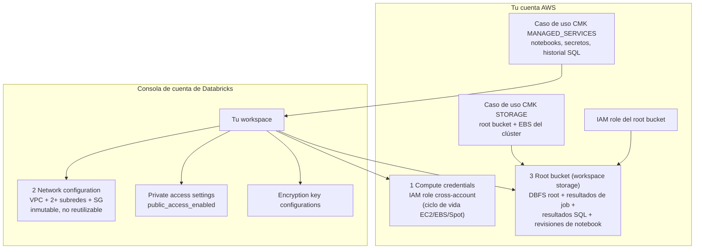
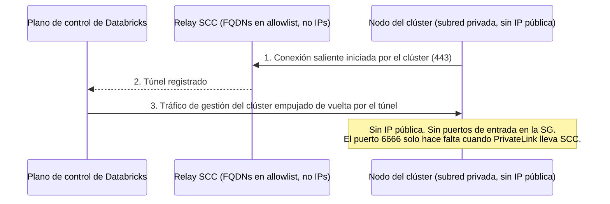
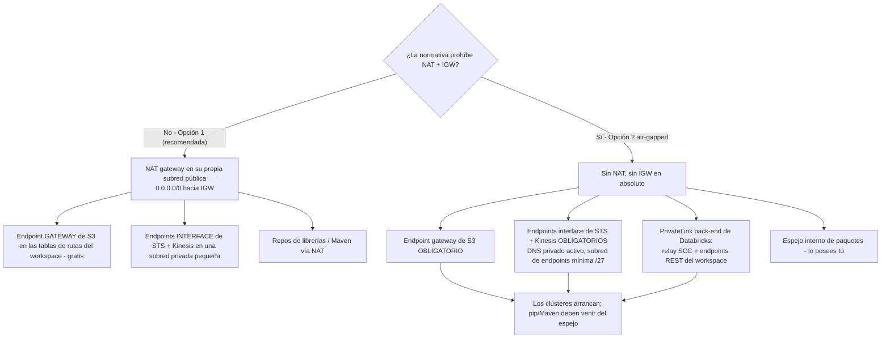
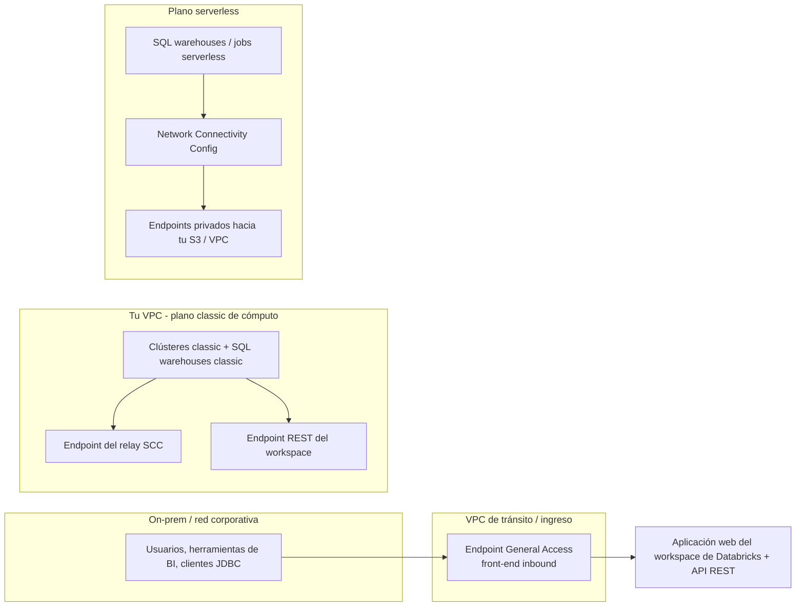
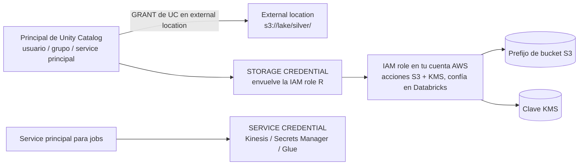
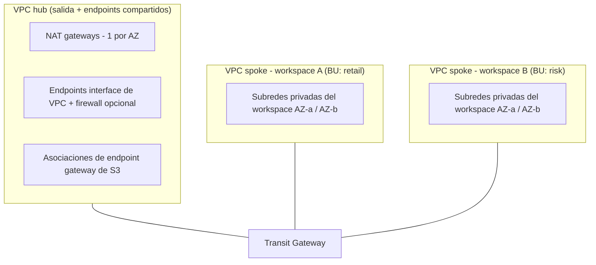

# Fundamentos de AWS para Databricks: diseño de VPC, root bucket, PrivateLink, KMS e IAM

Cada lakehouse de Databricks de este curso se apoya en una única premisa con forma de AWS: **el plano de datos vive en tu VPC, los datos viven en tu S3 y el plano de control habla con ambos por rutas que puedes nombrar en una pizarra**. Si te equivocas con el sustrato, nada aguas abajo te salva: los lanzamientos de clústeres fallan con errores de assume-role crípticos, un clúster de 100 nodos no puede arrancar porque una subred `/26` se quedó sin direcciones, una factura de S3 se dispara porque 1 TB al mes de tráfico de lago da vueltas por un NAT gateway a $0.045/GB, o un firewall que inspecciona TLS mata en silencio cada clúster en cuanto toca los certificados fijados del plano de control.

Cada hecho de abajo proviene de la documentación AWS de Databricks (página de customer-managed VPC *última actualización: 8 oct 2026*; fase de red bien arquitecturada *11 sep 2026*; páginas de PrivateLink *9 oct 2026*), de la Databricks Security Reference Architecture y de las páginas de precios de AWS — todas consultadas en **octubre de 2026**. Haz tú mismo la aritmética; es la única manera de defender un diseño de red en una revisión.

```text
 =============================================================
  EL SUSTRATO AWS DE UN VISTAZO - a oct 2026
 -------------------------------------------------------------
  Plano de control    Cuenta Databricks (notebooks, jobs,
                      metadatos del metastore, historial SQL)
  Plano de cómputo    EC2 en TU VPC - subredes privadas,
                      sin IPs públicas (SCC por defecto)
  Almacenamiento      TU S3: root bucket + external locations
  Confianza           La cuenta de Databricks 414351767826
                      asume roles en TU cuenta (external ID)
  Salida obligatoria  STS, S3, Kinesis (+ RDS, solo HMS heredado)
  PrivateLink         inbound / back-end classic / outbound
  Cifrado             SSE por defecto; CMK STORAGE +
                      MANAGED_SERVICES en Enterprise
  Ruta moderna IAM    UC storage + service credentials
                      (instance profiles = heredados)
 =============================================================
```

En esta lección vas a:

- diseccionar la **anatomía del workspace** — los cuatro objetos de la consola de cuenta con los que se monta un workspace de Databricks sobre AWS y la confianza cross-account que los une;
- dimensionar una **VPC gestionada por el cliente** con la regla documentada `(addresses − 5) ÷ 2`, desde `/26` (29 nodos) hasta `/17` (16,381 nodos), y elegir subredes contra un objetivo real de nodos;
- ejecutar correctamente **secure cluster connectivity (SCC)** — qué elimina, qué no elimina, y por qué el fijado de certificados convierte la inspección TLS en un asesino de clústeres;
- diseñar el **egress** a la manera de Databricks: endpoints **gateway** de S3 (gratis), endpoints **interface** de STS + Kinesis, la economía del NAT y la construcción air-gapped de la Opción 2;
- cablear **los tres sabores de PrivateLink** (inbound, back-end classic, outbound/serverless) con los prerrequisitos correctos y los límites de NCC;
- cifrar el **root bucket y los artefactos del plano de control** con los casos de uso de KMS correctos, y leer la política de la clave línea a línea;
- escribir la **política anotada del root bucket** — la condición `aws:PrincipalTag/DatabricksAccountId` y el deny `unity-catalog/*`;
- elegir entre **instance profiles, storage credentials y service credentials**, y ver por qué la ruta moderna ata IAM a los *principals*, no a las cajas;
- calcular a mano **siete ejemplos resueltos** — la capacidad de la subred, la factura de NAT frente a endpoints, el coste del inventario de endpoints, el coste mensual de KMS, el JSON de la política de confianza, la matriz de security groups y la política del root bucket;
- estudiar **dos casos de clientes de AWS con nombre propio** (Block y Amgen), leer el **recuadro de actualizaciones de 2026** y practicar con **12 preguntas tipo examen** más cuatro comprobaciones interactivas.

---

## 1. Anatomía del workspace: los cuatro objetos que realmente creas

Un workspace de Databricks en AWS no es “una flota de EC2”. Es un **objeto de la consola de cuenta montado con cuatro piezas** — tres que tú suministras o apruebas, uno que crea Databricks (página de customer-managed VPC, 8 oct 2026; guía de creación de workspace, 11 sep 2026):

| # | Objeto | Dónde vive | Qué ata |
|---|---|---|---|
| 1 | **Compute credentials** | Tu cuenta AWS | Una IAM role cross-account que Databricks asume para lanzar y gestionar capacidad EC2, EBS y Spot |
| 2 | **Network configuration** | Consola de cuenta de Databricks | ID de VPC + ≥2 ID de subred (uno por AZ) + ≥1 ID de security group |
| 3 | **Workspace storage configuration** | Tu cuenta AWS | El nombre del **root bucket** + la IAM role que Databricks asume para leerlo y escribirlo |
| 4 | *(opcional)* **Private access settings**, **encryption key configurations** | Consola de cuenta de Databricks | El comportamiento de la puerta de entrada de PrivateLink; los casos de uso de CMK `MANAGED_SERVICES` y `STORAGE` |



**Creación automática frente a manual.** La configuración automática (recomendada) usa una delegación temporal de AWS IAM para que nunca tengas que copiar políticas de confianza a mano. La configuración manual te obliga a construir cada rol y cada política tú mismo — y por eso la guía manual publica los ID de cuenta de confianza y la forma de la política de bucket que verás en la sección 7 (guía de creación de workspace, 11 sep 2026).

- **📚 ¿Sabías que…?** Los ID de cuenta de AWS de Databricks son públicos y dependen de la partición: **`414351767826`** para las regiones comerciales, `044793339203` para AWS GovCloud, `170661010020` para GovCloud DoD (guía de creación de workspace, 11 sep 2026). La cuenta de origen de las AMI para las imágenes de workspace es `601306020600`. Cualquier política de confianza que escribas para Databricks nombra una de estas — y siempre la emparejas con **`aws:ExternalId` igual al ID de *tu* cuenta de Databricks**, de modo que un segundo cliente de Databricks no pueda asumir tu rol.

### 1.1 Ejemplo resuelto E1 — la política de confianza cross-account, línea a línea

La configuración manual pide un rol en *tu* cuenta en el que confíe Databricks. La forma esencial (patrón de la guía de creación de workspace de Databricks y de la Databricks Security Reference Architecture, consultada 2026-10):

```json
{
  "Version": "2012-10-17",
  "Statement": [
    {
      "Effect": "Allow",
      "Principal": {
        "Federated": "arn:aws:iam::414351767826:saml-provider/Databricks-<your-account-id>"
      },
      "Action": "sts:AssumeRole",
      "Condition": {
        "StringEquals": {
          "sts:ExternalId": "<YOUR-DATABRICKS-ACCOUNT-ID>"
        }
      }
    }
  ]
}
```

Tres comprobaciones que un revisor debe hacer sobre este JSON: (1) la cuenta del ARN es la cuenta comercial de Databricks `414351767826` (o el ID de GovCloud si estás en GovCloud); (2) el **external ID es igual al ID de tu cuenta de Databricks**, no una cadena inventada; (3) la política de permisos del rol se acota a acciones de EC2/EBS/Spot etiquetadas para Databricks donde los estándares de tu organización lo exijan — la construcción de referencia del SRA usa condiciones de etiqueta `Vendor=Databricks` para que solo las instancias lanzadas por Databricks lleven el perfil.

> [!IMPORTANT]
> ⚠️ **Una configuración de red es inmutable y no reutilizable.** No puedes editar una configuración de red creada ni un registro de endpoint de VPC. Cambiar subredes o CIDR significa: terminar todos los clústeres → crear subredes nuevas → crear una configuración de red *nueva* → actualizar el workspace. Y “you cannot reuse a network configuration object across workspaces” (página de customer-managed VPC, 8 oct 2026) — incluso cuando dos workspaces comparten subredes, cada uno obtiene su propio registro. Diseña los CIDR una sola vez, con holgura, en la sección 2.

---

## 2. La VPC gestionada por el cliente: subredes privadas, dimensionamiento y la fórmula de capacidad

### 2.1 Las reglas que son fallos duros, no consejos

| Requisito | Valor (página de customer-managed VPC, 8 oct 2026) |
|---|---|
| Subredes del workspace | **Al menos dos, privadas, en AZ distintas** |
| Máscara de subred | **Entre `/17` y `/26`** |
| Subredes por AZ por workspace | Una seleccionable por AZ (puede haber más; se adjunta una) |
| DNS de la VPC | Hostnames **y** resolución activados |
| Tipo de subred | **Debe ser privada**; salida vía NAT+IGW o endpoints |
| Tablas de rutas | Las subredes del workspace llevan una ruta `0.0.0.0/0` (hacia NAT o un aparato) — salvo en la Opción 2 air-gapped |
| NACLs | Deben permitir `0.0.0.0/0` de entrada como regla de máxima prioridad; no deben denegar los puertos de salida obligatorios |
| Security groups | **1 a 5** por workspace; se recomiendan subredes y SG únicas por workspace |
| IPs por nodo | **Dos** (una de gestión, una de la aplicación Spark) |
| Regla de capacidad | Nodos útiles por subred = **(addresses − 5) ÷ 2** |
| Orientación | “Subnets must be at least `/26`, but most use cases require at least `/23`” (fase de red bien arquitecturada, 11 sep 2026) |
| CIDR de la VPC | Sin restricción en principio; **al menos `/25`** cuando se usan endpoints de PrivateLink; la página de mejores prácticas sugiere un mínimo de `/18` para despliegues de workspace |

La ruta `0.0.0.0/0` es la parte que confunde a la gente: las subredes del *workspace* son privadas, pero en la Opción 1 (la configuración estándar recomendada) su tabla de rutas sigue apuntando el tráfico por defecto hacia un **NAT gateway situado en su propia subred pública** que enruta el cuadriplo cero hacia un internet gateway. Privado significa “sin IPs públicas en mis nodos”, no “sin salida”.

### 2.2 Ejemplo resuelto E2 — dimensionar subredes para 450 nodos concurrentes por AZ

**Objetivo:** un equipo de plataforma quiere clústeres de hasta **450 nodos por zona de disponibilidad**, dos AZ, más margen para instance pools y SQL warehouses. Aplica la fórmula documentada `nodes = (addresses − 5) ÷ 2`:

```text
Ejemplo resuelto E2 - capacidad de subred, según la regla documentada de Databricks (11 sep 2026)
Fórmula: nodos útiles = (2^(32 - prefix) - 5) // 2

/26 .. (64 - 5) // 2   =   29 nodos   FALLA - hacen falta 450
/25 .. (128 - 5) // 2  =   59 nodos   FALLA
/24 .. (256 - 5) // 2  =  125 nodos   FALLA
/23 .. (512 - 5) // 2  =  253 nodos   FALLA - y por debajo de la
                                      guía “/23 en la mayoría” a escala
/22 .. (1024 - 5) // 2 =  509 nodos   PASA (509 >= 450, 12% de margen)
/21 .. (2048 - 5) // 2 = 2,045 nodos  PASA (holgura cómoda)
/17 .. (16384 - 5) // 2 = 16,381 nodos PASA (límite superior documentado)

Elegidas: dos subredes de trabajo /22, p. ej. 10.42.0.0/22 (AZ-a) y
10.42.4.0/22 (AZ-b), dentro de una VPC 10.42.0.0/18 (16,384 direcciones).
Espacio VPC restante: subredes NAT /24, una subred de endpoints, crecimiento.
```

En esa aritmética viven dos trampas. Primero, **el suelo de `/26` es legal pero inútil** — 29 nodos por AZ mueren con la primera carga de trabajo real, pero cumple la letra de la regla de máscara, así que la validación de creación del workspace pasa y el fallo llega después como “clústeres atascados en pending”. Segundo, la capacidad también la consumen cosas **inactivas**: los instance pools mantienen capacidad caliente, los SQL warehouses retienen nodos entre consultas, y un all-purpose cluster que alguien olvidó terminar retiene IPs durante días. Dimensiona para el pico *más* la flota inactiva.

```plot
{
  "type": "bar",
  "title": "Nodos de Databricks por subred: (addresses - 5) / 2, según lo documentado en sep 2026",
  "data": [
    {"Subnet CIDR": "/26", "Nodes per subnet": 29},
    {"Subnet CIDR": "/25", "Nodes per subnet": 59},
    {"Subnet CIDR": "/24", "Nodes per subnet": 125},
    {"Subnet CIDR": "/23", "Nodes per subnet": 253},
    {"Subnet CIDR": "/22", "Nodes per subnet": 509},
    {"Subnet CIDR": "/21", "Nodes per subnet": 2045}
  ],
  "xKey": "Subnet CIDR",
  "dataKeys": ["Nodes per subnet"],
  "xLabel": "Máscara de red de la subred de trabajo (el rango legal es /17-/26)",
  "yLabel": "Nodos EC2 útiles por subred"
}
```

- **📚 ¿Sabías que…?** El dividir a la mitad no es arbitrario: “Databricks assigns two IP addresses per node, one for management traffic and one for Spark applications. The total number of instances for each subnet is equal to half of the number of IP addresses that are available” (página de customer-managed VPC, 8 oct 2026). Las cinco direcciones restadas están reservadas por AWS (red, enrutador, DNS, uso futuro). Así que un `/23` no son “512 nodos” — son **253**, y toda revisión de capacidad que cita la aritmética cruda del CIDR se equivoca por 2×.

### 2.3 Security groups: la matriz de dos SG

De uno a cinco security groups por workspace; la forma documentada de salida y entrada (página de customer-managed VPC, 8 oct 2026):

| SG | Entrada | Salida |
|---|---|---|
| **`sg-workspace`** (adjunto a la configuración de red del workspace) | **Todo TCP y todo UDP desde sí mismo** (tráfico interno del clúster) | TCP **443** hacia `0.0.0.0/0`; **3306** (solo el Hive metastore heredado); **6666** (SCC, *solo si PrivateLink*); **8443, 8445** (cómputo → API del plano de control); **8444** (streaming de logging/lineage de Unity Catalog); opcionalmente **2443** (perfil de seguridad FIPS), **5432** (Lakebase), **53** (DNS propio) |
| **`sg-endpoints`** (ENIs de endpoint interface) | TCP **443** desde `sg-workspace` | No se requieren reglas — los security groups son stateful |

No copies puertos de plantillas NSG de Azure. **3306 existe solo para el Hive metastore heredado de Databricks** (desactivado por defecto en los workspaces nuevos de Unity Catalog), **6666 es SCC solo con PrivateLink**, **8444 es el stream de lineage/logging de Unity Catalog** y **2443 es FIPS**. Un conjunto de reglas “seguro” que descarta 8443/8444 produce fallos de lanzamiento que parecen bugs del producto.

---

## 3. Secure cluster connectivity: el modo por defecto, y lo que no te compra

**SCC es el modo de despliegue por defecto y la recomendación por defecto** (fase de red bien arquitecturada, 11 sep 2026). El mecanismo invierte la dirección de la llamada: cada clúster *inicia* una conexión hacia el relay SCC en el plano de control, y el tráfico de gestión del clúster vuelve por ese túnel. Resultado: **sin puertos de entrada abiertos y sin direcciones IP públicas en los nodos del plano de cómputo classic**.



Tres consecuencias que los ingenieros se equivocan interpretando:

1. **SCC ≠ sin internet.** SCC elimina las necesidades de *entrada*. Databricks sigue requiriendo *salida* hacia los FQDNs del relay SCC, `s3.amazonaws.com:443`, `sts.amazonaws.com:443`, Kinesis y los repositorios de librerías. Subredes privadas sin NAT ni endpoints te dan clústeres que nunca arrancan y `pip`/Maven que se quedan colgados.
2. **Allowlist de FQDNs, no de direcciones IP.** “Always allowlist the provided domain names (FQDNs) for secure cluster connectivity (SCC) relay endpoints, rather than individual IP addresses” (página de IP addresses and domains, consultada 2026-10). Las IPs de NAT del plano de control se publican por región (p. ej. us-east-1 `3.237.73.224/28`) y sirven para las *políticas de bucket*, no para el egress de SCC.
3. **SCC es prerrequisito de PrivateLink classic (back-end).** Si PrivateLink está en tu hoja de ruta, SCC debe estar activo desde el primer día — y un workspace existente sin SCC es una conversación de reconstrucción, no un interruptor.

> [!WARNING]
> ⚠️ **Nunca pongas un proxy que intercepte TLS delante del plano de control de Databricks o del relay SCC.** “Databricks control plane and SCC relay connections use TLS with certificate pinning. Do not enable TLS inspection (decrypt and re-encrypt) on traffic between your clusters and the Databricks control plane. Doing so causes cluster failures” (página de arquitectura de seguridad gestionada, consultada 2026-10). Inspecciona en cambio otras rutas de salida. Esta sola línea ahorra más horas de revisión de incidentes que cualquier otra cosa de esta página.

### 3.1 Comprobación interactiva — relaciona cada puerto de salida con su función

```matching
{
  "question": "Relaciona cada puerto TCP de la lista documentada de salida de security groups con para qué sirve en realidad (página de customer-managed VPC, 8 oct 2026):",
  "pairs": [
    {"left": "TCP 443", "right": "Egress HTTPS general: APIs de AWS, S3, STS, llamadas web"},
    {"left": "TCP 3306", "right": "Solo el Hive metastore heredado: no hace falta en workspaces UC"},
    {"left": "TCP 6666", "right": "Secure cluster connectivity: obligatorio solo con PrivateLink"},
    {"left": "TCP 8444", "right": "Logging y lineage de Unity Catalog hacia Databricks"},
    {"left": "TCP 8443 / 8445", "right": "Llamadas internas desde el plano de cómputo a la API del plano de control"},
    {"left": "TCP 2443", "right": "Solo perfil de seguridad FIPS / de cumplimiento"}
  ],
  "explanation": "El conjunto de trampas es deliberado: 3306 es solo del HMS heredado y no atraviesa PrivateLink; 6666 aparece solo cuando PrivateLink lleva SCC; 8444 es el stream de telemetría de Unity Catalog; 2443 es solo FIPS. Los equipos que copian reglas NSG de Azure o abren “todo el egress” suspenden la revisión de diseño; los que abren 443/3306/6666 y olvidan 8443/8444/8445 pasan la creación del workspace y después ven morir el lineage y las llamadas a la API."
}
```

---

## 4. Arquitectura de salida: endpoints gateway, endpoints interface, NAT

### 4.1 Lo que debe alcanzar una VPC gestionada por el cliente

“There are four AWS services that a Databricks workspace with a customer-managed VPC must reach: **STS, S3, Kinesis, and RDS**” (página de customer-managed VPC, 8 oct 2026). RDS es solo para el **Hive metastore heredado de Databricks** — un workspace de Unity Catalog no lo necesita. Así que el conjunto obligatorio moderno es **STS + S3 + Kinesis**.

La mecánica del tipo de endpoint que decide tu factura:

| Servicio | Tipo de endpoint disponible | Precio (consultado 2026-10) |
|---|---|---|
| **S3** | **Gateway** (adjunto a tablas de rutas) | **Gratis** — “There is no additional charge for using gateway endpoints” (guía de usuario de VPC de AWS) |
| S3 | Interface (PrivateLink) | Por hora y por AZ + procesamiento por GB — Databricks: “Unless strictly required for compliance reasons, prefer the gateway S3 VPC endpoints, which are free of charge” (11 sep 2026) |
| **DynamoDB** | Gateway | Gratis (el SRA lo lista como *opcional* para Databricks; documentado específicamente para acceso **serverless** en la misma región) |
| **STS** | Solo interface | ~**$0.01/AZ-hora** (tarifa de EE. UU. publicada habitualmente — verifícala en la página de precios de tu región) + $0.01/GB en el primer PB |
| **Kinesis** | Solo interface | El mismo precio de endpoint interface |

Los endpoints gateway existen **solo para S3 y DynamoDB** (guía de usuario de VPC de AWS). Todo lo demás que quieras sacar del camino público es un endpoint interface facturado **por AZ, por hora, haya o no tráfico**.

### 4.2 Ejemplo resuelto E3 — la factura de NAT frente a endpoints

Escenario de la orientación de red de Databricks: un workspace que mueve **1 TB/mes de tráfico S3** más **500 GB/mes de tráfico de otras APIs de AWS**, dos AZ, tarifas a oct 2026 (NAT gateway $0.045/hora + $0.045/GB; endpoints interface ~$0.01/AZ-hora; endpoints gateway gratis):

```text
Ejemplo resuelto E3 - fontanería mensual de salida, 2 AZ, a oct 2026 (tarifas de EE. UU.)
Carga de trabajo: 1,000 GB/mes vía S3 + 500 GB/mes de otras APIs de AWS

Escenario A - solo NAT, sin endpoints de VPC
  2 NAT gateways ....... 2 x $0.045/h x 730 h          = $ 65.70
  Procesamiento NAT .... 1,500 GB x $0.045/GB           = $ 67.50
  TOTAL .............................................. $133.20 / mes

Escenario B - recomendado: NAT + S3 gateway + interfaces STS/Kinesis
  2 NAT gateways ....... (fijo)                         = $ 65.70
  Endpoint gateway S3 ... gratis, en rutas del workspace = $  0.00
  Interfaces STS + Kinesis 2 svc x 2 AZ x $0.01 x 730  = $ 29.20
  NAT residual en tráfico sin endpoint ~500 GB x .045   = $ 22.50
  Datos de interface (primer escalón de 1 PB) ~1,000 GB x $0.01 = $ 10.00
  TOTAL .............................................. $127.40 / mes
  (y el tráfico S3 ya no toca el NAT en absoluto)

Escenario C - Opción 2 air-gapped: sin NAT, sin IGW
  NAT ................................. ninguno        = $  0.00
  S3 gateway + interfaces STS/Kinesis (como B)         = $ 29.20
  Endpoints PrivateLink back-end (ver E4)               = $ 29.20
  Espejo interno de librerías/repos ................. lo posees tú
  TOTAL (solo partidas de red) ............... $ 58.40 / mes
```

La enseñanza no es el giro de $6 — es la **forma**. El NAT cobra por hora *y* por GB para siempre; el endpoint **gateway** de S3 es gratis y saca el mayor camino de datos del NAT por completo; los endpoints interface son la única manera de mantener STS/Kinesis privados, pero los pagas por AZ incluso en reposo. En palabras de Databricks: “If most traffic through your NAT gateway is to AWS services that support interface endpoints or gateway endpoints, consider creating an interface endpoint or gateway endpoint for these services” (guía de NAT gateway de AWS). Y por GB a través de PrivateLink: primer PB **$0.01/GB**, siguientes 4 PB **$0.006**, por encima de 5 PB **$0.004** (precios de AWS PrivateLink, consultados 2026-10).

### 4.3 Opción 1 frente a Opción 2: la decisión de salida

La página clásica de PrivateLink define las dos configuraciones oficiales: la **Opción 1 (estándar, recomendada)** mantiene un NAT gateway + internet gateway y añade endpoints opcionales de S3/STS/Kinesis; la **Opción 2 (totalmente privada / air-gapped)** elimina NAT e IGW y *exige* los endpoints de S3, STS y Kinesis más el PrivateLink back-end de Databricks (página clásica de PrivateLink, 9 oct 2026).



Las construccions air-gapped siguen debiendo salida a `s3.amazonaws.com:443`, `sts.amazonaws.com:443` y los FQDNs del relay SCC — vía endpoints, no por internet. El compromiso está explícito en la documentación: la Opción 2 elimina el coste del NAT y los caminos públicos, y te entrega *cada* endpoint como dependencia operativa.

### 4.4 Comprobación interactiva — ordena una construcción air-gapped

```dragdrop
{
  "question": "Ordena la construcción del workspace air-gapped (Opción 2) como lo implica el flujo oficial (página clásica de PrivateLink + página de customer-managed VPC, 2026):",
  "items": [
    "Crear dos subredes privadas de trabajo en AZ distintas (/26 a /17) con DNS hostnames + resolución activados",
    "Adjuntar un endpoint gateway de S3 a las tablas de rutas del workspace",
    "Crear una subred dedicada de endpoints (mínimo /27) para los endpoints interface de servicios de AWS",
    "Crear los endpoints interface de STS y Kinesis con DNS privado; ingreso SG 443 desde la SG del workspace",
    "Crear y registrar los endpoints PrivateLink back-end de Databricks: relay SCC + API REST del workspace",
    "Crear el workspace y esperar 20 minutos tras el estado RUNNING antes de lanzar clústeres"
  ],
  "correctOrder": [
    "Crear dos subredes privadas de trabajo en AZ distintas (/26 a /17) con DNS hostnames + resolución activados",
    "Adjuntar un endpoint gateway de S3 a las tablas de rutas del workspace",
    "Crear una subred dedicada de endpoints (mínimo /27) para los endpoints interface de servicios de AWS",
    "Crear los endpoints interface de STS y Kinesis con DNS privado; ingreso SG 443 desde la SG del workspace",
    "Crear y registrar los endpoints PrivateLink back-end de Databricks: relay SCC + API REST del workspace",
    "Crear el workspace y esperar 20 minutos tras el estado RUNNING antes de lanzar clústeres"
  ],
  "explanation": "El orden importa: el endpoint gateway de S3 vive en las tablas de rutas y no necesita ENI, así que va antes que la subred de endpoints; las interfaces STS/Kinesis van en la subred dedicada de /27 o mayor con DNS privado antes de crear el workspace, porque un workspace cuyo STS es inalcanzable falla en el lanzamiento del clúster; los registros de PrivateLink back-end deben existir y ser referenciados por la configuración de red; y la documentación exige esperar 20 minutos extra tras RUNNING antes de usar los clústeres (página clásica de PrivateLink, 9 oct 2026)."
}
```

---

## 5. PrivateLink en Databricks: tres sabores, una matriz de prerrequisitos

Databricks admite **tres tipos de conectividad Private Link** (página de conceptos de Private Link, 9 oct 2026):

| Sabor | Camino | Tipos de endpoint | Prerrequisitos |
|---|---|---|---|
| **Inbound (front-end)** | Usuarios/BI/on-prem → endpoint interface de VPC → aplicación web del workspace + API REST | **General Access** | Plan Enterprise; un objeto **private access settings**; con `public_access_enabled=false` el workspace es alcanzable *solo* por PrivateLink |
| **Classic (back-end)** | Clústeres en tu VPC → dos endpoints interface → plano de control | **Relay SCC** + **workspace (API REST)** | Plan Enterprise + **VPC gestionada por el cliente** + **SCC**; endpoints registrados como VPC endpoint registrations y referenciados por la configuración de red |
| **Outbound (serverless)** | Plano de cómputo serverless → endpoints privados adjuntos a la NCC → tus buckets S3 o tu VPC | Endpoints privados vía **Network Connectivity Config (NCC)** | NCC en la cuenta; la conectividad privada de S3 estaba en **Public Preview** según la página de conceptos del 9 oct 2026 |

Un cuarto tipo, más estrecho — **Service Direct** — existe para servicios intensivos en rendimiento (Zerobus Ingest, Lakebase Autoscaling). Databricks “recommends at most one endpoint of each endpoint type” dentro de la misma VPC.



**Límites de NCC que conviene memorizar** (página de conceptos de Private Link, 9 oct 2026): hasta **10 NCC por región por cuenta**; **50 workspaces por NCC**; **30 endpoints privados de S3 por región**; **100 endpoints privados por región para recursos de VPC**. Los VPC endpoint registrations son **inmutables una vez creados**. El puerto **3306** (HMS heredado) **no** atraviesa PrivateLink. Y según la página de private access settings (4 may 2026), el nivel de acceso privado `ANY` está obsoleto — usa **Account** (solo los endpoints de VPC registrados en tu cuenta de Databricks) o **Endpoint** (lista de permitidos explícita).

### 5.1 Ejemplo resuelto E4 — inventario de endpoints y coste en reposo

Toma el workspace de dos AZ de E2 y añádele el PrivateLink classic back-end. Endpoints interface a la tarifa publicada habitualmente en EE. UU. de ~$0.01/AZ-hora (**≈ $7.30 por AZ-mes**; verifica tu región en aws.amazon.com/privatelink/pricing, consultado 2026-10):

```text
Ejemplo resuelto E4 - inventario de endpoints interface, 2 AZ, a oct 2026 (tarifa de EE. UU.; verifica por región)
Obligatorio para STS/Kinesis privados + PrivateLink back-end:
  Interfaz STS ........... 2 AZ x $7.30            = $14.60 / mes
  Interfaz Kinesis ....... 2 AZ x $7.30            = $14.60 / mes
  Endpoint relay SCC ..... 2 AZ x $7.30            = $14.60 / mes
  Endpoint REST workspace 2 AZ x $7.30             = $14.60 / mes
  Subtotal de horas en reposo ..................... = $58.40 / mes
  Procesamiento de datos  primer escalón de 1 PB $0.01/GB (sobre volúmenes de datos privados)

Compañeros gratuitos:
  Endpoint gateway de S3 (adjunto a tabla de rutas) . $ 0.00
  Endpoint gateway de DynamoDB (opcional, SRA) ....... $ 0.00

Anti-patrón - endpoint INTERFACE de S3 por reflejo, 3 AZ, sin uso:
  3 AZ x $7.30 = $21.90/mes en reposo por lo que hace el gateway gratis.
```

El anti-patrón de abajo es el que las revisiones de diseño siguen cazando: **los endpoints interface de S3 cobran por hora y por AZ y por GB, mientras que el endpoint gateway es gratis** y cubre el S3 dentro de la VPC. Cuatro endpoints interface en tres AZ quedan en ~$87.60/mes en reposo; el mismo acceso a S3 por un endpoint gateway queda en $0. Lo dice Databricks directamente: prefiera el gateway “unless strictly required for compliance reasons” (11 sep 2026).

---

## 6. Cifrado: el root bucket, los managed services y la política de la clave

Databricks cifra en reposo por defecto (SSE en el root bucket; los artefactos del plano de control cifrados en la capa gestionada por Databricks). Las claves gestionadas por el cliente (CMK) en el nivel **Enterprise** extienden ese control a dos casos de uso distintos (páginas de customer-managed keys, consultadas 2026-10):

| Caso de uso | Valor de configuración | Qué cifra |
|---|---|---|
| **Managed services** | `MANAGED_SERVICES` | Datos en el plano de control de Databricks: notebooks, secretos, datos e historial de consultas SQL, almacenamiento por defecto |
| **Workspace storage** | `STORAGE` | Tu **bucket de almacenamiento del workspace** (DBFS root, FileStore, modelos de MLflow, datos de pipelines de Lakeflow, resultados de jobs, resultados SQL, revisiones de notebook) y, opcionalmente, los **volúmenes EBS** del cómputo classic |

Unity Catalog además “supports the ability to read from and write to S3 buckets with KMS encryption enabled” — a cada IAM role de un storage credential se le conceden las acciones `kms:` que necesita sobre la clave del bucket.

### 6.1 Ejemplo resuelto E5 — coste de KMS para un entorno de tres claves

La construcción de referencia de la Databricks Security Reference Architecture usa **tres claves KMS**: almacenamiento del workspace, managed services y el catálogo del workspace de Unity Catalog. Precios de AWS KMS (consultados 2026-10): **$1.00 por clave por mes** (prorrateado por hora) más **$0.03 por cada 10,000 solicitudes**, con un free tier de 20,000 solicitudes/mes.

```text
Ejemplo resuelto E5 - coste mensual de CMK, a oct 2026 (aws.amazon.com/kms/pricing)
Claves .......... 3 (almacenamiento del workspace, managed services, catálogo UC)
              3 x $1.00                    = $ 3.00 / mes
Solicitudes ..... la forma del ejemplo resuelto de AWS: 2,010,000 solicitudes
              1,990,000 facturables (por encima del free tier de 20k)
              x $0.03 / 10,000             = $ 5.97
TOTAL (entorno ilustrativo) ....................... $ 8.97 / mes

Lee la palanca: el término de solicitudes domina solo con tasas de
llamada altas; el número de claves es un seguro barato. Un enredo de
30 claves sigue costando $30/mes en cuotas de clave - lo que mata el
enredo de claves es el coste de auditabilidad, no la factura de KMS.
```

### 6.2 La línea de la política de la clave que debes acertar

La guía de configuración de customer-managed-keys exige que la política de la clave permita al principal de Databricks — con una **condición de etiqueta**, no con acceso abierto (consultada 2026-10):

```json
{
  "Sid": "Allow Databricks use of the key",
  "Effect": "Allow",
  "Principal": { "AWS": "arn:aws:iam::414351767826:root" },
  "Action": [
    "kms:Encrypt", "kms:Decrypt", "kms:ReEncrypt*",
    "kms:GenerateDataKey*", "kms:DescribeKey"
  ],
  "Condition": {
    "StringEquals": {
      "aws:PrincipalTag/DatabricksAccountId": "<YOUR-DATABRICKS-ACCOUNT-ID>"
    }
  }
}
```

Más una declaración separada acotada a tu propio rol cross-account para los usos relacionados con EBS. La condición de etiqueta es la barandilla: garantiza que solo los principals de Databricks *etiquetados con el ID de tu cuenta* puedan usar la clave — no cualquier principal de la cuenta AWS de Databricks. Emparejala con la configuración de caso de uso `MANAGED_SERVICES` frente a `STORAGE` para que notebooks-secretos-historial SQL y bucket-EBS sean rotulables de forma independiente.

- **📚 ¿Sabías que…?** En tránsito, Databricks usa TLS 1.2+ entre usuarios/APIs/herramientas de BI y entre los planos de control y de cómputo; el cifrado del shuffle entre workers es **opt-in** (nivel Enterprise — mediante un init script con AES-256/TLS 1.3, o eligiendo familias de instancias que cifran el tráfico entre nodos de forma nativa). Así que “cifrado en reposo con CMK” y “cifrado en tránsito en todas partes” son tres casillas separadas, no una.

---

## 7. El root bucket: qué guarda, y la política que lo protege

El **root bucket** (almacenamiento del workspace) es un bucket S3 **en tu cuenta AWS** que Databricks aprovisiona (configuración automática) o que tú registras (configuración manual: nombre del bucket + ARN de la IAM role). Almacena activos del workspace “such as data, libraries, and logs”, el **DBFS root** (FileStore, modelos de MLflow, datos de pipelines de Lakeflow), datos de sistema del workspace (resultados de jobs, resultados de Databricks SQL, revisiones de notebook) y — según la guía de creación de workspace (11 sep 2026) — **“the workspace's default catalog”**.

Dos hechos sobre él que evitan dos desastres clásicos:

1. **Es del cliente pero lo opera Databricks.** El plano de control de Databricks lo alcanza como principal `arn:aws:iam::414351767826:root`, a lo que tu política de bucket permite *solo* bajo la condición de etiqueta de cuenta.
2. **No es tu lago de analítica.** DBFS root y los montajes de DBFS están **obsoletos** — “New accounts are provisioned without access to these features. Databricks recommends using Unity Catalog volumes, external locations, or workspace files instead” (página de mejores prácticas de DBFS + UC, consultada 2026-10). Y en la misma página: **“You should never load a storage account used as a DBFS root as an external location in Unity Catalog.”**

### 7.1 Ejemplo resuelto E6 — política anotada del root bucket

Forma de la configuración manual según la guía de creación de workspace (11 sep 2026), anotada:

```json
{
  "Version": "2012-10-17",
  "Statement": [
    {
      "Sid": "AllowDatabricksControlPlane",
      "Effect": "Allow",
      "Principal": { "AWS": "arn:aws:iam::414351767826:root" },
      "Action": ["s3:ListBucket", "s3:GetObject", "s3:PutObject", "s3:DeleteObject"],
      "Resource": [
        "arn:aws:s3:::<YOUR-ROOT-BUCKET>",
        "arn:aws:s3:::<YOUR-ROOT-BUCKET>/*"
      ],
      "Condition": {
        "StringEquals": {
          "aws:PrincipalTag/DatabricksAccountId": ["<YOUR-DATABRICKS-ACCOUNT-ID>"]
        }
      }
    },
    {
      "Sid": "PreventDBFSFromAccessingUnityCatalogPrefix",
      "Effect": "Deny",
      "Principal": "*",
      "Action": ["s3:DeleteObject", "s3:PutObject", "s3:DeleteObjectVersion"],
      "Resource": "arn:aws:s3:::<YOUR-ROOT-BUCKET>/unity-catalog/*",
      "Condition": { "StringNotLike": { "aws:PrincipalArn": "arn:aws:iam::<YOUR-ACCOUNT>:role/<UC-ADMIN-ROLE>" } }
    }
  ]
}
```

Movimientos de endurecimiento vistos en diseños de producción (patrones del SRA de Databricks y de la lista documentada de claves de condición): añadir condiciones `aws:SourceIp` para el rango de NAT del plano de control de tu región (un workspace recién creado falla su aprovisionamiento si la IP de NAT del plano de control de `us-west` no está permitida), y/o `aws:sourceVpce` ligado a tu endpoint gateway de S3 para que el bucket responda solo desde dentro de la VPC. Databricks apunta que el acceso del plano de control usa **VPC IDs para S3 en la misma región** y **IPs de NAT para S3 entre regiones** — diseña la condición para el par de regiones en el que realmente trabajas.

---

## 8. IAM: instance profiles frente a storage credentials frente a service credentials

Este es el cambio conceptual más importante del material de Databricks-on-AWS de 2021 a la era de Unity Catalog:

| Mecanismo | Se ata a | Estado a oct 2026 | Úsalo para |
|---|---|---|---|
| **Instance profile** | La **instancia EC2** (y por tanto el clúster) | **Heredado** — todavía administrable (Settings → Security), útil solo para montajes de DBFS heredados / `fs.s3a` / ACLs del HMS heredado | Nada nuevo en workspaces UC |
| **Storage credential** (securable de UC) | Los **principals** — usuarios, grupos, service principals, vía grants de UC | **Ruta moderna** | IAM role envuelta como objeto UC, usada por los **external locations** para tablas y volúmenes |
| **Service credential** (UC) | Los **principals** | **Ruta moderna** | Servicios de AWS que no son de almacenamiento — Kinesis, Secrets Manager, Glue |
| **Credential passthrough** | Passthrough de identidad por usuario | **Obsoleto desde DBR 15.0** — “Databricks recommends that you upgrade to Unity Catalog” (página de archivo, 13 may 2024) | Nada — migra |

Databricks enuncia el cambio sin rodeos: los service credentials son “the Unity Catalog alternative to instance profiles, with the advantage that access is not tied to a specific compute resource but instead to users, groups, or service principals” (documentación de service-credentials, consultada 2026-10). Un storage credential se define como “a Unity Catalog credential used to access external locations and tables” (referencia SQL de storage-credential, 11 sep 2026).



### 8.1 Ejemplo resuelto E7 — la ruta moderna de acceso a datos, de extremo a extremo

```sql
-- 1. The IAM role (your account) trusts Databricks with an external ID,
--    and its policy allows s3 on the lake prefix + kms on the bucket key.

-- 2. Register it as a UC storage credential (account admin):
CREATE STORAGE CREDENTIAL finance_cred
  AWS_IAM_ROLE_ARN 'arn:aws:iam::<ACCOUNT>:role/finance-lake-role'
  COMMENT 'Lake read/write for finance domains';

-- 3. Bind it to a path exactly once:
CREATE EXTERNAL LOCATION finance_loc
  URL 's3://acme-finance-lake/silver/'
  WITH (CREDENTIAL finance_cred);

-- 4. Govern by principal, not by box:
GRANT READ VOLUME, WRITE VOLUME
  ON EXTERNAL LOCATION finance_loc
  TO `data-eng-finance`;

-- Never the legacy move on a UC workspace:
--   spark.conf.set('fs.s3a.path.style.access', ...)  + instance profile
```

La diferencia examinable: los grants del paso 4 siguen al **grupo**, así que el mismo notebook funciona en un clúster de jobs, en un SQL warehouse y en un cómputo serverless sin ningún adjunto de instance profile — y la revocación es un solo `REVOKE`, no un parche de clúster más una edición de la política del bucket.

### 8.2 Comprobación interactiva — completa los términos

```fillblank
{
  "question": "Completa la frase con los términos correctos de Unity Catalog / IAM (documentación de service-credentials y storage-credential, consultada 2026-10):",
  "template": "En Unity Catalog, el securable que envuelve una IAM role para external locations de S3 es un storage {{1}}; la alternativa para servicios de AWS que no son de almacenamiento, como Kinesis, es un {{2}} {{3}}; ambos reemplazan al patrón heredado de instance {{4}}, y credential passthrough está obsoleto desde DBR 15.0.",
  "answers": {
    "1": "credential",
    "2": "service",
    "3": "credential",
    "4": "profile"
  },
  "distractors": ["metastore", "endpoint", "gateway", "passthrough", "namespace", "mount"],
  "explanation": "Los storage credentials gobiernan external locations y tablas; los service credentials cubren el acceso estilo Kinesis/Secrets Manager/Glue; ambos se conectan a los principals mediante grants de UC, mientras que los instance profiles se conectan al cómputo y solo sobreviven para los montajes heredados. Databricks posiciona explícitamente los service credentials como “the Unity Catalog alternative to instance profiles”. “Mount” es la palabra trampa: los montajes de DBFS están obsoletos y nunca deben apuntar a un external location de UC."
}
```

---

## 9. Patrones cross-account, hub-and-spoke y las trampas de la configuración de red

En el material oficial aparecen tres patrones de root bucket/cuenta (fundamentados en la guía de creación de workspace, 11 sep 2026):

1. **Cuenta única** — bucket, roles y workspace todo en una cuenta AWS (flujo automático por defecto).
2. **Política de bucket condicionada por etiqueta** — bucket en tu cuenta, permit para `414351767826:root` condicionado a `aws:PrincipalTag/DatabricksAccountId`, más el deny `unity-catalog/*` (E6).
3. **Bucket restringido por red** — la misma política más condiciones `aws:SourceIp` (IPs de NAT del plano de control / VPN corporativa) y/o `aws:sourceVpce` (tu endpoint gateway de S3).

Para muchas unidades de negocio, la topología documentada por Databricks es hub-and-spoke: “You can use a VPC hub-and-spoke architecture, where all VPC endpoints, NAT gateways, firewalls, and so on, are installed in the hub VPC. Each workspace is associated with subnets … in a different VPC, within the same or a different AWS account. The spoke VPCs are connected to the hub VPC using a Transit Gateway” (fase de red bien arquitecturada, 11 sep 2026). Recuerda la restricción de la sección 1: **cada workspace sigue registrando su propia configuración de red**, aunque se compartan subredes.



Trampas operativas recogidas de los modos de fallo documentados (sección de pitfalls de las páginas de customer-managed VPC y PrivateLink, 2026):

- **STS bloqueado = clústeres muertos.** STS es obligatorio. Imponer endpoints regionales o una regla de firewall nueva sin un endpoint interface de STS (o sin un allow para `sts.amazonaws.com:443`) hace que los fallos de assume-role detengan los lanzamientos de clústeres y el acceso a S3. La creación manual de workspace exige además el **STS endpoint activado para `us-west-2`**.
- **NACLs que “ayudan”.** Databricks valida que las NACLs permitan `0.0.0.0/0` de entrada como regla superior; un deny en 8443/8444/6666 causa fallos de lanzamiento crípticos. Reasocia las tablas de rutas si recreas subredes.
- **Kinesis en `us-west-1`** es entre regiones (los streams de destino viven en `us-west-2`), así que un endpoint regional de Kinesis allí se comporta de otra manera (nota de customer-managed VPC).
- **La VPC gestionada por Databricks se está retirando:** “In a future release, Databricks plans to deprecate classic workspace creation with a Databricks-managed VPC. New classic workspaces will require a customer-managed VPC” (8 oct 2026) — y un workspace existente con VPC gestionada por Databricks **no puede convertirse in situ**; planifica una reconstrucción.

- **📚 ¿Sabías que…?** La historia de migración de VPC gestionada por Databricks → VPC gestionada por el cliente tiene un filo duro de Unity Catalog: DBFS root/montajes nunca deben convertirse en un external location de UC, el acceso por instance profile se reemplaza por storage/service credentials, y PrivateLink exige Enterprise + SCC. La ruta realista es aprovisionar un workspace nuevo en la VPC del cliente → adjuntar el metastore → recrear el acceso con storage credentials + external locations → migrar la secuencia completa es el tema de la lección 3.

---

## 10. Red classic frente a serverless, y los deltas de 2026

| Dimensión | Plano classic de cómputo (VPC del cliente) | Serverless (SQL warehouses, jobs serverless) |
|---|---|---|
| Dónde corren los nodos | EC2 en **tu** VPC, subredes privadas | Plano de cómputo serverless gestionado por Databricks |
| IPs públicas | Ninguna (SCC por defecto) | Ninguna — “Serverless SQL warehouses do not have public IP addresses” (página de SQL serverless, 13 ago 2026) |
| VPC gestionada por el cliente | Obligatoria para los sabores de PrivateLink | “Customer-managed VPCs are not applicable to compute resources for serverless SQL warehouses” |
| Camino privado hacia tus datos | Endpoints S3/STS/Kinesis + PrivateLink back-end | Endpoints privados de **NCC**; network policies para el egress (`FULL_ACCESS` o destinos restringidos); DynamoDB en la misma región vía endpoints gateway |
| Quién posee el enrutamiento | Tú | Databricks (tú suministras los endpoint registrations / reglas de NCC) |
| Facturación por endpoint | Por hora y por AZ y por GB (interface) | Se cobra por hora por cada endpoint privado y por GB que pasa por ellos (página de networking serverless, 25 sep 2026) |
| Controles de egress | SGs, NACLs, firewall, NAT | Network policies con modo dry-run; las denegaciones caen en `system.access.outbound_network` |

### Actualizaciones de 2026 (a octubre de 2026)

> [!NOTE]
> **Qué cambió en el sustrato Databricks-on-AWS del que depende esta lección:**
> - **SCC es el modo por defecto en todas partes** — “Secure cluster connectivity (SCC) has become the default recommendation and is the default deployment mode for workspaces” (fase de red bien arquitecturada, *última actualización: 11 sep 2026*). Cualquier tutorial que abra puertos de entrada para la gestión de clústeres es material pre-SCC.
> - **Los workspaces classic requerirán VPCs gestionadas por el cliente** — “In a future release, Databricks plans to deprecate classic workspace creation with a Databricks-managed VPC” (página de customer-managed VPC, *última actualización: 8 oct 2026*). Los diseños desde cero nunca deben empezar en una VPC gestionada por Databricks, y los existentes necesitan un plan de reconstrucción, no una actualización in situ.
> - **Los controles de egress serverless pasaron a network policies; la lista de IPs estables de la NCC desapareció** — “The legacy list of stable IPs from the Public Preview was decommissioned and is no longer available through the NCC UI or Network Connectivity API”; las network policies ofrecen “Allow access to all destinations” (`FULL_ACCESS`) o “Restricted access to specific destinations” (páginas de networking serverless + manage-network-policies, *25 sep 2026*). Los runbooks antiguos con allow-lists de IPs serverless estables están caducados.
> - **La conectividad privada de S3 para serverless está en Public Preview** — listada como capacidad del endpoint PrivateLink en la página de conceptos (*9 oct 2026*); trata las afirmaciones de GA como prematuras y vuelve a comprobarlo antes de apoyarte en ello en un diseño de cumplimiento.
> - **Los prerrequisitos de PrivateLink se endurecieron en la documentación**: plan Enterprise tanto para inbound como para back-end classic; VPC gestionada por el cliente **y** SCC para back-end; subred de endpoints con mínimo `/27` para la opción air-gapped; nivel de acceso privado `ANY` obsoleto en favor de los niveles Account/Endpoint (páginas de PrivateLink + private-access-settings, *may–oct 2026*).
> - **La acreditación AWS Platform Architect evalúa ahora explícitamente el alcance de esta lección** — “Customer-managed VPCs · Customer-managed keys · Cloud service integrations” a lo largo de 20 preguntas, 80% para aprobar, gratuita para clientes y partners de Databricks, válida un año (databricks.com/learn/certification/databricks-on-aws, consultado 2026-10-12).

---

## Casos de Estudio del Mundo Real

Las páginas de clientes publican *resultados* de arquitectura, no diagramas de VPC — “Cloud: AWS” te dice que el sustrato es el sustrato de este curso, nunca qué CIDR ni qué disposición de KMS eligió una empresa. Cada cifra de abajo es declarada por el cliente, con la fuente y su fecha indicadas para que puedas verificarla.

### Caso A — Block (Square, Cash App, TIDAL): 12 PB en S3, fontanería IAM colapsada en Unity Catalog

| Elemento | Detalle |
|---|---|
| Cliente | **Block** (Square, Cash App, TIDAL) — servicios financieros; página de historia etiquetada **Cloud: AWS** |
| Desafío | 12 PB de datos de grafos + analítica fragmentados entre unidades de negocio; un doloroso flujo IAM de dos pasos (adjuntar políticas IAM a roles, *después* a buckets S3); gobernanza de PII GDPR/CCPA |
| Servicios | Databricks, Delta Lake, **Unity Catalog**, Spark Declarative Pipelines; **S3 como almacenamiento co-localizado** |
| Resultado | “12X Reduction in compute cost · 20% Reduction in data egress cost · 12PB Of data managed and governed”; el tiempo de permisos de intercambio de datos pasó “from days to seconds”; “the adoption of Unity Catalog promoted the collection of data into S3 buckets, resulting in improved latency and the co-location of compute and storage” |
| Fuente | https://www.databricks.com/customers/block/unity-catalog (página sin fecha, consultada 2026-10) |
| Relación con esta lección | La ruta moderna de IAM de la sección 8: la gobernanza reemplazó la fontanería IAM bucket por bucket sobre un sustrato S3 |

> ⏳ *Nota temporal: página de cliente sin fecha consultada en oct 2026; trata las cifras de 12×/20%/12 PB como resultados reportados, no como garantías.*

### Caso B — Amgen: de más de 120 IAM roles a uno o dos, vía Unity Catalog

| Elemento | Detalle |
|---|---|
| Cliente | **Amgen** — biofarmacéutica (verificada mediante un blog con fecha; no existe página de historia `/customers/amgen` a 2026-10) |
| Desafío | **AWS Glue** como catálogo empresarial más el desorden de **AWS IAM** con un rol por caso de uso; auditar significaba analizar políticas IAM |
| Servicios | Unity Catalog sobre un entorno AWS — el blog nombra Glue y IAM como stack anterior, así que el sustrato es AWS |
| Resultado | “we didn't have to create or manage at least 120+ IAM roles … we went from hundreds of IAM roles to just one or two principal IAM role”; “This reduces the audit effort for the function by 50%”; “around ~500 objects mapped in Unity Catalog”; “90 percent of our use cases are on Databricks” |
| Fuente | https://www.databricks.com/blog/how-databricks-unity-catalog-helped-amgen-enable-data-governance-enterprise-scale (**mayo de 2023**) |
| Relación con esta lección | Por qué los storage/service credentials (sección 8) vencen al enredo de instance profiles — el *recuento* de roles es la métrica que los auditores entienden |

> ⏳ *Nota temporal: cifras de mayo de 2023; el mecanismo (principals gobernados en UC, roles colapsados) sigue siendo el patrón documentado en 2026.*

### Caso C — Nubank: S3 como capa de almacenamiento de un lakehouse de fintech regulada

| Elemento | Detalle |
|---|---|
| Cliente | **Nubank** — fintech de LATAM, más de 100MM de clientes |
| Desafío | Eficiencia de costes y continuidad en una migración de plataforma de almacén de 12 meses con cero downtime |
| Servicios | Databricks SQL + Unity Catalog; capa de almacenamiento “mostly … AWS in S3” según una transcripción de una charla de Databricks |
| Resultado | “+40% annual cost savings” mientras las consultas mensuales crecían de “20MM to 40MM”; 17k usuarios; “Leverage of UC for centralized data governance in highly regulated FSI industry” |
| Fuente | https://www.databricks.com/dataaisummit/session/how-nubank-migrated-databricks-sql-reducing-costs-40-and-doubling (resumen de sesión, sin fecha, consultado 2026-10); confirmación de AWS/S3 en https://answers.databricks.com/nubank-s-fine-grained-access-control-at-scale-from-permission-groups-unity-catal-RcsHbHSL97Q (**2026-08-27**) |
| Relación con esta lección | La decisión de sustrato S3 + IAM (secciones 4 y 7) es sobre la que se apoya el “coste por consulta, no gasto total” |

> ⏳ *Nota temporal: evidencia de resumen de sesión, no un caso de estudio auditado; enseña el patrón de migración, no un descuento prometido.*

---

## Preguntas de Práctica (Practice Questions)

```question
{
  "id": "dbl-02-q1",
  "type": "multiple-choice",
  "question": "Se está creando un workspace classic de Databricks en AWS con una VPC gestionada por el cliente. ¿Qué conjunto coincide con los requisitos documentados en octubre de 2026?",
  "options": [
    "Al menos dos subredes privadas en AZ distintas, cada una con máscara entre /17 y /26, más DNS hostnames y resolución DNS activadas en la VPC",
    "Al menos dos subredes públicas en AZ distintas, cada una entre /24 y /28, con la asignación de IPs públicas activada en las subredes",
    "Exactamente una subred por workspace con máscara /16, más una subred pública separada para los clústeres",
    "Una subred por clúster, máscara /28, con las opciones DNS de la VPC desactivadas para evitar conflictos del resolvedor"
  ],
  "correct": 0,
  "explanation": "La página de customer-managed VPC (8 oct 2026) exige al menos dos subredes privadas en AZ distintas, máscaras de subred entre /17 y /26, y DNS hostnames + resolución activados en la VPC. “Subredes públicas para clústeres” es la trampa clásica: con SCC como modo por defecto, los nodos del clúster no llevan IPs públicas; las subredes públicas existen solo para alojar NAT gateways. La opción /28 queda por debajo del mínimo /26 y fallaría la validación."
}
```

```question
{
  "id": "dbl-02-q2",
  "type": "multiple-choice",
  "question": "Aplicando la regla de capacidad documentada de Databricks, ¿cuántos nodos EC2 puede soportar una subred de trabajo /22?",
  "options": [
    "1,024 nodos - el recuento bruto de direcciones, porque Databricks usa una IP por nodo",
    "509 nodos - (1,024 - 5) / 2, porque cada nodo ocupa una IP de gestión y una IP de Spark",
    "512 nodos - el recuento bruto de direcciones menos solo las direcciones reservadas por AWS",
    "253 nodos - porque la capacidad siempre se divide a la mitad dos veces: una por el reparto entre dos AZ y otra por las dos IPs"
  ],
  "correct": 1,
  "explanation": "Databricks documenta nodos = (addresses - 5) / 2: dos IPs por nodo (gestión + Spark) y cinco direcciones reservadas por AWS. Así que /22 = (1,024 - 5) / 2 = 509. Los distractores 1,024 y 512 son las dos mitades del error que cometen los equipos en las revisiones de capacidad; la respuesta 253 es la cifra del /23, desplazada un prefijo."
}
```

```question
{
  "id": "dbl-02-q3",
  "type": "multiple-choice",
  "question": "Secure cluster connectivity (SCC) está activada. ¿Qué afirmación es cierta en octubre de 2026?",
  "options": [
    "Los clústeres ya no necesitan ninguna conectividad saliente - todo el tráfico se tuneliza hacia dentro",
    "Los nodos classic de cómputo no necesitan IPs públicas ni puertos de entrada abiertos, pero los clústeres siguen marcando al relay SCC y a endpoints de AWS como STS y S3",
    "SCC reemplaza por completo a los endpoints de VPC, de modo que STS y S3 se alcanzan a través del plano de control",
    "SCC exige que toda subred de workspace se convierta en subred pública para que el relay pueda conectarse"
  ],
  "correct": 1,
  "explanation": "SCC invierte la llamada: cada clúster inicia una conexión con el relay SCC, así que no se necesitan IPs públicas ni puertos de entrada en los nodos classic de cómputo (fase de red, 11 sep 2026). La salida sigue siendo obligatoria: FQDNs del relay SCC, s3.amazonaws.com:443, sts.amazonaws.com:443, Kinesis, repos de paquetes. “SCC = sin internet” es la confusión más común de esta sección; sin NAT ni endpoints, los clústeres nunca arrancan."
}
```

```question
{
  "id": "dbl-02-q4",
  "type": "multiple-choice",
  "question": "Un equipo de plataforma quiere que 1 TB/mes de tráfico S3 se quede fuera de la internet pública con el menor coste de red. ¿Qué diseño coincide con la recomendación publicada de Databricks?",
  "options": [
    "Endpoint interface (PrivateLink) de S3 en cada AZ - los endpoints interface son más baratos que el NAT en cualquier volumen",
    "Endpoint gateway de S3 adjunto a las tablas de rutas del workspace - los endpoints gateway son gratis y Databricks dice preferirlos salvo que el cumplimiento exija lo contrario",
    "Ningún endpoint - SCC tuneliza el tráfico S3, así que no hace falta ningún endpoint de VPC",
    "Un NAT gateway por AZ con el tráfico S3 forzado a pasar por él para una inspección centralizada"
  ],
  "correct": 1,
  "explanation": "Los endpoints gateway de VPC para S3 son gratis (“There is no additional charge”) y Databricks declara: “Unless strictly required for compliance reasons, prefer the gateway S3 VPC endpoints, which are free of charge” (11 sep 2026). Los endpoints interface de S3 facturan por hora y por AZ y por GB. SCC no transporta datos de S3. Un NAT por AZ es el anti-patrón de $0.045/GB + $0.045/h del ejemplo resuelto E3."
}
```

```question
{
  "id": "dbl-02-q5",
  "type": "true-false",
  "question": "Verdadero o falso: con secure cluster connectivity activada y sin PrivateLink, el puerto 6666 debe estar abierto en las reglas de salida del security group del workspace.",
  "options": ["Verdadero", "Falso"],
  "correct": 1,
  "explanation": "Falso. La lista documentada de salida incluye el TCP 6666 “for secure cluster connectivity”, pero la misma página matiza: “This is only required if you use PrivateLink” (página de customer-managed VPC, 8 oct 2026). Abrir 6666 sin PrivateLink es inofensivo pero señala un conjunto de reglas copiado y pegado; olvidar 8443/8444/8445 mientras se abre 6666 es el fallo que de verdad rompe las llamadas a la API del plano de control y el streaming de lineage de Unity Catalog."
}
```

```question
{
  "id": "dbl-02-q6",
  "type": "multiple-choice",
  "question": "¿Qué combinación exige PrivateLink classic (back-end) para un workspace de Databricks?",
  "options": [
    "Nivel de precios Enterprise, VPC gestionada por el cliente y secure cluster connectivity",
    "Nivel de precios Premium, VPC gestionada por Databricks y subredes públicas",
    "Nivel de precios Enterprise, cualquier VPC y credential passthrough activado",
    "Cualquier nivel de precios, VPC gestionada por el cliente y un endpoint PrivateLink dedicado de SQL warehouse"
  ],
  "correct": 0,
  "explanation": "La página de PrivateLink classic (9 oct 2026) enumera: nivel de precios Enterprise; VPC gestionada por el cliente para el plano classic de cómputo (y para el PrivateLink inbound en workspaces classic); y SCC. “Endpoint PrivateLink de SQL warehouse” es una formulación no verificada: los warehouses classic viajan por los endpoints back-end del workspace/SCC, los warehouses serverless no tienen IPs públicas y usan rutas privadas gestionadas por Databricks. Credential passthrough está obsoleto desde DBR 15.0 y nunca es un prerrequisito de PrivateLink."
}
```

```question
{
  "id": "dbl-02-q7",
  "type": "multiple-choice",
  "question": "¿Qué par empareja correctamente un caso de uso de KMS en Databricks con lo que cifra?",
  "options": [
    "MANAGED_SERVICES cifra el root bucket y los volúmenes EBS del clúster; STORAGE cifra los notebooks y el historial SQL",
    "STORAGE cifra el bucket de almacenamiento del workspace (DBFS root, resultados de job/SQL, revisiones de notebook) y opcionalmente los EBS del clúster; MANAGED_SERVICES cifra artefactos del plano de control como notebooks, secretos y datos de consulta SQL",
    "Ambos casos de uso cifran solo el plano de control de Databricks - los buckets del cliente siempre usan SSE-S3",
    "STORAGE es solo para external locations de Unity Catalog; MANAGED_SERVICES es solo para DBFS root"
  ],
  "correct": 1,
  "explanation": "Las páginas de customer-managed keys definen exactamente dos casos de uso: MANAGED_SERVICES para datos del plano de control (notebooks, secretos, datos de consulta SQL, almacenamiento por defecto) y STORAGE para tu bucket de almacenamiento del workspace - que contiene DBFS root, FileStore, modelos de MLflow, datos de pipelines de Lakeflow - más opcionalmente los volúmenes EBS del cómputo classic. El distractor intercambia los dos; la opción de “siempre SSE-S3” ignora que UC puede leer y escribir buckets cifrados con KMS y que un CMK de STORAGE lo controla el cliente."
}
```

```question
{
  "id": "dbl-02-q8",
  "type": "multiple-choice",
  "question": "En octubre de 2026, ¿cuál es la ruta moderna correcta para que un job de Databricks en AWS lea una tabla Delta basada en S3 gobernada por Unity Catalog?",
  "options": [
    "Adjuntar un instance profile al clúster de jobs y montar el bucket con fs.s3a en el notebook",
    "Activar credential passthrough para que la identidad IAM propia de cada usuario alcance S3",
    "Usar un storage credential de UC envuelto sobre una IAM role, vinculado a un external location, con grants de READ a los usuarios/service principals que necesitan acceso",
    "Copiar las claves de acceso de largo plazo en un secret scope de Databricks y fijar spark.hadoop.fs.s3a.credentials.provider"
  ],
  "correct": 2,
  "explanation": "Los storage credentials son el securable de UC para los external locations; el acceso sigue a usuarios/grupos/service principals mediante grants de UC, no a la caja (documentación de service-credentials, consultada 2026-10). Los instance profiles son heredados (ligados al cómputo, útiles solo para los montajes de DBFS obsoletos); credential passthrough está obsoleto desde DBR 15.0; las claves de largo plazo en secret scopes violan por completo el modelo de confianza basado en roles."
}
```

```question
{
  "id": "dbl-02-q9",
  "type": "multiple-choice",
  "question": "Los clústeres de un workspace dejaron de lanzarse después de desplegar una nueva regla de firewall. Antes arrancaban bien. Existen los endpoints interface de STS, S3 y Kinesis. ¿Cuál es la causa documentada más probable?",
  "options": [
    "El firewall ahora bloquea la inspección TLS del relay SCC, y Databricks exige esa inspección para montar el túnel",
    "El firewall bloquea los FQDNs del relay SCC o la ruta de STS, y los clústeres ya no pueden completar el assume-role y los handshake con el plano de control",
    "El security group supera ahora el máximo de cinco SG por workspace",
    "Se cambió el CIDR de la VPC, algo que Databricks gestiona automáticamente mediante la configuración de red inmutable"
  ],
  "correct": 1,
  "explanation": "La inalcanzabilidad de STS o del relay SCC es la causa documentada de los fallos de assume-role y de lanzamiento (pitfalls de la página de customer-managed VPC). La inspección TLS es lo contrario de la solución: Databricks advierte explícitamente que inspeccionar el tráfico del plano de control/SCC causa fallos de clúster por el fijado de certificados. El número de SG no tiene relación (máximo cinco, y un firewall no lo supera). Las configuraciones de red son inmutantes: un cambio de CIDR NO se gestiona automáticamente; requiere subredes nuevas y una configuración de red nueva."
}
```

```question
{
  "id": "dbl-02-q10",
  "type": "multiple-choice",
  "question": "La política manual del root bucket concede acceso a arn:aws:iam::414351767826:root. ¿Qué condición hace segura esa concesión?",
  "options": [
    "aws:PrincipalArn que coincide con el usuario root de tu propia cuenta - Databricks siempre actúa como tu root",
    "aws:PrincipalTag/DatabricksAccountId igual al ID de tu cuenta de Databricks - así solo los principals de Databricks etiquetados para tu cuenta pueden usar el bucket",
    "aws:SourceIp restringido a 0.0.0.0/0 - el plano de control no tiene IPs estables",
    "aws:RequestedRegion igual solo a la región del workspace - la región por sí sola acota la concesión"
  ],
  "correct": 1,
  "explanation": "La guía de creación de workspace (11 sep 2026) condiciona el allow de la política del bucket a aws:PrincipalTag/DatabricksAccountId con el valor del ID de TU cuenta de Databricks. Sin esa condición de etiqueta, la concesión permitiría a cualquier principal de la cuenta AWS de Databricks tocar tu bucket. Las condiciones de SourceIp son un buen complemento de endurecimiento (IPs de NAT del plano de control), pero acotar a 0.0.0.0/0 no significa nada, y las condiciones de región no identifican la cuenta de quien llama."
}
```

```question
{
  "id": "dbl-02-q11",
  "type": "true-false",
  "question": "Verdadero o falso: un workspace de Databricks existente creado en una VPC gestionada por Databricks puede convertirse in situ a una VPC gestionada por el cliente.",
  "options": ["Verdadero", "Falso"],
  "correct": 1,
  "explanation": "Falso. La ruta de migración documentada es un workspace nuevo: no puedes convertir in situ un workspace con VPC gestionada por Databricks a VPC gestionada por el cliente. Y la dirección del cambio es unidireccional: Databricks planea deprecar la creación de workspaces classic con VPC gestionada por Databricks, y los nuevos workspaces classic requerirán una VPC gestionada por el cliente (8 oct 2026). Presupuesta una reconstrucción: VPC/subredes/configuración de red nuevos, adjuntar el metastore, storage credentials + external locations, migración de tablas."
}
```

```question
{
  "id": "dbl-02-q12",
  "type": "multiple-choice",
  "question": "Una fintech debe eliminar por completo los NAT gateway y los internet gateway de su VPC de analítica (Opción 2 oficial de PrivateLink). ¿Qué conjunto es obligatorio?",
  "options": [
    "Solo PrivateLink inbound - la conectividad back-end es innecesaria una vez desactivado el acceso público",
    "Endpoint gateway de S3, endpoints interface de STS y Kinesis, PrivateLink back-end de Databricks (relay SCC + endpoints del workspace), una subred privada de endpoints de al menos /27 y una fuente interna para las librerías",
    "Solo endpoints interface para los cuatro servicios obligatorios, manteniendo el NAT para instalar librerías",
    "Una VPC gestionada por Databricks con SCC desactivada, porque los diseños air-gapped no pueden usar VPCs gestionadas por el cliente"
  ],
  "correct": 1,
  "explanation": "La Opción 2 (página clásica de PrivateLink, 9 oct 2026) elimina NAT/IGW exigiendo los endpoints de S3, STS y Kinesis, los endpoints de PrivateLink back-end, una subred de endpoints de mínimo /27 y DNS privado. Un PrivateLink solo inbound no transporta el tráfico de clúster hacia AWS. Mantener el NAT contradice el objetivo. Los diseños air-gapped son precisamente un constructo de VPC gestionada por el cliente + SCC + Enterprise: los prerrequisitos se apilan en la dirección contraria a la opción D."
}
```

> [!WARNING]
> ⚠️ **Trampas de día de examen y de día de diseño para esta lección:**
> - **Dos IPs por nodo** — la capacidad es `(addresses − 5) ÷ 2`; un `/26` son **29 nodos**, un `/23` son **253**, un `/22` son **509**. Nunca cites la aritmética cruda del CIDR en una revisión de capacidad.
> - **SCC ≠ sin internet** — la salida hacia los FQDNs del relay SCC, `s3.amazonaws.com:443`, `sts.amazonaws.com:443` y Kinesis sigue siendo obligatoria; sin NAT y sin endpoints = clústeres que nunca arrancan.
> - **La inspección TLS del tráfico del plano de control/SCC causa fallos de clúster** (fijado de certificados). Allowlist de FQDNs, no de IPs, para el relay SCC.
> - **El puerto 6666 es solo con PrivateLink**; **3306 es solo del HMS heredado y no atraviesa PrivateLink**; **8444 hace streaming del lineage/logging de Unity Catalog**; **2443 es FIPS**; **5432 es Lakebase**.
> - **Prefiere el endpoint gateway gratis de S3**; los endpoints interface de S3 facturan por AZ por hora *y* por GB. STS/Kinesis necesitan endpoints interface.
> - **Las configuraciones de red y los VPC endpoint registrations son inmutables y no reutilizables** entre workspaces — diseña los CIDR una vez, con holgura.
> - **El root bucket es tuyo, operado por Databricks** — política de bucket condicionada por etiqueta; el DBFS root está obsoleto; **nunca** registres un bucket de DBFS root como external location de UC.
> - **IAM moderno = storage credentials + service credentials sobre principals**; los instance profiles son heredados; credential passthrough está obsoleto desde **DBR 15.0**.
> - **PrivateLink necesita Enterprise** (inbound y back-end classic), más VPC gestionada por el cliente + SCC para back-end; espera **20 minutos** tras el estado `RUNNING` del workspace antes de usar clústeres.
> - **STS bloqueado = clústeres muertos** — y la creación manual exige la activación regional de STS para `us-west-2`.

> [!IMPORTANT]
> **Veredicto comparativo — VPC classic gestionada por el cliente frente a serverless frente a VPC gestionada por Databricks**
> - **Classic (VPC gestionada por el cliente + SCC + endpoints, opcionalmente PrivateLink):** máximo control y el único modo en el que *tú* posees el enrutamiento, las NACLs, las políticas de endpoints y la topología hub-and-spoke — y por tanto la máxima superficie: tú posees la economía del NAT, la aritmética de capacidad `(addresses − 5) ÷ 2`, las listas de puertos de las SG y cada reconstrucción de una configuración de red inmutable. Elígelo cuando el cumplimiento mande subredes privadas, PrivateLink o rutas de salida explícitas, o cuando necesites clústeres classic all-purpose/jobs con red personalizada. Este es el objetivo de enseñanza por defecto de este curso, porque los workspaces de Unity Catalog con cómputo classic siguen requiriéndolo para los sabores de PrivateLink.
> - **Serverless (SQL warehouses, jobs serverless):** Databricks posee el plano de cómputo; no hay IPs públicas, las VPCs gestionadas por el cliente “are not applicable” al cómputo SQL serverless, y tus palancas se desplazan a los **endpoints privados de la NCC** y a las **network policies** (FULL_ACCESS frente a destinos restringidos, modo dry-run, denegaciones en `system.access.outbound_network`). Pagas por hora de endpoint privado y por GB que pasa por ellos en vez de por ENI por AZ. Elígelo para entornos de BI/SQL y jobs con picos donde la fontanería de VPC no es el diferencial — pero recuerda que tus *datos* siguen en S3 alcanzado por esos endpoints privados, así que las decisiones de KMS y de storage credential de las secciones 6–8 no cambian.
> - **VPC gestionada por Databricks (classic heredado):** el camino más corto hacia un primer workspace en los tutoriales antiguos, y un callejón sin salida en 2026 — Databricks planea deprecarla para la creación de workspaces classic, y un workspace existente **no puede convertirse in situ**. Nunca empieces desde cero en ella; trata cualquier existente como un elemento del backlog de migración con un plan de reconstrucción.
> - **Regla práctica:** si la pregunta es “quién enruta y quién inspecciona”, elige classic; si la pregunta es “quién opera la flota de cómputo”, elige serverless; si la respuesta es “hice clic en default en 2021”, estás mirando un ticket de reconstrucción.

> [!SUCCESS]
> **Conclusiones Clave (Key Takeaways):**
> 1. **Un workspace = cuatro objetos:** compute credentials cross-account (confianza en `414351767826` + external ID = ID de tu cuenta de Databricks), una configuración de red inmutable (VPC + ≥2 subredes + 1–5 SG), una configuración de almacenamiento (root bucket + IAM role) y, opcionales, private access settings + configuraciones de clave de cifrado (`MANAGED_SERVICES`, `STORAGE`).
> 2. **Reglas de la VPC gestionada por el cliente (8 oct 2026):** ≥2 subredes **privadas** en AZ distintas, máscaras **/17–/26**, DNS hostnames + resolución activados, NACLs que permitan `0.0.0.0/0` de entrada como regla superior, tablas de rutas del workspace con `0.0.0.0/0` hacia NAT (Opción 1) o solo hacia endpoints (Opción 2). Capacidad = **(addresses − 5) ÷ 2**: /26→29, /24→125, /23→253, /22→509, /17→16,381 nodos.
> 3. **SCC es el modo por defecto** — los clústeres marcan al relay SCC, así que sin IPs públicas ni puertos de entrada; la salida hacia los FQDNs del relay, S3, STS y Kinesis sigue obligatoria; **6666 solo con PrivateLink**; **nunca inspecciones TLS** el tráfico fijado del plano de control; allowlist de FQDNs, no de IPs.
> 4. **Salida obligatoria: STS, S3, Kinesis** (+ RDS solo para el HMS heredado). **Endpoint gateway de S3 = gratis**; STS/Kinesis necesitan endpoints **interface** (~$0.01/AZ-hora ≈ $7.30/AZ-mes en EE. UU., verifica por región + $0.01/GB en el primer escalón de 1 PB). E3: solo NAT ≈ **$133.20/mes** frente al recomendado ≈ **$127.40/mes** con gateway + interfaces; la Opción 2 air-gapped elimina el NAT por completo pero tú posees cada endpoint.
> 5. **PrivateLink tiene tres sabores:** inbound/front-end (General Access; Enterprise; private access settings), back-end classic (relay SCC + endpoints del workspace; Enterprise + VPC gestionada por el cliente + SCC), outbound/serverless (endpoints privados de NCC). Límites de NCC: **10/región/cuenta**, **50 workspaces/NCC**, **30 endpoints privados de S3/región**, **100 endpoints de recursos VPC/región**; espera **20 minutos** tras `RUNNING`.
> 6. **Cifrado:** SSE por defecto; CMK `STORAGE` cubre el root bucket (+ EBS opcional); CMK `MANAGED_SERVICES` cubre notebooks/secretos/historial SQL; la política de la clave debe permitir a `414351767826:root` condicionada a `aws:PrincipalTag/DatabricksAccountId`. KMS: **$1/clave/mes + $0.03/10k solicitudes**, free tier de 20k; un entorno de tres claves ≈ **$8.97/mes** con el propio ejemplo de 2.01M de solicitudes de AWS.
> 7. **Root bucket:** en *tu* cuenta, operado por Databricks; contiene DBFS root + datos de sistema del workspace + catálogo por defecto; DBFS root/montajes están obsoletos y **nunca deben convertirse en un external location de UC**; política = allow condicionado por etiqueta + deny `unity-catalog/*` + endurecimiento opcional con `aws:SourceIp`/`aws:sourceVpce`.
> 8. **Ruta moderna de IAM:** los **storage credentials** de UC (external locations) y los **service credentials** (Kinesis/Secrets Manager/Glue) se conectan a los **principals** mediante grants; los instance profiles son heredados (ligados al cómputo); credential passthrough está obsoleto desde **DBR 15.0**. El resultado publicado por Amgen — de más de 120 IAM roles a uno o dos — es la métrica que vende el cambio.
> 9. **Restricciones operativas:** las configuraciones de red y los VPC endpoint registrations son **inmutables y no reutilizables**; el hub-and-spoke con Transit Gateway es el patrón documentado para varios workspaces; un workspace con VPC gestionada por Databricks **no puede convertirse in situ**, y Databricks planea deprecar la creación classic con VPC gestionada.
