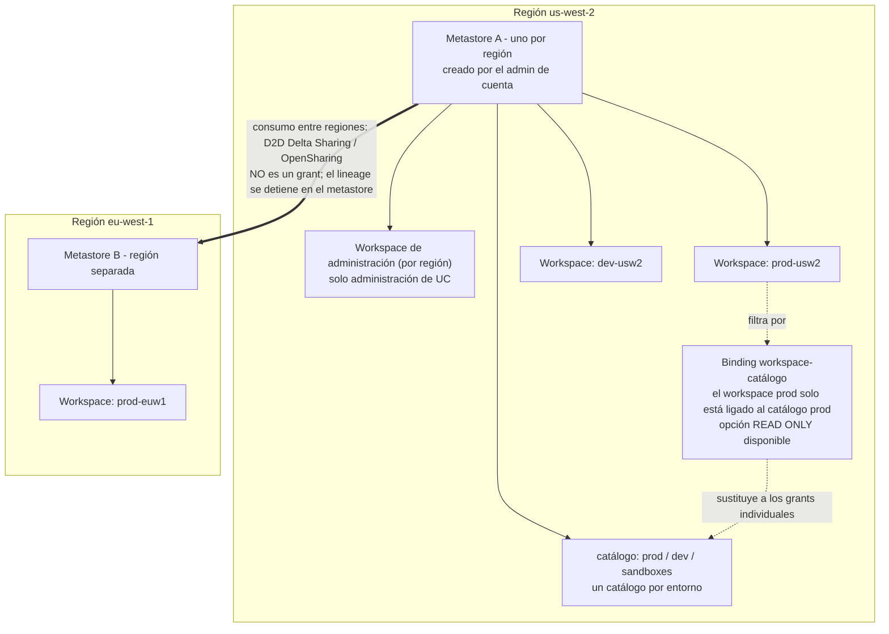
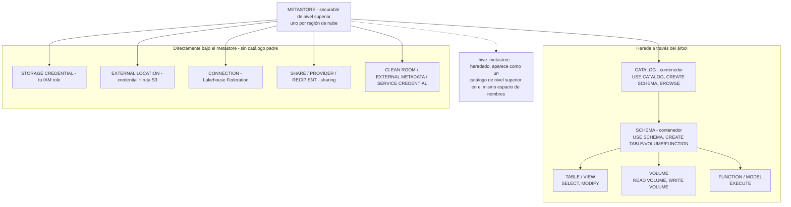
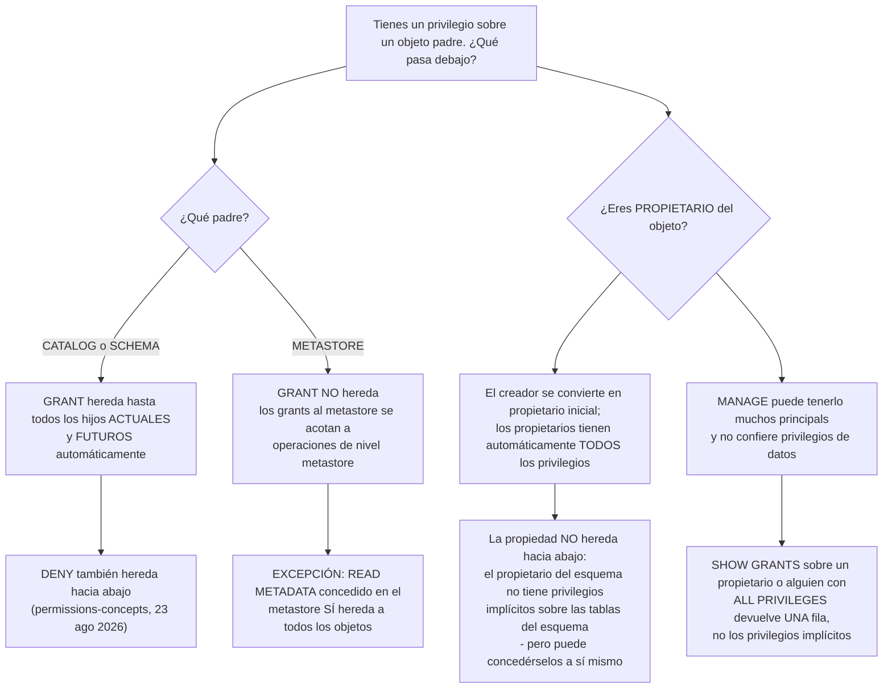
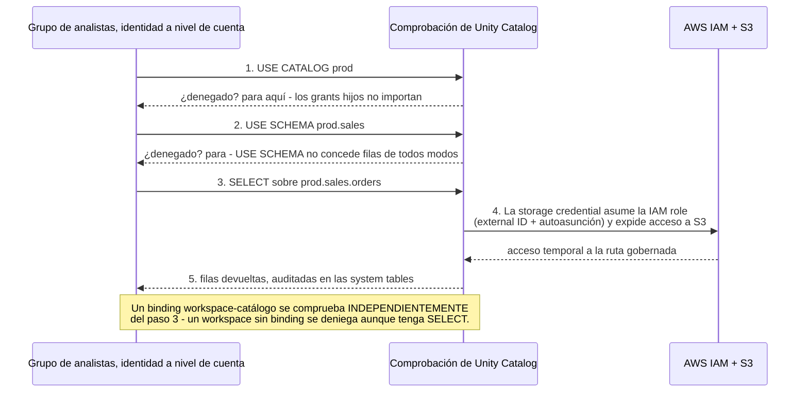
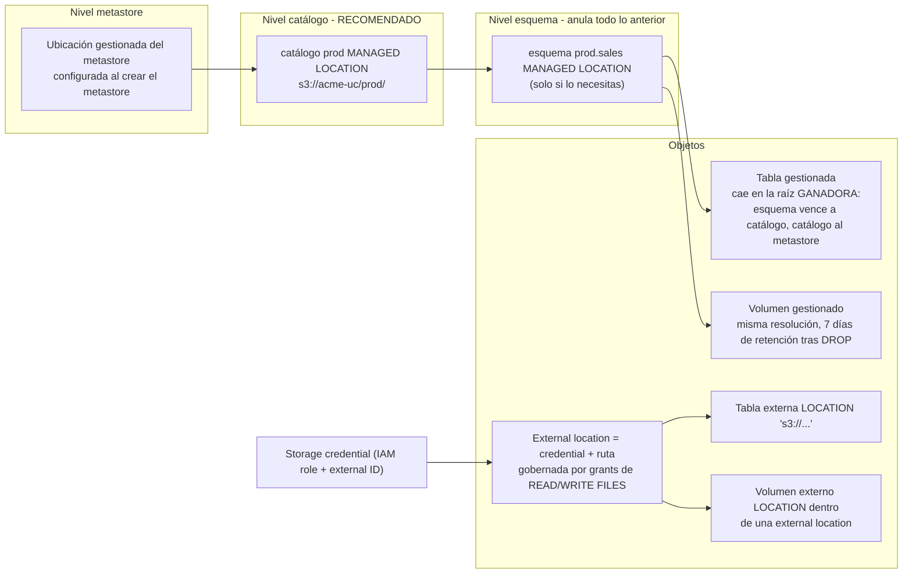
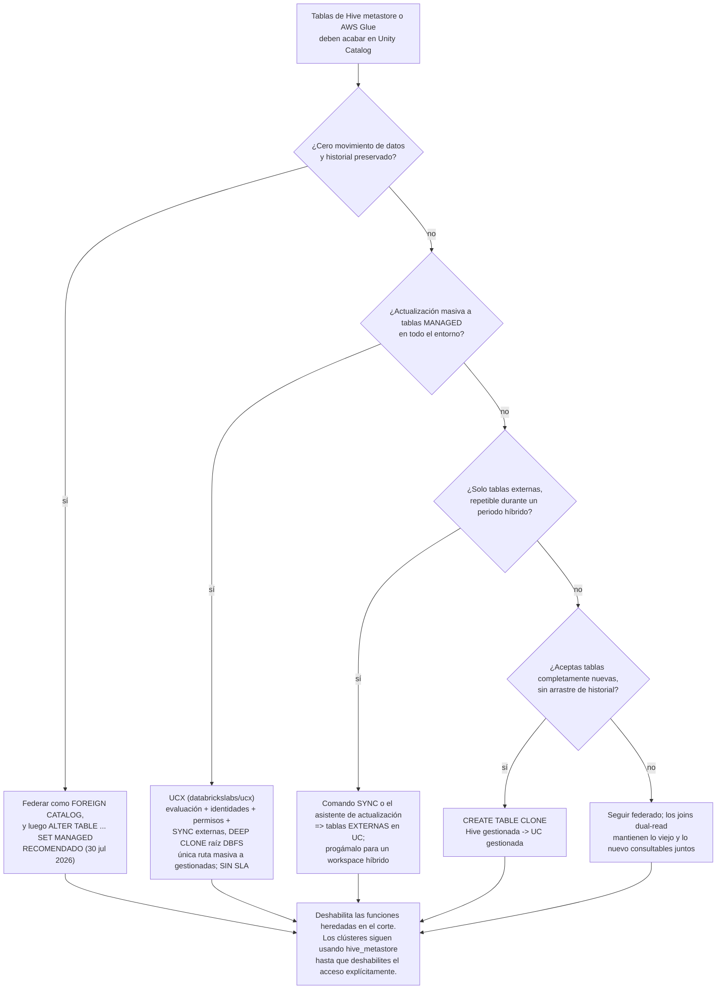

# Fundamentos de Unity Catalog: metastore, jerarquía, grants, storage credentials y external locations

La lección 02 construyó el sustrato AWS: VPC, root bucket, PrivateLink, KMS e IAM. Esta lección coloca encima el **plano de gobernanza**. Unity Catalog es el punto en que ese sustrato deja de ser fontanería y pasa a ser política — un `GRANT` que sigue a un *grupo* por cada workspace de una región, una IAM role envuelta en un securable para que revocar acceso sea un `REVOKE` en lugar de editar una política de bucket, y un espacio de nombres de tres niveles (`catalog.schema.table`) que por fin da a las rutas de S3 un nombre que puedes poner en una revisión.

La regla didáctica de esta lección: **Unity Catalog decide *quién*, tu cuenta AWS sigue guardando el *qué*.** Los archivos de datos nunca salen de tu cuenta de S3, IAM sigue teniendo que permitir que Databricks asuma un rol, y cada grant que escribas vale exactamente lo que vale la cadena de `USE CATALOG` → `USE SCHEMA` → `SELECT` que lo entrega. Confunde esas dos frases y cada síntoma de abajo se convierte en un misterio.

```text
=============================================================
 SUPERFICIE DE UNITY CATALOG EN AWS - a oct 2026
-------------------------------------------------------------
 Metastore ...... securable de nivel superior; UNO por
                  región de nube; los administradores de
                  cuenta lo crean y lo conectan; un workspace
                  se asigna a EXACTAMENTE UN metastore
 Jerarquía ...... metastore > catálogo > esquema >
                  tabla | vista | volumen | función |
                  modelo | servicio | secreto
                  (los securables que no son datos cuelgan
                  directamente del metastore: storage
                  credentials, external locations,
                  conexiones, shares, ...)
 Espacio de nombres ... tres niveles: catalog.schema.object
 Herencia ....... los grants a catálogo/esquema llegan a los
                  hijos ACTUALES y FUTUROS; los grants a
                  METASTORE NO llegan
                  (solo READ METADATA hereda)
 Propiedad ...... el creador es propietario; los propietarios
                  tienen todos los privilegios; la propiedad
                  NO hereda hacia abajo
 Por defecto .... deny-by-default - "Inicialmente, los
                  usuarios no tienen acceso a los datos de un
                  metastore"
 Storage ........ storage credential = tu IAM role (con
                  external ID obligatorio) como securable
                  external location = credential + ruta S3
 Gestionada ..... UC elige ubicación y ciclo de vida; los
                  archivos quedan en TU cuenta; UNDROP 7 días
 Externa ........ tú eliges LOCATION; UC solo gobierna;
                  DROP elimina metadatos; S3 sigue facturando
 Migración ...... hive_metastore aparece como un catálogo;
                  federar -> ALTER TABLE ... SET MANAGED
=============================================================
```

En esta lección vas a:

- colocar correctamente el **metastore** — uno por región, creado a nivel de cuenta, conectado a muchos workspaces, con los roles de administrador de cuenta / workspace / metastore separados;
- dibujar la **jerarquía de securables** y nombrar los objetos que deliberadamente cuelgan *fuera* del árbol de catálogos;
- dominar **privilegios y herencia**: por qué se exige `USE CATALOG` pero no concede datos, por qué los grants a nivel de metastore no se propagan y por qué la propiedad no hereda hacia abajo;
- operar el **deny-by-default** con sus dos excepciones documentadas de apertura por defecto (`main`, el catálogo del workspace) y la regla del **workspace binding** que anula incluso un `SELECT` impecable;
- construir **la configuración de AWS resuelta de extremo a extremo**: política de confianza de IAM con external ID → `CREATE STORAGE CREDENTIAL` → `CREATE EXTERNAL LOCATION` → cuatro `GRANT`s → una tabla Delta externa;
- separar las tablas y los volúmenes **gestionados de los externos**, predecir dónde aterriza físicamente una tabla gestionada y saber exactamente qué elimina `DROP` en cada caso;
- elegir una **herramienta de migración desde hive_metastore** según el tipo de tabla (`SYNC`, asistente de actualización, `CREATE TABLE CLONE`, `DEEP CLONE` vía UCX, federar y luego `SET MANAGED`);
- estudiar **tres casos de clientes con nombre propio** (Amgen, Rivian, nCino), leer el **recuadro de actualización de octubre de 2026** y practicar con **12 preguntas tipo examen** más cuatro comprobaciones interactivas.

---

## 1. El metastore: un objeto regional gestionado a nivel de cuenta

La propia referencia de Unity Catalog abre con la definición de la que cuelga todo lo demás:

> “El **metastore** es el objeto securable de nivel superior en Unity Catalog. Un metastore contiene todos los objetos securables registrados en Unity Catalog en una única región de nube.” — documentación de Databricks, *Unity Catalog securable objects* (última actualización: 8 oct 2026)

Se siguen tres consecuencias, y cada una es examinable:

1. **Un metastore por región de nube.** “Un metastore está acotado a una única región de nube. Tu organización necesita un metastore por cada región en la que opere.” Un único metastore “puede conectarse a varios workspaces de la misma región” (misma página, 8 oct 2026).
2. **Un workspace, un metastore.** “Cada workspace debe asignarse a exactamente un metastore” (guía de despliegue bien arquitecturado de Databricks, *Design Unity Catalog architecture*, consultada 2026-10). Un workspace no puede atravesar dos metastores, así que las lecturas entre regiones nunca son “solo un grant”.
3. **Los grants viajan con el metastore, no con el workspace.** “Los grants de permisos en un metastore se aplican a todos los workspaces conectados a ese metastore. En otras palabras, un privilegio concedido en un workspace es efectivo en todos los demás workspaces que comparten ese metastore” (8 oct 2026). Esa es toda la razón para consolidar: una superficie de política, muchos workspaces.

El propio metastore está “alojado como un servicio multiinquilino en el plano de control de Databricks” mientras que “los datos siguen viviendo en tu cuenta de nube” — el plano de control guarda los metadatos, tu S3 guarda los bytes (guía de despliegue; *Managed versus external assets*, 11 sep 2026).

### 1.1 Quién administra qué

| Nivel de administración | Alcance | Creación / notas (página de privilegios de administrador, 23 jun 2026) |
|---|---|---|
| **Administrador de cuenta** | La cuenta de Databricks | Crea y conecta metastores y workspaces; puede conceder directamente sobre un metastore; si un administrador de cuenta crea el metastore manualmente, ese administrador es su propietario inicial *y* administrador del metastore |
| **Administrador de workspace** | Un solo workspace | Puede crear catálogos y otros securables de nivel superior en **workspaces creados después del 6 de marzo de 2024** |
| **Administrador del metastore** | Un metastore (rol opcional) | Como propietario del metastore: puede gestionar privilegios o transferir la propiedad de *cualquier* objeto de dentro — storage credentials, external locations, conexiones, shares — y puede conceder a cualquiera lectura/escritura sobre cualquier dato de dentro |

Los metastores de aprovisionamiento automático (autoasignación de workspace, o la activación automática para cuentas de AWS creadas después del **8 de noviembre de 2023**) pueden haberse “creado sin administrador del metastore” — así que no asumas que el rol está ocupado solo porque Unity Catalog funcione.



- **📚 ¿Sabías que…?** Habilitar un workspace existente para Unity Catalog es una puerta de un solo sentido: “habilitar un workspace para Unity Catalog **no se puede revertir**. Una vez que habilites el workspace, gestionarás usuarios, grupos y service principals de este workspace mediante interfaces a nivel de cuenta” (documentación de Databricks, *Enable a workspace for Unity Catalog*, última actualización: 20 may 2026). La federación de identidades — usuarios y grupos a nivel de cuenta — se activa al mismo tiempo, y por eso los grants de esta lección siempre nombran **identidades a nivel de cuenta**, nunca identidades locales del workspace.

### 1.2 Ejemplo resuelto E1 — la topología de dos regiones, decidida sobre el papel

**Escenario:** un minorista opera producción y desarrollo en `us-west-2` y una entidad europea en `eu-west-1`. Cuatro workspaces, un equipo de plataforma, un modelo único de propiedad de datos.

```text
Ejemplo resuelto E1 - topología de metastores (a oct 2026)

Región us-west-2
  metastore ...... 1 (uno por región - límite duro)
  workspaces ..... 2 conectados: prod-usw2, dev-usw2
  workspace de admin  sí, 1 por región (guía de despliegue)
  catálogos ...... prod, dev, sandboxes (el aislamiento de
                   datos "comienza a nivel del catálogo" -
                   mejores prácticas de UC, 20 may 2026)
  bindings ....... prod-usw2  -> catálogo prod   (lectura-escritura)
                   dev-usw2   -> catálogo dev    (lectura-escritura)
                   ambos       -> sandboxes      (solo lectura)

Región eu-west-1
  metastore ...... 1
  workspaces ..... 1 conectado: prod-euw1
  catálogos ...... prod_eu
  entre regiones . El análisis UE de datos de EE. UU. pasa
                   por D2D Delta Sharing, no por un grant
                   (el lineage no cruza la frontera)

Por qué NO cuatro metastores
  - los grants tendrían que reemitirse por región
  - no habría catálogo compartido entre workspaces de una región
  - "Metastores provide regional isolation but are not
     intended as default units of data isolation"
     (mejores prácticas de UC, 20 may 2026)
Por qué NO un metastore para ambas regiones
  - imposible: los metastores son regionales y un workspace
    pertenece exactamente a uno
```

**Lectura:** los entornos se separan con **catálogos y bindings dentro de un único metastore**, no con metastores extra. La propia guía de workspaces nuevos de Databricks dice lo mismo: “adopta un metastore por región con varios catálogos… Aísla los entornos con workspace bindings” (Databricks Answers, 2026-08-27). Una salvedad que conviene guardar: ese Q&A oficial también aconseja planificar “el storage root con cuidado porque no puede cambiarse después de su creación” — es una entrada de Databricks Answers, no una página de documentación, así que trata la afirmación de inmutabilidad como evidencia del grado de un Q&A oficial.

---

## 2. La jerarquía: qué cuelga de qué, y por qué importa

Unity Catalog expone “un espacio de nombres de tres niveles (es decir, `catalog.schema.table`)” (documentación, *Enable a workspace*, 20 may 2026). Los activos de datos e IA — “tablas, vistas, volúmenes, funciones, modelos y servicios” — lo siguen, mientras que una segunda familia de objetos se sitúa **directamente bajo el metastore**, completamente fuera del árbol (*What is Unity Catalog?*, 7 jul 2026; securable-objects, 8 oct 2026).



Dos hechos estructurales que el alumnado repite ignorando:

- **Los contenedores son el catálogo y el esquema.** “Todos los objetos de esta jerarquía son objetos securables”, y los privilegios concedidos sobre un padre “se aplican automáticamente a todos los objetos hijos actuales y futuros” — pero ese motor de herencia empieza en el **catálogo**, no en el metastore (permissions-concepts, 23 ago 2026; blog de privilegios: “The highest level object that privileges are inherited from is the catalog”, 2023-05-05).
- **Las storage credentials y las external locations *no* están bajo un catálogo.** Viven a nivel de metastore, y por eso crear una es una operación acotada al metastore y por eso se conceden con la sintaxis `ON STORAGE CREDENTIAL …` / `ON EXTERNAL LOCATION …` en lugar de con un nombre de tres niveles.

El Hive metastore heredado es *aditivo*: “El metastore de Unity Catalog es aditivo, lo que significa que puede usarse junto con el Hive metastore de cada workspace en Databricks. El Hive metastore aparece como un catálogo de nivel superior llamado `hive_metastore` en el espacio de nombres de tres niveles” (documentación, *Work with the legacy Hive metastore*, consultada 2026-10). La sección 8 convierte ese hecho en un plan de migración.

- **📚 ¿Sabías que…?** Unity Catalog se publicó como código abierto el **2024-06-12/13** bajo licencia Apache 2.0, construido sobre una especificación OpenAPI y “compatible con la API metastore de Apache Hive y la API REST catalog de Apache Iceberg”, con soporte anunciado por AWS, Google Cloud, Microsoft, NVIDIA y Salesforce (blog de Databricks, 2024-06-13; comunicado de prensa, 2024-06-12). Así que el vocabulario de securables que estás aprendiendo en esta lección no es exclusivo de la interfaz de Databricks — es el mismo modelo servido a través de las interfaces Iceberg REST y Hive Metastore.

---

## 3. Privilegios: la cadena, las reglas de herencia y la trampa del propietario

> “Los objetos securables en Unity Catalog son jerárquicos, desde el metastore en lo alto, pasando por catálogos y esquemas, hasta los objetos de datos que contienen (tablas, vistas, volúmenes, funciones y modelos).” — documentación de Databricks, *Unity Catalog privileges* (última actualización: 8 oct 2026)

Esa referencia documenta la **versión 1.0 del modelo de privilegios**; un metastore “creado durante la vista pública (antes del 25 de agosto de 2022)” puede estar en un modelo anterior, sin el comportamiento de herencia de hoy. Asume 1.0 para todo lo que sigue.

### 3.1 Los privilegios que de verdad vas a escribir

| Nivel | Privilegios que vale la pena memorizar (referencia de privilegios, 8 oct 2026) |
|---|---|
| **Metastore** | `CREATE CATALOG`, `CREATE STORAGE CREDENTIAL`, `CREATE EXTERNAL LOCATION`, `READ METADATA`, `USE SHARE`, `CREATE CONNECTION` … |
| **Catálogo** | `USE CATALOG`, `CREATE SCHEMA`, `BROWSE`, `APPLY TAG`, más los de nivel hijo como `SELECT`, `MODIFY`, `CREATE TABLE` |
| **Esquema** | `USE SCHEMA`, `CREATE TABLE`, `CREATE VOLUME`, `CREATE FUNCTION`, `CREATE MATERIALIZED VIEW`, `EXTERNAL USE SCHEMA`, más los de nivel hijo `SELECT`, `MODIFY`, `READ VOLUME`, `WRITE VOLUME` |
| **Tabla** | `SELECT`, `MODIFY`, `INSERT`, `UPDATE`, `DELETE` (los tres de DML están “actualmente en Beta”), `READ METADATA`, `MANAGE` |
| **Volumen** | `READ VOLUME`, `WRITE VOLUME`, `READ METADATA`, `MANAGE` |
| **Storage credential** | `CREATE EXTERNAL LOCATION`, `READ FILES`, `WRITE FILES`, `MANAGE` |
| **External location** | `READ FILES`, `WRITE FILES`, `CREATE EXTERNAL TABLE`, `CREATE EXTERNAL VOLUME`, `EXTERNAL USE LOCATION`, `READ METADATA`, `BROWSE`, `MANAGE` |

Dos privilegios de navegación sostienen toda la ruta de lectura:

> “`USE CATALOG` — Se requiere para interactuar con cualquier objeto dentro de un catálogo. **No concede por sí mismo acceso a los datos.**” … “`USE SCHEMA` — Se requiere para interactuar con cualquier objeto dentro de un esquema. No concede por sí mismo acceso a los datos.” — referencia de privilegios, 8 oct 2026

### 3.2 Herencia frente a propiedad: dos mecanismos, una sola confusión



Lee ese diagrama como tres leyes separadas:

1. **Los grants a catálogo y esquema se propagan** a “todos los esquemas, tablas, vistas, volúmenes y funciones actuales y futuros” — por eso conceder `SELECT` sobre un catálogo es la jugada masiva eficiente (securable-objects, 8 oct 2026).
2. **Los grants al metastore no se propagan**, con la única excepción documentada de `READ METADATA`: “los privilegios concedidos a nivel de metastore no heredan a los objetos hijos… Esto difiere del comportamiento de herencia de privilegios de los grants a catálogo y esquema” (8 oct 2026). Tener `CREATE CATALOG` en el metastore te da cero tablas legibles.
3. **La propiedad no es herencia.** “El principal que crea un objeto se convierte en su propietario inicial”; “los propietarios de un objeto reciben automáticamente todos los privilegios sobre ese objeto”; pero “**la propiedad no hereda hacia abajo en Unity Catalog**” — el propietario de un esquema no obtiene automáticamente privilegios sobre las tablas del esquema, aunque “puede concederse privilegios a sí mismo” (permissions-concepts, 23 ago 2026; redacción de propiedad en GCP, 5 mar 2026).

Quién puede conceder en absoluto: “El propietario del objeto. El propietario del catálogo o esquema que contiene el objeto. Un usuario con el privilegio MANAGE sobre el objeto. Un administrador del metastore. Los administradores de cuenta también pueden conceder privilegios directamente sobre un metastore” (manage-privileges, consultada 2026-10).

### 3.3 Ejemplo resuelto E2 — la cadena de grants y una autopsia con `SHOW GRANTS`

**Objetivo:** el grupo `analysts` debe leer `prod.sales.orders`.

```sql
-- The full documented chain (Databricks Answers, 2026-08-27:
-- "reading a table requires the full USE CATALOG -> USE SCHEMA ->
--  SELECT chain")
GRANT USE CATALOG ON CATALOG prod      TO `analysts`;
GRANT USE SCHEMA  ON SCHEMA  prod.sales TO `analysts`;
GRANT SELECT      ON TABLE   prod.sales.orders TO `analysts`;

-- Shorter, equally valid: a catalog-level grant inherits down,
-- provided the usage privileges are there too:
--   "granting SELECT on a catalog allows a user to read any table
--    in that catalog (with the appropriate USE CATALOG and
--    USE SCHEMA usage privileges)" - securable-objects, Oct 8 2026
GRANT SELECT ON CATALOG prod TO `analysts`;

-- Audit: what does this principal actually hold?
SHOW GRANTS ON TABLE prod.sales.orders;
SHOW GRANTS ON CATALOG prod;
```

**Forense.** Supón que `SHOW GRANTS ON SCHEMA sales_staging` devuelve exactamente una fila: `OWNERSHIP`. ¿Por qué el propietario puede hacer `SELECT` sobre `sales_staging.t` igualmente? Porque la propiedad *es* todos los privilegios, renderizados como una sola fila — la referencia es explícita de que para quien tiene `ALL PRIVILEGES` “solo se devuelve `ALL PRIVILEGES`, no los privilegios implícitos individuales como `SELECT` o `MODIFY`” (8 oct 2026). ¿Por qué un *segundo* usuario no puede? Deny by default (sección 4). ¿Qué debe ejecutar el propietario del esquema para un colega? Un `GRANT SELECT ON SCHEMA …` explícito — la propiedad no se propaga, así que el colega no obtiene nada del estatus del propietario.

### 3.4 Comprobación interactiva — relaciona el privilegio con su nivel

```matching
{
  "question": "Relaciona cada privilegio de Unity Catalog con el nivel de securable en el que está documentado como un grant de primera clase (referencia de privilegios, 8 oct 2026):",
  "pairs": [
    {"left": "USE CATALOG", "right": "Catálogo - se exige antes de poder interactuar con cualquier objeto de dentro; no concede datos"},
    {"left": "CREATE EXTERNAL LOCATION", "right": "Debe mantenerse a la vez en el metastore Y en la storage credential"},
    {"left": "READ VOLUME / WRITE VOLUME", "right": "Volumen - gobierna archivos no tabulares, no filas de tablas"},
    {"left": "EXTERNAL USE LOCATION", "right": "External location - excluido de ALL PRIVILEGES a propósito"},
    {"left": "READ METADATA", "right": "El único privilegio a nivel de metastore que hereda hacia abajo"},
    {"left": "BROWSE", "right": "Catálogo - permite a un usuario descubrir datos sin tener USE CATALOG"}
  ],
  "explanation": "El conjunto de trampas es deliberado: USE CATALOG y USE SCHEMA son privilegios de navegación y nunca exponen filas; CREATE EXTERNAL LOCATION está documentado como “Required on both the metastore and the storage credential”; EXTERNAL USE LOCATION es uno de los cuatro privilegios (con EXTERNAL USE SCHEMA, MANAGE y READ METADATA) que ALL PRIVILEGES deliberadamente no incluye, porque los propietarios de la ubicación no lo tienen por defecto — una excepción antiexfiltración. READ METADATA es el único privilegio a nivel de metastore que hereda."
}
```

- **📚 ¿Sabías que…?** `ALL PRIVILEGES` suena absoluto y no lo es: “ALL PRIVILEGES no incluye los privilegios `EXTERNAL USE SCHEMA`, `EXTERNAL USE LOCATION`, `MANAGE` ni `READ METADATA`” (referencia de privilegios, 8 oct 2026). Y para evitar la exfiltración accidental de datos, “los propietarios de un esquema no tienen el privilegio `EXTERNAL USE SCHEMA` por defecto, y los propietarios de una external location no tienen el privilegio `EXTERNAL USE LOCATION` por defecto” (permissions-concepts, 23 ago 2026). `EXTERNAL USE LOCATION` solo puede concederlo un principal que tenga `MANAGE` sobre la ubicación.

---

## 4. Deny by default, las dos excepciones de apertura por defecto, y los bindings que vencen a los grants

> “**Inicialmente, los usuarios no tienen acceso a los datos de un metastore.** Los administradores de cuenta de Databricks, los administradores de workspace y los administradores del metastore tienen privilegios por defecto para gestionar Unity Catalog.” — documentación de Databricks, *Manage privileges in Unity Catalog* (consultada 2026-10)

El propio Q&A de Databricks lo restate como un “modelo de deny-by-default” (answers.databricks.com, 2026-08-27). Todo lo que un usuario puede alcanzar le fue concedido. Dos excepciones documentadas mantienen utilizables los workspaces nuevos — y ambas conviene nombrarlas con precisión, porque son lo que hace que un entorno “bien cerrado” se filtre en su primera semana:

1. **El catálogo `main`:** “Todos los usuarios tienen `USE CATALOG` sobre el catálogo `main` por defecto” (referencia de privilegios, 8 oct 2026).
2. **El catálogo del workspace:** “Todos los usuarios del workspace reciben el privilegio `USE CATALOG` sobre el catálogo del workspace. Los usuarios del workspace también reciben los privilegios `USE SCHEMA`, `CREATE TABLE`, `CREATE VOLUME`, `CREATE MODEL`, `CREATE FUNCTION` y `CREATE MATERIALIZED VIEW` sobre el esquema por defecto del catálogo” (manage-privileges, consultada 2026-10).



### 4.1 Los bindings son una segunda puerta, independiente

> “Por defecto, un catálogo es accesible desde todos los workspaces conectados al mismo metastore. Puedes restringir esto ligando el catálogo a workspaces concretos, opcionalmente como solo lectura. **El workspace binding sustituye a los grants individuales de privilegios.** Incluso un usuario con un grant explícito de `SELECT` no puede acceder a un objeto de un catálogo que no esté ligado a su workspace.” — securable-objects, 8 oct 2026

Los bindings existen para **catálogos**, **storage credentials** y **external locations** (página de binding workspace-catálogo, 29 abr 2026), y es el mecanismo que impide que una credential de producción sea utilizable en un workspace de sandbox. La misma página indica que el acceso “desde un workspace sin binding se deniega, incluso para usuarios con grants explícitos de privilegios sobre el catálogo”.

Un segundo valor por defecto que conviene conocer: “Un administrador del metastore debe habilitar el acceso externo a datos para cada metastore que necesites accesible externamente. Esta opción está **deshabilitada por defecto** para evitar el acceso externo no autorizado” (documentación, *Enable external data access*, 14 may 2026).

### 4.2 Ejemplo resuelto E3 — tres grants rotos, diagnosticados

```text
Ejemplo resuelto E3 - los tres fallos con los que choca
primero cualquier equipo

(a) Error SQL: GRANT USAGE ON CATALOG prod TO `analysts`;
    POR QUÉ ... USAGE es vocabulario heredado del Hive metastore
               / Lake Formation. Unity Catalog lo escribe
               USE CATALOG (y USE SCHEMA en el nivel siguiente).
    SOLUCIÓN .. GRANT USE CATALOG ON CATALOG prod TO `analysts`;

(b) SELECT denegado en prod.sales.orders aunque el usuario
    tiene SELECT sobre la tabla.
    POR QUÉ ... la cadena padre está rota: falta USE CATALOG en
               prod o falta USE SCHEMA en prod.sales. La
               referencia de privilegios: USE CATALOG es
               "Required to interact with any object inside a
               catalog" con independencia de los privilegios
               hijos.
    SOLUCIÓN .. concede los dos privilegios de uso y vuelve a
               probar.

(c) Esta mañana se marcó la external location como solo
    lectura, pero un escritor heredado sigue pareciendo
    tener éxito.
    POR QUÉ ... "It can take up to 60 minutes for this change to
               take effect across all compute resources"
               (manage-external-locations, consultada 2026-10).
    SOLUCIÓN .. espera la ventana de propagación y vuelve a
               probar; el flag de solo lectura también anula los
               derechos de escritura que concede la IAM role de
               bajo nivel de la credential.
```

El patrón (b) es el que genera tickets: un grant de `SELECT` es una *llave para una puerta*, y `USE CATALOG`/`USE SCHEMA` son el *pasillo que lleva hasta ella* — sin el pasillo, la llave no se usa.

---

## 5. Storage credentials: tu IAM role, envuelta en un securable

En AWS, “una **credential** es un objeto securable que representa una IAM role de AWS” (referencia de credenciales de Databricks SQL, consultada 2026-10), y el sabor de storage credential es exactamente el que llega a S3:

> “El primero es una **storage credential**, que especifica una IAM role de AWS que permite el acceso a la ubicación de S3. Necesitas esta storage credential para el segundo objeto obligatorio: una **external location**, que define la ruta a tu ubicación de almacenamiento en S3 y las credenciales necesarias para acceder a ella.” — documentación de Databricks, *Connect to cloud object storage using Unity Catalog* / *S3 external location* (11 sep 2026)

Qué guarda realmente el objeto (API de Storage Credential, consultada 2026-10):

| Campo | Función |
|---|---|
| `role_arn` | “El Amazon Resource Name (ARN) de la IAM role de AWS que se usa para expedir credenciales temporales” |
| `unity_catalog_iam_arn` (salida) | “El Amazon Resource Name (ARN) del usuario de AWS IAM gestionado por Databricks. Esta es la identidad que va a asumir la IAM role de AWS” |
| `external_id` (salida) | “El external ID utilizado en la asunción de roles para evitar el problema del deputy confundido” |

Tres reglas duras en el lado de AWS:

- **El external ID es obligatorio desde el 2023-11-30.** “Las políticas IAM para storage credentials ahora exigen un external ID — 30 de noviembre de 2023. Para crear una storage credential, ahora debes añadir el external ID de tu storage credential en la política de la IAM role en AWS” (notas de versión, nov 2023). El ejemplo de confianza de la documentación lleva `"sts:ExternalId": "0000"` como marcador de posición de *tu* valor devuelto.
- **El rol debe vivir en la misma cuenta AWS que el bucket**, y “debes tener permisos `iam:CreateRole` para crear la IAM role”; la configuración automática “usa delegación temporal de AWS IAM” y es la ruta recomendada para “la mayoría de los despliegues” (páginas de external location en S3, 11 sep / 7 ago 2026).
- **Los roles autoasumibles son obligatorios.** “Databricks bloquea storage credentials nuevas y existentes basándose en IAM roles que no son autoasumibles” (página de conexión S3, 11 sep 2026). La confianza es un `sts:AssumeRole` cross-account hacia el rol master fijo de Unity Catalog de Databricks.

```text
La cadena de confianza, en una imagen (a oct 2026)

  Rol master UC de Databricks (cuenta Databricks 414351767826)
    arn:aws:iam::414351767826:role/unity-catalog-prod-UCMasterRole-...
        |  sts:AssumeRole + sts:ExternalId = <el tuyo>
        v
  Tu rol de storage credential  (MISMA cuenta AWS que el bucket)
    arn:aws:iam::111122223333:role/acme-uc-raw-s3
        |  s3:GetObject / PutObject / List* / DeleteObject en tu prefijo
        |  kms:Decrypt / Encrypt / GenerateDataKey* (si SSE-KMS)
        v
  s3://acme-lake/raw/   (+ concesión opcional en la política de la clave KMS)
```

### 5.1 Ejemplo resuelto E4 — la política de confianza, línea a línea

```json
{
  "Version": "2012-10-17",
  "Statement": [
    {
      "Sid": "AllowDatabricksUCToAssumeThisRole",
      "Effect": "Allow",
      "Principal": {
        "AWS": "arn:aws:iam::414351767826:role/unity-catalog-prod-UCMasterRole-14S5ZJVKOTYTL"
      },
      "Action": "sts:AssumeRole",
      "Condition": {
        "StringEquals": {
          "sts:ExternalId": "0000"
        }
      }
    },
    {
      "Sid": "SelfAssumeRequiredByUCPolicy",
      "Effect": "Allow",
      "Principal": { "AWS": "arn:aws:iam::111122223333:role/acme-uc-raw-s3" },
      "Action": "sts:AssumeRole"
    }
  ]
}
```

Lista de comprobación del revisor: (1) el principal es el rol master de Unity Catalog de Databricks para la partición comercial `414351767826` (GovCloud usa ID de cuenta distintos — lección 02); (2) `sts:ExternalId` es igual al valor que Databricks devolvió para *esta* credential, no una cadena inventada; (3) la **política de permisos** del rol acota `s3:*` solo a tu prefijo; (4) si el bucket usa SSE-KMS, añade `kms:Decrypt`, `kms:Encrypt` y `kms:GenerateDataKey*` sobre esa clave a la política del rol **y** actualiza la **política de la clave** para permitir el rol con `kms:ViaService: s3.<region>.amazonaws.com` (documentación, *Configure encryption for S3 with KMS*, consultada 2026-10).

**Contraste heredado, en una línea:** un *instance profile* ata una IAM role a un **clúster**, de modo que todo el que use esa caja la hereda; una storage credential ata el rol a un **securable gobernado por grants**. Databricks posiciona los service credentials — el objeto hermano para AWS Glue y Secrets Manager — como “la alternativa de Unity Catalog a los instance profiles, con la ventaja de que el acceso no está ligado a un recurso de cómputo concreto” (documentación, consultada 2026-10), y etiqueta la configuración KMS de instance profile como “configuración heredada”.

- **📚 ¿Sabías que…?** La autenticación máquina a máquina de OAuth 2.0 — client credentials de service principal, tokens de acceso de **una hora**, hasta **cinco** secretos de OAuth por service principal, cada uno válido hasta **dos años** — es como un *service principal se autentica ante Databricks* (API, CLI, JDBC). No es como Unity Catalog llega a S3: en AWS, el acceso a almacenamiento es siempre expedición de una IAM role con un external ID (documentación de autenticación OAuth M2M + CLI, consultada 2026-10). Enseña el M2M como capa de identidad para *jobs que llaman a Databricks*, y los roles de IAM como capa de identidad para *Databricks que llama a S3*.

---

## 6. External locations: credential más ruta, gobernadas por grants

> “Una external location es un objeto securable que combina una ruta de almacenamiento con una storage credential que autoriza el acceso a esa ruta.” — referencia de external locations de Databricks SQL (consultada 2026-10)

Los privilegios sobre ella deciden quién puede tocar archivos: `READ FILES` para leer directamente, `WRITE FILES` para escribir (securable-objects, 8 oct 2026), más `CREATE EXTERNAL TABLE`, `CREATE EXTERNAL VOLUME`, `EXTERNAL USE LOCATION` y `BROWSE`. Dos reglas estructurales causan la mayoría de los fallos de `CREATE EXTERNAL LOCATION`:

- **Sin anidamiento.** “La ruta de almacenamiento de cualquier external location no puede estar contenida dentro de la ruta de almacenamiento de otra external location”; “las external locations no pueden solaparse con otras external locations” (referencia de external locations; *Path rules and access*, consultada 2026-10).
- **Las dos puertas para crearla.** “`CREATE EXTERNAL LOCATION` — Crea una external location que asocia una ruta de almacenamiento en la nube con una storage credential. **Se exige tanto en el metastore como en la storage credential**” (referencia de privilegios, 8 oct 2026).

Y el hecho operativo que sorprende a todo el mundo: pasar una ubicación a solo lectura “puede tardar **hasta 60 minutos** … en hacer efecto en todos los recursos de cómputo”, mientras que el flag en sí “impide a los usuarios escribir en archivos de esas external locations, con independencia de cualquier permiso de escritura concedido por la IAM role que subyace a la storage credential” (manage-external-locations, consultada 2026-10).

### 6.1 Ejemplo resuelto E5 — la configuración resuelta: credential → ubicación → grants → tabla externa

La pieza central de esta lección. El alumnado rellena su propio ARN de rol y su propio bucket; todo lo demás es sintaxis documentada (referencia de credenciales; referencia de external locations; página manual de S3, 7 ago 2026).

```sql
-- 0) AWS prerequisites (outside Databricks)
--    * IAM role in the SAME account as the bucket
--    * trust: Databricks UC master role 414351767826 with your
--      sts:ExternalId  (E4 above)
--    * permission policy: s3:GetObject/PutObject/List*/DeleteObject
--      on s3://acme-lake/raw/*
--    * KMS bucket? add kms:Decrypt/Encrypt/GenerateDataKey* to the
--      role policy AND allow the role in the key policy

-- 1) Metastore level (metastore admin holds these by default)
CREATE STORAGE CREDENTIAL acme_raw_cred
  AWS_IAM_ROLE_ARN 'arn:aws:iam::111122223333:role/acme-uc-raw-s3'
  COMMENT 'raw landing zone credential';

CREATE EXTERNAL LOCATION acme_raw_loc
  URL 's3://acme-lake/raw/'
  WITH (CREDENTIAL acme_raw_cred)
  COMMENT 'raw landing zone';

-- 2) Delegate creation, nothing else, to the platform team.
--    Databricks' recommendation: "grant only CREATE EXTERNAL
--    LOCATION and no other privileges on storage credentials"
GRANT CREATE EXTERNAL LOCATION
  ON STORAGE CREDENTIAL acme_raw_cred TO `data-platform`;

-- 3) Ingest team: file rights at the location
GRANT READ FILES, WRITE FILES, CREATE EXTERNAL TABLE
  ON EXTERNAL LOCATION acme_raw_loc TO `ingest-engineers`;

-- 4) Analyst team: the normal three-step chain
GRANT USE CATALOG ON CATALOG sales              TO `analysts`;
GRANT USE SCHEMA  ON SCHEMA  sales.raw          TO `analysts`;
GRANT SELECT      ON SCHEMA  sales.raw          TO `analysts`;

-- 5) External table - files stay exactly where they are
CREATE TABLE sales.raw.orders_ext (
  order_id BIGINT,
  ts       TIMESTAMP,
  amount   DECIMAL(12,2)
)
USING DELTA
LOCATION 's3://acme-lake/raw/orders/2026-10/';

-- 6) Audit the storage side
SHOW GRANTS ON EXTERNAL LOCATION acme_raw_loc;
SHOW GRANTS ON STORAGE CREDENTIAL acme_raw_cred;
```

**Variante A — zona de entrada solo lectura.** Marca la ubicación como solo lectura en Catalog Explorer (o con el flag `read_only` de la API) y vuelve a probar las escrituras después de la ventana de propagación de **60 minutos**; no declares la victoria al minuto cinco.

**Variante B — bucket con SSE-KMS.** Añade las tres acciones de KMS a la política del rol de la storage credential, permite el rol en la política de la clave con `kms:ViaService` y define **el algoritmo de cifrado en la external location** — una opción documentada desde el **2024-10-28** (notas de versión, oct 2024).

**Variante C — el grupo que nunca debería escribir.** Concede solo `READ FILES` y apóyate en el modo de solo lectura de la ubicación más el binding a un workspace de producción como doble garantía: los administradores de la nube “suelen ligar storage credentials a workspaces concretos para asegurar que las credenciales de producción solo se usen para crear external locations dentro de workspaces de producción” (manage-storage-credentials, consultada 2026-10).

### 6.2 Comprobación interactiva — completa los términos

```fillblank
{
  "question": "Completa la frase de configuración con los términos documentados de Unity Catalog / AWS (documentación de external location y credenciales en S3, 11 sep 2026 y 7 ago 2026; notas de versión nov 2023):",
  "template": "El securable que almacena una IAM role de AWS para S3 es una storage {{1}}; combinarlo con una ruta de nube crea un {{2}} {{3}}; la política de confianza del rol debe llevar el {{4}} devuelto por Databricks, obligatorio desde el 30 de noviembre de 2023, y el privilegio necesario para crear el segundo objeto debe mantenerse a la vez en el metastore y en esa credential — {{5}}.",
  "answers": {
    "1": "credential",
    "2": "external",
    "3": "location",
    "4": "external ID",
    "5": "CREATE EXTERNAL LOCATION"
  },
  "distractors": ["metastore", "endpoint", "gateway", "access key", "instance profile", "USE CATALOG", "READ FILES", "namespace", "mount", "session token"],
  "explanation": "Storage credential = el securable de la IAM role; external location = credential + ruta; el external ID es obligatorio desde el 2023-11-30 (marcador 0000 en la documentación) y evita el problema del deputy confundido; CREATE EXTERNAL LOCATION está documentado como exigido tanto en el metastore como en la storage credential. Las trampas de distractores son objetos reales: un instance profile es el mecanismo heredado ligado al cómputo, un montaje de DBFS está obsoleto y jamás debe registrarse como external location, y READ FILES concede acceso a archivos de una ubicación existente, no el derecho a crear una."
}
```

- **📚 ¿Sabías que…?** La fontanería de eventos de archivo para streaming sobre external locations se aprovisiona por ti en AWS: los recursos de política IAM documentados para eventos de archivo incluyen `arn:aws:sqs:*:*:csms-*` y `arn:aws:sns:*:*:csms-*` — las colas y topics gestionados de eventos de archivo que impulsan la ingesta basada en notificaciones (manage-external-locations, consultada 2026-10). Y la gobernanza de los datos no tabulares pasa cada vez más por **volúmenes** en lugar de grants de ruta en bruto: “Cuando defines un volumen externo, el acceso por URI de nube a los datos bajo la ruta del volumen lo gobiernan los privilegios concedidos sobre el volumen, **no** los privilegios concedidos sobre la external location donde se almacena el volumen” (documentación, *What are Unity Catalog volumes?*, consultada 2026-10).

---

## 7. Gestionado frente a externo: misma gobernanza, ciclo de vida distinto

> “**Activos gestionados:** Unity Catalog controla tanto la gobernanza (control de acceso, auditoría, lineage) como el ciclo de vida del almacenamiento de archivos subyacente (optimización de archivos, cómo se organizan y cuándo se eliminan). **Activos externos:** Unity Catalog controla solo la gobernanza.” — documentación de Databricks, *Managed versus external assets in Unity Catalog* (11 sep 2026)

| Dimensión | Tabla/volumen **gestionado** | Tabla/volumen **externo** |
|---|---|---|
| Ubicación de almacenamiento | Elegida por Unity Catalog: esquema → catálogo → ubicación gestionada del metastore | Tú eliges un `LOCATION` dentro de una external location |
| Dónde viven los bytes | “Los archivos de datos siempre permanecen en tu cuenta de nube” | Tu almacenamiento en la nube, sin cambios |
| Ciclo de vida | UC optimiza, organiza y **elimina en DROP**; `UNDROP` disponible **7 días**, eliminación permanente **en 30 días** | DROP elimina **solo los metadatos**; “los archivos de datos en tu almacenamiento en la nube no se eliminan” |
| Formato | “**Las tablas gestionadas usan el formato Delta o Apache Iceberg**” | Lo que registres (Delta en la práctica para las tablas de UC) |
| Acceso por ruta | “No se admite el acceso por ruta a las tablas gestionadas de Unity Catalog” — usa nombres de tabla | Archivos alcanzables a través de la external location / volumen gobernados |
| Capacidad extra | Califica para la **optimización predictiva** (compactación, clustering, vacuum) | Sin mantenimiento automático de almacenamiento |
| Retención tras DROP (volúmenes) | Los archivos de un volumen gestionado se conservan **7 días** después del DROP | Los datos permanecen en el almacenamiento en la nube |

Orden de resolución para el almacenamiento gestionado: “Las ubicaciones de almacenamiento gestionado en niveles inferiores de la jerarquía anulan las ubicaciones de almacenamiento definidas en niveles superiores… Databricks recomienda que asignes el almacenamiento gestionado a **nivel de catálogo** para el aislamiento lógico de datos” (documentación, *Specify a managed storage location*, consultada 2026-10). Los subdirectorios hasheados mantienen separados a los inquilinos: los esquemas caen bajo `<storage-root>/__unitystorage/schemas/<uuid>` y los catálogos bajo `<storage-root>/__unitystorage/catalogs/<uuid>`.



### 7.1 Ejemplo resuelto E6 — cálculo de ubicación: ¿dónde acaba la tabla de verdad?

**Configuración:** raíz del metastore `s3://acme-uc/metastore-root/`; catálogo `prod` creado con `MANAGED LOCATION 's3://acme-uc/prod/'`; esquema `prod.sales` creado **sin** ubicación gestionada; un segundo esquema `prod_sandbox` creado **con** `MANAGED LOCATION 's3://acme-uc/sandbox/'`.

```text
Ejemplo resuelto E6 - ubicación gestionada, a oct 2026

P1  ¿Tabla gestionada nueva en prod.sales?
    El esquema no tiene anulación -> GANA la raíz del CATÁLOGO
    => s3://acme-uc/prod/__unitystorage/catalogs/<catalog-uuid>/
       (patrón hasheado a nivel de catálogo documentado)

P2  ¿Tabla gestionada nueva en prod_sandbox?
    La anulación del esquema vence a la raíz del catálogo
    => s3://acme-uc/sandbox/__unitystorage/schemas/<schema-uuid>/

P3  ¿Tabla gestionada nueva en un catálogo SIN ubicación
    gestionada en ningún nivel superior?
    Vuelve a la ubicación gestionada del metastore - si se
    configuró una al crear el metastore; si no, el
    almacenamiento por defecto de Databricks en tu cuenta.

P4  Haces ALTER del esquema para añadir MANAGED LOCATION más
    tarde. ¿Se mueven las tablas existentes?
    NO. Las ubicaciones gestionadas se aplican a las tablas
    creadas después; las existentes conservan sus rutas
    originales. Planifica la raíz antes del primer CREATE TABLE.
```

DDL gestionado y externo, lado a lado (P5):

```sql
-- Managed: Unity Catalog picks the location and the lifecycle
CREATE TABLE sales.orders (
  order_id BIGINT, ts TIMESTAMP, amount DECIMAL(12,2)
) USING DELTA;

-- External: you pick the location, inside an external location
CREATE TABLE sales.orders_ext (
  order_id BIGINT, ts TIMESTAMP, amount DECIMAL(12,2)
) USING DELTA
LOCATION 's3://acme-lake/raw/orders/2026-10/';

-- Different DROP semantics (Sep 11, 2026)
DROP TABLE sales.orders;      -- files deleted; UNDROP 7 days,
                              -- permanent delete within 30 days
DROP TABLE sales.orders_ext;  -- metadata only; S3 keeps billing
```

```plot
{
  "type": "bar",
  "title": "Ventanas de tiempo de Unity Catalog sobre las que te pueden preguntar (horas), a oct 2026",
  "data": [
    {"Window": "OAuth M2M access token", "Hours": 1},
    {"Window": "Read-only location flip", "Hours": 1},
    {"Window": "Managed table UNDROP", "Hours": 168},
    {"Window": "Dropped managed volume", "Hours": 168},
    {"Window": "Purge after managed DROP", "Hours": 720}
  ],
  "xKey": "Window",
  "dataKeys": ["Hours"],
  "xLabel": "Ventana documentada (60 minutos = 1 hora; 7 días = 168; 30 días = 720)",
  "yLabel": "Horas"
}
```

> [!WARNING]
> ⚠️ **“Gestionado” nunca significa “almacenamiento de Databricks.”** Las tablas gestionadas siguen siendo archivos en *tu* cuenta de S3 — Unity Catalog solo elige la ruta y el ciclo de vida (11 sep 2026). Tres consecuencias: (1) dropear una tabla gestionada **elimina archivos** después de la ventana de `UNDROP` de 7 días, con eliminación permanente en 30 días, mientras que dropear una tabla externa deja que S3 te facture por archivos huérfanos; (2) no puedes referenciar tablas gestionadas por ruta `s3://` en absoluto; y (3) **jamás** registres un bucket usado como raíz de DBFS como external location — “nunca debes cargar una cuenta de almacenamiento usada como raíz de DBFS como external location en Unity Catalog” (documentación, *Best practices for DBFS and Unity Catalog*, consultada 2026-10).

---

## 8. Migrando desde `hive_metastore`: la escalera documentada

Unity Catalog es aditivo, así que la migración empieza por la coexistencia: el metastore heredado “aparece como un catálogo de nivel superior llamado `hive_metastore`”, y las consultas pueden unir una tabla heredada con una tabla de Unity Catalog en una sola instrucción mientras haces el corte (documentación, *Work with the legacy Hive metastore*, consultada 2026-10 — un comportamiento que este curso llama **dual-read**, para el registro, no un nombre de producto de la documentación).

Existen dos rutas documentadas (misma página): “actualizar todas las tablas registradas en el Hive metastore a Unity Catalog” o “federar tu Hive metastore a Unity Catalog usando la federación de Hive Metastore para un enfoque más gradual”.

La secuencia recomendada es explícita:

> “El enfoque recomendado es **federar primero tu Hive metastore o el catálogo de AWS Glue como catálogo externo (foreign catalog) y después actualizar las tablas externas in situ.** Este proceso de dos pasos te permite migrar tablas sin mover datos, preservando el historial, la configuración, los permisos y las vistas.” — documentación de Databricks, *Upgrade a Databricks workspace to Unity Catalog* (30 jul 2026)

El comando de conversión in situ es `ALTER TABLE <foreign_catalog>.<schema>.<table_name> SET MANAGED`, que “Databricks recomienda… para desbloquear la **optimización predictiva** de Unity Catalog, que incluye mantenimiento automático (compactación, clustering, vacuum)” (misma página).

### 8.1 Las cuatro herramientas, por lo que producen

| Herramienta | Tipos de tabla Hive que maneja | Resultado en UC | ¿Se mueven datos? | ¿Se preserva historial? | Fuente |
|---|---|---|---|---|---|
| **Federar → `ALTER TABLE … SET MANAGED`** | Externas y gestionadas (vía foreign catalog) | Gestionadas, in situ | **No** | **Sí** — “preservando el historial, la configuración, los permisos y las vistas” | página de actualización, 30 jul 2026 |
| **UCX** (Databricks Labs, `databrickslabs/ucx`) | Ambas; `SYNC` para externas, **`DEEP CLONE`** para las gestionadas con raíz DBFS | Gestionadas o externas | El clone copia datos para las tablas gestionadas con raíz DBFS | Lo decide UCX | páginas de migración + UCX, consultadas 2026-10 |
| **Asistente de actualización de Unity Catalog / `SYNC`** | Tablas externas (y tablas gestionadas almacenadas fuera de la raíz DBFS) | **Externas** | No (copia de metadatos; repetible/programable) | Las tablas quedan como están | página de migración; blog de SYNC, 2022-11-03 |
| **`CREATE TABLE CLONE`** | Tablas gestionadas de Hive | Gestionadas | Copia | **No** — “El historial de tabla no se migra… se tratan como tablas nuevas” | página de migración, consultada 2026-10 |

Restricciones que hay que memorizar: “Si quieres realizar una actualización masiva de tablas Hive a tablas gestionadas de Unity Catalog, esta es tu única opción” — UCX (página de migración); UCX “es un repo público de GitHub y **no lo soporta directamente Databricks**” y no lleva SLA; y “las tablas gestionadas de Hive deben estar en formato Delta o Parquet para poder actualizarse” (página de UCX, consultada 2026-10).



### 8.2 Ejemplo resuelto E7 — elige la herramienta según el tipo de tabla

```text
Ejemplo resuelto E7 - matriz de decisión de migración
(rellenada, con respuestas)

Tabla                                   Herramienta        Resultado   ¿Mover?  Historia
-----------------------------------------------------------------------------------------
1 Tabla EXTERNAL de Hive en S3          SYNC / asist. act. externa     no       n/a
2 Tabla gestionada de Hive en raíz DBFS  UCX (DEEP CLONE)   gestionada  SÍ       no
3 Tabla gestionada de Hive en S3 externa federar -> SET MGD gestionada  no       SÍ
4 Tabla de catálogo AWS Glue             federar -> SET MGD gestionada  no       SÍ
5 Tabla gestionada de Hive, necesita     CREATE TABLE CLONE gestionada  SÍ       no
   vida nueva, sin historial requerido
6 Informe heredado que lee               join dual-read     sin cambios no       sí
   hive_metastore durante el periodo híbrido

Lista de corte (página de actualización, 30 jul 2026)
  [ ] Adjuntar el workspace a un metastore de Unity Catalog
  [ ] Actualizar tablas y vistas de Hive a Unity Catalog
  [ ] Conceder acceso a usuarios/grupos/service principals de cuenta
  [ ] Actualizar consultas y jobs a los nuevos nombres de tabla
  [ ] Migrar archivos, notebooks y scripts fuera de DBFS
  [ ] Actualizar el cómputo a versiones compatibles de Databricks Runtime
  [ ] Deshabilitar el acceso a las funciones heredadas
```

**Lectura:** las filas 1 y 4 son las baratas (solo metadatos, `SET MANAGED` donde se admite); la fila 2 es la cara — el almacenamiento en la raíz DBFS fuerza un `DEEP CLONE` físico, y por eso exactamente “la raíz de DBFS y los montajes de DBFS están obsoletos y Databricks no los recomienda. Las cuentas nuevas se aprovisionan sin acceso a estas funciones” (documentación, *Best practices for DBFS and Unity Catalog*, consultada 2026-10). La fila 6 es la red de seguridad: como `hive_metastore` sigue funcionando hasta que lo deshabilites, lo viejo y lo nuevo pueden unirse en una sola consulta mientras los jobs migran uno a uno.

### 8.3 Comprobación interactiva — ordena el corte

```dragdrop
{
  "question": "Ordena la migración de Unity Catalog según lo que implica la página oficial de actualización (documentación, 30 jul 2026; páginas de UCX, consultadas 2026-10):",
  "items": [
    "Adjuntar el workspace a un metastore de Unity Catalog de la región",
    "Federar el Hive metastore o el catálogo de AWS Glue como foreign catalog",
    "Actualizar las tablas in situ con ALTER TABLE ... SET MANAGED, o migrar en bloque identidades, permisos, almacenamiento y tablas con UCX",
    "Conceder acceso a usuarios, grupos o service principals a nivel de cuenta en las tablas actualizadas",
    "Actualizar consultas y jobs para que apunten a las nuevas tablas de Unity Catalog",
    "Migrar archivos, notebooks y scripts desde DBFS y después actualizar el cómputo a versiones compatibles de Databricks Runtime",
    "Deshabilitar el acceso a las funciones heredadas en tus workspaces"
  ],
  "correctOrder": [
    "Adjuntar el workspace a un metastore de Unity Catalog de la región",
    "Federar el Hive metastore o el catálogo de AWS Glue como foreign catalog",
    "Actualizar las tablas in situ con ALTER TABLE ... SET MANAGED, o migrar en bloque identidades, permisos, almacenamiento y tablas con UCX",
    "Conceder acceso a usuarios, grupos o service principals a nivel de cuenta en las tablas actualizadas",
    "Actualizar consultas y jobs para que apunten a las nuevas tablas de Unity Catalog",
    "Migrar archivos, notebooks y scripts desde DBFS y después actualizar el cómputo a versiones compatibles de Databricks Runtime",
    "Deshabilitar el acceso a las funciones heredadas en tus workspaces"
  ],
  "explanation": "El orden documentado es: primero adjuntar el metastore (es el prerrequisito de todo lo demás), luego federar, luego actualizar las tablas in situ (o UCX para el volumen), luego conceder de nuevo a identidades a nivel de cuenta, luego redirigir consultas y jobs, luego dejar DBFS y subir el runtime, y solo al final deshabilitar las funciones heredadas — porque “By default, Databricks compute clusters continue to connect to the Hive metastore even after migration, unless you explicitly disable Hive metastore access”. Desactivar el acceso heredado antes de redirigir los jobs rompe el periodo híbrido que hace segura esta migración."
}
```

- **📚 ¿Sabías que…?** Unity Catalog te da una ventana de recuperación que el Hive metastore nunca tuvo: en Unity Catalog “puedes hacer `UNDROP` de una tabla gestionada durante 7 días, y los datos se eliminan permanentemente en 30 días”, mientras que “cuando dropeas una tabla gestionada en el Hive metastore, todos los archivos de datos subyacentes se eliminan de inmediato” (documentación, *Database objects in the legacy Hive metastore*, consultada 2026-10). Esa diferencia es el mejor argumento para terminar la migración — y la mejor razón para dejar de tratar `DROP` como un botón deshacer en los scripts heredados.

---

### Actualizaciones de 2026 (a octubre de 2026)

> [!NOTE]
> **Qué cambió en la historia de Unity Catalog de la que depende esta lección — cada línea contrastada con una fuente primaria:**
> - **Referencias de privilegios y securables actualizadas el 2026-10-08.** El modelo de privilegios **1.0** sigue siendo el vigente; los grants de DML de granularidad fina `INSERT` / `UPDATE` / `DELETE` están “actualmente en Beta” (véase *Fine-grained DML privileges*), y el securable más nuevo `feature` está en Public Preview — los tutoriales antiguos que solo listan tablas, vistas, volúmenes y funciones están incompletos (docs.databricks.com/aws/en/data-governance/unity-catalog/securable-objects y access-control/privileges-reference, última actualización: 8 oct 2026).
> - **Los workspace bindings cubren ahora también el lado del almacenamiento.** Los catálogos, las **storage credentials** y las **external locations** son todos ligables, con un nivel opcional de **solo lectura**, y “el acceso desde un workspace sin binding se deniega, incluso para usuarios con grants explícitos de privilegios sobre el catálogo” (documentación, workspace-catalog binding, última actualización: 29 abr 2026).
> - **Endurecimiento de la higiene de storage credentials.** Databricks “bloquea storage credentials nuevas y existentes basándose en IAM roles que no son autoasumibles”, el external ID es obligatorio desde el **2023-11-30**, y la configuración automática mediante delegación temporal de IAM es la opción documentada para la mayoría de despliegues (página de conexión S3, 11 sep 2026; manual de external location, 7 ago 2026).
> - **Las conexiones JDBC a Unity Catalog pasaron a GA el 2026-10-02**, mientras que el OAuth M2M para esa ruta sigue en Beta — relevante cuando una herramienta de BI debe leer tablas gobernadas por JDBC (notas de versión, octubre de 2026).
> - **La semántica de activos gestionados se reafirmó el 2026-09-11:** UC controla “la gobernanza… y el ciclo de vida del almacenamiento de archivos subyacente” para los activos gestionados y “solo la gobernanza” para los externos, y la documentación orienta ahora las conversiones de tablas externas hacia `SET MANAGED` para la **optimización predictiva** (managed-versus-external, 11 sep 2026; página de actualización, 30 jul 2026).
> - **La certificación evalúa ahora exactamente esta superficie.** La guía del examen *Databricks Certified Data Engineer Associate* (en vigor desde el **4 de mayo de 2026**) incluye un dominio de **Gobernanza y Seguridad 15%**, el blueprint de Data Engineer Professional incluye **Data Governance 7%** más **Data Sharing and Federation 5%**, y la acreditación AWS Platform Architect nombra explícitamente “storage credentials vs instance profiles” en su alcance (guías de examen + databricks.com/learn/certification/databricks-on-aws, consultado 2026-10-12).

---

## Casos de Estudio del Mundo Real

Databricks publica resultados de gobernanza, no matrices de grants. Cada cifra de abajo es **afirmación del cliente o de Databricks, no auditada**, con su URL y su fecha para que puedas comprobarla — el punto examinable es el *patrón*, no el marketing.

### Caso A — Amgen: de más de 120 IAM roles a uno o dos, vía Unity Catalog

| Elemento | Detalle |
|---|---|
| Cliente | **Amgen** — biofarmacéutica |
| Desafío | **AWS Glue** como catálogo empresarial más el desorden de roles de **AWS IAM** uno por caso de uso; auditar significaba analizar políticas IAM; la gobernanza no escalaba a la adopción empresarial |
| Servicios | Unity Catalog sobre un entorno AWS — el blog nombra Glue e IAM como el stack anterior, así que el sustrato es AWS; ACLs, dynamic views, historial de consultas |
| Resultado | “we didn't have to create or manage at least 120+ IAM roles … we went from hundreds of IAM roles to just one or two principal IAM role”; “This reduces the audit effort for the function by 50%”; “around ~500 objects mapped in Unity Catalog”; “90 percent of our use cases are on Databricks” |
| Fuente | https://www.databricks.com/blog/how-databricks-unity-catalog-helped-amgen-enable-data-governance-enterprise-scale (**mayo de 2023**) |
| Relación con esta lección | Secciones 5 y 8: una identidad gobernada que sustituye al desorden de roles, y llevar un catálogo al estilo Glue/Hive dentro de Unity Catalog |

> ⏳ *Nota temporal: cifras de mayo de 2023 — una foto de ese despliegue en su momento. El mecanismo (principals gobernados en UC, roles colapsados) sigue siendo el patrón documentado en oct 2026.*

### Caso B — Rivian: un catálogo gobernado para todos los equipos en AWS

| Elemento | Detalle |
|---|---|
| Cliente | **Rivian** — vehículos eléctricos; página de historia etiquetada **Cloud: AWS** |
| Desafío | Terabytes de datos de vehículos y de campo al día en más de 70.000 vehículos; equipos en silos que bloqueaban el ML de mantenimiento predictivo y de eficiencia de baterías |
| Servicios | Databricks SQL, Delta Lake, **Unity Catalog**, Liquid Clustering |
| Resultado | “1,000+ platform users, a 75% increase from a year ago” y “Unity Catalog gives us a truly centralized data catalog across all of our different teams” (https://www.databricks.com/customers/rivian, sin fecha, consultado 2026-10); “50% better runtime performance” y “More than 70,000 Rivians on the road, generating terabytes of data every day” (https://www.databricks.com/your-ai/customers/rivian, **2024-05-30**); el stack “Unity Catalog for data governance, Delta Tables for storage, and Liquid Clustering for data layout” para ML de predicción de carga en tiempo real (https://www.databricks.com/blog/data-intelligence-action-100-data-and-ai-use-cases-databricks-customers, **2025-07-09**) |
| Relación con esta lección | Secciones 1–3: un metastore compartido por workspaces, una jerarquía de catálogos, grants que siguen a grupos de cuenta y no a cajas |

> ⏳ *Nota temporal: fechas mezcladas — una página de cliente sin fecha (consultada oct 2026) más entradas con fecha de 2024 y 2025. Enseña la afirmación de “catálogo centralizado entre equipos” como reportada, no como garantizada.*

### Caso C — nCino: datos bancarios dentro de un único perímetro AWS

| Elemento | Detalle |
|---|---|
| Cliente | **nCino** — software bancario; página de historia etiquetada **Cloud: AWS** |
| Desafío | Consolidar 13 años de datos bancarios y “trillions in loan history” manteniendo ajustada la postura de cumplimiento |
| Servicios | Databricks en AWS, **Unity Catalog**, AI/BI Genie; los casos de uso listan Analítica y BI, AI, Almacén de datos, Gobernanza y Seguridad |
| Resultado | “Keeping data within a single AWS ecosystem reduces complexity, strengthens compliance and gives teams full control over sensitive financial information.”; “With Unity Catalog governing access and AI/BI Genie democratizing insights, executives, analysts and relationship managers all benefit from domain-driven AI solutions that no generic model can replicate.” |
| Fuente | https://www.databricks.com/customers/ncino (página sin fecha, consultada 2026-10) |
| Relación con esta lección | Secciones 4 y 6: bindings y external locations como perímetro de cumplimiento — una cuenta, una familia de credenciales, un modelo de grants |

> ⏳ *Nota temporal: página de cliente sin fecha consultada en oct 2026; las afirmaciones de arquitectura están vigentes, la cifra de historial de préstamos es la publicada.*

| Caso | Patrón de Unity Catalog que demuestra | Sección |
|---|---|---|
| Amgen | Desorden de IAM roles colapsado en principals gobernados; catálogo de la era Glue/Hive llevado a UC | 5, 8 |
| Rivian | Una jerarquía de catálogos a nivel de metastore sirviendo a muchos equipos y workloads | 1–3 |
| nCino | Bindings + external locations como perímetro de cumplimiento de un único ecosistema AWS | 4, 6 |

---

## Preguntas de Práctica (Practice Questions)

```question
{
  "id": "dbl-03-q1",
  "type": "multiple-choice",
  "question": "¿Qué afirmación sobre los metastores de Unity Catalog en AWS es correcta a octubre de 2026?",
  "options": [
    "Un metastore puede abarcar varias regiones de nube, y cada workspace puede conectarse a un metastore por región",
    "Hay un metastore por región de nube, puede conectarse a varios workspaces de esa región, y cada workspace debe asignarse a exactamente un metastore",
    "Cada workspace obtiene su propio metastore automáticamente, y los metastores pueden reasignarse libremente entre regiones",
    "Los metastores son objetos locales al workspace que los administradores de cuenta pueden consolidar opcionalmente"
  ],
  "correct": 1,
  "explanation": "La página de securable-objects (8 oct 2026) dice que un metastore está “scoped to a single cloud region” y puede conectarse a varios workspaces de esa región, y la guía de despliegue dice “Each workspace must be assigned to exactly one metastore”. Los distractores introducen de contrabando metastores cross-region, metastores por workspace y reasignación libre — ninguno de los cuales existe; el consumo entre regiones pasa en su lugar por D2D Delta Sharing."
}
```

```question
{
  "id": "dbl-03-q2",
  "type": "multiple-choice",
  "question": "¿Qué objetos cuelgan DIRECTAMENTE del metastore y no de un catálogo?",
  "options": [
    "Tablas, vistas y volúmenes, porque los objetos de datos siempre cuelgan del metastore",
    "Esquemas y tablas, porque el metastore es la capa de catálogo",
    "Storage credentials, external locations, service credentials, conexiones, shares, providers, recipients y clean rooms",
    "Solo las external locations; cualquier otro securable debe anidarse dentro de un catálogo"
  ],
  "correct": 2,
  "explanation": "Unity Catalog documenta que, junto al árbol catálogo/esquema, “Storage credentials, External locations, External metadata, Service credentials, Connections, Shares, Providers, Recipients, Clean rooms” existen directamente bajo el metastore (securable-objects, 8 oct 2026). Las tablas y las vistas cuelgan de los esquemas; tratar al metastore como padre de los objetos de datos es el malentendido estructural que está detrás de la mayoría de intentos fallidos de GRANT de tres niveles."
}
```

```question
{
  "id": "dbl-03-q3",
  "type": "true-false",
  "question": "Verdadero o falso: conceder CREATE CATALOG en el metastore también concede acceso al contenido de cada catálogo de ese metastore.",
  "options": ["Verdadero", "Falso"],
  "correct": 1,
  "explanation": "Falso. “Importantly, privileges granted at the metastore level do not inherit to child objects in the hierarchy. Metastore-level grants are scoped to metastore-level operations only” (securable-objects, 8 oct 2026). La única excepción documentada es READ METADATA, que sí hereda. Por el contrario, los grants a catálogo y esquema se aplican a todos los hijos actuales y futuros — por eso el instinto de jerarquía se rompe exactamente en el peldaño de arriba."
}
```

```question
{
  "id": "dbl-03-q4",
  "type": "multiple-choice",
  "question": "Un usuario tiene SELECT sobre prod.sales.orders pero la consulta falla con un error de permisos. ¿Cuál es la causa más probable?",
  "options": [
    "SELECT sobre una tabla nunca es válido; en su lugar debes tener MODIFY",
    "Al usuario le falta USE CATALOG en prod o USE SCHEMA en prod.sales — ambos son necesarios para interactuar con los objetos de dentro, y ninguno concede datos por sí mismo",
    "La tabla es gestionada, y las tablas gestionadas exigen una política IAM de S3 aparte para el usuario",
    "El administrador del metastore debe ejecutar primero SHOW GRANTS para materializar el privilegio"
  ],
  "correct": 1,
  "explanation": "La referencia de privilegios afirma que USE CATALOG es “Required to interact with any object inside a catalog” con independencia de qué privilegios hijos tenga el usuario, y que USE SCHEMA se exige para los objetos dentro de un esquema. El propio Q&A de Databricks resume la ruta de lectura como la cadena completa USE CATALOG -> USE SCHEMA -> SELECT. SELECT es perfectamente válido como privilegio de datos; las tablas gestionadas se alcanzan a través de Unity Catalog, no con políticas S3 en bruto; SHOW GRANTS es una herramienta de auditoría, no un paso de activación."
}
```

```question
{
  "id": "dbl-03-q5",
  "type": "multiple-choice",
  "question": "¿Qué par de afirmaciones sobre la propiedad es correcto?",
  "options": [
    "La propiedad hereda hacia abajo, de modo que el propietario de un esquema tiene automáticamente todos los privilegios sobre las tablas del esquema",
    "El creador se convierte en el propietario inicial, los propietarios tienen automáticamente todos los privilegios sobre el objeto, pero la propiedad no hereda hacia abajo — el propietario de un esquema debe concederse privilegios sobre las tablas del esquema",
    "Los propietarios no tienen privilegios hasta que se los conceden a sí mismos, y la propiedad se transfiere automáticamente cuando se crea un objeto hijo",
    "La propiedad y MANAGE son idénticos: MANAGE puede tenerlo muchos principals y confiere todos los privilegios de datos"
  ],
  "correct": 1,
  "explanation": "Permissions-concepts (23 ago 2026) dice que el principal que crea se convierte en el propietario inicial, que los propietarios “are automatically granted all privileges on that object” y que “Ownership doesn't inherit downward” — el propietario de un esquema no tiene automáticamente privilegios sobre las tablas, pero puede concedérselos. MANAGE es distinto: puede tenerlo muchos principals y no confiere privilegios de datos, y SHOW GRANTS renderiza la propiedad o ALL PRIVILEGES como una sola fila en lugar de una lista de privilegios implícitos."
}
```

```question
{
  "id": "dbl-03-q6",
  "type": "multiple-choice",
  "question": "¿Cuál es la relación correcta entre una IAM role, una storage credential y una external location en AWS?",
  "options": [
    "La external location almacena la IAM role, y la storage credential almacena la ruta S3",
    "Son tres nombres para el mismo objeto, así que conceder sobre uno concede sobre los tres",
    "La storage credential es el securable que guarda el ARN de la IAM role más el external ID; la external location empareja esa credential con una ruta S3; los grants sobre la credential gobiernan quién puede CREATE EXTERNAL LOCATION, y los grants sobre la ubicación gobiernan quién puede leer o escribir archivos",
    "La IAM role se adjunta al clúster como instance profile, y Unity Catalog solo registra la ruta"
  ],
  "correct": 2,
  "explanation": "Una credential es “a securable object representing an AWS IAM role” que guarda role_arn más el unity_catalog_iam_arn y el external_id devueltos; una external location “combines a storage path with a storage credential”. Databricks recomienda conceder solo CREATE EXTERNAL LOCATION sobre las storage credentials, mientras que READ FILES / WRITE FILES / CREATE EXTERNAL TABLE viven en la ubicación. La opción del instance profile describe el modelo heredado ligado al cómputo que las storage credentials sustituyeron."
}
```

```question
{
  "id": "dbl-03-q7",
  "type": "true-false",
  "question": "Verdadero o falso: desde el 30 de noviembre de 2023, crear una storage credential exige que el external ID esté presente en la política de confianza de la IAM role, y Databricks bloquea los roles que no son autoasumibles.",
  "options": ["Verdadero", "Falso"],
  "correct": 0,
  "explanation": "Verdadero. Las notas de versión de noviembre de 2023 dicen “IAM policies for storage credentials now require an external ID”, y la documentación de S3 dice que Databricks “blocks new and existing storage credentials based on IAM roles that are not self-assuming”. El external ID evita el problema del deputy confundido; el ejemplo de confianza de la documentación lleva sts:ExternalId = 0000 como marcador de posición del valor que devuelve tu credential."
}
```

```question
{
  "id": "dbl-03-q8",
  "type": "multiple-choice",
  "question": "Un equipo dropea una tabla Delta externa y después descubre que los archivos de S3 siguen ahí y siguen facturando. ¿Cuál es la explicación correcta?",
  "options": [
    "El DROP falló; las tablas externas no pueden dropearse mientras contienen datos",
    "Databricks pone en cuarentena los archivos externos eliminados durante 7 días antes de borrarlos",
    "Unity Catalog elimina solo los metadatos de los activos externos, mientras que los archivos de datos en el almacenamiento en la nube no se eliminan — a diferencia de una tabla gestionada, cuyos archivos se eliminan con una ventana de UNDROP de 7 días y eliminación permanente en 30 días",
    "Los archivos pertenecen a la external location, que solo los elimina cuando se dropea la propia ubicación"
  ],
  "correct": 2,
  "explanation": "Documentación del ciclo de vida del almacenamiento de objetos: “When you delete an external table or external volume, Unity Catalog removes the metadata from the metastore. The data files in your cloud storage are not deleted.” Los activos gestionados son lo contrario — UC controla el ciclo de vida del almacenamiento de archivos, puedes hacer UNDROP durante 7 días y los datos se eliminan permanentemente en 30 días. Dropear una external location tampoco limpia los archivos de la tabla, así que la reclamación de huérfanos es un trabajo del lado de S3."
}
```

```question
{
  "id": "dbl-03-q9",
  "type": "multiple-choice",
  "question": "Debes actualizar en masa tablas del Hive metastore a tablas MANAGED de Unity Catalog moviendo datos solo donde sea inevitable. ¿Qué herramienta nombra la documentación?",
  "options": [
    "El asistente de actualización de Unity Catalog, porque siempre crea tablas gestionadas",
    "El comando SYNC, porque SYNC convierte las tablas gestionadas in situ",
    "UCX (databrickslabs/ucx) — “your only option” para una actualización masiva a tablas gestionadas, usando SYNC para las tablas externas y DEEP CLONE para las gestionadas con raíz DBFS",
    "CREATE TABLE CLONE, porque los clones preservan el historial de la tabla"
  ],
  "correct": 2,
  "explanation": "La página de migración afirma que para una actualización masiva de tablas Hive a tablas gestionadas de Unity Catalog, UCX “is your only option”, mientras advierte que UCX es un repo público “not supported directly by Databricks” sin SLA. SYNC y el asistente de actualización producen tablas EXTERNAS; CREATE TABLE CLONE sí produce tablas gestionadas pero “Table history is not migrated… treated as new tables”. DEEP CLONE es la ruta de UCX para las tablas gestionadas con raíz DBFS, y por eso importa el formato: las tablas gestionadas de Hive deben ser Delta o Parquet."
}
```

```question
{
  "id": "dbl-03-q10",
  "type": "multiple-choice",
  "question": "Un usuario tiene SELECT sobre el catálogo prod y USE SCHEMA sobre prod.sales, pero no puede escribir un archivo en la ruta de entrada raw. ¿Qué falta?",
  "options": [
    "MODIFY sobre la tabla; las escrituras de archivos siempre son privilegios de tabla",
    "READ FILES o WRITE FILES sobre la external location que cubre esa ruta (y la ruta debe estar dentro de una external location registrada que esté ligada al workspace)",
    "CREATE CATALOG en el metastore, porque las escrituras son operaciones de nivel metastore",
    "La propiedad del esquema; solo los propietarios pueden escribir archivos"
  ],
  "correct": 1,
  "explanation": "El acceso directo a archivos lo gobierna READ FILES / WRITE FILES sobre la external location, que empareja la ruta con una storage credential; el propio CREATE EXTERNAL LOCATION debe mantenerse a la vez en el metastore y en la credential. Los privilegios de tabla como SELECT o MODIFY se aplican a los datos de la tabla, no a rutas en bruto; CREATE CATALOG no tiene relación; la propiedad no se exige y además no hereda. Y los bindings se comprueban de forma independiente — un workspace sin binding falla con independencia de los grants."
}
```

```question
{
  "id": "dbl-03-q11",
  "type": "multiple-choice",
  "question": "Un analista tiene un grant explícito de SELECT sobre el catálogo prod pero aun así no puede acceder desde el workspace de finanzas. ¿Qué explicación está documentada?",
  "options": [
    "Los grants caducan a los 60 minutos si no se reemiten",
    "El catálogo no está ligado al workspace de finanzas — el workspace binding sustituye a los grants individuales de privilegios, así que el acceso desde un workspace sin binding se deniega incluso para usuarios con grants explícitos",
    "El workspace de finanzas está conectado a un metastore distinto de la misma región, lo que invalida el grant",
    "Hay que volver a conceder SELECT a nivel de tabla para que un grant de nivel catálogo surta efecto"
  ],
  "correct": 1,
  "explanation": "La página de securable-objects es explícita: “Workspace binding supersedes individual privilege grants. Incluso un usuario con un grant explícito de SELECT no puede acceder a un objeto de un catálogo que no esté ligado a su workspace”, y la página de bindings confirma que el acceso desde un workspace sin binding se deniega. No existe una caducidad de grants de 60 minutos (la cifra de 60 minutos pertenece al interruptor de solo lectura de la external location); los grants sobreviven al compartir el metastore entre workspaces de la misma región; y los re-grants a nivel de tabla no son una condición de validez."
}
```

```question
{
  "id": "dbl-03-q12",
  "type": "multiple-choice",
  "question": "¿Qué veredicto comparativo sobre gobernar datos en S3 en Databricks es correcto a octubre de 2026?",
  "options": [
    "Los instance profiles heredados más los ACL de tablas del Hive metastore son equivalentes a Unity Catalog porque ambos emiten grants, así que la elección es cosmética",
    "Las políticas de bucket de S3 en bruto son suficientes porque Unity Catalog no puede revocar un acceso que IAM todavía permite",
    "Unity Catalog (storage credential + external location + grupos a nivel de cuenta) gana en dónde se ata la identidad — principals, no cajas —, en grants auditados, en la semántica de DROP y en sobrevivir a un segundo workspace en la misma región; el stack heredado ata roles al cómputo, elimina de inmediato los archivos gestionados de Hive sin ventana de UNDROP y mantiene los grants locales al workspace, mientras que las políticas de bucket por sí solas nunca expresan alcance de tabla, esquema o columna",
    "Ninguno de los dos modelos importa con tal de que el bucket sea privado, porque el cifrado sustituye al control de acceso"
  ],
  "correct": 2,
  "explanation": "Las diferencias son estructurales, no de estilo: las storage credentials de UC atan IAM a securables gobernados por grants (los service credentials están documentados como “the Unity Catalog alternative to instance profiles”), los drops gestionados de Hive eliminan los archivos de inmediato mientras que UC ofrece una ventana de UNDROP de 7 días y purga a 30 días, los grants a nivel de metastore se aplican a cada workspace conectado, y la auditoría y el lineage viajan con ellos. Las políticas de bucket siguen siendo necesarias para el perímetro de red, pero tienen forma de bucket o de prefijo, sin dimensión de tabla ni de esquema — y el cifrado es ortogonal a la autorización."
}
```

> [!WARNING]
> ⚠️ **Trampas de patrón para esta lección — repasa esta lista antes de diseñar nada:**
> - **`GRANT USAGE ON …` no es sintaxis de Unity Catalog.** Es vocabulario heredado/Lake Foundation; escribe `USE CATALOG` / `USE SCHEMA`.
> - **`USE CATALOG` ≠ acceso a datos.** Los privilegios de navegación abren el pasillo; solo `SELECT`/`MODIFY`/`READ VOLUME` abren puertas — y sin el pasillo, la llave de la puerta es inútil.
> - **Los grants a nivel de metastore no se propagan** — solo `READ METADATA` hereda desde el metastore. La herencia empieza en el catálogo.
> - **La propiedad no hereda hacia abajo**, y `SHOW GRANTS` muestra la propiedad o `ALL PRIVILEGES` como una sola fila — no se listan privilegios implícitos.
> - **`ALL PRIVILEGES` excluye `EXTERNAL USE SCHEMA`, `EXTERNAL USE LOCATION`, `MANAGE` y `READ METADATA`** a propósito; los propietarios de una ubicación no tienen `EXTERNAL USE LOCATION` por defecto, y solo quien tenga `MANAGE` puede concederlo.
> - **Los bindings vencen a los grants.** Un workspace sin binding se deniega incluso con un `SELECT` impecable; lo mismo aplica a storage credentials y external locations ligadas.
> - **External location ≠ storage credential ≠ IAM role.** Credential = ARN del rol + external ID; ubicación = credential + ruta + modo de solo lectura; y `CREATE EXTERNAL LOCATION` debe mantenerse **a la vez** en el metastore y en la credential.
> - **Los cambios a solo lectura tardan hasta 60 minutos** en hacer efecto en el cómputo — y también anulan los derechos de escritura de IAM. Las rutas nunca deben anidarse ni solaparse.
> - **Gestionado ≠ almacenamiento de Databricks.** Los archivos se quedan en tu cuenta; `DROP` sobre una tabla gestionada los elimina (7 días de `UNDROP`, purga a 30 días), `DROP` sobre una tabla externa elimina solo metadatos, y el acceso por ruta a tablas gestionadas no está admitido.
> - **Nunca registres un bucket de raíz de DBFS como external location**, y no des a identidades que no son de UC acceso de almacenamiento a tablas o volúmenes gestionados de UC.
> - **Orden de migración:** adjuntar el metastore → federar → `SET MANAGED` / UCX → conceder de nuevo a identidades de cuenta → redirigir jobs → dejar DBFS → deshabilitar el acceso heredado. Los clústeres siguen usando `hive_metastore` hasta que lo deshabilites explícitamente.

> [!IMPORTANT]
> **Veredicto comparativo — Unity Catalog frente al stack heredado (ACL de Hive + instance profiles + DBFS) frente a políticas de bucket de S3 en bruto**
> - **Frente a los ACL heredados del Hive metastore + instance profiles:** la identidad se ata al **recurso de cómputo** en el stack heredado (cualquiera en el clúster hereda el profile) y a los **principals** en Unity Catalog (storage credential + grants), de modo que el mismo `GRANT` funciona en un clúster de jobs, un SQL warehouse y cómputo serverless. La semántica de DROP diverge con fuerza — los drops gestionados de Hive “delete all underlying data files… immediately”, Unity Catalog da una ventana de **`UNDROP` de 7 días** y purga a 30 días —, y los grants son locales al workspace en Hive pero se aplican a **cada workspace conectado al metastore** en UC. El colapso publicado por Amgen de “120+ IAM roles” a “one or two principal IAM role” es la forma operativa de este veredicto (mayo de 2023).
> - **Frente a las políticas de bucket de S3 en bruto y solo IAM:** las políticas de bucket tienen **forma de bucket o de prefijo** — sin catálogo, esquema, tabla, columna o fila, sin lineage, sin rastro de auditoría de `SHOW GRANTS` —, y hay que reescribirlas por principal y por prefijo (la aritmética de la lección 02: el desorden de políticas crece con cada equipo nuevo). Consérvalas para el **perímetro de red y de cuenta**; pon la autorización en los securables. Recuerda la regla permanente de la documentación: “The only identity that should have access to data managed by Unity Catalog is the identity used by Unity Catalog” (connect-to-cloud-storage, 3 jun 2026).
> - **Frente a no hacer nada (un instance profile por clúster):** la diferencia es la *revocación*. Con UC, un `REVOKE` sobre un grupo termina el acceso en todas partes; con instance profiles estás parcheando clústeres y editando políticas de bucket, y las rutas de S3 sin gobernar sobreviven al cambio.
> - **El veredicto en una frase:** en octubre de 2026, **modela cada ruta de S3 como una storage credential más una external location sin solapamiento, concede los derechos de archivo sobre la ubicación y los derechos de datos sobre el espacio de nombres de tres niveles a grupos de cuenta, liga los catálogos y credenciales de producción a workspaces de producción, mantén las tablas gestionadas donde UC pueda gestionar el ciclo de vida, y trata el acceso Hive/instance profile como un backlog de migración — no como una opción de diseño.**

> [!SUCCESS]
> **Conclusiones Clave (Key Takeaways):**
> 1. **El metastore es el securable de nivel superior: uno por región de nube**, creado/administrado a nivel de cuenta y conectado a varios workspaces de esa región — “cada workspace debe asignarse a exactamente un metastore”, y **los grants se aplican a cada workspace conectado**. Aísla los entornos con **catálogos y workspace bindings**, no con metastores extra; las lecturas entre regiones pasan por D2D Delta Sharing, y el lineage se detiene en la frontera del metastore.
> 2. **La jerarquía es `metastore → catálogo → esquema → tabla|vista|volumen|función|modelo|servicio|secreto`**, con **storage credentials, external locations, conexiones, shares y clean rooms colgando directamente del metastore**; el `hive_metastore` heredado aparece como un catálogo de nivel superior en el mismo espacio de nombres de tres niveles.
> 3. **La herencia empieza en el catálogo**: los grants a catálogo/esquema llegan a todos los hijos actuales *y futuros*, y las denegaciones también heredan — pero **los grants al metastore no heredan**, con la única excepción de `READ METADATA`. **La propiedad es distinta**: el creador es propietario, los propietarios tienen todos los privilegios, **la propiedad no hereda hacia abajo**, y `SHOW GRANTS` imprime la propiedad/`ALL PRIVILEGES` en una sola fila.
> 4. **Deny by default** (“inicialmente, los usuarios no tienen acceso a los datos de un metastore”) con dos excepciones de apertura por defecto: `USE CATALOG` sobre `main`, y los privilegios del esquema por defecto del **catálogo del workspace**. **El workspace binding sustituye a los grants** — incluso un `SELECT` explícito falla desde un workspace sin binding —, y el acceso externo a datos está desactivado por defecto en cada metastore.
> 5. **Ruta de lectura = `USE CATALOG` → `USE SCHEMA` → `SELECT`**; `USAGE` no es sintaxis de UC; los privilegios `USE *` “no conceden por sí mismos acceso a los datos”.
> 6. **Storage credential = tu IAM role como securable** (`role_arn` + `unity_catalog_iam_arn` + `external_id`), external ID **obligatorio desde el 2023-11-30**, roles autoasumibles obligatorios, confianza hacia el rol master UC de Databricks en la cuenta `414351767826`; **external location = credential + ruta**, nunca anidadas ni solapadas, con `READ FILES`/`WRITE FILES`/`CREATE EXTERNAL TABLE` sobre ella y `CREATE EXTERNAL LOCATION` exigido **a la vez** en el metastore y en la credential. Los cambios a solo lectura se propagan en **hasta 60 minutos**.
> 7. **Gestionado frente a externo es una decisión de ciclo de vida, no de alojamiento** — los datos siempre se quedan en tu cuenta. El almacenamiento gestionado se resuelve **esquema → catálogo → metastore** (rutas hasheadas `__unitystorage/...`; el nivel de catálogo es la recomendación de Databricks), las tablas gestionadas son Delta/Iceberg con **`UNDROP` de 7 días** y purga a 30 días más optimización predictiva; el `DROP` externo elimina solo metadatos.
> 8. **Migración:** federar Hive/Glue como foreign catalog y después `ALTER TABLE … SET MANAGED` (sin movimiento de datos, historial preservado); **UCX es la única ruta masiva a tablas gestionadas** (SYNC para externas, `DEEP CLONE` para la raíz DBFS, sin SLA); el asistente de actualización/`SYNC` producen tablas **externas**; `CREATE TABLE CLONE` pierde el historial. El acceso heredado persiste hasta que lo deshabilites, y los buckets de raíz de DBFS nunca deben convertirse en external locations.
> 9. **Anclas:** Amgen — “120+ IAM roles” → “one or two principal IAM role”, esfuerzo de auditoría un **50%** menor, ~500 objetos gobernados (blog de Databricks, **mayo de 2023**); Rivian — “a truly centralized data catalog across all of our different teams”, más de 1.000 usuarios (sin fecha, consultado 2026-10; 2024-05-30; 2025-07-09); nCino — “Keeping data within a single AWS ecosystem reduces complexity, strengthens compliance” (sin fecha, consultado 2026-10) — afirmaciones del cliente, con fecha, no auditadas.
