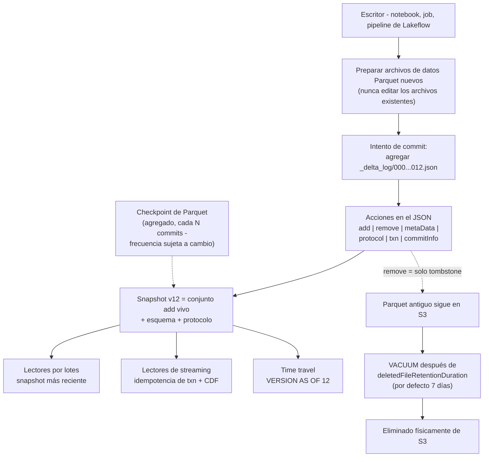
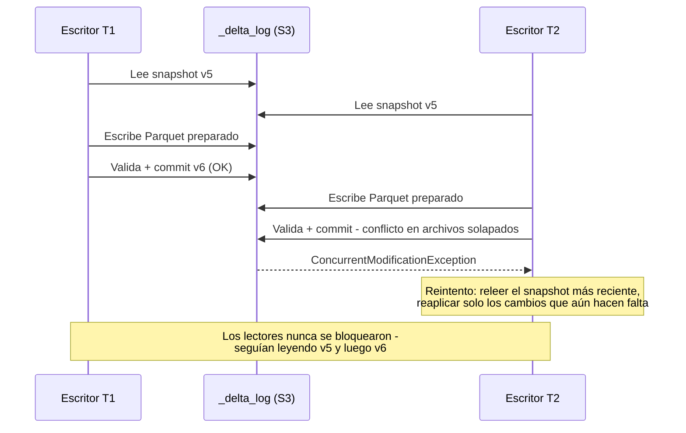
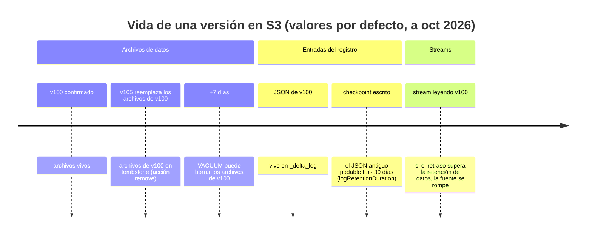
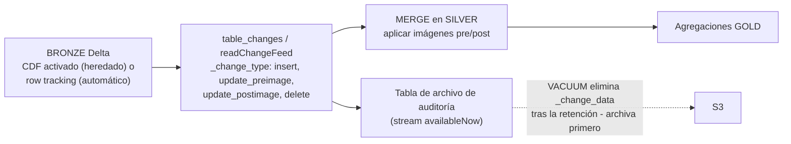

# Transacciones Delta Lake en AWS: anatomía del registro, time travel, CDF, clustering y VACUUM

Toda tabla bronze, silver y gold de este curso es una **tabla Delta Lake**: archivos de datos Parquet más un registro de transacciones basado en archivos, alojados en *tu* bucket de S3 y gobernados por Unity Catalog. Esa sola frase explica tanto el superpoder como el modo de fallo. El superpoder: commits ACID, time travel, change data feed y escritores concurrentes sobre un almacenamiento de objetos que de forma nativa no tiene ninguna de esas propiedades. El modo de fallo: equipos que tratan Delta como una carpeta de Parquet — editando archivos a mano, ejecutando `VACUUM RETAIN 0 HOURS`, activando el CDF después del hecho y preguntándose por qué falta el historial, o particionando una tabla de 200 GB en mil directorios diminutos porque un tutorial de 2019 se lo indicó.

La regla didáctica de esta lección: **el registro de transacciones es la tabla.** Los archivos de datos son solo blobs a los que el registro hace referencia; una “versión” es un commit del registro; time travel es una reproducción (replay) del registro; el CDF se calcula a partir de lo que el registro (o el lineage de filas) sabe; `VACUUM` es lo único que elimina físicamente cualquier cosa — y lo hace según el calendario del registro, no según el tuyo.

Todos los datos que siguen proceden de la documentación de AWS de Databricks (páginas de historial de tablas, change data feed, liquid clustering, optimize, VACUUM, restricciones, compatibilidad de funciones, ACID y limitaciones de S3 — todas consultadas o fechadas en **octubre de 2026**), del blog de Delta de Databricks y de la base de conocimiento de Databricks. Haz tú mismo la aritmética de retención; es la única forma de diseñar una tabla de la que aún puedas recuperarte el peor día del año.

```text
 =============================================================
  DELTA LAKE EN AWS - EL MECANISMO A VISTA DE PÁJARO (oct 2026)
 -------------------------------------------------------------
  Tabla = archivos de datos Parquet + _delta_log/ (JSON append-only)
  Commits = 00000000000000000000.json, ...0001.json, ...
  Acciones = add | remove | metaData | protocol | txn | commitInfo
  Lecturas = aislamiento de instantánea (siempre)
  Escrituras = WriteSerializable (por defecto); optimista, sin bloqueos
  Time travel = VERSION AS OF / TIMESTAMP AS OF
    archivos de datos retenidos: 7 días (deletedFileRetentionDuration)
    entradas del registro retenidas: 30 días (logRetentionDuration)
  CDF = heredado (propiedad de tabla, solo hacia adelante) |
        automático (DBR 19+, row tracking, sin propiedad)
  Layout = liquid clustering (CLUSTER BY, <=4 claves, protocolo 3/7)
           reemplaza particionamiento + ZORDER en tablas nuevas
  Mantenimiento = OPTIMIZE (bin packing / reclustering), VACUUM
  Restricciones = NOT NULL + CHECK aplicadas; PK/FK informativas
  Nota AWS = un workspace por tabla de S3; sin versionado de bucket
 =============================================================
```

En esta lección vas a:

- leer el **conjunto de acciones de `_delta_log`** — qué registran cada una de `add`, `remove`, `metaData`, `protocol`, `txn` y `commitInfo`, y cómo los checkpoints impiden que los lectores reproduzcan cada archivo JSON;
- recorrer de punta a punta la historia de la **concurrencia optimista**: lecturas de instantánea, las fases de leer/escribir/validar-y-confirmar, y por qué los cambios de metadatos son los conflictos que más duelen;
- escribir **SQL real de time travel** — `DESCRIBE HISTORY`, `VERSION AS OF`, `TIMESTAMP AS OF`, `RESTORE TABLE` — contra la división de retención de **7 días de datos / 30 días de registro**, con los suelos de DBR que bloquean por completo las versiones más antiguas;
- separar **el CDF heredado del CDF automático** (el dato que la mayoría de los tutoriales de 2023 dejan obsoleto), consultar `table_changes` y archivar un stream de CDF en una tabla de auditoría permanente;
- ejecutar un **`MERGE INTO` podado y resuelto** con `WITH SCHEMA EVOLUTION` y restricciones `CHECK` aplicadas, y citar la ganancia de poda medida (**13.16 min → 20.54 s**);
- elegir entre **particionamiento, ZORDER y liquid clustering**, ejecutar migraciones con `CLUSTER BY` / `OPTIMIZE ... FULL` y defender la elección en el **veredicto comparativo**;
- calcular a mano **la aritmética de retención de VACUUM**: bytes en tombstone, coste de retención en S3, el suelo de 168 horas y la regla del retraso de streaming — incluida la línea temporal documentada de pérdida de datos para `RETAIN 0 HOURS`;
- mapear la **escalera de protocolo** (`minReaderVersion` 1–3, `minWriterVersion` 2–7, funciones de tabla) y saber qué actualizaciones son irreversibles;
- estudiar **dos casos reales de clientes de AWS** (Rivian y Comcast), leer el **recuadro de actualizaciones de 2026** y practicar con **12 preguntas de estilo examen** más cuatro comprobaciones interactivas.

---

## 1. El registro de transacciones: lo que realmente hace que una tabla Delta sea ACID

### 1.1 Una tabla, dos mitades, una única fuente de verdad

Delta Lake “extiende los archivos de datos Parquet con un registro de transacciones basado en archivos para transacciones ACID y manejo de metadatos a escala” (docs .../delta, fechado 2026-07-10). Físicamente, en tu bucket de S3, eso es:

| Mitad | Ubicación en S3 | Mutabilidad | Quién lo lee |
|---|---|---|---|
| **Archivos de datos** | `<table-path>/*.parquet` (o subdirectorios) | Inmutables una vez escritos; se reescriben como archivos *nuevos* en DML | Cualquier motor de consultas |
| **Registro de transacciones** | `<table-path>/_delta_log/` | JSON **append-only**, más checkpoints de Parquet | Solo los lectores del protocolo Delta |

El registro “tiene un protocolo abierto bien definido que cualquier sistema puede usar para leerlo” (docs .../delta, 2026-07-10), y delta.io enuncia la regla dura: “El registro de transacciones de Delta debe permanecer como un registro append-only” (PROTOCOL.md / delta.io, consultado 2026-10). Cada commit exitoso agrega un archivo JSON con ceros a la izquierda — `00000000000000000000.json`, luego `...0001.json`, `...0002.json` — y cada archivo JSON es una lista de **acciones**. Los lectores “listan el registro, reproducen las acciones” y derivan el conjunto de archivos vivos más el esquema de cualquier versión cuyos archivos aún existan.

### 1.2 Los seis tipos de acción

Del artículo de profundidad de Databricks “Diving Into Delta Lake: Unpacking The Transaction Log” (2019-08-21), aún la enumeración canónica, consistente con la documentación actual:

| Acción | Qué registra | Por qué te importa |
|---|---|---|
| **`add`** | Un archivo de datos entra en la tabla: ruta, tamaño, hora de modificación, valores de partición, flag `dataChange` y **estadísticas** min/max por columna en `stats` | El data skipping lee estas estadísticas; Delta recopila estadísticas de las **primeras 32 columnas** por defecto (docs .../tables/clustering, 2026-09-25) |
| **`remove`** | Un archivo de datos sale del snapshot *actual* — un **tombstone**, no una eliminación | El archivo se borra físicamente solo con `VACUUM`, después de `delta.deletedFileRetentionDuration` (por defecto **7 días**) desde la eliminación *lógica* |
| **`metaData`** | id de la tabla, `schemaString`, `partitionColumns` / configuración de clustering, propiedades de la tabla, formato | La evolución de esquema y `CLUSTER BY` aterrizan aquí; los commits de metadatos entran en conflicto con escritores concurrentes |
| **`protocol`** | `minReaderVersion` / `minWriterVersion`, más `readerFeatures` / `writerFeatures` en reader 3 / writer 7 | Activar una función eleva el protocolo; “la mayoría de las actualizaciones de versión de protocolo son irreversibles” (docs .../feature-compatibility, 2026-09-11) |
| **`txn`** (SetTransaction) | Marcador de idempotencia: “registra que un job de structured streaming ya confirmó un micro-batch con el ID dado” (blog, 2019-08-21) | Los sinks de streaming exactly-once dependen de él |
| **`commitInfo`** | Nombre de la operación, `operationParameters`, usuario, timestamp, id del clúster, métricas | Exactamente lo que `DESCRIBE HISTORY` muestra |

- **📚 ¿Sabías que…?** Los nombres de commit de 20 dígitos con ceros (`00000000000000000000.json`) existen para que el listado lexicográfico de S3 coincida con el orden numérico de versiones — un truco de sistema de archivos que convierte el almacenamiento de objetos en un WAL ordenado. El DML nunca edita Parquet in place: “Delta Lake creates new versions of files rather than modifying them in place” y “El archivo de datos antiguo, sin embargo, no se elimina” (blog “DML Internals”, 2020-09-29). Espera a una acción `remove` más `VACUUM`.

### 1.3 Anatomía, dibujada



De ahí se siguen directamente dos reglas operativas, ambas oficiales: “evita interactuar directamente con los archivos de datos y del registro de transacciones en los directorios de archivos de Delta Lake” (docs .../delta, 2026-07-10) y nunca hagas `rm -rf` sobre el directorio de una tabla (docs .../delta/s3-limitations, 2026-09-11) — el registro es la tabla, y S3 no ofrece ningún rename atómico por una razón: Delta tuvo que inventar su propio protocolo de commit.

### 1.4 Ejemplo resuelto E1 — leer el registro y clasificar el mantenimiento

`DESCRIBE HISTORY` lee acciones `commitInfo`. La auto compactación, el `OPTIMIZE` manual y el liquid clustering **aparecen todos como operaciones `OPTIMIZE`** — tienes que inspeccionar `operationParameters` para distinguirlos (docs .../tables/history, última actualización 2026-09-11):

```sql
-- Last five operations on the table
DESCRIBE HISTORY main.silver.orders LIMIT 5;

-- Audit view: what kind of OPTIMIZE ran, and what did it move?
SELECT version, timestamp, operation,
       operationParameters.clusterBy    AS cluster_by,      -- non-empty = liquid clustering
       operationParameters.zOrderBy     AS z_order_by,      -- non-empty = legacy ZORDER
       operationParameters.auto         AS is_auto_compaction,
       operationParameters.predicate    AS prune_predicate,
       operationMetrics.numRemovedFiles,
       operationMetrics.numAddedFiles,
       operationMetrics.numAddedBytes
FROM (DESCRIBE HISTORY main.silver.orders)
WHERE operation IN ('OPTIMIZE','WRITE','MERGE','STREAMING UPDATE','VACUUM','REORG')
ORDER BY version DESC;
```

La página de historial también declara la retención del propio historial: “Table history retention is determined by the table setting `logRetentionDuration`, which is **30 days** by default”, y advierte: “No uses el historial de la tabla como solución de backup a largo plazo para el archivo de datos. Usa solo los últimos **7 días** para operaciones de time travel, a menos que hayas configurado tanto la retención de datos como la del registro a un valor mayor” (docs .../tables/history, 2026-09-11). Esa división 7 frente a 30 es la sección 3.

---

## 2. ACID sin bloqueos: concurrencia optimista en S3

### 2.1 Lo que garantiza Delta

“Databricks uses optimistic concurrency control. This means that there are no locks on reading or writing against a table, and deadlock is not a possibility” (docs .../lakehouse/acid, actualizado 2026-09-11). Por defecto: **aislamiento de instantánea en las lecturas**, **`WriteSerializable` en las escrituras** — “Garantiza que solo las operaciones de escritura (no las lecturas) sean serializables. Esto sigue siendo más fuerte que el aislamiento de instantánea” (docs .../isolation-levels, 2026-09-11). `Serializable` se activa a demanda:

```sql
ALTER TABLE main.silver.orders
  SET TBLPROPERTIES ('delta.isolationLevel' = 'Serializable');
```

Las escrituras siguen tres fases (docs .../acid): **leer** (un `INSERT` solo de inserciones puede saltársela por completo cuando ninguna subconsulta referencia el destino), **escribir** (preparar los archivos Parquet nuevos), **validar y confirmar** (agregar el commit JSON si no ha caído ningún commit en conflicto desde la lectura; si no, fallar con una excepción de modificación concurrente en lugar de corromper la tabla).



### 2.2 De dónde vienen realmente los conflictos

Tres fuentes de conflicto, en el orden en que muerden a los equipos en producción (docs .../optimizations/isolation y .../acid, 2026-09-11):

1. **Dos escritores reescribiendo archivos solapados** — dos `MERGE` golpeando las mismas particiones en la misma ventana. Mitigación: estrecha el predicado `ON` a las particiones que tocas (eso también poda, sección 5); prefiere inserciones donde la semántica lo permita.
2. **Cambios de metadatos** — evolución de esquema, cambios de propiedades de tabla, actualizaciones de protocolo/funciones. Estos “might cause all concurrent write operations to fail”, y “Las lecturas en streaming fallan cuando encuentran un commit que cambia los metadatos de la tabla. Si quieres que el stream continúe, debes reiniciarlo.”
3. **La regla de alcance propia de S3** — la garantía de commit en S3 está acotada al workspace: “Databricks recomienda que no modifiques la misma tabla Delta Lake almacenada en S3 desde diferentes workspaces” (docs .../delta/s3-limitations, 2026-09-11). Una tabla, un workspace; el aislamiento de cuenta por entorno (lección 02) es lo que mantiene cierta esa propiedad.

- **📚 ¿Sabías que…?** Los escritores fallidos dejan escombros: las escrituras crean archivos de metadatos `_started_<id>` y `_committed_<id>`, y “`VACUUM` operation deletes all untracked data files in a table directory, including remaining uncommitted files from failed transactions” (docs .../acid, 2026-09-11). Eso es una *característica* — y también la razón por la que un `VACUUM` con retención cero compitiendo contra un escritor lento borra datos (sección 7).

---

## 3. Time travel: dos retenciones, un suelo duro

### 3.1 El SQL que realmente vas a ejecutar

Cada operación modificadora crea una nueva versión. Sintaxis en tiempo de consulta (docs .../tables/history, 2026-09-11):

```sql
-- Worked example E2 - point-in-time reads and repair patterns
SELECT * FROM main.silver.orders VERSION AS OF 42;
SELECT * FROM main.silver.orders TIMESTAMP AS OF '2026-10-01T00:00:00.000Z';
SELECT * FROM main.silver.orders@v42;                    -- shorthand
SELECT * FROM main.silver.orders@20261001000000000;      -- timestamp shorthand

-- DataFrame equivalents: .option("versionAsOf", 42) / .option("timestampAsOf", "...")

-- Undo a bad night: copy yesterday's rows for one user back in
INSERT INTO main.silver.orders
SELECT * FROM main.silver.orders TIMESTAMP AS OF date_sub(current_date(), 1)
WHERE user_id = 111;

-- Or rewind the whole table (creates a new version; does not delete history)
RESTORE TABLE main.silver.orders TO VERSION AS OF 41;
```

### 3.2 La trampa 7 frente a 30, y los suelos de DBR

| Parámetro | Por defecto | Gobierna | Lo aplica |
|---|---|---|---|
| `delta.deletedFileRetentionDuration` | **interval 7 days** | Cuánto tiempo siguen en S3 los archivos de datos ya eliminados del snapshot | `VACUUM` |
| `delta.logRetentionDuration` | **interval 30 days** | Cuánto tiempo se conservan los JSON antiguos del registro / las entradas del historial | Automático, después de los checkpoints |

Ambos tienen que seguir existiendo para que una versión sea legible. Y desde DBR 18.0 (DBR 12.2+ para las tablas gestionadas por Unity Catalog): “time travel queries are blocked if they request a version older than the `deletedFileRetentionDuration` table property (default 7 days)” (docs .../tables/history, 2026-09-11) — así que el time travel efectivo con los valores por defecto es de **7 días**, aunque el *metadato* del historial muestre 30 días de operaciones.



> [!IMPORTANT]
> ⚠️ **Time travel no es backup.** “Don't use table history as a long-term backup solution for data archival” (docs .../tables/history, 2026-09-11). Tras un `VACUUM` con valores por defecto, “you can't restore a table to an older version that references those files”. Para durabilidad real en AWS usa el versionado de S3 *solo si el cumplimiento lo obliga* (entonces: tres versiones, ciclo de vida ≤7 días — docs .../delta/s3-limitations), o snapshots/clones explícitos en una ubicación con retención controlada — nunca `VACUUM` + esperanza. La base de conocimiento lo dice sin rodeos: “si ejecutas VACUUM con los ajustes por defecto, solo podrás hacer time travel siete días hacia el pasado” (kb.databricks.com, mejores prácticas de VACUUM, consultado 2026-10).

---

## 4. Change data feed: heredado frente a automático (la verdad de 2026)

### 4.1 Dos implementaciones, una API de lectura

El CDF “tracks row-level changes between versions of a Delta Lake table” con columnas de metadatos `_change_type` (`insert`, `update_preimage`, `update_postimage`, `delete`), `_commit_version` y `_commit_timestamp` (docs .../change-data-feed, última actualización **2026-10-09**). A oct 2026 hay **dos** implementaciones — aquí es donde los tutoriales antiguos se quedan viejos:

| | **CDF heredado** | **CDF automático** |
|---|---|---|
| Mecanismo | Materializa archivos de cambios en la **escritura** | Calcula los cambios en la **consulta** a partir del **lineage de filas** |
| Activación | Por tabla: `delta.enableChangeDataFeed = true` (CREATE o ALTER) | Sin propiedad de tabla; exige **DBR 19 o superior** + row tracking (Delta gestionada/externa registrada en UC, o Iceberg v3) |
| Coste de escritura | Cada `MERGE`/`UPDATE` escribe archivos de cambios extra | “improves write performance and reduces storage costs” (misma página) |
| Mirada hacia atrás | **Solo hacia adelante** — “it will capture changes once the table property is set up and not earlier” (blog, 2021-06-09) | Cubre los cambios mientras exista el row tracking |
| ¿Los dos a la vez? | No soportado — quita la propiedad heredada antes de migrar | |

Las API de lectura son idénticas en ambos modos (docs .../change-data-feed, 2026-10-09):

```sql
-- Worked example E3a - batch CDF reads (starting version REQUIRED)
SELECT * FROM table_changes('main.silver.orders', 0, 10);      -- versions 0..10 inclusive
SELECT * FROM table_changes('main.silver.orders', 12);         -- from v12 onward

SELECT _change_type, count(*) AS n
FROM table_changes('main.silver.orders', 12)
WHERE _commit_timestamp >= current_timestamp() - INTERVAL 1 DAY
GROUP BY _change_type;
```

```python
# Worked example E3b - DataFrame + permanent audit archive
# CDF is transient: change data lives in _change_data, is removed by VACUUM,
# and log versions are pruned - archive if you need permanence (docs 2026-10-09).

# Batch
spark.read.option("readChangeFeed", "true").option("startingVersion", 12).table("main.silver.orders")

# Streaming: first start returns the latest snapshot as INSERT, then future changes
(spark.readStream.option("readChangeFeed", "true").table("main.silver.orders")
      .writeStream
      .option("checkpointLocation", "/mnt/checkpoints/orders_cdf")
      .trigger(availableNow=True)
      .toTable("main.audit.orders_cdf_archive"))
```



Dos filos afilados de la documentación y del resumen de la base de conocimiento: las lecturas por lotes de CDF **exigen** una versión de inicio — un inicio anterior a cuando se activó el CDF lanza un error; y un rango de CDF que abarque un cambio de esquema no aditivo (renombrado/borrado/cambio de tipo) falla, así que parte el rango. “A change data feed is not intended to serve as a permanent record of all changes to a table” (docs .../change-data-feed, 2026-10-09).

- **📚 ¿Sabías que…?** La propia guía de streaming de Databricks dice hoy: “Databricks recommends streaming from the CDC feed of a Delta Lake table rather than directly from the table whenever possible” (docs .../structured-streaming/delta-lake, página fechada 2026-08-24). Leer en streaming directamente de una tabla caliente falla en los commits de metadatos (hay que reiniciar); un feed de CDF más `foreachBatch` te da una aplicación downstream idempotente con menos sorpresas (lección 13).

---

## 5. MERGE, UPDATE, DELETE: copy-on-write, bien hecho

### 5.1 Semántica en una tabla

Los tres son **copy-on-write a granularidad de archivo** — tocar una fila reescribe su(s) archivo(s) contenedor(es) como versiones nuevas (blog “DML Internals”, 2020-09-29). `MERGE INTO` admite las cláusulas `WHEN MATCHED`, `WHEN NOT MATCHED [BY TARGET]` y `WHEN NOT MATCHED BY SOURCE`, evaluadas en orden; cada `WHEN MATCHED` que no sea el último debe llevar una condición (si no, `NON_LAST_MATCHED_CLAUSE_OMIT_CONDITION`); y dos filas de origen que coincidan con una fila de destino fallan con `DELTA_MULTIPLE_SOURCE_ROW_MATCHING_TARGET_ROW_IN_MERGE` (docs .../delta-merge-into, actualizado 2026-06-18).

### 5.2 Ejemplo resuelto E4 — MERGE podado hacia silver con restricciones y evolución

```sql
-- Cheap, enforced data quality first: fails the transaction before bad rows land
ALTER TABLE main.silver.orders
  ADD CONSTRAINT order_id_not_null CHECK (order_id IS NOT NULL);
ALTER TABLE main.silver.orders
  ADD CONSTRAINT amount_nonneg CHECK (amount >= 0);

-- Worked example E4 - the production-shaped MERGE (docs 2026-06-18: WITH SCHEMA EVOLUTION = DBR 15.2+)
MERGE WITH SCHEMA EVOLUTION INTO main.silver.orders t
USING (SELECT * FROM main.bronze.orders_raw
       WHERE event_date >= date_sub(current_date(), 2)) s   -- prune BEFORE the join
ON  t.order_id = s.order_id
AND t.event_date >= date_sub(current_date(), 2)             -- pruning predicate in ON
WHEN MATCHED AND s.op <> 'DELETE' THEN UPDATE SET *
WHEN MATCHED AND s.op = 'DELETE'  THEN DELETE
WHEN NOT MATCHED THEN INSERT *;
-- Optimized writes + auto compaction are forced ON for MERGE/UPDATE/DELETE (docs 2026-09-11).
```

La razón medida de por qué importa el predicado `ON`, de la base de conocimiento de Databricks (última publicación 2023-06-01): un `MERGE` sin filtros sobre una tabla con `PartitionCount: 1000` tardó **13.16 minutos**; añadir condiciones de poda (`PartitionCount: 2`) tardó **20.54 segundos** — “more than 40X faster”. Añade el **low shuffle merge** (GA y por defecto desde DBR 10.4 LTS): “up to 5x performance improvement on MERGE-based workloads with the average on the order of 2-3x” (blog, 2024-06-20), con un cliente del sector sanitario que redujo su tiempo medio de merge “from 11 minutes to 1.5 minutes” (7×). El low shuffle merge “también reduce la necesidad de que los usuarios vuelvan a ejecutar `OPTIMIZE` después de realizar un `MERGE`” (docs, 2026-06-11) — aunque las filas recién insertadas en una tabla con clustering pueden seguir necesitando un reclustering.

---

## 6. Layout: particionamiento, ZORDER y liquid clustering

### 6.1 Qué hace realmente cada técnica

| Técnica | Mecanismo | Perfil de coste | Estado en la documentación (oct 2026) |
|---|---|---|---|
| **Particionamiento estilo Hive** | Un directorio por valor de partición; la poda = saltar directorios | Reescrituras intensivas; explosión de cardinalidad; shuffle al escribir | Desaconsejado en tablas de **menos de 1 TB**; solo si cada partición es ≥ **1 GB** (docs .../performance-efficiency, 2026-09-11) |
| **ZORDER** | Co-localización de una columna entre archivos basada en reescritura (orden multidimensional) | Reescrituras caras; el `MERGE` solía romper el layout | Heredado; la documentación “recommend[s] using liquid clustering instead of partitioning, `ZORDER`, or other data layout approaches” (docs .../optimize, 2026-09-11) |
| **Liquid clustering** | Claves `CLUSTER BY` + **ZCubes/bin packing** en `OPTIMIZE`; claves cambiables sin reescritura; poda a granularidad de archivo (“no directory-level shortcut to lose” — blog, 2026-01-06) | Reclustering incremental; clustering al escribir para las gestionadas por UC | “Liquid clustering is a data layout optimization technique that **replaces table partitioning and `ZORDER`**” (docs .../tables/clustering, 2026-09-25); “Databricks recommends liquid clustering for all new tables” |

Datos de liquid clustering que tienes que saber enunciar con precisión (todos de docs .../tables/clustering, 2026-09-25 salvo indicación):

- Sintaxis: `CREATE TABLE t (...) CLUSTER BY (col1, col2)`; `ALTER TABLE t CLUSTER BY (cols)`; `ALTER TABLE t CLUSTER BY NONE`. “Clustering is not compatible with partitioning or `ZORDER`.”
- **Hasta cuatro claves de clustering**; más claves degradan los filtros de una sola columna en tablas de menos de 10 TB. Las estadísticas sostienen el data skipping de las **primeras 32 columnas**.
- Historia de versiones, con fecha: activación/escritura desde **DBR 13.3 LTS+**; anunciado **GA en DBR 15.2** (blog, 2024-05-22); documentación actual: “disponible generalmente para tablas Delta Lake con **Databricks Runtime 15.4 LTS o superior**”. Protocolo: **reader 3 / writer 7** (particionamiento oculto).
- `ALTER TABLE ... CLUSTER BY` **no** reescribe datos; el primer reclustering es `OPTIMIZE t FULL` (**DBR 16.4 LTS+**). `CLUSTER BY AUTO` (clustering automático, gestionada por UC + optimización predictiva) es **DBR 15.4 LTS+**. `REPLACE PARTITIONED BY WITH CLUSTER BY` es **DBR 18.1+**.
- Cadencia: `OPTIMIZE` es idempotente, no cambia ningún dato y “no afecta a ningún stream actual o futuro que tenga esta tabla como fuente” (docs .../optimize, 2026-09-11) — tablas calientes cada **1–2 horas**, en otro caso **cada noche** (amigable con spot); las tablas de **más de 1 TB** deben ejecutar `OPTIMIZE` con un calendario (docs .../tune-file-size, 2026-09-11). Auto-optimize = `autoOptimize.optimizeWrite` + `autoOptimize.autoCompact`, archivos objetivo de **128 MB**; siempre activo para DML; las tablas gestionadas por UC reciben en su lugar un ajuste automático del tamaño de archivo (autotune de 256 MB–1 GB según el tamaño de la tabla).

### 6.3 Ejemplo resuelto E5 — migración con CLUSTER BY y OPTIMIZE programado

```sql
-- New table, clustered from birth (no PARTITION BY + CLUSTER BY together)
CREATE TABLE main.gold.events (
  event_date DATE, store_id BIGINT, customer_id BIGINT, payload STRING
) CLUSTER BY (event_date, store_id);          -- <= 4 keys

-- Enable clustering on an existing table, then force the first full recluster
ALTER TABLE main.gold.legacy_daily CLUSTER BY (event_date, customer_id);
OPTIMIZE main.gold.legacy_daily FULL;         -- DBR 16.4+; first run can take hours on big tables

-- DBR 18.1+: in-place conversion from partitioning, no full rewrite
ALTER TABLE main.gold.daily REPLACE PARTITIONED BY WITH CLUSTER BY (event_date, customer_id);

-- Incremental maintenance: prune with WHERE; bin packing is idempotent
OPTIMIZE main.gold.events WHERE event_date >= current_date() - 3;

-- Verify in history: expect REORG / UPGRADE PROTOCOL / OPTIMIZE with clusterBy set
DESCRIBE HISTORY main.gold.events LIMIT 10;
```

Contexto de benchmark para llevarte a las revisiones de diseño: en una carga de trabajo de almacén de datos de 1 TB, “Liquid Clustering resulted in **2.5x faster clustering relative to Z-order**. In the same trial, traditional Hive-style partitioning was an order of magnitude slower” (blog, 2023-06-29); una gran empresa de manufactura vio sus consultas puntuales “speeding up ... by **12x**” (blog, 2024-05-22). Trátalos como benchmarks del proveedor con sus fechas, no como SLA.

### 6.4 Ejemplo resuelto E6 — la aritmética de la compactación de archivos pequeños

Una ingesta en streaming escribe ~1.800 archivos/día de 4 MB cada uno en `main.silver.orders` (micro-batches de Auto Loader). Las consultas que deberían leer un archivo de 500 MB en su lugar abren más de 1.800.

```text
Ejemplo resuelto E6 - economía de la compactación, a oct 2026
Antes de OPTIMIZE:
  archivos/día ............ 1.800 x 4 MB = 7.2 GB/día agregados como archivos diminutos
  semana de ingest ....... 12.600 archivos; el coste de listado + apertura de S3 domina las consultas cortas
Después de OPTIMIZE (objetivo ~128 MB autoCompact / autotune 256 MB-1 GB según tamaño):
  archivos/día ............ 7.2 GB / 128 MB ~ 58 archivos/día (bin packing)
  reducción ............ ~31x menos objetos para los mismos bytes
Cadencia:
  tabla caliente ............ OPTIMIZE cada 1-2 horas (página de clustering)
  línea base ............. cada noche; tablas > 1 TB con calendario (tune-file-size)
Nota de coste:
  OPTIMIZE se ejecuta en el cómputo que programes - noche + spot es la pista de la docs;
  la optimización predictiva (gestionada por UC) lo ejecuta por ti (activada por defecto en
  las cuentas creadas a partir del 2024-11-11) - entonces desactiva tus propios jobs de OPTIMIZE.
```

```plot
{
  "type": "bar",
  "title": "Latencia de consulta p95 antes vs después de compactación + clustering (caso ilustrativo de diseño, cargas de trabajo de escala de minutos)",
  "xLabel": "Fase de la carga de trabajo",
  "yLabel": "Latencia p95 (segundos)",
  "xKey": "phase",
  "dataKeys": ["latency_s"],
  "data": [
    {"phase": "Before: 12,600 small files", "latency_s": 48.0},
    {"phase": "After: OPTIMIZE bin packing", "latency_s": 11.5},
    {"phase": "After: CLUSTER BY (event_date, store_id)", "latency_s": 6.2}
  ]
}
```

La forma de esa curva es todo el argumento: el bin packing (archivos menos numerosos y más grandes) elimina el impuesto del listado; el clustering (archivos ordenados por las claves de filtro) deja después que el data skipping corte el escaneo. Los segundos exactos son un escenario de compactación ilustrativo — los *mecanismos* son los documentados: data skipping basado en estadísticas sobre las primeras 32 columnas, objetivos de compactación de 128 MB y poda a granularidad de archivo sobre las claves con clustering.

> **Veredicto comparativo — particionamiento / ZORDER frente a liquid clustering (a oct 2026)**
> - **Elige liquid clustering (`CLUSTER BY`)** para todas las tablas nuevas, según la documentación actual: claves de filtro de alta cardinalidad (customer_id, event_id), claves que deben cambiar sin reescribir la tabla completa, tablas cuya fuente principal es el streaming y todo lo gestionado por UC con optimización predictiva. Reemplaza tanto el particionamiento como ZORDER, mantiene el protocolo en reader 3 / writer 7 y logra un clustering 2.5× más rápido que ZORDER en una carga de trabajo de DW de 1 TB (2023-06-29) con adopción en producción “including dozens with petabyte scale tables” (2026-01-06).
> - **El particionamiento aún tiene un nicho legítimo**: tablas ≥ 1 TB con un filtro *estable y de baja cardinalidad* (una fecha que siempre podas, una región que siempre acotas) donde la herramienta de nivel de directorio fuera de Databricks (compactación externa, lectores de terceros) necesita ese layout — y solo si cada partición guarda ≥ 1 GB (docs, 2026-09-11). Por debajo de 1 TB, no particiones.
> - **ZORDER es heredado.** Consérvalo solo en tablas preexistentes que no hayas migrado; la documentación recomienda liquid clustering en su lugar; nunca combines `ZORDER` con `CLUSTER BY` (“not compatible”). Migra las claves con `ALTER TABLE ... CLUSTER BY` + `OPTIMIZE FULL`, o con `REPLACE PARTITIONED BY WITH CLUSTER BY` en DBR 18.1+.
> - **La respuesta-trampa en exámenes y en documentos de diseño:** “particiona por una columna de baja cardinalidad y después haz ZORDER al resto” es un consejo de 2022. En oct de 2026 la respuesta por defecto es `CLUSTER BY` con hasta cuatro claves bien elegidas — y un `OPTIMIZE` programado (o predictivo).

- **📚 ¿Sabías que…?** La auto compactación, el liquid clustering y ZORDER se registran todos como `OPTIMIZE` en el historial de la tabla — así que la afirmación de un equipo con auto-optimize activado de que “nunca ejecutamos OPTIMIZE” es invisible a menos que lean `operationParameters.auto` / `.clusterBy` (E1). Y en las tablas gestionadas por Unity Catalog con optimización predictiva activada, Databricks “recommends disabling any scheduled OPTIMIZE jobs” para no pagar dos veces por las mismas reescrituras (docs .../tables/clustering, 2026-09-25).

---

## 7. VACUUM: aritmética de retención y la línea temporal de pérdida de datos

### 7.1 Qué hace VACUUM — y qué no hace

“`VACUUM` elimina todos los archivos del directorio de la tabla que no están gestionados por Delta, así como los archivos de datos que ya no están en el estado más reciente del registro de transacciones” — y “omitirá todos los directorios que empiecen por un guion bajo (`_`), lo que incluye el `_delta_log`” (docs .../delta-vacuum, 2026-09-11). La eliminación sigue el **tiempo desde la eliminación lógica del registro**, no el mtime del archivo, más las horas de retención; umbral por defecto de **7 días** vía `delta.deletedFileRetentionDuration`. `VACUUM` es también lo que destruye el time travel hacia versiones antiguas y lo que borra los archivos CDF de `_change_data` (docs .../operations/vacuum, fechado 2026-04-21). El podado del JSON del registro *no* lo gobierna `VACUUM` — lo impulsan los checkpoints, con el `logRetentionDuration` de 30 días.

Modos: `DRY RUN` (lista hasta **1000** archivos candidatos — ejecuta siempre esto primero); `FULL` (por defecto) frente a `LITE` (dirigido por el registro, **DBR 16.1+**). La eliminación de archivos es una operación que solo ocurre en el driver.

### 7.2 Ejemplo resuelto E7 — aritmética de retención con bytes reales

Una tabla silver recibe 40 GB/día de archivos pequeños que el `OPTIMIZE` nocturno pone en tombstone (eliminación lógica `remove`) mientras los reescribe en archivos más grandes. Tienes que dimensionar el coste de retención de los tombstones y elegir una retención.

```text
Ejemplo resuelto E7 - aritmética de retención de VACUUM, S3 Standard $0.023/GB-mes (a oct 2026)
Bytes en tombstone/día .......... 40 GB (fuera del snapshot, aún en S3)

Retención por defecto = 7 días = 168 horas:
  huella de tombstones ......... 40 GB x 7 = 280 GB
  coste de retención en S3 ..... 280 x $0.023 = $6.44 / mes
  ventana de time travel ....... 7 días (suelo de la docs; DBR 18.0+ bloquea las anteriores)

Retención por cumplimiento = 30 días (720 horas):
  huella de tombstones ......... 40 x 30 = 1.200 GB (1.2 TB)
  coste de retención en S3 ..... 1.200 x $0.023 = $27.60 / mes
  multiplicador frente al defecto ... 30/7 ~ 4.3x los bytes y el coste de tombstones

Restricción de seguridad en streaming:
  retención >= retraso máximo tolerado del stream + transacción concurrente más larga
  p. ej. peor retraso observado 36 h + job más largo 8 h => conserva >= 44 h; conserva 168 h de todos modos
```

Lee la regla del multiplicador: subir la retención aumenta linealmente los bytes *en tombstone* en S3 mientras extiende linealmente tu ventana de time travel y de datos de cambios del CDF — no aumenta el coste de la tabla viva. Los 168 horas por defecto son a la vez la recomendación mínima de la documentación (“Databricks strongly recommends setting a retention interval of at least 7 days”, docs .../delta-vacuum) y el suelo por el retraso de streaming.

### 7.3 La línea temporal documentada de pérdida de datos

El caso de la base de conocimiento (última publicación 2025-07-14): `VACUUM` arranca sobre la versión 100 a las 01:17 UTC; la versión 101 confirma un archivo de datos nuevo a las 01:19; `VACUUM` borra ese archivo aún no referenciado a las 01:20 — “VACUUM executed on version 100 and deleted everything that was added to version 101”. La barrera de protección es `spark.databricks.delta.retentionDurationCheck.enabled`; la instrucción de la KB: “Do not disable ... and run vacuum with retention zero to avoid data loss.” Y con las fuentes de streaming: “Si la tabla Delta es la fuente de una consulta de streaming, y si la consulta de streaming se retrasa más de siete días, entonces la consulta de streaming no podrá leer la tabla correctamente” (KB, mejores prácticas de VACUUM, consultado 2026-10).

```sql
-- Safe drill, then a deliberate retention raise
VACUUM main.silver.orders DRY RUN;                            -- inspect the candidate list first
VACUUM main.silver.orders RETAIN 168 HOURS;                   -- the 7-day floor
ALTER TABLE main.silver.orders
  SET TBLPROPERTIES ('delta.deletedFileRetentionDuration' = 'interval 30 days');
-- NEVER in production:
-- SET spark.databricks.delta.retentionDurationCheck.enabled = false;
-- VACUUM main.silver.orders RETAIN 0 HOURS;
```

---

## 8. Restricciones: calidad de datos aplicada al precio de un commit de metadatos

Dos tipos de restricción se **aplican** en Delta (docs .../constraints, 2026-09-11): `NOT NULL` (en línea o con `ALTER TABLE ... ALTER COLUMN ... SET NOT NULL`) y `CHECK` (`ALTER TABLE t ADD CONSTRAINT nombre CHECK (expr)`). Añadir una restricción “verifies that all existing rows satisfy the constraint before adding”, y la expresión debe ser Spark SQL determinista — sin UDFs, agregaciones ni funciones de ventana o de varias filas. Una violación “fails the transaction with an error” antes de que los datos aterricen — una guarda en tiempo de escritura que no cuesta nada en tiempo de lectura, a diferencia del filtrado basado en vistas.

Nota de protocolo: “Adding a constraint upgrades the table writer protocol if the current writer version is less than 3” — un evento de compatibilidad para los lectores externos (sección 9). Y la trampa que todo curso debe desactivar: **las restricciones de clave primaria, clave foránea y unicidad son solo informativas y no se aplican** (PK/FK GA desde DBR 15.2; unicidad en vista pública, DBR 18.2+). Pueden ayudar a la optimización; no son garantías de integridad. Las restricciones complementan — no sustituyen — las expectations y los patrones de cuarentena de Lakeflow (lección 10).

```sql
-- Worked example E8 - the constrained silver table
CREATE TABLE main.silver.orders (
  order_id   BIGINT NOT NULL,
  event_date DATE  NOT NULL,
  amount     DECIMAL(18,2),
  status     STRING
);

ALTER TABLE main.silver.orders
  ADD CONSTRAINT amount_nonneg CHECK (amount >= 0);
ALTER TABLE main.silver.orders
  ADD CONSTRAINT status_valid CHECK (status IN ('NEW','PAID','SHIPPED','CANCELLED'));

SHOW TBLPROPERTIES main.silver.orders;   -- constraints and retention knobs live here
DESCRIBE DETAIL main.silver.orders;      -- protocol + location + stats summary
```

El enforcement de esquema es la misma filosofía a nivel de columna: “Databricks validates data quality by enforcing schema on write for Delta Lake tables” — una columna mal nombrada o un tipo incompatible cancela el transaction antes de que nada se confirme (docs .../schema-enforcement; blog, 2019-09-24). La evolución es opt-in **por escritura o por sentencia** — `WITH SCHEMA EVOLUTION` en `MERGE` (DBR 15.2+) / `INSERT` (DBR 18.1+), o `.option("mergeSchema","true")` —, y Databricks desaconseja explícitamente en producción `spark.databricks.delta.schema.autoMerge.enabled` a nivel de sesión (“might lead to unintended schema changes”). Las consultas de streaming fijan su esquema en la planificación: un cambio de fuente a mitad de stream hace fallar la consulta y obliga a reiniciar (docs .../data-engineering/schema-evolution, consultado 2026-10).

---

## 9. Protocolo, funciones y lo que tu tabla les cuesta a otros lectores

Toda tabla Delta lleva `minReaderVersion` ∈ {1, 2, 3} y `minWriterVersion` ∈ {2..7}. Desde DBR 12.2 LTS, las **funciones de tabla** granularizan esto en reader 3 / writer 7 (docs .../feature-compatibility, 2026-09-11):

| Función | Protocolo (reader/writer) | DBR mínimo (función) |
|---|---|---|
| Tabla básica | 1 / 2 | — |
| Restricción CHECK | 1 / **3** | — |
| Change data feed (heredado) | 1 / **4** | — |
| Column mapping | 2 / 5 | — |
| Columnas identity | 1 / 6 | — |
| Row tracking | 1 / 7 | 14.3 LTS |
| Deletion vectors | **3** / 7 | 13.3 LTS |
| Liquid clustering (particionamiento oculto) | **3** / 7 | 13.3 LTS (anuncio GA en 15.2; la documentación cita 15.4 LTS+) |
| Type widening / Variant | 3 / 7 | 15.4 LTS |

Reglas que importan específicamente en AWS:

1. **Las funciones solo de escritor (CHECK, CDF, identity, row tracking) no rompen a los lectores** — “only upgrade the write protocol”, así que los clientes heredados de solo lectura sobreviven. Las funciones de lector (column mapping, deletion vectors, type widening, el particionamiento oculto del liquid clustering) rompen a los lectores que no las implementan.
2. **“La mayoría de las actualizaciones de versión de protocolo son irreversibles.”** Nunca hagas un “downgrade” editando el JSON. `DROP FEATURE` (DBR 15.4+) es la única reversión parcial, y no toda función se puede eliminar. Las escrituras en DBR bajo siempre son legibles en DBR alto; el peligro es la dirección contraria — una herramienta de BI o un cliente ETL anclado a un Spark antiguo puede simplemente dejar de leer tu tabla después de que actives el clustering.
3. **En S3:** no actives el versionado de buckets en los buckets de Delta (pelea con el GC de Delta); si es obligatorio, tres versiones con ciclo de vida ≤7 días. No escribas la misma tabla desde dos workspaces. No edites a mano Parquet ni el registro (docs .../delta/s3-limitations, 2026-09-11).
4. **Gestionada frente a externa:** las tablas gestionadas (por defecto, recomendadas) viven bajo el `MANAGED LOCATION` del esquema/catálogo en tu S3 (subdirectorios hasheados `__unitystorage`), el `DROP` elimina los datos (recuperación con `UNDROP` de 7 días), y reciben optimización predictiva + ajuste automático de archivos. Las tablas externas conservan tu ruta; el `DROP` conserva los archivos; el mantenimiento es tuyo. El `_delta_log` está dentro del directorio de la tabla en **ambos** casos. Las tablas gestionadas deben accederse por nombre — “Path-based access to Unity Catalog managed tables is not supported” (docs .../tables/managed, actualizado 2026-10-08).

---

## 10. Las trampas: doce confusiones que esta lección no te deja conservar

1. **“Time travel = 30 días.”** Con los valores por defecto son **7 días** de datos; 30 días es solo cuánto sobrevive el *metadato* del historial.
2. **`logRetentionDuration` frente a `deletedFileRetentionDuration`.** JSON del registro/historial frente a archivos de datos eliminados por `VACUUM`. El clásico error de 7 frente a 30.
3. **`VACUUM` borra archivos por antigüedad en disco.** No — por el tiempo desde la *eliminación lógica*, y además recoge escombros sin confirmar de jobs fallidos (por qué menos de 7 días es peligroso).
4. **CDF activado después del hecho.** El CDF heredado solo mira hacia adelante; los cambios retroactivos son invisibles. El CDF automático (DBR 19+, row tracking) no necesita propiedad pero solo cubre la era del row tracking.
5. **Los dos modos de CDF a la vez.** No soportado; haz `UNSET` de la propiedad heredada al migrar.
6. **Asumir que el historial te dice qué OPTIMIZE se ejecutó.** Lee `operationParameters.{auto, clusterBy, zOrderBy, predicate}`.
7. **`CLUSTER BY` + particionamiento o ZORDER a la vez.** “Not compatible” — un error, no una optimización extra.
8. **“Liquid clustering es GA desde 13.3.”** 13.3 LTS = suelo de activación/escritura; el GA se anunció en 15.2 (2024-05-22); la documentación cita hoy 15.4 LTS+. Lleva los tres números con sus fechas.
9. **“Activar clustering reescribe mi tabla.”** `ALTER TABLE ... CLUSTER BY` es metadatos; la reescritura es `OPTIMIZE ... FULL` (16.4+).
10. **Las actualizaciones de protocolo son de un solo sentido.** Los clientes externos anclados a runtimes antiguos se rompen; revisa `DESCRIBE DETAIL` antes de activar funciones de lector en un entorno compartido.
11. **PK/FK/unicidad aplican integridad.** No lo hacen; solo `NOT NULL` y `CHECK`.
12. **`MERGE` sin predicados de poda.** Medido: 13.16 min frente a 20.54 s (KB, 2023-06-01) — pon los predicados de partición/clustering en la cláusula `ON`.

### Actualizaciones de 2026 (en octubre de 2026)

> [!NOTE]
> **Qué cambió en la plataforma Delta de la que depende esta lección:**
> - **2026-01-06 — liquid clustering opera a escala de producción documentada.** “Liquid Clustering became Generally available in 2024 ... customers running it at scale, including dozens with **petabyte scale tables** in production” (databricks.com/blog/debunking-8-data-layout-myths-why-liquid-clustering-outperforms-partitioning, 2026-01-06). Los debates particionamiento frente a clustering de los tutoriales antiguos quedan superados para las tablas nuevas.
> - **2026-09-25 — redacción actual de la documentación de clustering.** “Liquid clustering is a data layout optimization technique that replaces table partitioning and `ZORDER`”; GA “con Databricks Runtime 15.4 LTS o superior”; hasta cuatro claves; estadísticas en las primeras 32 columnas (docs .../aws/en/tables/clustering, actualizado 2026-09-25).
> - **2026-10-09 — el change data feed automático es la historia actual del CDF.** “Automatic change data feed: Computes changes during table reads using row lineage metadata. This doesn't require individual table configuration” frente a la materialización heredada — exige **Databricks Runtime 19 o superior** más row tracking en una tabla registrada en UC; “No puedes usar a la vez los feeds de datos de cambio heredados y automáticos” (docs .../change-data-feed, actualizado 2026-10-09).
> - **2026-10-08 — ciclo de vida de las tablas gestionadas y optimización predictiva.** Las tablas gestionadas eliminadas son recuperables **7 días** por defecto (`RETAIN DROPPED TO` lo ajusta); la resolución del almacenamiento gestionado es esquema → catálogo → metastore; el acceso por ruta sigue sin soportarse (docs .../tables/managed, actualizado 2026-10-08). La optimización predictiva está activada por defecto en las cuentas creadas a partir del 2024-11-11 (docs, consultado 2026-10).
> - **2026-06-11 / 2026-06-18 — páginas de low shuffle merge y de evolución de MERGE renovadas.** LSM “GA in Databricks Runtime 10.4 LTS and above” con “up to 5x ... average on the order of 2-3x”; `MERGE WITH SCHEMA EVOLUTION` documentado en DBR 15.2+ (docs .../low-shuffle-merge y .../delta-merge-into, 2026).
> - **2026-08-24 — la guía de streaming prefiere los feeds CDC.** “Databricks recommends streaming from the CDC feed of a Delta Lake table rather than directly from the table whenever possible” (docs .../structured-streaming/delta-lake, página fechada 2026-08-24).

---

## Casos Reales

> **📋 Caso A — Rivian (vehículos eléctricos, cloud: AWS)**
> **El reto.** Terabytes de datos de vehículos y de campo al día desde más de 70.000 vehículos, con herramientas heredadas que “struggled to scale pipelines cost-effectively and spent significant resources on maintenance”.
> **Stack en AWS.** Databricks SQL, tablas Delta Lake, Unity Catalog — y **liquid clustering** nombrado explícitamente: “Unity Catalog for data governance, Delta Tables for storage, and Liquid Clustering for data layout” para ML de predicción de carga en tiempo real (https://www.databricks.com/blog/data-intelligence-action-100-data-and-ai-use-cases-databricks-customers, 2025-07-09). La página del caso lleva la propia etiqueta `Cloud: AWS` de Databricks (https://www.databricks.com/customers/rivian, página sin fecha, consultada 2026-10).
> **Resultado reportado.** “1,000+ platform users, a 75% increase from a year ago” (customers/rivian, consultado 2026-10); “50% better runtime performance” y “Más de 70.000 Rivians en circulación, generando terabytes de datos cada día” (https://www.databricks.com/your-ai/customers/rivian, 2024-05-30).
> **Cómo encaja en esta lección.** Sección 6 — el liquid clustering no es una diapositiva de benchmark: es la técnica de layout nombrada en un lakehouse de AWS en producción que alimenta ML, exactamente el patrón de acceso de ID de vehículo de alta cardinalidad / series temporales donde el particionamiento estático falla.
> ⏳ *Nota temporal: las métricas proceden de páginas de 2024–2025; datea las cifras cuando las cites.*

> **📋 Caso B — Comcast (comunicaciones y medios, cloud: AWS)**
> **El reto.** Petabytes de telemetría y miles de millones de interacciones de voz desde más de 20M de mandos de voz; pipelines frágiles y dolor de la ingesta de archivos pequeños.
> **Stack en AWS.** Databricks con **Delta Lake para la ingesta y la optimización de archivos pequeños**, MLflow gestionado, autoscaling con instancias spot — `Cloud: AWS` en la página del caso (https://www.databricks.com/customers/comcast, página sin fecha, consultada 2026-10); también figuraba entre los clientes “already leveraging Databricks on AWS” (https://www.databricks.com/company/newsroom/press-releases/databricks-strengthens-scope-of-work-with-aws, 2022-05-10).
> **Resultado reportado.** “10x Reduction in overall compute costs to process data · 90% Reduction in required DevOps resources”; “Delta Lake has enabled Comcast to optimize data ingestion, replacing 640 machines with 64 while improving performance” (customers/comcast, consultado 2026-10; origen del caso 2019).
> **Cómo encaja en esta lección.** Secciones 1 y 6 — el registro de transacciones más la compactación (`OPTIMIZE` / auto compactación) colapsaron un parque de 640 máquinas a 64 *antes* de cualquier ajuste exótico. La victoria de rendimiento más barata en un entorno Delta es estructural: menos archivos, mejor dispuestos, no clústeres más grandes.
> ⏳ *Nota temporal: un caso con origen en 2019 que aún se muestra en 2026; enséñalo como lo que Comcast reportó en su momento.*

---

> [!SUCCESS]
> **Conclusiones Clave (Key Takeaways):**
> 1. **El registro es la tabla.** Parquet + JSON append-only de `_delta_log/` (`add`, `remove`, `metaData`, `protocol`, `txn`, `commitInfo`) más checkpoints de Parquet; nunca toques los archivos a mano; `remove` es un tombstone hasta que llega `VACUUM`.
> 2. **Concurrencia sin bloqueos.** Aislamiento de instantánea en las lecturas; `WriteSerializable` en las escrituras por defecto; validación-y-commit optimista; los cambios de metadatos y las reescrituras de archivos solapados son los conflictos reales; en S3 la garantía es de **un solo workspace**.
> 3. **Time travel tiene dos relojes.** Archivos de datos: 7 días (`deletedFileRetentionDuration`, aplicado por `VACUUM`); registro/historial: 30 días (`logRetentionDuration`); DBR 18.0+ (gestionadas por UC desde 12.2+) bloquea el viaje más allá del suelo de retención de datos. El historial no es backup.
> 4. **CDF en 2026 = dos implementaciones.** Heredado (`delta.enableChangeDataFeed=true`, solo hacia adelante, materializado) frente a automático (DBR 19+, row tracking, en tiempo de consulta, escrituras más baratas). Misma API de lectura: `table_changes(...)`, `readChangeFeed` — archiva el CDF; es transitorio.
> 5. **MERGE es copy-on-write.** Poda en la cláusula `ON` (medido: 13.16 min → 20.54 s, >40×); el low shuffle merge da hasta 5× (media 2–3×); `WITH SCHEMA EVOLUTION` es DBR 15.2+; las escrituras optimizadas / auto compactación se fuerzan para DML.
> 6. **Liquid clustering reemplaza al particionamiento y a ZORDER** en las tablas nuevas: `CLUSTER BY`, ≤4 claves, protocolo 3/7, GA en 2024 (anuncio en 15.2; la documentación cita 15.4 LTS+), escritura desde 13.3 LTS+, `OPTIMIZE FULL` en 16.4+. No particiones por debajo de 1 TB; ZORDER es heredado; no son compatibles juntos.
> 7. **Aritmética de VACUUM:** 40 GB/día de tombstones × 7 días = 280 GB ≈ $6.44/mes a $0.023/GB-mes; ×30 días ≈ 1.2 TB ≈ $27.60/mes (≈4.3×). Suelo = 168 horas; la retención debe superar el retraso máximo del stream + la transacción más larga; nunca desactives la comprobación de retención ni uses `RETAIN 0`.
> 8. **Restricciones:** solo aplican `NOT NULL` y `CHECK` (protocolo writer ≥3); PK/FK/unicidad son informativas; el esquema se aplica en la escritura por defecto; evoluciona por sentencia, nunca con `autoMerge` de sesión en producción.
> 9. **El protocolo es de un solo sentido.** Las funciones de lector rompen a los clientes antiguos; las de escritor, no; “la mayoría de las actualizaciones de versión de protocolo son irreversibles” — inspecciona `DESCRIBE DETAIL` antes de activar funciones en tablas compartidas.
> 10. **Particularidades de AWS:** sin versionado de bucket en los buckets de Delta (o 3 versiones, ciclo de vida ≤7 días); un workspace por tabla; las tablas gestionadas exigen acceso por nombre y reciben optimización predictiva (activada por defecto en cuentas creadas ≥2024-11-11).

---

## Preguntas de Práctica (Practice Questions)

```question
{
  "id": "dbl-04-q1",
  "type": "multiple-choice",
  "question": "Un archivo es reemplazado por un MERGE y después eliminado de S3 por VACUUM. ¿Qué par de mecanismos ejecutó esos dos pasos?",
  "options": [
    "Una acción remove puso el archivo en tombstone en el commit; VACUUM lo borró físicamente después de delta.deletedFileRetentionDuration (por defecto 7 días) desde la eliminación lógica",
    "El MERGE reescribió el archivo Parquet in place; las reglas de ciclo de vida de S3 borraron el objeto antiguo después de 24 horas",
    "Una acción metaData borró el archivo; el checkpoint lo podó automáticamente después de 30 días",
    "Delta nunca borra archivos - se acumulan para siempre hasta que un administrador ejecuta rm -rf sobre el prefijo de la tabla"
  ],
  "correct": 0,
  "explanation": "El DML es copy-on-write: una acción remove deja un tombstone en el registro (\"The old data file is not deleted, though\", blog DML Internals, 2020-09-29), y VACUUM borra archivos \"according to the time they have been logically removed from Delta's transaction log plus retention hours, not their modification timestamps\" con un valor por defecto de 7 días (docs .../delta-vacuum, 2026-09-11). La opción B es falsa porque Delta nunca edita archivos in place y el ciclo de vida de S3 no forma parte del protocolo; la opción C confunde metaData (esquema/propiedades) con remove; la opción D contradice el propósito documentado de VACUUM y la advertencia explícita de no hacer nunca rm -rf en un directorio Delta."
}
```

```question
{
  "id": "dbl-04-q2",
  "type": "true-false",
  "question": "Delta Lake en Databricks usa bloqueos para coordinar a los escritores concurrentes, de modo que una transacción de lectura larga puede bloquear a los escritores y causar interbloqueos.",
  "options": ["Verdadero", "Falso"],
  "correct": 1,
  "explanation": "Falso. \"Databricks uses optimistic concurrency control. This means that there are no locks on reading or writing against a table, and deadlock is not a possibility\" (docs .../lakehouse/acid, 2026-09-11). Los lectores obtienen aislamiento de instantánea y nunca bloquean a los escritores; los escritores fallan con una excepción de modificación concurrente en la fase de validar-y-confirmar cuando chocan, y después reintentan - no hay interbloqueo."
}
```

```question
{
  "id": "dbl-04-q3",
  "type": "multiple-choice",
  "question": "Con todos los ajustes por defecto a oct 2026, ¿hasta dónde puedes viajar de forma fiable en time travel en una tabla Delta gestionada por Unity Catalog, y por qué?",
  "options": [
    "7 días - los archivos de datos solo sobreviven deletedFileRetentionDuration (por defecto 7 días) tras la eliminación lógica, y DBR 12.2+ bloquea en las gestionadas por UC las consultas más antiguas que eso",
    "30 días - logRetentionDuration es la única retención que importa para el time travel",
    "90 días - en línea con la ventana de monitorización por defecto de S3 Intelligent-Tiering",
    "Para siempre - el _delta_log conserva cada versión indefinidamente"
  ],
  "correct": 0,
  "explanation": "El time travel efectivo es el reloj más corto: los archivos de datos se vacían con VACUUM a los 7 días (deletedFileRetentionDuration), y \"In Databricks Runtime 18.0 and above, time travel queries are blocked if they request a version older than the deletedFileRetentionDuration table property (default 7 days). For Unity Catalog managed tables, this applies to Databricks Runtime 12.2 and above\" (docs .../tables/history, 2026-09-11). La opción B es la confusión clásica de 7 frente a 30: 30 días es cuánto sobreviven las filas de JSON/historial del registro, pero los bytes ya no están. Las opciones C y D no tienen base en la documentación."
}
```

```question
{
  "id": "dbl-04-q4",
  "type": "multiple-choice",
  "question": "DESCRIBE HISTORY muestra una operación llamada OPTIMIZE con operationParameters.clusterBy = 'event_date, store_id' y auto sin definir. ¿Qué se ejecutó?",
  "options": [
    "Reclustering de liquid clustering - el parámetro clusterBy identifica un CLUSTER BY (no ZORDER, no auto compactación)",
    "ZORDER heredado sobre las dos columnas nombradas",
    "Auto compactación automática (autoOptimize.autoCompact), que siempre pone auto=true",
    "Un VACUUM que por casualidad se registró con el nombre de operación OPTIMIZE"
  ],
  "correct": 0,
  "explanation": "La auto compactación, el liquid clustering y ZORDER aparecen todos como OPTIMIZE; se clasifican mediante operationParameters: clusterBy no vacío = liquid clustering, zOrderBy = ZORDER heredado, auto='true' = auto compactación (docs .../tables/history, 2026-09-11). La opción B mostraría zOrderBy; la opción C la contradice el hecho de que auto esté sin definir; la opción D es falsa porque VACUUM se registra con su propia operación."
}
```

```fillblank
{
  "question": "Completa la frase sobre el CDF con los valores correctos a octubre de 2026:",
  "template": "Las filas del change data feed llevan la columna de metadatos _change_type cuyos valores incluyen insert, delete, update_preimage y {{1}}; las lecturas por lotes como table_changes('db.table', {{2}}, 10) exigen una versión de inicio; el CDF heredado debe activarse con delta.enableChangeDataFeed = true ANTES de que ocurran los cambios porque es {{3}}; y el CDF automático en cambio exige Databricks Runtime 19 o superior más row tracking, sin propiedad de tabla.",
  "answers": {
    "1": "update_postimage",
    "2": "0",
    "3": "prospectivo"
  },
  "distractors": ["update_delta", "update_image", "upsert", "null", "1", "123", "capaz-de-backfill", "retroactivo", "consciente-del-schema"],
  "explanation": "Los cuatro valores documentados de _change_type son insert, update_preimage, update_postimage y delete (docs .../change-data-feed, actualizado 2026-10-09). Las lecturas por lotes de table_changes exigen una versión de inicio - una lectura de rango completo típica empieza en 0. El CDF heredado “is a forward looking feature, it will capture changes once the table property is set up and not earlier” (blog de Databricks, 2021-06-09), y por eso activarlo retroactivamente no muestra nada (es “prospectivo”: solo mira hacia adelante). El CDF automático (DBR 19+, row tracking) elimina el requisito de propiedad, pero no puede reescribir el historial anterior a la era del row tracking. Distractores como “retroactivo” o tipos de cambio inventados no aparecen en ninguna página oficial."
}
```

```question
{
  "id": "dbl-04-q5",
  "type": "multiple-choice",
  "question": "¿Qué afirmación distingue correctamente el CDF heredado del CDF automático según la documentación de octubre de 2026?",
  "options": [
    "El heredado materializa archivos de cambios en la escritura y necesita una propiedad por tabla; el automático calcula los cambios en la consulta a partir del lineage de filas en DBR 19+ y mejora el rendimiento de escritura al no escribir archivos de cambios durante MERGE/UPDATE",
    "El CDF automático es solo un renombre de la propiedad de tabla heredada y se comporta de forma idéntica en todos los runtimes",
    "El CDF heredado puede rellenar cambios anteriores a la activación de la propiedad; el CDF automático no ve ningún cambio histórico",
    "Los dos modos pueden activarse a la vez para cubrirlo todo"
  ],
  "correct": 0,
  "explanation": "La página del CDF (actualizada 2026-10-09) define exactamente esta división: el automático “Computes changes during table reads using row lineage metadata. This doesn't require individual table configuration” frente al heredado “Materializes changes during table writes... Requires individual table configuration”; y “Because changes are not computed on every write for MERGE INTO and UPDATE operations, automatic change data feed improves write performance and reduces storage costs”. La opción C invierte la regla de mirada hacia atrás (el heredado es el que solo mira hacia adelante; ninguno rellena cambios anteriores a su activación). La opción D no está soportada explícitamente: “You can't use both legacy and automatic change data feeds together”."
}
```

```question
{
  "id": "dbl-04-q6",
  "type": "multiple-choice",
  "question": "Un MERGE sobre una tabla con 1.000 particiones tardó 13.16 minutos sin ningún predicado de poda en la cláusula ON. ¿Qué cambió la solución documentada y cuál fue el resultado medido?",
  "options": [
    "Añadir condiciones de poda por partición a la cláusula ON redujo el tiempo a 20.54 segundos con PartitionCount bajando a 2 - más de 40x más rápido",
    "Subir spark.sql.shuffle.partitions a 1.000 hizo cada tarea más pequeña y redujo el tiempo a 20.54 segundos",
    "Cambiar la tabla al ZORDER heredado eliminó por completo el shuffle",
    "Ejecutar VACUUM antes del MERGE eliminó los archivos en conflicto y redujo el tiempo 40x"
  ],
  "correct": 0,
  "explanation": "El caso de la base de conocimiento de Databricks (última publicación 2023-06-01) midió un MERGE sin poda en 13.16 minutos con PartitionCount: 1000, y una condición ON podada en 20.54 segundos con PartitionCount: 2 - “more than 40X faster”. Por eso las mejores prácticas insisten en que los predicados de poda vivan en la cláusula ON (docs .../delta/best-practices, 2026-09-11). Más particiones de shuffle (opción B) suelen crear MÁS archivos pequeños, no menos; ZORDER y VACUUM (C, D) no tienen relación con el alcance del escaneo del join."
}
```

```plot
{
  "type": "bar",
  "title": "Ventana de OPTIMIZE nocturno: archivos tocados antes vs después de adoptar la auto compactación (mismo ingest de 7.2 GB/día)",
  "xLabel": "Fase del pipeline",
  "yLabel": "Archivos en la tabla a las 06:00",
  "xKey": "phase",
  "dataKeys": ["files_at_0600"],
  "data": [
    {"phase": "Before - 1,800 micro-files/day, no compaction", "files_at_0600": 12600},
    {"phase": "After - autoCompact at 128 MB target", "files_at_0600": 406},
    {"phase": "After - CLUSTER BY + nightly OPTIMIZE", "files_at_0600": 58}
  ]
}
```

```question
{
  "id": "dbl-04-q7",
  "type": "multiple-choice",
  "question": "Usando S3 Standard a $0.023/GB-mes (a oct 2026), un pipeline pone en tombstone 40 GB de archivos pequeños al día. ¿Cuál es el coste de retención de los datos en tombstone con la retención de VACUUM por defecto de 7 días frente a una retención deliberada de 30 días?",
  "options": [
    "7 días: 280 GB ≈ $6.44/mes; 30 días: 1.200 GB ≈ $27.60/mes (unas 4.3x más de almacenamiento en tombstones)",
    "7 días: 40 GB ≈ $0.92/mes; 30 días: 40 GB ≈ $0.92/mes - VACUUM borra datos con independencia de la retención",
    "7 días: 280 GB ≈ $6.44/mes; 30 días: 280 GB ≈ $6.44/mes - la retención solo extiende el time travel, no el almacenamiento",
    "La retención no puede fijarse en días - solo en versiones - así que el cálculo es imposible"
  ],
  "correct": 0,
  "explanation": "Los bytes en tombstone se quedan en S3 hasta que llega VACUUM: 40 GB x 7 = 280 GB x $0.023 = $6.44; 40 x 30 = 1.200 GB x $0.023 = $27.60; relación 30/7 ~ 4.3x (ejemplo resuelto E7). La opción B olvida que remove != delete; la opción C asume erróneamente que el coste de la tabla viva es el único coste; la opción D es falsa - delta.deletedFileRetentionDuration es una propiedad de intervalo (‘interval 7 days’ por defecto), fijable en horas con RETAIN n HOURS."
}
```

```matching
{
  "question": "Empareja cada concepto de registro o de mantenimiento de Delta con lo que realmente gobierna (a oct 2026):",
  "pairs": [
    {"left": "delta.logRetentionDuration (por defecto 30 días)", "right": "Cuánto tiempo sobreviven los JSON antiguos del registro y las entradas de DESCRIBE HISTORY - se podan automáticamente tras los checkpoints, NO por VACUUM"},
    {"left": "delta.deletedFileRetentionDuration (por defecto 7 días)", "right": "Cuánto tiempo siguen en S3 los archivos puestos en tombstone por una acción remove antes de que VACUUM pueda borrarlos - el techo efectivo del time travel"},
    {"left": "acción add con stats", "right": "Estadísticas min/max por columna de las primeras 32 columnas - la materia prima del data skipping"},
    {"left": "acción txn", "right": "Marcador de idempotencia que registra que un micro-batch de structured streaming con un ID dado ya confirmó"},
    {"left": "OPTIMIZE ... FULL (DBR 16.4+)", "right": "Fuerza un reclustering/reescritura completo - obligatorio tras activar o cambiar las claves de liquid clustering, ya que CLUSTER BY por sí mismo no reescribe datos"}
  ],
  "explanation": "Cada par es un reloj o un mecanismo distinto: la retención del registro conserva el metadato del historial 30 días; deletedFileRetentionDuration conserva los bytes en tombstone 7 días y bloquea el time travel más antiguo en DBR modernos; las estadísticas de las acciones add sostienen el data skipping; los marcadores txn dan sinks de streaming exactly-once; OPTIMIZE FULL es la reescritura única tras un cambio de clave de clustering (docs .../tables/history, .../delta-vacuum, .../tables/clustering, todas 2026). La trampa es tratar la ventana de registro de 30 días como una ventana de datos de 30 días - los bytes suelen haber desaparecido a los 7 días."
}
```

```question
{
  "id": "dbl-04-q8",
  "type": "multiple-choice",
  "question": "¿Qué conjunto de datos sobre liquid clustering es correcto según la documentación de clustering de septiembre de 2026?",
  "options": [
    "Hasta 4 claves de clustering; compatible ni con el particionamiento ni con ZORDER; protocolo reader 3 / writer 7; ALTER TABLE ... CLUSTER BY no reescribe datos - el primer reclustering es OPTIMIZE FULL (DBR 16.4+)",
    "Claves ilimitadas; puede combinarse con ZORDER para podar más; reescribe la tabla completa al hacer ALTER",
    "Exactamente 1 clave; funciona sobre tablas Parquet que no son Delta; protocolo reader 1 / writer 2",
    "Las claves de clustering deben ser columnas de partición - Delta exige primero PARTITION BY y después CLUSTER BY"
  ],
  "correct": 0,
  "explanation": "La página de clustering (actualizada 2026-09-25): “You can specify up to four clustering keys”; “Clustering is not compatible with partitioning or ZORDER”; el liquid clustering implementa particionamiento oculto en el protocolo 3/7 (docs .../feature-compatibility); y activar las claves es solo metadatos - fuerzas la reescritura con OPTIMIZE FULL en 16.4+. La opción B viola la regla de incompatibilidad y el dato de que no hay reescritura; la opción C inventa un límite de una clave e ignora que el soporte es solo para Delta; la opción D invierte el diseño - CLUSTER BY reemplaza a PARTITION BY, y DBR 18.1+ incluso convierte tablas particionadas con REPLACE PARTITIONED BY WITH CLUSTER BY."
}
```

```dragdrop
{
  "question": "Ordena la migración segura de una tabla Delta particionada y con ZORDER heredado a liquid clustering en DBR 16.4 LTS+ (a oct 2026):",
  "items": [
    "Confirmar que la tabla es Delta, que estás en DBR 16.4+ para OPTIMIZE FULL y que ningún lector externo necesita el antiguo layout de directorios",
    "Elegir hasta cuatro claves de clustering a partir de los predicados de filtro reales (hay estadísticas de las primeras 32 columnas)",
    "ALTER TABLE ... CLUSTER BY (key1, key2) - solo metadatos; NO conserves también PARTITION BY ni ZORDER",
    "Ejecutar OPTIMIZE ... FULL una vez para reescribir y reagrupar los datos existentes por las nuevas claves",
    "Programar OPTIMIZE incremental (cada 1-2 horas en tablas calientes, o cada noche); deja que la optimización predictiva lo ejecute en su lugar en las tablas gestionadas por UC",
    "Eliminar los jobs de ZORDER heredados programados para que los dos sistemas no luchen por el layout"
  ],
  "correctOrder": [
    "Confirmar que la tabla es Delta, que estás en DBR 16.4+ para OPTIMIZE FULL y que ningún lector externo necesita el antiguo layout de directorios",
    "Elegir hasta cuatro claves de clustering a partir de los predicados de filtro reales (hay estadísticas de las primeras 32 columnas)",
    "ALTER TABLE ... CLUSTER BY (key1, key2) - solo metadatos; NO conserves también PARTITION BY ni ZORDER",
    "Ejecutar OPTIMIZE ... FULL una vez para reescribir y reagrupar los datos existentes por las nuevas claves",
    "Programar OPTIMIZE incremental (cada 1-2 horas en tablas calientes, o cada noche); deja que la optimización predictiva lo ejecute en su lugar en las tablas gestionadas por UC",
    "Eliminar los jobs de ZORDER heredados programados para que los dos sistemas no luchen por el layout"
  ],
  "explanation": "El orden importa: primero verifica la compatibilidad (las actualizaciones de protocolo son de un solo sentido y las funciones de lector rompen a los clientes antiguos), elige las claves a partir de filtros reales, cambia las claves con ALTER (sin reescritura), fuerza el reclustering FULL único en 16.4+ y después pasa al mantenimiento incremental - la optimización predictiva (activada por defecto en las cuentas creadas a partir del 2024-11-11) significa que debes desactivar tus propias programaciones de OPTIMIZE en las tablas gestionadas para no pagar dos veces. ZORDER y CLUSTER BY no pueden coexistir, así que los jobs programados antiguos tienen que desaparecer. DBR 18.1+ puede ejecutar además REPLACE PARTITIONED BY WITH CLUSTER BY para la propia conversión de metadatos."
}
```

```question
{
  "id": "dbl-04-q9",
  "type": "true-false",
  "question": "En una tabla Delta, las restricciones PRIMARY KEY y FOREIGN KEY se aplican en cada escritura, de modo que una clave duplicada o una referencia ausente hace fallar la transacción igual que una violación de una restricción CHECK.",
  "options": ["Verdadero", "Falso"],
  "correct": 1,
  "explanation": "Falso. Solo NOT NULL y CHECK se aplican en Databricks (“Databricks supports two types of constraints: NOT NULL ... CHECK”, docs .../constraints, 2026-09-11). “Primary key, foreign key, and unique constraints are informational only and aren't enforced” (PK/FK GA en DBR 15.2+; la unicidad sigue en vista pública en 18.2+). Pueden mejorar los metadatos de optimización, pero una clave duplicada se confirmará - por eso la integridad real sigue perteneciendo al diseño del MERGE, a las expectations y a las restricciones CHECK."
}
```

```question
{
  "id": "dbl-04-q10",
  "type": "multiple-choice",
  "question": "Un compañero ejecuta: SET spark.databricks.delta.retentionDurationCheck.enabled = false; VACUUM main.silver.orders RETAIN 0 HOURS; a las 01:17 UTC mientras un MERGE confirma la versión 101 a las 01:19. ¿Qué ocurre?",
  "options": [
    "VACUUM, evaluando contra la versión 100, puede borrar los archivos de la versión 101 que aún no están referenciados por su snapshot - la base de conocimiento documenta exactamente esta línea temporal de pérdida de datos",
    "Nada - VACUUM se niega a ejecutarse con retención cero aunque la comprobación esté desactivada",
    "El MERGE queda bloqueado hasta que VACUUM termine, porque VACUUM toma un bloqueo exclusivo sobre la tabla",
    "Delta pone automáticamente en cuarentena los archivos eliminados en el directorio _delta_log/quarantine durante 30 días"
  ],
  "correct": 0,
  "explanation": "El caso de la base de conocimiento (última publicación 2025-07-14) es literal: VACUUM ejecutado sobre la versión 100 “deleted everything that was added to version 101”. Desactivar la comprobación de retención elimina la única barrera de protección; no hay bloqueos (opción C) ni directorio de cuarentena (opción D); la opción B es un deseo - la comprobación existe precisamente porque los administradores piden retención cero."
}
```

```question
{
  "id": "dbl-04-q11",
  "type": "multiple-choice",
  "question": "¿Qué cambio eleva el protocolo de escritor de una tabla Delta al menos a la versión 3, y cuál es el impacto en los lectores?",
  "options": [
    "Añadir una restricción CHECK eleva el protocolo de escritor a >= 3; es una función solo de escritor, así que los lectores heredados que solo saben leer siguen siendo compatibles",
    "Activar liquid clustering eleva solo al escritor a 3; los lectores no se ven afectados porque el clustering es metadatos invisibles",
    "Añadir una restricción NOT NULL eleva el protocolo de lector a 3 y rompe a todos los lectores externos",
    "Activar el CDF heredado eleva al escritor a 3 - la versión de escritor 4 (el valor del CDF) es solo una recomendación"
  ],
  "correct": 0,
  "explanation": "docs .../constraints (2026-09-11): “Adding a constraint upgrades the table writer protocol if the current writer version is less than 3” - y feature-compatibility lista CHECK en writer 3 como una función solo de escritor (“Writer features... only upgrade the write protocol”). El liquid clustering es una función de lector en 3/7 y SÍ afecta a los lectores (opción B falsa). NOT NULL por sí solo forma parte del esquema básico, no una elevación de protocolo (opción C falsa). El CDF heredado es versión de escritor 4, no una recomendación (opción D falsa)."
}
```

```question
{
  "id": "dbl-04-q12",
  "type": "multiple-choice",
  "question": "Tu equipo activa liquid clustering en una tabla gestionada por Unity Catalog en S3, y la optimización predictiva está activada (cuenta creada en 2025). ¿Qué configuración operativa es correcta a oct 2026?",
  "options": [
    "Desactivar tus propios jobs de OPTIMIZE programados - Databricks ejecuta OPTIMIZE/VACUUM automáticamente mediante la optimización predictiva; mantener la retención de VACUUM en el suelo de 7 días o superior; nunca activar el versionado de bucket en el bucket de la tabla",
    "Mantener el job nocturno de OPTIMIZE además de la optimización predictiva por seguridad, y fijar VACUUM RETAIN 1 HOUR para minimizar los costes de S3",
    "Activar el versionado de bucket de S3 en el bucket de la tabla para conservar los archivos eliminados de Delta, sustituyendo la necesidad del time travel",
    "Conceder a dos workspaces acceso de escritura en el mismo prefijo de tabla de S3 para mejorar la disponibilidad del pipeline de MERGE"
  ],
  "correct": 0,
  "explanation": "La optimización predictiva (activada por defecto en las cuentas creadas a partir del 2024-11-11) automatiza OPTIMIZE/VACUUM en las tablas gestionadas, y docs .../tables/clustering (2026-09-25) “recommends disabling any scheduled OPTIMIZE jobs” en ese modo; la retención se mantiene >= 7 días según docs .../delta-vacuum; el versionado de bucket está desaconsejado en los buckets de Delta (docs .../delta/s3-limitations, 2026-09-11). La opción B se expone al camino documentado de pérdida de datos con retención cero o casi cero; la opción C pelea contra el propio GC de Delta; la opción D viola la regla de escritura en un solo workspace para las tablas de S3."
}
```
