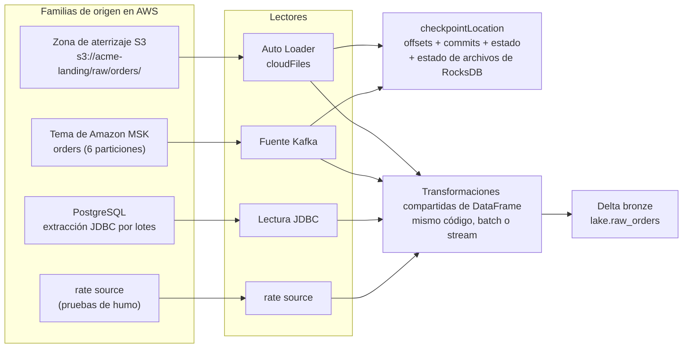
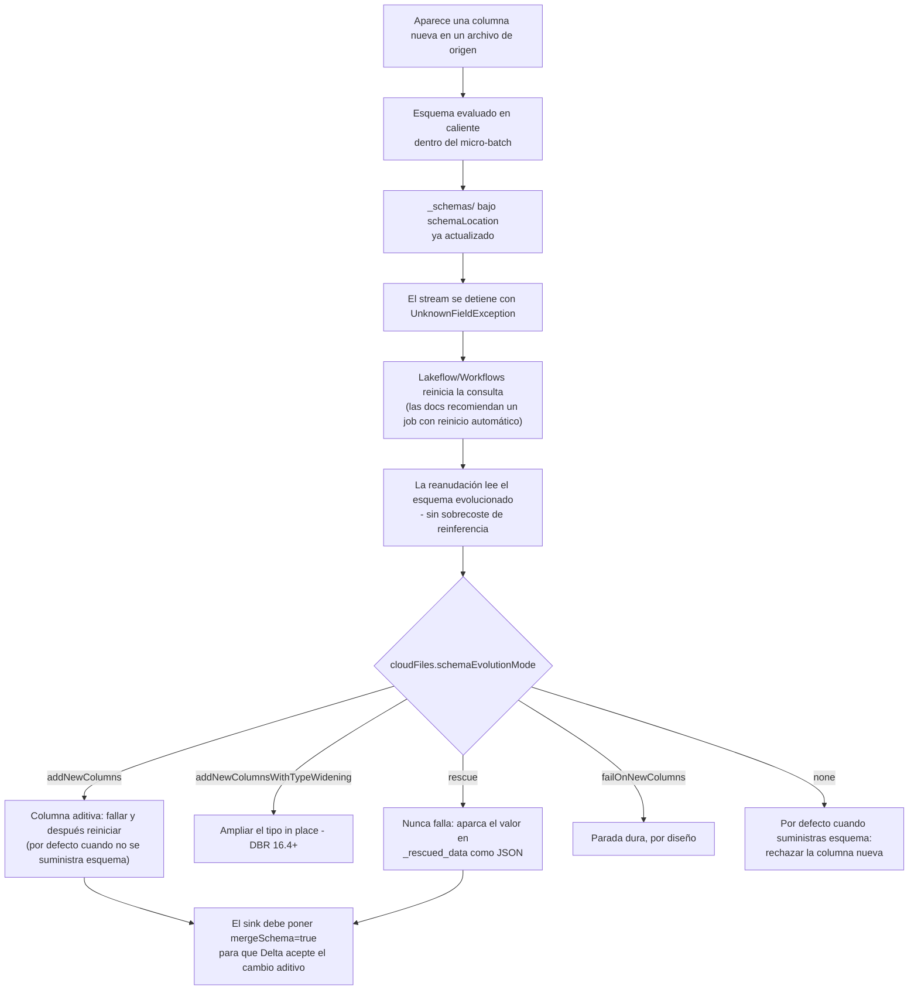
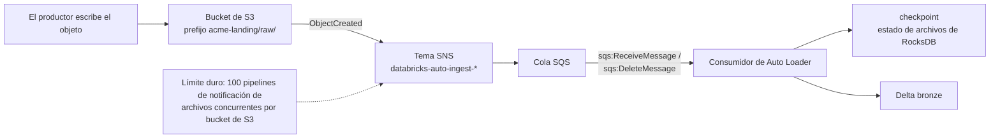
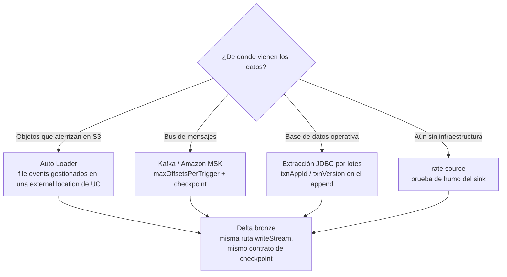
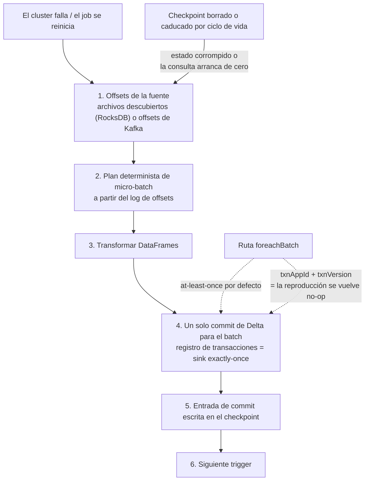

# Ingestión en AWS: Auto Loader, file events, Kafka/MSK y sinks idempotentes

Todo lo que sigue en este curso — las transacciones Delta de la lección 04, los pipelines declarativos de la lección 07, los controles de calidad de la lección 10 — asume una **tabla bronze que ya se está rellenando correctamente**. La ingesta es donde los proyectos de lakehouse fallan en silencio: un checkpoint borrado «para arreglar el retraso», un directorio de esquema aparcado dentro del prefijo de aterrizaje para que el stream descubra sus propios archivos de estado, una consulta de Kafka dejada en `startingOffsets` por defecto de modo que la primera ejecución se saltó tres horas de backlog, o un stream de listado de directorios con un trigger de un segundo cuya factura de `LIST` crece con cada hora de actividad.

La mecánica no es complicada. La recomendación de la propia Databricks es una frase: «Databricks also recommends Auto Loader whenever you use Apache Spark Structured Streaming to ingest data from cloud object storage» (docs .../auto-loader, última actualización **2026-09-11**). Lo complicado es la *higiene* — dónde vive el estado, qué pasa cuando aparece una columna, qué modo de descubrimiento se paga solo, y cómo un micro-batch reintentado evita escribir las filas dos veces. Eso es esta lección.

Todos los datos que siguen proceden de la documentación de AWS de Databricks (páginas de Auto Loader, directory-listing, file-notification, esquema, producción, clean-source, mejores prácticas, FAQ, checkpoints, output-mode, triggers, foreach, Delta streaming, Kafka y JDBC), de la documentación de Apache Spark y de AWS, y de blogs de ingeniería de Databricks fechados — todos consultados o fechados en **octubre de 2026**. El alcance de la plataforma es **Databricks sobre AWS**: Azure Event Hubs no existe sobre este sustrato y queda fuera de aquí.

```text
 =============================================================
  INGESTIÓN EN DATABRIKS/AWS - FORMA DEL PIPELINE (oct 2026)
 -------------------------------------------------------------
  Familias de origen (todas convergen en Delta bronze)
    archivos en S3    -> Auto Loader (spark.readStream "cloudFiles")
    Kafka/MSK         -> spark.readStream.format("kafka")
    BD operativa      -> extracción JDBC por lotes (no hay fuente
                         JDBC de streaming en Databricks; los
                         upserts van por foreachBatch)
    rate source       -> solo pruebas (filas timestamp + value)
  Modos de detección de archivos de Auto Loader
    listado de directorios     -> API LIST de S3 en cada trigger (POR DEFECTO)
    notificaciones de archivos -> tema SNS + cola SQS por stream
    file events gestionados    -> 1 cola por external location
                                  (DBR 14.3 LTS+, recomendado)
  Estado (dos ubicaciones, ambas duraderas, ambas sin ciclo de vida)
    checkpointLocation        -> offsets + commits + estado +
                                 estado de descubrimiento de RocksDB
    cloudFiles.schemaLocation -> historial de esquema _schemas/
                                 (las docs permiten que sea == checkpoint)
  Garantías
    descubrimiento de archivos exactly once (RocksDB en el checkpoint)
    appends de Delta exactly once  (registro de transacciones)
    foreachBatch -> at-least-once; hazlo idempotente con
                    txnAppId / txnVersion
  Triggers
    por defecto ~3-5s | processingTime | availableNow (DBR 10.4+)
    continuous -> NO soportado en Databricks (usa realTime)
  Cifras duras (docs, oct 2026)
    maxFilesPerTrigger 1000 (duro) - auto-ajustado en DBR 18.0+
    maxBytesPerTrigger blando, los archivos nunca se parten
    inferencia de esquema   primeros 50 GB o 1.000 archivos
    maxFileAge              mínimo 14 días, recomendado 90 días
    LIST de S3              $0.005 por 1.000 (misma tarifa que PUT)
    notificaciones clásicas: 100 pipelines por bucket de S3
 =============================================================
```

En esta lección vas a:

- escribir el propio **notebook bronze de Auto Loader** — `cloudFiles.format`, `schemaLocation`, `checkpointLocation`, `useManagedFileEvents`, `inferColumnTypes`, `schemaEvolutionMode`, `mergeSchema` en el sink Delta — y narrar cada valor por defecto;
- situar la **ubicación de esquema y el checkpoint** donde no puedan ser descubiertos, caducados ni compartidos, y defender esa elección frente al instinto de «poner el estado junto a los datos»;
- calcular las **tres facturas de `LIST`** para un prefijo de aterrizaje bajo tres políticas de trigger, y elegir entre **listado de directorios, notificaciones de archivos clásicas SNS+SQS y file events gestionados** con sus permisos, límites y comportamiento de backfill;
- ejecutar un **boceto de rendimiento** para un pico de 1,8 millones de archivos — tasa de llegada frente a tasa de servicio, el límite duro de archivos frente al límite blando de bytes, y qué pasa cuando alguien «con cuidado» deja `maxFilesPerTrigger` demasiado bajo;
- configurar **Amazon MSK con `AWS_MSK_IAM`**, incluidos los nombres de clase con shaded y el puerto que debe coincidir con el modo de autenticación, más la aritmética de dimensionado de `maxOffsetsPerTrigger`;
- elegir un **output mode contra la matriz de soporte de Delta**, hacer **idempotente** `foreachBatch` con `txnAppId`/`txnVersion`, y defender la cadena exactly-once de extremo a extremo;
- unificar **batch y streaming** en una sola ruta de código con `Trigger.AvailableNow`, y calcular el coste del job bronze nocturno en **DBUs a octubre de 2026**;
- estudiar **dos casos reales de clientes de AWS** (Asurion y Burberry), leer el **recuadro de actualizaciones de 2026** y practicar con **13 preguntas de estilo examen** más cuatro comprobaciones interactivas.

---

## 1. Ingestión en el lakehouse de AWS: tres familias de origen, una ruta de escritura

La ingesta sobre Databricks en AWS tiene tres familias que importan en producción, más un juguete:

| Familia | Lector | Por qué pagas | Postura exactly-once | Auth en AWS |
|---|---|---|---|---|
| **Archivos en S3** (landing zone, exportaciones DMS/Firehose, extracts de socios) | `spark.readStream.format("cloudFiles")` — Auto Loader | Descubrimiento (API `LIST` o de colas) + cómputo | Descubrimiento exactly once (RocksDB en el checkpoint); los appends de Delta son exactly once | IAM instance profile / storage credential de Unity Catalog en la external location |
| **Bus de mensajes** (Amazon MSK / Kafka autogestionado; Amazon Kinesis también es nombrada por Databricks como fuente de baja latencia) | `spark.readStream.format("kafka")` | Offsets por micro-batch (`maxOffsetsPerTrigger`) + cómputo | Kafka es at-least-once en el lado del broker; el sink Delta cierra el bucle | `SSL` / `SASL_SSL` + `AWS_MSK_IAM`, o un service credential de UC |
| **Base de datos operativa** | extracciones por lotes con `spark.read.format("jdbc")` (gobernadas por una conexión JDBC de Unity Catalog) | Escaneos completos por extracción + cómputo | Append con `txnAppId`/`txnVersion` para que las reejecuciones sean no-ops | `dbutils.secrets` o una conexión JDBC de UC — nunca credenciales en la URL |
| **rate source** (solo pruebas) | `spark.readStream.format("rate")` | Nada real | N/A | Ninguna |

Tres cosas de esa tabla son estructurales. Primero, **las cuatro convergen en la misma ruta de escritura**: `writeStream` → `checkpointLocation` → output mode → Delta. El código de transformación es idéntico para `spark.read` y `spark.readStream` porque ambos devuelven DataFrames — esa es la historia de la unificación batch/streaming de la sección 9. Segundo, **JDBC no tiene ninguna fuente de streaming documentada por Databricks**: la documentación actual describe lecturas por lotes, conexiones UC gobernadas y `foreachBatch` para las escrituras; el DML a nivel de fila sobre la base de datos de origen no está soportado explícitamente («The Spark JDBC data source does not support arbitrary DML statements», docs .../connect/jdbc-connection, consultado 2026-10). Tercero, **el checkpoint es la consulta** — bórralo y arrancas de cero: para Kafka eso significa que `startingOffsets` vuelve a aplicarse; para Auto Loader, que el estado de archivos descubiertos desapareció.



- **📚 ¿Sabías que…?** Auto Loader no es nuevo. Databricks lo anunció el **2020-02-24** como «an optimized cloud file source for Apache Spark that loads data continuously and efficiently from cloud storage as new data arrives», nombrando a Fivetran, Qlik, Infoworks, StreamSets y Syncsort como herramientas de ingesta socias en el lanzamiento (databricks.com/blog/2020/02/24/introducing-databricks-ingest-easy-data-ingestion-into-delta-lake.html, 2020-02-24). El problema que resolvió nunca cambió: «Tanto el coste como la latencia pueden sumarse rápidamente a medida que se añaden más y más archivos a un directorio debido al listado repetido de archivos.» Las cifras de escala que verás citadas — «billions of files» para backfills y «millions of files per hour» para ingesta casi en tiempo real — son **afirmaciones de capacidad del proveedor** de la página de docs (2026-09-11), no benchmarks de clientes: trátalas como margen de diseño, nunca como un SLA.

---

## 2. Anatomía de Auto Loader: la fuente `cloudFiles`

### 2.1 Las opciones que importan (oct 2026)

`spark.readStream.format("cloudFiles")` es una fuente ordinaria de Structured Streaming. Lo que lo hace Auto Loader es el motor de descubrimiento: a medida que se encuentran archivos, sus metadatos se persisten «in a scalable key-value store (RocksDB) in the *checkpoint location*», lo que «ensures that data is processed **exactly once**» (docs .../auto-loader, 2026-09-11).

| Opción | Por defecto | Qué hace en realidad |
|---|---|---|
| `cloudFiles.format` | obligatoria | Analizador: `json`, `csv`, `xml`, `parquet`, `avro`, `text`, `binaryFile` (`ORC` no está soportado para inferencia/evolución) |
| `cloudFiles.schemaLocation` | sin definir | Activa inferencia/evolución; aloja el historial de `_schemas/`. Puede ser igual al checkpoint — las docs lo dicen explícitamente |
| `cloudFiles.useManagedFileEvents` | `false` | Usa la cola de file events gestionados en una external location de Unity Catalog (DBR 14.3 LTS+) |
| `cloudFiles.inferColumnTypes` | `false` | Inferencia con tipos para JSON/CSV/XML; si no, todo aterriza como `string` |
| `cloudFiles.schemaEvolutionMode` | `addNewColumns` sin esquema, `none` con esquema suministrado | `addNewColumns` · `addNewColumnsWithTypeWidening` · `rescue` · `failOnNewColumns` · `none` |
| `cloudFiles.maxFilesPerTrigger` | `1000` (duro) | Tope de archivos por micro-batch. **DBR 18.0+ lo configura de forma dinámica — no lo fijes manualmente** |
| `cloudFiles.maxBytesPerTrigger` | sin definir (blando) | Tope de bytes como cadena (`"10g"`); un archivo nunca se parte entre micro-batches |
| `cloudFiles.includeExistingFiles` | `true` | Se evalúa **solo en el primer arranque** de un stream; cambiarlo después no tiene efecto |
| `cloudFiles.maxFileAge` | `7d` en la tabla del file source; el TTL de seguimiento de eventos de Auto Loader **mínimo 14 días, recomendado 90 días** | Demasiado bajo significa ingesta duplicada o archivos perdidos |
| `checkpointLocation` | obligatoria | Offsets, commits, estado, metadatos — más el estado de archivos de RocksDB de Auto Loader |

Dos valores por defecto sorprenden a todo el mundo. `includeExistingFiles=true` significa que el primer arranque de un checkpoint nuevo recorre todo el prefijo (eso es tu backfill). Y `maxFilesPerTrigger=1000` es un límite **duro** mientras que el límite de bytes es blando — «An individual file is never split across micro-batches» (docs .../spark/api-options, fecha de página **2026-10-05**).

### 2.2 Ejemplo resuelto E1 — un notebook bronze de Auto Loader con forma de producción

```python
BRONZE   = "lake.raw_orders"                    # Unity Catalog managed Delta table
SRC      = "s3://acme-landing/raw/orders/"      # external location, file events enabled
CKPT     = "/Volumes/lake/ops/checkpoints/orders_bronze"
SCHEMA_P = "/Volumes/lake/ops/schemas/orders_bronze"   # docs allow SCHEMA_P == CKPT

df = (spark.readStream.format("cloudFiles")
      .option("cloudFiles.format", "json")
      .option("cloudFiles.schemaLocation", SCHEMA_P)
      .option("cloudFiles.useManagedFileEvents", "true")   # DBR 14.3+; needs file events on the EL
      .option("cloudFiles.inferColumnTypes", "true")       # typed JSON instead of all-string
      .option("cloudFiles.schemaEvolutionMode", "addNewColumns")
      # .option("cloudFiles.maxFilesPerTrigger", 1000)     # omit on DBR 18.0+ (auto-tuned)
      .load(SRC))

query = (df.writeStream
      .option("checkpointLocation", CKPT)
      .option("mergeSchema", "true")            # additive change must reach the Delta table
      .trigger(availableNow=True)               # scheduled incremental batch, rate-limited
      .toTable(BRONZE))
```

Lo que significan los números mientras se ejecuta: el primer arranque muestrea **los primeros 50 GB o 1.000 archivos** (lo que se cruce primero, los más recientes por hora de modificación) para inferir el esquema; cada micro-batch posterior está limitado a **1.000 archivos** salvo que el runtime lo auto-ajuste (DBR 18.0+); `Trigger.AvailableNow` procesa solo los archivos que llegaron **antes de la hora de inicio de la consulta** y se apaga solo; y si aparece una columna nueva, la consulta se detiene con `UnknownFieldException` *después* de que `_schemas` ya se haya actualizado — así que el job, y no una persona, la reinicia (sección 3).

> [!IMPORTANT]
> **Una consulta, un checkpoint, para siempre.** «Give each query its own checkpoint directory in durable cloud storage» (docs .../structured-streaming/production, consultado 2026-10). Dos streams de Auto Loader apuntando a un mismo checkpoint corrompen el estado de archivos el uno al otro; cambiar una consulta a un checkpoint completamente nuevo la hace arrancar de cero — con `includeExistingFiles=true` reprocesará el prefijo entero. Y «Cuando borras los archivos de un directorio de checkpoint o cambias a una ubicación de checkpoint nueva, la siguiente ejecución de la consulta arranca de cero» (docs .../structured-streaming/checkpoints, fechado 2026-06-30). Nunca borres un checkpoint para «arreglar» el retraso; arregla el trigger y los límites de tasa en su lugar.

---

## 3. Inferencia, evolución y rescue de esquemas

### 3.1 Qué muestrea realmente la inferencia

En la primera definición del DataFrame, Auto Loader «lists your source directory and chooses the **most recent (by file modification time) 50 GB of data or 1000 files**, and uses those to infer your data schema» (FAQ de Auto Loader, fechado **2026-06-23**). El resultado se escribe en un directorio `_schemas` bajo `cloudFiles.schemaLocation`, y es el historial de esquema que el stream recarga en cada reinicio — «Cuando el stream se reinicia, toma el esquema evolucionado de la ubicación de esquema y comienza a ejecutarse **sin ninguna sobrecarga de la inferencia**» (misma FAQ).

Valores por defecto que muerden:

- JSON, CSV e XML infieren **todas las columnas como strings** salvo que fijes `cloudFiles.inferColumnTypes=true`. Los formatos con tipos (Parquet, Avro) fusionan en su lugar los tipos codificados.
- Si el directorio de origen está vacío, **debes suministrar un esquema** — no hay nada que muestrear.
- `cloudFiles.schemaHints` te permite fijar tipos conocidos (`"order_id=STRING, amount=DECIMAL(12,2)"`) sin escribir a mano el esquema completo.
- Las columnas de partición se infieren de rutas al estilo Hive, pero **las columnas de partición nuevas no se evolucionan** — decláralas con `cloudFiles.partitionColumns`.
- Existen overrides: `spark.databricks.cloudFiles.schemaInference.sampleSize.numBytes` (p. ej. `10gb`) y `...sampleSize.numFiles`.

### 3.2 Modos de evolución y el bucle de reinicio

La secuencia ante un cambio de esquema es fija, y vale la pena memorizarla, porque es un diseño de *alerta y reproducción* y no una corrección silenciosa:



Dos hechos de apoyo. **El lado de escritura debe estar de acuerdo**: `.option("mergeSchema", "true")` en el sink Delta, o la tabla rechaza el cambio aditivo. Y **un renombrado se trata como una adición** — el nombre nuevo se convierte en columna mientras la antigua se rellena con `NULL` en las filas nuevas (docs .../data-engineering/schema-evolution, consultado 2026-10). El esquema de una consulta de streaming está «locked in during the planning phase», así que cualquier cambio de fuente a mitad de vuelo hace fallar la consulta y obliga a reiniciar; por eso las docs recomiendan ejecutar los streams de Auto Loader como **jobs de Lakeflow/Workflows** y no como notebooks all-purpose que corren para siempre.

### 3.3 Ejemplo resuelto E2 — un stream de eventos que nunca falla con tipos fijados

```python
SRC      = "s3://acme-landing/raw/events/"
CKPT     = "/Volumes/lake/ops/checkpoints/raw_events"
SCHEMA_P = "/Volumes/lake/ops/schemas/raw_events"

df = (spark.readStream.format("cloudFiles")
      .option("cloudFiles.format", "json")
      .option("cloudFiles.schemaLocation", SCHEMA_P)
      .option("cloudFiles.inferColumnTypes", "true")
      .option("cloudFiles.schemaHints", "user_agent=STRING, device_id=STRING")
      .option("cloudFiles.schemaEvolutionMode", "rescue")   # new columns never stop the lane
      .load(SRC))

(df.writeStream
   .option("checkpointLocation", CKPT)
   .option("mergeSchema", "true")
   .trigger(availableNow=True)
   .toTable("lake.raw_events"))

# morning audit: what did we not understand yesterday?
#   SELECT * FROM lake.raw_events WHERE _rescued_data IS NOT NULL
```

`_rescued_data` guarda lo que el esquema no pudo aceptar — «column is missing from the schema / type mismatches / case mismatches» — como un blob JSON junto a la ruta del archivo de origen, y así mantienes a la vez un flujo sin pérdidas *y* una señal de calidad medible. Usa `rescue` en los flujos que nunca deben detenerse (clickstream, IoT); usa `addNewColumns` más un job con reinicio automático en los flujos donde una columna nueva es un evento que quieres *notar*.

### 3.4 ⚠️ ADVERTENCIA — nunca pongas el estado de esquema ni el checkpoint en la ruta de datos

> ⚠️ **ADVERTENCIA — `cloudFiles.schemaLocation` y `checkpointLocation` nunca deben vivir dentro del directorio de aterrizaje de origen, y tampoco bajo una política de ciclo de vida de objetos en la nube.**
> 1. **Estar en la ruta de datos significa autodescubrimiento.** Si `_schemas/` o el checkpoint viven bajo `s3://acme-landing/raw/orders/`, Auto Loader terminará listando sus propios archivos de estado como entradas. Mantén el estado en un **prefijo distinto o en un volumen de Unity Catalog** (`/Volumes/<catalog>/<schema>/checkpoints/...`), nunca bajo el directorio de datos de la tabla.
> 2. **Una regla de ciclo de vida que caduca el estado destruye la consulta.** «Databricks recommends setting the checkpoint location to a location **without a cloud object lifecycle policy**. If files in the checkpoint location are cleaned according to the policy, **the stream state is corrupted**. If this happens, you must restart the stream from scratch» (docs .../auto-loader/production, pie de página **2026-09-18**). La misma frase aplica a `schemaLocation`.
> 3. **Sepáralos por carga de trabajo.** Cada carga de trabajo de ingesta con Auto Loader requiere un checkpoint de streaming propio. Dos cargas de trabajo compartiendo un checkpoint, o un directorio `_schemas`, lucharán por el estado.
> 4. **El estado junto a una tabla Delta debe llevar prefijo de guion bajo.** Si debes colocar un checkpoint junto a una tabla, usa `/_checkpoints`: `VACUUM` «omite cualquier directorio que empiece por `_`» (docs .../structured-streaming/delta-lake, fechado 2026-08-24), así el mantenimiento no se lo comerá.
> 5. **La igualdad está bien, la contención no.** Las docs permiten explícitamente `schemaLocation == checkpointLocation`; lo que nunca permiten es estado dentro de la ruta de entrada ni bajo una caducidad.

---

## 4. Detección de archivos: listado de directorios frente a notificaciones de archivos

Auto Loader «supports two file detection modes. By default, Auto Loader uses **directory listing** mode. However, Databricks recommends **file notification mode using file events** for most workloads» (docs .../auto-loader, 2026-09-11). Elegir entre uno y otro es la decisión de coste e infraestructura de esta lección.

### 4.1 Listado de directorios (por defecto)

Cada trigger lista el árbol de entrada. Dos propiedades lo hacen viable: Auto Loader «uses native cloud APIs to get lists of files», y en S3 cada `LIST` devuelve hasta **1.000 claves**, de modo que el número de llamadas a la API escala como *archivos ÷ 1.000* y no como *directorios × triggers*. Esa es la diferencia frente al file source de OSS Spark, cuyo coste la documentación modela como «1 (base directory) + 365 (per day) × 24 (per hour) = **8761 calls**» para un layout `YYYY/MM/DD/HH` (docs .../auto-loader/directory-listing-mode, 2026-09-11).

La advertencia documentada trata de la *frecuencia*: con triggers continuos como `Trigger.ProcessingTime`, el modo de listado de directorios «continuously lists the entire directory and can significantly increase `LIST` API costs». Tres reglas de higiene:

- conserva el **nomenclatura léxica de archivos** (`YYYY/MM/DD/HH`, con ceros a la izquierda — los archivos CDC de AWS DMS como `LOAD00000001.csv` y los nombres de objetos de Kinesis Firehose son los ejemplos de las propias docs), aunque **Auto Loader no garantiza el orden en que los archivos se descubren o se procesan**;
- prefiere `Trigger.AvailableNow` a un trigger continuo en este modo;
- **el listado incremental está obsoleto**: en modo `auto` se ejecuta un listado completo de directorios tras **7 listados incrementales consecutivos** (ajustable con `cloudFiles.backfillInterval`), y DBR 11.3 LTS+ te deja cambiar la ruta de entrada *sin* un checkpoint nuevo — una capacidad **no soportada** para las notificaciones de archivos.

### 4.2 Notificaciones de archivos clásicas: SNS + SQS



En este modo Auto Loader conecta la **notificación del bucket** de S3 (`ObjectCreated`) a través de un **tema de AWS SNS** hasta una **cola de AWS SQS** (prefijo de recurso `databricks-auto-ingest`) y después consume la cola. La política de configuración necesita el conjunto de acciones documentado — `s3:GetBucketNotification`, `s3:PutBucketNotification`, `sns:CreateTopic`, `sns:Subscribe`, `sns:Publish`, `sqs:CreateQueue`, `sqs:ReceiveMessage`, `sqs:DeleteMessage`, `sqs:SendMessage`, `sqs:SetQueueAttributes`, `sqs:ChangeMessageVisibility`, `sqs:PurgeQueue` sobre `databricks-auto-ingest-*` — y una vez configurado, el stream en ejecución solo necesita la política reducida de consumo (docs .../auto-loader/file-notification-mode, pie de página **2026-10-07**). La misma página limita el patrón a **100 por bucket de S3**.

Dos reservas viajan con él. La entrega de eventos es best-effort — «Cloud providers do not guarantee 100% delivery of all file events» —, así que los SLA de completitud en el modo clásico se compran con re-listados asíncronos de `cloudFiles.backfillInterval` que ingieren **solo los archivos perdidos** (sin duplicados, porque el checkpoint ya sabe lo que vio). Y en este modo no puedes cambiar la ruta de entrada sin un checkpoint nuevo.

### 4.3 File events gestionados (recomendado)

La forma moderna se activa **en la external location**, no por stream: una sola cola de notificación de archivos para todos los streams que procesan archivos de una external location dada, activada con `cloudFiles.useManagedFileEvents=true`. Requisitos: un workspace habilitado para Unity Catalog, permiso para crear un storage credential y una external location, y **Databricks Runtime 14.3 LTS o superior** (misma página, 2026-10-07).

Lo que obtienes: menos concesiones IAM (permiso en la nube de una vez, y después ninguna cola por stream), auto-ajuste y limpieza automáticos, backfill automático — «Databricks rellena automáticamente esas external locations con un listado completo cuando los file events se activan por primera vez, y después continúa haciéndolo aproximadamente **cada 24 horas**» — y la instrucción explícita de **no** fijar un intervalo de backfill en este modo. Lo que debes respetar: «The file events service optimizes file discovery by **caching** the most recently created files. If Auto Loader runs infrequently, this cache can expire … invoke Auto Loader at least **once every seven days**.» Un job `AvailableNow` nocturno u horario pasa ese listero con holgura; una ejecución manual trimestral, no.

Cambiar de modo es seguro: «puedes cambiar entre notificaciones de archivos y listado de directorios en cualquier momento y seguir manteniendo las garantías de procesamiento de datos **exactly-once**» (misma página).

### 4.4 Ejemplo resuelto E3 — la factura de `LIST`, calculada de tres formas

Entradas (todas oficiales): S3 devuelve **1.000 claves por `LIST`**; «Las solicitudes LIST de cualquier clase de almacenamiento se facturan a la misma tarifa que las solicitudes PUT, COPY y POST de S3 Standard» — **$0.005 por cada 1.000** en `us-east-1`, mientras que DELETE y CANCEL son gratuitos (aws.amazon.com/s3/pricing, consultado **2026-10**). Prefijo de aterrizaje: **2.000.000 de archivos**. La aritmética de abajo es nuestra; las entradas son de AWS.

| Política | Ciclos de listado/día | Llamadas `LIST`/ciclo | Llamadas `LIST`/mes (30 d) | Cargo/mes |
|---|---|---|---|---|
| Layout del file source OSS `YYYY/MM/DD/HH` (el propio ejemplo 8,761 de las docs) | 1 | 8.761 | 262.830 | **$1.31** |
| Auto Loader + `Trigger.AvailableNow` cada 15 min | 96 | 2.000 | 5.760.000 | **$28.80** |
| Auto Loader + `processingTime="10 seconds"` | 8.640 | 2.000 | 518.400.000 | **$2,592** |
| Auto Loader + trigger continuo de 1 segundo | 86.400 | 2.000 | 5.184.000.000 | **$25,920** |
| **File events gestionados** (listado completo automático ≈ cada 24 h) | 1 | 2.000 | 60.000 | **$0.30** |

Lee la forma, no solo los dólares: el mismo prefijo de 2M de archivos cuesta **900× más** con un trigger de un segundo que con un `AvailableNow` de 15 minutos, porque el multiplicador es la *frecuencia* de listado — no el volumen de datos. Los file events gestionados sustituyen el listado por trigger por llamadas a la API de colas, dejando solo el listado automático de backfill de ~24 horas. Aquí deliberadamente no precio el lado SQS/SNS: las fuentes de esta lección no traen ninguna cifra verificada de precio de colas de AWS, así que comprueba tú mismo aws.amazon.com/pricing antes de modelarlo.

```plot
{
  "type": "bar",
  "title": "Cargos mensuales de LIST en S3 para un prefijo de aterrizaje de 2.000.000 de archivos (us-east-1, $0.005 por cada 1.000 solicitudes, a oct 2026)",
  "xLabel": "Política de descubrimiento",
  "yLabel": "US$ al mes en solicitudes LIST",
  "xKey": "policy",
  "dataKeys": ["usd_per_month"],
  "data": [
    {"policy": "Managed file events (~24 h backfill listing)", "usd_per_month": 0.3},
    {"policy": "Directory listing, AvailableNow every 15 min", "usd_per_month": 28.8},
    {"policy": "Directory listing, processingTime 10 s", "usd_per_month": 2592},
    {"policy": "Directory listing, 1 s continuous", "usd_per_month": 25920}
  ]
}
```

- **📚 ¿Sabías que…?** `LIST` se factura como una escritura, no como una lectura: «Las solicitudes LIST de cualquier clase de almacenamiento se facturan a la misma tarifa que las solicitudes PUT, COPY y POST de S3 Standard» — **$0.005 por 1.000** —, mientras que `DELETE` y `CANCEL` son gratuitos (aws.amazon.com/s3/pricing, consultado 2026-10). Y en S3 no existe un rename de propósito general: «S3 Express One Zone es la única clase de almacenamiento que soporta la API `RenameObject`», así que un archivo estilo MOVE es un par **copy + delete** facturado a las tarifas de PUT/COPY/LIST — y, en términos de notificaciones clásicas, esa copia aparece como aún otro evento `ObjectCreated`. Esa es una segunda razón por la que los file events gestionados, que no se disparan de nuevo con tus propias copias de contabilidad, son el modo recomendado.

---

## 5. Rendimiento e higiene en producción

### 5.1 Ejemplo resuelto E4 — un boceto de rendimiento para un pico de 1,8 millones de archivos

Escenario: un socio deja **1.800.000 archivos JSON de 120 KB** en el prefijo de aterrizaje durante una ventana nocturna de dos horas (**216 GB**), y después sigue llegando un hilo constante. Tasa de llegada = 1.800.000 ÷ 7.200 s = **250 archivos/s**.

Dimensionado de los micro-batches:

- Por defecto `maxFilesPerTrigger=1000` → cada micro-batch lleva **1.000 archivos = 120 MB**.
- Si en su lugar fijas `maxBytesPerTrigger="500mb"`, ese tope de bytes *blando* permitiría 500 MB ÷ 120 KB ≈ **4.166 archivos** — pero el **límite de archivos es duro**, así que el batch efectivo sigue en 1.000 archivos. Gana el límite que se alcance primero.
- Supón que el cluster sostiene **1,0 s por micro-batch** → tasa de servicio **1.000 archivos/s (120 MB/s)**. Utilización ρ = 250 ÷ 1.000 = **0,625** — la cola se vacía.
- El backlog de 1,8 M de archivos se drena a 1.000 − 250 = 750 archivos/s netos → **2.400 s = 40 minutos**, habiendo procesado 2,4 M de archivos en total (≈288 GB).

Ahora el modo de fallo que crea un ingeniero «cuidadoso»: dejar `maxFilesPerTrigger=100` «para no forzar el cluster», lo que limita el servicio a **100 archivos/s < 250 archivos/s de llegada** — la cola crece a 150 archivos/s sin límite, y ningún tamaño de cluster arregla un mando de control de admisión mal puesto. En **DBR 18.0+** tanto `cloudFiles.maxFilesPerTrigger` como `cloudFiles.maxBytesPerTrigger` se «configuran de forma dinámica y no es necesario fijarlos manualmente» (docs .../spark/api-options, 2026-10-05); fijarlos a mano ahí pelea contra el auto-ajuste. Y si el pico es genuinamente enorme y de una sola vez, ejecuta `Trigger.AvailableNow` como tarea de Workflows en lugar de un trigger continuo — limita la tasa entre micro-batches y se apaga cuando se pone al día.

### 5.2 Retención: `maxFileAge`, `cleanSource`, backfill

| Mando | Regla (fuente, fecha) |
|---|---|
| `cloudFiles.maxFileAge` | Mínimo **14 días**; Databricks recomienda «a conservative setting … such as **90 days**»; un ajuste demasiado agresivo causa «duplicate ingestion or missing files» (página de producción, **2026-09-18**). Este es un reloj *distinto* del filtro de descubrimiento de 7 días del file source |
| `cloudFiles.cleanSource` | **DBR 16.4+**; `OFF` (por defecto) / `MOVE` / `DELETE`; `retentionDuration` por defecto **30 días**; `DELETE` debe ser **> 7 días**; `waitForCompletion` es **DBR 19+** (página clean-source, **2026-08-21**) |
| Destino de `MOVE` | **No** debe ser hijo del directorio de origen (o los archivos se ingieren otra vez), y debe permanecer en la **misma external location**; los movimientos entre buckets no están soportados (misma página) |
| Quién puede activarlo | «Do not enable `cloudFiles.cleanSource` if multiple Auto Loader streams or other clients read from the same source directory» (best-practices, **2026-06-29**) |
| Backfill (modos clásicos) | `cloudFiles.backfillInterval` ejecuta re-listados completos asíncronos que ingieren **solo los archivos perdidos**; con file events gestionados es automático (al activarlos y unas cada 24 h) — no lo fijes ahí (página de producción, 2026-09-18; página file-notification, 2026-10-07) |

La economía de `cleanSource` es el mismo argumento de la sección 4: «Archiva los archivos procesados con `cloudFiles.cleanSource` … Esto reduce tanto los costes de almacenamiento como los costes de listado de directorios para streams de larga duración» — dejas de pagar por re-listar archivos que nunca más leerás.

### 5.3 Monitorización de la fuente

Tres métricas te dicen si la ingesta está sana *antes* de que disparen las alertas de frescor aguas abajo: `numFilesOutstanding`, `numBytesOutstanding` y (notificaciones de archivos) `approximateQueueSize` — más la tabla de estado:

```sql
-- DBR 11.3 LTS+: what does this checkpoint believe?
SELECT * FROM cloud_files_state('/Volumes/lake/ops/checkpoints/orders_bronze');
```

Un `numFilesOutstanding` creciente con una tasa de procesamiento estable significa que estás dimensionado por debajo (arregla los límites de tasa, no el checkpoint); un `approximateQueueSize` estancado en el modo clásico de notificaciones significa que el consumidor no puede vaciar la cola — permisos, o el límite de 100 por bucket.

---

## 6. Kafka y Amazon MSK como fuente

### 6.1 Las opciones que importan

Lectura mínima: `spark.readStream.format("kafka").option("kafka.bootstrap.servers", "<server:9094>").option("subscribe", "orders").option("startingOffsets", "latest").load()` — y después las cuatro opciones que deciden si tu primer día sale bien:

| Opción | Por defecto | Comportamiento |
|---|---|---|
| `startingOffsets` | **`latest`** (streaming), `earliest` (batch) | Se aplica **solo cuando arranca una consulta nueva**; «Resumed queries always use the checkpoint.» Una partición añadida recién empieza en `earliest` |
| `maxOffsetsPerTrigger` | ninguno | Máximo de registros por micro-batch, «distributed proportionally across topic partitions» — tu limitador de tasa de puesta al día |
| `minOffsetsPerTrigger` + `maxTriggerDelay` | ninguno / **`15m`** | Acumula el tráfico pequeño; cuando se alcanza `maxTriggerDelay`, el micro-batch se ejecuta igualmente |
| `failOnDataLoss` | **`true`** | Hace fallar la consulta ante topics borrados o offsets truncados en lugar de saltarse datos en silencio |

El esquema de fila es fijo, siete columnas: `key` binary, `value` binary, `topic` string, `partition` int, `offset` long, `timestamp` timestamp, `timestampType` int. La autenticación en AWS es `SSL` o `SASL_SSL` con `PLAIN`/`SCRAM`/`AWS_MSK_IAM` — o, en la ruta gobernada, un **service credential / conexión de Unity Catalog**, en cuyo caso *no* debes fijar tú `kafka.security.protocol` ni `sasl.*`. Si conduces el cliente directamente: **prefija siempre las propiedades del cliente con `kafka.`** y usa siempre los **nombres de clase con shaded** de Databricks (`kafkashaded.`, `shadedmskiam.`), o te encontrarás con `SaslException` / `RESTRICTED_STREAMING_OPTION_PERMISSION_ENFORCED`.

### 6.2 Ejemplo resuelto E5 — lectura MSK IAM con limitación de tasa

```python
kafka_opts = {
  "kafka.bootstrap.servers": "b-1.mskcluster.acme.amazonaws.com:9098",  # 9098 = IAM port
  "subscribe": "orders",
  "startingOffsets": "earliest",        # FIRST run only; the checkpoint wins from then on
  "maxOffsetsPerTrigger": 600000,       # records per micro-batch, split across 6 partitions
  "failOnDataLoss": "true",
  # Omit the next four lines when a Unity Catalog service credential governs the connection:
  "kafka.security.protocol": "SASL_SSL",
  "kafka.sasl.mechanism": "AWS_MSK_IAM",
  "kafka.sasl.jaas.config": "shadedmskiam.software.amazon.msk.auth.iam.IAMLoginModule required awsRoleArn='arn:aws:iam::123456789012:role/msk_client';",
  "kafka.sasl.client.callback.handler.class": "shadedmskiam.software.amazon.msk.auth.iam.IAMClientCallbackHandler",
}

raw = (spark.readStream.format("kafka").options(**kafka_opts).load()
        .selectExpr("cast(value as string) as json", "timestamp as ingest_ts"))
```

Aritmética de dimensionado (nuestra, sobre semánticas oficiales): la llegada pico es de **12.000 msg/s** en 6 particiones a **400 bytes** de media. Con `processingTime="30 seconds"` y `maxOffsetsPerTrigger=300000`, la capacidad es 300.000 ÷ 30 = **10.000 msg/s < 12.000 msg/s** — el backlog crece a 2.000 msg/s. Súbelo a **600.000** → 20.000 msg/s de capacidad, carga útil del micro-batch 600.000 × 400 B = **240 MB**, ρ = 0,6, estable. Dos hechos de apoyo para el runbook operativo: el rol de IAM necesita `kafka-cluster:Connect` y `kafka-cluster:ReadData`, y el puerto debe coincidir con el modo (**9092** PLAINTEXT, **9094** SASL/SSL, **9098** IAM) — más VPC peering o PrivateLink entre la VPC de Databricks y la VPC de MSK (docs .../kafka/authentication, 2026-07-10).

### 6.3 JDBC y el rate source

JDBC es una extracción por **lotes** en esta plataforma: credenciales vía `dbutils.secrets.get(scope="jdbc", key="username")` (nunca en la URL), o la ruta gobernada `.option("databricks.connection", "prod_pg")` con el JAR del driver en un Volumen; la memoria del driver está limitada a **400 MiB**, y el `externalOptionsAllowList` por defecto solo permite seis opciones de lectura. Como las escrituras a nivel de fila sobre la fuente no están soportadas, el patrón de upsert es siempre *extracción → Delta* con appends idempotentes:

```python
(df.write.format("delta").mode("append")
   .option("txnAppId", f"jdbc-pull-{run_date}").option("txnVersion", 0)
   .saveAsTable("lake.raw_orders_jdbc"))   # rerun of the same run_date is a no-op
```

El **rate source** (`spark.readStream.format("rate")`, `rowsPerSecond` por defecto 1, más `rampUpTime` y `numPartitions`) emite filas sintéticas de `timestamp` + `value` y está «intended for testing and benchmarking» — perfecto para verificar el checkpoint, el output mode y el cableado del sink Delta en dos minutos, antes de que entre en juego ningún permiso de S3 ni de MSK.



```matching
{
  "question": "Empareja cada fuente de ingesta con su propiedad principal a octubre de 2026:",
  "pairs": [
    {"left": "Archivos que aterrizan en s3://acme-landing/raw/", "right": "Auto Loader (cloudFiles): el coste de descubrimiento escala con los archivos ingeridos, no con los directorios; el estado de RocksDB en el checkpoint da descubrimiento exactly-once"},
    {"left": "Tema de Amazon MSK con 6 particiones", "right": "Fuente Kafka: maxOffsetsPerTrigger limita los registros por micro-batch, startingOffsets solo se aplica a una consulta nueva, el checkpoint manda al reanudar"},
    {"left": "Tabla PostgreSQL operativa", "right": "Extracción JDBC por lotes gobernada por una conexión JDBC de Unity Catalog; no existe fuente de streaming JDBC en Databricks, ni DML a nivel de fila sobre la fuente"},
    {"left": "spark.readStream.format('rate')", "right": "Solo pruebas: filas sintéticas de rowsPerSecond con timestamp y value - nunca una fuente de producción"},
    {"left": "Tabla Delta aguas arriba (ruta CDC preferida)", "right": "Las lecturas en streaming de una fuente Delta exigen entradas append-only; Databricks recomienda hacer streaming desde el feed CDC en lugar de directamente desde la tabla"}
  ],
  "explanation": "Cada fuente tiene un motor de coste que la gobierna y un modo de fallo que la gobierna: archivos -> frecuencia de descubrimiento e higiene de esquemas; Kafka -> control de admisión de offsets y startingOffsets en el primer arranque; JDBC -> coste de escaneo completo y manejo de credenciales; rate -> nada, es una sonda; Delta CDC -> la recomendación documentada para pipelines dirigidos por cambios (docs .../structured-streaming/delta-lake, 2026-08-24). La trampa es asumir que alguno de estos comparte la historia exactly-once de otro: solo el sink Delta cierra el bucle, y foreachBatch no."
}
```

---

## 7. Sinks: output modes, idempotencia y MERGE

### 7.1 Output modes y la matriz de Delta

| Output mode | Semántica | ¿Sink Delta? |
|---|---|---|
| **append** (por defecto) | Solo las filas que no cambiarán en triggers futuros; los operadores con estado esperan el watermark | Soportado |
| **update** | Todas las filas que cambiaron durante este trigger | **No soportado por Delta** — usa MERGE en `foreachBatch` |
| **complete** | Cada fila que el operador haya producido jamás; «can perform poorly as data scales» | Soportado (usa materialized views en casos con muchas agregaciones) |

«**Delta Lake**, which backs all Unity Catalog managed tables, **supports append and complete modes but not update mode**» (docs .../structured-streaming/output-mode, 2026-09-11). Observa también «Joins only support the append output mode». Los appends simples de Delta son exactly-once a través del registro de transacciones: «The Delta Lake transaction log guarantees exactly-once processing, even when there are other streams or batch queries running concurrently against the table» (docs .../structured-streaming/delta-lake, 2026-08-24).

### 7.2 Ejemplo resuelto E6 — upserts idempotentes en `foreachBatch`

«Debes usar `foreachBatch` para las operaciones merge de Delta Lake en Structured Streaming» — y `foreachBatch()` «provides only **at-least-once** write guarantees», así que la idempotencia es tu trabajo (docs .../structured-streaming/foreach, fechado **2026-08-24**).

```python
from delta.tables import DeltaTable

def upsert(batch_df, batch_id):
    if batch_df.isEmpty():
        return
    (DeltaTable.forName(spark, "lake.silver_orders")
       .merge(batch_df.alias("s"), "s.order_id = t.order_id")     # pruned ON clause
       .whenMatchedUpdateAll(condition="s.ingest_ts > t.ingest_ts")
       .whenNotMatchedInsertAll()
       .execute())                                                # must itself be idempotent

(silver.writeStream.format("delta")
   .option("checkpointLocation", "/Volumes/lake/ops/checkpoints/silver_orders")
   .outputMode("update")            # accepted by foreachBatch; the Delta table itself gets append/complete
   .foreachBatch(upsert)
   .trigger(processingTime="1 minute")
   .start())
```

Para los appends simples escritos desde `foreachBatch`, vincula la identidad del batch de forma explícita: `.option("txnAppId", app_id).option("txnVersion", batch_id)` — Delta «uses `txnAppId` and `txnVersion` to identify and **ignore duplicate writes**». Tres reglas de las mismas páginas: **si borras el checkpoint y reinicias, debes proporcionar un `txnAppId` distinto**, porque «New checkpoints start with a **batch ID of 0**»; **no captures ni reintentes excepciones localmente** — deja que los errores se propaguen para que el orquestador reintente el batch completo y las métricas sigan siendo honestas; y prefiere **una escritura de streaming por sink**, ya que varios sinks dentro de `foreachBatch` serializan tu paralelismo.

```dragdrop
{
  "question": "Ordena la respuesta a un incidente por cambio de esquema en el flujo bronze de Auto Loader (a oct 2026):",
  "items": [
    "Aparece una columna nueva en un archivo de origen; el micro-batch la evalúa en caliente",
    "Se actualiza _schemas bajo cloudFiles.schemaLocation y después el stream se detiene con UnknownFieldException",
    "El job de Lakeflow/Workflows reinicia la consulta (las docs recomiendan un job con reinicio automático, no una persona)",
    "El stream reanudado carga el esquema evolucionado desde schemaLocation sin sobrecoste de reinferencia",
    "El sink Delta aplica mergeSchema=true para que la columna aditiva llegue a la tabla bronze",
    "Auditoría: DESCRIBE HISTORY sobre la tabla y después revisa _rescued_data si el flujo corre con schemaEvolutionMode=rescue"
  ],
  "correctOrder": [
    "Aparece una columna nueva en un archivo de origen; el micro-batch la evalúa en caliente",
    "Se actualiza _schemas bajo cloudFiles.schemaLocation y después el stream se detiene con UnknownFieldException",
    "El job de Lakeflow/Workflows reinicia la consulta (las docs recomiendan un job con reinicio automático, no una persona)",
    "El stream reanudado carga el esquema evolucionado desde schemaLocation sin sobrecoste de reinferencia",
    "El sink Delta aplica mergeSchema=true para que la columna aditiva llegue a la tabla bronze",
    "Auditoría: DESCRIBE HISTORY sobre la tabla y después revisa _rescued_data si el flujo corre con schemaEvolutionMode=rescue"
  ],
  "explanation": "El orden documentado es: evaluar en caliente, actualizar _schemas, fallar con UnknownFieldException, el job reinicia, reanudar desde el esquema evolucionado, mergeSchema en el sink. Los dos errores clásicos son invertir los pasos 2 y 3 (la gente asume que el stream falla antes de que se escriba la ubicación de esquema; las docs dicen que se detiene después de que la ubicación de esquema se haya actualizado) y olvidar mergeSchema en el lado de escritura, lo que convierte una fuente evolucionada en un commit de Delta fallido."
}
```

---

## 8. Exactly-once de extremo a extremo

La garantía es una cadena, y cada eslabón es un componente que ya has conocido:



El contenido del checkpoint es fijo: **offsets** (lo que se leyó), **commits** (qué micro-batches llegaron al sink — «enabling exactly-once semantics»), **estado** y **metadata** (el ID único de la consulta más los ajustes de configuración). Consecuencias que deberías poder recitar:

- un checkpoint por consulta, en almacenamiento duradero, fuera de toda política de ciclo de vida;
- borrarlo o moverlo hace arrancar de cero — Kafka reproduce según `startingOffsets`, Auto Loader vuelve a listar (y a reprocesar el prefijo si `includeExistingFiles` era true en el arranque original), y las escrituras de Delta se reproducen salvo que `txnAppId` cambie;
- para destinos que no son Delta (una base de datos OLTP, una cola, una API HTTP), *tú* eres dueño de la idempotencia claveada en `batchId`: «Si el `batchId` se mantiene igual, el resultado de tu operación debe permanecer igual»;
- `foreachBatch` nunca se ejecuta en modo de procesamiento continuo, y en serverless solo se soportan `Trigger.AvailableNow()` y el obsoleto `Trigger.Once()`.

- **📚 ¿Sabías que…?** Un checkpoint almacenado *junto* a una tabla Delta solo sobrevive al mantenimiento si lo nombras con un guion bajo: `VACUUM` «omite cualquier directorio que empiece por `_`», y por eso la sugerencia de las propias docs es «a directory structure such as `/_checkpoints`» (docs .../structured-streaming/delta-lake, 2026-08-24). Es una pequeña convención de nombrado la que separa el estado de tu stream de un comando de mantenimiento rutinario.

---

## 9. Unificación de batch + streaming

Una ruta de código, dos triggers. El mismo lector bronze corre como un job incremental nocturno o como un stream de baja latencia; solo cambian trigger, checkpoint y cluster.

| Forma | Trigger | Úsalo cuando |
|---|---|---|
| Batch incremental programado | `.trigger(availableNow=True)` en una tarea de Workflows (DBR 10.4 LTS+) | Bronze nocturno/horario; quiere limitación de tasa más autoterminación; la única historia de triggers soportada en serverless junto al obsoleto `Once` |
| Micro-batch continuo | por defecto (latencia ≈**3–5 s**) o `processingTime="10 seconds"` | SLAs casi en tiempo real en cómputo clásico |
| Tiempo real | `realTime='5 minutes'` — «'5 minutes' indicates the length of a micro-batch» | Cargas de trabajo operativas sub-segundo; el detalle pertenece a la lección 13 |
| Procesamiento continuo | `continuous='1 second'` → «**Not supported.** This is an experimental feature included in Spark OSS. Use real-time mode instead.» | Nunca en Databricks |

`Trigger.AvailableNow` «processes all files that arrived **before** the query start time», que es exactamente la semántica que quiere un batch programado, y los usuarios de SQL obtienen lo mismo a través de `STREAM read_files(...)`, que a su vez usa Auto Loader para las tablas de streaming (docs .../read_files, 2026-08-03).

### 9.1 Ejemplo resuelto E7 — lo que cuesta el job bronze nocturno

Una ejecución `AvailableNow` por noche, **25 minutos** por ejecución, **30 ejecuciones/mes** → **12,5 horas-cluster/mes** en un job cluster de 4 nodos (1 driver + 3 workers). Para las emisiones usamos el nodo ilustrativo de la propia Databricks: «an instance type which runs at 3 DBU/hour … a four node jobs cluster would be charged at $2.40 ($0.2 × 3 × 4)» (blog de mejores prácticas de coste, **2022-10-18**) → **12 DBU/h**. Tarifas: **Jobs Compute $0.15/DBU** y **All-Purpose $0.55/DBU** (AWS, US, lista Premium, a oct 2026 — fuente documental: el registro de proveedor Databricks G-Cloud 15 capturado el 2026-09-25, corroborado por lecturas independientes en 2026-10; revisa siempre `system.billing.list_prices` en tu propia cuenta). Lado AWS: `m5.xlarge` a **$0.192/h** (lista de precios de EC2, leída 2026-10) × 4 nodos.

| Configuración | Coste en DBU | Coste en AWS | Total |
|---|---|---|---|
| **Job cluster** (la casa correcta para un pipeline) | 12 × 12,5 × $0.15 = **$22.50** | 4 × 12,5 × $0.192 = **$9.60** | **$32.10** |
| All-purpose cluster (mismo código, SKU equivocado) | 12 × 12,5 × $0.55 = **$82.50** | $9.60 | **$92.10** |

La versión all-purpose cuesta **3,7× la línea de DBU** — en línea con la propia regla empírica de Databricks de que los pipelines pertenecen al cómputo de jobs —, y además factura el tiempo ocioso que tendrías que gestionar tú. Los workers en spot recortan la columna de AWS hasta un 90% (el driver se queda on-demand, con aviso de expulsión de dos minutos); la columna de DBU no cambia, porque el spot altera el precio de la instancia, nunca la tarifa de emisión.

- **📚 ¿Sabías que…?** La vieja advertencia de que «el retraso de listado tras la escritura en S3 puede hacer que Auto Loader se salte archivos» es **historia**: desde el **2020-12-01** «todas las operaciones GET, PUT y LIST de S3 … ahora son **fuertemente consistentes**» (AWS News Blog, 2020-12-01), confirmado en la guía de usuario de S3 (consultada 2026-10). El riesgo de salto *actual* es la entrega de eventos — los proveedores de nube «no garantizan la entrega del 100 % de todos los eventos de archivos» —, y para eso existen `cloudFiles.backfillInterval` (modo clásico) y el backfill automático de ~24 horas (file events gestionados). Si un tutorial de 2021 te dice que construyas una solución de compromiso para la consistencia eventual de S3, puedes borrar ese párrafo.

---

## 10. Las trampas: doce confusiones que esta lección no te deja conservar

1. **«`startingOffsets=latest` está bien — es el por defecto.»** En una consulta **nueva** se salta el backlog en silencio; las consultas reanudadas usan el checkpoint de todos modos. Pon `earliest` en la primera ejecución y después confía en el checkpoint para siempre.
2. **Borrar un checkpoint para arreglar el retraso.** Arranca de cero: Kafka reproduce o se salta según `startingOffsets`, Auto Loader vuelve a listar, y Delta reproduce salvo que `txnAppId` cambie (los checkpoints nuevos reinician en el batch ID 0).
3. **Estado en la ruta de datos o bajo una regla de ciclo de vida.** Esquema/checkpoint dentro del prefijo de aterrizaje → autodescubrimiento; caducidad del ciclo de vida → «the stream state is corrupted».
4. **«`schemaLocation` y `checkpointLocation` deben diferir siempre.»** Falso — las docs permiten que sean iguales. Lo que debe diferir es *estado frente a datos*, y *un checkpoint por carga de trabajo*.
5. **Delta + `outputMode("update")`**. No soportado; usa MERGE en `foreachBatch`. Delta te da solo append y complete.
6. **Confiar en `foreachBatch` para el exactly-once.** Es at-least-once — vincula `txnAppId`/`txnVersion`, mantén el MERGE idempotente y nunca tragues excepciones localmente.
7. **Trigger continuo + modo de listado de directorios.** La explosión de coste clásica: listar el árbol entero en cada trigger. Cambia a `AvailableNow` o a file events.
8. **Fijar `maxFilesPerTrigger` en DBR 18.0+.** Ahí se configura de forma dinámica, y fijarlo a mano pelea contra el auto-ajuste; en runtimes antiguos, el valor por defecto de 1.000 archivos puede ser mucho demasiado pequeño para un backfill de varios TB.
9. **`maxFileAge` significa una sola cosa.** El file source lo usa como filtro de descubrimiento de 7 días; Auto Loader lo usa como estado de seguimiento de eventos con un **mínimo de 14 días** y una **recomendación de 90 días** — y en la primera ejecución acota hasta dónde ingeres.
10. **`cleanSource` con dos lectores.** El segundo lector no encuentra nada. Además: un destino de `MOVE` dentro de la ruta de origen causa reingesta infinita, y los movimientos entre buckets fallan con error.
11. **Clases de Kafka sin shaded o el prefijo `kafka.` ausente.** Usa `kafkashaded.` / `shadedmskiam.`, y cuando una conexión la gobierne un service credential de UC, no fijes tú `kafka.security.protocol`.
12. **«`maxOffsetsPerTrigger` se restablece en cada reinicio.»** Los controles de admisión se aplican a consultas nuevas; una consulta reanudada lee su checkpoint. Dimensionalo una vez, con intención, y vigila el retraso en lugar de re-ajustarlo tras cada incidente.

> **Veredicto comparativo — listado de directorios frente a notificaciones de archivos (a oct 2026)**
> - **Elige los file events gestionados** (una cola por external location de Unity Catalog, `cloudFiles.useManagedFileEvents=true`, DBR 14.3 LTS+) para **la mayoría de las cargas de trabajo de producción** — esa es la recomendación explícita de Databricks: «Databricks recommends file notification mode using file events for most workloads» (docs .../auto-loader/file-notification-mode, 2026-10-07). Obtienes descubrimiento dirigido por eventos sin `LIST` por trigger (E3: **$0.30/mes frente a $28.80–$25,920/mes** en el mismo prefijo de 2M de archivos), permisos de una vez en lugar de IAM por stream, backfills completos automáticos al activarlos y unos cada 24 horas, y el requisito duro de **ejecutar el stream al menos una vez cada 7 días** para que la caché de file events no caduqué.
> - **Quédate en el listado de directorios** cuando el prefijo sea pequeño y de corta vida, cuando el job sea una ejecución programada de `Trigger.AvailableNow` (96 listados/día ≈ $28.80/mes con 2M de archivos — un error de redondeo al lado del cómputo), cuando no puedas conceder `s3:GetBucketNotification` / `s3:PutBucketNotification` más los derechos de SNS/SQS, o cuando necesites **cambiar la ruta de entrada sin un checkpoint nuevo** (una capacidad exclusiva del listado de directorios). Es el por defecto precisamente porque no necesita nada más allá de acceso de lectura.
> - **Las notificaciones de archivos clásicas SNS+SQS** son el término medio heredado: dirigidas por eventos como los file events, pero con el conjunto de acciones IAM publicado, un prefijo de recurso que gobernar (`databricks-auto-ingest-*`), un límite duro de **100 pipelines por bucket de S3**, colas por stream que limpiar, entrega best-effort que exige `cloudFiles.backfillInterval` y ninguna movilidad de la ruta de entrada. Los diseños nuevos pertenecen a los file events gestionados; el modo clásico sobrevive en entornos anteriores a las external locations de Unity Catalog.
> - **La respuesta-trampa:** «las notificaciones de archivos cuestan más porque pagas por SNS y SQS.» La factura que de verdad puedes modelar — el `LIST` de S3 a $0.005 por 1.000 — escala con la *frecuencia de listado*, y las fuentes de esta lección no traen ningún precio verificado de SQS/SNS (así que no lo modeles de memoria). Decide sobre permisos, comportamiento de backfill, la regla de la caché de 7 días y el límite de 100 por bucket; trata los céntimos de solicitudes como secundarios.

---

## Casos Reales

> **📋 Caso A — Asurion (seguros y protección de dispositivos, cloud: AWS)**
> **El reto.** Un entorno heredado de 8.000 tablas, 10.000 vistas y ~600 data marts, con mapeos ETL por tabla y una capa batch/speed duplicada que no podía absorber nuevas fuentes de forma barata.
> **Stack en AWS.** Spark **Structured Streaming**, **Auto Loader** y `foreachBatch` hacia tablas Delta, ingiriendo «database CDC feeds, APIs and flat files to streams from Kinesis, Kafka, SNS and SQS», con Databricks SQL alimentando 600 data marts — un data lake de producción explícitamente «on AWS» (https://www.databricks.com/blog/2021/09/16/large-scale-etl-and-lakehouse-implementation-at-asurion.html, **2021-09-16**).
> **Resultado reportado.** «The Asurion data lake executes **4,000+ streaming jobs** and hosts over 4,000 tables in a production data lake on AWS» (https://www.databricks.com/blog/2021/05/10/aws-guide-to-data-ai-summit-featuring-disney-comcast-capital-one-and-mcdonalds.html, **2021-05-10**). En arquitectura: «an unified approach to data movement from traditional ETL to streaming data pipelines between Delta tables» (2021-09-16).
> **Cómo encaja en esta lección.** Secciones 1, 6 y 7 — con más de 4.000 streaming jobs, la arquitectura *es* un framework de ingesta parametrizado (un patrón Auto Loader / `foreachBatch`, muchos feeds), y la lista de fuentes nativas de AWS (Kinesis, SNS, SQS) es exactamente por qué importan las decisiones de sustrato de las secciones 4 y 6.
> ⏳ *Nota temporal: cifras de 2021 reportadas en su momento; revisa cualquier afirmación sobre concurrencia de workspace de ese blog contra la documentación actual antes de reutilizarla.*

> **📋 Caso B — Burberry (venta minorista de lujo, cloud: AWS)**
> **El reto.** Lotes diarios de clickstream que llegaban «anywhere between **2:00 and 7:00 PM GMT**», y un almacén en la nube que preagregaba el detalle que Customer 360 necesitaba.
> **Stack en AWS.** Databricks Data Intelligence Platform con Snowplow Behavioral Data Platform para Customer 360 en tiempo real — la página del caso lleva la propia etiqueta `Cloud: AWS` de Databricks (https://www.databricks.com/customers/burberry, página sin fecha, consultada **2026-10**).
> **Resultado reportado.** «**99% Reduction in latency** for customer clickstream data · **52x Increase in cookie duration**»; «we've broken free from daily data batches and formed an accurate real-time view of our customers' digital activity» (misma URL, consultada 2026-10; origen del caso 2023).
> **Cómo encaja en esta lección.** Secciones 4 y 9 — un SLA de latencia sobre archivos de evento es un requisito de negocio, y se cumple con descubrimiento dirigido por eventos más un trigger de baja latencia, no con un cluster más grande. El cuello de botella era la cadencia de llegada de archivos, no el cómputo.
> ⏳ *Nota temporal: una cifra con origen en 2023 que aún se muestra en 2026 — cítala como lo que Burberry reportó en su momento.*

---

### Actualizaciones de 2026 (en octubre de 2026)

> [!NOTE]
> **Qué cambió en la plataforma de ingesta de la que depende esta lección:**
> - **2026-09-11 — Auto Loader es el valor por defecto documentado.** «Databricks also recommends Auto Loader whenever you use Apache Spark Structured Streaming to ingest data from cloud object storage», y las docs de listado de directorios añaden que Databricks «recommends file notification mode using file events on external locations instead of directory listing mode for most workloads» (docs .../auto-loader y .../auto-loader/directory-listing-mode, última actualización 2026-09-11). Los tutoriales del file source de OSS son material heredado.
> - **2026-10-07 — los file events se configuran en la external location.** Una cola por external location, exigiendo DBR **14.3 LTS+** y un workspace habilitado para UC; listado completo automático al activarlos y «about every 24 hours»; ejecuta el stream «at least **once every seven days**» o la caché caduca; el modo clásico SNS+SQS está limitado a **100 pipelines por bucket de S3**; cambiar de modo en pleno stream conserva las garantías exactly-once (docs .../auto-loader/file-notification-mode, pie de página 2026-10-07).
> - **2026-10-08 — página de triggers, redacción actual.** Latencia por defecto ≈ **3–5 s**; `continuous` es «**Not supported** … Use real-time mode instead»; en serverless solo se soportan `AvailableNow`/`Once` y Databricks recomienda `Trigger.AvailableNow()`; `Trigger.Once` está obsoleto (docs .../structured-streaming/triggers, pie de página 2026-10-08).
> - **2026-10-05 — deja de ajustar a mano los límites de tasa.** En DBR 18.0+ `cloudFiles.maxFilesPerTrigger` y `cloudFiles.maxBytesPerTrigger` se «configuran de forma dinámica y no es necesario fijarlos manualmente»; en el resto siguen siendo 1.000 archivos (duro) y sin tope de bytes (blando) (docs .../spark/api-options, fecha de página 2026-10-05).
> - **2026-08-21 — la retención de la fuente es una función con nombre.** `cloudFiles.cleanSource` con `OFF` / `MOVE` / `DELETE`, retención por defecto de 30 días, `DELETE` exigiendo **más de 7 días**, `waitForCompletion` en **DBR 19+** (docs .../auto-loader/clean-source, fechado 2026-08-21).
> - **2026-09-18 — página de higiene en producción.** Los checkpoints deben estar en ubicaciones **sin una política de ciclo de vida de objetos en la nube** (si no, «the stream state is corrupted»); `maxFileAge` mínimo **14 días**, recomendado **90 días**; `Trigger.AvailableNow` procesa los archivos que llegaron antes del inicio de la consulta; inspecciona el estado con `cloud_files_state()` (DBR 11.3 LTS+) (docs .../auto-loader/production, pie de página 2026-09-18).

---

> [!SUCCESS]
> **Conclusiones Clave (Key Takeaways):**
> 1. **Auto Loader es el valor por defecto documentado** para Structured Streaming desde almacenamiento de objetos en la nube; descubre los archivos **exactly once** mediante el estado de RocksDB guardado en el checkpoint, y las docs afirman margen hasta miles de millones de archivos para backfills (declarado por el proveedor, 2026-09-11).
> 2. **Dos ubicaciones de estado, ambas sagradas.** `checkpointLocation` = offsets/commits/estado + estado de descubrimiento de archivos; `cloudFiles.schemaLocation` = historial de `_schemas/` (se permiten ubicaciones iguales). Ninguna pertenece a la ruta de datos, bajo una política de ciclo de vida, ni compartida entre cargas de trabajo.
> 3. **La evolución de esquemas es fallar y después reiniciar.** Muestrea **50 GB o 1.000 archivos** en la primera definición; una columna nueva actualiza `_schemas` y *después* detiene la consulta con `UnknownFieldException`; un job la reinicia con el esquema evolucionado; el sink Delta necesita `mergeSchema=true`. El modo `rescue` aparca los desconocidos en `_rescued_data` en lugar de fallar.
> 4. **Tres modos de descubrimiento, una recomendación.** Listado de directorios (por defecto; el coste de `LIST` escala con la *frecuencia* de listado), notificaciones clásicas SNS+SQS (100 por bucket, conjunto IAM publicado, backfill para la entrega best-effort) y **file events gestionados** (DBR 14.3 LTS+, una cola por external location, backfills automáticos de ~24 h, ejecutar al menos cada 7 días).
> 5. **Haz la cuenta de `LIST`:** 2M de archivos a $0.005/1.000 — `AvailableNow` cada 15 min ≈ **$28.80/mes**; trigger de 10 s ≈ **$2,592**; continuo de 1 s ≈ **$25,920**; file events gestionados ≈ **$0.30**. S3 es strongly consistent en GET/PUT/LIST desde el **2020-12-01** — el riesgo de hoy es la entrega de eventos, no el listado.
> 6. **El rendimiento es control de admisión.** 1.000 archivos/trigger por defecto (duro) frente a un tope de bytes blando; la tasa de servicio debe superar la tasa de llegada (E4: 1.000 archivos/s frente a 250 archivos/s → drenaje en 40 minutos; un tope de 100 archivos encola para siempre). DBR 18.0+ auto-ajusta ambos mandos.
> 7. **Kafka arranca en `latest`.** Pon `earliest` solo en la primera ejecución, acota la puesta al día con `maxOffsetsPerTrigger` (E5: 600.000 offsets por 30 s = 20.000 msg/s frente a 12.000 msg/s de llegada), mantén `failOnDataLoss=true` y usa clases `shadedmskiam.` en el puerto **9098** para MSK IAM.
> 8. **Delta rechaza el modo `update`.** Solo append y complete; los upserts van por `foreachBatch` + MERGE, que es at-least-once — vincula `txnAppId`/`txnVersion`, haz idempotente el MERGE, deja que las excepciones se propaguen, un escritor de streaming por sink.
> 9. **El exactly-once es una cadena:** estado de archivos de RocksDB → log de offsets → plan determinista → un commit de Delta → log de commits; el eslabón más débil es la higiene del checkpoint (directorio propio, duradero, sin política de ciclo de vida, nunca borrado «para arreglar el retraso»).
> 10. **Unifica batch y streaming** con `Trigger.AvailableNow` (DBR 10.4 LTS+, el trigger recomendado en serverless); pricea los pipelines como cómputo de jobs — el job bronze nocturno de E7 cuesta **$32.10/mes** en un job cluster frente a **$92.10** en all-purpose (3,7× solo en la línea de DBU).

---

## Preguntas de Práctica (Practice Questions)

```question
{
  "id": "dbl-05-q1",
  "type": "multiple-choice",
  "question": "¿Qué afirmación describe correctamente los modos de detección de archivos de Auto Loader según la documentación de octubre de 2026?",
  "options": [
    "El listado de directorios es el valor por defecto, pero Databricks recomienda el modo de notificación de archivos con file events para la mayoría de las cargas de trabajo; cambiar entre modos en pleno stream mantiene las garantías de procesamiento exactly-once",
    "El modo de notificación de archivos es el por defecto porque es más barato, y el listado de directorios debe solicitarse explícitamente con cloudFiles.useIncrementalListing",
    "Los dos modos no pueden cambiarse una vez que un stream ha arrancado: cambiar el modo obliga a un checkpoint nuevo y a una reingesta completa",
    "El listado de directorios está obsoleto y falla en prefijos con más de un millón de archivos"
  ],
  "correct": 0,
  "explanation": "Auto Loader admite dos modos de detección: «By default, Auto Loader uses directory listing mode. However, Databricks recommends file notification mode using file events for most workloads» (docs .../auto-loader, 2026-09-11), y «you can switch between file notifications and directory listing at any time and still maintain exactly-once data processing guarantees» (página file-notification, 2026-10-07). La opción B invierte el valor por defecto; la opción C contradice la regla documentada de cambio de modo; la opción D inventa un error por número de archivos que no aparece en ninguna parte: el listado escala por llamada a la API, no por rechazo."
}
```

```question
{
  "id": "dbl-05-q2",
  "type": "true-false",
  "question": "Auto Loader garantiza el orden en que los archivos se descubren y se procesan, de modo que los consumidores aguas abajo pueden confiar en el orden de llegada lexicográfico.",
  "options": ["Verdadero", "Falso"],
  "correct": 1,
  "explanation": "Falso. Las docs lo dicen directamente: «Auto Loader does not guarantee the order in which files are discovered or processed, regardless of whether you use directory listing or file notifications» (docs .../auto-loader, 2026-09-11). La nomenclatura léxica (LOAD00000001.csv de DMS, prefijos de Firehose) sigue importando para los backfills y para la depuración humana, pero cualquier diseño que necesite orden debe llevar una clave de event-time explícita - no confiar en el orden de descubrimiento."
}
```

```question
{
  "id": "dbl-05-q3",
  "type": "multiple-choice",
  "question": "Un equipo quiere guardar cloudFiles.schemaLocation y el checkpoint del stream bronze de órdenes. ¿Qué layout es correcto?",
  "options": [
    "/Volumes/lake/ops/schemas/orders_bronze y /Volumes/lake/ops/checkpoints/orders_bronze - rutas de volumen separadas, fuera de toda política de ciclo de vida, un checkpoint por carga de trabajo",
    "s3://acme-landing/raw/orders/_schemas y s3://acme-landing/raw/orders/_checkpoint - estado junto a los datos para que el stream pueda encontrarlo",
    "Ambos en s3://acme-landing/raw/orders/ pero bajo una regla de ciclo de vida de 30 días para que los archivos de estado antiguos caduquen automáticamente",
    "Un checkpoint compartido en /Volumes/lake/ops/checkpoints/shared usado por todos los streams de Auto Loader del workspace"
  ],
  "correct": 0,
  "explanation": "El estado pertenece a rutas duraderas y sin caducidad fuera del prefijo de origen: «Databricks recommends setting the checkpoint location to a location without a cloud object lifecycle policy. If files in the checkpoint location are cleaned according to the policy, the stream state is corrupted» (página de producción, 2026-09-18), y cada carga de trabajo necesita su propio checkpoint. La opción B haría que Auto Loader descubriera su propio estado; la opción C es literalmente el caso de corrupción por ciclo de vida; la opción D viola la regla de un checkpoint por consulta. Observa la trampa: las docs SÍ permiten que schemaLocation sea igual a checkpointLocation - la igualdad está bien, la contención en la ruta de datos no."
}
```

```fillblank
{
  "question": "Completa los valores por defecto de Auto Loader y de Kafka a octubre de 2026:",
  "template": "Auto Loader procesa como máximo {{1}} archivos por micro-batch por defecto (un límite duro), muestrea los primeros {{2}} GB o {{3}} archivos para inferir el esquema, exige que cloudFiles.maxFileAge sea de al menos {{4}} días con un valor recomendado de unos {{5}} días, y una consulta de streaming de Kafka recién creada usa startingOffsets {{6}} por defecto.",
  "answers": {
    "1": "1000",
    "2": "50",
    "3": "1000",
    "4": "14",
    "5": "90",
    "6": "latest"
  },
  "distractors": ["500", "10000", "10", "7", "14 días es incorrecto - 30", "30", "earliest", "100", "5", "128"],
  "explanation": "Valores por defecto directamente de las docs (oct 2026): cloudFiles.maxFilesPerTrigger = 1000 y duro (api-options, 2026-10-05); la inferencia de esquemas muestrea los primeros 50 GB o 1.000 archivos (página de esquemas, 2026-09-11); el mínimo de cloudFiles.maxFileAge es 14 días con «a conservative setting ... such as 90 days» (página de producción, 2026-09-18); startingOffsets usa «latest» por defecto en streaming y «earliest» en batch (opciones de Kafka). Las trampas: 7 días es el filtro de descubrimiento maxFileAge del file source, no el TTL de Auto Loader; «earliest» es lo que debes fijar deliberadamente en la primera ejecución, nunca el valor por defecto; 500/10.000/128 no tienen base en estas páginas."
}
```

```question
{
  "id": "dbl-05-q4",
  "type": "multiple-choice",
  "question": "Una consulta de streaming de Kafka lleva una semana en ejecución con startingOffsets en su valor por defecto. Un compañero la reinicia tras un fallo del cluster y afirma que se saltará el backlog acumulado mientras estaba caída. ¿Qué ocurre en realidad?",
  "options": [
    "No se salta nada: las consultas reanudadas siempre leen el checkpoint, y startingOffsets solo se aplica cuando una consulta arranca por primera vez",
    "La consulta se reanuda en «latest» porque ese es el valor por defecto de streaming, así que el backlog del tiempo de caída se pierde",
    "La consulta se reanuda en «earliest» automáticamente tras cualquier fallo, reproduciendo el topic entero",
    "La consulta falla con failOnDataLoss=true hasta que un ingeniero fija startingOffsets explícitamente"
  ],
  "correct": 0,
  "explanation": "Página de opciones de Kafka: en las consultas de streaming startingOffsets «only applies when a new query starts. Resumed queries always use the checkpoint.» El peligro es lo OPUESTO a lo que afirma: una consulta genuinamente nueva con el por defecto «latest» se salta en silencio todo lo que ya hay en el topic - por eso pones «earliest» en la primera ejecución. La opción C describe el borrado del checkpoint, no un reinicio; la opción D confunde el manejo de pérdida de datos (topics borrados / offsets truncados) con el comportamiento de reanudación."
}
```

```question
{
  "id": "dbl-05-q5",
  "type": "multiple-choice",
  "question": "¿Qué configuración de autenticación de Amazon MSK es correcta cuando el cluster de Databricks se autentica con un rol de IAM y no se usa ningún service credential de Unity Catalog?",
  "options": [
    "kafka.security.protocol=SASL_SSL, kafka.sasl.mechanism=AWS_MSK_IAM, kafka.sasl.jaas.config=shadedmskiam.software.amazon.msk.auth.iam.IAMLoginModule required awsRoleArn='...', kafka.sasl.client.callback.handler.class=shadedmskiam.software.amazon.msk.auth.iam.IAMClientCallbackHandler, puerto de bootstrap 9098",
    "kafka.security.protocol=SASL_SSL con mecanismo PLAIN, usando el nombre de usuario y la contraseña de administración de MSK, en el puerto 9092",
    "security.protocol=SASL_SSL y sasl.mechanism=AWS_MSK_IAM sin el prefijo kafka., usando software.amazon.msk.auth.iam.IAMLoginModule en el puerto 9094",
    "kafka.security.protocol=SSL con las clases sin shaded org.apache.kafka, en el puerto 9098"
  ],
  "correct": 0,
  "explanation": "La forma documentada de MSK IAM es SASL_SSL + AWS_MSK_IAM con los nombres de clase con shaded de Databricks (shadedmskiam.) y el puerto de IAM 9098; la propia guía de clientes de MSK de AWS lista las mismas cuatro propiedades (docs.aws.amazon.com/msk/.../configure-clients-for-iam-access-control, consultado 2026-10). La opción B inventa credenciales de MSK; la opción C omite el prefijo obligatorio «kafka.» y usa la clase upstream sin shaded, las dos causas más comunes de SaslException / RESTRICTED_STREAMING_OPTION_PERMISSION_ENFORCED; la opción D usa SSL puro (truststore), que no realiza autenticación IAM. Y cuando la conexión la gobierne un service credential de UC, NO debes fijar estas propiedades en absoluto."
}
```

```question
{
  "id": "dbl-05-q6",
  "type": "true-false",
  "question": "Una agregación de streaming puede escribirse en una tabla Delta gestionada por Unity Catalog con outputMode('update'), porque Delta sigue la semántica de actualización de la fuente.",
  "options": ["Verdadero", "Falso"],
  "correct": 1,
  "explanation": "Falso. «Delta Lake, which backs all Unity Catalog managed tables, supports append and complete modes but not update mode» (docs .../structured-streaming/output-mode, 2026-09-11). Para un comportamiento tipo update ejecutas MERGE dentro de foreachBatch - las docs lo llaman «Merge in streaming». Kafka acepta los tres modos, y por eso los estudiantes sobre-generalizan; los joins soportan solo append, sin importar el sink."
}
```

```question
{
  "id": "dbl-05-q7",
  "type": "multiple-choice",
  "question": "Un job de upsert con foreachBatch se borra y se reinicia con un checkpoint NUEVO, reutilizando el mismo txnAppId que usó la ejecución anterior. ¿Qué ocurre con las escrituras del primer batch?",
  "options": [
    "Las escrituras se ignoran en silencio: los checkpoints nuevos reinician en el batch ID 0, y Delta ve esa combinación txnAppId/txnVersion como ya confirmada",
    "Las escrituras se aplican dos veces, produciendo filas duplicadas en la tabla de destino",
    "El job falla la validación porque txnAppId debe derivarse de la ruta del checkpoint",
    "Delta asigna automáticamente un txnAppId nuevo y aplica el batch con normalidad"
  ],
  "correct": 0,
  "explanation": "docs .../structured-streaming/delta-lake (2026-08-24): Delta «uses txnAppId and txnVersion to identify and ignore duplicate writes», «If you delete the streaming checkpoint and restart the query with a new checkpoint, you must provide a different txnAppId», y «New checkpoints start with a batch ID of 0». Reutilizar el app id anterior hace que los batches reproducidos sean no-ops - la trampa de la pérdida silenciosa de datos. La opción B es lo que ocurre SIN txnAppId/txnVersion en una ruta foreachBatch at-least-once; la opción D está inventada; la opción C confunde las dos direcciones de la regla."
}
```

```question
{
  "id": "dbl-05-q8",
  "type": "multiple-choice",
  "question": "Un prefijo de aterrizaje contiene 2.000.000 de archivos y lo lee Auto Loader en modo de listado de directorios (1.000 claves por LIST, $0.005 por cada 1.000 solicitudes LIST, us-east-1, mes de 30 días). ¿Cuál es el cargo aproximado de LIST en S3 con Trigger.AvailableNow cada 15 minutos?",
  "options": [
    "Unos $28.80 al mes - 96 ciclos de listado/día × 2.000 llamadas LIST = 5.760.000 LIST/mes",
    "Unos $1.31 al mes - el ejemplo de 8.761 llamadas de las docs se aplica a todo stream de Auto Loader",
    "Unos $0.30 al mes - las notificaciones de archivos son el valor por defecto, así que no se factura ningún listado",
    "Unos $10 al mes - LIST se factura a la tarifa de GET de $0.0004 por 1.000"
  ],
  "correct": 0,
  "explanation": "2.000.000 de archivos / 1.000 claves = 2.000 llamadas LIST por ciclo completo; 96 ciclos/día × 30 días = 2.880 ciclos → 5.760.000 solicitudes LIST → × $0.005/1.000 = $28.80 (ejemplo resuelto E3; entradas de aws.amazon.com/s3/pricing, consultado 2026-10). La opción B aplica mal el ejemplo del árbol de directorios del file source OSS (8.761 llamadas) a Auto Loader; la opción C confunde el modo recomendado con el por defecto (el listado de directorios es el por defecto) - y la cifra de $0.30 pertenece a los file events gestionados; la opción D usa la tarifa de GET, pero «LIST requests ... are charged at the same rate as S3 Standard PUT, COPY, and POST requests»."
}
```

```question
{
  "id": "dbl-05-q9",
  "type": "multiple-choice",
  "question": "¿Qué conjunto enuncia correctamente los requisitos y las obligaciones de los file events gestionados?",
  "options": [
    "Workspace habilitado para Unity Catalog, permiso para crear un storage credential y una external location, DBR 14.3 LTS+, cloudFiles.useManagedFileEvents=true, y el stream debe ejecutarse al menos una vez cada siete días",
    "Cualquier workspace en cualquier runtime, cloudFiles.useNotifications=true, y un backfillInterval manual de 5 minutos",
    "DBR 11.3 LTS+, solo una instance profile (sin external location), y una cola SQS por stream",
    "Los file events gestionados no requieren permisos más allá de lectura en el bucket e imponen ninguna obligación de frecuencia de ejecución"
  ],
  "correct": 0,
  "explanation": "La página file-notification (2026-10-07) lista exactamente esto: workspace habilitado para UC, derechos de storage credential + external location, «Compute on Databricks Runtime 14.3 LTS or above», activados desde la external location más cloudFiles.useManagedFileEvents=true; y el servicio de file events guarda en caché los archivos recientes, así que «invoke Auto Loader at least once every seven days» (página de producción, 2026-09-18) o el descubrimiento vuelve a un listado completo. El useNotifications y el backfill de 5 minutos de la opción B pertenecen al modo clásico; la opción C resta requisitos al runtime e inventa colas por stream (los events gestionados son una cola por external location); la opción D ignora el permiso en la nube de una vez que la función explícitamente exige."
}
```

```question
{
  "id": "dbl-05-q10",
  "type": "multiple-choice",
  "question": "¿Qué configuración de cleanSource es segura en DBR 16.4 LTS+?",
  "options": [
    "cloudFiles.cleanSource=MOVE con moveDestination=s3://acme-archive/orders/, retentionDuration de 30 días, y un único lector del directorio de origen",
    "cloudFiles.cleanSource=DELETE con retentionDuration=3 días, porque los archivos borrados ya están en el checkpoint",
    "cloudFiles.cleanSource=MOVE con moveDestination dentro del directorio de origen s3://acme-landing/raw/orders/archive/",
    "cloudFiles.cleanSource=MOVE apuntando a un bucket de S3 distinto, con dos streams de Auto Loader leyendo el mismo prefijo"
  ],
  "correct": 0,
  "explanation": "Página clean-source (2026-08-21): el destino de MOVE «Must not be a child of the source directory» (o los archivos se ingieren otra vez), debe permanecer en la misma external location/volumen/montaje (entre buckets no está soportado), y best-practices (2026-06-29) dice «Do not enable cloudFiles.cleanSource if multiple Auto Loader streams or other clients read from the same source directory». La opción B viola el suelo duro: para DELETE «Must be greater than 7 days for DELETE». La opción C es el layout de reingesta infinita; la opción D rompe tanto la regla de misma ubicación como la de lector único."
}
```

```question
{
  "id": "dbl-05-q11",
  "type": "multiple-choice",
  "question": "Durante un pico de dos horas tu zona de aterrizaje recibe 250 archivos/s. Un cluster procesa 1.000 archivos/s con el límite de tasa por defecto, pero un ingeniero deja cloudFiles.maxFilesPerTrigger=100 para estar seguro. ¿Cuál es la evaluación correcta?",
  "options": [
    "La capacidad de servicio cae a 100 archivos/s, por debajo de la tasa de llegada de 250 archivos/s, así que el backlog crece sin límite; en DBR 18.0+ el mando se configura de forma dinámica y hay que dejarlo tranquilo",
    "El stream es más seguro porque los micro-batches más pequeños reducen el coste: las DBU se facturan por archivo, no por segundo",
    "No cambia nada: maxFilesPerTrigger solo se evalúa en el primer arranque de un stream, igual que includeExistingFiles",
    "La tasa de llegada se pausa automáticamente mientras la cola no esté vacía, así que un tope más bajo solo añade latencia"
  ],
  "correct": 0,
  "explanation": "El control de admisión fija la tasa de servicio: 100 archivos por trigger a 1 s/micro-batch = 100 archivos/s frente a 250 archivos/s que llegan significa que la cola diverge (ejemplo resuelto E4). En DBR 18.0+ tanto maxFilesPerTrigger como maxBytesPerTrigger se «configuran de forma dinámica y no es necesario fijarlos manualmente» (api-options, 2026-10-05), así que fijarlos a mano pelea contra el auto-ajuste. La opción B recuerda mal el medidor (las DBU son cómputo por hora/por segundo, no por archivo); la opción C la confunde con includeExistingFiles, que SÍ es solo del primer arranque; la opción D describe una limitación inversa que no está documentada."
}
```

```question
{
  "id": "dbl-05-q12",
  "type": "true-false",
  "question": "Debido a que Amazon S3 ofrecía históricamente consistencia eventual para las operaciones LIST, los pipelines de Auto Loader sobre S3 en 2026 aún necesitan una solución de compromiso de consistencia eventual para evitar perder archivos.",
  "options": ["Verdadero", "Falso"],
  "correct": 1,
  "explanation": "Falso - la premisa está caducada. Desde 2020-12-01 «all S3 GET, PUT, and LIST operations ... are now strongly consistent» (AWS News Blog, 2020-12-01), confirmado por la guía de usuario de S3 (consultada 2026-10). El riesgo residual actual es la entrega de eventos de archivos best-effort («Cloud providers do not guarantee 100% delivery of all file events»), que se gestiona con cloudFiles.backfillInterval en el modo clásico y con el backfill automático de ~24 horas con los file events gestionados (docs, 2026-10-07)."
}
```

```question
{
  "id": "dbl-05-q13",
  "type": "multiple-choice",
  "question": "Un job nocturno de Auto Loader usa Trigger.AvailableNow, corre 25 minutos × 30 días (12,5 horas-cluster) en un job cluster de 4 nodos que emite 3 DBU/h por nodo. Con la lista Premium de AWS (Jobs $0.15/DBU, All-Purpose $0.55/DBU, oct 2026), ¿cuál es la diferencia de coste en DBU entre ejecutarlo en cómputo de jobs frente a cómputo all-purpose?",
  "options": [
    "$60.00 al mes más en all-purpose - $82.50 frente a $22.50, la brecha documentada de 3.7x por DBU entre los SKU",
    "$9.60 al mes más, porque solo el lado de EC2 difiere entre los dos SKU",
    "$22.50 al mes en cualquier caso - las tarifas de DBU no difieren entre cómputo de jobs y all-purpose",
    "$82.50 al mes más en cómputo de jobs, porque los job clusters facturan una prima de concurrencia"
  ],
  "correct": 0,
  "explanation": "12 DBU/h × 12,5 h = 150 DBU: × $0.55 = $82.50 all-purpose frente a × $0.15 = $22.50 jobs → una brecha de $60.00, es decir 3,7× en la línea de DBU (ejemplo resuelto E7; tarifas del registro documental de oct-2026 descrito en la lección - revisa siempre system.billing.list_prices). La columna de AWS es idéntica en ambas filas ($9.60 de tiempo de m5.xlarge), y por eso la opción B es incorrecta; la opción C contradice la escalera de SKU; la opción D inventa una prima de concurrencia - el cómputo de jobs es la casa más barata y correcta para los pipelines."
}
```
